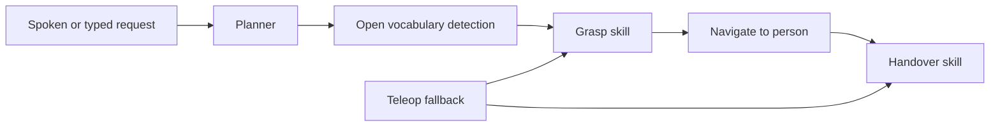
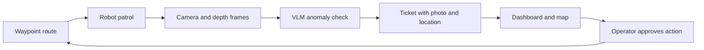
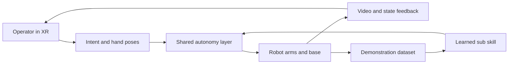
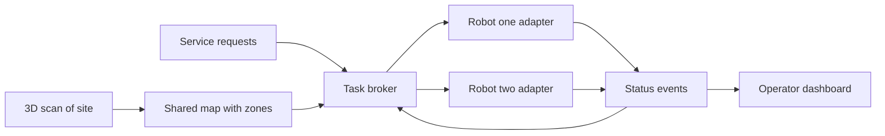

# T01 Autonomous Urban Services — Solution Patterns

[Track overview](T01-0-Track-Overview.md) · [Hardware shortlist](T01-2-Hardware-Shortlist.md) · [Cross-vendor solutions](T01-3-Cross-Vendor-Solutions.md)

**How to use this page:** pick **one** reference architecture, staff it from the building-blocks table, sanity-check it against the feasibility guide, then choose or adapt an idea from the idea bank. The architectures are the author's synthesis (interpretation); products, numbers and repositories are sourced. Legend: ● easy · ◐ stretch · ○ unrealistic · ⚠️ unverified.

## Reference architectures

| Pattern | One-line summary | Best hardware | 48 h |
|---|---|---|---|
| A Call and deliver | Order in, robot drives, handover confirmed | Wheeled dual-arm or any mobile base | ● |
| B Fetch and hand over | Find a named object, grasp, bring, give | Wheeled dual-arm, humanoid | ◐ |
| C Patrol, detect, report | Walk a route, flag anomalies, file tickets | Quadruped | ● |
| D Remote hands | XR operator does the hard step, autonomy does the rest | Humanoid or dual-arm plus XR | ● |
| E Town brain | One broker dispatches several robots on one map | Any two robots plus compute | ◐ |

### A — Call and deliver

**When to use:** indoor delivery, linen or parcel runs, porter service. Lowest risk, most legible demo. Choose it if your team is strong in ROS navigation and weak in manipulation.

- **Components:** 2D or 3D LiDAR map; Nav2 (or the vendor's built-in navigation) for goals; an LLM with a tiny tool set (`go_to`, `status`, `cancel`) to turn free text into tasks; handover confirmation by button, QR scan or weight change; dashboard with live pose and task log.
- **Main risk:** localisation drift and Wi-Fi drop-outs in a hall full of people and robots. Mitigate with a short, fixed route, on-robot navigation, and a route rehearsed at the same time of day as the demo.

### B — Fetch and hand over

**When to use:** "bring me the towel / the parcel / the water bottle" stories; tidying and litter picking. Choose it if you have someone who has done grasping before.

- **Components:** open-vocabulary detector and segmenter to find the object from a text prompt; a grasp skill that is either scripted (top-down grasp from a depth point, MoveIt 2 or vendor IK) or a learned policy (imitation or VLA fine-tune on 50 or more demonstrations — rule of thumb ⚠️ unverified); navigation as in pattern A; handover triggered by force or by a spoken "got it"; teleop as fallback and as the data-collection tool.
- **Main risk:** grasp reliability. Restrict to 2–3 object types, fix the pick location and lighting, and decide by Saturday night whether the learned skill is good enough or the scripted grasp ships.

### C — Patrol, detect, report

**When to use:** facility inspection, winter pavement patrol, bin and litter monitoring. Choose it if you got a quadruped or want a strong data and dashboard story. An agentic quadruped inspection system placed 3rd overall at Europe Embodied 2026, so this pattern is proven hackathon material.

- **Components:** waypoint following (vendor navigation or Nav2); fixed camera poses per waypoint; a fast detector for known classes plus a VLM prompt for open questions ("is this exit blocked?"); tickets stored as JSON with image, pose and severity; a web map; optional re-inspection loop.
- **Main risk:** false positives make the report useless. Plant known "defects", measure found versus planted, and show the confusion honestly. Keep VLM prompts closed-ended (yes / no plus reason).

### D — Remote hands (teleoperation with shared autonomy)

**When to use:** the task needs dexterity that autonomy cannot deliver in a weekend (opening doors, pressing lift buttons, handling varied objects), or you have a humanoid. The pitch is a small town where one remote operator serves many sites.

- **Components:** XR headset or AR glasses streaming hand and head pose; vendor teleoperation stack; an autonomy layer that takes over transit and one repeated sub-skill; logging of every teleop episode in a standard dataset format; one policy trained on that data to show the path from teleop to autonomy.
- **Main risk:** network latency and the "it is just remote control" objection. Run the control loop on the local network, and show at least one step executing autonomously with the operator's hands visibly off.

### E — Town brain (multi-robot dispatch on a shared map)

**When to use:** you have access to two different robots (see [Cross-vendor solutions](T01-3-Cross-Vendor-Solutions.md)) and a software-heavy team. High ambition score, high integration risk.

- **Components:** a LiDAR scan converted to a 2D occupancy map plus zone labels (stairs, slopes, wet area); a broker that matches tasks to robot capabilities (legs for stairs, arms for handover); thin per-robot adapters with the same four verbs (`go_to`, `do_skill`, `status`, `stop`); an item handoff point between robots; one dashboard.
- **Main risk:** two SDKs, two networks, two failure modes. Build the broker against a simulated "fake robot" first, integrate robot one fully, and add robot two only if robot one is stable by Sunday noon.

## Building blocks

All repositories below were checked on GitHub on 2026-11-14 (exist, not archived unless stated). Effort assumes one competent person and a working robot SDK.

| Capability | Open-source tools / models | Notes on effort |
|---|---|---|
| Mapping and localisation | slam_toolbox (2D LiDAR), RTAB-Map ROS (RGB-D / 3D), elevation_mapping_cupy (GPU elevation maps for legged robots) | 2D map of a hall: **1–2 h**. 3D and elevation mapping: half a day and a GPU. |
| Navigation | Nav2 (ROS 2 navigation framework); BehaviorTree.CPP for mission logic | ● on a wheeled base with a good LiDAR. Note: ROS 2 Lyrical Luth shipped in May 2026 and Nav2 for Lyrical in Aug 2026 with a breaking refactor; **use the ROS distribution on the vendor image, do not upgrade mid-event**. Many legged robots ship their own navigation — use it. |
| Manipulation planning | MoveIt 2; vendor IK and Cartesian controllers | Scripted pick from a known pose: **half a day**. Collision-aware planning in clutter: ◐. |
| Open-vocabulary perception | Ultralytics YOLO (fast, known classes; check licence terms), SAM 2 and Grounded-SAM-2 (text-prompted detection and masks) | Detection from a prompt: **1–2 h**. Grounded-SAM-2 has had no commits since Nov 2025 but works as a reference pipeline. |
| VLM scene understanding | Any hosted or local vision-language model called with closed-ended prompts | Minutes to wire up; budget time for prompt and threshold tuning with planted test cases. |
| Speech in / out | faster-whisper (speech to text), Piper (local text to speech; original repo archived in 2025, successor location ⚠️ unverified), Pipecat (real-time voice-agent framework) | Push-to-talk assistant: **2–3 h**. Open-mic in a noisy hall: ◐ — bring a directional or headset microphone. |
| LLM agents for robots | ROSA (NASA JPL; natural-language agent for ROS 1 / ROS 2), RAI (RobotecAI; vendor-agnostic agent framework on ROS 2) | Quick win for "talk to the robot" and for operator tooling. Keep the tool list tiny and add a confirmation step before motion. |
| VLA and imitation policies | LeRobot (Hugging Face; datasets, training, policies including SmolVLA and the pi0 family), openpi (Physical Intelligence), Isaac GR00T (NVIDIA; repo currently at N1.7, also reachable through LeRobot) | ◐ One skill, one object set, one camera layout. Needs a data-collection rig by Saturday evening and a GPU overnight. SmolVLA is the small option (about 450 M parameters, as reported ⚠️ unverified). |
| Teleoperation and shared autonomy | xr_teleoperate (Unitree humanoids with XR devices), Open-TeleVision (research reference, last updated 2024), LeRobot teleop and recording tools | ● if the vendor stack is supported on the robot on the bench; otherwise a day of integration. Doubles as the data source for policies. |
| Fleet and building integration | Open-RMF (multi-fleet traffic, doors, lifts) | ○ to deploy fully in 48 h; borrow its concepts (task broker, fleet adapter) for pattern E. |
| Dashboards and logging | Rerun (multimodal robotics visualisation), Foxglove SDK, rosbridge_suite (ROS to web sockets) | Live 3D view and replay: **1–2 h**. A custom web map with tickets: half a day. Record everything — replays rescue demos. |
| Digital twin | Handheld LiDAR scan exported as point cloud, flattened to an occupancy grid; annotate zones by hand | ● as a base layer; photorealistic twins and simulation transfer are ◐. |
| Edge inference | On-robot or bench GPU / edge-AI board for detection and speech; cloud for large VLM / LLM calls | Decide early what must survive a Wi-Fi outage: navigation and safety always local. |

## State of the art — who already does this

| Product or project | Organisation | What it does (reported figures) | Lesson for a 48-hour build |
|---|---|---|---|
| Pavement delivery robots | Starship Technologies | Passed **10 million** autonomous deliveries in spring 2026; about 3,000 robots, 22–23 million km, eight countries; in June 2026 announced moving 1,200+ robots from US campuses to urban grocery and hot-food routes | Scale came from a narrow operating domain plus fleet operations. Build the ops loop (order, track, confirm), not only the driving. |
| RIVR ONE wheeled-legged robot | RIVR (ETH Zurich spin-off; acquired by Amazon in March 2026, terms undisclosed) | Doorstep delivery over stairs; reported payload up to 60 kg; earlier restaurant deliveries in Zurich | The value is in the last 100 metres, not the road. Legs earn their place only where wheels fail — show the stairs. |
| Courier-assist robot trial | Swiss Post, Migros Online, RIVR | Test in Regensdorf (Aug–Sep 2025): robot accompanies the parcel carrier with heavy boxes; evaluated stair climbing and getting in and out of the vehicle; no results published | "Robot assists the worker" is the deployed reality. Demo the awkward transitions (vehicle exit, door, stairs). |
| Level-4 delivery van | LOXO and Planzer, with Swisscom connectivity (Bern) | Two-year commercial deployment from Sept 2024; reported driving without a driver behind the wheel by May 2026 (exact timing of fully driverless operation unclear across sources) | Fixed approved routes plus remote supervision. Not hackathon scope, but copy the control-room concept. |
| SmartShuttle | PostAuto (Sion, Valais) | Two 11-seat autonomous shuttles carried **21,500+** passengers in their first year (2016–17); a collision with a van's protruding tailgate grounded both for two weeks; later on-demand service in Uvrier | Acceptance grows with exposure. One perception blind spot can stop a service — test overhanging and glass obstacles. |
| Trombia Free autonomous sweeper | Trombia Technologies (Finland) | Electric autonomous street sweeper piloted in Helsinki and Espoo (2021) under human supervision; a full-service contract with Porvoo reported for 2026 (single trade source ⚠️ unverified) | Municipalities buy a supervised service bundle, not a robot. Supervised autonomy is acceptable — say so. |
| CityCat sweeper with Enway autonomy | Bucher Municipal (Swiss manufacturer) | Autonomous sweeping trialled on public roads inside a defined perimeter in Singapore | Geofence first. A small, well-defined perimeter is a feature, not a weakness. |
| Commercial cleaning robots | Pudu Robotics, Gausium and others | More than **50,000** units shipped worldwide in 2025 (Counterpoint); both vendors claim the top rank in different trackers | Floor cleaning is a product category already. Do not rebuild it; add what products lack (manipulation, reporting, multi-robot hand-offs). |
| Street-cleanliness measurement | Cortexia (pilot in Gland, Switzerland) | AI system that measures street cleanliness to steer cleaning effort (details ⚠️ unverified) | Measure, then dispatch. A sensing-and-routing project needs no manipulation and still serves "maintain the city". |
| Hackathon reference: agentic inspection | Team Arvit, Europe Embodied 2026 | Agentic inspection system on a quadruped, 3rd overall in a 48-hour event | Pattern C is achievable in a weekend and competitive. |
| Hackathon reference: see, think, act | Intel Physical AI Challenge (Zurich, Dec 2026) | Vision-based defect sorting with a low-cost SO-101 arm in 40 hours | Organisers in this ecosystem value a complete perceive-decide-act loop, even on simple hardware. |

## 48-hour feasibility guide

Wall-clock is **55 hours** (Sat 10:00 to Mon 17:00); realistic build time after kickoff, sleep, meals, robot queues and rehearsal is far less.

| Reliably works in a weekend ● | Stretch — only with prior experience ◐ | Do not attempt ○ |
|---|---|---|
| 2D map and Nav2 point-to-point on a wheeled base, flat floor | Outdoor runs on slopes, snow or stairs with a quadruped | Village-wide outdoor autonomy |
| Waypoint patrol with a quadruped's built-in navigation | One learned manipulation skill (VLA or imitation fine-tune) | Whole-body humanoid loco-manipulation from scratch |
| Text-prompted object detection and VLM yes / no checks | Reliable handover to a moving person | Training a locomotion policy and sim-to-real transfer |
| Voice or chat interface with an LLM and 3–5 tools | Pressing lift buttons or opening doors with force control | Dexterous in-hand manipulation with a multi-finger hand |
| XR teleoperation with a supported vendor stack | Two robots from different vendors in one mission | Fully autonomous multi-floor delivery including lifts |
| Scripted pick-and-place from a known pose | 3D semantic map with elevation layers | Custom hardware, grippers or electronics beyond a 3D-printed adapter |
| Web dashboard with live pose, tickets and replay | Open-microphone speech in a noisy hall | Anything requiring a permit you do not already have |

Scoping advice:

- **One robot, one route, one skill, one number.** A narrow claim demonstrated three times beats a broad concept shown once.
- **Milestones (suggested):** Sat 16:00 robot moves under your own code · Sat 23:00 ugly end-to-end run · Sun 12:00 feature freeze · Sun 20:00 fallback video recorded · Mon morning rehearsals only.
- **Get on the hardware first.** Robot time is the scarce resource with about 220 participants. Develop against recorded data or a stub when you do not hold the robot.
- **Use the vendor's strengths.** Built-in locomotion, navigation and teleop are almost always better than what you can write in a weekend. Spend your time on the service layer.
- **Design the fallback into the architecture.** Every autonomous step should have a teleop or button fallback that keeps the demo flowing; disclose it when used.
- **Decide local versus cloud early.** Navigation, safety stops and the demo-critical perception run locally; large LLM / VLM calls may use the cloud if Wi-Fi allows — test under load.
- **Measure as you go.** Log every run from Saturday evening; the success-rate slide writes itself.
- **Kill criteria:** if a learned skill is under about 60 % success by Sunday noon, ship the scripted or teleoperated version and present the policy as work in progress.

## Idea bank

| # | Idea | Hardware class | Pattern |
|---|---|---|---|
| 1 | **Towel runner** — bathrobe and towel delivery between laundry and bath entrance, ordered by QR at the lounger | Wheeled dual-arm / mobile base | A |
| 2 | **Stair porter** — quadruped carries a bag or parcel up the venue steps while following the guest | Quadruped | A |
| 3 | **Dawn ice patrol** — quadruped walks the forecourt loop, geo-tags ice and snow ridges, sends a gritting priority list | Quadruped + compute | C |
| 4 | **Bin scout** — fill-level estimation from patrol images, collection route proposed on a map | Quadruped or mobile base + compute | C |
| 5 | **Lost and found tidy-up** — robot picks left-behind items in a hall, photographs and bins them by category, posts a lost-property list | Wheeled dual-arm | B |
| 6 | **Three-language concierge** — answers visitor questions in German, French and English from a local knowledge file and walks them to the place | Humanoid or wheeled dual-arm | A |
| 7 | **Lift-button skill** — force-controlled arm finds and presses call buttons so any delivery robot can change floors | Arm / cobot | B |
| 8 | **Remote caretaker** — one XR operator supervises a robot doing a facility round and takes over only for doors and switches | Humanoid or dual-arm + XR | D |
| 9 | **Teleop to autonomy in a weekend** — collect 50+ teleop episodes of one service task, fine-tune a policy, show before and after success rates | Dual-arm or arm + XR | D |
| 10 | **Parcel locker attendant** — fixed arm sorts incoming parcels into guest lockers and hands them out on QR scan | Arm / cobot | B |
| 11 | **Relay delivery** — quadruped brings the item over stairs to a handoff shelf, wheeled robot takes it down the corridor | Quadruped + wheeled dual-arm | E |
| 12 | **Slope-aware town map** — handheld LiDAR scan turned into a map that tells each robot class where it may go | Scanner + compute | E |
| 13 | **Table reset** — robot clears cups and wipes a café table to a measurable cleanliness check | Wheeled dual-arm / cobot | B |
| 14 | **Venue night watch** — after-hours round checking doors, lights, spills and blocked exits with photo tickets | Quadruped or mobile base | C |
| 15 | **AR work orders** — AR glasses show a works-crew member the robot's findings in place, with one-tap "done" feedback closing the ticket | XR + any patrol robot | C |

## Sources

- [Europe Embodied 2026: 48-Hour Hackathon — TUM International](https://tum-international.com/europe-embodied-2026-48-hour-hackathon/)
- [Intel Physical AI Challenge | European Robotics House — Luma](https://luma.com/d3pjvggt)
- [Leukerbad Hackathon 2026 (Robotics, XR, and AI) — Luma](https://luma.com/vj13ns00)
- [Starship Technologies passes 10 million deliveries — Starship press release](https://starship.xyz/press/autonomous-delivery-moves-into-the-mainstream-as-starship-technologies-passes-10-million-deliveries/)
- [Starship Technologies surpasses 10 million autonomous deliveries — Robotics 24/7](https://www.robotics247.com/article/starship-technologies-surpasses-10-million-autonomous-deliveries/starship_technologies)
- [Starship Technologies doubles down on grocery — Starship press release](https://www.starship.xyz/press/starship-technologies-doubles-down-on-grocery/)
- [Amazon acquires robotics startup RIVR — Venturelab](https://www.venturelab.swiss/Amazon-acquires-robotics-startup-RIVR)
- [RIVR ONE delivery robot and Swiss Post — New Atlas](https://newatlas.com/robotics/rivr-one-delivery-robot-swiss-post)
- [Swiss Post tests the use of auxiliary robots for parcel delivery — SWI swissinfo.ch](https://www.swissinfo.ch/eng/research-frontiers/swiss-post-tests-the-use-of-auxiliary-robots-for-parcel-delivery/89940924)
- [LOXO and Planzer begin commercial autonomous delivery in Europe — Parcel and Postal Technology International](https://www.parcelandpostaltechnologyinternational.com/news/automation/loxo-and-planzer-begin-commercial-autonomous-delivery-in-europe.html)
- [SAAM project presentation slides (LOXO / Planzer deployment)](https://www.saam.swiss/wp-content/uploads/SAAM-Project-presentation-slides.pdf)
- [Swisscom connects highly automated delivery traffic — Swisscom](https://www.swisscom.ch/de/about/news/2025/12/09-swisscom-vernetzt-hochautomatisierten-lieferverkehr.html)
- [Initial study indicates public acceptance for self-driving buses — PostAuto](https://www.postauto.ch/en/about-us-and-news/media/press-releases/2017/initial-study-indicates-public-acceptance-for-self-driving-buses)
- [Swiss driverless buses a hit despite accident — Le News](https://lenews.ch/2017/06/30/swiss-driverless-buses-a-hit-despite-accident/)
- [Trombia Free autonomous street sweeper — New Atlas](https://newatlas.com/automotive/trombia-free-autonomous-street-sweeper)
- [Cooperation with Forum Virium helped Trombia break into international markets — Forum Virium Helsinki](https://forumvirium.fi/en/cooperation-with-forum-virium-helped-finnish-company-trombia-developer-of-the-worlds-first-autonomous-street-sweeping-robot-break-into-international-markets/)
- [Driverless sweepers (Bucher Municipal and Enway) — Transport Engineer](https://www.transportengineer.org.uk/content/features/driverless-sweepers)
- [Commercial cleaning robot market poised for rapid growth — Counterpoint Research (locale URL as returned by search)](https://counterpointresearch.com/cn/insights/commercial-cleaning-robot-market-poised-fo-rapid-growth)
- [IDC 2025: world's No.1 commercial cleaning robot supplier (vendor claim) — Gausium](https://gausium.com/news/idc-2025-worlds-no1-commercial-cleaning-robot-supplier/)
- [Gland pilots Cortexia's AI system to improve street cleanliness — Kurrant](https://kurrant.com/kurrantly-news/gland-pilots-cortexias-ai-system-to-improve-street-cleanliness/)
- [Nav2 Lyrical release: key features — Open Robotics Discourse](https://discourse.openrobotics.org/t/nav2-lyrical-release-key-features/57666)
- [ROS 2 Lyrical Luth release notes](https://docs.ros.org/en/lyrical/Releases/Release-Lyrical-Luth.html)
- [Nav2 migration guide: Kilted to Lyrical](https://docs.nav2.org/migration/Kilted.html)
- [Building generalist humanoid capabilities with Isaac GR00T N1.6 — NVIDIA Developer blog](https://developer.nvidia.com/blog/building-generalist-humanoid-capabilities-with-nvidia-isaac-GR00T-n1-6-using-a-sim-to-real-workflow)
- [navigation2 — GitHub](https://github.com/ros-navigation/navigation2)
- [slam_toolbox — GitHub](https://github.com/SteveMacenski/slam_toolbox)
- [rtabmap_ros — GitHub](https://github.com/introlab/rtabmap_ros)
- [elevation_mapping_cupy — GitHub](https://github.com/leggedrobotics/elevation_mapping_cupy)
- [BehaviorTree.CPP — GitHub](https://github.com/BehaviorTree/BehaviorTree.CPP)
- [MoveIt 2 — GitHub](https://github.com/moveit/moveit2)
- [Ultralytics YOLO — GitHub](https://github.com/ultralytics/ultralytics)
- [SAM 2 — GitHub](https://github.com/facebookresearch/sam2)
- [Grounded-SAM-2 — GitHub](https://github.com/IDEA-Research/Grounded-SAM-2)
- [faster-whisper — GitHub](https://github.com/SYSTRAN/faster-whisper)
- [Piper (archived) — GitHub](https://github.com/rhasspy/piper)
- [Pipecat — GitHub](https://github.com/pipecat-ai/pipecat)
- [ROSA — GitHub (NASA JPL)](https://github.com/nasa-jpl/rosa)
- [RAI — GitHub (RobotecAI)](https://github.com/RobotecAI/rai)
- [LeRobot — GitHub (Hugging Face)](https://github.com/huggingface/lerobot)
- [openpi — GitHub (Physical Intelligence)](https://github.com/Physical-Intelligence/openpi)
- [Isaac GR00T — GitHub (NVIDIA)](https://github.com/NVIDIA/Isaac-GR00T)
- [xr_teleoperate — GitHub (Unitree)](https://github.com/unitreerobotics/xr_teleoperate)
- [Open-TeleVision — GitHub](https://github.com/OpenTeleVision/TeleVision)
- [Open-RMF — GitHub](https://github.com/open-rmf/rmf)
- [Rerun — GitHub](https://github.com/rerun-io/rerun)
- [Foxglove SDK — GitHub](https://github.com/foxglove/foxglove-sdk)
- [rosbridge_suite — GitHub](https://github.com/RobotWebTools/rosbridge_suite)
