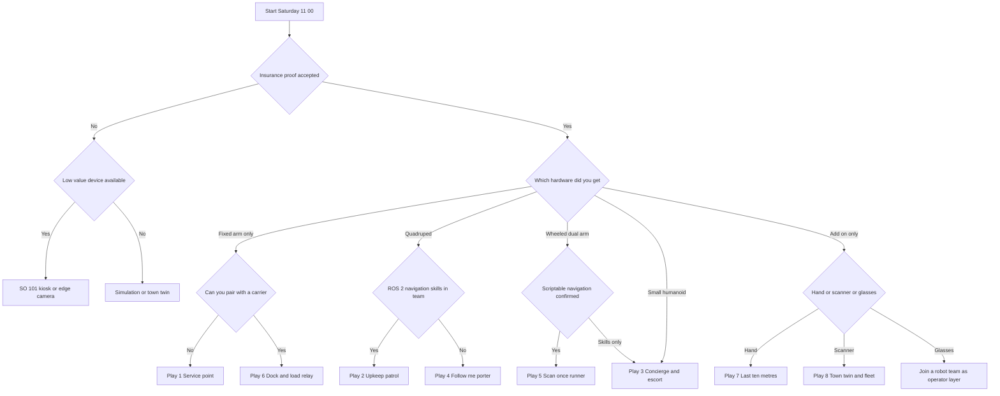

# T01 Autonomous Urban Services — Cross-Vendor Solutions

[Start here](../../00-START-HERE.md) · [Track overview](T01-0-Track-Overview.md) · [Official directions: who has what](T01-6-Official-Directions-Who-Has-What.md) · [Hardware shortlist](T01-2-Hardware-Shortlist.md) · [Solution patterns](T01-1-Solution-Patterns.md)

> **Official tagline:** Let robots become intelligent service partners of the future city.

**What this page is:** a synthesis of the 20 company briefs and playbooks into team-level plays that combine vendors. Every product claim comes from the linked company docs. **Nothing here is confirmed on site**: which models, editions and SDK versions are on the tables is unknown until you ask at the booths. Legend: ● easy / good · ◐ stretch · ○ unrealistic · ⚠️ unconfirmed on site.

**Three facts that shape every choice** (from [Event intel](../../Event/Event-Intel.md)):

- **Build window is about 47 h**: Sat 13:00 to a hard stop at **Mon 12:00**. Hardware selection is **Sat 11:00–12:00** — know your first, second and third choice before you walk in.
- **Judging:** technical quality · innovation · real-world value · **completeness**. Only the track champion reaches the final (pitch plus live robot demo).
- **No liability insurance = no personal operation of high-value robots.** You are then limited to software, simulation, digital twins or approved low-value devices (the site names the LeRobot SO-101). See [If you have no insurance or no robot](#if-you-have-no-insurance-or-no-robot).

## Choose in five minutes

- **Insurance first.** If nobody in the team has cover that explicitly includes borrowed third-party equipment, go straight to the no-robot section. Ask at kickoff whether a vendor technician may operate the robot for you — the rules say some devices need one present, but do not promise this ⚠️.
- **Fixed arm only** (Dobot, ROKAE, Flexiv): the most reliable demo on the floor. Make the *service point* the hero (Play 1), or upgrade it into a loading dock for someone else's carrier (Play 6).
- **Quadruped** (Unitree Go2 EDU, Magiclab MagicDog EDU, Genisom, AGIBOT D1): with ROS 2 navigation skills in the team, run a waypoint patrol or courier (Play 2). Without them, use person-following, which needs no map (Play 4).
- **Wheeled dual-arm** (Galbot G1, Spirit AI Moz1, Galaxea R1, UniX AI Wanda): if you can send navigation goals from your own code, do delivery with hand-over (Play 5). If the vendor only exposes pre-loaded skills, put your effort into the language and service layer (Play 3).
- **Add-on only** (XREAL, SKYLANDX, D-Robotics, WUJI, Leadshine, OriginFlow, Omnicor, Binabik, coprod): none of these moves through a building alone. Secure a robot partner by **Sat 19:00 (H6)** or switch to the no-robot path.
- **Check the edition before anything else.** Programmable: Unitree **Go2 EDU** (not Air / Pro), Magiclab **MagicDog EDU** (not PRO), AGIBOT **X2 Ultra** for navigation (not Edu), Genisom **L1 EDU** or L2. A wrong edition ends the play in the first hour.

## Team plays — the strongest solutions for this track

Ordered from most reliable to most ambitious. Hours count from Sat 13:00 (H0) to Mon 12:00 (H47).

| # | Play | Core hardware | Pattern | Demo reliability |
|---|---|---|---|---|
| 1 | Alpine Service Point | Fixed cobot + edge board | B | ● |
| 2 | Dorf-Check upkeep patrol | Quadruped + scanner + glasses | C | ● |
| 3 | Three-language concierge and escort | Humanoid or wheeled dual-arm + edge voice | A | ● |
| 4 | Follow-me porter with autonomous return | Quadruped + edge board | A | ● / ◐ |
| 5 | Scan-once room-service runner | Wheeled dual-arm + scanner | A + B | ◐ |
| 6 | Dock-and-load relay | Fixed arm + quadruped | E | ◐ |
| 7 | Retrofit-free last ten metres | Force arm + dexterous hand + glove | D | ◐ |
| 8 | Step-free town twin with mixed-fleet dispatcher | Scanner + two robots + glasses | E | ◐ / ○ |

Patterns A–E are defined in [Solution patterns](T01-1-Solution-Patterns.md).

### Play 1 — Alpine Service Point

- **Official direction(s) served:** T01.3 public-space service · T01.5 guidance and information · T01.7 human-robot interaction
- **Problem → value in Leukerbad:** about 2,000 guests on an average night against 1,329 residents; counters close in the evening. An unattended point hands out pre-ordered items (spa kit, rental key, pharmacy parcel, lift pass) at any hour and answers questions in German, French and English.
- **Hardware:**
  - Arm, pick one: **Dobot Nova 2 / Nova 5 or Magician E6** (one TCP/IP API, fastest to get moving) — [Dobot playbook](../../Companies/Dobot/T01-Autonomous-Urban-Services/Dobot-T01-3-Playbook.md) · **ROKAE xMate SR5 / CR7** (Cartesian impedance hand-over) — [ROKAE playbook](../../Companies/ROKAE/T01-Autonomous-Urban-Services/ROKAE-T01-3-Playbook.md) · **Flexiv Rizon 4 + Grav** (force sensing, IP65) — [Flexiv playbook](../../Companies/Flexiv/T01-Autonomous-Urban-Services/Flexiv-T01-3-Playbook.md)
  - **D-Robotics RDK X5** + camera for on-device detection and voice — [D-Robotics playbook](../../Companies/D-Robotics/T01-Autonomous-Urban-Services/D-Robotics-T01-3-Playbook.md)
  - Optional: **XREAL** glasses as a remote operator view ("one operator, many kiosks") — [XREAL playbook](../../Companies/XREAL/T01-Autonomous-Urban-Services/XREAL-T01-3-Playbook.md)
- **Software stack:**
  - Order page (QR code) + speech-to-text + LLM with a small local facts file; cloud only for the LLM.
  - Perception: fiducial tags on bins first, open-vocabulary detection second (`hobot_dosod` on the RDK X5, or a detector on the laptop).
  - Control: Dobot `TCP-IP-Python-V4` or `DOBOT_6Axis_ROS2_V4` (Humble, MoveIt) · ROKAE `xCoreSDK` Python or `rokae_ros2` (Humble, MoveIt 2) · Flexiv Python RDK in non-real-time mode.
  - Hand-over: release when the guest pulls — ROKAE via Cartesian impedance, Flexiv via force sensing. On Dobot use a camera "item taken" check.
  - Compute: one laptop at the cell; RDK X5 if you want no laptop in the kiosk.
- **Why it can win:**
  - Technical quality: 20 uninterrupted cycles with a measured success rate and one deliberate recovery (misplaced item).
  - Innovation: modest alone; raise it with force-aware hand-over and a multilingual, grounded dialogue.
  - Real-world value: both Dobot and ROKAE already run arms in unmanned retail and catering kiosks, so the deployment path is credible.
  - Completeness: order → pick → hand over → log, all working by Saturday night; the rest is polish.
- **48-hour outline:**
  - H0–6: confirm firmware (Dobot V4.4+, ROKAE xCore v3.2.1+, Flexiv RDK licence and version), hello-world, teach three poses, mount camera.
  - H6–24: tag-based picking of 3–5 items, order page, hand-over with "item taken" check.
  - H24–40: one learned detection, voice in three languages, error recovery, usage dashboard.
  - H40–47: freeze, 10+ rehearsal runs, backup video.
- **Main risk and fallback:** it can look like a factory cell. Mitigate by telling the city story explicitly (24/7, unattended, local items) and by showing a hand-off to a carrier if another team lends one for a minute. No gripper supplied → suction cup, hook tool with hang-tag items, or ask Flexiv about the Grav gripper. Detection unreliable → keep the tags.
- **Team profile it suits:** 2–4 people, Python, one vision person, no navigation experience needed. Good for a team formed on site.

### Play 2 — Dorf-Check upkeep patrol

- **Official direction(s) served:** T01.4 urban inspection · T01.2 cleaning and facility maintenance · T01.6 navigation
- **Problem → value in Leukerbad:** municipal services are sized for 1,300 residents but serve far more guests; 1,188 mm of precipitation with a December peak makes paths a daily issue. A robot walks a fixed round and files geo-tagged tickets (full bin, blocked path, spill, "ice" mat) for the works crew, who close them on a phone or in glasses.
- **Hardware:**
  - Quadruped, pick one: **Unitree Go2 EDU** — [Unitree playbook](../../Companies/Unitree/T01-Autonomous-Urban-Services/Unitree-T01-3-Playbook.md) · **Magiclab MagicDog EDU** (built-in SLAM and goal navigation) — [Magiclab playbook](../../Companies/Magiclab/T01-Autonomous-Urban-Services/Magiclab-T01-3-Playbook.md) · **Genisom L1 EDU / L2** — [Genisom playbook](../../Companies/Genisom-AI/T01-Autonomous-Urban-Services/Genisom-AI-T01-3-Playbook.md)
  - **SKYLANDX MetaCam Air 2**: one scan as the twin the tickets are pinned on, plus optional 3D change detection — [SKYLANDX playbook](../../Companies/SKYLANDX/T01-Autonomous-Urban-Services/SKYLANDX-T01-3-Playbook.md)
  - **D-Robotics RDK X5** for on-robot detection without Wi-Fi — [D-Robotics playbook](../../Companies/D-Robotics/T01-Autonomous-Urban-Services/D-Robotics-T01-3-Playbook.md)
  - **XREAL One series** as the crew's hands-free ticket view — [XREAL playbook](../../Companies/XREAL/T01-Autonomous-Urban-Services/XREAL-T01-3-Playbook.md)
- **Software stack:**
  - Navigation: MagicDog `/goal_pose` waypoints (or the Python SDK navigation calls — the ROS 2 package is frozen on Foxy) · Unitree: no first-party navigation stack, so `slam_toolbox` + Nav2, with the community `go2_ros2_sdk` as a shortcut · Genisom: RoamerX on the robot or RoamerX Lite (Humble, Nav2).
  - Perception: fixed camera pose per checkpoint → fast detector for known classes (`mono2d_trash_detection`, `hobot_dosod` on the RDK) + a VLM with **closed-ended** prompts for open questions.
  - Data product: ticket as JSON (photo, class, map pose, severity) → web map → "resolved" workflow. Optional Open3D cloud-to-cloud diff between a reference scan and today's scan.
  - Compute: navigation on the robot; detection on the RDK X5 or laptop; VLM in the cloud only if Wi-Fi holds.
- **Why it can win:**
  - Technical quality: found versus planted (plant 5, find 5), false alarms shown honestly.
  - Innovation: the loop closes — the crew resolves a ticket and the next lap verifies it; 3D differencing instead of cameras alone.
  - Real-world value: fewer inspection walks for a small works crew; winter-safety angle for older guests.
  - Completeness: robot, perception, dashboard and human workflow in one demo. An agentic quadruped inspection system placed 3rd at Europe Embodied 2026, so the pattern is proven.
- **48-hour outline:**
  - H0–6: edition check, teleop, scan the loop with the MetaCam, pick 6–8 checkpoints and 3–4 issue types you can stage.
  - H6–24: unattended patrol loop, image capture, detector + VLM prompt and JSON schema, dashboard.
  - H24–40: staged faults, false-positive tuning, duplicate suppression, glasses or phone view, optional change detection.
  - H40–47: repeat runs, metrics slide, backup video.
- **Main risk and fallback:** navigation is not ready → walk the round under teleoperation and keep perception and ticketing autonomous (say so). VLM slow or offline → fixed-class local detector. Outdoor run not allowed or too wet (MagicDog has no IP rating, MetaCam Air 2 is IP5X) → indoor mock street. Keep the story on **maintenance service**, not security, to stay out of T02.
- **Team profile it suits:** 3–5 people; one ROS 2 navigation person, one perception person, one web / dashboard person.

### Play 3 — Three-language concierge and escort

- **Official direction(s) served:** T01.5 guidance and information · T01.3 public-space service · T01.7 human-robot interaction
- **Problem → value in Leukerbad:** a German-speaking village with international, often elderly guests; information desks close early. The robot answers "where / when / how" from a local knowledge file and, where navigation allows, walks the guest there at their pace. The organisers' own KPIs for the tourist centre are query resolution and multilingual performance — reuse them.
- **Hardware:**
  - Body, pick one: **AGIBOT X2** (stationary concierge on any X2; escort only on **X2 Ultra** with the navigation module enabled ⚠️) — [AGIBOT playbook](../../Companies/AGIBOT/T01-Autonomous-Urban-Services/AGIBOT-T01-3-Playbook.md) · **Galbot G1** (SDK navigation, welcome / guide kit on the developer portal) — [Galbot playbook](../../Companies/Galbot/T01-Autonomous-Urban-Services/Galbot-T01-3-Playbook.md) · **UniX AI Wanda 2.0** (pre-loaded reception and guiding skills, no public SDK) — [UniX AI playbook](../../Companies/UniX-AI/T01-Autonomous-Urban-Services/UniX-AI-T01-3-Playbook.md) · **Magiclab MagicDog EDU** (microphone array, TTS, goal navigation) — [Magiclab playbook](../../Companies/Magiclab/T01-Autonomous-Urban-Services/Magiclab-T01-3-Playbook.md)
  - **D-Robotics RDK S100 / X5** for offline speech and a small VLM — [D-Robotics playbook](../../Companies/D-Robotics/T01-Autonomous-Urban-Services/D-Robotics-T01-3-Playbook.md) · or **Omnicor AI** on-device inference if their team can port your model (no public SDK ⚠️) — [Omnicor playbook](../../Companies/Omnicor-AI/T01-Autonomous-Urban-Services/Omnicor-AI-T01-3-Playbook.md)
  - Optional: **XREAL** glasses as staff supervision view.
- **Software stack:**
  - Speech in → LLM with three tools (`answer`, `guide_to(place)`, `call_human`) grounded in a small Leukerbad facts file → vendor navigation → speech out.
  - AGIBOT: AimDK_X2 ROS 2 services (TTS, microphone, preset motions, navigation task); the public AgentSDK hospital-triage sample is a template but needs AGIBOT credentials. Galbot: `navigate_to_goal` after a map is built. UniX: whatever skill hook the engineers expose.
  - Offline path: `sensevoice_ros2` (speech recognition) + `hobot_tts` + `hobot_llamacpp` on the RDK. Language coverage for German and French is ⚠️ unverified — test on day 1.
  - Pace control: check the guest is still behind (camera or timed check-ins); stop and prompt.
  - Compute: laptop on the robot's network; cloud LLM only with a local fallback.
- **Why it can win:**
  - Technical quality: grounded answers (no invented opening hours), response latency measured, escalation to a human for out-of-scope questions.
  - Innovation: pace-adaptive escort, and an "unplug the network" moment on stage.
  - Real-world value: AGIBOT guiding robots already work at Guangzhou Metro and Chimelong; Galbot runs 170+ kiosks. The use case is commercially real.
  - Completeness: the stationary version is done by Saturday night; escort is an upgrade, not a dependency.
- **48-hour outline:**
  - H0–6: confirm variant, firmware and navigation access; run TTS / microphone examples; draft the knowledge file in DE / FR / EN.
  - H6–24: voice loop end to end; named places; first "take me to X".
  - H24–40: noise robustness (push-to-talk), language switching, pace logic, offline mode.
  - H40–47: fix three reliable interactions, rehearse with a non-team guest, backup video.
- **Main risk and fallback:** hall noise → push-to-talk, directional microphone, or a QR phone page. Navigation module not enabled → stationary concierge that points and hands a QR route to the phone. Vendor access is "staff presses the button" (UniX level A) → keep your language layer as the visible contribution and say what is vendor skill.
- **Team profile it suits:** 2–4 people; LLM / speech skills, one person for the robot SDK. Strong for teams with language and UX talent and little robotics experience.

### Play 4 — Follow-me porter with autonomous return

- **Official direction(s) served:** T01.1 delivery and urban logistics · T01.7 human-robot interaction · T01.6 navigation
- **Problem → value in Leukerbad:** guests arrive by road only and then carry luggage up steep lanes and steps; hotel carts cannot take stairs. A legged robot follows the guest with the bag, then walks home alone.
- **Hardware:**
  - Quadruped, pick one: **Genisom L2** (16 kg payload, IP66, GLUE following built in — whether it is controllable by API is ⚠️) — [Genisom playbook](../../Companies/Genisom-AI/T01-Autonomous-Urban-Services/Genisom-AI-T01-3-Playbook.md) · **Unitree Go2 EDU** (bag up to about 7 kg) — [Unitree playbook](../../Companies/Unitree/T01-Autonomous-Urban-Services/Unitree-T01-3-Playbook.md) · **Magiclab MagicDog EDU** (5 kg, tracking mode) — [Magiclab playbook](../../Companies/Magiclab/T01-Autonomous-Urban-Services/Magiclab-T01-3-Playbook.md) · **AGIBOT D1 Ultra** (5 kg, IP54, velocity commands only) — [AGIBOT playbook](../../Companies/AGIBOT/T01-Autonomous-Urban-Services/AGIBOT-T01-3-Playbook.md)
  - **D-Robotics RDK X5** + camera (stereo if available) as the follow brain — [D-Robotics playbook](../../Companies/D-Robotics/T01-Autonomous-Urban-Services/D-Robotics-T01-3-Playbook.md)
  - Optional: **OriginFlow Band** as a gloved-hand "follow / stop / go home" input — only if the booth gives a live data stream (no public SDK ⚠️) — [OriginFlow brief](../../Companies/OriginFlow/T01-Autonomous-Urban-Services/OriginFlow-T01-1-Brief.md)
- **Software stack:**
  - `body_tracking` + `reid` on the RDK X5 publish `/cmd_vel`; a safety node stops on lost target and holds a minimum distance from `hobot_stereonet` depth.
  - One bridge node from `/cmd_vel` to the base: Unitree high-level sport API · Genisom `MoveVelocity` (C++ over UDP, no ROS 2 driver — you write the bridge) · AGIBOT D1 `move(vx, vy, yaw_rate)`. Match ROS 2 distro, `ROS_DOMAIN_ID` and RMW between the RDK and the robot.
  - Return: Nav2 goal to "home" in a pre-built map, or breadcrumb replay of the outbound path.
  - Start / stop by command words (`sensevoice_ros2`) or two buttons on a phone page.
  - Compute: perception on the RDK; locomotion stays on the robot's own controller.
- **Why it can win:**
  - Technical quality: re-identification keeps the lock when a second person crosses; depth-based stop distance; all on a 10 TOPS board.
  - Innovation: medium — pace adaptation and the autonomous return are the new bits.
  - Real-world value: accessibility and staff strain in a steep spa town; the cost-per-trip line is easy to write.
  - Completeness: following needs no map, so a full loop works early.
- **48-hour outline:**
  - H0–6: run `body_tracking` on the bench; get the base moving from a velocity command; build the rack.
  - H6–24: bridge with speed limits and dead-man stop; first corridor follow; map the route.
  - H24–40: re-ID, stop distance, lost-target behaviour, autonomous return, stairs or ramp segment.
  - H40–47: suitcase payload test, 10 rehearsals with a volunteer, backup video.
- **Main risk and fallback:** base SDK access denied or slow → follow with a coloured vest or AprilTag on the guest, or use the vendor's own follow mode and keep your work on return and UI. Re-ID unstable → single-person tracking in a taped lane. Rack makes the robot unstable → lighter bag, lower mount, slower gait.
- **Team profile it suits:** 3–4 people; one embedded / ROS 2 person for the bridge, one perception person. Works without a navigation expert.

### Play 5 — Scan-once room-service runner

- **Official direction(s) served:** T01.1 delivery and urban logistics · T01.6 navigation and path planning · T01.3 public-space service
- **Problem → value in Leukerbad:** hotels and rehabilitation clinics move towels, water, parcels and therapy aids along corridors all day, and small operators cannot afford a robot integrator. One short scanner walk prepares the site; a wheeled dual-arm robot then picks an item, drives it to a door and hands it over. Headline number: **minutes from scan to first delivery**.
- **Hardware:**
  - Robot, pick one: **Galbot G1** (SDK mapping, point-to-point navigation, arm planning, wrist force / torque) — [Galbot playbook](../../Companies/Galbot/T01-Autonomous-Urban-Services/Galbot-T01-3-Playbook.md) · **Spirit AI Moz1** (documented LiDAR navigation, Python SDK; indoor only, IP40) — [Spirit AI playbook](../../Companies/Spirit-AI/T01-Autonomous-Urban-Services/Spirit-AI-T01-3-Playbook.md) · **Galaxea R1 Pro / R1 Lite** (navigation stack ⚠️ not publicly documented) — [Galaxea playbook](../../Companies/Galaxea/T01-Autonomous-Urban-Services/Galaxea-T01-3-Playbook.md) · **UniX AI Wanda 2.0** (skill hook only) — [UniX AI playbook](../../Companies/UniX-AI/T01-Autonomous-Urban-Services/UniX-AI-T01-3-Playbook.md)
  - **SKYLANDX MetaCam Air 2** for the site scan — [SKYLANDX playbook](../../Companies/SKYLANDX/T01-Autonomous-Urban-Services/SKYLANDX-T01-3-Playbook.md)
  - Optional: **D-Robotics RDK X5** as a shelf camera that verifies the right item was taken · **XREAL** supervisor view.
- **Software stack:**
  - Scan → MetaCam Studio (Windows) → PCD / PLY export → Open3D: crop a height band, project to a 2D occupancy grid, mark no-go zones by hand.
  - **Be honest about the map:** whether the robot accepts an external map is ⚠️ unconfirmed (Galbot: not documented; Moz1: its relocaliser reads .ply / .pcd, usability unverified). Default plan: the robot builds its own map, and the scan is the operator's planning view and dashboard twin, aligned by three landmarks.
  - Galbot: `navigate_to_goal`, `motion_plan`; the SDK and firmware must match (SDK 1.10.x with GBS 1.18.x); there is no ROS 2 runtime bridge. Moz1: ROS navigation service with a pose sequence + MozRobot SDK Cartesian moves; the SDK returns RGB only, so put AprilTags on trays and doors.
  - Mission layer: QR order page → dispatcher → waypoints → hand-over confirmation → log.
  - Compute: navigation on the robot; dispatcher and marker detection on a laptop.
- **Why it can win:**
  - Technical quality: 10 logged deliveries, a person stepping into the path, force-triggered release on Galbot.
  - Innovation: commissioning time as the claim ("new site in 15 minutes"), shown by re-scanning a second area live.
  - Real-world value: matches the carnival's own hotel and restaurant deployments and their KPIs (task completion rate, speed).
  - Completeness: full move-and-deliver loop on one robot with a dashboard.
- **48-hour outline:**
  - H0–6: scan the route (two passes), export; SDK hello-world; build the robot's map; save waypoints.
  - H6–24: A → B → A driving at low speed; scripted pick from a fixed slot; hand-over.
  - H24–40: order page, multi-order queue, failure handling, second-area re-scan, timing measurements.
  - H40–47: 10 runs, metrics, backup video.
- **Main risk and fallback:** probably one robot shared by many teams (Spirit AI, UniX) → develop against mocks and book slots early. Grasp unreliable → pre-load items on a tray and demo delivery plus hand-over. Navigation unavailable on Galaxea → `slam_toolbox` + Nav2 on the chassis velocity topic, or fiducial markers at the two stations.
- **Team profile it suits:** 4–5 people; one per layer (map, navigation, manipulation, mission app). Needs confirmed robot time in the first hour.

### Play 6 — Dock-and-load relay

- **Official direction(s) served:** T01.1 delivery and urban logistics · T01.6 navigation · T01.3 public-space service
- **Problem → value in Leukerbad:** delivery robots still need a person to load them, and the last 100 metres here are steps and slopes. A fixed arm at a micro-hub (pharmacy, bakery, hotel back office) loads a legged courier that parks a few centimetres off every time; the courier does the stairs. Zero human touches from order to door.
- **Hardware:**
  - Hub arm, pick one: **Flexiv Rizon 4 / 4s + Grav** (finds the box by touch) — [Flexiv playbook](../../Companies/Flexiv/T01-Autonomous-Urban-Services/Flexiv-T01-3-Playbook.md) · **ROKAE xMate SR5 / CR7** (impedance-controlled placement) — [ROKAE playbook](../../Companies/ROKAE/T01-Autonomous-Urban-Services/ROKAE-T01-3-Playbook.md) · **Dobot Nova 5** (tag-based placement) — [Dobot playbook](../../Companies/Dobot/T01-Autonomous-Urban-Services/Dobot-T01-3-Playbook.md)
  - Courier, pick one: **Unitree Go2 EDU** · **Genisom L1 EDU / L2** · **Magiclab MagicDog EDU** · **AGIBOT D1 Ultra**, each with an open-top, funnel-shaped box and an AprilTag.
  - **D-Robotics RDK X5** as the dock camera · optional **SKYLANDX** map for the courier's route.
  - Stretch only: a self-unloading box — **Leadshine PJ3** tilting bed (no public protocol; abandon if not spinning by H6) — [Leadshine playbook](../../Companies/Leadshine/T01-Autonomous-Urban-Services/Leadshine-T01-3-Playbook.md) · or a **coprod co:motion** locking hatch (pre-order hardware, only with coprod engineers at your table) — [coprod brief](../../Companies/coprod/T01-Autonomous-Urban-Services/coprod-T01-1-Brief.md)
- **Software stack:**
  - Dispatcher on a laptop: job queue + state machine over MQTT or plain HTTP. **One message contract**: `docked` / `loaded` / `delivered`. Each robot keeps its own stack.
  - Dock: coarse box pose from the tag → Flexiv `Contact` primitive touches the rim on two faces to compute the true offset → place → release. ROKAE: MoveIt 2 plan + compliant insertion. Dobot: tag pose only, so add mechanical guide rails.
  - Courier: its own navigation (see Play 2). Use separate DDS domain IDs, wired links and fixed IPs so the two robots do not collide on the network.
  - Recipient confirms by QR or PIN; dashboard shows both robots' states.
- **Why it can win:**
  - Technical quality: 20 consecutive cycles with random parking offsets, offset measured and displayed.
  - Innovation: the loading step most delivery demos skip; touch instead of precise vision.
  - Real-world value: mirrors the deployed reality (Swiss Post and RIVR test robots that assist the carrier on stairs).
  - Completeness: a whole chain across two vendors with one dashboard — strong system thinking for a jury that includes the coprod CEO (standards) and Foxglove (observability).
- **48-hour outline:**
  - H0–6: split into arm, courier and dispatcher sub-teams; agree box geometry, docking pose and messages; mock both sides.
  - H6–24: arm places a fixed parcel into a static box; courier drives A → B → A; dispatcher skeleton.
  - H24–40: tag + touch localisation with the courier parked ± 10 cm off; full loop; failure states (carrier absent, parcel dropped).
  - H40–47: three clean end-to-end runs or cut scope; backup video.
- **Main risk and fallback:** two vendors mean two hardware queues and two SDKs. Fallback ladder: teleoperate the courier and keep loading autonomous (state it) → a trolley pushed by a teammate as the carrier → Play 1. Start integration by H24 at the latest.
- **Team profile it suits:** 5 people with ROS 2 experience; one integration lead who owns the message contract.

### Play 7 — Retrofit-free last ten metres

- **Official direction(s) served:** T01.7 human-robot interaction in complex cities · T01.3 public-space service · T01.1 delivery
- **Problem → value in Leukerbad:** indoor delivery robots stall wherever the building expects a human hand — lift buttons, key-card readers, lever handles. Old alpine hotels and clinics will not retrofit every lift. A five-finger hand uses the building as it is; when autonomy fails, a remote operator in a glove takes over for 20 seconds and the intervention is logged and replayed.
- **Hardware:**
  - Hand, pick one: **Wuji Hand** (gen 1 has a published 15 N fingertip force; Hand 2 is beta) + **Wuji Glove** — [WUJI playbook](../../Companies/WUJI/T01-Autonomous-Urban-Services/WUJI-T01-3-Playbook.md) · **Leadshine DH116** (545 g, C++ / Python SDK; on-site availability is a best guess ⚠️) — [Leadshine playbook](../../Companies/Leadshine/T01-Autonomous-Urban-Services/Leadshine-T01-3-Playbook.md)
  - Arm with force sensing: **Flexiv Rizon** or **ROKAE xMate** — [Flexiv playbook](../../Companies/Flexiv/T01-Autonomous-Urban-Services/Flexiv-T01-3-Playbook.md) · [ROKAE playbook](../../Companies/ROKAE/T01-Autonomous-Urban-Services/ROKAE-T01-3-Playbook.md)
  - **XREAL** glasses as the operator's view — [XREAL playbook](../../Companies/XREAL/T01-Autonomous-Urban-Services/XREAL-T01-3-Playbook.md)
  - Stretch: mount the hand on a wheeled dual-arm robot (Galaxea R1, Galbot G1, AGIBOT G1 / G2). Mounting and power on those hosts are not documented — only with both vendors' engineers.
  - A mock panel: lift buttons, keypad, card reader, lever handle.
- **Software stack:**
  - Fiducial tag locates the panel → arm moves to a pre-contact pose → hand takes a canned pose (index extended) → the **arm** pushes until its force sensing reports contact → verify by button light.
  - Hand poses recorded once by glove teleop (`wuji-sdk` retargeting) and replayed. Arm SDK and hand SDK in one Python process. `wuji-ros2` targets ROS 2 Lyrical only, so on a Humble robot bridge through a thin Python node.
  - Tele-assist state machine: AUTONOMOUS → HELP REQUESTED → TELEOP → RESUME, with MCAP logging; replay the most common intervention without the operator.
  - Compute: one Linux laptop.
- **Why it can win:**
  - Technical quality: force-guarded contact, hand + arm coordination, success rate over 20 trials, seconds per intervention.
  - Innovation: "the fleet learns from each assist" — a concrete path from teleoperation to autonomy.
  - Real-world value: delivery without building retrofits; one operator backs up many robots.
  - Completeness: weaker — it is a skill module, not a whole service. Close the gap by showing a carrier arriving at the panel, even if pushed by hand.
- **48-hour outline:**
  - H0–6: adapter plate (STEP file in `wuji-description`), cable routing, e-stop check, SDK teleop example, mock panel.
  - H6–24: pose library (press, pinch card, wrap handle), panel localisation, force-guarded press.
  - H24–40: second skill (key-card tap or lever), tele-assist flow, 20-trial test, intervention replay.
  - H40–47: polish, backup video.
- **Main risk and fallback:** arm + hand integration eats the weekend. Adapter not ready → clamp the factory base to a bracket; Hand 2 beta unstable → gen 1; no arm at all → bring the panel to the hand on a slider and show the tele-assist station only. Hands are **indoor only** (gen 1 is IP40; Leadshine publishes no rating).
- **Team profile it suits:** 3–4 people with one mechanical person (adapter, mounting) and one comfortable merging two SDKs.

### Play 8 — Step-free town twin with mixed-fleet dispatcher

- **Official direction(s) served:** T01.6 navigation and path planning · T01.5 guidance · T01.1 delivery · T01.4 inspection
- **Problem → value in Leukerbad:** in a steep village with many elderly and rehabilitation guests, the shortest path is often unusable for a wheeled robot, a wheelchair or a rollator. One LiDAR twin is analysed for slope, steps and kerb height into a **traversability graph**; the same graph routes a wheeled robot, a quadruped and a human, and one dispatcher assigns jobs by terrain class.
- **Hardware:**
  - **SKYLANDX MetaCam Air 2 with RTK** (scan a route with at least one stair, one ramp, one kerb) — [SKYLANDX playbook](../../Companies/SKYLANDX/T01-Autonomous-Urban-Services/SKYLANDX-T01-3-Playbook.md)
  - One quadruped (**Unitree Go2 EDU** or **Genisom**) + one wheeled robot (**Galbot G1**, **Spirit AI Moz1** or **UniX AI Wanda 2.0**).
  - **XREAL** for the dispatcher or visitor view. A web twin first; a world-anchored AR path needs Air 2 Ultra or AURA, which may not be on site ⚠️.
  - Local edge node for the dispatcher LLM: **D-Robotics RDK S100**, an **Omnicor** node if one exists on site ⚠️, or simply a laptop.
- **Software stack:**
  - Open3D + numpy: ground segmentation → per-cell slope, step height, clear width → cost graph with profiles (wheeled robot, quadruped, wheelchair) → A* per profile → waypoints exported to each robot's navigation.
  - Task broker with thin per-robot adapters exposing the same four verbs: `go_to`, `do_skill`, `status`, `stop`. Build it against a fake robot first.
  - Fleet beyond the hardware you hold: simulate extra robots in Genisom **MATRiX** (multi-robot supported) and label them as simulated on the dashboard.
  - Human view: routes drawn in the SKYLANDX 3DGS web twin.
- **Why it can win:**
  - Technical quality: slopes validated against a manual measurement; route changes when the profile changes.
  - Innovation: highest of the eight — one geometric twin serving robots and people.
  - Real-world value: accessibility data most towns do not have; scales as one scan session per district.
  - Completeness: the risk. A planner with one robot executing one route is complete; two half-integrated robots are not.
- **48-hour outline:**
  - H0–6: scan and export; dispatcher skeleton with simulated robots; secure both hardware slots.
  - H6–24: traversability analysis and profile routing; robot one drives the "wheeled" route past the stairs.
  - H24–40: twin viewer with routes; add robot two **only if** robot one is stable by Sunday noon.
  - H40–47: shortest versus step-free comparison, rehearsal, backup video.
- **Main risk and fallback:** outdoor scan blocked by weather (Air 2 is IP5X) → scan the venue entrance ramp and steps. Ground segmentation noisy → hand-drawn corridors, compute slope only there. Robot integration slips → show planning plus a teleoperated run along the computed route, labelled as such; the second robot stays simulated.
- **Team profile it suits:** 5 people, software-heavy: geometry / mapping, back-end, front-end, one robot integrator. Also the best robot play to degrade gracefully into a no-insurance project.

## Best combination per official direction

| Direction | Strongest platform | Add-ons | One-line concept | Open |
|---|---|---|---|---|
| **T01.1** Autonomous delivery & urban logistics | Indoors: **Galbot G1** (SDK navigation + two arms). Stairs and slopes: **Unitree Go2 EDU** or **Genisom L2** | SKYLANDX map · fixed Flexiv / ROKAE / Dobot arm as loading dock · D-Robotics RDK X5 | Order by QR, robot carries, recipient confirms; relay across an arm hub and a legged courier (Plays 5, 6) | Which editions are on site; may robots leave the Sportarena |
| **T01.2** Smart cleaning & facility maintenance | Wiping: **Flexiv Rizon 4** (IP65, constant-force primitives) or **ROKAE CR7** (IP67). Tidying: **Galaxea R1 Lite** or **UniX AI Panther** | SKYLANDX scan of the object for wipe paths · XREAL coverage view · Leadshine hand for human tools | Force-logged wipe of a handrail with a "cleaning certificate"; or patrol, pick up, bin and report the rest | Flexiv RDK licence; whether UniX upkeep skills are loaded; GPU for Galaxea G0.5 |
| **T01.3** Public-space service robots | **Galbot G1** (kiosk is its commercial product) or a fixed **Dobot Nova / ROKAE SR** service point | D-Robotics RDK X5 vision · WUJI / Leadshine hand · XREAL remote operator | Unattended 24/7 hand-out point with multilingual ordering (Play 1) | Gripper and camera supplied or not; grasp stack on the Galbot unit |
| **T01.4** Autonomous urban inspection | **Unitree Go2 EDU** or **Magiclab MagicDog EDU** | SKYLANDX 3D change detection · D-Robotics on-robot detection · XREAL work orders | Patrol, detect, ticket, close the loop (Play 2) | Built-in navigation on the firmware; Wi-Fi for cloud VLM |
| **T01.5** Smart guidance & information services | **AGIBOT X2** (real guiding deployments) · **Galbot G1** guide kit · **MagicDog EDU** | D-Robotics RDK S100 offline voice · Omnicor on-device LLM · XREAL | Grounded three-language concierge that walks the guest there (Play 3) | X2 navigation module enabled; speech languages supported |
| **T01.6** Autonomous navigation & path planning | **SKYLANDX MetaCam Air 2** + **Genisom** (RoamerX Lite, Nav2) or **Unitree Go2 EDU** | D-Robotics RDK as bridge computer · XREAL route view | Step-free route twin with per-robot traversability (Play 8); GNSS-free courier with a live pose payload | SKYLANDX Rosbridge access (not public); RoamerX Lite real-robot bring-up is marked TODO |
| **T01.7** Human-robot interaction in complex cities | **Flexiv / ROKAE arm + WUJI Hand** for human-made interfaces; **AGIBOT X2** for dialogue | XREAL (operator view, intent display) · Wuji Glove · OriginFlow Band | Remote hands with replay (Play 7); pace-adaptive escort (Plays 3, 4) | Hand adapters on site; OriginFlow live stream; Air 2 Ultra / AURA availability |

## What pairs with what

Notes are integration effort and the one fact that decides it, taken from the "cross-vendor combos" tables in the company playbooks. "—" = no useful pairing documented. All ⚠️ until tried on site.

| Base platform | XR glasses (XREAL) | 3D scanner (SKYLANDX) | Edge compute (D-Robotics; Omnicor) | Dexterous hand (WUJI; Leadshine) | Agent / AI software (Binabik; Omnicor; own LLM) | EMG data capture (OriginFlow) |
|---|---|---|---|---|---|---|
| **Unitree Go2 EDU** | Medium. HUD and head-steered camera for a walking supervisor | Low–medium for a prior map (format conversion). Medium–high for live pose via MetaCam Hub | **Low.** ROS 2 node over Ethernet; use if no Orin is fitted | — (no arm on the dog) | Own LLM over SDK tools is the realistic route. Binabik: unknown | "Muscle remote" gestures (follow, stop, come back). No public SDK |
| **Genisom L1 EDU / L2** | Low–medium. Stream data to an Android app | **Low–medium.** RoamerX localises against a point-cloud map; convert to PCD and align frames | Medium. Power from the expansion port, Ethernet to the robot | — | Unknown; ask both sides | Hands-free stop / go, unverified |
| **Magiclab MagicDog EDU** | Low–medium. App talks to your dispatcher, not the robot | Medium. Dog localises in its own 2D map; alignment is manual | Medium. The dog's ROS 2 package is Foxy-era; distro and DDS match must be tested | — | Own LLM on a laptop with a small tool set | — |
| **AGIBOT D1 Ultra** | — | Medium. Useful as a reference map only | **Needed.** The D1 SDK gives only IMU and joint states, so the RDK X5 + depth camera is the navigation brain. Medium effort | — | — | Same gesture idea as Unitree |
| **AGIBOT X2** | Low–medium. Android app talking to your ROS bridge | Medium. Map conversion not guaranteed | Low. ROS 2 Humble on both sides; fills the gap while the X2 vision interface is "to be enabled" | — | AgentSDK sample needs AGIBOT credentials. Omnicor lists AgiBot as a customer, scope unverified | — |
| **Galbot G1** | Medium. Separate app on your own backend | Low–medium offline. Using the scan for G1 localisation is not documented | Low. Standalone camera node at shelf or locker | High. Mounting and SDK integration not documented | Omnicor: medium, possibly an existing tie. Binabik: unknown | — |
| **Galaxea R1 Pro / Lite** | Low–medium. Staff UI on your order service | Medium, unverified map hand-off | Medium. ROS 2 bridge for an extra perception node | High. Not advised in 48 h | **Binabik: low if they bring their own setup** — R1 Pro is their named platform | Demonstration capture is adjacent; no documented link |
| **UniX AI Wanda 2.0 / Panther** | Medium. Teleop link not public | Low–medium offline; feeding the map into the robot depends on access | **Low.** Independent sensor station; touches no robot internals | High. Panther page says hand-compatible; interface not public | Your LLM router on a laptop above the pre-loaded skills | — |
| **Spirit AI Moz1** | Low–medium. App talks to your dispatcher | Low for visualisation; high risk as a navigation map | Low for a ROS 2 perception node; the two firms announced a partnership | High. Not a 48-hour job | Binabik: unknown | — |
| **Fixed arm (Flexiv / ROKAE / Dobot)** | Medium. Remote operator approves or corrects picks | Low for a venue twin; medium to register a scanned object for wipe paths | **Low.** Camera pipeline on the board, arm over Ethernet (ROKAE SDK supports aarch64) | **Medium on Flexiv / ROKAE** (adapter plate, two SDKs). Dobot: rely on hand compliance, no arm-side force sensing assumed | Own LLM for the order interface | High, experimental |

Rules of thumb from the same tables:

- **Lowest-effort add-ons:** D-Robotics RDK X5 as an independent perception node, and a SKYLANDX scan used offline as files. Both work even when the robot vendor gives you little access.
- **Highest-effort add-ons:** any dexterous hand on any mobile robot, and any pairing that needs an undocumented vendor interface (SKYLANDX live pose, Binabik, Omnicor, OriginFlow, coprod).
- **Two mobile robots in one mission is always "high".** Integrate at the message level only, and fix the interface in hour 1.

## If you have no insurance or no robot

The rules say software, simulation and digital-twin projects are "equally welcome", but the final is a pitch plus **live robot demonstration** — ask at kickoff what counts for a software team. Each idea below still closes a perceive → decide → act loop and names its real-robot next step.

| # | Idea | Tools named in the company docs | T01 direction | What makes it more than slides |
|---|---|---|---|---|
| 1 | **Step-free route twin** — traversability graph of the venue or a village lane, with routes per robot class and for wheelchairs | SKYLANDX PCD / PLY / 3DGS export (ask staff to scan and export if you may not handle the scanner) → Open3D → web viewer | T01.6, T01.5 | Slopes checked against a manual measurement; route flips when the profile changes |
| 2 | **Mixed-fleet dispatcher in simulation** — task broker assigning jobs by terrain and payload to simulated couriers | Genisom **MATRiX** (MuJoCo + Unreal, multi-robot, sloped courses, Town and Yard maps) · RoamerX Lite Gazebo launch (`platform:=GAZEBO`, patrol demo) · `genisom_vln` for language goals (GPU needed) | T01.1, T01.6 | Injected failure and automatic re-assignment; same adapter interface a real dog would use. Download MATRiX early — several GB |
| 3 | **Concierge agent tested on a simulated humanoid** | AGIBOT **X2 Sim + MC** (MuJoCo, no GPU, same AimDK calls as the real robot) · AgentSDK hospital-triage sample as the pattern | T01.5, T01.7 | Code is deployable unchanged if an AGIBOT technician runs it on a real X2 for the final ⚠️ ask |
| 4 | **SO-101 micro service point** — lost-property sorter or key hand-out with a learned skill | LeRobot · Galaxea `g05-so101` checkpoint of G0.5 (more than 8 GB VRAM, non-commercial licence) · D-Robotics LeRobot fork with the ACT recipe for SO-100 arms and inference on RDK X5 / S100 (50+ episodes, about 4 h training) | T01.3 | A real arm doing a real task with a measured success rate; the same see-think-act loop the organisers' next hackathon uses |
| 5 | **Street-keeper smart camera** — edge box that files geo-tagged litter and blocked-path tickets | D-Robotics RDK X5 + `mono2d_trash_detection` / `hobot_dosod` / `hobot_llamacpp`; whether the board counts as an approved low-value device is ⚠️ ask | T01.4, T01.2 | Runs with the network unplugged; ticket opens and closes live; cost and power per unit |
| 6 | **Coverage-cleaning or delivery planner in simulation** | D-Robotics `drobotics_robosim` (Gazebo Classic, Humble, slam_toolbox, Nav2, coverage planning, 14-room world) · Galbot G1 MJCF with virtual planar base for mobile-manipulation logic · Dobot / ROKAE MoveIt + Gazebo configs for a kiosk cell | T01.2, T01.1 | Measured coverage or trip time; a clear list of what changes on the real robot |

Notes:

- **Do not use `unitree_mujoco` for task logic**: it simulates the low-level interface only, not the high-level sport service you would use on the real Go2.
- Manipulation in simulation: AGIBOT **Genie Sim 3.x** (Isaac Sim, G2 model, 200+ tasks; NVIDIA GPU, large download) and Galaxea **GalaxeaManipSim** (Linux + CUDA) exist, but T01 judges will ask for the service, not the benchmark.
- Datasets for a learned-skill story without collecting data: Galaxea Open-World Dataset (500+ h, R1 Lite; retail, office, kitchen scenes).
- Team up: a software team with idea 1, 2 or 5 is exactly the missing layer for a robot team running Play 2, 5 or 8. Offer it at team formation.

## If your first-choice hardware is taken

| First choice | Plan B | Plan C | What changes in the build |
|---|---|---|---|
| **Unitree Go2 EDU** | Magiclab MagicDog EDU | Genisom L1 EDU, or AGIBOT D1 Ultra + D-Robotics RDK X5 | MagicDog: navigation is built in, so less Nav2 work, but 5 kg payload, no IP rating and a frozen Foxy ROS 2 package — prefer its Python SDK. Genisom: C++ SDK, you write the `/cmd_vel` bridge. D1: velocity only, you bring sensors and use tag-to-tag navigation |
| **Galbot G1** | Spirit AI Moz1 | Galaxea R1 Pro / Lite, or UniX AI Wanda 2.0 | Moz1: navigation documented, RGB only → fiducials everywhere, docs in Chinese, likely one shared unit. Galaxea: navigation unverified → own SLAM or markers; manipulation moves to a teleop-data-and-policy workflow needing a GPU. UniX: you build only the layer above pre-loaded skills |
| **AGIBOT X2** (concierge) | Magiclab MagicDog EDU as guide dog | Galbot G1 with the guide kit, or a tablet + D-Robotics RDK S100 voice kiosk next to any robot | Dialogue layer is unchanged. Body language (wave, point) is lost on a dog; escort gets easier because navigation is built in |
| **Flexiv Rizon + Grav** | ROKAE xMate SR5 / CR7 | Dobot Nova 2 / 5 | ROKAE: touch primitives become your own Cartesian impedance code (real-time is C++). Dobot: no force sensing assumed → tags, guide rails and camera checks replace touch |
| **Genisom L2** (follow-me) | Unitree Go2 EDU + RDK X5 `body_tracking` | MagicDog EDU tracking mode | Following moves from a built-in feature to your own perception node; payload drops from 16 kg to about 7 kg or 5 kg |
| **SKYLANDX MetaCam Air 2** | The robot's own SLAM (slam_toolbox, vendor mapping) | Hand-drawn map plus fiducial markers | You lose the "scan to delivery in minutes" claim and the 3D twin; pick a different headline number |
| **XREAL glasses** | Same dashboard on a tablet or phone | VR headset from a robot vendor's teleop kit, if lent | Nothing in the robot stack changes; the hands-free story is weaker |
| **WUJI Hand** | Leadshine DH116 | Stock gripper with a printed finger or stylus | Leadshine: fewer degrees of freedom, different SDK and bus (CAN FD / RS485). Stylus: button press still works, key card and handle do not |
| **D-Robotics RDK X5** | The robot's on-board Orin, if fitted | Laptop on a tether or in a backpack | Same ROS 2 nodes on other hardware; the "runs offline on a 10 TOPS board" claim goes |
| **Any robot at all** | Join a team that has one, as its software layer | No-robot ideas above | Decide by Sat 19:00, not later |

## Approach comparison

| Approach | Technical depth | Demo reliability | Innovation | Real-world value | Completeness in 47 h |
|---|---|---|---|---|---|
| Fixed service point (Play 1) | **Medium** — vision + force hand-over | **High** — nothing drives | **Low–medium** — known pattern | **High** — clear staffing case | **High** — done by Saturday night |
| Patrol, detect, report (Play 2) | **Medium–high** — navigation + perception + data product | **High** — teleop fallback keeps it alive | **Medium** — close-the-loop and 3D diff | **High** — small works crew, winter paths | **High** — every layer is simple |
| Concierge and escort (Play 3) | **Medium** — language grounding | **High** stationary · **medium** with escort | **Medium** — pace-adaptive, offline | **High** — tourism, multilingual | **High** — stationary version is a full product |
| Follow-me porter (Play 4) | **Medium** — re-ID, depth safety, bridge | **Medium–high** — no map needed | **Medium** | **High** — accessibility on slopes | **Medium–high** — return leg is the extra |
| Map-based runner with hand-over (Play 5) | **High** — navigation + manipulation | **Medium** — shared robot, grasp risk | **Medium** — commissioning-time claim | **High** — hotels and clinics | **Medium** — needs robot time early |
| Cross-vendor relay (Play 6) | **High** — multi-robot handshake, touch docking | **Medium–low** — two failure modes | **High** — the skipped loading step | **High** — real last-mile split | **Medium** — only with a strict interface |
| Remote hands with dexterous hand (Play 7) | **High** — force-guarded contact, teleop replay | **Medium** — static rig is stable | **High** — assist-to-autonomy | **Medium–high** — no building retrofit | **Low–medium** — a module, not a service |
| Town twin and mixed-fleet dispatcher (Play 8) | **High** — terrain analysis, multi-profile planning | **Low–medium** with two robots · **high** as planner + one robot | **High** | **High** — accessibility data | **Low–medium** — scope must be cut hard |
| Software or simulation only | **Medium–high** — depends on rigour | **High** — no hardware queue | **Medium** | **Medium** — must name the real-robot step | **Medium** — final needs a live robot demo ⚠️ |

Reading the table: completeness is an explicit judging criterion and only one team per track advances. **Plays 1–4 are the ones most likely to be finished; Plays 6–8 are the ones most likely to be remembered.** A common winning shape is a reliable core (Play 1, 2 or 3) with exactly one cross-vendor element from a later play added on Sunday if the core is stable by noon.

## Sources

Track and event:

- [T01 Track overview](T01-0-Track-Overview.md) · [T01 Solution patterns](T01-1-Solution-Patterns.md) · [Event intel](../../Event/Event-Intel.md)

Company briefs (all 20):

- [AGIBOT](../../Companies/AGIBOT/T01-Autonomous-Urban-Services/AGIBOT-T01-1-Brief.md) · [Binabik AI](../../Companies/Binabik-AI/T01-Autonomous-Urban-Services/Binabik-AI-T01-1-Brief.md) · [coprod](../../Companies/coprod/T01-Autonomous-Urban-Services/coprod-T01-1-Brief.md) · [D-Robotics](../../Companies/D-Robotics/T01-Autonomous-Urban-Services/D-Robotics-T01-1-Brief.md) · [Dobot](../../Companies/Dobot/T01-Autonomous-Urban-Services/Dobot-T01-1-Brief.md) · [Flexiv](../../Companies/Flexiv/T01-Autonomous-Urban-Services/Flexiv-T01-1-Brief.md) · [Galaxea](../../Companies/Galaxea/T01-Autonomous-Urban-Services/Galaxea-T01-1-Brief.md) · [Galbot](../../Companies/Galbot/T01-Autonomous-Urban-Services/Galbot-T01-1-Brief.md) · [Genisom AI](../../Companies/Genisom-AI/T01-Autonomous-Urban-Services/Genisom-AI-T01-1-Brief.md) · [Leadshine](../../Companies/Leadshine/T01-Autonomous-Urban-Services/Leadshine-T01-1-Brief.md)
- [Magiclab](../../Companies/Magiclab/T01-Autonomous-Urban-Services/Magiclab-T01-1-Brief.md) · [Omnicor AI](../../Companies/Omnicor-AI/T01-Autonomous-Urban-Services/Omnicor-AI-T01-1-Brief.md) · [OriginFlow](../../Companies/OriginFlow/T01-Autonomous-Urban-Services/OriginFlow-T01-1-Brief.md) · [ROKAE](../../Companies/ROKAE/T01-Autonomous-Urban-Services/ROKAE-T01-1-Brief.md) · [SKYLANDX](../../Companies/SKYLANDX/T01-Autonomous-Urban-Services/SKYLANDX-T01-1-Brief.md) · [Spirit AI](../../Companies/Spirit-AI/T01-Autonomous-Urban-Services/Spirit-AI-T01-1-Brief.md) · [Unitree](../../Companies/Unitree/T01-Autonomous-Urban-Services/Unitree-T01-1-Brief.md) · [UniX AI](../../Companies/UniX-AI/T01-Autonomous-Urban-Services/UniX-AI-T01-1-Brief.md) · [WUJI](../../Companies/WUJI/T01-Autonomous-Urban-Services/WUJI-T01-1-Brief.md) · [XREAL](../../Companies/XREAL/T01-Autonomous-Urban-Services/XREAL-T01-1-Brief.md)

Company playbooks (fit 3 or higher, plus the add-on vendors):

- [AGIBOT](../../Companies/AGIBOT/T01-Autonomous-Urban-Services/AGIBOT-T01-3-Playbook.md) · [Binabik AI](../../Companies/Binabik-AI/T01-Autonomous-Urban-Services/Binabik-AI-T01-3-Playbook.md) · [D-Robotics](../../Companies/D-Robotics/T01-Autonomous-Urban-Services/D-Robotics-T01-3-Playbook.md) · [Dobot](../../Companies/Dobot/T01-Autonomous-Urban-Services/Dobot-T01-3-Playbook.md) · [Flexiv](../../Companies/Flexiv/T01-Autonomous-Urban-Services/Flexiv-T01-3-Playbook.md) · [Galaxea](../../Companies/Galaxea/T01-Autonomous-Urban-Services/Galaxea-T01-3-Playbook.md) · [Galbot](../../Companies/Galbot/T01-Autonomous-Urban-Services/Galbot-T01-3-Playbook.md) · [Genisom AI](../../Companies/Genisom-AI/T01-Autonomous-Urban-Services/Genisom-AI-T01-3-Playbook.md) · [Leadshine](../../Companies/Leadshine/T01-Autonomous-Urban-Services/Leadshine-T01-3-Playbook.md)
- [Magiclab](../../Companies/Magiclab/T01-Autonomous-Urban-Services/Magiclab-T01-3-Playbook.md) · [Omnicor AI](../../Companies/Omnicor-AI/T01-Autonomous-Urban-Services/Omnicor-AI-T01-3-Playbook.md) · [ROKAE](../../Companies/ROKAE/T01-Autonomous-Urban-Services/ROKAE-T01-3-Playbook.md) · [SKYLANDX](../../Companies/SKYLANDX/T01-Autonomous-Urban-Services/SKYLANDX-T01-3-Playbook.md) · [Spirit AI](../../Companies/Spirit-AI/T01-Autonomous-Urban-Services/Spirit-AI-T01-3-Playbook.md) · [Unitree](../../Companies/Unitree/T01-Autonomous-Urban-Services/Unitree-T01-3-Playbook.md) · [UniX AI](../../Companies/UniX-AI/T01-Autonomous-Urban-Services/UniX-AI-T01-3-Playbook.md) · [WUJI](../../Companies/WUJI/T01-Autonomous-Urban-Services/WUJI-T01-3-Playbook.md) · [XREAL](../../Companies/XREAL/T01-Autonomous-Urban-Services/XREAL-T01-3-Playbook.md)

Developer guides checked for the integration claims:

- [Unitree](../../Companies/Unitree/Unitree-Developer-Guide.md) · [Galbot](../../Companies/Galbot/Galbot-Developer-Guide.md) · [D-Robotics](../../Companies/D-Robotics/D-Robotics-Developer-Guide.md) · [Magiclab](../../Companies/Magiclab/Magiclab-Developer-Guide.md) · [Genisom AI](../../Companies/Genisom-AI/Genisom-AI-Developer-Guide.md) · [AGIBOT](../../Companies/AGIBOT/AGIBOT-Developer-Guide.md) · [Galaxea](../../Companies/Galaxea/Galaxea-Developer-Guide.md)

Company profiles:

- [AGIBOT](../../Companies/AGIBOT/AGIBOT.md) · [D-Robotics](../../Companies/D-Robotics/D-Robotics.md) · [Galbot](../../Companies/Galbot/Galbot.md) · [Magiclab](../../Companies/Magiclab/Magiclab.md) · [SKYLANDX](../../Companies/SKYLANDX/SKYLANDX.md) · [Unitree](../../Companies/Unitree/Unitree.md) · [WUJI](../../Companies/WUJI/WUJI.md) · [XREAL](../../Companies/XREAL/XREAL.md)
