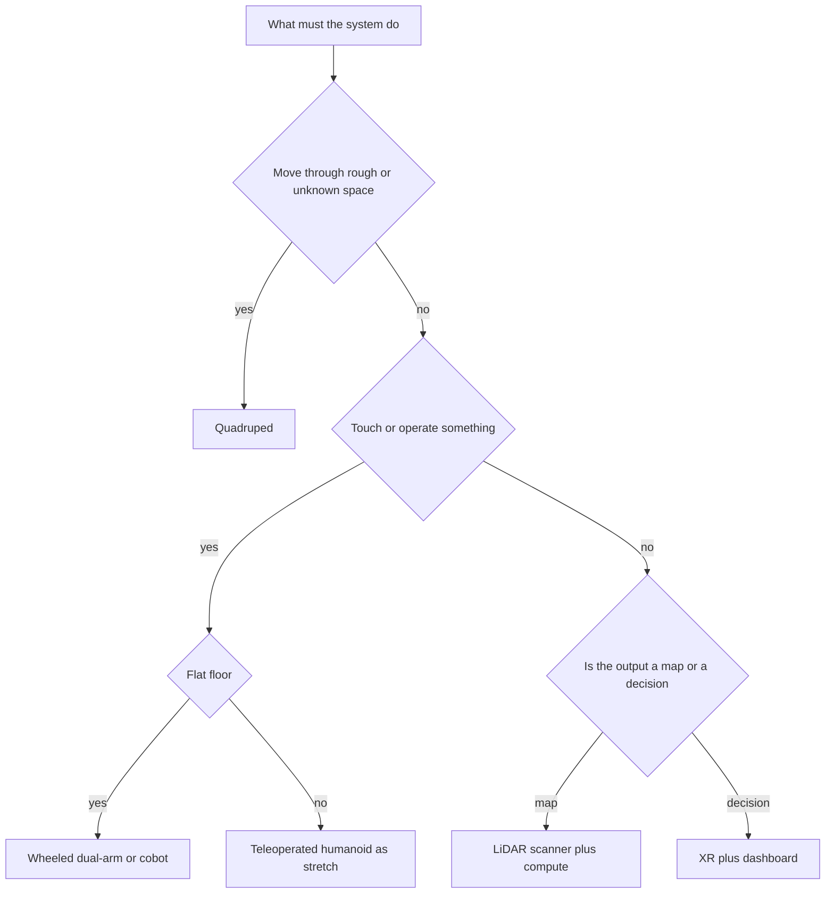

# T02 Resilient & Safe City — Track Overview

> **Official tagline:** Systems that respond, protect and keep infrastructure running.

[Start here](../../00-START-HERE.md) · [Solution patterns](T02-1-Solution-Patterns.md) · [Hardware shortlist](T02-2-Hardware-Shortlist.md) · [Cross-vendor solutions](T02-3-Cross-Vendor-Solutions.md)

**Status of this page:** written on day 1 *before* the detailed statement was read out. Everything outside the "Official statement" section is preparation and interpretation. Only the tagline, the track name, the prize pool and the hardware vendor list are official ([Luma listing](https://luma.com/vj13ns00), [BuilderBase page](https://builderbase.com/event/leukerbad-robotics-hackathon)).

## Official directions for this track

> **Official tagline (carnival website):** "Use robots to build a safer, more resilient future city."

The organizers publish seven example directions per track. Tracks are **open**: the team defines its own problem, platform and approach inside the theme. Verified on the official site on 2026-11-14.

| # | Official direction |
|---|---|
| T02.1 | Emergency rescue robots |
| T02.2 | Autonomous inspection in hazardous environments |
| T02.3 | Infrastructure safety monitoring |
| T02.4 | Disaster response & environment sensing |
| T02.5 | Smart security monitoring |
| T02.6 | Autonomous navigation in complex terrain |
| T02.7 | Human-robot collaborative emergency response |

Judging (round 1, per track): **technical quality · innovation · real-world value · completeness**; one champion per track goes to the grand final (pitch + live robot demo). Details: [Event intel](../../Event/Event-Intel.md).
Which company has what for this track: [All solutions, projects and plans](T02-5-All-Solutions-and-Projects.md). The second-pass files `…-4-Solutions-Register-and-Papers.md` (where present) map a company onto these seven directions.
Source: [Leukerbad Robot Carnival website](https://www.leukerbad-robot-carnival.tech) — hackathon page.

## Official statement (fill in at kickoff)

- [ ] **Problem statement** (exact wording):
- [ ] **Constraints and rules** (team size, indoor / outdoor, what counts as "built here", pre-trained models allowed?):
- [ ] **Judging criteria and weights** (per criterion, in %):
- [ ] **Hardware allowed / allocated** (which robot, how many hours, booking system, who may operate it):
- [ ] **Deliverables and deadlines** (demo slot, video, repo, pitch length, submission platform):
- [ ] **Mentors for this track** (name, organisation, where to find them):
- [ ] **Extra to ask:** Is there a staged test area (stairs, doors, dark room)? Is Wi-Fi isolated per team? May robots leave the Sportarena? Are drones allowed at all?

## What this track is probably about

*Interpretation, not official.* The tagline has three verbs — **respond, protect, keep running** — which map onto three families of problems:

- **Respond** — get eyes, sensors or hands into a place that is dangerous or unreachable for people: first-look reconnaissance, search for people, teleoperated intervention.
- **Protect** — detect a hazard *before* it hurts someone: patrol, anomaly detection, hazard monitoring, guiding people out.
- **Keep infrastructure running** — routine inspection and simple maintenance of plant rooms, pipes, tunnels, lifts and power, so that failures are found early and services survive a disruption.
- **The robot is rarely the product; the information is.** In real deployments the value is a map, a reading, an alarm or a decision that arrives minutes earlier (see the Blatten and TU Graz examples in [Solution patterns](T02-1-Solution-Patterns.md)).
- **Human-in-the-loop is the expected design**, not a weakness. Field trials in this domain are dominated by teleoperation with autonomy assists; fully autonomous rescue is still a research topic.
- **Degraded conditions are the point of "resilient":** darkness, smoke, stairs, lost radio link, cut-off road, few staff. A solution that only works in the lit, connected hall misses the theme.
- **"City" here is a small alpine resort**, so judges may respond well to solutions sized for a municipality with a tiny budget and a volunteer-scale response force (inference).
- **Overlap to watch:** delivery during a disruption overlaps with T01, checking on vulnerable guests overlaps with T04. Pick one track and say why.

## Problem archetypes

Feasibility: ● easy in 48 h · ◐ stretch · ○ unrealistic. Ratings are judgement calls that assume a working robot with a vendor SDK and no pre-built stack.

| # | Problem | Who feels it | What the robot does | Hardware class | 48 h |
|---|---|---|---|---|---|
| 1 | **First-look recon** of a smoky, gassy or unstable space | Fire brigade, hazmat unit | Walks in ahead of the crew, streams video and sensor readings, marks hazards on a map | Quadruped + camera / gas or thermal sensor | ● |
| 2 | **Routine inspection round** of plant rooms (pumps, valves, gauges, leaks) | Utility and facility operators | Follows a waypoint route, reads gauges, flags leaks and anomalies, writes a report | Quadruped or wheeled base + edge compute | ● |
| 3 | **Search for a missing or injured person** in a building | Rescue services | Explores, detects people, reports position and condition | Quadruped + person detection | ◐ |
| 4 | **Scan and compare**: 3D capture of a structure and change detection against the last scan | Municipal engineers, road and tunnel owners | Operator or robot carries a LiDAR scanner; software highlights what moved | Handheld LiDAR scanner + compute | ● |
| 5 | **Remote hands** in a hazardous area (close a valve, flip a breaker, move an object) | Responders, utility technicians | Teleoperated arm with autonomy assists for grasp and alignment | Arm / cobot, wheeled dual-arm, XR | ◐ |
| 6 | **Night safety and security patrol** (open doors, person on the floor, blocked exit) | Venue operators, police, hotels | Patrols autonomously, raises events with snapshots | Quadruped or wheeled base | ● |
| 7 | **Access-route hazard watch** (rockfall debris, snow, ice, water on roads and paths) | Road maintenance, municipality | Fixed or robot-borne camera with change detection and alerting | Edge compute + camera, optionally quadruped | ◐ |
| 8 | **Isolation mode**: town cut off, supplies and medication must still move, vulnerable people checked | Municipality, clinics, hotels | Prioritised indoor delivery and welfare checks | Wheeled dual-arm or quadruped | ◐ |
| 9 | **Augmented responder**: hands-free hazard map, robot video and procedures in the field of view | Volunteer firefighters, technicians | AR glasses show live robot feed, map and checklists; remote expert annotates | XR + compute | ● |
| 10 | **Evacuation guide**: multilingual guidance and headcount in a public building | Spa, hotel and event operators | Speaks, points the way, sweeps rooms, counts people | Humanoid or quadruped with speech | ◐ |
| 11 | **Common operating picture**: fuse robot and sensor feeds into one incident view with summaries | Incident commander | Software layer; robots are data sources and taskable assets | Compute (+ any robot) | ● |
| 12 | **Autonomous outdoor rescue or slope monitoring** (rubble, avalanche debris, rock faces) | Mountain rescue, hazard services | Unsupervised mobility and manipulation in snow and rubble | Heavy-duty field robots, drones | ○ |

Notes:
- Row 12 is ○ because of terrain, weather, permits and because **no drone vendor is in the announced hardware list** (⚠️ unverified — ask at kickoff).
- Rows 1, 2, 6 and 11 share 80 % of their software (navigate → perceive → report). Build that core once and choose the story at hour 36.

## Leukerbad scenarios

Each scenario lists the sourced fact first, then the use case (inference).

1. **The cut-off town.** On 4 Jan 2018 the access roads were closed for avalanche danger during storm Burglind and about **10,000 tourists** were stuck; supermarket shelves emptied within a day ([Nau.ch](https://www.nau.ch/people/aus-der-schweiz/ich-habe-noch-die-letzten-windel-packli-bekommen-65282834)). Resident population is only **1,329** (Dec 2020, [Wikipedia](https://en.wikipedia.org/wiki/Leukerbad)) — roughly **7–8 visitors per resident**. → *Use case:* an "isolation mode" system that prioritises scarce supplies and medication, runs indoor deliveries and welfare checks, and gives the crisis staff one live picture.
2. **One road in.** Road access comes from the south via Leuk; the railway closed in 1967 ([Wikipedia](https://en.wikipedia.org/wiki/Leukerbad)). Local press reports rockfall-related closures of the Rumeling–Inden–Leukerbad road and snow closures of the Albinen link (⚠️ unverified dates — seen only as search-result summaries of [1815.ch](https://1815.ch/news/wallis/aktuell/rumeling-inden-leukerbad-strasse-vorsichtshalber-gesperrt)). → *Use case:* camera or LiDAR change detection on a slope or gallery mock-up; "scan today, compare with last week".
3. **Hot water as critical infrastructure.** About **3.9 million litres** of thermal water flow daily at up to **51 °C** into **22 pools** per [Wikipedia](https://en.wikipedia.org/wiki/Leukerbad) (the destination's media kit says 30 pools — ⚠️ unverified, PDF not retrievable today). → *Use case:* robot inspection round in hot, humid pump and pipe rooms: leak detection, gauge reading, thermal anomalies, slip hazards.
4. **Cable cars from 1957 and 1970–72.** The Gemmi lift (to 2,322 m) dates from 1957, the Torrent lift (to 2,313 m) from 1970–72 ([Wikipedia](https://en.wikipedia.org/wiki/Leukerbad)); the media kit reports more than 180,000 Gemmi passengers a year (⚠️ unverified, via search summary). → *Use case:* pre-opening visual checklist of a station or machine room, or a robot that reaches a stranded cabin area first with a camera and a voice link. Present it as assistance to certified inspectors, not as a replacement.
5. **Spa town with mobility-limited guests.** Leukerbad has a rehabilitation centre and large public baths ([Wikipedia](https://en.wikipedia.org/wiki/Leukerbad)); about **660,000 overnight stays** a year according to the media kit (⚠️ unverified, via search summary). → *Use case:* evacuation sweep of a bath or clinic floor — find people left behind, report who needs carrying, guide the rest in several languages.
6. **A village that avalanches destroyed and that went bankrupt.** Major avalanches hit the village repeatedly between the 16th and 18th centuries; in 1998 the municipality had **CHF 346 million** of debt and was placed under cantonal administration until 2004 ([Wikipedia](https://en.wikipedia.org/wiki/Leukerbad)). → *Use case framing:* resilience technology for a small municipality must be cheap, shareable between villages and operable by non-experts.
7. **Blatten, same canton, May 2025.** The village was evacuated on 19 May; on 28 May a rock-ice avalanche buried about **130 houses**, with **one fatality**. A radar installed on evacuation day and a camera installed the day before the collapse measured movement above **10 m per day**; authorities published the data to justify the evacuation ([Geopraevent](https://www.geopraevent.ch/project/blatten-kleines-nesthorn/?lang=en)). → *Use case:* a rapidly deployable sensing kit plus a public-facing dashboard that explains *why* a closure or evacuation was ordered.
8. **The venue itself.** The hackathon runs in the Sportarena ([Luma](https://luma.com/vj13ns00)). → *Use case:* treat corridors, stairs, changing rooms and technical rooms as the stand-in for a tunnel, clinic or plant room. Ask the organisers which areas robots may enter (⚠️ unverified).

## What judges will likely reward

**The only official hint so far:** the event page says prizes go to the "most creative, ambitious and technically outstanding teams" ([Luma](https://luma.com/vj13ns00)). No criteria or weights are published — record them at kickoff.

**What comparable events show** (no event found published numeric weights):

| Event | How it was judged | What won | Take-away |
|---|---|---|---|
| [Europe Embodied 2026, Munich](https://tum-international.com/europe-embodied-2026-48-hour-hackathon/) (48 h; ESRA involved) | Track winners first, then a final between track winners | Overall 1st: VLM robot that uses object weight as an input. Track "autonomous industrial inspection, quadruped": an **agentic inspection system**, 3rd overall | One clear technical idea, shown live, beats a broad system |
| [Intel Physical AI Challenge, European Robotics House, Zurich](https://luma.com/d3pjvggt) (4–6 Dec 2026; created by EuroTech Federation, ESRA and Edelweiss) | Live demonstrations on the last day | Not yet held | Framing is "sees, thinks, acts" — expect the same closed-loop expectation here |
| [EnRicH 2025, Zwentendorf](https://www.fkie.fraunhofer.de/en/press-releases/summary-european-robotics-hackathon-2025.html) (15 teams, disaster response) | Timed live runs (30 min) observed by judges; awards per task: search and rescue, 3D mapping, radiation mapping, manipulation, robot cooperation | Teams that kept a data link alive and had a backup plan | Robustness and task completion count more than elegance |
| ETH Robotics Club HACK2026 (⚠️ unverified, participant blog seen only as search summary) | Not found | One team built an autonomous explorer on a Unitree Go2 | Quadruped exploration plus semantic scene description is a known, feasible 48 h scope |

**Likely criteria** (inference from the above and from the organisers' wording):

| Likely criterion | What scores | What loses |
|---|---|---|
| Working live demo on real hardware | Closed loop: sense → decide → act, repeated twice without touching the robot | Slides, simulation only, "it worked an hour ago" |
| Technical depth | One hard thing done properly (e.g. reliable re-localisation, shared autonomy, change detection) | Ten API calls glued together |
| Relevance and impact | A named user, a real local incident, a number that improves | Generic "smart city safety" |
| Creativity and ambition | Unusual combination of provided hardware (e.g. scanner + quadruped + AR) | A patrol robot with a chatbot |
| Robustness | Works in the dark, survives link loss, has a safe stop | Needs perfect Wi-Fi and daylight |
| Story and clarity | 3 minutes: problem, demo, measured result, next step | Architecture tour |

**What usually distinguishes winners** (inference): a staged but honest scenario, a before/after number, a visible fallback when something fails, and a mixed venture/industry jury hearing who would pay for it.

## KPIs you can show in a 3-minute demo

| KPI | How to measure on site | Good target for a demo |
|---|---|---|
| **Time to first situational picture** | Stopwatch from "alarm" to first map + image on the operator screen | < 60 s |
| **Hazard detection rate** | Stage N known hazards (puddle, open door, dummy person, hot object); count found | ≥ 8 of 10, with false alarms stated |
| **Localisation error of findings** | Distance between reported and true position on the floor plan | < 1 m |
| **Coverage** | Share of the test area mapped or inspected, and the time it took | 100 % of a small route |
| **Operator interventions** | Count of manual take-overs per run | 0–1 |
| **Behaviour on link loss** | Pull the network cable or leave Wi-Fi range on purpose | Robot stops safely or returns; data is buffered |
| **Human exposure avoided** | Minutes a person did *not* have to spend in the hazard zone | State it as a number |
| **Report latency and quality** | Time from end of round to finished report; fields a human had to correct | < 2 min, few corrections |
| **Teleoperation latency** | Glass-to-glass delay with a visible clock in frame | < 300 ms (inference: above this, fine manipulation becomes hard) |
| **Cost per round** | Robot minutes vs staff minutes | Order-of-magnitude argument only |

Tip: measure a **human baseline** for the same task on Saturday night. A before/after pair is the strongest slide.

## Safety, ethics and regulation

*General orientation from background knowledge, not legal advice and not re-verified today (⚠️).*

- **People near moving robots.** Keep a safety operator with an emergency stop for every legged or humanoid robot; limit speed in shared space; never demo over spectators' feet. Relevant standards families: ISO 10218 and ISO/TS 15066 for industrial arms and collaboration, ISO 13482 for personal-care robots.
- **Surveillance and privacy.** Patrol and monitoring ideas record identifiable people. The revised Swiss Federal Act on Data Protection has been in force since 1 Sept 2023. Design for data minimisation: detect events, blur faces, store locally, delete quickly. Avoid face recognition entirely — remote biometric identification in public space is heavily restricted under the EU AI Act, which any European product will meet.
- **Rescue claims.** Do not claim a robot "finds victims" beyond what you tested. State detection rate and failure cases; a missed person is the worst failure mode in this track.
- **Dual use.** Security and patrol robots are close to policing and defence uses. Keep the system unarmed, non-coercive and clearly civilian; say so in the pitch.
- **Drones.** Switzerland applies the EU drone rules (registration, operator competence, category limits) since 2023. Outdoor flights over a resort town need checking before you plan around them; indoor flight needs organiser consent.
- **Safety-critical infrastructure.** Cable cars, pressure systems and electrical plant are inspected under regulated regimes. Position the robot as an assistant that documents and pre-screens, not as the certifying inspector.
- **Automation bias.** Dashboards and LLM summaries must show the raw evidence (image, timestamp, position) next to any conclusion so the commander can check it.
- **Elderly and vulnerable guests.** Evacuation or welfare-check robots must not block exits, startle people or imply medical judgement.

## Decision helper: which hardware class for which archetype

● good fit · ◐ possible with caveats · ○ poor fit. Assumes the platform classes announced for the event; specific models on site are ⚠️ unverified until the hardware desk confirms.

| Archetype | Humanoid | Wheeled dual-arm | Quadruped | Arm / cobot | XR | Scanner / compute |
|---|---|---|---|---|---|---|
| 1 First-look recon | ◐ | ◐ | ● | ○ | ● | ◐ |
| 2 Inspection round | ◐ | ● | ● | ○ | ◐ | ● |
| 3 Person search | ◐ | ◐ | ● | ○ | ◐ | ◐ |
| 4 Scan and compare | ○ | ◐ | ◐ | ○ | ◐ | ● |
| 5 Remote hands | ◐ | ● | ○ | ● | ● | ◐ |
| 6 Safety patrol | ◐ | ● | ● | ○ | ○ | ◐ |
| 7 Access-route watch | ○ | ○ | ◐ | ○ | ○ | ● |
| 8 Isolation mode logistics | ◐ | ● | ◐ | ○ | ○ | ◐ |
| 9 Augmented responder | ○ | ○ | ◐ | ○ | ● | ● |
| 10 Evacuation guide | ● | ◐ | ◐ | ○ | ◐ | ◐ |
| 11 Common operating picture | ◐ | ◐ | ◐ | ○ | ◐ | ● |
| 12 Autonomous outdoor rescue | ○ | ○ | ◐ | ○ | ○ | ◐ |

Quick rule of thumb:

- **Safest bet for T02:** quadruped + edge compute + operator dashboard (archetypes 1, 2, 3, 6).
- **Lowest hardware risk:** scanner + compute (archetypes 4, 7, 11) — no robot queue, but you must work harder to look like a robotics project.
- **Highest wow, highest risk:** teleoperated humanoid or dual-arm "remote hands" through XR (archetype 5).

## Sources

Read directly on 2026-11-14:
- [Leukerbad Hackathon 2026 (Robotics, XR, and AI) — Luma](https://luma.com/vj13ns00)
- [Leukerbad Robotics Hackathon — BuilderBase event page](https://builderbase.com/event/leukerbad-robotics-hackathon) (read from the copy saved in this project)
- [Leukerbad — Wikipedia](https://en.wikipedia.org/wiki/Leukerbad)
- [Nau.ch, 4 Jan 2018 — access roads to Leukerbad closed, about 10,000 tourists stuck](https://www.nau.ch/people/aus-der-schweiz/ich-habe-noch-die-letzten-windel-packli-bekommen-65282834)
- [Geopraevent — Monitoring Kleines Nesthorn, Lötschental (Blatten)](https://www.geopraevent.ch/project/blatten-kleines-nesthorn/?lang=en)
- [TUM International — Europe Embodied 2026: 48-Hour Hackathon recap](https://tum-international.com/europe-embodied-2026-48-hour-hackathon/)
- [Intel Physical AI Challenge | European Robotics House — Luma](https://luma.com/d3pjvggt)
- [Fraunhofer FKIE — Robots and drones put to the test at the European Robotics Hackathon 2025](https://www.fkie.fraunhofer.de/en/press-releases/summary-european-robotics-hackathon-2025.html)

Seen only as search-result summaries (page could not be opened; treat as ⚠️ unverified):
- [My Leukerbad AG — Media Kit (PDF)](https://leukerbad.ch/assets/content/documents-website/MyLeukerbad-AG/Media-Kits/Media-Kit_EN_web.pdf)
- [1815.ch — Rumeling–Inden–Leukerbad road closed as a precaution](https://1815.ch/news/wallis/aktuell/rumeling-inden-leukerbad-strasse-vorsichtshalber-gesperrt)
- [Participant blog — 48 Hours at the ETH Robotics Club Hangar: HACK2026](https://intention.put.poznan.pl/?p=351)
