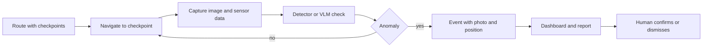
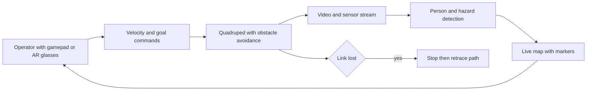
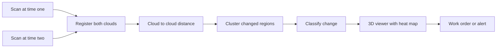
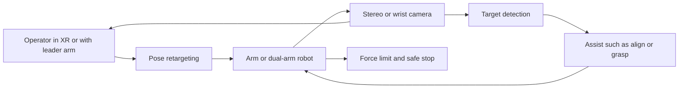
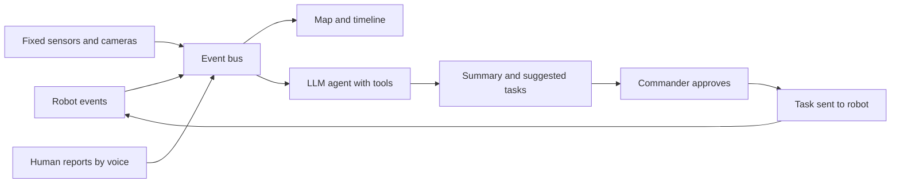

# T02 Resilient & Safe City — Solution Patterns

[Track overview](T02-0-Track-Overview.md) · [Hardware shortlist](T02-2-Hardware-Shortlist.md) · [Cross-vendor solutions](T02-3-Cross-Vendor-Solutions.md)

**How to use this page:** pick one reference architecture, check the building blocks you need, read the feasibility guide, then choose an idea. Archetype numbers refer to the table in the [Track overview](T02-0-Track-Overview.md). Architectures, effort estimates and ideas are the author's judgement (inference); facts about products and events are linked.

## Reference architectures

### A. Patrol – Detect – Report (autonomous inspection round)

- **When to use:** archetypes 2, 6, 7. You have a mobile base that can follow waypoints and you want a repeatable round with a written result.
- **Why it is the default:** it is the format that commercial inspection robots sell, and an agentic inspection system on a quadruped placed third overall at [Europe Embodied 2026](https://tum-international.com/europe-embodied-2026-48-hour-hackathon/).

- **Components:** mobile base with built-in or LiDAR SLAM · waypoint executor · camera (plus thermal or gas sensor if available) · a detector for known classes and a vision-language model for "what is wrong here" · event store · operator UI · report generator.
- **Main risk:** localisation drift or a closed door breaks the route. Mitigate with a short route (4–6 checkpoints), visual markers at checkpoints, and a manual "resume from checkpoint N" button.

### B. Scout ahead (teleoperation with shared autonomy)

- **When to use:** archetypes 1 and 3. The story is "the robot goes in first while the crew gears up" — the benefit reported by the [TU Graz detection-robot project](https://www.tugraz.at/en/news/article/detection-robot-firefighting).

- **Components:** robot high-level motion API · low-latency video (WebRTC or vendor stream) · onboard detection so it keeps working when the link is thin · 2D or 3D map with markers · link watchdog with a defined lost-link behaviour · operator view on screen or AR glasses.
- **Main risk:** network. At [EnRicH 2025](https://www.fkie.fraunhofer.de/en/press-releases/summary-european-robotics-hackathon-2025.html) lost radio links were the main obstacle, and one winning team used a fibre tether. With about 220 participants sharing hall Wi-Fi, bring your own router or a cable and demo the lost-link behaviour on purpose.

### C. Scan to twin (capture, compare, flag change)

- **When to use:** archetypes 4, 7, 11. You have a handheld LiDAR scanner or a robot LiDAR and want a hardware-light project with a strong visual.

- **Components:** scanner export (point cloud) · registration (global alignment then ICP) · distance computation and clustering · optional classification of each change with a vision-language model on rendered views · web 3D viewer · alert rule (volume or displacement above a threshold).
- **Main risk:** it looks like a software demo. Mitigate by staging a physical change live (move a "rock", open a hatch), by mounting the scanner on a robot, or by pushing the result into AR glasses for the field worker.

### D. Remote hands (XR teleoperated manipulation with assists)

- **When to use:** archetype 5. The story is "close the valve without sending a person in".

- **Components:** teleoperation input (XR headset, AR glasses with a controller, leader arm or 6-DoF mouse) · inverse kinematics and retargeting · camera feedback · one assist primitive (auto-align to a detected handle, force-limited turn) · force or torque limits · recorded demonstrations as a by-product.
- **Main risk:** integration time. Teleoperation stacks are vendor-specific; latency and calibration eat a day. Decide by Saturday 20:00 whether the full loop works; if not, fall back to a fixed cobot with a scripted, force-limited valve turn triggered by the operator.

### E. Incident copilot (common operating picture with an LLM agent)

- **When to use:** archetypes 8, 9, 11, and as the top layer over A–D.

- **Components:** message bus (MQTT or ROS 2 topics) · geo-referenced map and timeline · speech-to-text for radio-style reports · LLM with a small, typed tool set (list events, show camera, send robot to point) · approval step before any robot action · evidence links next to every summary.
- **Main risk:** an impressive screen with no robot in the loop, or an LLM that invents events. Mitigate by closing the loop at least once (commander approves → robot moves → new evidence appears) and by letting the model cite event IDs only.

## Building blocks

⚠️ Tool names and maturity notes come from background knowledge and were **not re-checked on 2026-11-14** (the web-search budget for this run was exhausted). Confirm the current version, licence and ROS 2 distribution before committing. Vendor-specific SDKs are covered in the [Hardware shortlist](T02-2-Hardware-Shortlist.md).

| Capability | Open-source tools / models | Notes on effort |
|---|---|---|
| **Navigation** | ROS 2 Nav2 · slam_toolbox (2D) · FAST-LIO2 or Point-LIO (LiDAR odometry) · RTAB-Map (RGB-D / LiDAR SLAM) · frontier exploration packages · Unitree `unitree_sdk2` / `unitree_ros2` high-level motion | **Half a day** if the robot ships with a working SLAM and a go-to-point API; **more than a day** if you bring up Nav2 from scratch on a legged robot. Prefer the vendor's built-in mapping first |
| **Manipulation** | MoveIt 2 · vendor arm SDKs · simple Cartesian and force-limited primitives · AprilTag / ArUco for target pose | **Hours** for scripted pick or turn with a fiducial; **a day or more** for marker-free grasping |
| **Perception: known classes** | Ultralytics YOLO family (check the AGPL licence) · RT-DETR · pose models for "person lying down" | **1–2 hours** with pretrained weights; **3–5 hours** including collecting and labelling 100–200 local images |
| **Perception: open vocabulary** | Grounding DINO · YOLO-World / YOLOE · Segment Anything 2 and later · Depth Anything V2 | **Hours**; needs a GPU or a strong edge board. Good for "find the fire extinguisher" style queries |
| **Perception: scene judgement** | Hosted multimodal LLMs via API · small local VLMs (for example SmolVLM or Qwen-VL class) | **Hours.** Best for gauge reading and "is anything unusual". Always keep the image as evidence; expect a few seconds per frame |
| **3D and change detection** | Open3D (registration, ICP, clustering) · CloudCompare (cloud-to-cloud distance, M3C2) · PCL | **Half a day** for scan → align → heat map on two indoor scans |
| **Speech and LLM agents** | Whisper / faster-whisper · Silero VAD · Piper TTS · NASA JPL ROSA (natural-language ROS agent) · ROS MCP servers · plain function calling over 5–8 robot skills | **Half a day** for push-to-talk commands. Hall noise is the enemy: use a headset mic and push-to-talk, not wake words |
| **VLA and imitation policies** | Hugging Face LeRobot (ACT, Diffusion Policy, [SmolVLA](https://huggingface.co/blog/smolvla), a compact 450M-parameter model) · Physical Intelligence openpi (π0 family) · NVIDIA Isaac GR00T N1.x · OpenVLA | **A full day** for one skill: 50–100 teleoperated demos, a few GPU hours of fine-tuning, then evaluation. ACT is the most forgiving choice for a single fixed-scene skill. Rarely the right centre of a T02 project |
| **Teleoperation and shared autonomy** | Open-TeleVision · Unitree XR teleoperation stack · GELLO-style leader arms · LeRobot leader–follower · WebRTC video · gamepad via ROS 2 `joy` | **Hours** for gamepad plus video; **a day** for XR hand tracking to a humanoid or dual-arm robot. AR-glasses support depends on the vendor SDK |
| **Dashboards and digital twins** | Foxglove · Rerun · RViz2 · Potree or CesiumJS (web point clouds) · Gaussian-splatting toolkits (nerfstudio, gsplat) · Streamlit or Gradio for operator UIs · Grafana · swisstopo open geodata (terrain and 3D buildings) | **2–4 hours** for a convincing operator view with Foxglove or Rerun; **half a day** for a custom web map with event markers |
| **Messaging and resilience** | ROS 2 DDS or Zenoh · MQTT · rosbag2 for record and replay · Tailscale or a private router · local inference on edge boards | **Hours.** Record a bag of every good run: it is your backup demo and your debugging tool |
| **Simulation (optional)** | Gazebo · MuJoCo · Isaac Sim / Isaac Lab | Use only to develop while the robot is booked by another team; do not demo in simulation |
| **Agent framework for robots** | dimensionalOS (used for a Go2 autonomous explorer at ETH Robotics Club HACK2026 — ⚠️ unverified, search summary of a [participant blog](https://intention.put.poznan.pl/?p=351)) | Check Go2 firmware and SDK compatibility before relying on it |

## State of the art — who already does this

| Product or project | Organisation | What it does | Lesson for a 48-hour build |
|---|---|---|---|
| **ANYmal / ANYmal X** | ANYbotics (Zurich) | Autonomous legged inspection of industrial plants. Customer deliveries of the explosion-safe ANYmal X began on **27 Oct 2026**, with Equinor and DSM-Firmenich named as customers (trade press, [The Robot Report](https://www.therobotreport.com/anybotics-begins-delivering-anymal-x-legged-robot-explosive-atmospheres/) — ⚠️ seen as search summary) | The product is the repeatable round and the data trail, not the walking. Build the report first |
| **ANYmal passing access-controlled doors** | ANYbotics with dormakaba | Weeks of continuous testing in 2026 in which the robot passed controlled doors on inspection routes (company statement — ⚠️ search summary, no primary link retrieved) | Doors are the hidden blocker of indoor patrol. Choose a door-free route or make "open the door" the one hard thing you solve |
| **ANYmal in Zurich's sewers** (2018) | ETH Zurich research consortium | Tested whether a legged robot could replace a human sewer inspector, using foot contact sensing where cameras struggle in damp darkness ([CORDIS](https://cordis.europa.eu/news/rcn/124780-fourlegged-robot-explores-zurichs-sewers_de) — ⚠️ search summary) | Plan for sensor failure in dark, wet, reflective places; show a fallback |
| **Elios 3** | Flyability (Swiss) | Collision-tolerant caged drone with LiDAR that builds a 3D model in real time inside confined spaces; hundreds of customers in over 50 countries by the company's account ([Venture Kick profile](https://www.venturekick.ch/flyability) — ⚠️ search summary) | Tolerating contact can be simpler than avoiding it. A live-growing 3D map is a persuasive demo |
| **Radar and camera monitoring at Blatten** (May 2025) | Geopraevent with Valais authorities | Interferometric radar (range up to 4 km) installed on evacuation day; camera measured more than **10 m/day**; about **1 GB/day** uploaded with a satellite backup link; data published to explain the evacuation ([Geopraevent](https://www.geopraevent.ch/project/blatten-kleines-nesthorn/?lang=en)) | Fast deployment, clear thresholds and explaining evidence to the public saved lives. A robot that deploys or complements sensors is credible; a robot that replaces them is not |
| **"Detection Robots" study** (published June 2026) | TU Graz with Austrian fire-service associations and DCNA | Compact remote-controlled quadruped carrying the gas detectors fire services already own; delivers readings and video while crews put on protective gear; field tests rated promising; gaps named: digital interfaces of detectors and protection class of affordable robots ([TU Graz](https://www.tugraz.at/en/news/article/detection-robot-firefighting)) | Reuse the responder's existing instruments, accept remote control, and quantify minutes saved |
| **EnRicH 2025** | Fraunhofer FKIE, at Zwentendorf nuclear plant | 15 teams; search and rescue behind steel doors, radiation and 3D mapping, manipulation, ground–air cooperation. Radio loss was the main obstacle; one team used fibre ([FKIE](https://www.fkie.fraunhofer.de/en/press-releases/summary-european-robotics-hackathon-2025.html)) | Communications and backup plans decide runs. The ROS 1 to ROS 2 migration hurt every team — freeze your stack early |
| **ELROB 2026** (Thun) and **ARCHE 2026** | Swiss federal defence procurement office (armasuisse) with research partners | Field trials for security and disaster-response robotics, including a casualty search and evacuation scenario; ARCHE reportedly tested an ANYmal D in June 2026 with about 160 participants ([Swiss federal news service](https://www.admin.ch/de/newnsb/noLYvwsY_h77Dzp4A_aF_) — ⚠️ search summaries; the ARCHE page returned an error today) | Switzerland has an active test culture for rescue robots; cite it to show the problem is real and unsolved |
| **Europe Embodied 2026, quadruped inspection track** | TUM International with Robo TUM, START Munich, ESRA | 48-hour challenge on autonomous industrial inspection; an agentic inspection system finished third overall ([TUM International](https://tum-international.com/europe-embodied-2026-48-hour-hackathon/)) | Architecture A is a proven hackathon format; you need an extra twist to win overall |
| **Hypertron-T01** | Astrall Dynamics | Quadruped firefighting robot with integrated water cannon and an 80 kg payload claim, shown at INTERSCHUTZ 2026 (vendor press release — ⚠️ search summary, no primary link retrieved) | Purpose-built hardware; do not try to imitate it. Compete on software and workflow |
| **Satellite radar precursors at Blatten** | ESA-funded research | Slope instability was visible in satellite radar data years earlier, but only analysed afterwards (⚠️ search summary, no primary link retrieved) | Detection is often a data-triage problem: an alerting layer over existing data is a valid T02 project |

## 48-hour feasibility guide

**What reliably works in a weekend**

| Works | Why |
|---|---|
| Waypoint patrol on a quadruped or wheeled base in a mapped indoor area | Vendor SLAM and go-to-point APIs exist; the route can be short |
| Detection of 3–6 staged hazard classes with a pretrained detector plus a VLM check | Pretrained weights; small local fine-tune if needed |
| Person detection and "person on the floor" via pose estimation | Mature models; easy to stage |
| Gamepad teleoperation with live video and a map with markers | Few moving parts |
| Two-scan change detection on indoor point clouds | Open3D pipeline is short; result is visual |
| Voice or text commands mapped to a handful of robot skills | Function calling over a small tool set is robust if every action needs confirmation |
| Auto-generated inspection report with photos, positions and timestamps | Pure software; high perceived value |
| AR or tablet view of robot video, map and checklist | Works even if SDK access to the glasses is limited to display mirroring |

**What usually does not**

| Avoid | Why |
|---|---|
| Autonomous outdoor operation on snow, slopes or stairs | Weather, permits, robot protection class, GPS-denied localisation |
| Humanoid whole-body autonomy (walking plus manipulating plus opening doors) | Each part alone is a research problem; hardware time is scarce |
| Training a general VLA policy | Not enough data or compute; one narrow skill at most |
| Multi-robot coordination across vendors as the core | Two SDKs, two networks, two failure sources. Do it only as a final stretch |
| Custom SLAM, custom locomotion controllers, custom hardware mounts that need machining | Days of tuning; no demo value |
| Anything that needs perfect hall Wi-Fi | Hundreds of devices on the same spectrum |
| Real smoke, gas, water or heat | Safety and venue rules; simulate with props and labelled stand-ins |

**Scoping advice**

1. **Hours 0–4:** get the robot moving through its SDK and a camera frame on your laptop. If this fails, switch platform now, not on Sunday.
2. **Hours 4–12:** end-to-end skeleton with stubs — robot moves, one detection fires, one event appears on the dashboard. Ugly but complete.
3. **Hours 12–30:** make one thing excellent (the "hard thing" you will name in the pitch) and stage the scenario with props.
4. **Hours 30–40:** robustness — dark-room test, link-loss test, ten repeated runs, record rosbags and a backup video.
5. **Hours 40–48:** freeze code, measure KPIs against a human baseline, rehearse the 3-minute demo three times.

Rules of thumb:
- **One robot, one scenario, one number.** Add a second device only if the first loop already works.
- **Stage the hazard, never the result.** Props are fine; pre-recorded detections presented as live are not.
- **Design the failure.** Decide what the audience sees when the link drops or the detector misses, and make that look intentional.
- **Book hardware time early** and develop against recorded data between slots.
- **Keep a human approval step** before any robot action triggered by an LLM.

## Idea bank

| # | Idea | Hardware class |
|---|---|---|
| 1 | **Scout dog:** quadruped enters a dark room ahead of the crew, marks people and hazards on a live map within 60 seconds | Quadruped + compute |
| 2 | **Thermal-water rounds:** autonomous inspection of a pump and pipe room mock-up — gauge reading, leak and puddle detection, automatic report | Quadruped or wheeled base |
| 3 | **Scan diff for galleries and walls:** two LiDAR scans, automatic heat map of what moved, alert above a displacement threshold | Handheld LiDAR scanner + compute |
| 4 | **Valve closer:** operator closes a valve remotely with a force-limited arm and an auto-align assist | Arm / cobot + XR |
| 5 | **Cut-off town console:** crisis dashboard that fuses robot events, road status and stock levels and proposes prioritised deliveries for approval | Compute (+ wheeled dual-arm) |
| 6 | **Evacuation sweep:** robot checks rooms after an alarm, reports who is still inside and who needs assistance, speaks several languages | Quadruped or humanoid |
| 7 | **Responder glasses:** AR glasses show robot video, hazard markers and the next checklist step; a remote expert draws annotations | XR + compute |
| 8 | **Lost-link hero:** patrol robot that detects network loss, retraces its path to coverage and uploads buffered evidence | Quadruped |
| 9 | **Night patrol with explainable alerts:** events with photo, position and a one-line reason; faces blurred on device | Quadruped or wheeled base + edge compute |
| 10 | **Sensor dropper:** robot carries and places a small wireless sensor or camera at a hazard spot and withdraws | Wheeled dual-arm or quadruped with arm |
| 11 | **Talk to the incident:** commander asks by voice what changed in the last ten minutes; the agent answers with linked evidence and can task the robot | Compute + any mobile robot |
| 12 | **Cable-car station pre-check:** robot runs a visual checklist of a machine-room mock-up and documents each item for the certified inspector | Quadruped or wheeled base |
| 13 | **Instant twin for responders:** five-minute walk-through scan becomes a navigable 3D model with exits, hazards and shut-off valves tagged | Handheld LiDAR scanner + XR |
| 14 | **Gesture-guided scout:** responder points, and the robot goes there and looks; muscle-signal or hand tracking as the hands-free input | Quadruped + XR or EMG wearable |
| 15 | **Scanner on legs:** mount the handheld scanner on a quadruped to map a space no person should enter, then run the scan diff | Quadruped + LiDAR scanner |

Strong combinations for this track: **1 + 7** (scout plus responder glasses), **2 + 11** (rounds plus incident copilot), **3 + 15** (scan diff with robot capture).

## Sources

Read directly on 2026-11-14:
- [TUM International — Europe Embodied 2026: 48-Hour Hackathon recap](https://tum-international.com/europe-embodied-2026-48-hour-hackathon/)
- [Fraunhofer FKIE — Robots and drones put to the test at the European Robotics Hackathon 2025](https://www.fkie.fraunhofer.de/en/press-releases/summary-european-robotics-hackathon-2025.html)
- [TU Graz — Four-legged detection robots for safe firefighting operations](https://www.tugraz.at/en/news/article/detection-robot-firefighting)
- [Geopraevent — Monitoring Kleines Nesthorn, Lötschental (Blatten)](https://www.geopraevent.ch/project/blatten-kleines-nesthorn/?lang=en)
- [Leukerbad Hackathon 2026 (Robotics, XR, and AI) — Luma](https://luma.com/vj13ns00)
- [Intel Physical AI Challenge | European Robotics House — Luma](https://luma.com/d3pjvggt)

Seen only as search-result summaries (not opened; treat as ⚠️ unverified):
- [The Robot Report — ANYbotics begins delivering ANYmal X](https://www.therobotreport.com/anybotics-begins-delivering-anymal-x-legged-robot-explosive-atmospheres/)
- [CORDIS — Four-legged robot explores Zurich's sewers](https://cordis.europa.eu/news/rcn/124780-fourlegged-robot-explores-zurichs-sewers_de)
- [Venture Kick — Flyability profile](https://www.venturekick.ch/flyability)
- [Swiss federal news service — European Land Robot Trial (ELROB) 2026](https://www.admin.ch/de/newnsb/noLYvwsY_h77Dzp4A_aF_)
- [Hugging Face — SmolVLA blog post](https://huggingface.co/blog/smolvla)
- [Participant blog — 48 Hours at the ETH Robotics Club Hangar: HACK2026](https://intention.put.poznan.pl/?p=351)

Not sourced today: the open-source tool list in "Building blocks" and the feasibility estimates rest on background knowledge and experience-based judgement; verify versions and licences on each project's own repository.
