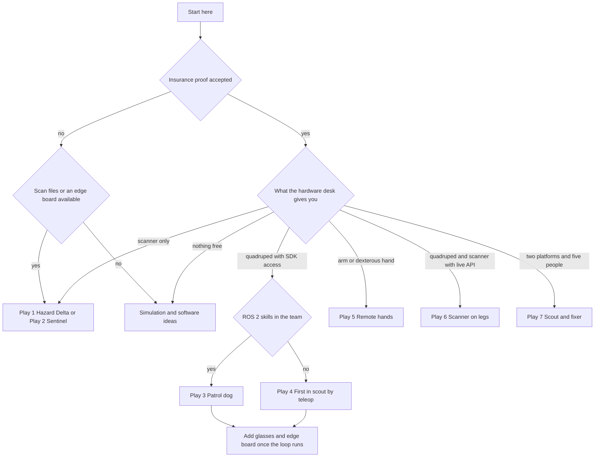

# T02 Resilient & Safe City — Cross-Vendor Solutions

[Start here](../../00-START-HERE.md) · [Track overview](T02-0-Track-Overview.md) · [Official directions: who has what](T02-6-Official-Directions-Who-Has-What.md) · [Hardware shortlist](T02-2-Hardware-Shortlist.md) · [Solution patterns](T02-1-Solution-Patterns.md)

> **Official tagline:** Use robots to build a safer, more resilient future city.
> **What this page is:** a synthesis of the 20 company briefs and playbooks in this knowledge base into team-ready builds. No new research. Every product claim comes from the linked company docs; **which models and how many units are on site is unconfirmed for every vendor** — settle it at the hardware desk before you commit.

**Three rules that shape every play below**

- **Judging = technical quality · innovation · real-world value · completeness.** Only the track champion reaches the final (pitch + live robot demo). A complete loop that runs twice beats a broad half-working system ([Event intel](../../Event/Event-Intel.md)).
- **Insurance decides your hardware class.** Without proof of third-party liability insurance covering borrowed equipment you are limited to software, simulation, digital twins or approved low-value devices (the site names the **LeRobot SO-101**). Which devices count as "high-value" is **unconfirmed on site** — ask.
- **Plan for a hard stop Monday 12:00** (about 47 h from Saturday 13:00). Every play has a fallback that still demos.

## Choose in five minutes

- **Insurance first.** No accepted proof → go to [If you have no insurance or no robot](#if-you-have-no-insurance-or-no-robot). Play 1 (exported scan files) and Play 2 (edge boards at about USD 100–190 each) are the two hardware-light plays; whether the scanner or boards need insurance is **unconfirmed on site**.
- **Quadruped with SDK access** means an **EDU / development edition**: Unitree Go2 **EDU** (Air / Pro have no SDK access), Magiclab MagicDog **EDU**, AGIBOT D1 **Edu / Ultra** (Pro has no secondary development), Genisom L1 EDU. Check the label before anything else.
- **ROS 2 skills in the team** → Play 3, ideally on a MagicDog EDU, whose ROS 2 SDK already exposes mapping and `/goal_pose` navigation. **No ROS 2 skills** → Play 4: gamepad teleop through a Python SDK plus live video is a few hours of work and still a strong rescue story.
- **Arm or dexterous hand** → Play 5. A fixed arm cannot reach a hazard, so the story is "the technician is stuck in the valley, the valve must be closed now".
- **Scanner plus quadruped** → Play 6 only if SKYLANDX staff enable the live interface by hour 6; otherwise run Play 1 and let the robot merely carry the scanner.
- **Two platforms and a full team of five** → Play 7, built as two stand-alone halves joined at message level. Everyone else: one robot, one scenario, one number.

## Team plays — the strongest solutions for this track

Ordered from most reliable to most ambitious. Hours are counted from build start (Sat 13:00).

| # | Play | Core vendors | Needs a robot | Reliability | Ceiling |
|---|---|---|---|---|---|
| 1 | Hazard Delta | SKYLANDX (+ XREAL) | No | High | Medium |
| 2 | Cut-the-cable Sentinel | D-Robotics (+ Omnicor AI, SKYLANDX) | No (robot verifier is a stretch) | High | Medium |
| 3 | Night-watch patrol dog | Magiclab or Unitree + D-Robotics + XREAL | Quadruped | Medium–high | Medium–high |
| 4 | First-in scout with responder glasses | Unitree + XREAL + D-Robotics + SKYLANDX | Quadruped | Medium–high | High |
| 5 | Remote hands for a cut-off plant room | Flexiv or ROKAE + WUJI + XREAL | Arm | Medium | High |
| 6 | No-entry scanner on legs | SKYLANDX + quadruped + D-Robotics | Quadruped + scanner | Medium–low | High |
| 7 | Scout and fixer | Quadruped + arm or wheeled dual-arm + SKYLANDX + XREAL | Two platforms | Low | Highest |

### Play 1 — Hazard Delta: scan, re-scan, show what changed

- **Official direction(s) served:** T02.3 Infrastructure safety monitoring · T02.4 Disaster response & environment sensing.
- **Problem → value in Leukerbad:** one road in, rockfall and avalanche closures. After an event, someone must decide whether a gallery, plant room or lift station is safe to reopen. A 10-minute walk-through scan compared with a baseline gives a measured map of what moved or is blocked, instead of photos and guesswork.
- **Hardware:** [SKYLANDX](../../Companies/SKYLANDX/T02-Resilient-and-Safe-City/SKYLANDX-T02-3-Playbook.md) **MetaCam Air 2** (619 g handheld LiDAR + panoramic vision + RTK) + laptop. Optional: [XREAL](../../Companies/XREAL/T02-Resilient-and-Safe-City/XREAL-T02-3-Playbook.md) glasses as a head-up display of the result for the field worker.
- **Software stack:** on-device SLAM → MetaCam Studio (**Windows** desktop app) or Skyland Cloud → export **PLY / PCD / LAS / E57** → Open3D for ICP fine alignment → cloud-to-cloud or M3C2 distance (CloudCompare) → cluster changes, estimate volume, flag "route blocked" → web 3D viewer with heat map. All compute on one laptop. **Needs file exports only — no vendor API.**
- **Why it can win:**
  - *Technical quality:* registration, a measured noise floor (re-scan with no change) and volume per change cluster.
  - *Innovation:* medium — known method, sharp packaging; lift it with the blocked-route logic and an AR hand-off.
  - *Real-world value:* objective reopening decision for a road gallery or cable-car station; matches SKYLANDX's own "no human entry" use case.
  - *Completeness:* the whole loop (scan → diff → ranked list → alert) fits in a weekend and can be shown live.
- **48-hour outline:** H0–6 get scanner and software access, baseline scan, load export in Open3D (start coding on sample data in parallel) · H6–24 stage changes (boxes as debris, moved barrier, closed door), second scan, first heat map · H24–40 clustering, volume, blocked-route flag, viewer, noise-floor test · H40–48 rehearse the live run, record backup, freeze.
- **Main risk and fallback:** it looks like a software demo → stage a **physical change live** and push the result to glasses or a tablet. Processing slower than the demo slot → pre-process a second "after" scan and show live capture separately. No Studio licence → ask staff for a raw export or use Skyland Cloud. IP rating, cold limits and battery life of the scanner are **not public**.
- **Team profile it suits:** 2–4 people, Python and 3D geometry, no robotics experience needed. Good choice when insurance or robot access is uncertain.

### Play 2 — Cut-the-cable Sentinel: edge hazard nodes that work offline

- **Official direction(s) served:** T02.5 Smart security monitoring · T02.4 Disaster response & environment sensing.
- **Problem → value in Leukerbad:** closed winter paths, tunnel portals and the valley road still get walked into, and a small municipality cannot watch every camera. A self-contained node detects a person or a new obstacle in a closed zone and warns locally — **even when the uplink is down**, which is exactly when storms hit.
- **Hardware:** [D-Robotics](../../Companies/D-Robotics/T02-Resilient-and-Safe-City/D-Robotics-T02-3-Playbook.md) **RDK X5** (10 TOPS, 5 V supply, PoE option) + RDK Stereo Camera or any MIPI / USB camera + power bank. 2–3 nodes if available. Optional: [Omnicor AI](../../Companies/Omnicor-AI/T02-Resilient-and-Safe-City/Omnicor-AI-T02-3-Playbook.md) OC Node for a local LLM incident report (specs not public — treat as a bonus) · SKYLANDX scan as the map the alerts are pinned on.
- **Software stack:** camera → pre-converted YOLO from `rdk_model_zoo` → ByteTrack → zone logic (polygon + dwell time) in a Python ROS 2 node on TogetheROS.Bot (Humble) → optional `hobot_stereonet` for metric distance → alert (snapshot, distance, timestamp) over MQTT / HTTP → laptop dashboard; `hobot_tts` for a spoken warning; store-and-forward when the link returns. **All inference on the board.**
- **Why it can win:**
  - *Technical quality:* offline behaviour demonstrated, not claimed — measured latency, buffered re-send, stereo distance.
  - *Innovation:* modest alone; rises with the robot-verifier stretch (alert → robot goes to check → alert closed).
  - *Real-world value:* cost per node is the argument for a village that once went bankrupt; no cloud needed.
  - *Completeness:* a single node is a finished product by Sunday morning.
- **48-hour outline:** H0–6 flash RDK OS, run a Model Zoo YOLO demo on the live camera, confirm frame rate · H6–24 tracking, zone logic, alert format, dashboard · H24–40 stereo distance, "new static object" rule, offline buffering, second node · H40–48 enclosure mock-up, rehearse the cable pull, backup video.
- **Main risk and fallback:** custom classes (fire, smoke, rockfall) need training **and** INT8 conversion with the OpenExplorer toolchain — budget half a day or avoid it; stay on stock classes. Stereo camera missing → mono camera with pixel zones. Obstacle rule flaky → demo person intrusion only. Boards have no IP rating.
- **Team profile it suits:** 2–4 people, Linux and computer vision; a good second team from the same friend group as a Play 3 or 4 team (the nodes become that team's alert source).

### Play 3 — Night-watch patrol dog with an offline brain

- **Official direction(s) served:** T02.2 Autonomous inspection in hazardous environments · T02.3 Infrastructure safety monitoring · T02.5 Smart security monitoring.
- **Problem → value in Leukerbad:** thermal-water plant rooms (about 3.9 million litres a day at up to 51 °C), garages, clinic corridors and lift stations are checked by hand and rarely at night. A dog walks a fixed round, reports only what changed, and files evidence.
- **Hardware:** first choice [Magiclab](../../Companies/Magiclab/T02-Resilient-and-Safe-City/Magiclab-T02-3-Playbook.md) **MagicDog EDU** (ROS 2 SDK already exposes mapping, map saving, localisation and `/goal_pose` navigation; 2D LiDAR only) · or [Unitree](../../Companies/Unitree/T02-Resilient-and-Safe-City/Unitree-T02-3-Playbook.md) **Go2 EDU** (15 kg, 4D LiDAR L2, depth camera, optional Orin; no open navigation stack from Unitree). Add-ons: [D-Robotics](../../Companies/D-Robotics/T02-Resilient-and-Safe-City/D-Robotics-T02-3-Playbook.md) **RDK X5** as payload computer · [XREAL](../../Companies/XREAL/T02-Resilient-and-Safe-City/XREAL-T02-3-Playbook.md) glasses as operator head-up console (plain USB-C display, no SDK code) · optional SKYLANDX baseline scan · bring-your-own USB thermal camera.
- **Software stack:**
  - *MagicDog:* `magicdog_ros2_sdk` — `/set_slam_model`, `/save_map`, waypoints to `/goal_pose`, wait on `/ab_navigation_complete`, pose from `/tracked_pose`. Wired Ethernet on 192.168.55.x, CycloneDDS, `ROS_DOMAIN_ID=25`.
  - *Go2:* `unitree_sdk2_python` high-level sport client over Ethernet (192.168.123.x); waypoints by odometry + AprilTags with built-in obstacle avoidance on, or Nav2 + slam_toolbox through the **unofficial** community `go2_ros2_sdk`.
  - *Perception:* detector (person / pose) plus a VLM check per waypoint ("door closed?", "water on the floor?", "read the gauge"); on the RDK X5 via TogetheROS.Bot, on the Go2's Orin, or on a laptop.
  - *Output:* dashboard with map, pose, incident cards (photo, position, one-line reason); auto-generated round report; baseline-versus-today comparison.
- **Why it can win:**
  - *Technical quality:* full autonomy loop repeated without touching the robot; evidence next to every conclusion.
  - *Innovation:* low–medium as plain patrol (an agentic inspection dog already placed third at Europe Embodied 2026) → add **one twist**: router off and it still reports, or baseline diff against a 3D twin.
  - *Real-world value:* matches Unitree's and Magiclab's own commercial inspection lines; easy to count rounds saved.
  - *Completeness:* route → detect → card → report → human confirms is a finished workflow.
- **48-hour outline:** H0–6 confirm edition, network, drive from code, record a map or a route bag · H6–24 waypoint loop, capture at each waypoint, first detector, dashboard skeleton · H24–40 incident cards, report, 2–3 anomaly types, offline run on the RDK X5, glasses layout · H40–48 ten full runs, backup video, freeze.
- **Main risk and fallback:** wrong edition (no SDK) → switch platform in hour 1. `magicdog_ros2_sdk` may not match firmware (**unconfirmed on site**) → timed velocity commands through `magicdog_sdk`. Localisation drift → 4–6 checkpoints with fiducials. Navigation fails entirely → drive by joystick and keep detection, alerting and reporting autonomous.
- **Team profile it suits:** 3–5 people with one ROS 2 person, one vision person, one front-end person. The default T02 play.

### Play 4 — First-in scout with responder glasses

- **Official direction(s) served:** T02.1 Emergency rescue robots · T02.4 Disaster response & environment sensing · T02.6 Autonomous navigation in complex terrain · T02.7 Human-robot collaborative emergency response.
- **Problem → value in Leukerbad:** after a rockfall, gas warning or fire alarm, a volunteer-scale response force needs to know what is inside before entering. The dog goes first while the crew gears up; map, people and hazards arrive in the responder's field of view.
- **Hardware:** [Unitree](../../Companies/Unitree/T02-Resilient-and-Safe-City/Unitree-T02-3-Playbook.md) **Go2 EDU** (40° slopes, about 16 cm steps); **B2** (IP67, −20 to 55 °C) only if a unit is released to teams. Alternatives: [Genisom AI](../../Companies/Genisom-AI/T02-Resilient-and-Safe-City/Genisom-AI-T02-3-Playbook.md) L1 EDU / M1, [AGIBOT](../../Companies/AGIBOT/T02-Resilient-and-Safe-City/AGIBOT-T02-3-Playbook.md) D1 Edu / Ultra. Add-ons: [XREAL](../../Companies/XREAL/T02-Resilient-and-Safe-City/XREAL-T02-3-Playbook.md) One-series glasses (+ XREAL Eye and Beam Pro for the two-way link) · [D-Robotics](../../Companies/D-Robotics/T02-Resilient-and-Safe-City/D-Robotics-T02-3-Playbook.md) RDK X5 for on-board detection and H.265 video · [SKYLANDX](../../Companies/SKYLANDX/T02-Resilient-and-Safe-City/SKYLANDX-T02-3-Playbook.md) reference scan of the venue.
- **Software stack:** gamepad → high-level velocity commands (`unitree_sdk2_python`) with obstacle avoidance on → camera to person detection, markers projected into the map → live map from L2 LiDAR (`point_lio_unilidar`, ROS 1 Noetic in a container, or 2D slam_toolbox) shown in Foxglove or a web viewer → **link watchdog: stop, then retrace**. Glasses level 1: the operator UI simply appears in the glasses. Level 2 (Unity + Android host, XREAL SDK 3.1.0): the First Person View streaming sample sends the responder's view to a Windows command laptop; findings come back as head-locked cards (One + Eye has **6DoF only, no anchors**).
- **Why it can win:**
  - *Technical quality:* SLAM plus semantic markers, measured glass-to-glass latency, designed lost-link behaviour.
  - *Innovation:* human–robot–command triangle; hands stay free for the gamepad or the kit.
  - *Real-world value:* minutes of human exposure avoided; fits mountain-rescue and fire-service practice where teleoperation with assists is the norm.
  - *Completeness:* "alarm → first picture in under 60 s → casualty pinned → route handed over" is a closed story.
- **48-hour outline:** H0–6 teleop from laptop with video, offline mapping from a recorded bag, glasses confirmed as external display · H6–24 live map and pose, person / hazard markers, operator HUD · H24–40 link-loss behaviour, breadcrumb route export, optional FPV uplink, dim-room tests · H40–48 build the incident room (low light, obstacles, a dummy), rehearse, mirror glasses to a projector for the judges.
- **Main risk and fallback:** hall Wi-Fi (about 220 participants) → own router or cable, and demo the link drop **on purpose**. ROS 1 / ROS 2 bridging eats time → 2D SLAM on the community ROS 2 stack. Laptop USB-C port lacks DisplayPort Alt Mode → other laptop or adapter. Glasses fail → same UI on the laptop screen. Go2 EDU is not weather-rated for snow → run indoors and argue terrain from the published B2 ratings.
- **Team profile it suits:** 3–5 people; works **without ROS 2 depth** at level 1 (Python SDK + web UI). Level 2 needs one person fluent in Unity and Android.

### Play 5 — Remote hands for a cut-off plant room

- **Official direction(s) served:** T02.7 Human-robot collaborative emergency response · T02.2 Autonomous inspection in hazardous environments (intervention half) · T02.1 Emergency rescue robots.
- **Problem → value in Leukerbad:** the access road is closed, the technician is stuck in the valley, and a pump room or lift machine room needs a valve closed or a breaker reset now. A force-limited arm does it while the operator stays outside — and it stops safely, or finishes alone, when the link drops.
- **Hardware:** [Flexiv](../../Companies/Flexiv/T02-Resilient-and-Safe-City/Flexiv-T02-3-Playbook.md) **Rizon 4s / Rizon 4 + Grav** gripper (whole-arm force sensing; second arm as leader if available) · or [ROKAE](../../Companies/ROKAE/T02-Resilient-and-Safe-City/ROKAE-T02-3-Playbook.md) xMate SR / CR (Cartesian impedance) · or [Dobot](../../Companies/Dobot/T02-Resilient-and-Safe-City/Dobot-T02-3-Playbook.md) CR / Nova (position control). Dexterous option: [WUJI](../../Companies/WUJI/T02-Resilient-and-Safe-City/WUJI-T02-3-Playbook.md) **Wuji Glove → Wuji Hand 2** (20 DoF) on the arm flange, or [Leadshine](../../Companies/Leadshine/T02-Resilient-and-Safe-City/Leadshine-T02-3-Playbook.md) DH116. Operator view: 2 webcams + optional XREAL glasses. A plywood hazard panel you build: lever valve, breaker, connector, door handle.
- **Software stack:**
  - *Two Flexiv arms:* `flexiv_tdk` LAN / WAN teleoperation examples with force feedback (Ubuntu 22.04+, real-time privileges; WAN needs clock sync).
  - *One arm:* your own loop sending slow Cartesian targets in `NRT_CARTESIAN_MOTION_FORCE` with a force cap, plus one-button assists ("grasp handle", "turn 90°") from RDK primitives. On connection loss the robot decelerates, stops and holds (built in).
  - *With WUJI:* `1.teleop_real.py` from `wuji-sdk` drives the fingers; the **glove gives no wrist position**, so the arm moves between pre-taught poses selected by key or pedal. Use the Python SDK — `wuji-ros2` targets Ubuntu 26.04 + ROS 2 Lyrical only. Sessions log to MCAP.
  - *Stretch — teach once, repeat on link loss:* heartbeat between operator PC and robot PC; on timeout, replay the recorded trajectory re-anchored to an AprilTag.
- **Why it can win:**
  - *Technical quality:* force-limited contact, fail-safe stop, peak force and task time on screen.
  - *Innovation:* shared autonomy for degraded communication — the cable-pull moment is memorable.
  - *Real-world value:* removes the person from first entry; "one road in" makes remote expertise locally credible.
  - *Completeness:* valve, breaker and plug on one panel with a recorded audit trail is a finished cell.
- **48-hour outline:** H0–6 confirm number of arms, **RDK / TDK licence tier**, Remote mode, flange adapter; one teleop path moving; build the panel · H6–24 stable teleop with force cap, camera streams, first full valve close · H24–40 assists, operator UI (force bar, link-quality indicator), link-drop test, timing runs against a human baseline · H40–48 rehearse with a non-team operator, backup video.
- **Main risk and fallback:** only one arm or no TDK licence → single-arm loop with a visual force bar. No flange adapter for the hand → hand stays on its desk stand and the panel is brought to it, or use the Grav gripper. Valve too stiff for the hand (gen 1 is a 15 N fingertip class) → lever-handle valve. Judges see a factory cell → lead with the Leukerbad scenario and put the operator visibly in another room. Hands and controllers are dry-lab devices — indoors only.
- **Team profile it suits:** 3–5 people with manipulation or control background; one person for the operator UI. Decide by Saturday 20:00 whether the full teleop loop works.

### Play 6 — No-entry scanner on legs

- **Official direction(s) served:** T02.2 Autonomous inspection in hazardous environments · T02.6 Autonomous navigation in complex terrain · T02.4 Disaster response & environment sensing.
- **Problem → value in Leukerbad:** the dangerous step is sending a person to look. A legged robot carries the mapping payload into the gallery or flooded basement and returns a measured 3D picture with the changes highlighted — the same kit works in a tunnel with no GNSS.
- **Hardware:** [SKYLANDX](../../Companies/SKYLANDX/T02-Resilient-and-Safe-City/SKYLANDX-T02-3-Playbook.md) **MetaCam Air 2 + MetaCam Hub** on a quadruped: [Unitree](../../Companies/Unitree/T02-Resilient-and-Safe-City/Unitree-T02-3-Playbook.md) Go2 EDU / B2, [Genisom AI](../../Companies/Genisom-AI/T02-Resilient-and-Safe-City/Genisom-AI-T02-3-Playbook.md) L1 / M1 (payload 8 / 30 kg), [Magiclab](../../Companies/Magiclab/T02-Resilient-and-Safe-City/Magiclab-T02-3-Playbook.md) MagicDog or [AGIBOT](../../Companies/AGIBOT/T02-Resilient-and-Safe-City/AGIBOT-T02-3-Playbook.md) D1 (5 kg payload). Optional [D-Robotics](../../Companies/D-Robotics/T02-Resilient-and-Safe-City/D-Robotics-T02-3-Playbook.md) RDK X5 for person / leak detection pinned into the map.
- **Software stack:** MetaCam SLAM → live pose and point cloud over the **Rosbridge-protocol WebSocket** (generic client such as roslibpy) to the operator laptop → teleop first, then waypoint following in the baseline map using MetaCam relocalization for pose and the robot vendor's SDK for velocity → Play 1 change detection on the patrol scan → finished scan to Skyland Cloud for a 3DGS twin. SLAM on the scanner, motion on the robot, analysis on the laptop.
- **Why it can win:**
  - *Technical quality:* live SLAM bridge, relocalization against a prior scan, cm-level change volumes.
  - *Innovation:* high — cross-vendor, the human is removed from the risk, the map grows live on screen.
  - *Real-world value:* SKYLANDX's own "autonomous scanning in high-risk zones" case, sized for a road gallery.
  - *Completeness:* walk in → map → return → delta report → safe route marked.
- **48-hour outline:** H0–6 confirm Hub, API document and a carrier robot; mount; stream pose to the laptop — **go / no-go at H6** · H6–24 teleop patrol with live map, baseline scan of the route · H24–40 relocalize in the baseline, semi-autonomous waypoint run, change detection · H40–48 reliability runs, backup video.
- **Main risk and fallback:** the live interface is **"on request"** — topics, message types and rates are not public. No API by H6 → the robot carries the scanner, the scan is processed afterwards (still a valid demo, and it is Play 1 with legs). Vibration degrades SLAM → slow gait, damped mount. Two vendors' support needed at once → book both early.
- **Team profile it suits:** 4–5 people with SLAM / ROS depth and the patience to work with two booths. Not a first hackathon project.

### Play 7 — Scout and fixer: find it, map it, fix it

- **Official direction(s) served:** T02.1 Emergency rescue robots · T02.7 Human-robot collaborative emergency response · T02.2 · T02.4 (one end-to-end incident).
- **Problem → value in Leukerbad:** real incidents span outside and inside. A legged scout finds and localises the fault, a robot with hands performs the single critical action, and one incident view shows both — many cheap scouts, a few capable hands, a pattern a small municipality could pool with partners.
- **Hardware:** scout — Unitree Go2 EDU, Genisom or MagicDog. Fixer, in order of integration safety: **fixed force-controlled arm** ([Flexiv](../../Companies/Flexiv/T02-Resilient-and-Safe-City/Flexiv-T02-3-Playbook.md) Rizon or [ROKAE](../../Companies/ROKAE/T02-Resilient-and-Safe-City/ROKAE-T02-3-Playbook.md) xMate) as an actuated valve station · wheeled dual-arm ([Galbot](../../Companies/Galbot/T02-Resilient-and-Safe-City/Galbot-T02-3-Playbook.md) G1 with documented SDK navigation, [Galaxea](../../Companies/Galaxea/T02-Resilient-and-Safe-City/Galaxea-T02-3-Playbook.md) R1 Pro, [Spirit AI](../../Companies/Spirit-AI/T02-Resilient-and-Safe-City/Spirit-AI-T02-3-Playbook.md) Moz1, [UniX AI](../../Companies/UniX-AI/T02-Resilient-and-Safe-City/UniX-AI-T02-3-Playbook.md) Wanda 2.0 — flat indoor floors only) · Unitree G1 EDU with `xr_teleoperate` only with confirmed access. Shared map: SKYLANDX scan. Commander view: XREAL or a big screen.
- **Software stack:** each vendor's stack stays separate; **integrate only at message level** (ROS 2 or MQTT) with a schema agreed in hour 1: asset ID, pose, action, status. Scout = Play 3 or 4. Fixer = Play 5 skill or vendor teleop. Top layer = incident copilot from [Solution patterns](T02-1-Solution-Patterns.md) (architecture E): event bus, map and timeline, LLM with a small typed tool set, **human approval before any robot action**.
- **Why it can win:**
  - *Technical quality:* heterogeneous orchestration with a clean message contract and per-robot fail-safes.
  - *Innovation:* highest — a full detect-to-fix loop across vendors is rare in 47 hours.
  - *Real-world value:* the strongest narrative of the track: nobody enters until the hazard is isolated.
  - *Completeness:* only if both halves are finished alone first; a timeline replay ties them together.
- **48-hour outline:** H0–6 split the team per robot, agree the schema, one script per robot proving remote control · H6–24 each half works stand-alone (scout detects and reports; fixer executes one skill) · H24–40 connect through the bus, shared dashboard, two full end-to-end runs · H40–48 cut to what works three times in a row; record each half separately.
- **Main risk and fallback:** two robot queues and two vendor stacks double every failure mode. Fallback ladder: human-in-the-loop dispatch → fixer live with a pre-recorded scout segment → present Play 4 or Play 5 alone. Do **not** mount an arm on a quadruped in 48 hours. Wheeled dual-arm vendors have unconfirmed or closed interfaces (UniX AI has no public SDK).
- **Team profile it suits:** a full team of 5 with prior robot experience, confirmed access to two platforms on Saturday, and the discipline to cut scope at hour 40.

## Best combination per official direction

| Direction | Strongest platform | Add-ons | One-line concept | Open |
|---|---|---|---|---|
| **T02.1** Emergency rescue robots | Unitree **Go2 EDU** (B2 if released to teams) | XREAL glasses · D-Robotics RDK X5 · SKYLANDX reference scan | Dog goes in first, pins people and hazards on a live map within 60 s, hands the route to the crew (Play 4) | [Unitree playbook](../../Companies/Unitree/T02-Resilient-and-Safe-City/Unitree-T02-3-Playbook.md) |
| **T02.2** Autonomous inspection in hazardous environments | Magiclab **MagicDog EDU** (built-in SLAM and goal navigation) or Unitree Go2 EDU | D-Robotics RDK X5 · SKYLANDX MetaCam · own thermal camera | Autonomous round of a plant-room mock-up: gauges, leaks, open covers, auto-report, baseline diff (Play 3 / 6) | [Magiclab playbook](../../Companies/Magiclab/T02-Resilient-and-Safe-City/Magiclab-T02-3-Playbook.md) |
| **T02.3** Infrastructure safety monitoring | SKYLANDX **MetaCam Air 2** | Quadruped carrier · XREAL · Flexiv "touch-test" arm for loose bolts and seized valves | Scan today, compare with last week, alert above a displacement or volume threshold (Play 1) | [SKYLANDX playbook](../../Companies/SKYLANDX/T02-Resilient-and-Safe-City/SKYLANDX-T02-3-Playbook.md) |
| **T02.4** Disaster response & environment sensing | SKYLANDX MetaCam + D-Robotics **RDK X5** nodes | Quadruped verifier · Omnicor AI local LLM report | Rapidly deployable sensing kit: sentinel nodes raise the alert, a scan measures what changed, a dashboard explains why the closure was ordered (Play 1 + 2) | [D-Robotics playbook](../../Companies/D-Robotics/T02-Resilient-and-Safe-City/D-Robotics-T02-3-Playbook.md) |
| **T02.5** Smart security monitoring | D-Robotics **RDK X5** sentinel (fixed) · UniX AI **Wanda 2.0** or a patrol dog (mobile) | SKYLANDX map · XREAL console | Closed-zone watch with explainable alerts (photo, position, one-line reason), event detection only, no face recognition (Play 2 / 3); indoors, a fire-safety round that also tests fire doors | [UniX AI playbook](../../Companies/UniX-AI/T02-Resilient-and-Safe-City/UniX-AI-T02-3-Playbook.md) |
| **T02.6** Autonomous navigation in complex terrain | Unitree Go2 EDU / B2 or Genisom **M1 / L2** (rated to −20 °C; on-site model unconfirmed) | Genisom MATRiX simulator · SKYLANDX relocalization · AprilTags | Stairs-and-slope route with a designed lost-link behaviour: stop, retrace, upload buffered evidence (Play 4 / 6) | [Genisom AI playbook](../../Companies/Genisom-AI/T02-Resilient-and-Safe-City/Genisom-AI-T02-3-Playbook.md) |
| **T02.7** Human-robot collaborative emergency response | Flexiv **Rizon 4s + Grav** (force-feedback teleop) or WUJI Glove → Hand 2 on a partner arm | XREAL glasses · OriginFlow Band (if a live stream is offered) | Operator outside the hazard room closes the valve; the robot caps force, stops on link loss or finishes the taught skill alone (Play 5) | [Flexiv playbook](../../Companies/Flexiv/T02-Resilient-and-Safe-City/Flexiv-T02-3-Playbook.md) |

## What pairs with what

Short notes from the company playbooks. "—" means no useful pairing documented. Effort: L low · M medium · H high.

| Base platform | XR glasses ([XREAL](../../Companies/XREAL/XREAL.md)) | 3D scanner ([SKYLANDX](../../Companies/SKYLANDX/SKYLANDX.md)) | Edge compute ([D-Robotics](../../Companies/D-Robotics/D-Robotics.md), [Omnicor AI](../../Companies/Omnicor-AI/Omnicor-AI.md)) | Dexterous hand ([WUJI](../../Companies/WUJI/WUJI.md), [Leadshine](../../Companies/Leadshine/Leadshine.md)) | Agent / AI software | EMG data capture ([OriginFlow](../../Companies/OriginFlow/OriginFlow.md)) |
|---|---|---|---|---|---|---|
| **Unitree Go2 EDU / B2** | **L** as head-up console; **M** for FPV link (Unity + Android) | **L–M** offline reference scan; **M–H** live on-robot via Hub | **L–M** RDK X5 as payload computer when no Orin is fitted | — (WUJI glove alone as gesture input: L, software only) | Own detector + VLM; Omnicor port **M**, unknowns are power and mounting | **M–H** gesture commands; needs a live sEMG stream (unconfirmed) |
| **Magiclab MagicDog EDU** | **M** operator HUD for remote scouting | **L–M** gives the 3D baseline the 2D-LiDAR dog cannot build | **M** on-dog detection and sensor hub (power, mount, ROS 2 bridge) | — (glove gestures: L) | LLM coordinator for dog + MagicBot Z1 (playbook concept 4) | **H**; hardware availability doubtful |
| **Genisom L1 EDU / L2 / M1** | **M** stream + simple overlay | **L–M** baseline scan or mapping sensor if robot LiDAR data is not accessible | **L** USB camera + Ethernet / 12 V from payload interfaces | — (glove gestures: L) | `genisom_vln` language-goal search, developed in MATRiX | **M–H**, unknown API |
| **AGIBOT D1 Edu / Ultra** | **L–M** FPV with alert overlays | **M** offline easy, live relocalisation hard | **L–M** — needed anyway: the D1 SDK gives motion + IMU only | — | Omnicor lists AgiBot as a customer (unverified whether a deployment is in the hall) | **M–H** maps to `move()` |
| **Flexiv Rizon 4 / 4s** | **L–M** head-up camera view; head-pose-driven camera arm is a published research setup (ActiveGlasses) | **L** pre-scan as 3D context for the report | **H** vision-guided valve turning (arm SDK + calibration is tight) | **M** WUJI hand on flange: adapter plate, two SDKs on one PC | LLM → whitelisted skill → human approval (playbook concept 3) | Force-aware teleop idea; unconfirmed |
| **ROKAE xMate SR / CR** | **L–M** operator view | **L** pre-scan | **H** | **M** WUJI hand or Flexiv Grav as end-effector | MoveIt 2 via `rokae_ros2` + your LLM layer | Unconfirmed |
| **Dobot CR / Nova** | **L–M** | **L** | **M–H** RDK as edge perception | **L–M** simplest carrier for a WUJI hand (easy pose teaching) | Python V4 SDK + VLM for "inspect panel, then act" | Unconfirmed |
| **Wheeled dual-arm** (UniX Wanda, Galbot G1, Galaxea R1 Pro, Spirit AI Moz1) | **M** video and overlay; community XR teleop stacks target Quest / Pico, **not** XREAL | **L–M** offline building twin; **H** as navigation prior | **L–M** independent perception node if robot compute is closed | **H** end-effector swap needs vendor approval | [Binabik AI](../../Companies/Binabik-AI/Binabik-AI.md) Studio on AgiBot G2 / Galaxea R1 Pro only (request access); vendor models (Galaxea G0.5, AGIBOT GO-1) | **H**, unverified compatibility |
| **Humanoid** (Unitree G1 EDU, AGIBOT X2) | XREAL not in Unitree's supported headset list (`xr_teleoperate`: Vision Pro, PICO 4 Ultra Enterprise, Quest 3) | **L** pre-scan | **M** | **H** wrist mount, power, vendor approval | AGIBOT AgentSDK whitelisted-skill pattern for an evacuation guide | **H** |

Reading the table:

- **Cheapest upgrades to any quadruped play:** XREAL as a plain display (L) and a SKYLANDX offline scan (L–M). Add them only after the core loop runs.
- **D-Robotics is the default edge add-on**; Omnicor AI is the "it runs offline" story but has no public SDK or specs — always keep a Plan B compute.
- **Hands need an arm and an adapter plate.** Secure both in the first six hours or stay with a stock gripper.
- **OriginFlow is input for the human, never for the robot**, and only if the team hands out a live stream on site.

## If you have no insurance or no robot

The rules say software, AI, simulation and digital-twin projects are "equally welcome". Make the loop closed (sense → decide → act) even if the "act" is simulated, and say clearly what is simulated.

| # | Idea | Directions | Vendor tools named in the company docs | What to show |
|---|---|---|---|---|
| 1 | **Hazard Delta on exported scans** — change detection and blocked-route alert | T02.3 · T02.4 | SKYLANDX file exports (PLY / LAS / E57) or the "Get Sample Data" request; ask staff to do the two scans for you · Open3D, CloudCompare | Heat map, volume per change, noise floor ([SKYLANDX playbook](../../Companies/SKYLANDX/T02-Resilient-and-Safe-City/SKYLANDX-T02-3-Playbook.md), concepts 1–2) |
| 2 | **Responder Twin** — one scan becomes a navigable 3D plan with exits, shut-offs and evacuation routes that re-plan when a corridor is blocked | T02.7 · T02.4 | SKYLANDX point cloud + OBJ mesh + 3DGS from Skyland Cloud · occupancy grid + A* · XREAL Unity Editor simulator or a tablet | "Fire in room X" → routes recompute → follow the arrows |
| 3 | **Language-tasked search dog in simulation** — "find a person in a red jacket near the lower entrance" | T02.1 · T02.6 | Genisom **MATRiX** v1.1.2 (MuJoCo + Unreal Engine 5, Linux x86_64, several GB — download early) + [`genisom_vln`](https://github.com/zsibot/genisom_vln) zero-shot baseline (SmolVLM2, Ollama or a cloud VLM) | Two different queries to prove it is not scripted ([Genisom AI playbook](../../Companies/Genisom-AI/T02-Resilient-and-Safe-City/Genisom-AI-T02-3-Playbook.md), concept 3) |
| 4 | **SO-101 valve closer: teach once, finish alone when the link drops** | T02.7 · T02.2 | LeRobot leader–follower + ACT on the **SO-101** (the approved low-value device) · D-Robotics documents a LeRobot ACT recipe for SO-100 arms with inference on RDK S100 / X5 (SO-101 compatibility unconfirmed) · heartbeat watchdog | Pull the cable mid-task; the arm completes or safely aborts; report success rate over 10 runs |
| 5 | **Edge sentinel without a robot** — Play 2 as a pure perception project | T02.5 · T02.4 | D-Robotics RDK X5 + `rdk_model_zoo` + TogetheROS.Bot (board value is low; insurance status unconfirmed) · or the same pipeline on a laptop, with Omnicor's listed open LLMs (Apertus, Qwen, Mistral) for a local multilingual report | Router off, alert still fires, log syncs on reconnect |
| 6 | **Incident copilot / common operating picture** over simulated or borrowed robot feeds | T02.7 · T02.1 | MATRiX multi-robot simulation as the fleet · `unitree_mujoco` (low-level only — the high-level sport service is **not** simulated) or `unitree_sim_isaaclab` with `xr_teleoperate --sim` for a simulated G1 "remote hands" · AGIBOT X2 MuJoCo sim (no GPU needed) for an evacuation guide · Flexiv Elements Studio simulated robot, `rokae_ros2` / Dobot ROS 2 Gazebo for a valve cell | Commander approves → simulated robot moves → new evidence appears; the model cites event IDs only |

- **Team up instead of standing alone:** ideas 1, 5 and 6 are exactly the top layer a robot team lacks. Offer your dashboard to a Play 3 or 4 team and demo with their live feed.
- **Datasets and models that need no hardware:** Unitree's Hugging Face org (246 LeRobot-format datasets), WUJI `wuji-description` (URDF / MJCF hands, MuJoCo viewer check in 10 minutes), Galbot G1 MJCF with a virtual planar base, OriginFlow's gated OriginData preview sample (human manipulation with hand pose and finger-force estimates).
- **Do not demo in simulation only if a real loop is within reach** — "completeness" is judged, and the final requires a live robot demonstration.

## If your first-choice hardware is taken

| First choice | Plan B | Plan C | What changes in the build |
|---|---|---|---|
| **Unitree Go2 EDU** | Magiclab MagicDog EDU | Genisom L1 EDU or AGIBOT D1 Edu / Ultra | B: you gain vendor SLAM and `/goal_pose` navigation but work in ROS 2 on 192.168.55.x with 2D LiDAR only. C: velocity commands + odometry only — Genisom through a thin C++ / UDP bridge, AGIBOT through `move(vx, vy, yaw_rate)`; bring your own camera and compute, navigate by fiducials |
| **Magiclab MagicDog EDU** | Unitree Go2 EDU | AGIBOT D1 Edu / Ultra | No vendor navigation stack: waypoint following by odometry + AprilTags, or the unofficial `go2_ros2_sdk` with Nav2. Keep the route to 4–6 checkpoints |
| **Weather-rated dog** (B2, Genisom M1 / L2, MagicDog-Y1) | Any EDU dog indoors | — | Drop the snow demo; stage rubble and low light indoors and argue outdoor capability from the published ratings, stated as such |
| **SKYLANDX MetaCam** | Robot LiDAR map (Go2 L2 + Point-LIO, Genisom RoamerX mapping if accessible) | Image diff at fiducial checkpoints, D-Robotics stereo depth | B: lower map quality, same diff pipeline. C: 2D change detection only; show findings on a floor plan instead of a twin |
| **D-Robotics RDK X5** | Robot's own computer (Go2 Orin, Genisom L1 EDU Orin NX) | Laptop over cable or Wi-Fi; Omnicor OC Node if staff provide one | B: CUDA code works but you depend on shell access to the robot. C: the "works offline" claim holds only if the laptop travels with the robot |
| **XREAL glasses** | Tablet or laptop with the same web UI | Projector split screen | Nothing in the pipeline; you lose the hands-free argument, so stress the evidence-next-to-conclusion design instead |
| **Flexiv Rizon + TDK** | ROKAE xMate SR / CR with Cartesian impedance (xCore SDK, `rokae_ros2`) | Dobot CR / Nova, position control | B: no ready force-feedback teleop kit — write your own target-streaming loop with a stiffness cap. C: force sensing is not default — pre-taught poses, click-to-act, compliant mock-ups (lever valve, spring-loaded switch) |
| **WUJI Hand 2 + Glove** | WUJI Hand gen 1; webcam MediaPipe keypoints instead of the glove | Leadshine DH116 (6 active DoF) or the arm's stock gripper | B: same SDK and retargeting. C: fewer finger DoF — redesign the panel around power grasps, levers and push-buttons |
| **Wheeled dual-arm for the fixer** (UniX Wanda) | Galbot G1 (documented SDK with point-to-point navigation) or Galaxea R1 Pro (ROS 2 Humble, teleop) | Fixed arm as an actuated valve station | B: different teleop stack; flat indoor floor only. C: the "robot drives to the valve" segment disappears — the scout's finding is dispatched to a fixed cell |
| **Unitree G1 EDU remote hands** | Fixed arm (Play 5) | Wheeled dual-arm with vendor teleop | Lose the humanoid wow, gain reliability; the scout-then-act story stays intact |
| **Any robot at all** | Software-only top layer for another team | Simulation ideas above | Agree a message schema with the host team in the first hour and demo with their live feed |

## Approach comparison

| Approach | Technical depth | Demo reliability | Innovation | Real-world value | Completeness in 47 h |
|---|---|---|---|---|---|
| **Scan to twin** (Play 1) | Medium — registration, noise floor, volumetrics | **High** — no robot, file exports only | Medium — known method | High — reopening decisions, clear user | **High** |
| **Edge sentinel** (Play 2) | Medium — offline pipeline, stereo distance | **High** — few moving parts | Low–medium — rises with a robot verifier | High — cost per node, works in outages | **High** |
| **Patrol – detect – report** (Play 3) | Medium — full autonomy loop | Medium–high — short route, fiducials | Low–medium — needs a twist | High — sells today as a product | High |
| **Scout ahead with glasses** (Play 4) | Medium–high — SLAM, markers, link watchdog | Medium–high — teleop is forgiving, Wi-Fi is not | Medium–high — human–robot–command link | High — exposure minutes avoided | Medium–high |
| **Remote hands** (Play 5) | High — force control, shared autonomy | Medium — licence, adapter and calibration risks | High — link-loss handover | High — keeps staff out of first entry | Medium |
| **Scanner on legs** (Play 6) | High — live SLAM bridge, relocalization | Medium–low — depends on an undocumented API | High — cross-vendor no-entry mapping | High — tunnels, galleries, no GNSS | Medium–low |
| **Scout and fixer** (Play 7) | High — heterogeneous orchestration | **Low** — two stacks, two queues | **High** — full detect-to-fix loop | High — strongest narrative | Low — only with early scope cuts |
| **Software or simulation only** | Medium — depends on the hard thing you pick | High — nothing physical can fail | Low–medium — unless the idea is new | Medium — must name a real user | Medium — no live robot for the final |

**Bottom line**

- **Want the safest path to a track win:** Play 3 or Play 4 with **one named twist** (offline, baseline diff or responder glasses) and a human baseline number.
- **Uncertain hardware or insurance:** Play 1 or Play 2 — both finish, both are locally grounded.
- **Want the final-stage wow:** Play 5 with the cable-pull moment, or Play 7 if two platforms are confirmed on Saturday.

## Sources

Knowledge-base documents used (no web research in this pass):

- Track and event: [Track overview](T02-0-Track-Overview.md) · [Solution patterns](T02-1-Solution-Patterns.md) · [Hardware shortlist](T02-2-Hardware-Shortlist.md) · [Event intel](../../Event/Event-Intel.md)
- Briefs (all 20): [AGIBOT](../../Companies/AGIBOT/T02-Resilient-and-Safe-City/AGIBOT-T02-1-Brief.md) · [Binabik AI](../../Companies/Binabik-AI/T02-Resilient-and-Safe-City/Binabik-AI-T02-1-Brief.md) · [coprod](../../Companies/coprod/T02-Resilient-and-Safe-City/coprod-T02-1-Brief.md) · [D-Robotics](../../Companies/D-Robotics/T02-Resilient-and-Safe-City/D-Robotics-T02-1-Brief.md) · [Dobot](../../Companies/Dobot/T02-Resilient-and-Safe-City/Dobot-T02-1-Brief.md) · [Flexiv](../../Companies/Flexiv/T02-Resilient-and-Safe-City/Flexiv-T02-1-Brief.md) · [Galaxea](../../Companies/Galaxea/T02-Resilient-and-Safe-City/Galaxea-T02-1-Brief.md) · [Galbot](../../Companies/Galbot/T02-Resilient-and-Safe-City/Galbot-T02-1-Brief.md) · [Genisom AI](../../Companies/Genisom-AI/T02-Resilient-and-Safe-City/Genisom-AI-T02-1-Brief.md) · [Leadshine](../../Companies/Leadshine/T02-Resilient-and-Safe-City/Leadshine-T02-1-Brief.md) · [Magiclab](../../Companies/Magiclab/T02-Resilient-and-Safe-City/Magiclab-T02-1-Brief.md) · [Omnicor AI](../../Companies/Omnicor-AI/T02-Resilient-and-Safe-City/Omnicor-AI-T02-1-Brief.md) · [OriginFlow](../../Companies/OriginFlow/T02-Resilient-and-Safe-City/OriginFlow-T02-1-Brief.md) · [ROKAE](../../Companies/ROKAE/T02-Resilient-and-Safe-City/ROKAE-T02-1-Brief.md) · [SKYLANDX](../../Companies/SKYLANDX/T02-Resilient-and-Safe-City/SKYLANDX-T02-1-Brief.md) · [Spirit AI](../../Companies/Spirit-AI/T02-Resilient-and-Safe-City/Spirit-AI-T02-1-Brief.md) · [Unitree](../../Companies/Unitree/T02-Resilient-and-Safe-City/Unitree-T02-1-Brief.md) · [UniX AI](../../Companies/UniX-AI/T02-Resilient-and-Safe-City/UniX-AI-T02-1-Brief.md) · [WUJI](../../Companies/WUJI/T02-Resilient-and-Safe-City/WUJI-T02-1-Brief.md) · [XREAL](../../Companies/XREAL/T02-Resilient-and-Safe-City/XREAL-T02-1-Brief.md)
- Playbooks read in full: [Unitree](../../Companies/Unitree/T02-Resilient-and-Safe-City/Unitree-T02-3-Playbook.md) · [Genisom AI](../../Companies/Genisom-AI/T02-Resilient-and-Safe-City/Genisom-AI-T02-3-Playbook.md) · [Magiclab](../../Companies/Magiclab/T02-Resilient-and-Safe-City/Magiclab-T02-3-Playbook.md) · [SKYLANDX](../../Companies/SKYLANDX/T02-Resilient-and-Safe-City/SKYLANDX-T02-3-Playbook.md) · [AGIBOT](../../Companies/AGIBOT/T02-Resilient-and-Safe-City/AGIBOT-T02-3-Playbook.md) · [D-Robotics](../../Companies/D-Robotics/T02-Resilient-and-Safe-City/D-Robotics-T02-3-Playbook.md) · [Omnicor AI](../../Companies/Omnicor-AI/T02-Resilient-and-Safe-City/Omnicor-AI-T02-3-Playbook.md) · [UniX AI](../../Companies/UniX-AI/T02-Resilient-and-Safe-City/UniX-AI-T02-3-Playbook.md) · [WUJI](../../Companies/WUJI/T02-Resilient-and-Safe-City/WUJI-T02-3-Playbook.md) · [XREAL](../../Companies/XREAL/T02-Resilient-and-Safe-City/XREAL-T02-3-Playbook.md) · [Flexiv](../../Companies/Flexiv/T02-Resilient-and-Safe-City/Flexiv-T02-3-Playbook.md) (concepts and combos)
- Developer guides checked for integration claims: [Unitree](../../Companies/Unitree/Unitree-Developer-Guide.md) · [Magiclab](../../Companies/Magiclab/Magiclab-Developer-Guide.md) · [SKYLANDX](../../Companies/SKYLANDX/SKYLANDX-Developer-Guide.md) · [D-Robotics](../../Companies/D-Robotics/D-Robotics-Developer-Guide.md) · skimmed for simulators and SDK limits: [Genisom AI](../../Companies/Genisom-AI/Genisom-AI-Developer-Guide.md) · [Flexiv](../../Companies/Flexiv/Flexiv-Developer-Guide.md) · [WUJI](../../Companies/WUJI/WUJI-Developer-Guide.md) · [XREAL](../../Companies/XREAL/XREAL-Developer-Guide.md) · [AGIBOT](../../Companies/AGIBOT/AGIBOT-Developer-Guide.md) · [Galbot](../../Companies/Galbot/Galbot-Developer-Guide.md) · [ROKAE](../../Companies/ROKAE/ROKAE-Developer-Guide.md) · [OriginFlow](../../Companies/OriginFlow/OriginFlow-Developer-Guide.md)
- Company profiles: [Unitree](../../Companies/Unitree/Unitree.md) · [Magiclab](../../Companies/Magiclab/Magiclab.md) · [Genisom AI](../../Companies/Genisom-AI/Genisom-AI.md) · [SKYLANDX](../../Companies/SKYLANDX/SKYLANDX.md) · [D-Robotics](../../Companies/D-Robotics/D-Robotics.md) · [XREAL](../../Companies/XREAL/XREAL.md) · [Flexiv](../../Companies/Flexiv/Flexiv.md) · [WUJI](../../Companies/WUJI/WUJI.md)

Limits of this page: the plays, orderings and low / medium / high ratings are the author's judgement from the documents above. Briefs of fit-2 companies (Galaxea, Galbot, Spirit AI, ROKAE, Dobot, Leadshine, Binabik AI, OriginFlow, coprod) were read, their playbooks only where a play depends on them (Flexiv); open their playbooks before committing to those platforms.
