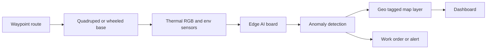
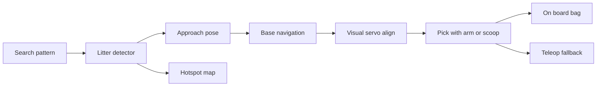
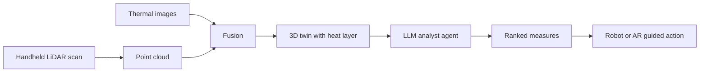

# T03 Sustainable City — Solution Patterns

[Track overview](T03-0-Track-Overview.md) · [Hardware shortlist](T03-2-Hardware-Shortlist.md) · [Cross-vendor solutions](T03-3-Cross-Vendor-Solutions.md)

**How to read this page:** architecture choices, effort ratings and "lessons" are my engineering judgement (inference). Product figures are vendor- or press-reported and cited. Tool descriptions come from prior knowledge; the tool home pages were checked for reachability today, but versions and features should be confirmed in each README. "⚠️ unverified" marks anything not confirmed today.

## Reference architectures

### Pattern A — Tabletop see-and-sort cell

**When to use:** waste sorting, tray clearing, parts triage, deposit return. Lowest risk, easiest to count. Same shape as the Intel Physical AI Challenge task (vision finds defects, arm sorts).

| Item | Choice |
|------|--------|
| Components | Fixed overhead RGB-D camera · hand-eye calibration · open-vocabulary detector or fine-tuned YOLO · top-down grasp from depth · vendor Cartesian motion API or MoveIt 2 · scale or counter · live dashboard |
| Variants | Suction instead of fingers for flat items · AR glasses show the decision to a human co-sorter · LLM maps item to local sorting rule in the guest's language |
| Main risk | **Grasping variety** (crushed cans, transparent PET, film, paper flat on the table). Mitigate with a restricted item set, a matte background, suction, and a "cannot grasp, ask human" bin |

### Pattern B — Patrol, sense and report

**When to use:** energy audit, plant-room inspection, meter reading, environmental monitoring, ice and snow mapping. The robot is a mobile sensor; value comes from the data layer.

| Item | Choice |
|------|--------|
| Components | Vendor navigation or Nav2 with a pre-built map · waypoint list · thermal camera and CO2 / PM / temperature sensors on a small microcontroller · VLM or classic CV for gauge reading and open-window detection · time-series store · map dashboard · LLM that turns anomalies into a short report |
| Variants | Teleoperated route on day 1, autonomous replay on day 2 · handheld LiDAR scan as the base map |
| Main risk | **Localisation and navigation eat the weekend.** Mitigate by using the vendor's built-in mapping, keeping the route short and indoors, and accepting a teleoperated route with autonomous sensing |

### Pattern C — Mobile find, pick and deposit

**When to use:** litter picking, planter care, collecting bottles after an event. Most visible on stage, highest integration load.

| Item | Choice |
|------|--------|
| Components | Mobile base with arm (or wheeled dual-arm, or quadruped with arm) · detector on base camera · approach controller · wrist-camera visual servoing · simple grasp primitive or learned pick policy · collection bag · hotspot map as secondary output |
| Variants | **Scout only**: quadruped detects and maps, human or second robot picks · passive scoop or magnetic picker instead of an arm |
| Main risk | **Base-to-arm hand-off** (stopping at a reachable pose, calibration between base and wrist camera). Mitigate with a fixed stand-off distance, AprilTag-free visual servoing on the wrist camera, and teleoperation for the last 10 cm if needed |

### Pattern D — Teleoperate, record, fine-tune, run

**When to use:** contact-rich or deformable tasks where scripting fails: plugging an EV connector, unscrewing, opening a device, bagging, handling fabric or film.

| Item | Choice |
|------|--------|
| Components | Teleoperation rig (leader arm, XR controllers, or vendor tool) · LeRobot dataset format · ACT or SmolVLA fine-tune on a rented or on-site GPU · policy rollout with human take-over · success classifier or simple sensor check |
| Reference numbers | SmolVLA base is a **450M-parameter** model; the LeRobot docs quote about **4 hours for 20k steps on one A100**. Community guidance puts a usable single-task dataset at roughly **50 or more clean episodes** (blog-level evidence, not a guarantee) |
| Main risk | **Zero-percent policy on Sunday night.** Mitigate by fixing camera poses and lighting before recording, keeping one narrow task, training a first model after 20–30 episodes to test the pipeline, and keeping teleoperation as the demo fallback (shared autonomy is a legitimate pitch) |

### Pattern E — Scan, twin, decide, act

**When to use:** building retrofit, energy planning, water and heat networks, waste-point planning. Good when robot slots are scarce; pair it with one physical action to stay a robotics entry.

| Item | Choice |
|------|--------|
| Components | Scanner export (point cloud or mesh) · thermal or sensor overlay · viewer (web 3D or Rerun) · rule- or LLM-based ranking of measures with kWh estimates · action step: robot patrol to the worst spots, or AR glasses guiding a technician |
| Main risk | **Looks like a software project.** Mitigate with one closed loop: the twin sends a robot to verify or fix the top-ranked finding |

## Building blocks

Effort: **S** = hours, **M** = half a day to a day, **L** = most of the weekend (for a team that has used the tool before; double it otherwise).

| Capability | Open-source tools / models | Notes on effort |
|------------|----------------------------|-----------------|
| Navigation and mapping | Nav2 (ROS 2) · slam_toolbox (2D) · RTAB-Map (RGB-D) · FAST-LIO (LiDAR odometry) · vendor built-in mapping and waypoint APIs | **S** with vendor navigation; **M–L** with Nav2 on an unfamiliar base. Prefer the vendor stack and a short route |
| Task logic | BehaviorTree.CPP · plain Python state machine | **S**. A 100-line state machine is enough and easier to debug at 3 am |
| Manipulation | MoveIt 2 · ros2_control · vendor Cartesian and force-control APIs · top-down grasp from depth · FoundationPose (6D pose of known objects) | **S** for top-down picks with vendor API; **M** for MoveIt 2 setup; **L** for general grasping |
| Perception: detection | Ultralytics YOLO (check the AGPL licence) · Grounding DINO (text-prompted) · SAM 2 (segmentation) · Roboflow supervision (tracking, counting) | **S** zero-shot with Grounding DINO; **M** to fine-tune YOLO on 200–500 own images taken under demo lighting |
| Perception: waste data | TACO (litter in context; the paper describes 1,500 images and 4,784 annotations) · TrashNet (six material classes) | **S** to bootstrap; expect a domain gap, so add your own photos of the exact demo items |
| Perception: scene and gauges | Hosted or local VLM for "is this window open", "read this gauge", "what material is this" | **S**. Cache and rate-limit; have a classic-CV fallback for the demo |
| Speech and LLM agents | faster-whisper (speech to text) · Piper (text to speech) · Ollama (local LLMs) · Model Context Protocol servers · ros-mcp-server (LLM tool calls into ROS) | **S–M**. Keep the LLM out of the control loop; let it choose among tested skills |
| VLA and imitation policies | LeRobot (ACT, Diffusion Policy, SmolVLA; v0.6.0 of July 2026 adds GR00T N1.7 and lists Unitree G1 support) · openpi (pi0 family) · Isaac-GR00T | **M–L**. Realistic for one narrow skill; needs GPU time and disciplined data collection |
| Teleoperation and shared autonomy | LeRobot leader-follower arms · Unitree xr_teleoperate (XR teleoperation) · LeRobot rollout with human corrections (DAgger, foot pedal) · vendor teleop suites | **S–M** if the vendor ships it. Doubles as data collection and as demo fallback |
| Simulation | MuJoCo · Isaac Lab · Genesis | **M–L**. Usually skip in 48 hours unless the vendor provides a ready scene |
| Dashboards | Rerun · Foxglove · Grafana with InfluxDB · Node-RED | **S**. Build it on day 1 so every test run produces numbers |
| Building and energy integration | Home Assistant (smart plugs, thermostats, sensors) · Node-RED flows | **S**. A smart plug with power metering gives a measured kWh figure quickly |
| Digital twins and 3D | Scanner vendor export · OpenDroneMap (photogrammetry) · gsplat (Gaussian splatting) | **M**. Budget time for processing and file conversion |
| Edge AI and transport | OpenVINO (Intel) · board vendor toolchains · Zenoh (robot-to-cloud data) | **M**. Model conversion and quantisation often fail on the first try; start early |

## State of the art — who already does this

Figures are vendor- or press-reported unless stated; no independent benchmark was found.

| Product or project | Organisation | What it does | Lesson for a 48-hour build |
|--------------------|--------------|--------------|----------------------------|
| AI sorting robot (customer case study) | Recycleye (UK) | Reported average of **55 successful picks/min**, **99 % target purity**, **12 % more target material** at one installation | Report purity and recovery, not just accuracy. Speed is not where a hackathon team competes |
| High Recovery Robot Cell | EverestLabs (US) | Reported **104 picks/min** versus 70 for its earlier delta system | Industrial cells use belts, suction and fixed cameras: constrain the scene the same way |
| MRF sorting robot at Circular Services, Sarasota | Glacier (US) | Up to **60 picks/min**, over **35,000 items/day** (news report, Oct 2026) | "Items per day" is an intuitive headline KPI; extrapolate yours transparently |
| Heavy-waste sorting robots | ZenRobotics, part of Terex (FI) | Robots for bulky construction and demolition waste | Different waste streams need different grippers; pick one stream |
| AMP sorting systems | AMP (US) | Large-scale AI sorting ⚠️ unverified (no current figures found today) | — |
| Adoption gap | Kingston University estimate | Fewer than **5 %** of UK waste facilities use such automation | Small, cheap, retrofit-friendly cells for small towns are an open niche (inference) |
| Autonomous litter robot for grass | Angsa Robotics (DE) | Picks small litter on lawns; about **1,000 m²/h**, about **8 h** battery, **30 L** capacity (vendor specs); six-month pilot in Mannheim parks in 2025, results not found | Small litter on grass is a detection problem first. Coverage rate plus recall are the right KPIs |
| SeaClear2.0 | EU Horizon project | Drones and underwater robots find and collect seabed litter; still needs human supervision; project ends Dec 2026 | Even funded multi-year projects keep a human in the loop: shared autonomy is acceptable |
| Rocsys M1 | Rocsys (NL) | Hands-free charging for robotaxi depots; one unit serves up to **10 vehicles**; in pilot, larger roll-out planned for 2027 | Sharing one arm across bays is the business case. Demo on a mock inlet with compliance |
| Mobile charging robot prototype | Volkswagen (DE) | Battery-carrying robot shown in Dresden in June 2026; plugs in autonomously or manually; no market date | Still prototype stage at an OEM: a credible plug-in demo is competitive |
| Charging robot pilot | Kiwi Charge (CA) | Robot charges cars in rotation in apartment garages and dealerships; pilot funded with 1.7M dollars | Fits car parks in dense resorts: one robot, many bays |
| Daisy | Apple (US) | Disassembles about **200 iPhones/hour**, 15 models (2018–2019 coverage) | Disassembly works when the product is known. Choose one product and one step |
| Thermal wastewater heat recovery, Burgerbad | Leukerbad spa with HUBER (CH) | Two heat exchangers recover about **450 kW** from roughly 30 °C spa wastewater; heat pump output over **1 MW** | Not a robot, but the local proof that resource recovery pays. Inspection and optimisation of such plants is a ready use case |
| Defect sorting with SO-101 arm | Intel Physical AI Challenge, European Robotics House (Zurich, Dec 2026) | Hackathon task: vision detects defective objects, arm sorts them | Organisers in this network consider see-and-sort the right scope for about 40 hours |
| Autonomous feed mixing on a robot-vacuum chassis | Siloking challenge, TUM robo.innovate 2026 | Hackathon challenge using a low-cost mobile base for a resource task | A cheap base with one clear job can carry a sustainability story |
| Legged industrial inspection | ANYbotics (CH) | Quadruped inspection of plants, including thermal and gas sensing ⚠️ unverified (prior knowledge, not checked today) | Swiss precedent for Pattern B |
| Precision spot spraying | Ecorobotix (CH) | Camera-guided spraying that cuts herbicide use strongly ⚠️ unverified (prior knowledge, not checked today) | "Same result with a fraction of the resource" is the cleanest T03 pitch form |

## 48-hour feasibility guide

**Published time frame:** kickoff Sat 11:00, submission Mon 13:00, demos from 13:30. Sleep and queueing for hardware will take a large share of the roughly 50 hours.

| Reliably works in a weekend | Usually does not |
|-----------------------------|------------------|
| Fixed camera + arm + restricted item set (Pattern A) | General grasping of arbitrary, crushed, wet or transparent waste |
| Zero-shot detection with a text-prompted model, then a quick fine-tune on own photos | Training a detector only on public datasets and expecting it to work under hall lighting |
| Vendor navigation with a short indoor route and waypoints | Outdoor autonomy on snow, slopes or in crowds |
| Thermal or sensor logging on a teleoperated or waypoint patrol | Robust autonomous multi-floor navigation with doors and lifts |
| One narrow learned skill from 50+ teleoperated episodes | A general VLA policy across several tasks or object types |
| LLM choosing between three to five tested skills | LLM generating low-level motion or free-form code at run time |
| Mock EV inlet with force-limited insertion | Real vehicle, live power, arbitrary parking pose |
| One disassembly step on one known product | Full disassembly of mixed e-waste, anything with lithium cells |
| A dashboard fed by every test run | A polished digital twin of the town |
| Shared autonomy with a clear human take-over | Fully unattended operation for the whole demo slot |

**Scoping rules (my advice)**

1. **Decide by Saturday 14:00**: one archetype, one robot, one KPI. Write the demo script before writing code.
2. **Book hardware and a mentor first.** Vendor SDK onboarding is the largest unknown; ask the vendor engineer for the shortest path to "move to pose" and "get camera frame".
3. **Hour 6 goal:** robot moves under your code, camera stream on your laptop, dashboard shows a dummy value.
4. **Hour 20 goal:** the full loop runs once, however badly. From here on, only improve reliability.
5. **Freeze features Sunday 20:00.** Monday morning is for 10 rehearsal runs, the backup video and the slides.
6. **Record a clean backup video on Sunday night.** Hardware fails during demos.
7. **Control the scene:** fixed lighting, matte background, marked floor positions, the exact items you trained on plus a few unseen ones for credibility.
8. **Measure as you go.** Log every run (success, time, energy). The KPI slide is then a by-product.
9. **Keep the impact claim small and defensible:** measured value in the hall, one cited factor, one clearly labelled extrapolation to Leukerbad.
10. **Team split for four people:** robot control · perception · data and dashboard · story, impact numbers and stakeholder talk.

## Idea bank

One line each; hardware class in brackets. All are suggestions (inference), not announced challenges.

1. **Guest-proof sorter** — arm sorts PET, aluminium, glass and paper and explains the local rule by voice in the guest's language. [arm / cobot + camera]
2. **Hackathon waste meter** — sort and weigh the event's own waste over the weekend; present real diversion numbers. [arm / cobot + scale + edge board]
3. **Thermal leak hound** — quadruped patrols the Sportarena, finds heat leaks, open doors and idle equipment, ranks them by estimated kW. [quadruped + thermal camera]
4. **Plant-room rounds** — legged robot reads analog gauges and pipe temperatures on a heat-recovery mock-up and writes the shift report. [quadruped + camera + edge board]
5. **Litter scout and picker** — quadruped maps litter hotspots; a mobile manipulator collects the mapped items. [quadruped + wheeled dual-arm]
6. **Tray-return cell** — dual-arm robot clears trays, separates organics, PET and glass, and logs food waste per meal. [wheeled dual-arm or humanoid]
7. **One arm, many bays** — force-controlled arm on a cart finds a mock charging inlet and plugs in, then moves to the next bay. [force-controlled arm]
8. **AR sorting coach** — glasses highlight the right bin for the item in your hand; a robot handles the remaining items. [XR + camera, optional arm]
9. **Rental-gear triage** — arm inspects ski or spa rental items (helmets, goggles, sandals), sorts into reuse, repair, recycle. [arm + camera, dexterous hand optional]
10. **Unscrew and separate** — teleoperation-trained policy removes the cover and one module from a single known device; dummy battery only. [arm + dexterous hand + XR teleop]
11. **Scan to retrofit list** — handheld LiDAR scan plus thermal images produce a 3D heat map and a ranked list of measures; robot revisits the top three spots. [scanner + compute, quadruped optional]
12. **Water-wise planter care** — mobile manipulator checks soil moisture and leaf health and waters only the plants that need it; reports litres saved. [wheeled dual-arm or arm on base]
13. **Salt only where it is icy** — patrol measures surface temperature and ice on walkways and outputs a targeted gritting map. [quadruped + thermal / IR sensor]
14. **Air and noise layer** — robot carries CO2, particulate and noise sensors along a route and publishes a live map for the municipality. [quadruped or wheeled base + sensors]
15. **Watts per pick** — the same sorting model on an edge board versus a GPU laptop, with live power draw and accuracy side by side. [edge-AI board + arm]

## Sources

Events and hackathon formats
- [Leukerbad Hackathon 2026 (Robotics, XR, and AI) — Luma](https://luma.com/vj13ns00)
- [Leukerbad Robot Carnival 2026 — Luma](https://luma.com/yo2pk18n)
- [Intel Physical AI Challenge | European Robotics House — Luma](https://luma.com/d3pjvggt)
- [TUM robo.innovate Hackathon](https://roboinnovate.mirmi.tum.de/hackathon/)

State of the art
- [A3 / automate.org: The next robotics opportunity may be hiding in our trash](https://www.automate.org/robotics/industry-insights/the-next-robotics-opportunity-may-be-hiding-in-our-trash) (search summary only)
- [FOX 13: How an AI-powered robot in Sarasota saves 35,000 recyclables a day](https://www.fox13news.com/news/how-ai-powered-robot-sarasota-saves-35000-recyclables-day) (search summary only)
- [GaLaBau trade fair news: autonomous garbage removal (Angsa Robotics)](https://www.galabau-messe.com/en/news/2024/article/autonomous-garbage-removal) (search summary only)
- [Euronews: EU deploys drones and robots to remove litter from the sea (SeaClear2.0)](https://www.euronews.com/2026/03/16/no-ordinary-clean-up-operation-eu-deploys-drones-and-robots-to-remove-litter-from-the-sea-) (search summary only)
- [EV Wire: Rocsys unveils hands-free robotaxi charging system details](https://evwire.com/p/rocsys-unveils-hands-free-robotaxi-charging-system-details) (search summary only)
- [newmobility.news: Volkswagen's charging butler shows its tricks in Dresden](https://newmobility.news/en/2026/06/10/volkswagens-charging-butler-shows-its-tricks-in-dresden/) (search summary only)
- [APMA: Kiwi Charge takes EV charging robot to showroom floor](https://www.apma.ca/post/kiwi-charge-takes-ev-charging-robot-to-showroom-floor-with-1-7-million-pilot-project) (search summary only)
- [Fortune: Apple's Daisy recycling robot](https://fortune.com/longform/apple-iphone-recycle-parts-old-iphones-daisy/) (search summary only)
- [HUBER case study: heat recovery from thermal spa wastewater in Leukerbad](https://www.huber-se.com/case-studies/detail/leukerbad-in-switzerland-uses-huber-heat-exchanger-for-heat-recovery-from-thermal-spa-wastewater/)

Learning-based control
- [Hugging Face blog: LeRobot v0.6.0](https://huggingface.co/blog/lerobot-release-v060)
- [LeRobot documentation: SmolVLA](https://huggingface.co/docs/lerobot/smolvla) (search summary only)
- [Hugging Face blog: SmolVLA](https://huggingface.co/blog/smolvla) (search summary only)
- [TACO: Trash Annotations in Context (arXiv 2003.06975)](https://arxiv.org/abs/2003.06975v2) (search summary only)

Tool home pages (reachability checked 2026-11-14; descriptions from prior knowledge)
- [Nav2](https://github.com/ros-navigation/navigation2) · [slam_toolbox](https://github.com/SteveMacenski/slam_toolbox) · [RTAB-Map ROS](https://github.com/introlab/rtabmap_ros) · [FAST-LIO](https://github.com/hku-mars/FAST_LIO)
- [MoveIt 2](https://github.com/moveit/moveit2) · [ros2_control](https://github.com/ros-controls/ros2_control) · [BehaviorTree.CPP](https://github.com/BehaviorTree/BehaviorTree.CPP) · [FoundationPose](https://github.com/NVlabs/FoundationPose)
- [Ultralytics YOLO](https://github.com/ultralytics/ultralytics) · [Grounding DINO](https://github.com/IDEA-Research/GroundingDINO) · [SAM 2](https://github.com/facebookresearch/sam2) · [supervision](https://github.com/roboflow/supervision) · [TACO dataset](https://github.com/pedropro/TACO) · [TrashNet](https://github.com/garythung/trashnet)
- [LeRobot](https://github.com/huggingface/lerobot) · [openpi](https://github.com/Physical-Intelligence/openpi) · [Isaac-GR00T](https://github.com/NVIDIA/Isaac-GR00T) · [Unitree xr_teleoperate](https://github.com/unitreerobotics/xr_teleoperate) · [Unitree SDK2](https://github.com/unitreerobotics/unitree_sdk2)
- [faster-whisper](https://github.com/SYSTRAN/faster-whisper) · [Piper](https://github.com/rhasspy/piper) · [Ollama](https://github.com/ollama/ollama) · [MCP servers](https://github.com/modelcontextprotocol/servers) · [ros-mcp-server](https://github.com/robotmcp/ros-mcp-server)
- [Rerun](https://github.com/rerun-io/rerun) · [Foxglove](https://github.com/foxglove) · [Grafana](https://github.com/grafana/grafana) · [InfluxDB](https://github.com/influxdata/influxdb) · [Node-RED](https://github.com/node-red/node-red) · [Home Assistant](https://github.com/home-assistant/core)
- [MuJoCo](https://github.com/google-deepmind/mujoco) · [Isaac Lab](https://github.com/isaac-sim/IsaacLab) · [Genesis](https://github.com/Genesis-Embodied-AI/Genesis) · [OpenDroneMap](https://github.com/OpenDroneMap/ODM) · [gsplat](https://github.com/nerfstudio-project/gsplat) · [OpenVINO](https://github.com/openvinotoolkit/openvino) · [Zenoh](https://github.com/eclipse-zenoh/zenoh)

Research note: the web-search quota for this session ran out before every planned check was done. Rows marked "⚠️ unverified" or sources marked "search summary only" should be re-checked before they are quoted in a pitch.
