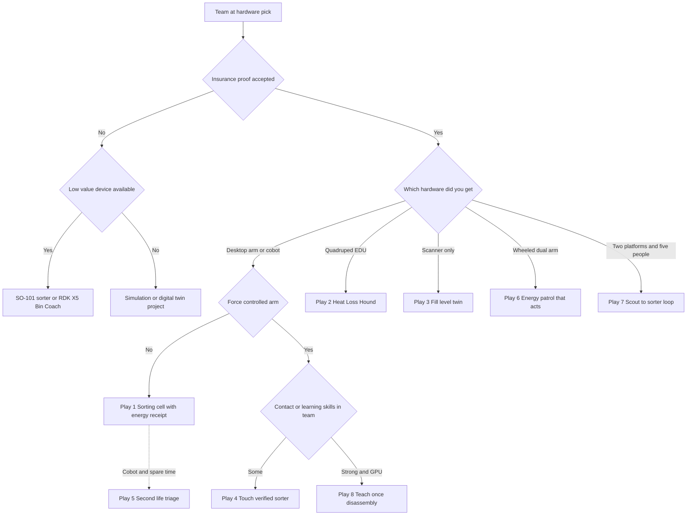

# T03 Sustainable City — Cross-Vendor Solutions

[Start here](../../00-START-HERE.md) · [Track overview](T03-0-Track-Overview.md) · [Official directions: who has what](T03-6-Official-Directions-Who-Has-What.md) · [Hardware shortlist](T03-2-Hardware-Shortlist.md) · [Solution patterns](T03-1-Solution-Patterns.md)

> **Official tagline:** Use robotics to drive a greener, more sustainable future.

**How to read this page**

- It is a synthesis of the company briefs and playbooks in this knowledge base. No new web research. Product facts come from those docs; ratings, rankings and "why it can win" lines are my judgement (inference).
- **No vendor has published which models are on site.** Every hardware line below means "if this unit is at the booth". Confirm in the first 30 minutes.
- **No company on site has a sustainability product.** The best fit score in this track is **3/5** (Dobot, Flexiv, Galaxea, Galbot, Genisom AI, ROKAE, SKYLANDX, Unitree). The sustainability logic, the sensors and the metric are always yours.
- Build window: **Sat 13:00 to Mon 12:00, about 47 hours**. Hour marks below (H0 = Sat 13:00) follow that. Judging: **technical quality · innovation · real-world value · completeness**.
- Safety for every play: **clean, dry mock waste · dummy battery cells only · unpowered mock sockets · no recording of people**. Details: [Track overview](T03-0-Track-Overview.md).

## Choose in five minutes

- **Insurance decides first.** Without proof of third-party liability cover for borrowed equipment you may not operate high-value robots yourself. Go to [If you have no insurance or no robot](#if-you-have-no-insurance-or-no-robot). Ask whether a vendor technician may run your code on the robot for the demo (some devices need a technician present anyway).
- **Fixed arm = safest path to "completeness".** A position-controlled desktop arm (Dobot) gives a working sorting loop on day 1 (Play 1). A force-controlled arm (Flexiv, ROKAE) adds touch as a sensor (Play 4), which is the cheapest way to raise the innovation score.
- **Quadruped = strongest Leukerbad story.** Thermal water, heated hotels and steep terrain fit a sensing patrol (Play 2). Only **EDU** units are programmable (Unitree Go2 Air / Pro and Magiclab PRO / base Z1 are not). You bring the thermal camera: **no vendor has confirmed a thermal or gas sensor on site**.
- **Scanner only = credible entry with little robot risk** (Play 3). Add a quadruped carrier or one physical action so it does not read as a pure software project.
- **Wheeled dual-arm robots are the most impressive and the least predictable** (Play 6). Take one only if the vendor engineers confirm SDK access and navigation in the first hour.
- **Two platforms need five people and a hard cut-off** (Play 7). Learned disassembly needs a GPU and prior teleoperation experience (Play 8). Both have a built-in fallback to a simpler play.

## Team plays — the strongest solutions for this track

Ordered from most reliable to most ambitious.

| # | Play | Core hardware | Add-ons | Directions | Reliability |
|---|---|---|---|---|---|
| 1 | Guest-proof sorting cell with an energy receipt | Dobot desktop arm or cobot | D-Robotics RDK X5, XREAL display | T03.1 · T03.6 · T03.3 | High |
| 2 | Heat-Loss Hound: energy and water leak patrol | Unitree Go2 EDU or Genisom quadruped | RDK X5, SKYLANDX scan, XREAL | T03.2 · T03.5 · T03.7 | High as sensing |
| 3 | Fill-level twin: collect and clear only when needed | SKYLANDX MetaCam Air 2 | Quadruped carrier, RDK X5, XREAL | T03.4 · T03.7 · T03.1 | High |
| 4 | Touch-verified sorter | Flexiv Rizon + Grav, or ROKAE xMate | RDK X5, XREAL display | T03.1 · T03.6 | Medium–high |
| 5 | Second-life triage station with a material passport | Dobot Nova cobot | RDK board, XREAL, force arm | T03.6 · T03.1 | Medium |
| 6 | Night energy patrol that acts | Galbot G1 or Galaxea R1 | SKYLANDX scan, RDK X5 | T03.5 · T03.4 · T03.2 | Medium–low |
| 7 | Scout-to-sorter loop | Quadruped + fixed arm cell | RDK X5, XREAL | T03.1 · T03.2 · T03.6 | Low linked, high as two halves |
| 8 | Teach-once disassembly cell for repair and reuse | Flexiv or ROKAE arm + WUJI, or Galaxea LEMO, or Dobot X-Trainer | XREAL, OriginFlow, RDK S100 | T03.6 | Low autonomous, medium shared |

### Play 1 — Guest-proof sorting cell with an energy receipt

- **Official direction(s) served:** T03.1 Smart waste sorting & collection · T03.6 Smart recycling & resource optimization · T03.3 Energy-efficient robotic systems.
- **Problem → value in Leukerbad:** visitors from many countries do not know Swiss separate-collection rules, and the resort has far more guest-nights than residents (figures in the [Track overview](T03-0-Track-Overview.md)). A desk-sized cell re-sorts light recyclables at a hotel, spa or event exit and prints an **energy receipt**: items diverted, contamination rate, **Wh per item**. Strongest evidence: sort the **hackathon's own waste** over the weekend and show measured numbers.
- **Hardware:**
  - Arm: Dobot **Magician E6** (6-axis, 750 g, 450 mm, 130 W) or **MG400** (4-axis, 500 g, top-down only, 150 W); Nova 2 / 5 if that is what is on site — [Dobot playbook](../../Companies/Dobot/T03-Sustainable-City/Dobot-T03-3-Playbook.md).
  - Vision brain: D-Robotics **RDK X5** (10 TOPS, 5 V supply, about USD 100–190 per board) — [D-Robotics playbook](../../Companies/D-Robotics/T03-Sustainable-City/D-Robotics-T03-3-Playbook.md).
  - Operator view: XREAL One-series glasses as a plain **USB-C display** — [XREAL playbook](../../Companies/XREAL/T03-Sustainable-City/XREAL-T03-3-Playbook.md).
  - Bring yourself: overhead USB / RealSense camera, suction cup or gripper check, kitchen scale per bin, plug-in power meter, USB-C power meter for the board.
- **Software stack:**
  - Perception on the X5: `hobot_yolo_world` open-vocabulary detection (classes as text, changed live on `/target_words`); fallback is a stock YOLO model from `rdk_model_zoo` or a detector on the laptop.
  - Bridge: detections arrive as D-Robotics `ai_msgs`; write a small relay node on the board that republishes a plain target pose (message names ⚠️ unverified in the developer guide).
  - Calibration: 4-point homography from camera pixels to the table.
  - Control: `TCP-IP-Python-V4` (MovJ / MovL + digital output for suction; controller firmware **V4.4.0.0+**) for E6 / Nova, `TCP-IP-4Axis-Python` for MG400.
  - Logic: Python state machine; low-confidence items go to a "human check" bin; the operator confirms in the glasses by key, pedal or voice and each correction is logged as a training label. No XREAL SDK needed.
  - Compute: vision on the X5, arm client and dashboard on a laptop. Show the same model on laptop versus X5 with live watts ("watts per pick").
- **Why it can win:**
  - Technical quality: closed perception-to-action loop across two vendors, confusion matrix on unseen items.
  - Innovation: low for plain sorting; the energy receipt, edge-versus-laptop comparison and the human-correction loop lift it to medium.
  - Real-world value: measured kg and Wh from the event itself, a per-node cost, a clear hotel / spa operator.
  - Completeness: the highest of all plays — the robot part is done on day 1.
- **48-hour outline:** H0–6 arm moving from Python, camera clamped, calibration, one scripted pick · H6–24 detector on 4–5 classes, closed loop, suction reliability per material · H24–40 dashboard, power metering, HUD and correction log, 100-item endurance run · H40–47 freeze, backup video, 10 rehearsal runs.
- **Main risk and fallback:** suction fails on crumpled or transparent items → restrict to rigid classes or switch to a gripper. YOLO-World vocabulary limits on the X5 are ⚠️ unverified → stock model or laptop detector. Arm taken → D-Robotics "Bin Coach" (camera node with LEDs, voice and a servo flap), which needs no robot.
- **Team profile it suits:** 3–4 Python generalists; no robotics experience needed. One person owns the numbers from hour 1.

### Play 2 — Heat-Loss Hound: energy and water leak patrol

- **Official direction(s) served:** T03.2 Environmental monitoring robots · T03.5 Water & energy management · T03.7 Environmental data collection & analysis.
- **Problem → value in Leukerbad:** thermal water, heat exchangers and year-round heated hotels, clinics and baths. Losses (open windows, warm pipes, steam and water leaks, lights on in empty rooms) go unnoticed between manual rounds. A legged patrol turns them into a **ranked, geo-located fix list** and reports its own **Wh per patrol**.
- **Hardware:**
  - Carrier: Unitree **Go2 EDU** (4D LiDAR L2, optional Orin; **must be EDU**) — [Unitree playbook](../../Companies/Unitree/T03-Sustainable-City/Unitree-T03-3-Playbook.md); or Genisom **L1 EDU** (Orin NX, 3D LiDAR, depth camera; IP54, 0–40 °C) / **L2** (IP66, −20 to 55 °C) — [Genisom AI playbook](../../Companies/Genisom-AI/T03-Sustainable-City/Genisom-AI-T03-3-Playbook.md).
  - Perception box: D-Robotics RDK X5 on the robot, powered from a USB-C power bank or the robot's supply (check voltage and current).
  - Base map: one SKYLANDX **MetaCam Air 2** scan of the route — [SKYLANDX playbook](../../Companies/SKYLANDX/T03-Sustainable-City/SKYLANDX-T03-3-Playbook.md).
  - Optional: XREAL One Pro + Eye + Beam Pro to pin readings in place ("Energy X-ray").
  - Bring yourself: **USB thermal camera** and a small CO2 / temperature / humidity board. None is confirmed from any vendor.
- **Software stack:**
  - Motion (Unitree): `unitree_sdk2_python` high-level sport client, velocity commands, obstacle avoidance on. Stay high-level. The developer guide found **no official Nav2 / SLAM bring-up** for Go2, so plan teach-and-repeat with odometry and visual markers at waypoints; `/utlidar/cloud` plus Point-LIO is the stretch.
  - Motion (Genisom): C++ SDK over UDP (no Python wrapper found); ask whether the on-robot RoamerX accepts waypoint goals from a laptop.
  - Perception: thermal threshold against ambient; YOLO-World for objects; `hobot_llamacpp` VLM on key frames for yes / no questions such as "is a window open" (about 20 tokens/s on the X5, so key frames only).
  - Data: finding = class, pose, photo, rough size class → web dashboard with pins on the MetaCam export (PLY / LAS, aligned by hand) → second run shows "fixed since last patrol".
  - Compute: board on the robot, dashboard on a laptop; no cloud required.
- **Why it can win:**
  - Technical quality: autonomy loop plus thermal and RGB fusion plus repeat-run comparison.
  - Innovation: medium (known pattern, new setting); VLM energy-waste questions and the 3D twin raise it.
  - Real-world value: the best local fit in the track; Unitree's inspection line lists a water plant and a hydropower station, Genisom lists wind-farm and water-utility inspection (customers and dates not public).
  - Completeness: high if the route is short; a teleoperated route with autonomous sensing is still a complete demo.
- **48-hour outline:** H0–6 confirm EDU and SDK link, drive from code, thermal stream, pick a 30–50 m loop · H6–24 repeatable patrol, anomaly detection on recorded data, findings with pose · H24–40 live integration, dashboard, battery-based Wh per patrol, 3–4 planted faults (kettle as warm pipe, open window) · H40–47 rehearse, backup video.
- **Main risk and fallback:** non-EDU dog → drive by remote and run perception only. Navigation drift → shorter route, markers. No thermal camera → RGB and VLM checks only (windows, lights, dripping taps). Never claim kWh you did not measure; label loss estimates as rough.
- **Team profile it suits:** one robot / ROS person (C++ if Genisom), one perception, one data and dashboard, one story and stakeholder. Good for teams that want to talk to the spa or municipality.

### Play 3 — Fill-level twin: collect and clear only when needed

- **Official direction(s) served:** T03.4 Sustainable urban infrastructure · T03.7 Environmental data collection & analysis · T03.1 (collection side) · T03.6 (resource optimization).
- **Problem → value in Leukerbad:** waste containers, grit and wood-chip stores and snow depots are served on fixed schedules in a town with road-only access. Measuring real volume lets crews drive only where needed: fewer truck trips, less fuel and noise.
- **Hardware:**
  - SKYLANDX **MetaCam Air 2** (619 g handheld, < 1 cm relative accuracy) + MetaCam Studio + Skyland Cloud viewer — [SKYLANDX playbook](../../Companies/SKYLANDX/T03-Sustainable-City/SKYLANDX-T03-3-Playbook.md).
  - Optional carrier for repeat scans: Unitree Go2 EDU, Genisom, Magiclab MagicDog EDU or AGIBOT D1, with MetaCam Hub (⚠️ availability unconfirmed) or an improvised rigid mount.
  - Optional: one RDK X5 "Bin Coach" node on a bin for item-level counts; XREAL glasses to show fill level on site.
- **Software stack:**
  - **Safe data path = file export** (LAS / PLY / E57 from MetaCam Studio) into your own Python. Live Rosbridge access is "contact SKYLANDX" — treat as a bonus (`roslibpy` client).
  - Analysis: Open3D or CloudCompare — align scan A and B, ground-plane fit, 2.5D volume and difference map; Studio's stockpile tool gives a reference number.
  - Decision: rule or route optimiser ("visit only sites above 70 % fill"), km and CO2 avoided with every assumption on screen.
  - Compute: laptop; cloud only for the shareable 3D view.
- **Why it can win:**
  - Technical quality: registration with error bars, one volume validated against a tape measure.
  - Innovation: low–medium handheld; medium–high once a quadruped repeats the scan autonomously.
  - Real-world value: a number a works department can use on Monday.
  - Completeness: high — the handheld version works without any robot.
- **48-hour outline:** H0–6 get a scanner, scan one test pile, confirm export and file sizes, volume script on sample data · H6–24 scan 3–5 sites or mock piles at two points in time, alignment and difference pipeline · H24–40 dashboard with map, fill, trend and trip plan; mount on a carrier and run two rounds with a staged change · H40–47 polish, one scene in the cloud viewer, rehearse.
- **Main risk and fallback:** "looks like a software project" → add the carrier robot or let the twin dispatch a robot to the fullest site. Snow and wet surfaces return poorly → cardboard, wood chips or gravel. No Studio licence on your laptop → ask staff to export. No robot → push the scanner on a trolley.
- **Team profile it suits:** 2–4 people strong in Python geometry and data; one robot person if a carrier is used. Good when robot slots are scarce.

### Play 4 — Touch-verified sorter

- **Official direction(s) served:** T03.1 Smart waste sorting & collection · T03.6 Smart recycling & resource optimization.
- **Problem → value in Leukerbad:** cameras confuse look-alike materials (clear PET versus glass, foil-lined carton versus can). Contaminated batches are the real cost in recycling. A gentle squeeze and a weight reading settle the class: purer fractions from hotel and spa back-of-house.
- **Hardware:**
  - Flexiv **Rizon 4 / 4s** (4 kg, force sensing 0.1 / 0.03 N, IP65 arm) + **Grav** gripper (1–100 N, IP67) — [Flexiv playbook](../../Companies/Flexiv/T03-Sustainable-City/Flexiv-T03-3-Playbook.md).
  - Or ROKAE **xMate SR5** (5 kg, 919 mm, 48 VDC) / **CR7** (7 kg, IP67) with your own gripper — [ROKAE playbook](../../Companies/ROKAE/T03-Sustainable-City/ROKAE-T03-3-Playbook.md).
  - Optional: RDK X5 for edge vision (naming trap: D-Robotics "RDK" is a board, Flexiv "RDK" is an SDK); XREAL display for the uncertain items.
  - Bring yourself: overhead camera. Neither arm vendor supplies a camera or vision stack.
- **Software stack:**
  - Flexiv: `flexivrdk` **non-real-time primitives** and Cartesian motion-force commands from Python (no real-time kernel needed). Rizon arms use **RDK v1.9.x**, not v2.x — pin the pip version to the robot software. The RDK licence must be active on the robot, wired LAN, Remote mode. 1 kHz streaming needs the Professional licence and is not required here.
  - Touch feature: close the gripper at 2–3 force levels, log finger width → stiffness; arm wrench → weight. Fuse vision class + stiffness + weight in a tiny classifier.
  - ROKAE: xCore SDK Python motion + digital I/O gripper; press until a contact-force threshold. Reading force from Python is ⚠️ unverified — fallback is the controller's contact detection as a binary touch signal.
  - Compute: laptop; no GPU needed with a small detector.
- **Why it can win:**
  - Technical quality: a measured accuracy gain, **vision-only versus vision + touch**, on the same items.
  - Innovation: multimodal material identification by touch; rare at hackathons.
  - Real-world value: purity is what recyclers pay for; IP65 / IP67 hardware suits wet streams (demo stays clean and dry).
  - Completeness: good once the licence and SDK version are confirmed in hour 1.
- **48-hour outline:** H0–6 RDK connection and examples, gripper force control, camera-to-robot calibration · H6–24 pick-and-place on 4 classes, squeeze curves for about 20 objects per class · H24–40 fusion classifier, confusion matrices, dashboard, live squeeze plot · H40–47 robustness runs, backup video.
- **Main risk and fallback:** licence or version wall → find out before designing. Grav width and force update rate is an open question for the Flexiv engineers. Camera fails → pure touch sorting from a fixed pick point still shows the idea. Arm unavailable → Play 1 with a kitchen scale as the second modality.
- **Team profile it suits:** 3–4 people, one comfortable with robot control and contact, one perception, one data. Suits teams that like measurement.

### Play 5 — Second-life triage station with a material passport

- **Official direction(s) served:** T03.6 Smart recycling & resource optimization · T03.1 Smart waste sorting & collection.
- **Problem → value in Leukerbad:** loose batteries and small devices in residual waste are a fire risk and a lost resource, and a remote valley pays for every transport. A station **inspects, tests and grades** each item into reuse / repair / recycle / hazardous and logs it.
- **Hardware:**
  - Dobot **Nova 2 or Nova 5** (2 / 5 kg; CR3A or Magician E6 also work) + gripper — [Dobot playbook](../../Companies/Dobot/T03-Sustainable-City/Dobot-T03-3-Playbook.md).
  - Two cameras (overhead, close-up) and a test fixture: contact pads to an ADC on an Arduino or a D-Robotics RDK board for open-circuit voltage.
  - Optional: XREAL glasses show each item's grade; a Flexiv or ROKAE arm adds one force-controlled step (opening a cover).
  - **Dummy or discharged cells only. Never damaged lithium cells.**
- **Software stack:** `TCP-IP-Python-V4`, or `DOBOT_6Axis_ROS2_V4` with MoveIt for collision-aware motion around the fixture · VLM or OCR reads chemistry and label and flags swelling · rule table (chemistry + voltage + damage → bin) · every item written to a CSV "material passport" · laptop compute, VLM local or cloud.
- **Why it can win:**
  - Technical quality: multi-sensor decision (image + label + voltage) with a full log.
  - Innovation: medium–high; grading is fresher than sorting.
  - Real-world value: Dobot has a real circular-economy reference to cite — **Breezy (Poland)** uses Nova cobots to test, inspect and grade used electronics (case study undated ⚠️).
  - Completeness: good if scope stays at 3 battery types.
- **48-hour outline:** H0–6 arm, gripper, fixture mock-up, voltage over serial · H6–24 pick → close-up → fixture → bin, label reading on 3 types · H24–40 damage check, passport log, dashboard, one small-device class · H40–47 rehearse, backup video.
- **Main risk and fallback:** small round cells are hard to grasp → V-groove tray and suction. Label reading unreliable → size / shape class plus voltage. Fixture not ready by H24 → fall back to Play 1 on the same arm.
- **Team profile it suits:** 3–4 people including one hardware tinkerer for the fixture.

### Play 6 — Night energy patrol that acts

- **Official direction(s) served:** T03.5 Water & energy management · T03.4 Sustainable urban infrastructure · T03.2 Environmental monitoring robots.
- **Problem → value in Leukerbad:** old hotel and holiday-flat stock wastes heat through lights left on, tilted windows and high thermostats, and smart-building retrofits are costly. Most inspection robots only report. A mobile manipulator **also acts** on the existing switches and dials: retrofit-free building automation.
- **Hardware:**
  - Galbot **G1** (wheeled dual-arm, 5 kg per arm, wrist reach floor to 2.1 m, 8 h, wrist force sensors) — [Galbot playbook](../../Companies/Galbot/T03-Sustainable-City/Galbot-T03-3-Playbook.md).
  - Or Galaxea **R1 Pro** / **R1 Lite** — [Galaxea playbook](../../Companies/Galaxea/T03-Sustainable-City/Galaxea-T03-3-Playbook.md).
  - Mock wall: rocker light switch, radiator thermostat dial, window handle.
  - Optional: SKYLANDX scan as the venue map (map format conversion ⚠️ unverified), RDK X5 for low-power detection, a temperature / CO2 sensor on the robot.
- **Software stack:**
  - Galbot: GalbotSDK (C++ / Python) high-level navigation between waypoints on a pre-built map and high-level arm motion; wrist force sensing limits contact force.
  - Galaxea: scripted or teleoperation-learned primitives over ROS 2; G0.5 may handle panel interaction zero-shot (⚠️ unverified — test in hour 1).
  - Perception: VLM checklist per waypoint (light on, window open, meter value) on a laptop or cloud.
  - Reporting: findings, actions and estimated kWh with the calculation shown.
- **Why it can win:**
  - Technical quality: mobile manipulation with perception-driven action.
  - Innovation: high — inspect **and** act.
  - Real-world value: strong narrative for a heating-dominated alpine town; needs honest numbers and the robot's own energy use.
  - Completeness: the weak point; scope to one reliable action.
- **48-hour outline:** H0–6 confirm navigation, mapping and SDK level with the vendor; build the mock wall; test reach · H6–24 VLM state detection, one reliable primitive (light switch) · H24–40 second primitive, two-waypoint patrol, dashboard · H40–47 full runs, backup video.
- **Main risk and fallback:** switch pressing is fiddly → 3D-print a paddle over the switch, or report-only plus a smart plug. Navigation fails → rooms side by side on one wall. Galbot's own "site inspection" kit is only planned, so everything is custom. Robot unavailable → the same detection on a quadruped (Play 2).
- **Team profile it suits:** 4–5 people with mobile-manipulation experience and a vendor engineer willing to help.

### Play 7 — Scout-to-sorter loop

- **Official direction(s) served:** T03.1 Smart waste sorting & collection · T03.2 Environmental monitoring robots · T03.6 Smart recycling & resource optimization.
- **Problem → value in Leukerbad:** collection is the expensive part of recycling in a steep, pedestrian resort. A legged scout covers stairs and paths, maps litter and bin fill, and carries items to an indoor station that sorts and logs them.
- **Hardware:**
  - Scout: Unitree Go2 EDU, Genisom L1 / L2, AGIBOT D1 or Magiclab MagicDog EDU with a carry basket and an RDK X5.
  - Station: the cell from Play 1 or Play 4 (Dobot, Flexiv or ROKAE), or a Galbot G1 / Galaxea R1.
  - Optional: XREAL glasses for the operator; SKYLANDX scan as the shared map.
  - Playbooks: [Unitree](../../Companies/Unitree/T03-Sustainable-City/Unitree-T03-3-Playbook.md) · [Genisom AI](../../Companies/Genisom-AI/T03-Sustainable-City/Genisom-AI-T03-3-Playbook.md) · [Galbot](../../Companies/Galbot/T03-Sustainable-City/Galbot-T03-3-Playbook.md) · [ROKAE](../../Companies/ROKAE/T03-Sustainable-City/ROKAE-T03-3-Playbook.md).
- **Software stack:**
  - Each robot stays on its own vendor SDK. The interface is **one message** ("item delivered at station") over a ROS 2 topic, MQTT or HTTP.
  - Hand-over through a **passive tray or basket**; no robot-to-robot grasping. A person or the arm loads the basket. Docking by floor marks or AprilTags.
  - Scout perception: YOLO-World litter classes and bin state, pose-tagged; a small routing script outputs the pick-up order and "km saved versus fixed round".
  - Optional agent: an LLM chooses among 3–5 tested skills. `unitree_robotskills` shows the pattern (bounded tools, observe → reason → act → verify) but targets G1-D and R1-D; reuse the idea, not the code.
- **Why it can win:**
  - Technical quality: heterogeneous multi-robot system with a clean interface.
  - Innovation: high at system level.
  - Real-world value: a full loop from "found" to "sorted"; the quadruped covers terrain a wheeled robot cannot.
  - Completeness: only if both halves work alone first.
- **48-hour outline:** H0–6 split into scout and station sub-teams, agree message and hand-over point · H6–24 each half works stand-alone (these are Play 2-style patrol and Play 1) · H24–36 integrate hand-over and dispatcher · **H36 hard decision**: linked demo or two segments · H40–47 rehearse the single golden path.
- **Main risk and fallback:** two SDKs and two vendor teams → fall back to Play 1 and the scout shown side by side, with a human carrying the basket. Outdoor use depends on organiser permission and on the unit (Go2 has no weather rating) → indoor mock street.
- **Team profile it suits:** exactly 5 people, one integration lead, one person per vendor from hour 0.

### Play 8 — Teach-once disassembly cell for repair and reuse

- **Official direction(s) served:** T03.6 Smart recycling & resource optimization.
- **Problem → value in Leukerbad:** rental gear, e-bike packs and hotel electronics are shredded because opening them is manual. A cell that unscrews, unclips and separates parts by feel, taught by a human once, makes local repair and battery-safe recycling cheaper. Local link is moderate (ski and e-bike rental); the innovation score is the reason to do it.
- **Hardware (pick one route):**
  - Force route: Flexiv **Rizon 4s + Grav** or ROKAE **AR5 / SR5** with a screwdriver bit, plus **Wuji Glove + Wuji Hand** for clips and connectors (flange fit ⚠️ unverified; hand is IP40) — [Flexiv](../../Companies/Flexiv/T03-Sustainable-City/Flexiv-T03-3-Playbook.md) · [WUJI playbook](../../Companies/WUJI/T03-Sustainable-City/WUJI-T03-3-Playbook.md).
  - Dual-arm route: Galaxea **LEMO** with A1Z-T leader arms (if on site) — [Galaxea playbook](../../Companies/Galaxea/T03-Sustainable-City/Galaxea-T03-3-Playbook.md).
  - Teleop-kit route: Dobot **X-Trainer** (2 × Nova 2 with leader handles; training stack poorly documented).
  - Add-ons: XREAL glasses as operator view; OriginFlow kit for grip-force capture **only if the booth offers data export** (no public SDK); RDK S100 to run an ACT policy on-board (stretch).
  - **Dummy battery housing, no live cells.**
- **Software stack:**
  - Scripted skills first: Flexiv contact, hole-search and compliant-insertion primitives with success checks from force and torque; a behaviour tree or LLM only sequences tested skills.
  - Teleoperation: glove skeleton → Wuji SDK `RetargetSession` → hand; arm on **pre-taught poses** stepped by pedal or key (the glove tracks fingers, not a global wrist pose — confirm with WUJI). One **MCAP per episode**.
  - Learning (one step only): 50–100 teleoperated episodes in LeRobot format → ACT. Flexiv Trainer needs a leader **and** a follower arm. `wuji-openpi` ships no checkpoints. Full G0.5 fine-tuning needs more than 70 GB VRAM.
  - Compute: laptop plus a GPU for training; inference on a laptop GPU.
- **Why it can win:**
  - Technical quality: contact-rich control with force traces as success checks and one live recovery.
  - Innovation: the highest in the track.
  - Real-world value: battery reuse and right-to-repair; say honestly which steps are autonomous.
  - Completeness: only with ruthless scoping — one product, three skills.
- **48-hour outline:** H0–6 secure arm and hand slots, pick ONE device with 4 visible screws, build the fixture, confirm SDK access to force · H6–24 scripted unscrew and lid lift with force checks; teleop working; record 50+ episodes of the hard step · H24–40 train, evaluate, part sorting into reuse / recycle / hazardous, skill sequencer · H40–47 20-trial success rate, teleop fallback rehearsed.
- **Main risk and fallback:** mounting eats day 1 → hand on a desk stand, items handed in by a person. Policy at zero on Sunday night → **shared autonomy** (human teleoperates the hard 5 seconds), pre-loosened fasteners, say so. Scope explosion → "remove cover and sort two parts".
- **Team profile it suits:** 4–5 experienced people: force control, teleoperation and imitation learning, mechanical fixture, GPU access.

## Best combination per official direction

| Direction | Strongest platform | Add-ons | One-line concept | Open |
|---|---|---|---|---|
| T03.1 Smart waste sorting & collection | Dobot Magician E6 / MG400 / Nova (fastest), Flexiv Rizon + Grav (smartest) | D-Robotics RDK X5, XREAL display, quadruped for collection | Sorting cell with an energy receipt (Play 1), touch-verified (Play 4), fed by a scout (Play 7) | Which arms and end-effectors are on site; suction on crumpled or clear items |
| T03.2 Environmental monitoring robots | Unitree Go2 EDU; Genisom L2 for outdoor (IP66, −20 to 55 °C) | RDK X5, own thermal / CO2 sensors, SKYLANDX base map | Patrol that pins heat, air and litter findings on a map (Play 2) | No thermal or gas payload confirmed; EDU variant; may robots leave the hall |
| T03.3 Energy-efficient robotic systems | D-Robotics RDK X5 (5 V supply) with a Dobot arm (100–150 W class) | Omnicor AI if they port your model on site; WUJI Hand gen 1 per-joint current; coprod co:power telemetry (⚠️ quantities unverified) | "Watts per pick": same task on edge board versus laptop GPU, with a live joules-per-item meter (inside Play 1) | No measured X5 power figure published — bring a meter; Omnicor has nothing self-serve |
| T03.4 Sustainable urban infrastructure | SKYLANDX MetaCam Air 2 | Quadruped carrier, XREAL overlay, Flexiv arm for a mock charger plug-in | Fill-level or retrofit twin (Play 3); alternative: force-guided charger plug-in on an unpowered socket ([Flexiv Concept 2](../../Companies/Flexiv/T03-Sustainable-City/Flexiv-T03-3-Playbook.md)) | Studio licence, cloud processing time, Hub availability |
| T03.5 Water & energy management | Unitree Go2 EDU or Genisom quadruped (sense); Galbot G1 or Galaxea R1 Pro (act) | RDK X5 VLM for gauges and windows, thermal camera, SKYLANDX map | Plant-room and corridor rounds: read gauges, find leaks, switch off what is wasted (Plays 2 and 6) | Access to a real plant room or spa operator; thermal camera |
| T03.6 Smart recycling & resource optimization | Flexiv Rizon + Grav or ROKAE xMate (contact); Dobot Nova (grading) | WUJI Glove + Hand, XREAL, OriginFlow, Galaxea LEMO | Second-life triage with a material passport (Play 5) or teach-once disassembly (Play 8) | Force access from Python on ROKAE; hand mounting; GPU for training |
| T03.7 Environmental data collection & analysis | SKYLANDX MetaCam Air 2 + Genisom or Unitree carrier | RDK X5 nodes (about USD 100–190 each), XREAL "Energy X-ray" | Repeat scans and sensor rounds build a geo-referenced layer with change alerts (Plays 2 and 3) | Rosbridge access to live scanner data; registration between robot map and scan is manual |

## What pairs with what

Notes come from the "cross-vendor combos" tables in the company playbooks. Effort: low / medium / high for a 47-hour build. "—" means no useful pairing.

| Base platform | XR glasses (XREAL) | 3D scanner (SKYLANDX) | Edge compute (D-Robotics, Omnicor) | Dexterous hand (WUJI, Leadshine) | Agent / AI software | EMG data capture (OriginFlow) |
|---|---|---|---|---|---|---|
| **Dobot E6 / MG400 / Nova** | Sorting HUD as USB-C display. **Low** | Offline scan of the waste room. Low, presentation value only | X5 detections → TCP/IP to the arm. **Low**, best low-power story | Desktop arms carry under 1 kg, a Wuji Hand weighs about 0.6–0.9 kg: only on Nova 5 / CR class. Medium | LLM picks among tested skills; no vendor model. Dobot ships no waste dataset | With X-Trainer for demonstrations. High, unproven |
| **Flexiv Rizon + Grav** | Class, confidence and force trace over the cell. Low–medium | Scan of a part for refinishing paths. Medium | X5 vision over LAN / ROS 2. Low | Wuji Hand for clips and cables. **High**, flange fit ⚠️ unverified | Behaviour tree or LLM sequences force primitives; Flexiv Trainer for one learned step | Grip-force estimates to set force limits, only with data export. High |
| **ROKAE xMate SR / CR / AR** | Operator overlay for exceptions. Medium–high | Offline workspace scan. Low | X5 perception, results over network. Low–medium | Wuji Hand. Medium–high | Galbot / Galaxea / Spirit AI grasp models: portability ⚠️ unverified | Demonstration capture. Medium–high |
| **Unitree Go2 EDU** | Crew sees leak and litter pins in AR. Medium (marker registration) | Base map of the site. **Low**, frames aligned by hand | X5 on board over Ethernet + DDS / ROS 2. Low–medium | — | `unitree_robotskills` pattern (written for G1-D / R1-D) | — |
| **Genisom L1 / L2** | Technician sees heat pins in place. Medium | Map and twin. Medium (conversion to PCD / 3DGS; MATRiX import ⚠️ unverified) | X5 on the power rail. Low–medium (check voltage, current) | — | `genisom_vln` language tasking (real-robot use not documented) | — |
| **Magiclab MagicDog EDU · AGIBOT D1** | AR overlay of findings. Medium | Carrier for repeat scans. Medium | X5 as sensor brain. Low–medium | AGIBOT's own OmniPicker 3 gripper can sit on another vendor's arm | — | — |
| **Galaxea LEMO / R1** | Operator overlay for "unknown item". Low–medium | Room map for the energy patrol. Medium ⚠️ unverified | X5 classifier on a few watts. Low | Wuji Hand. **High**, risky in 48 h | Binabik Studio runs on R1 Pro (request access only); G0.5 with language prompts | Expert demonstrations. High, research-grade |
| **Galbot G1** | Operator corrects sorting decisions. Low–medium | Venue scan for patrol route. Medium ⚠️ unverified | X5 over the bin, robot wakes only when needed. Low | Third-party hand mounting and drivers ⚠️ unverified. High | GraspVLA served from a laptop (about 9 GB VRAM); Omnicor lists Galbot as a customer (scope not public) | — |
| **Unitree G1 EDU + Dex3-1** | `xr_teleoperate` supports Apple Vision Pro, PICO 4 Ultra Enterprise, Meta Quest 3; **XREAL not confirmed** | — | Off-board GPU for training | Wuji Hand: high, not advised in 48 h | `unitree_lerobot` (ACT, Pi0, GR00T) | High / unproven ⚠️ |
| **AGIBOT G2 · Spirit AI Moz1 · UniX Wanda** | Operator or audit overlay | Building map | D-Robotics classifier; Spirit v1.5 was ported to the D-Robotics S600 (no figures published) | — | Binabik Studio on AgiBot G2; GO-1 and Spirit v1.5 open weights; UniX has no public SDK | — |

Rules of thumb:

- **Lowest-effort add-ons:** D-Robotics RDK X5 (detections over the network) and XREAL as a plain display. Each can be added in half a day.
- **Highest-effort add-ons:** a third-party hand on any arm, and anything that needs an undocumented interface (OriginFlow, Omnicor, Binabik, coprod, live SKYLANDX stream). Use them only with the vendor's engineer next to you.
- **Never share control between two vendors' robots.** Exchange one message and a passive tray.

## If you have no insurance or no robot

The rules allow software, AI, simulation and digital-twin projects and organiser-approved low-value devices (the site names the **LeRobot SO-101**). Pair every idea with **one physical or measured element** so it still scores on completeness. Whether an edge board, XR glasses or a handheld scanner count as "low-value" is ⚠️ unconfirmed — ask at the hardware desk.

| # | Idea | Tools named in the company docs | What you show |
|---|---|---|---|
| 1 | **Bin Coach** — smart recycling point without a robot | D-Robotics RDK X5, `hobot_yolo_world`, `rdk_model_zoo`, `hobot_llamacpp`, GPIO LEDs / PWM servo flap, TTS node; older `mono2d_trash_detection` node as reference | Hold up an item, the right bin lights up, contamination dashboard, watts on a USB-C meter |
| 2 | **SO-101 defect and recyclables sorter** | LeRobot (ACT, SmolVLA) on the SO-101; D-Robotics documents an ACT recipe with BPU inference on RDK S100 / X5 for **SO-100** arms (`rdk_LeRobot_tools`; SO-101 compatibility not stated — ask) | 50+ teleoperated episodes, a policy that sorts 3 item types, optionally with no external GPU connected |
| 3 | **Energy audit mission in simulation** | Genisom **MATRiX** simulator (RGB, infrared, depth and LiDAR), `genisom_roamerx_open` (ROS 2 / Nav2), `genisom_vln` (zero-shot, VLM-based) | Type "where do we waste heat on level 2", the simulated dog walks the route and reports; a vendor engineer may run the same route on the real robot |
| 4 | **Sorting policy trained in simulation** | Galaxea `GalaxeaManipSim` (30+ environments, scripted demo generation, LeRobot export) and Open-World Dataset; Unitree `unitree_sim_isaaclab` (G1 pick-place tasks, `xr_teleoperate` connects directly); AGIBOT Genie Sim with GO-1 open weights; Spirit v1.5 "move objects into box" checkpoint (MIT) | Success rate of a bin-sorting task in sim, with a clear path to the real robot |
| 5 | **Retrofit or fill-level twin from scans** | SKYLANDX exports (LAS / PLY / E57) from MetaCam Studio, Open3D, CloudCompare, Skyland Cloud viewer; XREAL glasses to pin results | Wall and window areas or pile volumes with error bars, ranked measures, trip plan (ask staff to scan if you may not handle the device) |
| 6 | **Touch sorter or charger scheduler against a simulated arm** | Flexiv Elements Studio simulated robot (same RDK script later targets the real serial number), `flexiv_ros2` fake hardware + MoveIt, `flexiv_description` URDF | Full task logic running in simulation; a Flexiv engineer runs the final script on the real arm if allowed |

Also possible: an **AR sorting coach** with XREAL One Pro + Eye + Beam Pro and a laptop classifier ("look at item → label → right bin"). Budget the first day for the Unity and Android toolchain.

## If your first-choice hardware is taken

| First choice | Plan B | Plan C | What changes in the build |
|---|---|---|---|
| Dobot Magician E6 / MG400 | Dobot Nova 2 / 5 or CR3A | ROKAE xMate SR5, Flexiv Rizon, or Galaxea LEMO | E6, Nova and CRA share the V4 TCP/IP API (same code); MG400 needs the separate 4-axis repo. Another vendor means a new SDK and a first-hour licence / version check, but more payload and force control |
| Flexiv Rizon + Grav | ROKAE xMate SR5 / CR7 | Dobot arm + kitchen scale as second modality | ROKAE: gripper and camera not confirmed as supplied, force readout from Python ⚠️ unverified. Dobot: drop the squeeze test, keep weight; innovation score drops |
| Unitree Go2 EDU | Genisom L1 EDU / L2 | Magiclab MagicDog EDU or AGIBOT D1 Ultra / Edu | Genisom: C++-only SDK, built-in navigation to confirm. Magiclab: ROS 2 SDK on Foxy / Iron over a wired link, with SLAM and goal-pose navigation included. Last resort: sensor box on a trolley, same data pipeline |
| Galbot G1 | Galaxea R1 Pro / R1 Lite | Spirit AI Moz1, UniX Wanda or AGIBOT G2 | Galaxea: ROS 2 plus teleoperation, policy server needs an off-board GPU. Spirit AI: Chinese-only docs. UniX: no public SDK, you may only orchestrate pre-loaded skills. AGIBOT G2: depends on Genie Studio access and staff |
| Galaxea LEMO (learned dual-arm) | Dobot X-Trainer | Unitree G1 EDU + `xr_teleoperate` + `unitree_lerobot` | Data stays in LeRobot format; teleoperation rig and training entry point change. G1 adds balance risk: sit or support the robot |
| SKYLANDX MetaCam | Robot's own LiDAR map (Go2 L2 LiDAR, Genisom 3D LiDAR) | Photogrammetry or a hand-drawn floor plan | Lower accuracy; volumes become rough. Keep the dashboard and the decision rule unchanged |
| D-Robotics RDK X5 | Robot's on-board computer (Orin on Go2 EDU, Orin NX on Genisom L1 EDU, AGX Orin on Galbot G1) | Laptop GPU | Detection code moves off the board; you lose the low-power claim unless you still meter the power |
| XREAL glasses | Monitor or tablet | — | Nothing in the logic; mirror the HUD on a screen for the jury in any case |
| WUJI Hand | Leadshine DH116 hand (LHandProLib SDK, C++ / Python) | Vendor gripper (Flexiv Grav, AGIBOT OmniPicker 3) | No glove teleoperation with the DH116; with a gripper, choose a device that opens with screws rather than clips |

## Approach comparison

| Approach | Technical depth | Demo reliability | Innovation | Real-world value | Completeness in 47 h |
|---|---|---|---|---|---|
| Scripted tabletop sorting cell (Play 1) | Medium — closed loop, two vendors | **High** — controlled scene | Low–medium — needs the energy receipt | High — countable kg and Wh | **High** |
| Touch-verified sorting (Play 4) | Medium–high — force as sensor | Medium–high — licence gate | **High** — measured gain | High — purity | Medium–high |
| Patrol, sense and report (Play 2) | Medium — fusion and autonomy | High as teleop route, medium autonomous | Medium — known pattern | **High** — best local fit | High |
| Scan to twin (Play 3) | Medium — registration, error bars | **High** — offline processing | Low–medium handheld, higher on a robot | High — trips saved | High |
| Grading station (Play 5) | Medium–high — multi-sensor rules | Medium — small parts | Medium–high | High — fire risk, reuse | Medium |
| Mobile manipulator inspects and acts (Play 6) | **High** — navigation plus manipulation | Low–medium — fiddly contacts | High | Medium–high — needs honest kWh | Low–medium |
| Multi-robot loop (Play 7) | High — system integration | Low linked, high as two halves | High | Medium — story beats throughput | Low–medium |
| Teleoperate, learn, disassemble (Play 8) | **High** — contact-rich, learned | Low autonomous, medium shared autonomy | **High** | Medium — long-term | Low |
| Edge-only smart bin, no robot | Low–medium — on-device AI | **High** | Low | Medium — signage and data | High, but barely a robot |
| Simulation or twin only | Medium | High | Medium | Low–medium without a real measurement | Medium — add one physical element |

Reading the table (my view): **Play 1 or Play 2 with one upgrade** (touch, twin, or the event's own measured data) is the best expected score across the four criteria. Plays 6–8 win only if they run live; plan their fallback on Saturday, not on Monday.

## Sources

Track and event
- [T03 Track overview](T03-0-Track-Overview.md) · [T03 Solution patterns](T03-1-Solution-Patterns.md) · [T03 Hardware shortlist](T03-2-Hardware-Shortlist.md) · [Event intel](../../Event/Event-Intel.md)

Briefs (all 20 companies)
- [AGIBOT](../../Companies/AGIBOT/T03-Sustainable-City/AGIBOT-T03-1-Brief.md) · [Binabik AI](../../Companies/Binabik-AI/T03-Sustainable-City/Binabik-AI-T03-1-Brief.md) · [coprod](../../Companies/coprod/T03-Sustainable-City/coprod-T03-1-Brief.md) · [D-Robotics](../../Companies/D-Robotics/T03-Sustainable-City/D-Robotics-T03-1-Brief.md) · [Dobot](../../Companies/Dobot/T03-Sustainable-City/Dobot-T03-1-Brief.md) · [Flexiv](../../Companies/Flexiv/T03-Sustainable-City/Flexiv-T03-1-Brief.md) · [Galaxea](../../Companies/Galaxea/T03-Sustainable-City/Galaxea-T03-1-Brief.md) · [Galbot](../../Companies/Galbot/T03-Sustainable-City/Galbot-T03-1-Brief.md) · [Genisom AI](../../Companies/Genisom-AI/T03-Sustainable-City/Genisom-AI-T03-1-Brief.md) · [Leadshine](../../Companies/Leadshine/T03-Sustainable-City/Leadshine-T03-1-Brief.md)
- [Magiclab](../../Companies/Magiclab/T03-Sustainable-City/Magiclab-T03-1-Brief.md) · [Omnicor AI](../../Companies/Omnicor-AI/T03-Sustainable-City/Omnicor-AI-T03-1-Brief.md) · [OriginFlow](../../Companies/OriginFlow/T03-Sustainable-City/OriginFlow-T03-1-Brief.md) · [ROKAE](../../Companies/ROKAE/T03-Sustainable-City/ROKAE-T03-1-Brief.md) · [SKYLANDX](../../Companies/SKYLANDX/T03-Sustainable-City/SKYLANDX-T03-1-Brief.md) · [Spirit AI](../../Companies/Spirit-AI/T03-Sustainable-City/Spirit-AI-T03-1-Brief.md) · [Unitree](../../Companies/Unitree/T03-Sustainable-City/Unitree-T03-1-Brief.md) · [UniX AI](../../Companies/UniX-AI/T03-Sustainable-City/UniX-AI-T03-1-Brief.md) · [WUJI](../../Companies/WUJI/T03-Sustainable-City/WUJI-T03-1-Brief.md) · [XREAL](../../Companies/XREAL/T03-Sustainable-City/XREAL-T03-1-Brief.md)

Playbooks (fit 3 and add-on vendors)
- [Dobot](../../Companies/Dobot/T03-Sustainable-City/Dobot-T03-3-Playbook.md) · [Flexiv](../../Companies/Flexiv/T03-Sustainable-City/Flexiv-T03-3-Playbook.md) · [Galaxea](../../Companies/Galaxea/T03-Sustainable-City/Galaxea-T03-3-Playbook.md) · [Galbot](../../Companies/Galbot/T03-Sustainable-City/Galbot-T03-3-Playbook.md) · [Genisom AI](../../Companies/Genisom-AI/T03-Sustainable-City/Genisom-AI-T03-3-Playbook.md) · [ROKAE](../../Companies/ROKAE/T03-Sustainable-City/ROKAE-T03-3-Playbook.md) · [SKYLANDX](../../Companies/SKYLANDX/T03-Sustainable-City/SKYLANDX-T03-3-Playbook.md) · [Unitree](../../Companies/Unitree/T03-Sustainable-City/Unitree-T03-3-Playbook.md)
- [D-Robotics](../../Companies/D-Robotics/T03-Sustainable-City/D-Robotics-T03-3-Playbook.md) · [WUJI](../../Companies/WUJI/T03-Sustainable-City/WUJI-T03-3-Playbook.md) · [XREAL](../../Companies/XREAL/T03-Sustainable-City/XREAL-T03-3-Playbook.md)

Developer guides and profiles checked for integration claims
- [Unitree developer guide](../../Companies/Unitree/Unitree-Developer-Guide.md) · [Flexiv developer guide](../../Companies/Flexiv/Flexiv-Developer-Guide.md) · [D-Robotics developer guide](../../Companies/D-Robotics/D-Robotics-Developer-Guide.md) · [Galaxea developer guide](../../Companies/Galaxea/Galaxea-Developer-Guide.md) · [Dobot profile](../../Companies/Dobot/Dobot.md) (no separate developer guide)

Company profiles
- [Dobot](../../Companies/Dobot/Dobot.md) · [Flexiv](../../Companies/Flexiv/Flexiv.md) · [ROKAE](../../Companies/ROKAE/ROKAE.md) · [Unitree](../../Companies/Unitree/Unitree.md) · [Genisom AI](../../Companies/Genisom-AI/Genisom-AI.md) · [SKYLANDX](../../Companies/SKYLANDX/SKYLANDX.md) · [D-Robotics](../../Companies/D-Robotics/D-Robotics.md) · [XREAL](../../Companies/XREAL/XREAL.md) · [WUJI](../../Companies/WUJI/WUJI.md) · [Galaxea](../../Companies/Galaxea/Galaxea.md) · [Galbot](../../Companies/Galbot/Galbot.md)

Note: this page adds no facts beyond those documents. Items marked ⚠️ are flagged as unverified in the source docs and must be checked at the vendor booth.
