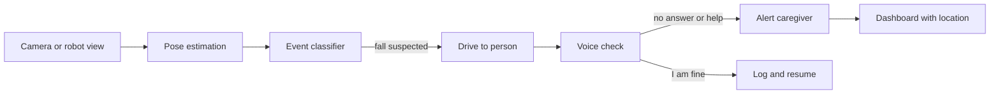
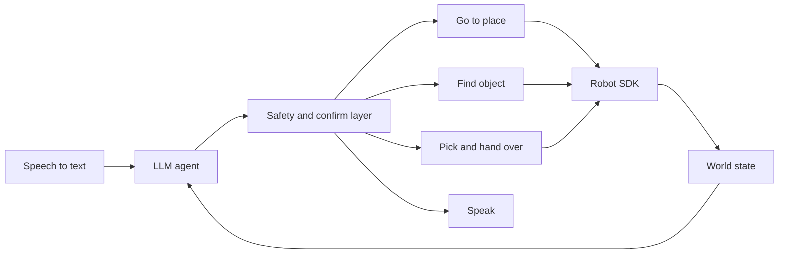
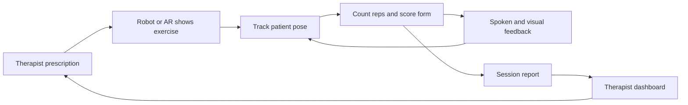
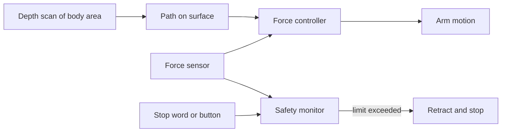
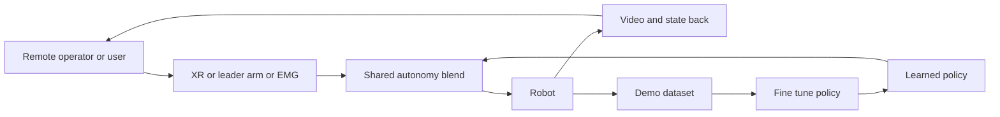

# T04 Elderly Care & Rehabilitation — Solution Patterns

[Track overview](T04-0-Track-Overview.md) · [Hardware shortlist](T04-2-Hardware-Shortlist.md) · [Cross-vendor solutions](T04-3-Cross-Vendor-Solutions.md)

**How to use this page:** pick one reference architecture, check the building blocks you would need, compare with who already does it, then scope with the feasibility guide. The official challenge statement was not public when this was written; adjust once it is announced. Archetype numbers refer to the table in the [track overview](T04-0-Track-Overview.md).

## Reference architectures

| Pattern | Best for archetypes | Robot skill needed | Risk level |
|---|---|---|---|
| A. Watch, check, escalate | 2 fall response, 7 night rounds | Navigation only | Low |
| B. Voice agent with a skill library | 1 fetch, 6 delivery, 8 companionship | Navigation plus one grasp | Medium |
| C. Coach loop | 4 rehab coaching, 3 gait screening | Almost none (perception-led) | Low |
| D. Force-controlled contact | 5 physio and massage, 11 feeding | Force or impedance control | Medium to high |
| E. Teleoperate, record, learn | 9 telepresence, 1 fetch, 10 EMG control | Teleoperation plus imitation learning | Medium |

### A. Watch, check, escalate

**When to use:** fall detection and response, night rounds, wandering alerts. The robot's job is to notice, verify by talking to the person, and bring a human in fast. Works with a quadruped, a wheeled base, or a fixed camera plus any robot that can drive to a location.

- **Components:** 2D pose model on an edge board; rule or small classifier on keypoints (torso angle, hip height, stillness time); map with named places; speech in and out; notification channel (messenger bot or web dashboard).
- **Design choice:** send keypoints and a single blurred snapshot, not a video stream. This is both a privacy feature and a bandwidth saver.
- **Main risk:** false alarms (lying on a sofa, bending down) and missed falls under occlusion. Mitigate with the voice check step and report a false-alarm count from scripted non-fall actions.

### B. Voice agent with a skill library

**When to use:** fetch and carry, medication delivery, concierge-type helpers. An LLM turns a spoken request into calls to a small set of robust, pre-tested robot skills.

- **Components:** speech recognition with voice activity detection; an LLM with tool calling; **4–6 skills** exposed as functions (`go_to`, `find`, `pick`, `hand_over`, `say`, `call_human`); open-vocabulary detector for "find"; a whitelist layer that blocks unknown actions and asks for confirmation before anything physical near a person.
- **Design choice:** the LLM never outputs joint commands. It chooses among skills that each work on their own.
- **Main risk:** the grasp. Fix the object set (three items with known geometry), fix the pick location (a shelf at known height), and keep a teleoperated fallback for the demo.

### C. Coach loop

**When to use:** rehab exercise coaching, sit-to-stand or gait screening, AR-guided therapy. The intelligence is in tracking and feedback; the robot or the glasses are the friendly front end.

- **Components:** exercise library (3–5 exercises, each a joint-angle template); pose tracker; repetition counter (state machine on one joint angle) and form score (angle range, symmetry, tempo); feedback phrases generated by an LLM from the scores; a one-page report per session.
- **Demonstrator options:** humanoid playing pre-recorded arm motions; avatar on a screen; overlay in AR glasses showing the target pose.
- **Main risk:** being seen as "just a webcam app". Counter it with the physical demonstrator, the therapist loop (prescription in, report out) and a measured accuracy number.

### D. Force-controlled contact

**When to use:** massage, passive mobilisation, guided-resistance exercise, bringing a spoon or cup close to a person. Requires an arm with real force or torque sensing.

- **Components:** depth camera or 3D scan to get the surface; path generator (strokes along a line, circles around a point); hybrid position and force control using the vendor's built-in primitives where available; independent monitor on force, speed and workspace; soft end-effector (silicone ball, roller).
- **Design choice:** let the user set intensity by voice ("softer", "stop") and plot the force trace live.
- **Main risk:** safety with a person in the loop. Develop on foam or a manikin, cap force conservatively, keep away from head and neck, and get the vendor engineer to review limits before any human trial.

### E. Teleoperate, record, learn

**When to use:** telepresence with hands, any manipulation task too hard to script in a weekend, EMG or head-motion control for a user with limited mobility. Start fully teleoperated; add autonomy only where it proves reliable.

- **Components:** a teleoperation interface (headset or glasses view, leader arm, hand tracking, or EMG gestures); a recorder in a standard dataset format; an imitation-learning policy fine-tuned on your demos; a blend or switch so the human can take over at any time.
- **Design choice:** pitch it the way care-robot leaders do. Waseda's AIREC is reported as teleoperation-first, and 1X offers remote expert supervision for tasks NEO has not learned.
- **Main risk:** training eats the weekend. Decide by the end of day 1 whether the learned policy is on track; if not, demo the teleoperated system with assistive features (auto-align, grasp assist).

## Building blocks

*Tool and model names come from general practitioner knowledge; only the items listed under Sources were re-checked today. Check each project's current README and licence before you depend on it (⚠️ unverified versions).*

| Capability | Open-source tools / models | Notes on effort |
|---|---|---|
| **Navigation** | ROS 2 with Nav2; slam_toolbox (2D); RTAB-Map (RGB-D); FAST-LIO2 or Point-LIO (3D LiDAR); AprilTag markers for precise docking; vendor navigation in the robot SDK | Use the vendor stack if the robot ships with mapping and go-to-goal. A tagged map with 5 named places is a half-day job; tuning Nav2 on an unfamiliar base can take a full day. |
| **Manipulation** | MoveIt 2; cuRobo (GPU planning); vendor Cartesian and force primitives; GraspNet-family and AnyGrasp grasp predictors; simple top-down grasp from a depth centroid | For 3 known objects, a scripted top-down grasp from a detected centroid is the most reliable option. Budget a day for one robust pick and hand-over. |
| **Perception: objects and scenes** | Open-vocabulary detectors (Grounding DINO, OWLv2, YOLO-World); SAM 2 for masks; FoundationPose for 6D pose; Depth Anything for monocular depth; VLMs for scene questions | Detection by text prompt works in an hour. 6D pose and cluttered scenes take much longer. Check licences (some YOLO releases are AGPL). |
| **Perception: people** | MediaPipe Pose, Hands and Face; RTMPose / MMPose; Kinect-style depth skeletons from RGB-D SDKs | Body keypoints at interactive rates on a laptop or edge board within an hour. Fall rules and rep counting are simple geometry on top. |
| **Speech and LLM agents** | Whisper or faster-whisper (speech to text); Silero VAD; Piper or Kokoro (text to speech); Pipecat or LiveKit Agents (real-time voice pipelines); any LLM with tool calling; llama.cpp or Ollama for local models; ROS-to-LLM bridges such as ROSA or an MCP server for ROS | A talking agent with 5 tools takes 3–4 hours. Hall noise is the real problem: use a close-talk or lapel microphone and push-to-talk. Swiss German dialect recognition is weaker than Standard German (⚠️ unverified); demo in English or Standard German. |
| **VLA and imitation policies** | LeRobot (dataset format, ACT, Diffusion Policy, SmolVLA); openpi (pi0, pi0-FAST, pi0.5 checkpoints); OpenVLA with LoRA fine-tuning; NVIDIA Isaac GR00T N1.x | SmolVLA is about **450M parameters** and is designed to run on consumer hardware. Planning number: about **50 demonstrations per task** as a floor, 50–200 per secondary guides (⚠️ unverified). ACT on one fixed task is the lowest-risk learner. Larger VLAs need a serious GPU and a robot-specific adapter. |
| **Teleoperation and shared autonomy** | GELLO-style leader arms; ALOHA-style bilateral setups; Open-TeleVision and similar headset teleop; hand tracking from a headset or MediaPipe; vendor teleop kits; LibEMG for EMG gesture recognition | If the vendor brings a teleop kit, use it. Building headset teleop from scratch on an unfamiliar robot is a full day. EMG gesture classification with 4–5 gestures is feasible in half a day with a per-user calibration. |
| **Dashboards and digital twins** | Foxglove and Rerun (robot data visualisation); RViz2; Streamlit or Gradio (caregiver web UI in an hour); Grafana for time series; MuJoCo, Gazebo or Isaac Sim for simulation; HL7 FHIR for health-record data shapes | A caregiver dashboard is cheap and highly visible. Model the session report on FHIR resource names to show integration awareness without building an integration. |
| **3D scanning and room models** | Scanner vendor export to point cloud; Open3D and CloudCompare for processing; plane and height segmentation for thresholds and steps; VLM captioning of rendered views | A hazard report from a point cloud (floor plane, obstacles under 15 cm, door widths) is feasible in a day. |
| **Middleware glue** | ROS 2; Zenoh or plain WebSocket and REST between laptop and robot; Docker images from the vendor | Agree on one message bus on day 1. Network setup in a crowded hall often costs more time than algorithms; bring your own router. |

**2026 developments worth knowing (secondary sources, ⚠️ unverified details):**

- Open-weight VLA checkpoints are now routine: openpi provides pi0, pi0-FAST and pi0.5 base checkpoints, and NVIDIA publishes a GR00T N1.6 3B checkpoint with a post-training path for low-cost arms.
- Intrinsic (Alphabet) is reported to have open-sourced a ROS-compatible core runtime at ROSCon 2026.
- Guides disagree on which ROS 2 distribution to target (Jazzy is the common recommendation; a newer release is mentioned). Use whatever the robot vendor's image ships with.

## State of the art — who already does this

| Product or project | Organisation | What it does | Lesson for a 48-hour build |
|---|---|---|---|
| **Lio** | F&P Robotics (Switzerland) | Mobile base with a soft-covered arm for care facilities. Tested in nursing homes and rehab clinics since 2017; evaluated for **22 months** in two care facilities (Konstanz and Schaffhausen) in an Interreg project on usability, acceptance and perceived benefit. | A Swiss precedent exists. Useful functions were modest (transport, reminders, entertainment); acceptance by staff is what gets studied, so show the staff view. |
| **Accessible and integrated robotic assistant for care homes** | FHNW (Switzerland) | Research project on integrating a robotic assistant into care-home routines (details not reviewed, ⚠️ unverified). | Integration into existing workflows is itself a research topic; a clean hand-off to staff is a feature. |
| **Navel** | navel robotics (Germany) | Social robot piloted since late 2023 in two residential care homes of Evangelische Heimstiftung; staff reported positive emotional effects and clear limitations. | Companionship works as an add-on to activity programmes. Be explicit about limits. |
| **Hyodol** | Hyodol (South Korea) | Doll-form companion with reminders and chat, deployed through welfare programmes; a study with 278 participants linked more frequent free-chat use to larger improvement in depressive symptoms after six months. | Low-tech form factor, high adherence. Usage frequency is a KPI you can log. |
| **ElliQ** | Intuition Robotics | Tabletop companion; New York State reported a **95%** reduction in loneliness among users with 30+ days of use (agency-reported, not peer reviewed). | Proactive prompts beat waiting for commands. Treat headline numbers with care in your pitch. |
| **Abi** | Andromeda Robotics (Australia) | Humanoid companion; **22 robots** working across one provider's residential homes with more than 1,500 residents (April 2026). | Fleet deployments are happening with companionship and group activities, not manipulation. |
| **AIREC** | Waseda University (Japan) | Caregiving humanoid research: repositioning, feeding, bathing support and more, reported as teleoperation-first. | Even flagship projects lean on teleoperation for nursing tasks. Pattern E is credible. |
| **NEO** | 1X | Home humanoid on pre-order (reported **USD 20,000** or **USD 499 per month**); a remote expert can supervise tasks the robot has not learned. | Remote assistance is a product feature. Address the privacy question up front. |
| **Stretch with head-worn teleoperation (HAT)** | Hello Robot, Carnegie Mellon | A user with quadriplegia controlled a mobile manipulator at home for a week via a head-worn interface: fetching a drink, feeding, scratching an itch. | A simple interface plus a simple robot delivers independence. Design the interface around one real user. |
| **EMG-controlled mobile manipulator** | Research preprint, 2026 | Twelve-day in-home deployment with a user with quadriplegia using wearable EMG to control a mobile manipulator. | EMG wearables as a control channel are current research; a short calibrated demo is on trend. |
| **Obi** and research feeding systems | Obi (commercial); Georgia Tech, Cornell and others (research) | Obi executes pre-programmed scooping; research systems add perception and were evaluated with small groups of users with disabilities (for example 8 people in a 2019 study). | Fixed trajectories are a legitimate product. Bite acquisition and transfer near the face are hard; use a manikin. |
| **PhyRC dressing challenge** | Cornell EmPRISE Lab, KAIST RIRO Lab | Competition to put a T-shirt on a seated manikin with two mobile manipulators, in simulation first; 100 teams from 21 countries. | Dressing is frontier research. Do not attempt it; borrow its milestone-per-second scoring for your own KPIs. |
| **Aescape** | Aescape (USA) | Robotic massage tables in fitness clubs; raised **USD 83M** (March 2025) with a partner planning 60 locations. | Body scan, then personalised force-controlled path, with the user controlling pressure. That is pattern D, and the market is funded. |
| **Lokomat and Armeo** | Hocoma (Switzerland) | Gait and arm rehabilitation robots used in clinics worldwide. Reviews note that trials of stationary gait robots have not shown superiority over comparable conventional therapy. | Sell repetitions, motivation and therapist time, not better outcomes. |
| **Myosuit** | MyoSwiss (Switzerland) | Textile lower-limb exosuit aimed at older, frail and post-surgery users, listed in a 2026 review. | Wearable assistance is a Swiss strength; a hackathon team can add sensing or coaching around such devices rather than build one. |

## 48-hour feasibility guide

**Reliably works in a weekend**

- A voice agent calling 4–6 pre-tested robot skills.
- Pose-based fall detection, repetition counting and range-of-motion scoring.
- Go-to-named-place navigation on a robot whose vendor stack already maps and localises.
- Picking **known** objects from a **known** location, followed by a hand-over that waits for a pull or a spoken "got it".
- Force-limited surface following on a manikin or foam with a force-controlled arm, using vendor primitives.
- Teleoperation with a vendor kit, plus recording of demonstrations.
- A caregiver dashboard and an automatically generated session report.
- A room hazard report from a handheld 3D scan.

**Sometimes works, plan a fallback**

- Fine-tuning ACT or a small VLA on 50+ demonstrations of one task.
- Open-vocabulary "find the red cup anywhere in the room".
- Humanoid demonstrating exercises with balance preserved (upper-body motions only is safer).
- Speech interaction in a loud hall without a close microphone.
- Multi-robot hand-offs (quadruped delivers to arm).

**Does not work in a weekend**

- Lifting, transferring or dressing a person.
- General-purpose humanoid manipulation in clutter.
- Walking a humanoid through a crowd or on stairs under your own controller.
- Anything requiring clinical validation or a claim of therapeutic effect.
- Training a VLA from scratch.

**Scoping advice**

| Rule | Why |
|---|---|
| **One user, one task, one room.** | Judges remember a complete story, not a feature list. |
| **Demo first.** Write the 3-minute demo script in hour 1 and build only what appears in it. | Prevents building invisible infrastructure. |
| **Robot time is the bottleneck.** Develop against recorded data or simulation; queue for the robot with a test list. | Shared hardware and vendor engineers are scarce. |
| **Use the vendor's highest-level API.** | Their locomotion, navigation and force primitives are tuned; yours will not be by Monday. |
| **Keep a human in the loop on purpose.** | Shared autonomy is the honest state of the art in care robotics. |
| **Freeze features early on the final day.** | Leave the last hours for 10 measured trials, the backup video and the README. |
| **Measure something.** | A number turns a demo into evidence. |

**Suggested timeline (inference; the event runs from Saturday 10:00 to Monday 17:00, about 55 hours wall-clock):**

| Phase | Hours | Goal |
|---|---|---|
| Decide | 0–3 | Track, hardware booked, demo script, roles |
| Skeleton | 3–12 | Every block exists as a stub and is connected end to end, even if faked |
| Core skill | 12–30 | The one hard skill works 5 of 10 times on the real robot |
| Robustness | 30–44 | 8 of 10; add safety layer, dashboard, KPI logging |
| Evidence | 44–50 | Measured trials, backup video, README, slides |
| Rehearse | 50–55 | Three full run-throughs, pitch timing, fallback plan |

## Idea bank

Hardware tags: **[H]** humanoid · **[W]** wheeled dual-arm · **[Q]** quadruped · **[A]** arm or cobot · **[D]** dexterous hand · **[X]** XR glasses · **[S]** 3D scanner · **[C]** edge compute and camera · **[E]** EMG wearable.

1. **Rehab buddy:** a humanoid demonstrates shoulder and knee exercises, counts repetitions, and sends the therapist a session report. **[H][C]**
2. **Fall-safe room scan:** walk a hotel room or flat with a handheld scanner and get a ranked trip-hazard report with fixes. **[S][C]**
3. **Guardian dog:** a quadruped that patrols at night, detects a person on the floor, asks if they are OK and calls staff with location. **[Q][C]**
4. **Pill runner:** a mobile robot delivers the right medication box to the right person, confirms identity and intake by voice, and logs it. **[W] or [Q]**
5. **Force-capped massage:** a force-controlled arm follows a scanned forearm or back path; the user sets pressure by voice and sees the force trace. **[A][C]**
6. **Mirror therapy with EMG:** muscle signals from the healthy arm drive a robot hand or arm, with activation shown as biofeedback. **[E][D][A]**
7. **AR physio overlay:** glasses show the target joint angle and a ghost limb; the therapist sees adherence on a dashboard. **[X][C]**
8. **Pick-it-up helper:** a spoken "I dropped my glasses" triggers find, pick and hand-over, with teleop fallback. **[W][C]**
9. **Tele-therapist:** a remote physiotherapist drives a humanoid's arms through a headset to demonstrate and correct an exercise. **[H][X]**
10. **Sit-to-stand screener:** a camera times and scores five sit-to-stand repetitions as a quick fall-risk indicator and tracks change over a stay. **[C]**
11. **Winter walk escort:** a quadruped leads a guest along a safe route to the baths, carries a bag, and alerts on a fall. **[Q][C]**
12. **Mealtime assistant:** an arm presents a cup or spoon to a manikin and waits for a ready signal before approaching. **[A][C]**
13. **Grip trainer:** a dexterous hand or force-controlled arm provides graded resistance and games for hand rehabilitation, logging force over time. **[D] or [A]**
14. **Care concierge:** a multilingual voice agent on a mobile robot gives appointment and medication reminders and hands over to staff when unsure. **[H] or [W]**
15. **Teach-by-showing caregiver robot:** a caregiver teleoperates a fetch task ten times; the robot learns it and repeats it with a human takeover button. **[W][X]**

## Sources

Event and comparable challenges
- [Leukerbad Hackathon 2026 (Robotics, XR, and AI) — Luma](https://luma.com/vj13ns00)
- [PhyRC 2027 Physical Robot Caregiving Challenge — Cornell EmPRISE Lab](https://emprise.cs.cornell.edu/phyrc/challenge-2027/)
- [robo.innovate Hackathon 2025: Advancing Robotics and AI Solutions — TUM MIRMI](https://www.mirmi.tum.de/en/mirmi/news/article/roboinnovate-hackathon-2025-advancing-robotics-and-ai-solutions)

Products, deployments and studies
- [Lio: A Personal Robot Assistant for Human-Robot Interaction and Care Applications — arXiv](https://arxiv.org/pdf/2006.09019.pdf)
- [Robots in elderly care (PUR project with Lio) — FHV](https://www.fhv.at/en/research/human-centred-technologies/projects/completed-projects/robot-in-the-elderly-care)
- [Accessible and integrated robotic assistant for care homes — FHNW](https://www.fhnw.ch/en/computer-science/research-services/research/projects/accessible-and-integrated-robotic-assistant-for-care-homes)
- [Social Robotics in Long-Term Care (Navel case study) — International Federation of Robotics](https://ifr.org/case-studies/social-robotics-in-long-term-care)
- [Hyodol study (Yonsei University repository, PDF)](https://ir.ymlib.yonsei.ac.kr/bitstream/22282913/210249/1/91142.pdf)
- [Seniors are building deep bonds with this AI robot (ElliQ) — Entrepreneur](https://www.entrepreneur.com/business-news/a-new-ai-robot-is-helping-seniors-combat-loneliness/502676)
- [Australia's largest rollout of humanoid companion robots (Abi) — HelloCare](https://hellocare.com.au/australias-largest-rollout-of-humanoid-companion-robots-signals-new-era-in-aged-care/)
- [Waseda's AIREC pushes humanoid care robots toward teleoperation-first nursing tasks — Origin of Bots](https://www.originofbots.com/news/wasedas-airec-pushes-humanoid-care-robots-toward-teleoperation-first-nursing-tasks)
- [Home robots available in 2026 (1X NEO) — The Gadgeteer](https://the-gadgeteer.com/2026/05/20/home-robots-available-2026/)
- [Carnegie Mellon researchers learn much from in-home test of adaptive robot interface (HAT and Stretch) — Newswise](https://www.newswise.com/articles/carnegie-mellon-university-researchers-learn-much-from-in-home-test-of-adaptive-robot-interface)
- [Researchers develop interface for quadriplegics to control robots — The Robot Report](https://www.therobotreport.com/researchers-develop-interface-for-quadriplegics-to-control-robots/)
- [In-home EMG-controlled mobile manipulator deployment (2026 preprint) — arXiv](https://arxiv.org/pdf/2602.02773v1)
- [Active Robot-Assisted Feeding with a General-Purpose Mobile Manipulator — arXiv](https://arxiv.org/pdf/1904.03568)
- [Kiri-Spoon: A Kirigami Utensil for Robot-Assisted Feeding (includes Obi comparison) — arXiv](https://arxiv.org/pdf/2501.01323)
- [Aescape raises $83M, brings robotic massages to more locations — The Robot Report](https://www.therobotreport.com/aescape-raises-83m-brings-robotic-massages-more-locations/)
- [Electromechanical gait trainers — Stroke Engine](https://strokengine.ca/en/interventions/electromechanical-gait-trainers/)
- [Systematic review on wearable lower-limb exoskeletons — Journal of NeuroEngineering and Rehabilitation](https://jneuroengrehab.biomedcentral.com/track/pdf/10.1186/s12984-021-00815-5)
- [Review listing the Myosuit among assistive exosuits (2026) — EPJ Web of Conferences](https://www.epj-conferences.org/articles/epjconf/pdf/2026/11/epjconf_staaar2026_01003.pdf)

Open-source building blocks
- [SmolVLA: efficient vision-language-action model trained on LeRobot community data — Hugging Face blog](https://huggingface.co/blog/smolvla)
- [SmolVLA paper — arXiv](https://arxiv.org/pdf/2506.01844)
- [VLA models comparison 2026 (secondary guide) — Robotics Center](https://www.roboticscenter.ai/tools/vla-models-comparison/)
- [Open Robotics Technology Strategy for 2026 — Open Robotics](https://www.openrobotics.org/technology-strategy-2026)
- [Alphabet's Intrinsic open-sources Intrinsic Core at ROSCon 2026 (secondary report) — AI Weekly](https://aiweekly.co/alerts/alphabets-intrinsic-open-sources-intrinsic-core-at-roscon-2026)
