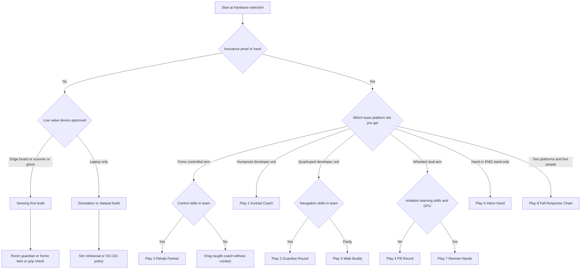

# T04 Elderly Care & Rehabilitation — Cross-Vendor Solutions

[Start here](../../00-START-HERE.md) · [Track overview](T04-0-Track-Overview.md) · [Official directions: who has what](T04-6-Official-Directions-Who-Has-What.md) · [Hardware shortlist](T04-2-Hardware-Shortlist.md) · [Solution patterns](T04-1-Solution-Patterns.md)

> **Official tagline:** Let robots help people live healthier, more independent and dignified lives.

**What this page is:** a synthesis of the 20 company briefs and playbooks for this track. It tells a team of up to 5 which vendors to combine, in which order of risk, inside the real build window of about **47 hours** (Sat 13:00 to Mon 12:00). Every product claim comes from the company docs in this knowledge base. **No model list is published for the event**, so every "hardware" line below is **unconfirmed on site** until you have seen the unit at the booth.

**Three rules that hold for every play**

- **No robot touches a frail person.** Use team members, a mannequin or a foam limb. Hand objects over via a tray or table unless the play is built on a force-controlled arm, and even then only with the vendor engineers' and organizers' explicit OK.
- **Robot first, add-ons second.** XREAL, OriginFlow, SKYLANDX, WUJI, Leadshine, Omnicor AI and Binabik AI supply no robot body. Get the base platform moving before you integrate any of them.
- **One number on screen.** Judging is technical quality, innovation, real-world value and completeness. A measured KPI (success in N trials, seconds to alert, peak force in newtons) is the cheapest way to score on all four.

## Choose in five minutes

- **Insurance decides first.** Without proof of third-party liability insurance covering borrowed equipment you may not operate high-value robots yourself. You are then limited to software, simulation, digital twins or organizer-approved lower-value devices (the site names the **LeRobot SO-101**). Go to [If you have no insurance or no robot](#if-you-have-no-insurance-or-no-robot). Whether an edge board, a scanner, a glove or AR glasses count as "lower-value" is **not published**: ask at kickoff.
- **The unit variant decides second.** Unitree accepts SDK commands only on **EDU** units, Magiclab only on **EDU / Development Version**, and AGIBOT documents voice and screen for **X2 Ultra** but not X2 EDU. Check this in the first 30 minutes, before you write a line of code.
- **Force-controlled arm (Flexiv, ROKAE)** is the only class that may come near a body. With control skills, build the assist-as-needed trainer (Play 3). Without them, do a no-contact drag-taught coach on a Dobot Nova or the same arm.
- **Humanoid or quadruped** means a no-contact play: coach (Play 1), night round (Play 2) or escort (Play 5). These have the best ratio of visible result to engineering risk.
- **Wheeled dual-arm** means fetch and deliver. Without imitation-learning experience and a GPU, script it (Play 4). With both, teleoperate and learn (Play 7).
- **Only add-on hardware (EMG band, glove, dexterous hand)** still gives a strong, visual demo: Play 6. Two base platforms plus five people is the only situation in which Play 8 is sensible.

**Who is judging (from the event intel):** the published jury includes an anthropologist who studies why deployments struggle, a Foxglove go-to-market lead, a Sereact robotics engineer, an investor and the coprod CEO. Inference: show the staff view, log and visualise your data, make learned manipulation actually run, and name the buyer.

## Team plays — the strongest solutions for this track

Ordered from most reliable to most ambitious. "H" hours count from Sat 13:00; plan a hard stop at **H47** (Mon 12:00).

| # | Play | Base platform | Add-ons | Directions | Risk |
|---|---|---|---|---|---|
| 1 | Kurbad Coach | Humanoid, standing in place | Edge board, AR glasses, EMG | T04.3 · T04.5 · T04.7 | Low |
| 2 | Guardian Round | Quadruped | Edge board, AR glasses, scanner | T04.7 · T04.2 · T04.6 | Low to medium |
| 3 | Rehab Partner | Force-controlled arm | EMG, AR glasses, edge board | T04.3 | Medium |
| 4 | Pill Round | Wheeled dual-arm | Edge board, scanner, AR glasses | T04.6 · T04.1 · T04.2 | Medium |
| 5 | Walk Buddy | Quadruped | Edge board, scanner, EMG | T04.4 · T04.5 · T04.7 | Medium |
| 6 | Intent Hand | Dexterous hand on a stand or arm | EMG, glove, AR glasses | T04.1 · T04.3 · T04.5 | Medium to high |
| 7 | Remote Hands | Wheeled dual-arm or humanoid | XR headset, AR glasses, agent layer | T04.2 · T04.1 · T04.5 | High |
| 8 | Fall Response Chain | Room sensor + scout + manipulator | AR glasses, EMG trigger | T04.7 · T04.2 · T04.6 · T04.1 | Very high |

### Play 1 — Kurbad Coach

A humanoid demonstrates seated rehab exercises, an edge board scores the patient, the therapist sees the numbers hands-free.

- **Official direction(s) served:** T04.3 rehabilitation training · T04.5 interaction and companionship · T04.7 health monitoring.
- **Problem → value in Leukerbad:** rehab guests get a few supervised sessions and then repeat exercises alone; adherence drops. The Leukerbad Clinic has been a rehabilitation centre since 1961. Value: more supervised repetitions per therapist hour and a per-patient session report, with **no contact**.
- **Hardware:**
  - Demonstrator: **Unitree G1 EDU** (1.32 m, about 35 kg, 4-mic array and speaker) standing in place on a gantry or with a spotter — [Unitree playbook](../../Companies/Unitree/T04-Elderly-Care-and-Rehabilitation/Unitree-T04-3-Playbook.md), Concept 2. Same play on **AGIBOT X2 Ultra** ([AGIBOT playbook](../../Companies/AGIBOT/T04-Elderly-Care-and-Rehabilitation/AGIBOT-T04-3-Playbook.md), Concept 1) or **Magiclab MagicBot Z1 Development Version** ([Magiclab playbook](../../Companies/Magiclab/T04-Elderly-Care-and-Rehabilitation/Magiclab-T04-3-Playbook.md), Concept 3).
  - Scoring: **D-Robotics RDK X5** + camera ([D-Robotics playbook](../../Companies/D-Robotics/T04-Elderly-Care-and-Rehabilitation/D-Robotics-T04-3-Playbook.md), Concept 2), or a laptop webcam.
  - Therapist view: **XREAL One-series** glasses as a plain USB-C display ([XREAL playbook](../../Companies/XREAL/T04-Elderly-Care-and-Rehabilitation/XREAL-T04-3-Playbook.md), Concept 1).
  - Optional: **OriginFlow Band** for a muscle-effort channel ([OriginFlow playbook](../../Companies/OriginFlow/T04-Elderly-Care-and-Rehabilitation/OriginFlow-T04-3-Playbook.md)).
- **Software stack:**
  - Perception on the RDK X5: body keypoints from the TogetheROS.Bot node `mono2d_body_detection` → your own `rclpy` node for joint angles, a repetition state machine and a range-of-motion score. Keypoints are **2D**: fix the camera side-on.
  - Robot: Unitree `unitree_sdk2_python` over Ethernet (upper-body arm trajectories while the factory controller balances; confirm the mode with the booth and validate first in `unitree_mujoco`). On AGIBOT: AimDK_X2 over ROS 2 for preset motions, TTS and the face screen, with perception **off-board** because the X2 vision interface is not enabled in the SDK.
  - Speech and coaching phrases: your own speech-to-text + LLM + text-to-speech on a laptop. Stock D-Robotics speech examples are Chinese.
  - Glasses: no XREAL SDK needed. Render a high-contrast dashboard on the laptop and show it in the glasses; always mirror it on a big screen for judges.
  - Compute: RDK X5 for vision, laptop for LLM and dashboard, nothing on the robot.
- **Why it can win:**
  - Technical quality: a closed loop from human pose to robot motion and spoken feedback, with a measured rep-count accuracy.
  - Innovation: the humanoid is used for what only a human-shaped robot can do (show the movement); the video never leaves the edge board.
  - Real-world value: therapist time is the scarce resource; no contact means a short path to a pilot in a clinic lounge.
  - Completeness: prescription in, demonstration, scoring, report out. The full loop fits in a 3-minute demo.
- **48-hour outline:**
  - H0–6: confirm EDU / Ultra variant; run the vendor arm-control or preset-motion example; keypoints running on the RDK or webcam.
  - H6–24: three seated upper-body exercises on the robot; rep counting and range-of-motion scoring; voice loop.
  - H24–40: therapist dashboard in the glasses, session report, optional EMG channel or mirror mode.
  - H40–47: test with 5 different people, 10 measured runs, backup video, README.
- **Main risk and fallback:** the robot loses balance or arm control is not accessible on the unit you get. Fallback: slow, small motions on a gantry → preset gestures only → a screen avatar demonstrates while the robot talks. The scoring pipeline is the core and survives every fallback.
- **Team profile it suits:** little robotics experience; one perception person, one robot-SDK person, one front-end and pitch person. Best first choice for a mixed team.

### Play 2 — Guardian Round

A small quadruped walks a night round, a private room sensor detects a fall, the robot checks on the person by voice and alerts the caregiver.

- **Official direction(s) served:** T04.7 health monitoring · T04.2 smart care robots · T04.6 automation in care scenarios.
- **Problem → value in Leukerbad:** clinics and spa hotels have many elderly guests and thin night staffing; falls at night are found late, and the nearest acute hospitals are down in the valley. Value: shorter time from fall to human contact, fewer manual rounds, and no video stream of sleeping guests.
- **Hardware:**
  - Patrol robot: **Unitree Go2 EDU** (about 15 kg, 4D LiDAR, front camera) — [Unitree playbook](../../Companies/Unitree/T04-Elderly-Care-and-Rehabilitation/Unitree-T04-3-Playbook.md), Concept 1. Alternatives: **Magiclab MagicDog EDU** ([playbook](../../Companies/Magiclab/T04-Elderly-Care-and-Rehabilitation/Magiclab-T04-3-Playbook.md)), **AGIBOT D1 Ultra** ([playbook](../../Companies/AGIBOT/T04-Elderly-Care-and-Rehabilitation/AGIBOT-T04-3-Playbook.md), Concept 3), **Genisom L2 / L1 EDU** ([brief](../../Companies/Genisom-AI/T04-Elderly-Care-and-Rehabilitation/Genisom-AI-T04-1-Brief.md)).
  - Sensor: **D-Robotics RDK X5** + camera as a fixed "room guardian" and, if mounting and power work, a second one on the robot ([D-Robotics playbook](../../Companies/D-Robotics/T04-Elderly-Care-and-Rehabilitation/D-Robotics-T04-3-Playbook.md), Concepts 1 and 3).
  - Nurse view: **XREAL** glasses or a tablet.
  - Optional: **SKYLANDX MetaCam Air 2** for a baseline scan of the corridor ([SKYLANDX playbook](../../Companies/SKYLANDX/T04-Elderly-Care-and-Rehabilitation/SKYLANDX-T04-3-Playbook.md), Concept 3).
- **Software stack:**
  - Detection on the RDK X5: `mono2d_body_detection` → `hobot_falldown_detection` → your own rule node (debounce, "on the floor longer than N seconds", bed and chair zones). The stock fall logic is basic, so add your own rule on keypoint height and box aspect ratio.
  - Check-in: spoken prompt, reply by voice or by hand gesture (`hand_gesture_detection`: thumb up = fine, palm = help).
  - Robot: Go2 high-level sport client with velocity commands and built-in obstacle avoidance, driven along a taped waypoint route by a small state machine (patrol → approach → check → alert → wait). Whether the on-site Go2 exposes mapping and go-to-point through the SDK is a question for the booth; MagicDog's SDK ships SLAM and navigation examples; the D1 SDK is velocity commands only.
  - Alert: event plus a stick-figure snapshot over MQTT / HTTP to a caregiver dashboard. All vision stays on the board.
- **Why it can win:**
  - Technical quality: a perception and autonomy loop on real hardware, with fall-to-alert latency and a false-alarm count from scripted non-fall actions.
  - Innovation: privacy by design (events, not video) and cancel-by-gesture; a robot that verifies before it escalates.
  - Real-world value: falls are the biggest measurable problem in elderly care; an RDK X5 per room is cheap enough to scale.
  - Completeness: detect, approach, ask, escalate, log. The fixed sensor alone is already a finished product if the robot fails.
- **48-hour outline:**
  - H0–6: flash the board, run the stock fall demo; confirm EDU and network on the robot; record test clips (fall, sit, bend, lie on a bench).
  - H6–24: event logic and dashboard; patrol state machine on a 10 m route.
  - H24–40: approach to a 1.5 m stop distance, voice and gesture check-in, escalation, false-alarm tuning.
  - H40–47: 10 full runs with timing, backup video, README.
- **Main risk and fallback:** localisation drift in a crowded hall and Wi-Fi dropouts. Fallback: short taped route with markers → teleoperate the walk and keep detection autonomous → fixed room guardian plus a teleoperated robot. A low camera on a quadruped changes how a fall looks: retune the rules.
- **Team profile it suits:** one navigation person, one ROS 2 / embedded Linux person, one dashboard person. Good for teams that want a robot moving on stage with low manipulation risk.

### Play 3 — Rehab Partner

A therapist teaches an arm exercise by hand; a force-controlled arm replays it and helps only as much as the patient's muscles need.

- **Official direction(s) served:** T04.3 rehabilitation training robots (core) · T04.7 through the effort and range-of-motion log.
- **Problem → value in Leukerbad:** upper-limb rehab after fracture, joint replacement or stroke needs many guided repetitions and therapists can supervise only a few patients. The village's core business is rehabilitation and thermal therapy. Value: one therapist sets up the exercise in 10 seconds and gets objective progress data.
- **Hardware:**
  - Arm: **Flexiv Rizon 4s** (4 kg, 919 mm, force sensing down to 0.03 N with the wrist sensor) with a padded hand-held handle that breaks away under load — [Flexiv playbook](../../Companies/Flexiv/T04-Elderly-Care-and-Rehabilitation/Flexiv-T04-3-Playbook.md), Concept 2. Or **ROKAE xMate SR3 / SR5** (Cartesian stiffness adjustable 0–3000 N/m) — [ROKAE playbook](../../Companies/ROKAE/T04-Elderly-Care-and-Rehabilitation/ROKAE-T04-3-Playbook.md), Concept 1.
  - Effort signal: **OriginFlow Band** (16-channel sEMG wristband) — [OriginFlow playbook](../../Companies/OriginFlow/T04-Elderly-Care-and-Rehabilitation/OriginFlow-T04-3-Playbook.md), Concept 2.
  - Therapist view: **XREAL** glasses in display mode ([XREAL playbook](../../Companies/XREAL/T04-Elderly-Care-and-Rehabilitation/XREAL-T04-3-Playbook.md), Concept 1).
  - Optional: **D-Robotics RDK X5** or a webcam for compensation detection (shoulder shrug, trunk lean).
- **Software stack:**
  - Flexiv: `pip install flexivrdk`; record the path in free drive; replay with the non-real-time Cartesian motion-force commands from Python (no real-time kernel needed; tolerates network latency). The 1 kHz real-time mode needs a Professional licence, a wired LAN and Linux or macOS. The RDK needs a **robot-side licence**: confirm it in the first hour.
  - ROKAE: xCore SDK (controller version v3.2.1 or later). Python covers drag teaching, moves and force-control setup; **real-time Cartesian impedance is C++ only** and needs a direct cable and ideally a real-time Linux kernel.
  - Three modes: passive (robot moves), active-assist (robot helps when the patient stalls), resist. Assistance gain = function of tracking error and the EMG effort index; change the gain between repetitions, not inside them.
  - OriginFlow has **no public SDK**: you write a bridge node yourself, and a live stream is unconfirmed on site. Without it, use the arm's own force reading and show EMG as a recorded overlay.
  - Compute: one laptop; a Python loop is enough for slow rehab motions.
- **Why it can win:**
  - Technical quality: impedance shaping, effort estimation and hard safety caps, with a live force trace in newtons.
  - Innovation: a muscle signal closes the loop, not just force; the therapist programs by demonstration with no code.
  - Real-world value: the most direct fit to Leukerbad's rehab clinics; sells repetitions and therapist time, not clinical outcomes.
  - Completeness: teach, three modes, session report, visible safety design (handle never strapped, force and speed caps, E-stop holder).
- **48-hour outline:**
  - H0–6: licence and SDK version confirmed; free-drive record and compliant replay of one path with nobody attached; ask OriginFlow what can be read live.
  - H6–24: three modes, force and speed caps, breakaway handle, per-repetition metrics.
  - H24–40: effort-aware gain, "patient share vs robot share" display, session report, glasses view.
  - H40–47: tests with team members at low force, safety review with the vendor engineer, backup video.
- **Main risk and fallback:** human contact may be restricted by the organizers, and the EMG stream may not exist. Fallback: a spring-loaded dummy arm instead of a person; force-only adaptation instead of EMG. **Variant "Spa Hand":** the same arm follows a stroke path on a mannequin or foam limb with a regulated contact force (start around 5–15 N on Flexiv) and a pressure slider; this is the closest thing to Flexiv's own Mello massage system and to the AI-massage integrations on ROKAE arms, so technical risk is low but innovation is moderate.
- **Team profile it suits:** at least one person with control or force-control experience, one signal-processing person, one who owns safety limits. Do not pick it if nobody can own the E-stop and the caps.

### Play 4 — Pill Round

A wheeled dual-arm robot picks the right box, verifies it, drives to the right person, hands over on a pull, and logs the event.

- **Official direction(s) served:** T04.6 automation in care scenarios · T04.1 daily living assistance · T04.2 smart care robots.
- **Problem → value in Leukerbad:** night and weekend staff lose time on fetching and distributing medication and small items, and mix-ups are a safety issue. Value: caregiver minutes saved per shift plus an audit trail; a nurse still approves the plan.
- **Hardware:**
  - Robot: **Galbot G1** (wheeled dual-arm, 5 kg per arm, wrist reach from the floor to 2.1 m, wrist force sensors) — [Galbot playbook](../../Companies/Galbot/T04-Elderly-Care-and-Rehabilitation/Galbot-T04-3-Playbook.md), Concept 1. Its pharmacy picking is in daily commercial use, which makes the pitch credible. Alternatives: **Galaxea R1 Pro / R1 Lite** ([playbook](../../Companies/Galaxea/T04-Elderly-Care-and-Rehabilitation/Galaxea-T04-3-Playbook.md)), **Spirit AI Moz1** ([playbook](../../Companies/Spirit-AI/T04-Elderly-Care-and-Rehabilitation/Spirit-AI-T04-3-Playbook.md), Concept 2), **UniX AI Panther / Wanda 2.0** ([playbook](../../Companies/UniX-AI/T04-Elderly-Care-and-Rehabilitation/UniX-AI-T04-3-Playbook.md)). Delivery-only version without an arm: **Magiclab MagicDog EDU** with a basket ([playbook](../../Companies/Magiclab/T04-Elderly-Care-and-Rehabilitation/Magiclab-T04-3-Playbook.md), Concept 1).
  - Bedside station: **D-Robotics RDK X5** for identity check (QR wristband) and a confirmation button.
  - Optional: **SKYLANDX MetaCam** for a prior map with named places; **XREAL** glasses for the nurse; **Omnicor AI** for on-device models (Galbot is a listed Omnicor customer; whether a port exists for the robot you get is unconfirmed).
- **Software stack:**
  - GalbotSDK (Python, no ROS needed): `navigate_to_goal`, collision-aware motion planning, gripper commands, force-sensor reading for release-on-pull. **Build a map first**: a G1 without a map can refuse all commands. SDK 1.10.x needs robot system GBS 1.18.x.
  - Task logic: a plain state machine (order → shelf slot → pick → verify barcode or label → drive → identify → hand over → log). Shelf slots are taught as fixed poses. No large model required.
  - Dashboard: nurse approves the plan on a tablet; every hand-over lands in an event log.
  - Map shortcut: scan once with the MetaCam, slice the point cloud into a 2D occupancy grid and pick named waypoints in the twin. Import into the robot's own navigation is **unconfirmed**; keep the robot's own map as the working one.
  - Never use real medication: boxes with mock labels, candy or beads.
- **Why it can win:**
  - Technical quality: closed-loop verification, force-triggered hand-over, wrong-box rejection shown live.
  - Innovation: moderate on its own; raise it with the identity station and the "map once, deploy in a new ward in 30 minutes" measurement.
  - Real-world value: mirrors a task that is already commercial in pharmacies; reuses the organizers' own KPI vocabulary (task completion rate, order accuracy).
  - Completeness: plan, pick, verify, deliver, hand over, audit trail, deliberate error case.
- **48-hour outline:**
  - H0–6: SDK access and version check, map the demo area, run the pick-and-place and navigation tutorials, build a two-shelf mock pharmacy.
  - H6–24: taught-pose picking of 4–6 boxes, barcode verification, navigation between shelf and two "rooms".
  - H24–40: force-triggered hand-over, identity check, wrong-box rejection, event log and dashboard.
  - H40–47: speed limits, failure recovery, 10 measured rounds, backup video.
- **Main risk and fallback:** what is unlocked on the on-site robot is unknown, and small boxes are hard to grasp. Fallback: suction cup or larger pill organisers → fixed base position within arm reach (no driving) → quadruped delivers and a human loads. On UniX AI no SDK is public: an operator triggers the skill when your software says so, and you state that openly.
- **Team profile it suits:** solid Python and integration skills, no machine-learning requirement. Good for a team that wants a manipulation demo without betting on a learned policy.

### Play 5 — Walk Buddy

A dog-sized robot escorts a rehab guest on the prescribed daily walk, carries a bottle and phone, sets the pace, and calls for help after a fall.

- **Official direction(s) served:** T04.4 mobility assistance and support · T04.5 interaction and companionship · T04.7 health monitoring.
- **Problem → value in Leukerbad:** rehab patients are told to walk daily but are afraid to go alone, and staff cannot escort everyone. The village is steep, with snow and ice in winter. Value: more unsupervised walking with a safety net, and a route that has been checked for obstacles beforehand. The robot gives **no physical support**.
- **Hardware:**
  - Robot: **Magiclab MagicDog EDU** (16 kg, SDK with SLAM, navigation and audio, built-in person following) — [Magiclab playbook](../../Companies/Magiclab/T04-Elderly-Care-and-Rehabilitation/Magiclab-T04-3-Playbook.md), Concept 2. Alternatives: **Genisom L2** (follow-and-carry is a product feature, 16 kg payload; SDK is C++ only) — [Genisom brief](../../Companies/Genisom-AI/T04-Elderly-Care-and-Rehabilitation/Genisom-AI-T04-1-Brief.md); **Unitree Go2 EDU** ([playbook](../../Companies/Unitree/T04-Elderly-Care-and-Rehabilitation/Unitree-T04-3-Playbook.md)).
  - Perception: **D-Robotics RDK X5** on the robot (person following by re-identification, pose) or a laptop carried by a team member.
  - Route check: **SKYLANDX MetaCam Air 2** scan of the walking route ([SKYLANDX playbook](../../Companies/SKYLANDX/T04-Elderly-Care-and-Rehabilitation/SKYLANDX-T04-3-Playbook.md), Concept 1).
  - Optional: **OriginFlow Band** for an effort or fatigue signal; **XREAL** glasses for a remote therapist view; **coprod** co:sense IMU for tilt and sway on a rollator ([coprod brief](../../Companies/coprod/T04-Elderly-Care-and-Rehabilitation/coprod-T04-1-Brief.md)), only if the founders provide a kit.
- **Software stack:**
  - Robot camera stream → pose estimation → distance to person, cadence, "person on the ground" classifier. State machine: lead / follow / wait / alert, with distance and time goals from a therapist-set plan.
  - Control: velocity commands to hold a set distance and a fixed lateral offset. If the built-in following can be triggered from the SDK (**unconfirmed** for both Magiclab and Genisom), use it and add only the monitoring layer.
  - Route audit: point cloud → floor plane → flag steps, thresholds and narrow passages against a rollator footprint (Python + Open3D); works from exported files, no SKYLANDX API needed.
  - Voice check before any alert; alert with position to a caregiver dashboard.
- **Why it can win:**
  - Technical quality: real-time human tracking plus behaviour logic, with a measured audit of the route.
  - Innovation: escort, coaching and safety net in one small robot, plus a pre-checked route twin.
  - Real-world value: the only play that addresses mobility directly, and it is specific to a steep spa village.
  - Completeness: plan the walk, audit the route, escort, detect, alert, report distance and pace.
- **48-hour outline:**
  - H0–6: confirm the programmable variant; camera stream and velocity commands; scan the demo lane.
  - H6–24: person tracking and distance keeping; route hazard report from the scan.
  - H24–40: pace coaching by voice, fall watch with voice check, dashboard.
  - H40–47: runs with different people and spectators around, backup video.
- **Main risk and fallback:** tracking loses the person among spectators, and the robot itself is a trip hazard. Fallback: coloured vest marker, low speed, fenced lane → teleoperate the walk and keep monitoring autonomous. Snow and ice performance is untested for these robots: do not claim it.
- **Team profile it suits:** one perception person, one robot-SDK person (C++ if Genisom), one point-cloud person. Choose it over Play 2 when the team wants the mobility direction and accepts a weaker reliability record.

### Play 6 — Intent Hand

A weak squeeze at the wrist commands a robot hand to do the forceful part: hold the bottle, lift the cup, pick the pill box.

- **Official direction(s) served:** T04.1 daily living assistance · T04.3 rehabilitation training · T04.5 human-robot interaction.
- **Problem → value in Leukerbad:** many older people keep motor intent but lose grip strength (arthritis, sarcopenia), and hand therapy is repetitive and unmeasured. Value: independence in small daily tasks, and a biofeedback trainer for rehab guests.
- **Hardware:**
  - Input: **OriginFlow Band** with PULSE output (hand pose and fingertip-force estimate) — [OriginFlow playbook](../../Companies/OriginFlow/T04-Elderly-Care-and-Rehabilitation/OriginFlow-T04-3-Playbook.md), Concept 3. Second input and ground truth: **WUJI Glove** (526 tactile points, finger pose, free Python SDK) — [WUJI playbook](../../Companies/WUJI/T04-Elderly-Care-and-Rehabilitation/WUJI-T04-3-Playbook.md).
  - Output: **WUJI Hand** (20 DoF) on a desk stand, or **Leadshine DH116S** (359 g, 6 active joints) — [Leadshine playbook](../../Companies/Leadshine/T04-Elderly-Care-and-Rehabilitation/Leadshine-T04-3-Playbook.md), Concept 3.
  - Stretch: mount the hand on a **Flexiv Rizon** or **ROKAE xMate** arm (flange adapter, payload and power routing must be checked; Hand 2 is about 800 g with cables).
  - Display: **XREAL** glasses for effort feedback.
- **Software stack:**
  - With PULSE live: retarget finger pose to the robot hand; the force estimate sets grip strength with amplification and a hard cap.
  - Without PULSE: your own 3–4 class gesture classifier on raw sEMG (rest, power grasp, pinch, open), trained per user in minutes.
  - WUJI: start from the official glove-to-hand teleop example (`RetargetSession`); develop without hardware in MuJoCo from `wuji-description`. Leadshine: LHandProLib Python API or the ROS 2 Humble example; the SDK comes as download archives, so get it on a USB stick.
  - Safety: **the robot hand never grips a person**; rigid, light, cheap objects only; the arm stays in a fixed or pre-taught pose.
- **Why it can win:**
  - Technical quality: signal decoding, retargeting and force scaling, with measured latency.
  - Innovation: high and very visual; no other vendor on site senses muscle activity.
  - Real-world value: independence for people with weak grip; the same band becomes a take-home rehab trainer.
  - Completeness: calibration, mirroring, three daily-living tasks, effort report.
- **48-hour outline:**
  - H0–6: **gate** — ask OriginFlow what can be read live; get the robot hand opening and closing from code.
  - H6–24: classifier or retargeting working; hand mirrors the user.
  - H24–40: force scaling, three tasks (bottle, cup, pill box), optional arm mount.
  - H40–47: reliability runs with one calibrated team member, backup video.
- **Main risk and fallback:** no live EMG stream. Fallback chain: gesture classes instead of PULSE → WUJI Glove as the input ("remote caregiver lends a hand", WUJI Concept 3) → webcam hand tracking with MediaPipe driving the hand as a mirror-therapy coach (Leadshine Concept 1, WUJI Concept 2). Performance on genuinely weak or elderly muscles is untested: say so.
- **Team profile it suits:** one signal-processing or machine-learning person, one hardware and bus bring-up person. Works without insurance-heavy robots if the hand stays on a desk stand, subject to what the organizers class as lower-value.

### Play 7 — Remote Hands

A remote nurse or relative works through a robot's hands; every session is recorded, and the most frequent chore is learned and repeated autonomously.

- **Official direction(s) served:** T04.2 smart care robots · T04.1 daily living assistance · T04.5 interaction and companionship.
- **Problem → value in Leukerbad:** a road-only alpine village with few caregivers, guests whose relatives live far away, and winter closures. Value: one caregiver covers several rooms today with a human in the loop, and the data builds tomorrow's autonomy. This is how the leading care-robot projects are framed (teleoperation first).
- **Hardware:**
  - Robot: **Galaxea R1 Pro / R1 Lite** with whatever teleop rig Galaxea brought (leader arms, VR) — [Galaxea playbook](../../Companies/Galaxea/T04-Elderly-Care-and-Rehabilitation/Galaxea-T04-3-Playbook.md), Concepts 1 and 2. Alternatives: **Unitree G1 EDU + Dex3-1** ([playbook](../../Companies/Unitree/T04-Elderly-Care-and-Rehabilitation/Unitree-T04-3-Playbook.md), Concepts 3 and 4) or **Spirit AI Moz1 + Quest VR kit** ([playbook](../../Companies/Spirit-AI/T04-Elderly-Care-and-Rehabilitation/Spirit-AI-T04-3-Playbook.md), Concepts 1 and 4).
  - Operator view: the vendor's own headset path. Unitree's `xr_teleoperate` supports Apple Vision Pro, PICO 4 Ultra Enterprise and Meta Quest 3; **XREAL glasses are not on that list**. Use XREAL as a light monitoring view for the caregiver, not as the teleop headset.
  - GPU: a workstation with more than 8 GB VRAM for policy inference.
  - Optional: **Binabik AI** Studio for "teach once" on a Galaxea R1 Pro or AGIBOT G2 ([playbook](../../Companies/Binabik-AI/T04-Elderly-Care-and-Rehabilitation/Binabik-AI-T04-3-Playbook.md)); it is request-access only and needs a Binabik engineer committed to your team.
- **Software stack:**
  - Galaxea: ROS 2 Humble vendor stack on the robot; teleoperate → record → convert to LeRobot format → run **G0.5** zero-shot from an off-board policy server, or train a small diffusion policy on 50–100 demos. A full G0.5 fine-tune needs more than 70 GB VRAM, and the weights are non-commercial.
  - Unitree: `xr_teleoperate --record` → `unitree_lerobot` (start with ACT) → `eval_g1.py`; rehearse in `unitree_sim_isaaclab`. Dex3-1 grasp load is about 500 g: light, rigid objects only.
  - Assist layer you add: person-distance speed limit, one-button "go to room", two-way audio, a visible indicator when a human is connected, and a takeover button.
  - Speech and LLM request parsing are your own additions on a laptop.
- **Why it can win:**
  - Technical quality: a full teleoperation-to-policy pipeline shown live, with an honest success rate over 20 trials.
  - Innovation: shared autonomy with a consent model; the caregiver as the teacher.
  - Real-world value: deployable today with a human in the loop; a clear staffing story for remote valleys.
  - Completeness: only if the teleoperated version is finished first and the learned skill is treated as a bonus.
- **48-hour outline:**
  - H0–6: teleop running end to end; fix table, lighting and three care tasks (water and pill box, dropped phone from the floor, call button).
  - H6–24: operator UI and safety layer; record 50–100 demos of one task; start training overnight.
  - H24–40: evaluate the policy; integrate voice request and takeover; second task by teleop.
  - H40–47: decide honestly between learned and teleoperated for the live run; 20 measured trials; backup video.
- **Main risk and fallback:** training eats the weekend, and venue Wi-Fi adds latency. Decide at the end of day 1 whether the policy is on track. Fallback: wired link, operator behind a screen in the same hall, teleoperation plus the recorded-dataset counter as the story. A 96 kg robot (Galaxea) or a biped near people needs strict stand-off distance.
- **Team profile it suits:** prior imitation-learning experience, access to a GPU, one person fluent in ROS 2. Not for a first robotics project.

### Play 8 — Fall Response Chain

A room sensor detects a fall, a scout robot checks on the person, a mobile manipulator brings the phone or a blanket, and the on-call nurse directs it all through glasses.

- **Official direction(s) served:** T04.7 health monitoring · T04.2 smart care robots · T04.6 automation in care scenarios · T04.1 daily living assistance.
- **Problem → value in Leukerbad:** after a fall the first needs are human contact and a phone, water or warmth within reach, while help travels up a mountain road. Value: a complete sense-decide-act care loop. The robots do **not** lift the person.
- **Hardware:**
  - Sense: **D-Robotics RDK X5** guardian node ([D-Robotics playbook](../../Companies/D-Robotics/T04-Elderly-Care-and-Rehabilitation/D-Robotics-T04-3-Playbook.md), Concept 4).
  - Scout: **Unitree Go2 EDU** (cut this first if time runs out).
  - Fetch: **Galaxea R1 Pro / R1 Lite** ([Galaxea playbook](../../Companies/Galaxea/T04-Elderly-Care-and-Rehabilitation/Galaxea-T04-3-Playbook.md), Concept 4) or **Galbot G1** ([Galbot playbook](../../Companies/Galbot/T04-Elderly-Care-and-Rehabilitation/Galbot-T04-3-Playbook.md), Concept 3).
  - Nurse: **XREAL** glasses (cut second, use a tablet).
  - Optional: **OriginFlow Band** as a wearable "I need help" gesture trigger.
- **Software stack:**
  - One message schema agreed in hour 1, and one interface to the manipulator: "deliver item to zone B".
  - RDK publishes a fall or inactivity event over ROS 2 or MQTT → an orchestrator with a fixed playbook → robot navigates to the room waypoint → person-aware approach with a hard stop distance → two-way audio and video to the nurse → nurse picks "fetch phone", "bring blanket" or "clear path" → the manipulator vendor's built-in skill, G0.5, or teleoperation executes.
  - Compute: detection on the RDK, policy on a GPU workstation, orchestration on a laptop.
- **Why it can win:**
  - Technical quality: multi-robot, multi-vendor orchestration with a timed alarm-to-arrival and alarm-to-contact chain.
  - Innovation: the highest of the eight; prevention, response and telepresence in one system.
  - Real-world value: small clinics and hotels with thin night staffing and long ambulance times.
  - Completeness: the hardest criterion here; it is met only if each link also works alone.
- **48-hour outline:**
  - H0–6: split the team into detection, navigation and manipulation; agree the schema; secure robot time on both platforms.
  - H6–24: fall detector on the RDK; robot drives to an alarm waypoint; one fetch skill by teleop with demos recorded.
  - H24–40: end-to-end alarm → arrival → call → action; stop-distance safety; nurse UI.
  - H40–47: timed runs; cut scope to what works three times in a row; backup video.
- **Main risk and fallback:** three integrations in 47 hours. Cut order: scout dog → AR view → autonomy of the manipulation. What remains is Play 2 (sensor and alert) plus a teleoperated fetch, which is still a finished demo. Most likely of all plays to fail live: carry a video.
- **Team profile it suits:** five people, at least three with robot experience, two base platforms confirmed in the first hour. Otherwise pick Play 2 or Play 4 and mention the chain as the roadmap.

## Best combination per official direction

| Direction | Strongest platform | Add-ons | One-line concept | Open |
|---|---|---|---|---|
| **T04.1** Daily living assistance for seniors | Galaxea R1 Pro / R1 Lite (floor to about 2 m reach) or Galbot G1 | D-Robotics RDK (room camera), XREAL (caregiver view), OriginFlow (gesture trigger) | Voice-requested "pick up what I dropped / bring my water" with teleop takeover (Plays 4, 7) | [Galaxea](../../Companies/Galaxea/T04-Elderly-Care-and-Rehabilitation/Galaxea-T04-3-Playbook.md) · [Galbot](../../Companies/Galbot/T04-Elderly-Care-and-Rehabilitation/Galbot-T04-3-Playbook.md) · [UniX AI](../../Companies/UniX-AI/T04-Elderly-Care-and-Rehabilitation/UniX-AI-T04-3-Playbook.md) |
| **T04.2** Smart care robots | Unitree Go2 EDU or Magiclab MagicDog EDU for rounds; Galbot G1 for rounds with hands | D-Robotics RDK X5, XREAL, SKYLANDX | Night-round robot that detects, asks, escalates and fetches (Plays 2, 8) | [Unitree](../../Companies/Unitree/T04-Elderly-Care-and-Rehabilitation/Unitree-T04-3-Playbook.md) · [Magiclab](../../Companies/Magiclab/T04-Elderly-Care-and-Rehabilitation/Magiclab-T04-3-Playbook.md) · [Galbot](../../Companies/Galbot/T04-Elderly-Care-and-Rehabilitation/Galbot-T04-3-Playbook.md) |
| **T04.3** Rehabilitation training robots | Flexiv Rizon 4s or ROKAE xMate SR (contact); Unitree G1 EDU or AGIBOT X2 Ultra (no-contact coach) | OriginFlow Band, XREAL, D-Robotics RDK, WUJI Glove | Therapist-taught assist-as-needed arm, or humanoid exercise coach with rep scoring (Plays 3, 1) | [Flexiv](../../Companies/Flexiv/T04-Elderly-Care-and-Rehabilitation/Flexiv-T04-3-Playbook.md) · [ROKAE](../../Companies/ROKAE/T04-Elderly-Care-and-Rehabilitation/ROKAE-T04-3-Playbook.md) · [Dobot](../../Companies/Dobot/T04-Elderly-Care-and-Rehabilitation/Dobot-T04-3-Playbook.md) |
| **T04.4** Mobility assistance & support | Magiclab MagicDog EDU or Genisom L2 (follow and carry) | SKYLANDX MetaCam (route and home audit), D-Robotics RDK, coprod co:sense IMU | Walking escort with fall watch on a pre-audited route; no load-bearing support (Play 5) | [Magiclab](../../Companies/Magiclab/T04-Elderly-Care-and-Rehabilitation/Magiclab-T04-3-Playbook.md) · [Genisom AI](../../Companies/Genisom-AI/T04-Elderly-Care-and-Rehabilitation/Genisom-AI-T04-3-Playbook.md) · [SKYLANDX](../../Companies/SKYLANDX/T04-Elderly-Care-and-Rehabilitation/SKYLANDX-T04-3-Playbook.md) · [coprod](../../Companies/coprod/T04-Elderly-Care-and-Rehabilitation/coprod-T04-3-Playbook.md) |
| **T04.5** Human-robot interaction & companionship | AGIBOT X2 Ultra (TTS, mic stream, face screen, agent sample) or Unitree G1 EDU | Omnicor AI (offline models), XREAL (captions), OriginFlow / WUJI (intent input) | Offline multilingual companion that also does something physical: coach, remind, deliver (Plays 1, 6) | [AGIBOT](../../Companies/AGIBOT/T04-Elderly-Care-and-Rehabilitation/AGIBOT-T04-3-Playbook.md) · [Omnicor AI](../../Companies/Omnicor-AI/T04-Elderly-Care-and-Rehabilitation/Omnicor-AI-T04-3-Playbook.md) · [XREAL](../../Companies/XREAL/T04-Elderly-Care-and-Rehabilitation/XREAL-T04-3-Playbook.md) |
| **T04.6** Automation in care scenarios | Galbot G1 (pharmacy track record) | D-Robotics RDK (ID station), SKYLANDX (prior map), Binabik AI (teach once, only on Galaxea R1 Pro or AGIBOT G2) | Verified medication and item round with audit trail; therapy-station reset (Play 4) | [Galbot](../../Companies/Galbot/T04-Elderly-Care-and-Rehabilitation/Galbot-T04-3-Playbook.md) · [Spirit AI](../../Companies/Spirit-AI/T04-Elderly-Care-and-Rehabilitation/Spirit-AI-T04-3-Playbook.md) · [Binabik AI](../../Companies/Binabik-AI/T04-Elderly-Care-and-Rehabilitation/Binabik-AI-T04-3-Playbook.md) |
| **T04.7** Smart health monitoring & assistance | D-Robotics RDK X5 (fall, pose, gesture, voice on the device) | Any quadruped as carrier, OriginFlow Band (effort), WUJI Glove (grip), XREAL (HUD) | Private room guardian and chair-stand screener that sends events, not video (Play 2) | [D-Robotics](../../Companies/D-Robotics/T04-Elderly-Care-and-Rehabilitation/D-Robotics-T04-3-Playbook.md) · [OriginFlow](../../Companies/OriginFlow/T04-Elderly-Care-and-Rehabilitation/OriginFlow-T04-3-Playbook.md) · [WUJI](../../Companies/WUJI/T04-Elderly-Care-and-Rehabilitation/WUJI-T04-3-Playbook.md) |

## What pairs with what

Effort ratings are taken from the cross-vendor tables in the company playbooks. "—" means no useful pairing was found in the docs.

| Base platform | XR glasses ([XREAL](../../Companies/XREAL/XREAL.md)) | 3D scanner ([SKYLANDX](../../Companies/SKYLANDX/SKYLANDX.md)) | Edge compute ([D-Robotics](../../Companies/D-Robotics/D-Robotics.md)) | Dexterous hand ([WUJI](../../Companies/WUJI/WUJI.md), [Leadshine](../../Companies/Leadshine/Leadshine.md)) | Agent / AI software ([Omnicor AI](../../Companies/Omnicor-AI/Omnicor-AI.md), [Binabik AI](../../Companies/Binabik-AI/Binabik-AI.md)) | EMG data capture ([OriginFlow](../../Companies/OriginFlow/OriginFlow.md)) |
|---|---|---|---|---|---|---|
| **Force-controlled arm** ([Flexiv](../../Companies/Flexiv/Flexiv.md) Rizon, [ROKAE](../../Companies/ROKAE/ROKAE.md) xMate) | **Low.** Therapist HUD in display mode: force, range, reps. Head-pose exercises need One + Eye and a Unity app (medium) | Medium. Static scan of the workcell (bed, chair) for collision-aware motion; the person is not in the scan | Low to medium. Pose estimation and limb tracking without a GPU laptop. Naming trap: D-Robotics "RDK" is a board, Flexiv "RDK" is an SDK | Medium to high. Gentle hand-over with tactile release; needs flange adapter, payload budget and a second SDK | Omnicor adds only a local voice layer (medium). Binabik support for these arms is not public | **Best pairing on site.** Effort-aware assistance; medium effort, depends on a live stream |
| **Cobot without force sensor** ([Dobot](../../Companies/Dobot/Dobot.md) Nova 5, CR) | Medium. AR overlay of the exercise path, loosely coupled over the network | Medium. Workcell geometry only | Low to medium. The Python TCP client runs anywhere, so no laptop at the bedside | Medium to high. Check payload (hand plus object) | — | Medium. Activation feedback for scoring; **no contact tasks without a CRAF arm** |
| **Humanoid** ([Unitree](../../Companies/Unitree/Unitree.md) G1 EDU, [AGIBOT](../../Companies/AGIBOT/AGIBOT.md) X2 Ultra, [Magiclab](../../Companies/Magiclab/Magiclab.md) Z1) | Low for a display-only overlay. **Not usable as the Unitree teleop headset** | Low for visualisation; Real2Sim rehearsal is high | **Low.** Off-board pose and speech; ROS 2 on both sides for AGIBOT | High to very high. Not in the supported end-effector lists; avoid unless adapters exist on site | Omnicor: private voice interface, medium to high, AGIBOT is a listed customer. Binabik: only AGIBOT G2 is named | Medium. Coach reacts to muscle effort, no robot-side change |
| **Quadruped** (Unitree Go2 EDU, Magiclab MagicDog EDU, AGIBOT D1 Ultra, [Genisom AI](../../Companies/Genisom-AI/Genisom-AI.md)) | Low to medium. Nurse sees camera, alerts and stats | Medium to high. Pre-scanned route map or robot-carried change detection; needs a mount and map conversion | **Medium.** On-robot fall and person detection; mount, power (USB-C power bank) and a command bridge | — | Omnicor: on-robot fall detection under a power budget, medium | Low value. Gesture command or leg-effort signal only |
| **Wheeled dual-arm** ([Galaxea](../../Companies/Galaxea/Galaxea.md) R1, [Galbot](../../Companies/Galbot/Galbot.md) G1, [Spirit AI](../../Companies/Spirit-AI/Spirit-AI.md) Moz1, [UniX AI](../../Companies/UniX-AI/UniX-AI.md)) | Low to medium for a caregiver view. Hand-tracked tele-assist is high and needs Air 2 Ultra or AURA glasses | Medium. Prior map and named places; map import into the robot is unconfirmed | **Low to medium.** Room sensor or ID station that dispatches a fetch task over one message | High. Mount, wiring and SDK support unknown; not realistic in 47 h | Omnicor: on-board VLA, medium if a port exists (Galbot is a listed customer). Binabik: named support for Galaxea R1 Pro only | Medium. Squeeze or gesture as a command channel for users who cannot speak |
| **No robot body** (laptop, desk stand) | Low. Any dashboard becomes a HUD; captions and prompts | **Low.** Home or ward safety twin from exported files | **Low.** Room guardian and chair-stand screener | Low. Hand on a desk stand as mirror coach | Low to medium. Offline multilingual companion on an edge box | Low. Grip Coach: band, laptop, effort bar |

Vendors with no self-serve path: **Omnicor AI** (no public docs or SDK), **Binabik AI** (request access), **OriginFlow** (no public SDK), **SKYLANDX** (no public SDK; exports work offline), **UniX AI** (no public SDK). Each needs a yes from the booth in the first hour; build so the play survives a no.

## If you have no insurance or no robot

The rules allow software, AI, simulation, digital twins and organizer-approved lower-value devices (the **LeRobot SO-101** is the only one named). Projects without a physical robot are "equally welcome", but the grand final is a pitch plus a live robot demonstration. Inference: pair your software with something that moves or senses live.

| # | Idea | Direction | Tools named in the company docs | What you show |
|---|---|---|---|---|
| 1 | **Room Guardian and chair-stand screener** | T04.7 | D-Robotics RDK X5 with TogetheROS.Bot (`tros-humble`): `mono2d_body_detection`, `hobot_falldown_detection`, `hand_gesture_detection`, `hobot_tts`; pre-converted models in `rdk_model_zoo`. No board: the same logic on a laptop with MediaPipe | Fall alarm within seconds, stick figure only, cancel by thumb-up; 30-second sit-to-stand count with a one-page report |
| 2 | **Discharge-ready home twin** | T04.4 · T04.7 | SKYLANDX MetaCam Studio exports (PLY / PCD / OBJ / 3DGS PLY) processed with Open3D; sample data via SKYLANDX's request form if no scanner slot | Walk a room for 10 minutes, get a ranked hazard list and minimum clearance for a rollator route |
| 3 | **SO-101 bedside helper** | T04.1 · T04.6 | D-Robotics' LeRobot fork and `rdk_LeRobot_tools` (ACT on SO-100 arms, inference on RDK S100 / X5, documented end to end); Galaxea `GalaxeaVLA` lists a `g05-so101` G0.5 variant (non-commercial weights) | A small arm moves a dose cup into the right day slot or hands a cup to a tray on voice request; a camera check verifies before release |
| 4 | **Sim-first care robot** | T04.2 · T04.3 | Unitree `unitree_mujoco` (Go2, G1; same DDS topics as the real robot), `unitree_sim_isaaclab` (G1 with Dex3, pick-place tasks), `xr_teleoperate --sim`, `unitree_lerobot`, public Unitree datasets on Hugging Face (including "Pour Medicine"); Galaxea `GalaxeaManipSim` (30+ environments, R1 family) and the Galaxea Open-World Dataset (500+ h, homes and kitchens) | Night round or coach behaviour rehearsed in simulation; then ask an insured team or a vendor engineer to run the same code on the real robot |
| 5 | **Hand-rehab mirror coach in simulation** | T04.3 | WUJI `wuji-description` (URDF / MJCF for MuJoCo) with webcam + MediaPipe in the same 21-keypoint format as the glove; Leadshine MJCF / RViz2 twin from `lhandpro_ws` | A simulated robot hand demonstrates and mirrors finger exercises and scores range of motion; swap in a real hand or glove if you can borrow one |
| 6 | **Unplugged care companion** | T04.5 | The open-source edge stack the Omnicor AI playbook recommends as the baseline: whisper.cpp, a quantised local LLM via llama.cpp or Ollama (the site lists the Swiss model Apertus), Piper; D-Robotics `sensevoice_ros2` and `hobot_llamacpp` if you run it on an RDK | Multilingual reminders and conversation with the network cable unplugged; measured on-device latency |
| 7 | **Force-control rehearsal for a rehab cell** | T04.3 | Flexiv `isaac_sim_ws` (simulated arm in Isaac Sim) and `flexiv_ros2` fake-hardware mode; ROKAE `rokae_ros2` with Gazebo and MoveIt 2; Dobot ROS 2 Humble package with Gazebo for Nova 2 / Nova 5 | The assist-as-needed logic and session report running against the simulated arm; a credible hand-off to Play 3 |

- **Device status is not published.** Whether RDK boards, MetaCam scanners, XREAL glasses, the OriginFlow Band or the WUJI Glove need insurance proof is an open question at kickoff. Ideas 4, 5, 6 and 7 work with a laptop alone.
- **Combine across the line.** A no-insurance team can own the sensing, dashboard or policy for an insured team's robot. Team size is capped at 5, so agree roles before hardware selection (inference).
- **Do not train a VLA from scratch.** Use open weights and public datasets, and treat any fine-tune as a stretch goal.

## If your first-choice hardware is taken

| First choice | Plan B | Plan C | What changes in the build |
|---|---|---|---|
| **Flexiv Rizon 4s** (Play 3) | ROKAE xMate SR3 / SR5 or AR5 | Dobot CR5AF (CRAF) if on site; otherwise Dobot Nova 5 as a **no-contact** moving-target coach | ROKAE: Python is high-level only; real-time impedance needs C++, a direct cable and a real-time kernel. Dobot: without a CRAF there is no force control, only collision levels, so drop all contact and score the patient by camera |
| **Unitree G1 EDU** (Play 1) | AGIBOT X2 Ultra | Magiclab MagicBot Z1 Development Version; last resort a screen avatar | AGIBOT: ROS 2 AimDK, perception off-board, check Ultra vs EDU for voice and screen. Magiclab: arms-only control while balancing is unconfirmed, so plan on preset actions |
| **Unitree Go2 EDU** (Plays 2, 5) | Magiclab MagicDog EDU | AGIBOT D1 Ultra or Genisom L2 / L1 EDU | MagicDog: SDK ships SLAM, navigation and audio examples. D1: velocity commands only, script the route. Genisom: C++ SDK only; unclear whether following and voice are callable |
| **Galbot G1** (Play 4) | Galaxea R1 Pro / R1 Lite | Spirit AI Moz1 or UniX AI Panther / Wanda 2.0 | Galaxea: ROS 2 topics instead of a Python SDK; teleop as fallback for every step. Moz1: position and Cartesian targets only, Chinese-only docs, keep 2 m distance. UniX AI: no public SDK, your layer triggers vendor skills |
| **Galaxea R1 + teleop rig** (Play 7) | Unitree G1 EDU + Dex3-1 with `xr_teleoperate` | Spirit AI Moz1 + Quest VR kit | Unitree: bring or borrow a supported headset; objects up to about 500 g; fixed stance. Moz1: a Pi0.5 config for Moz1 is documented, but Spirit v1.5 fine-tuning is specified for 8× A100 80 GB; present teleop plus the data pipeline |
| **WUJI Hand** (Play 6) | Leadshine DH116S / DH116-M | Hand rendered in MuJoCo from `wuji-description` | Leadshine: 6 active joints instead of 20, so use grasp primitives instead of finger-level retargeting; bus bring-up can cost half a day |
| **OriginFlow Band, live stream** (Plays 3, 6) | WUJI Glove (pose and pressure) | Webcam hand tracking, or the arm's own force sensor | The story shifts from muscle intent to measured hand function or force-only adaptation; show EMG as recorded data if you have any |
| **D-Robotics RDK X5** (Plays 1, 2, 4, 8) | Laptop with an open pose model | Omnicor AI OC Node, only if the team confirms one is on site | You lose the "per room for the price of a board" argument; keep the events-not-video design |
| **XREAL glasses** (any play) | Tablet or large screen | — | Nothing functional changes; you lose the hands-free argument. Mirror for judges in every case |
| **SKYLANDX MetaCam** (Plays 4, 5) | The robot's own SLAM map | SKYLANDX sample data via the request form | The twin becomes a visual layer only; drop the "map once" headline |

## Approach comparison

| Approach | Technical depth | Demo reliability | Innovation | Real-world value | Completeness in 47 h |
|---|---|---|---|---|---|
| **Sensing-first, no robot body** (room guardian, home twin, grip check) | Medium: perception and rules | **High**: nothing moves | Low to medium: privacy design | High: falls, scalable per room | **High**: finished by day 2 |
| **Coach loop with a humanoid** (Play 1) | Medium: pose to motion loop | High: robot stays in place | Medium: embodied demonstrator | High: therapist time, adherence | High: clear loop, easy fallbacks |
| **Quadruped patrol or escort** (Plays 2, 5) | Medium: navigation plus perception | Medium to high: taped route helps | Medium: verify before escalate | High: night staffing, falls | High for patrol, medium for escort |
| **Force-controlled contact** (Play 3) | **High**: impedance, effort estimation | Medium: depends on licence and contact rules | Medium to high with EMG | **High**: direct rehab fit | Medium: safety work takes time |
| **Scripted fetch and deliver, wheeled dual-arm** (Play 4) | Medium: integration, verification | Medium: grasp is the weak link | Low to medium | High: caregiver minutes, audit trail | Medium to high with fixed slots |
| **Hand and EMG intention interface** (Play 6) | High: decoding, retargeting | Low to medium: stream access is a gate | **High**: unique signal, very visual | Medium to high: independence | Medium: strong fallbacks exist |
| **Teleoperate, record, learn** (Play 7) | **High**: data to policy pipeline | Medium for teleop, low for the learned skill | High: shared autonomy | High: deployable with a human in the loop | Medium: finish teleop first |
| **Multi-robot chain** (Play 8) | **High**: orchestration across stacks | **Low**: most likely to fail live | **High**: full care loop | High: system-level story | Low: only with five people and two platforms |
| **Simulation or digital twin only** | Medium to high: depends on the task | High: no hardware queue | Medium | Low to medium: indirect | Medium: weak in a live-robot final |

**Reading the table (inference):** with "completeness" as an explicit criterion and a live-demo final, the top three rows win more often than their innovation rating suggests. If you want an ambitious story, build a reliable play and present the ambitious one as the next three months, which also fits the lab-access prize.

## Sources

Track and event
- [T04 Track overview](T04-0-Track-Overview.md) · [T04 Solution patterns](T04-1-Solution-Patterns.md) · [T04 Hardware shortlist](T04-2-Hardware-Shortlist.md)
- [Event intel](../../Event/Event-Intel.md) (rules, judging, insurance, schedule, jury)

Company briefs (all 20 read)
- [AGIBOT](../../Companies/AGIBOT/T04-Elderly-Care-and-Rehabilitation/AGIBOT-T04-1-Brief.md) · [Binabik AI](../../Companies/Binabik-AI/T04-Elderly-Care-and-Rehabilitation/Binabik-AI-T04-1-Brief.md) · [coprod](../../Companies/coprod/T04-Elderly-Care-and-Rehabilitation/coprod-T04-1-Brief.md) · [D-Robotics](../../Companies/D-Robotics/T04-Elderly-Care-and-Rehabilitation/D-Robotics-T04-1-Brief.md) · [Dobot](../../Companies/Dobot/T04-Elderly-Care-and-Rehabilitation/Dobot-T04-1-Brief.md) · [Flexiv](../../Companies/Flexiv/T04-Elderly-Care-and-Rehabilitation/Flexiv-T04-1-Brief.md) · [Galaxea](../../Companies/Galaxea/T04-Elderly-Care-and-Rehabilitation/Galaxea-T04-1-Brief.md) · [Galbot](../../Companies/Galbot/T04-Elderly-Care-and-Rehabilitation/Galbot-T04-1-Brief.md) · [Genisom AI](../../Companies/Genisom-AI/T04-Elderly-Care-and-Rehabilitation/Genisom-AI-T04-1-Brief.md) · [Leadshine](../../Companies/Leadshine/T04-Elderly-Care-and-Rehabilitation/Leadshine-T04-1-Brief.md)
- [Magiclab](../../Companies/Magiclab/T04-Elderly-Care-and-Rehabilitation/Magiclab-T04-1-Brief.md) · [Omnicor AI](../../Companies/Omnicor-AI/T04-Elderly-Care-and-Rehabilitation/Omnicor-AI-T04-1-Brief.md) · [OriginFlow](../../Companies/OriginFlow/T04-Elderly-Care-and-Rehabilitation/OriginFlow-T04-1-Brief.md) · [ROKAE](../../Companies/ROKAE/T04-Elderly-Care-and-Rehabilitation/ROKAE-T04-1-Brief.md) · [SKYLANDX](../../Companies/SKYLANDX/T04-Elderly-Care-and-Rehabilitation/SKYLANDX-T04-1-Brief.md) · [Spirit AI](../../Companies/Spirit-AI/T04-Elderly-Care-and-Rehabilitation/Spirit-AI-T04-1-Brief.md) · [Unitree](../../Companies/Unitree/T04-Elderly-Care-and-Rehabilitation/Unitree-T04-1-Brief.md) · [UniX AI](../../Companies/UniX-AI/T04-Elderly-Care-and-Rehabilitation/UniX-AI-T04-1-Brief.md) · [WUJI](../../Companies/WUJI/T04-Elderly-Care-and-Rehabilitation/WUJI-T04-1-Brief.md) · [XREAL](../../Companies/XREAL/T04-Elderly-Care-and-Rehabilitation/XREAL-T04-1-Brief.md)

Company playbooks (fit 3 or higher, plus the add-on vendors)
- [AGIBOT](../../Companies/AGIBOT/T04-Elderly-Care-and-Rehabilitation/AGIBOT-T04-3-Playbook.md) · [Binabik AI](../../Companies/Binabik-AI/T04-Elderly-Care-and-Rehabilitation/Binabik-AI-T04-3-Playbook.md) · [D-Robotics](../../Companies/D-Robotics/T04-Elderly-Care-and-Rehabilitation/D-Robotics-T04-3-Playbook.md) · [Dobot](../../Companies/Dobot/T04-Elderly-Care-and-Rehabilitation/Dobot-T04-3-Playbook.md) · [Flexiv](../../Companies/Flexiv/T04-Elderly-Care-and-Rehabilitation/Flexiv-T04-3-Playbook.md) · [Galaxea](../../Companies/Galaxea/T04-Elderly-Care-and-Rehabilitation/Galaxea-T04-3-Playbook.md) · [Galbot](../../Companies/Galbot/T04-Elderly-Care-and-Rehabilitation/Galbot-T04-3-Playbook.md) · [Leadshine](../../Companies/Leadshine/T04-Elderly-Care-and-Rehabilitation/Leadshine-T04-3-Playbook.md) · [Magiclab](../../Companies/Magiclab/T04-Elderly-Care-and-Rehabilitation/Magiclab-T04-3-Playbook.md)
- [Omnicor AI](../../Companies/Omnicor-AI/T04-Elderly-Care-and-Rehabilitation/Omnicor-AI-T04-3-Playbook.md) · [OriginFlow](../../Companies/OriginFlow/T04-Elderly-Care-and-Rehabilitation/OriginFlow-T04-3-Playbook.md) · [ROKAE](../../Companies/ROKAE/T04-Elderly-Care-and-Rehabilitation/ROKAE-T04-3-Playbook.md) · [SKYLANDX](../../Companies/SKYLANDX/T04-Elderly-Care-and-Rehabilitation/SKYLANDX-T04-3-Playbook.md) · [Spirit AI](../../Companies/Spirit-AI/T04-Elderly-Care-and-Rehabilitation/Spirit-AI-T04-3-Playbook.md) · [Unitree](../../Companies/Unitree/T04-Elderly-Care-and-Rehabilitation/Unitree-T04-3-Playbook.md) · [UniX AI](../../Companies/UniX-AI/T04-Elderly-Care-and-Rehabilitation/UniX-AI-T04-3-Playbook.md) · [WUJI](../../Companies/WUJI/T04-Elderly-Care-and-Rehabilitation/WUJI-T04-3-Playbook.md) · [XREAL](../../Companies/XREAL/T04-Elderly-Care-and-Rehabilitation/XREAL-T04-3-Playbook.md)

Developer guides checked for integration claims
- [Flexiv](../../Companies/Flexiv/Flexiv-Developer-Guide.md) · [ROKAE](../../Companies/ROKAE/ROKAE-Developer-Guide.md) · [Unitree](../../Companies/Unitree/Unitree-Developer-Guide.md) · [D-Robotics](../../Companies/D-Robotics/D-Robotics-Developer-Guide.md) · [Galaxea](../../Companies/Galaxea/Galaxea-Developer-Guide.md) · [Galbot](../../Companies/Galbot/Galbot-Developer-Guide.md) · [WUJI](../../Companies/WUJI/WUJI-Developer-Guide.md) · [Genisom AI](../../Companies/Genisom-AI/Genisom-AI-Developer-Guide.md) · [SKYLANDX](../../Companies/SKYLANDX/SKYLANDX-Developer-Guide.md)
