# AGIBOT — Product Portfolio

⬆ [AGIBOT profile](AGIBOT.md) · [Developer guide](AGIBOT-Developer-Guide.md) · [Roadmap and strategy](AGIBOT-Roadmap-and-Strategy.md)

> **Pick in 30 seconds:** want a hackable humanoid → **X2 Ultra** (ROS 2 SDK, Orin NX, LiDAR + RGB-D). Want something that survives Leukerbad's slopes, stairs and weather → **D1 Edu / D1 Ultra** (small, open SDK) or **D1 Max** (IP67, 25 kg payload, LiDAR + RTK built in). Want learned manipulation → **G1 / G2** with GO models and Genie Studio (needs AGIBOT staff). Want an end-effector for another vendor's arm → **OmniPicker 3** or an **OmniHand**.
>
> What is actually on site is **not confirmed**; see the profile for the best guess. Specs below are from official product pages read on 2026-11-14 unless flagged. Status: ✅ shipping/available · 🧪 announced/preview · 🔭 roadmap/concept.

## Lineup map

Track relevance: ● strong · ◐ partial · ○ none.

| Product | Category | Status | Launched | Price (if public) | Positioning (one line) | T01 | T02 | T03 | T04 |
|---|---|---|---|---|---|---|---|---|---|
| A3 Ultra | Full-size humanoid | 🧪 | Jul 2026 | not public | 24/7 service humanoid: autonomous charging, 700 TOPS compute, 360° perception | ● | ◐ | ○ | ◐ |
| A3 | Full-size humanoid | ✅ | Apr 2026 | not public | Light (55 kg), athletic stage / interaction humanoid, 10 h runtime | ◐ | ○ | ○ | ◐ |
| A2 Ultra | Full-size humanoid | ✅ | 2025 ⚠️ unverified | not public | Proven reception / guiding humanoid, 1,000+ units deployed (company claim) | ● | ◐ | ○ | ◐ |
| A2 Lite | Full-size humanoid | ✅ | 2025 ⚠️ unverified | not public | Stripped-down A2 for shows: no cameras, no LiDAR, no hands | ○ | ○ | ○ | ○ |
| X2 (Neo / Ultra) | Compact humanoid | ✅ | 2025; Ultra "New Version" 2026 ⚠️ unverified dates | not public (official store lists it; price not readable in this pass) | 1.31 m interactive humanoid; **Ultra is the developer variant** | ● | ◐ | ○ | ● |
| X1 | Open-source humanoid | ✅ (design files) | 2024 | build-it-yourself | Full-stack open-source reference design | ○ | ○ | ○ | ◐ |
| G2 | Wheeled dual-arm manipulator | ✅ | Oct 2025 ⚠️ unverified | not public | Industrial-grade (IP42) force-controlled manipulator with interactive face | ● | ◐ | ● | ● |
| G2 Max | Heavy-payload task robot | 🧪 | Jul 2026 | not public | Handling / palletizing variant of G2 | ◐ | ○ | ◐ | ○ |
| G2 Air | Single-arm mobile manipulator | 🧪 | Apr 2026 | not public | Slim (< 800 mm wide) single 7-DoF arm on a mobile base | ● | ○ | ◐ | ◐ |
| G1 / G1 Max | Wheeled dual-arm platform | ✅ | 2024 | not public | Data-collection and model-inference robot (AgiBot World, GO-1) | ◐ | ○ | ● | ◐ |
| D1 Ultra (D1 Pro / Edu) | Small quadruped | ✅ | 2025 | D1 Pro **USD 3,200** (official store); Edu / Ultra not read | 15.5 kg dog; Edu and Ultra have the SDK and expansion ports | ● | ● | ◐ | ◐ |
| D1 Max / D1 MaxPro | Larger quadruped | ✅ | Apr 2026 ⚠️ unverified | not public | IP67 wheel-legged (Max, 25 kg) and heavy-duty (MaxPro, 50 kg) industrial dogs | ● | ● | ◐ | ○ |
| D2 Max | All-terrain quadruped | 🧪 | Apr 2026 (announced) | not public | Larger autonomous all-terrain dog; not on product menu yet | ◐ | ● | ○ | ○ |
| C5 | Cleaning robot | ✅ | 2024 ⚠️ unverified | not public | Sweep + scrub + dust-mop for large indoor floors, self-servicing dock | ● | ○ | ◐ | ○ |
| OmniHand family | Dexterous hands | ✅ / 🧪 | 2025–2026 | OmniHand 3 Lite-S **USD 699** per hand (official store) | 4 hands from 350 g / 4 DoF to 22+3 DoF tendon-driven | ◐ | ○ | ◐ | ● |
| OmniPicker 3 | Adaptive gripper | ✅ | Apr 2026 | not public | 140 N, tactile, UMI-compatible gripper | ● | ◐ | ● | ◐ |
| MEgo | Data-collection kit | 🧪 | Apr 2026 | not public | Robot-free demonstration capture (gripper + egocentric view) | ○ | ○ | ◐ | ◐ |
| GO-1 / GO-2 / GO-3 | Foundation models | ✅ / ✅ / 🧪 | Mar 2025 / Apr 2026 / Oct 2026 | GO-1 weights free | VLA manipulation policies for G-series robots | ● | ◐ | ● | ● |
| Genie Studio | Dev platform | ✅ | 2025 | not public | Collect → train → evaluate → deploy pipeline for GO models | ◐ | ◐ | ◐ | ◐ |
| Genie Sim 3.0 | Simulator | ✅ | 2026 | free (open source) | Isaac-based manipulation sim with ROS 2 runtime | ◐ | ◐ | ◐ | ◐ |

## Products

### X2 (Neo / Ultra / Edu)

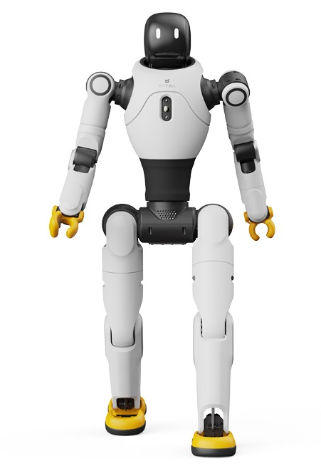

Compact bipedal humanoid built for conversation, guiding and shows. The official page (Nov 2026) lists two variants, **X2 Neo** and **X2 Ultra (New Version)**. The **X2 Edu** (July 2026, education / competitions) is covered by the AimDK SDK docs but has no separate spec column on the product page.

| Spec | X2 Neo | X2 Ultra (New Version) |
|---|---|---|
| Size / weight | 1310 × 460 × 210 mm, about **35 kg** | same size, about **39 kg** |
| Body DoF | **30** (head 1, arms 7 each, waist 3, legs 6 each) | **31** (head 2); **47** with optional hands (10 active + 6 passive) |
| Arm reach / payload | **558 mm** (without end effector); **≤ 1 kg** over full range, up to 3 kg in specific poses | same |
| Walking speed | typically **≤ 0.8 m/s** (2 m/s lab) | same |
| Knee peak torque | 120 N·m | 120 N·m |
| Sensors | interaction RGB camera, head touch, mic array + wireless mic, speaker | adds **stereo RGB, RGB-D, rear camera, LiDAR** |
| Compute | RK3588 ×2 | RK3588 ×2 + **Jetson Orin NX 16 GB (157 TOPS)** |
| Ports (minimum) | USB-C ×3, RJ45 ×2, 12 V/3 A, 48 V/5 A | same |
| Connectivity | Wi-Fi, Bluetooth, 4G/5G module, GPS, optional UWB | same |
| Battery | about **500 Wh**, about **2 h** walking at 0.5 m/s, charge ≤ 1.5 h, replaceable | same, plus autonomous low-battery return |
| Operating temp | −10 °C to 40 °C | same |
| Secondary development | **not supported** | **supported** (interfaces vary by delivered version) |
| End effectors | none | OmniHand, OmniPicker (as ordered) |
| Creation tools | LinkSoul, LinkCraft | LinkSoul, LinkCraft, SkillForge |
| Warranty | 8 months | 18 months |

- **Variants and access:** Neo = app, persona (LinkSoul) and motion (LinkCraft) tools only. Ultra = AimDK ROS 2 SDK (Python / C++), on-board development on the Orin NX. Edu = SDK-covered; hardware specs not confirmed here (see [Developer guide](AGIBOT-Developer-Guide.md)).
- **Check on site first:** which variant it is, and that SDK version matches robot firmware.
- **Limits that shape your idea:** arms carry about 1 kg; it is a talker and guide, not a lifter. Navigation and specific skills need the matching software packages.
- **Typical applications:** exhibit / showroom tours, reception, wayfinding, retail assistance, stage shows, STEM education, teleoperated data collection.
- **Accessories:** UWB Agile Group Control Kit, OmniHand, OmniHand 3 Lite (listed "coming soon" on the X2 page), OmniPicker, AGIBOT VR Kit (teleoperation with live video).
- Official page: https://www.agibot.com/products/X2

### D1 Ultra (also D1 Pro / Edu)

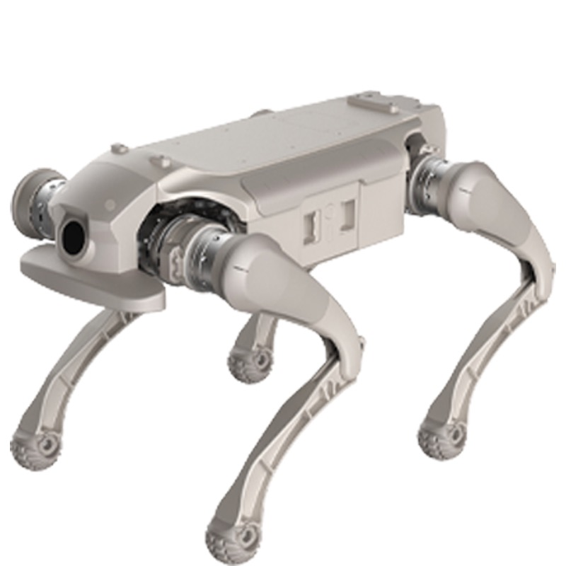

Small 12-motor quadruped family on one chassis. **Pro** is the closed consumer-style unit, **Edu** opens the SDK and ports, **Ultra** is the hardened industry version.

| Spec | D1 Pro | D1 Edu | D1 Ultra |
|---|---|---|---|
| Standing size | about 635 × 360 × 420 mm | same | 630 × 360 × 420 mm |
| Weight (with battery) | **15.5 kg** | 15.5 kg | not stated |
| Max speed | 3.5 m/s | 3.5 m/s | **3.7 m/s** |
| Payload | **5 kg** | 5 kg | 5 kg |
| Slope / stairs / jump | **40°** / **16 cm** / 35 cm | same | same |
| Range / runtime | 6 ± 1 km / 1–2 h | same | 6 ± 1 km |
| Protection | not stated | not stated | **IP54** |
| Joint peak torque | 48 N·m | 48 N·m | about 48 N·m |
| Compute | 8-core CPU | 8-core CPU | not stated |
| Sensors (standard) | IMU, FPV camera (HFOV 111°) | same | not stated |
| Battery | 43.2 V, 4.6 Ah; about 1 h charge (10–90%) | same | not stated |
| Operating temp | 0–40 °C | 0–40 °C | not stated |
| **SDK / secondary development** | **No** | **Yes** | **Yes** |
| Expansion ports | none | Ethernet, USB, power, SBUS, UART | Ethernet, USB, power, SBUS, UART |

- **Add-ons supported (Edu / Ultra):** 3D LiDAR, depth camera, RTK, 4G/5G, video-transmission and follow modules. "Intelligent follow" needs your own development.
- **Simulation:** URDF provided; Isaac Sim and MuJoCo.
- **Leukerbad notes:** D1 Pro / Edu are rated **0 °C minimum** — November outdoor use at 1,400 m may fall below that; the Ultra's temperature range is not stated. No LiDAR or depth camera is standard, so autonomy means bringing your own sensor and compute.
- **Typical applications:** security patrol, inspection, education, entertainment; the Ultra page also lists emergency rescue.
- Official pages: https://www.agibot.com/products/D1Ultra · https://www.agibot.com/products/D1_Pro

### D1 Max / D1 MaxPro

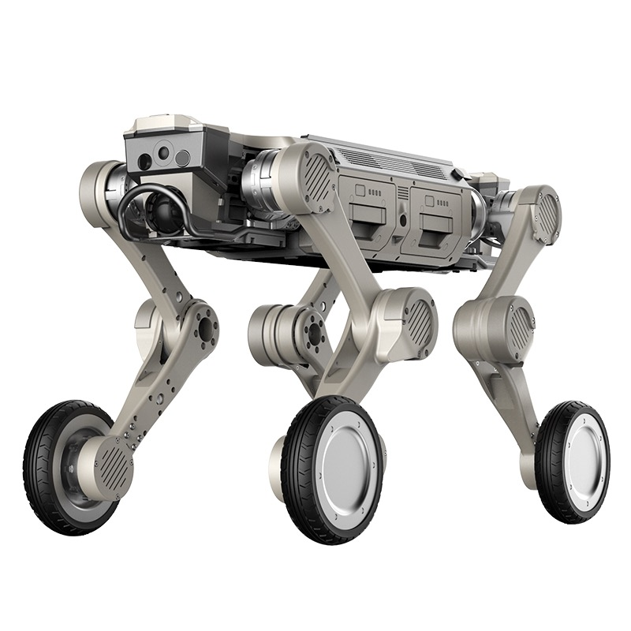

Industrial quadrupeds. **D1 Max** is wheel-legged (switches between wheel and leg mode); **D1 MaxPro** is the heavy-payload model.

| Spec | D1 Max | D1 MaxPro |
|---|---|---|
| Size (standing) | 930 × 480 × 585 mm | not read |
| Weight | **41 kg** | not read |
| DoF | 12 + 4 (wheels) | not read |
| Rated payload | **25 kg** | **50 kg** sustained |
| Max speed | **6 m/s** | not read |
| Slope / stairs / obstacle | **45°** / 25 cm continuous / 80 cm obstacle | stairs up to **30 cm**, open-riser industrial stairs |
| Protection | **IP67** | **IP67**, wades 20 cm water |
| Operating temp | **−20 °C to 55 °C** | −20 °C to 55 °C |
| Battery / runtime | 54 V, 504.9 Wh × 2, hot-swap; **5 h** unloaded / 3.5 h loaded | 2,081 Wh; 5.5 h unloaded / ≥ 2 h loaded; quick swap |
| Range | 29 km unloaded / 18 km loaded | not read |
| Compute | NVIDIA Orin NX 16 GB (100–157 TOPS) | not read |
| Sensors | 2 × 96-channel LiDAR (front + rear), 2 × 8 MP FPV cameras, fill lights, IMU, **GNSS RTK**, 2 × ultrasonic | not read |
| Dev access | SDK, 3D CAD and URDF | GitHub repo exists (see profile) |
| Interfaces | 2 × GbE, 2 × USB 3.0, RS232, RS485, 2 × SBUS, PPS; power out 5 / 12 / 24 / 48 V, max 480 W; Wi-Fi, Bluetooth | not read |
| Docking | charging dock standard; autonomous charging station optional | autonomous charging dock optional |

- **Why it matters here:** the only AGIBOT platform rated for cold, wet, steep outdoor work with LiDAR and RTK already fitted — the strongest fit for T02 and outdoor T01 if a unit is on site (not confirmed).
- **Typical applications:** logistics and transport, search and rescue, task execution, heavy-load operation.
- Official pages: https://www.agibot.com/products/D1_Max · https://www.agibot.com/products/D1_MaxPro

### G2

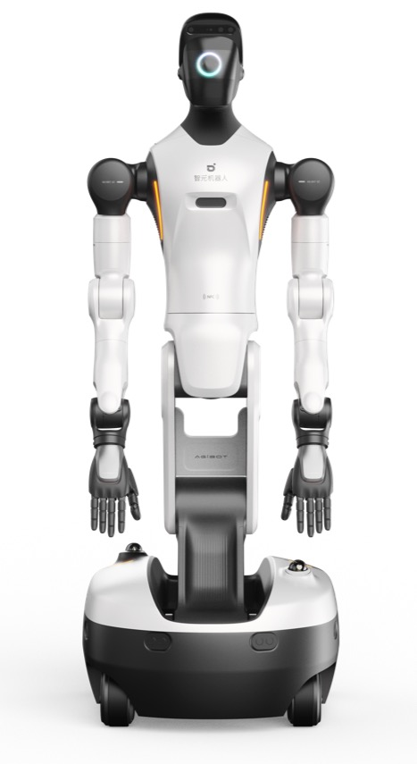

Wheeled dual-arm robot aimed at industrial tasks that also need a friendly interface.

| Spec | Value |
|---|---|
| Protection | **IP42** whole machine |
| Build | 100% automotive-grade components (company claim) |
| Manipulation | force-controlled arms; sub-millimetre assembly claimed |
| Skill deployment | Genie RL (fast on-robot learning) |
| Interaction | animated face, human-like motion, multi-user conversation, eye-gaze tracking |
| DoF, payload, reach, size, compute, runtime | **not on the product page** — ask AGIBOT staff |

- **Dev access:** through Genie Studio and GO models rather than an open SDK; expect to need AGIBOT support.
- **Proof point:** six G2 units ran 1,730 tasks in a 24-hour convenience-store trial (Nov 2026, company news; see profile).
- **Typical applications:** precision assembly, handling, retail store operation, interactive service.
- Official page: https://www.agibot.com/products/G2

### G2 Max

No image saved. Heavy-payload industrial task robot for handling and palletizing, launched at WAIC in July 2026. 🧪 Specs **not public**; no product page on agibot.com as of 2026-11-14. Unlikely to be available to teams.

### G2 Air

No image saved. Single-arm mobile manipulator announced April 2026. 🧪 No product page on agibot.com as of 2026-11-14.

| Spec | Value (press-release values carried over from the profile) |
|---|---|
| Arm | **7 DoF**, **3 kg** payload, **750–800 mm** reach |
| Base | width **< 800 mm**, speed **≥ 1.5 m/s** |

Typical applications: light pick-and-place and delivery in narrow aisles.

### G1 / G1 Max

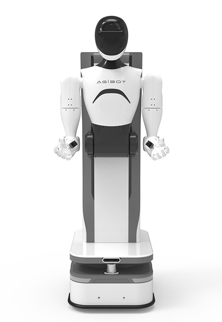

**G1** (Genie-1) is the data-collection and inference robot behind the AgiBot World dataset. **G1 Max** is the bigger flexible-manufacturing version.

| Spec | G1 | G1 Max |
|---|---|---|
| Height / size | **130–180 cm** (lifting waist) | 770 × 620 × 1630 mm |
| Weight | **150 kg** | **230 kg** |
| DoF | **20** without end effectors (26 total) | 7 per arm, 22 total |
| Arm payload | holds **3 kg** continuously with one arm | **5 kg** per arm |
| Working height | over 2 m | 0–2 m |
| End effector | 6-DoF hand or two-finger gripper | not stated |
| Force sensing | six-axis force sensor on each arm | 2 × six-axis force sensors |
| Sensors | 3 × RGB-D + 5 × fisheye; chassis RGB-D front / rear + LiDAR | 360° LiDAR, 4 AI vision sensors |
| Compute | **Jetson AGX Orin 64 GB** | 275 TOPS |
| Runtime | **4 h+** | **5 h**, 2 kWh, hot-swap, 2 h charge |
| Base | turns in place, crosses 20 mm obstacles | four-wheel drive, zero-radius turn, crab walk |

- **Dev access:** VR / motion-capture teleoperation with full-body joint recording; trained and deployed through Genie Studio with GO models. G1 Max advertises open interfaces for secondary development.
- **Limits:** flat indoor floors only (20 mm obstacle limit); heavy to move around a venue.
- **Typical applications:** teleoperated data collection, model inference, loading / unloading, connector plugging, intralogistics.
- Official pages: https://www.agibot.com/products/G1 · https://www.agibot.com/products/G1_MAX

### A2 Ultra

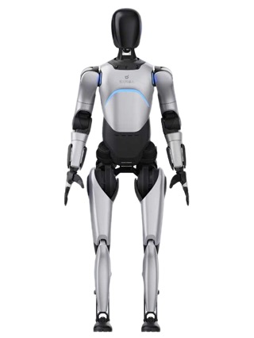

Full-size reception and guiding humanoid; AGIBOT's most-deployed biped.

| Spec | Value |
|---|---|
| Size / weight | **169 cm** × 75 cm × 30 cm, about **69 kg** |
| DoF | **40** total (neck 2, arm 7 each, leg 6 each, 6-DoF hands) |
| Arm payload | about **2 kg** |
| Speed | max **1.2 m/s**; 10° ramps |
| Knee peak torque | 270 N·m |
| Sensors | 3D LiDAR, RGB-D, RGB and fisheye cameras, array microphone |
| Interaction | face screen with expressions, speaker, indicator light |
| Compute | 16-core CPU + **NVIDIA Jetson Orin 64 GB** |
| Connectivity | Wi-Fi, 4G/5G |
| Battery | 14.4 Ah; standing **3 h**, walking **1.5 h+**; fast charge (2 h) and hot-swap |
| Certifications | CR, CE-MD, CE-RED, FCC (company claim) |

- **Dev access:** configuration rather than code — AimMaster client, LinkSoul (knowledge base, wake word, persona, voice, greeting), dance development and swarm-control software. No open low-level SDK confirmed.
- **Typical applications:** exhibition-hall guide, autonomous reception, route guidance, event and brand-ambassador work.
- Official page: https://www.agibot.com/products/A2_Ultra

### A2 Lite

No image saved (looks like the A2 Ultra). Show-only A2: **23 DoF** (5 per arm, no hands), about **64 kg**, max **0.8 m/s**, **Wi-Fi only**, and **no LiDAR, cameras, face screen or Orin board**. Standing 4.5 h, walking 1.5 h+. Supports dance development, swarm control and optional VR teleoperation. Not useful for autonomy projects. Official page: https://www.agibot.com/products/A2_Pro

### A3 Ultra

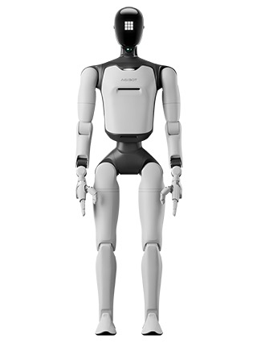

Newest full-size service humanoid (WAIC, July 2026), designed for unattended round-the-clock operation.

| Spec | Value |
|---|---|
| Size / weight | **1.74 m**, **60 kg** (press release, via profile) |
| DoF | **51 active** (press release, via profile); 7 per arm, 6 per leg, 3 waist; OmniHand up to 20 DoF |
| Arm payload | **5 kg** per arm (press release, via profile) |
| Runtime | up to **8 h** combined (press release, via profile); dual battery compartments, autonomous charging |
| Compute | **700 TOPS** embedded processor (NVIDIA Thor per press release), three-tier heterogeneous architecture |
| Sensors | LiDAR, chest and hip RGB-D, left / right and rear fisheye, interactive binocular camera, front and rear microphones, dual shoulder touch sensors |
| Positioning / network | centimetre-level positioning, global 5G |
| Structure | magnesium alloy + carbon-fibre-reinforced nylon |
| Other | enters and leaves its own transport case; secondary development supported; persona customisation |

- **Availability:** not public; treat as a showpiece unless AGIBOT staff say otherwise.
- **Typical applications:** reception and guided tours, fleet deployments.
- Official page: https://www.agibot.com/products/A3Ultra

### A3

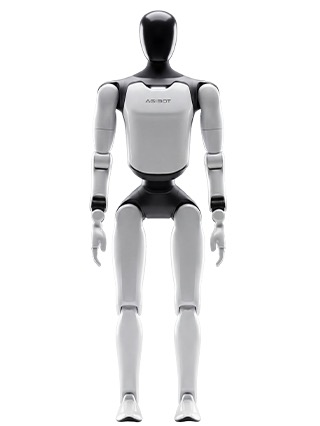

Lightweight athletic humanoid for performance and interaction.

| Spec | Value |
|---|---|
| Size / weight | **173 cm**, **55 kg** |
| Runtime | up to **10 h**; dual battery packs, **1,152 Wh**, **10 s** hot swap |
| Power | 12 kW peak, 0.218 kW/kg |
| Positioning | UWB standard, single-unit accuracy < ±10 cm; fleet control of 100+ units |
| Network | dual-module 5G, eSIM + SIM |
| Interaction | shoulder touch sensing, 360° microphone array, voice + multimodal |
| Dev access | "fully open interfaces" for secondary development (page claim; SDK not verified); LinkCraft motion authoring, LinkSoul personas |
| Logistics | folds into a case, loads itself, one-person deployable |

- **Typical applications:** commercial shows, themed-park guides, live-stream hosts, embodied-AI research.
- Official page: https://www.agibot.com/products/A3

### X1

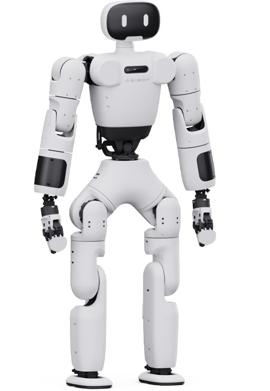

Full-stack open-source humanoid reference design (hardware drawings, RL training and inference code on GitHub). A learning resource, not a rentable robot.

| Spec | Value |
|---|---|
| Active DoF | **34** |
| Height / weight | **130 cm**, **33 kg** |
| Runtime | 2 h |
| Max walking speed | 1 m/s |
| Single-arm payload | 0.5 kg |

The page doubles as a parts catalogue — see PowerFlow actuators under Accessories. Official page: https://www.agibot.com/products/X1

### D2 Max

No image saved. All-terrain quadruped announced April 2026 and described as "Level 3 autonomous". 🧪 Not on the product menu as of 2026-11-14; specs **not public**.

### C5

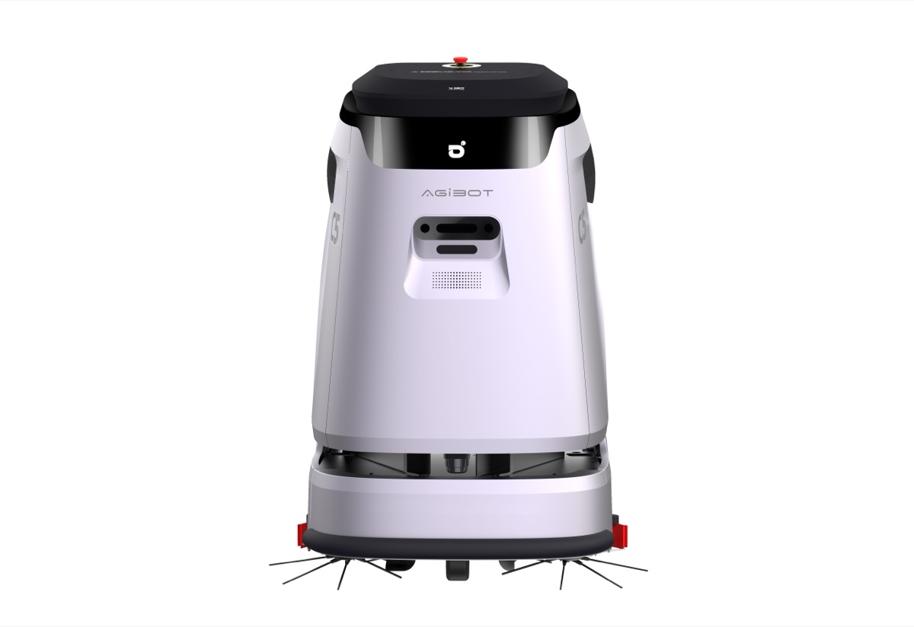

Autonomous floor-cleaning robot for medium and large indoor spaces; combines sweeping, scrubbing and dust mopping.

| Spec | Value |
|---|---|
| Max cleaning rate | **1,980 m²/h** |
| Scrub width / pressure | **550 mm** / 25 kg |
| Water tank | **90 L** |
| Scrubbing endurance | **3 h** |
| Debris removal | > 95% (company figure) |
| Navigation | laser + vision fusion positioning, vision + point-cloud obstacle perception, automatic zoning and map updates |
| Building integration | elevator and access-control linkage, scheduling, job reports |
| Workstation | auto charging, water fill and drain, 4-minute sewage-tank self-clean; 520 × 310 × 1038 mm, 1,800 W; optional mobile water tank |

- **Dev access:** none public — an appliance managed from robot, phone and cloud. Good as a concept anchor (T01 / T03), poor as a hack platform.
- **Typical applications:** malls, transport hubs, factories, hospitals, supermarkets, offices, hotels.
- Official page: https://www.agibot.com/products/C5

### OmniHand family (Ultra-T, Ultra, standard, Lite)

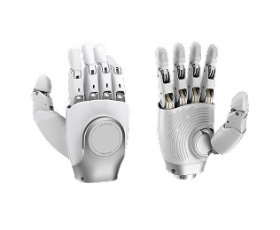

Dexterous hands sold under the AGILINK brand. The picture shows the standard OmniHand 3.

| Model | DoF | Weight | Payload | Speed (open/close) | Repeatability | Sensing | Interface |
|---|---|---|---|---|---|---|---|
| **OmniHand 3 Ultra-T** (tendon-driven flagship) | **22 + 3 wrist** | 500 g hand, about 1.7 kg full assembly | not stated | 0.3 s | not stated | full-hand 3D tactile (0.01 N), in-palm camera | CAN FD / EtherCAT |
| **OmniHand 3 Ultra-M** (direct-drive; menu name "OmniHand Ultra") | **21 active** | 630 g | 5 kg | 0.3 s | ±0.1 mm | vision-based fingertip tactile, 0–30 N | not read |
| **OmniHand 3** (standard) | **10 active + 6 passive** | 510 g | 5 kg | 0.5 s | ±0.3 mm | 300+ force taxels on fingertips, palm and back of hand | not read |
| **OmniHand 3 Lite** | **4 active + 7 passive** | 350 g | 7.5 N max fingertip force | 0.5 s | ±0.5 mm | optional tactile; optional wrist camera | not read |

- **Dev access:** `agilink_omnihand_sdk` (C++ / Python / ROS 2) and URDFs per the profile; the Lite is marketed with a fully open-source toolkit.
- **Price signal:** OmniHand 3 Lite-S listed at **USD 699** per hand on the official store; other models not public.
- **Cross-vendor use:** a hand plus another vendor's arm (Flexiv, ROKAE, Dobot) is a realistic T04 or T03 build if mounting and power can be sorted on site.
- Official pages: https://www.agilink-ai.com/omni-hand3.html · https://www.agilink-ai.com/omni-hand3-ultra-t.html · https://www.agilink-ai.com/ultra-m.html · https://www.agilink-ai.com/omni-hand3-lite.html

### OmniPicker 3

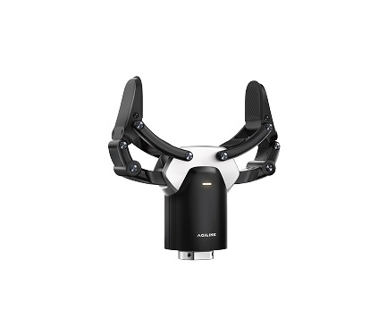

Adaptive two-finger gripper built for data collection and contact-rich handling.

| Spec | Value |
|---|---|
| Max grip force | **140 N** (validated over 1 million full-load cycles) |
| Stroke | 110 ± 5 mm |
| Max payload | **5 kg** |
| Repeatability | ±0.1 mm |
| Tactile | fingertip sensing, 0.1 N resolution |
| Interface | CAN FD / RS485 |
| Data collection | native UMI compatibility; optional depth or fisheye camera |

Easiest AGIBOT part to combine with other vendors' arms. Official page: https://www.agilink-ai.com/omni-picker3.html

### MEgo

No image saved. Robot-free data-collection kit (gripper + egocentric view + processing engine) announced April 2026. 🧪 Specs and availability **not public**. Relevant only if AGIBOT brings one for demonstration capture.

### GO-1 / GO-2 / GO-3 (preview)

No image saved. Manipulation foundation models (vision-language-action family).

| Model | Status | Access | Notes |
|---|---|---|---|
| GO-1 | ✅ | open weights and fine-tuning code (OpenDriveLab / AgiBot-World, Hugging Face) | trained on the AgiBot World dataset; reference robot is the G1 |
| GO-2 | ✅ (Apr 2026) | served through Genie Studio; open-source status not public | action chain-of-thought, planner + executor; company-reported 98.5% on LIBERO |
| GO-3 | 🧪 preview (Oct 2026) | not public | company claims top results on three benchmarks |

**48-hour reality check:** fine-tuning a VLA needs demonstration data and GPU time. Only plan on this if AGIBOT staff provide a G-series robot with a working teleoperation and training pipeline.

### Genie Studio

No image saved. Commercial platform that chains data collection, fine-tuning, evaluation and deployment for G-series robots with GO models. Not open source; pricing not public. The X2 page also names newer tools — **SkillForge** (skill training, phase 1 mainly pick-and-place, limited customer trials), **AgentFlow** (task orchestration) and **Agent Foundry** (simulation and evaluation); how they relate to Genie Studio is not stated. Official page: https://genie.agibot.com/en/geniestudio

### Genie Sim 3.0

No image saved. Open-source, Isaac-based simulation platform with a native ROS 2 runtime (MoveIt, ros2_control), open assets, datasets and evaluation code. Free. The fastest way to start before a robot slot is free — needs an NVIDIA GPU workstation. Official repo: https://github.com/AgibotTech/genie_sim

## Accessories and ecosystem

| Item | Type | Key facts | Status |
|---|---|---|---|
| OmniHand 3 family | dexterous hands | see table above | ✅ / 🧪 |
| OmniPicker 3 | gripper | 140 N, 5 kg, CAN FD / RS485, UMI-compatible | ✅ |
| OmniPicker (earlier version, X1 page) | gripper | 0.43 kg, 30 N, 120 mm stroke, 0.7 s, CAN / CAN FD / RS485 / serial | ✅ |
| OmniGlove / OmniGlove Pro | teleoperation glove | listed on the official store at **USD 6,300 / 8,500**; specs not read | ✅ |
| AGIBOT VR Kit | teleoperation | live video + motion mapping for X2, beyond line of sight | ✅ |
| UWB Agile Group Control Kit | fleet positioning | multi-robot choreography for X2 / A3 | ✅ |
| PowerFlow R86-3 | joint actuator | 1.28 kg, peak **200 N·m**, rated 60 N·m, 48 V | ✅ |
| PowerFlow R86-2 | joint actuator | 0.81 kg, peak 80 N·m, rated 20 N·m, 48 V | ✅ |
| PowerFlow R52 | joint actuator | 0.45 kg, peak 19 N·m, rated 6 N·m, 48 V | ✅ |
| PowerFlow L28 | linear actuator | 200 g, 110 N thrust, 50 mm/s, 24 V, FDCAN | ✅ |
| Domain controller DCU | comms hub | 90 g, EtherCAT to 3 × FDCAN, 1 kHz, Linux SDK | ✅ |
| C5 workstation | dock | auto charge, water fill / drain, tank self-clean | ✅ |
| D1 Max charging dock / autonomous charging station | dock | dock standard, autonomous station optional | ✅ |
| LinkSoul | software | no-code persona, voice, knowledge base (A2, A3, X2) | ✅ |
| LinkCraft | software | turn a video of a movement into robot motion | ✅ |
| AimMaster, AGIBOT Go app, AGIQUAD Go app | software | operator client and mobile apps for humanoids / quadrupeds | ✅ |
| Data Service | service | embodied-AI data collection offered via a separate site (maniformer.ai) | ✅ |

## Legacy and discontinued

- **A2 (original), A2-W, A2-Max** — still named in the website's contact-form dropdown but no longer on the product menu; superseded by A2 Ultra / A2 Lite, the G series and A3. Status ⚠️ unverified.
- **X1** — remains as an open-source design, not a sold robot.
- **OmniHand 2025 (with tactile)** — still listed on the official store alongside the OmniHand 3 generation.

## Image credits

All images © AGIBOT, taken from the product-menu thumbnails on the official site (agibot.com) on 2026-11-14 and converted to JPEG.

| File | Shows | Source URL |
|---|---|---|
| assets/agibot-a3-ultra.jpg | A3 Ultra | https://www.agibot.com/public/uploads/images/20261019/d000d7c155d324f34dde6ae2d90e04b8.png |
| assets/agibot-a3.jpg | A3 | https://www.agibot.com/public/uploads/images/20260429/a657e46f829152dbed8c7cd370ef8054.png |
| assets/agibot-a2-ultra.jpg | A2 Ultra | https://www.agibot.com/public/uploads/images/20250922/7528a0359f8f7e09788972bdb5c35c2a.png |
| assets/agibot-x2.jpg | X2 | https://www.agibot.com/public/uploads/images/20250924/bcdaf302f10439090f551e9906ef7285.png |
| assets/agibot-x1.jpg | X1 | https://www.agibot.com/public/uploads/images/20250115/93ff145215289a6030b2e08d06815827.png |
| assets/agibot-g2.jpg | G2 | https://www.agibot.com/public/uploads/images/20251031/afa47f3a6d43c28b95a1534ed8310ad7.png |
| assets/agibot-g1.jpg | G1 | https://www.agibot.com/public/uploads/images/20241230/1968be56db5f4f93c2d514a82df24944.png |
| assets/agibot-d1-ultra.jpg | D1 Ultra | https://www.agibot.com/public/uploads/images/20250924/833452d6caa40f2728dae867dcdcfc2a.png |
| assets/agibot-d1-max.jpg | D1 Max | https://www.agibot.com/public/uploads/images/20260429/6cc43e41089201e697d1bb7de197b8e8.png |
| assets/agibot-c5.jpg | C5 | https://www.agibot.com/public/uploads/images/20251023/d59c5681d6db5d368849ac13334e98e9.png |
| assets/agibot-omnihand.jpg | OmniHand 3 (standard) | https://www.agibot.com/public/uploads/images/20261029/a3ef97f9da1cc8fa12c180e795e0775e.png |
| assets/agibot-omnipicker.jpg | OmniPicker 3 | https://www.agibot.com/public/uploads/images/20261029/a47083518f0729427fc6a4dec5e275e7.png |

## Sources

Research note: web search was unavailable for this pass, so launch dates and the G2 Air / G2 Max / D2 Max / MEgo / GO-model rows rely on the [AGIBOT profile](AGIBOT.md) and its sources; everything else was read directly from the official pages below.

- [AGIBOT — A3 Ultra](https://www.agibot.com/products/A3Ultra)
- [AGIBOT — A3](https://www.agibot.com/products/A3)
- [AGIBOT — A2 Ultra](https://www.agibot.com/products/A2_Ultra)
- [AGIBOT — A2 Lite (with A2 Ultra comparison table)](https://www.agibot.com/products/A2_Pro)
- [AGIBOT — X2](https://www.agibot.com/products/X2)
- [AGIBOT — X1](https://www.agibot.com/products/X1)
- [AGIBOT — G2](https://www.agibot.com/products/G2)
- [AGIBOT — G1](https://www.agibot.com/products/G1)
- [AGIBOT — G1 Max](https://www.agibot.com/products/G1_MAX)
- [AGIBOT — D1 Ultra](https://www.agibot.com/products/D1Ultra)
- [AGIBOT — D1 Pro / Edu](https://www.agibot.com/products/D1_Pro)
- [AGIBOT — D1 Max](https://www.agibot.com/products/D1_Max)
- [AGIBOT — D1 MaxPro](https://www.agibot.com/products/D1_MaxPro)
- [AGIBOT — C5](https://www.agibot.com/products/C5)
- [AGILINK — OmniHand 3](https://www.agilink-ai.com/omni-hand3.html)
- [AGILINK — OmniHand 3 Ultra-T](https://www.agilink-ai.com/omni-hand3-ultra-t.html)
- [AGILINK — OmniHand 3 Ultra-M](https://www.agilink-ai.com/ultra-m.html)
- [AGILINK — OmniHand 3 Lite](https://www.agilink-ai.com/omni-hand3-lite.html)
- [AGILINK — OmniPicker 3](https://www.agilink-ai.com/omni-picker3.html)
- [AGIBOT official store](https://store.agibot.com/)
- [Genie Studio](https://genie.agibot.com/en/geniestudio)
- [GitHub — AgibotTech/genie_sim](https://github.com/AgibotTech/genie_sim)
- [AGIBOT — New generation of embodied AI robots and models (2026-04-17)](https://www.agibot.com/article/231/detail/63.html)
- [PR Newswire via AAP — Four new products at WAIC 2026 (2026-07-20)](https://www.aap.com.au/aapreleases/cision20260719ae07639/)
