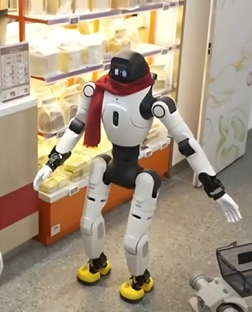
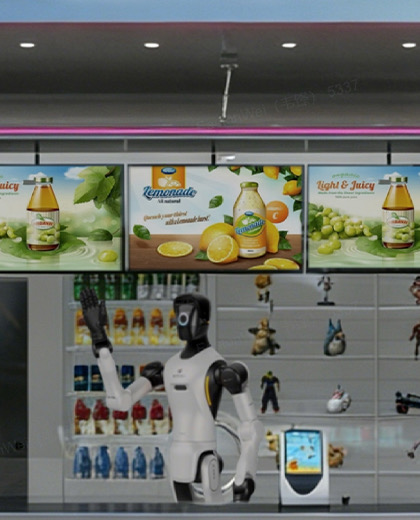
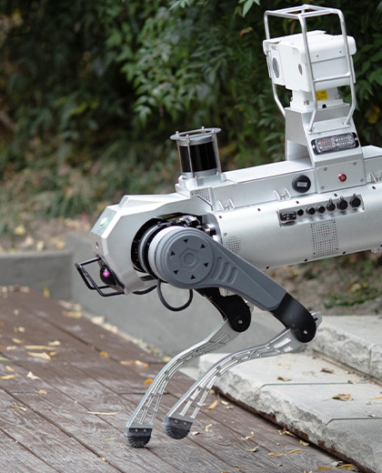
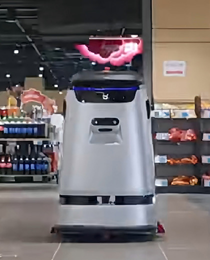
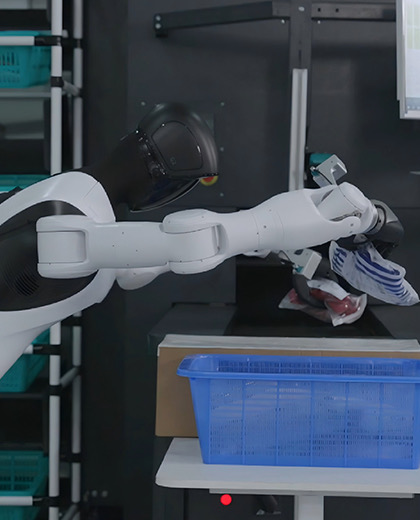
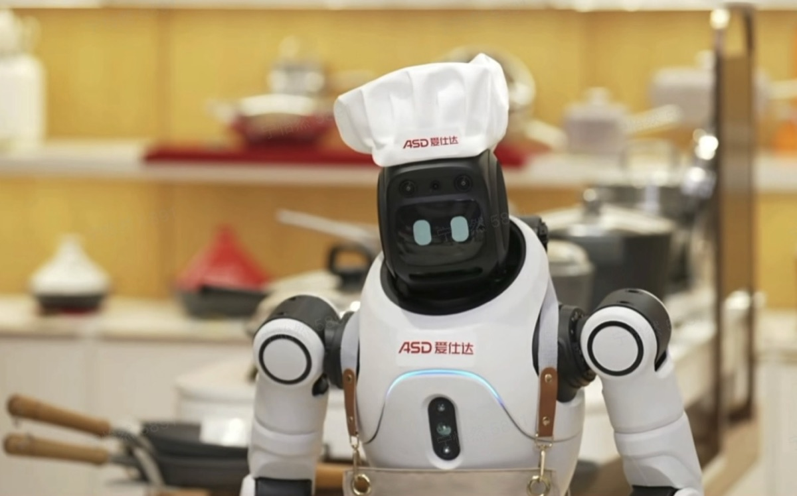
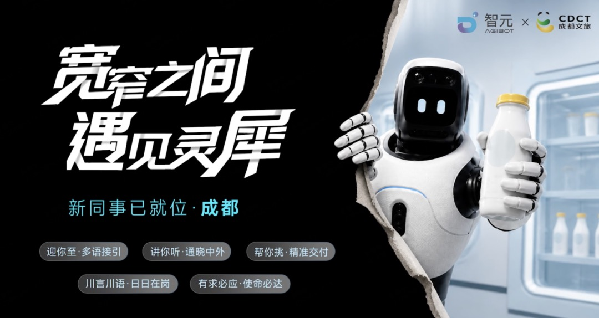
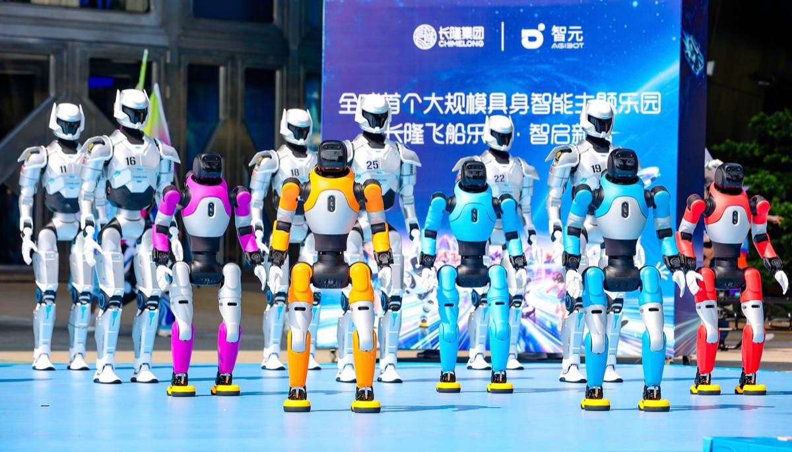
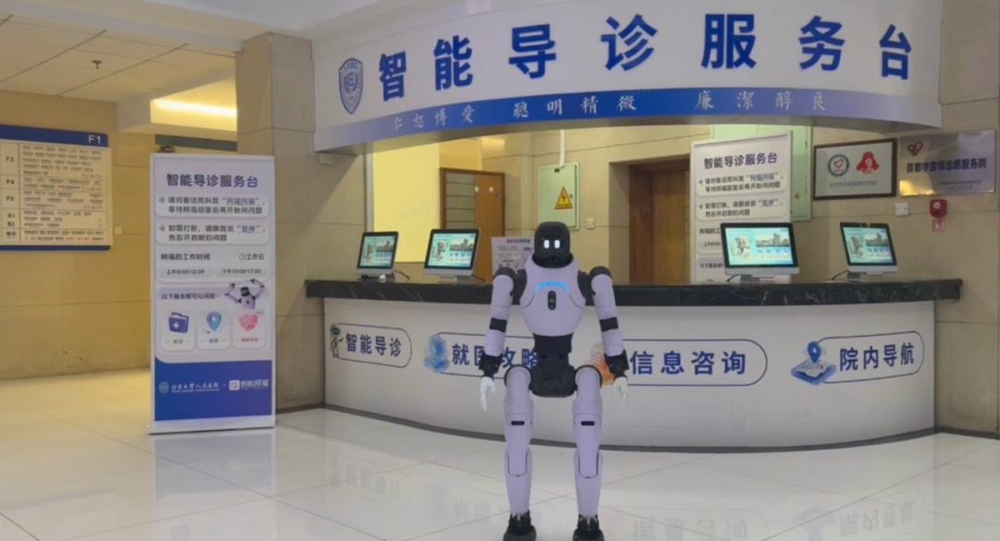
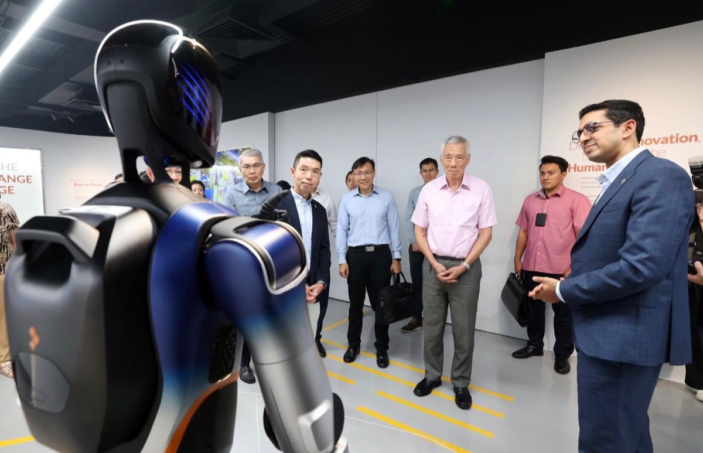

# AGIBOT — Solutions and Projects Register

⬆ [AGIBOT profile](AGIBOT.md) · [Product portfolio](AGIBOT-Products.md) · [Papers and research](AGIBOT-Papers-and-Research.md) · [Roadmap and strategy](AGIBOT-Roadmap-and-Strategy.md)

> **Coverage note:** Walked on 2026-11-14: (1) the English site agibot.com — sitemap, product menu and **every news title from article 24 to 134** (Dec 2024 – 6 Nov 2026), about 45 articles read in full or in part; (2) the Chinese site agibot.com.cn — the **Solutions page** (`/solution`, seven solutions with named customers), **every news title from article 4 to 269** (Sep 2023 – Nov 2026), about 48 articles read. The Chinese site is more complete (hospital, Chengdu, Singapore, Joyson and G2 Max cases exist only there). **Not accessible / empty:** the legacy industry pages (`/picture/171`–`177`, "cooperation cases" `/picture/187`) are empty templates; open.agibot.com "ecosystem cases" and agiraas.com render only with JavaScript; the WeChat-only posts were not read. **Web search was unavailable for this pass** (search quota exhausted), so nothing here is cross-checked against trade press today — all facts come from AGIBOT's own pages unless flagged. Company-reported numbers are claims, not audited results. AGIBOT = 智元机器人 (Zhiyuan Robotics), legal name 智元创新（上海）科技股份有限公司 — confirmed on the Chinese site footer.

## Solutions catalogue — everything they offer

Rows 1–7 are the official **"seven standardized productivity solutions"** launched at the AGIBOT Partner Conference (APC) on 2026-04-17. Rows 8–20 are further applications AGIBOT markets or has deployed. Rows 21–30 are commercial models and enabling platforms sold with the solutions.

| # | Solution / application | What it does | Products used | Maturity | Tracks | Source link |
|---|---|---|---|---|---|---|
| 1 | Production-line loading and unloading | Picks precision parts (tablets, chip trays, CNC parts), places them in test fixtures / machines, sorts good and bad units; hour-level changeover via reinforcement learning | G2, OmniHand 3, Genie Studio | ✅ | — | [CN solutions page](https://www.agibot.com.cn/solution) |
| 2 | Industrial handling (depalletizing, tote and material transfer) | Dual-arm robots move totes, cartons and heavy parts between pallets, racks and lines; connects to MES / AGV | A2-W, G2, G2 Max | ✅ | — | [CN solutions page](https://www.agibot.com.cn/solution) |
| 3 | Logistics sorting and parcel induction | Robot feeds boxes, bags and odd-shaped parcels into sorters, 24/7, end-to-end model, no pre-programming | G1, G2, G2 Max | ✅ | T01 · T03 | [Seven solutions article](https://www.agibot.com/article/231/detail/64.html) |
| 4 | Guidance, shopping-guide and wayfinding ("导览导购导引") | Greets, explains, answers questions, walks people to a destination, issues queue numbers; for retail, restaurants, hotels, government halls, metro | A2 / A2 Ultra, A3, X2, G2, LinkSoul | ✅ | T01 · T04 | [CN solutions page](https://www.agibot.com.cn/solution) |
| 5 | Retail service station (unmanned robot kiosk) | Self-running 24/7 kiosk: robot sells, picks and hands over goods and gives visitor information; for scenic sites, malls, transport hubs | G2 or X2 (retail pod), SkillForge | ✅ | T01 | [CN solutions page](https://www.agibot.com.cn/solution) |
| 6 | Security patrol and inspection | Quadruped patrols sites, reads equipment state, flags faults; vision-language navigation, optional arm, central dispatch platform | D1 Max / MaxPro, D2 Max, G2 (indoor patrol) | ✅ | T02 | [CN solutions page](https://www.agibot.com.cn/solution) |
| 7 | Industrial and commercial cleaning | Sweep, scrub and dust-mop robots with a docking station for water change and self-cleaning; factories, malls, hospitals, airports | C5, C4 | ✅ | T01 · T03 | [CN solutions page](https://www.agibot.com.cn/solution) |
| 8 | In-store sales assistant | Asks about needs (household size, habits, budget), recommends products, hands over to staff for price and payment | X2 | ✅ | T01 | [ASD article](https://www.agibot.com/article/231/detail/124.html) |
| 9 | Tourist-district visitor service team | Three roles on one street: greeter / route help, cultural guide (incl. dialect), retail pod | X2 | ✅ | T01 | [Chengdu article](https://www.agibot.com.cn/article/315/detail/252.html) |
| 10 | Theme-park and culture-tourism package | Shows, science education, guided tours, retail stations, "AI companion" experiences, hotel service, sports games, with fleet coordination and a private 5G-A network | A3, X2, G2, D1 | ✅ | T01 | [Chimelong launch](https://www.agibot.com/article/231/detail/123.html) |
| 11 | Hospital triage and wayfinding desk | Answers "which department?", route, doctor schedule, insurance questions from the hospital knowledge base; speech plus gestures | X2 + Ant Afu AI health assistant | 🧪 (one hospital, live) | T04 · T01 | [Hospital article](https://www.agibot.com.cn/article/315/detail/248.html) |
| 12 | Transit-hub passenger service (metro, airport, rail) | Security-check guidance, passenger inquiries, patrol in metro stations; reception and information at airports | G2, A2 | ✅ metro · 🧪 airport | T01 · T02 | [Innovation Day recap](https://www.agibot.com.cn/article/315/detail/261.html) |
| 13 | Convenience-store operations (multi-robot) | Customer help, shelf check and restock, coffee, checkout / hot food, table cleaning — six robots, one store | G2 + Genie Master | 🧪 trial | T01 | [Store trial](https://www.agibot.com/article/231/detail/134.html) |
| 14 | Hotel front desk and guest service | Welcomes guests, multi-turn conversation, front-desk reception | A3 | 🧪 | T01 | [Innovation Day recap](https://www.agibot.com.cn/article/315/detail/261.html) |
| 15 | Entertainment and commercial performance | Group dance, stage shows, parades, sports demos; swarm control of 100+ robots | A3, X2, D1, LinkCraft, 灵动 fleet platform | ✅ | T01 | [AGIBOT NIGHT](https://www.agibot.com/article/231/detail/40.html) |
| 16 | Event and venue wayfinding fleet | Dozens of robots give directions across a large venue | mixed fleet (via rental partner Qingtianzu) | ✅ (WAIC 2026) | T01 | [WAIC recap](https://www.agibot.com.cn/article/315/detail/174.html) |
| 17 | Education and research solutions | Teaching platforms, courses, joint labs, competitions | X2 Edu, D1 Edu, G1, X1, AIMA platform | ✅ | — | [Yuansheng programme](https://www.agibot.com.cn/article/315/detail/247.html) |
| 18 | Data factory and data services | Robot data-collection centres, teleoperated data capture, dataset services | G1, VR teleoperation kit, MEgo, MEgo Glove, MANIFORMER | ✅ | — | [LEAP 2026](https://www.agibot.com/article/231/detail/93.html) |
| 19 | VR teleoperation | Operator drives the robot's arms and hands in VR with low latency | VR Teleoperation Kit with A2 / G-series | ✅ (data collection use) | T02 · T04 | [CN product menu](https://www.agibot.com.cn) |
| 20 | Regional solution bundles (Australia / NZ) | Partner-built solutions for mining, commercial cleaning, research and education, cultural entertainment | portfolio + local partners | 🧪 | T02 · T03 | [APC ANZ](https://www.agibot.com/article/231/detail/84.html) |
| 21 | RaaS — robot rental | Day-rate rental with local delivery and support (UK from **£1,999/day** humanoid, **£899/day** quadruped; Middle East from **SAR 2,000/day**) | whole range; AgiRaaS, Qingtianzu (擎天租) platform | ✅ | — | [UK APC](https://www.agibot.com/article/231/detail/81.html) |
| 22 | "Powered by AGIBOT" | White-label / custom robot for partners: hardware and software options, custom look, custom models | whole range | ✅ | — | [Italy launch](https://www.agibot.com/article/231/detail/39.html) |
| 23 | EasyOn 5G-A-RobotNet | Private 5G-A network with edge compute for robot fleets: >100 Mbps uplink, <10 ms latency per robot, set-up under 1 h | with ZTE, DroidUp and a telecom operator (EN page says China Mobile, CN page says China Telecom — ⚠️ unverified which) | ✅ (GLOMO award) | — | [MWC article](https://www.agibot.com/article/231/detail/46.html) |
| 24 | Genie Studio 2.0 | Develop, deploy and operate tasks: Flywheel (data and training), Agent (zero-code task orchestration), Monitor (fleet ops); new task site in as little as **7 days** | G-series, GO-2 | ✅ | — | [Genie Studio 2.0](https://www.agibot.com/article/231/detail/130.html) |
| 25 | Genie Master (embodied agent framework) | Robot finds why it failed, adjusts and stores the lesson — self-improvement after deployment | G2 | 🧪 | — | [Genie Master](https://www.agibot.com.cn/article/315/detail/257.html) |
| 26 | SkillForge | Customer-run collect → train → deploy loop for the X2; add a new product (SKU) on site | X2 whole-body VLA | ✅ | — | [Chengdu article](https://www.agibot.com.cn/article/315/detail/252.html) |
| 27 | AIMA open platform | Link-U OS + LinkSoul (personas, knowledge base) + LinkCraft (motions) + Genie Studio + 灵动 (multi-robot scheduling) | whole range | ✅ | — | [APC 2026](https://www.agibot.com/article/231/detail/62.html) |
| 28 | WITA-Omni interaction model | One model for hearing, seeing, speaking, face and gesture; full-duplex talk; **100+ languages, 29 dialects** (company claim) | A3, X2 | 🧪 first customers | T01 · T04 | [Innovation Day recap](https://www.agibot.com.cn/article/315/detail/261.html) |
| 29 | Music interaction | Voice song requests from a licensed catalogue (NetEase Cloud Music), built into the robot | A3 | ✅ since 2026-10-15 (China) | T04 | [NetEase article](https://www.agibot.com.cn/article/315/detail/236.html) |
| 30 | Harsh-environment joints | Special joints rated **IP67**, **−40 to 55 °C**, plus liquid-cooled joints for continuous duty | AHA3 hardware platform | 🧪 | T02 | [Innovation Day recap](https://www.agibot.com.cn/article/315/detail/261.html) |

Also named but without content: legacy Chinese menu items "robot butler" (机器人管家), "special-operations stand-in" (特种替身), "biopharma" (生物医药) — pages are empty; the "Xia Lan" (夏澜) product under "AGIBOT Premium Selection" links to a partner site (not read) ⚠️ unverified; a "riding robot" from the quadruped unit was shown at WAIC 2026 (no details).

### Guidance, shopping-guide and wayfinding

- **How it works:** robot with autonomous navigation and voice / face / gesture interaction; content is configured by the customer (LinkSoul knowledge base and persona). Full flow: greet → explain → escort → recommend → queue number.
- **Who uses it:** Anta stores, Haidilao restaurants, Guangzhou Metro (named on the official solutions page).
- **Numbers (company-reported):** Anta **+20%** foot traffic and double-digit conversion gains; Guangzhou Metro **−13%** operating cost and up to **80%** of passenger questions solved by self-service.
- **Official link:** [Solutions page (Chinese)](https://www.agibot.com.cn/solution) · [Seven solutions article](https://www.agibot.com/article/231/detail/64.html)

### Retail service station

- **How it works:** a compact unmanned kiosk; the robot talks to visitors, picks the item and hands it over, and also answers local-information questions. Runs **24/7**, sold as one integrated unit.
- **Who uses it:** Digital China (24-hour service), Yue Hua Entertainment (grab-and-deliver in seconds), Silicon-based Ark (multi-robot, fully unmanned); X2 retail pods in Chengdu and Wuhan.
- **Numbers:** X2 retail pod handles **20+ product types**, **>98%** success, about **30 s** per task (Chengdu, company-reported).
- **Official link:** [Solutions page (Chinese)](https://www.agibot.com.cn/solution) · [Chengdu article](https://www.agibot.com.cn/article/315/detail/252.html)

### Security patrol and inspection

- **How it works:** quadruped as carrier, several sensors plus AI recognition; vision-language navigation (follow a spoken route description), optional arm for simple manipulation; a central platform shows and schedules all robots. Three use types: security rounds, area patrol, industrial inspection.
- **Who uses it:** Wolong Group factory, State Grid **750 kV substation** (official page). Indoors: G2 robots patrol Guangzhou Metro; Jinan Metro inspection is listed as a project.
- **Numbers:** State Grid — "inspection efficiency several times higher", no exact figure published.
- **Official link:** [Solutions page (Chinese)](https://www.agibot.com.cn/solution)

### Industrial and commercial cleaning

- **How it works:** cleaning-robot range (sweep-vacuum, scrub, dust-mop) plus a smart workstation that refills and drains water and cleans the robot — unattended operation with digital reporting.
- **Who uses it:** BYD, Qilu Hospital (Jinan), Shanghai Greenland Binfen Plaza mall (绿地缤纷广场), Shanghai Hongqiao International Airport.
- **Numbers:** Hongqiao Airport total cost **−18%** (company-reported). C5: up to **1,980 m²/h** (see product portfolio).
- **Official link:** [Solutions page (Chinese)](https://www.agibot.com.cn/solution) · [C5 product page](https://www.agibot.com/products/C5)

### Logistics sorting and parcel induction

- **How it works:** a wheeled dual-arm robot picks mixed parcels (boxes, bags, odd shapes) and places them on the sorter; driven by an end-to-end model, so no per-item programming.
- **Who uses it:** Damon Technology (德马) sorting project; Xiaonan Intelligence (soft packages); JD Logistics (G2 Max tote handling in a real warehouse, shown at WAIC 2026).
- **Numbers (company-reported):** Damon — up to **70%** of human throughput, **99%** second-pass success; Xiaonan — labour cost **−50%**, up to **435 items/h**.
- **Track note:** closest AGIBOT offer to T03 waste sorting — same pick-and-sort skill, but **no waste or recycling deployment exists**.
- **Official link:** [Seven solutions article](https://www.agibot.com/article/231/detail/64.html)

### In-store sales assistant

- **How it works:** X2 greets, asks follow-up questions, recommends a product and explains features; hands over to a human for promotions, stock and payment.
- **Who uses it:** ASD (cookware) — **100 X2 robots in 100 stores** in China.
- **Numbers:** three-day livestream, **10 h per day**, from stores in Wenling, Shanghai and Wuxi (28–30 Sep 2026).
- **Official link:** [ASD article](https://www.agibot.com/article/231/detail/124.html)

### Tourist-district visitor service team

- **How it works:** three X2 robots with fixed jobs on a busy heritage street — greeter and route help, cultural guide (also speaks Sichuan dialect), retail pod. Picture is the official campaign graphic.
- **Who uses it:** Chengdu Culture and Tourism Group at **Kuanzhai Alley**, Chengdu — described as the first permanent biped-humanoid service post in a core tourist district in China.
- **Reuse:** AGIBOT says it now has a standard tourism service package (role fitting, site tuning, operations, content updates) for scenic sites, visitor centres, museums and old-town streets.
- **Official link:** [Chengdu article (Chinese)](https://www.agibot.com.cn/article/315/detail/252.html)

### Theme-park and culture-tourism package

- **How it works:** robots in seven visitor scenarios — live shows, science education, guided tours, retail stations, AI companion experiences, hotel services, sports games — on a dedicated **5G-A** network (with China Mobile), with central coordination and safety rules for charging, privacy and fire.
- **Who uses it:** Chimelong Spaceship Park, Hengqin (Zhuhai). **300+ robots** at opening (24 Sep 2026), about **500** by 29 Oct 2026.
- **Numbers:** from contract to opening in about **one month**; around **10,000 visitors/day** in the October holiday week (company-reported).
- **Official link:** [Chimelong launch](https://www.agibot.com/article/231/detail/123.html)

### Hospital triage and wayfinding desk

- **How it works:** X2 stands at the outpatient guidance desk; it is connected to the Ant Afu (蚂蚁阿福) AI health assistant and the hospital's own knowledge base. It answers which department to visit, where to go, doctor schedules and insurance questions, with speech and gestures.
- **Who uses it:** Peking University People's Hospital, Beijing.
- **Numbers (hospital data, to 30 Sep 2026):** **66 working days**, **46,686 interactions**, average **707 per day**, peak **1,420 per day**.
- **Limits:** information and guidance only — no physical patient help, no clinical task.
- **Official link:** [Hospital article (Chinese)](https://www.agibot.com.cn/article/315/detail/248.html)

### Transit-hub passenger service

- **Picture:** an A2 humanoid presenting to visitors, published in AGIBOT's Singapore article; the venue is not named there.
- **Metro:** **120 G2 robots** at Guangzhou Metro for security-check guidance, passenger inquiries and patrol (Innovation Day, 29 Oct 2026).
- **Airport:** with Certis (security services group), first validation at **Changi Airport Terminal 5**, Singapore — A2 gave reception, guidance and information to passengers and staff. Planned scope: security inspection, passenger service, facility maintenance.
- **Rail and tourism:** projects with Guangzhou Railway and Sichuan Cultural Tourism were shown at WAIC 2026 (guided tours, route guidance, information).
- **Official link:** [Singapore article (Chinese)](https://www.agibot.com.cn/article/315/detail/145.html) · [Innovation Day recap (Chinese)](https://www.agibot.com.cn/article/315/detail/261.html)

### Convenience-store operations
- **How it works:** six G2 robots with separate jobs — customer help, shelf inspection, restocking, coffee, checkout and hot food, cleaning — coordinated by the Genie Master agent framework.
- **Numbers:** 24-hour trial in Xuhui, Shanghai (2–3 Nov 2026): **1,730 tasks** — 683 customer interactions, 369 pick-and-deliver, 147 coffees, 126 breakfasts, 277 shelf tasks, 128 table cleanings. **Four of six** robots passed the final assessment.
- **Official link:** [Store trial article](https://www.agibot.com/article/231/detail/134.html)

### Hotel front desk, event wayfinding and entertainment
- **Hotel:** A3 front-desk reception at Qiantan Shangri-La (Shanghai) and hotel service at Chimelong — listed as projects, no figures.
- **Event wayfinding:** **60 robots** gave directions across the WAIC 2026 main and two side venues (with rental partner Qingtianzu).
- **Entertainment:** AGIBOT NIGHT (60-minute robot-led gala), Genting stage show (40+ robots), daily human-robot opening show at Chimelong, Guinness record with **110 A3** dancing together.
- **Official link:** [WAIC recap (Chinese)](https://www.agibot.com.cn/article/315/detail/174.html) · [Genting article](https://www.agibot.com/article/231/detail/94.html)

### VR teleoperation, WITA-Omni and music interaction (enablers for T02 / T04)
- **VR teleoperation kit:** sold as a product; used mainly for data collection and public demos (remote archery with a G2 in Malaysia). No hazardous-site or telepresence-care deployment found.
- **WITA-Omni:** knows who is speaking, when to answer, and links speech with face and motion; many languages and dialects — useful for a multilingual guide or companion.
- **Music:** song requests by voice on the A3; planned add-ons are music-to-gesture, AI DJ and sing-along. Pilot points at Chimelong showed longer visitor stays (no figure).
- **Official link:** [Innovation Day recap (Chinese)](https://www.agibot.com.cn/article/315/detail/261.html) · [NetEase article (Chinese)](https://www.agibot.com.cn/article/315/detail/236.html)

## Projects register — past and current

Dates are event dates where the page gives one, otherwise the page's publication date.

| Date | Project / deployment / pilot / partnership | Partner or customer | Location | What happened (one line) | Tracks | Source link |
|---|---|---|---|---|---|---|
| 2026-11-09 | X2 refreshed edition released | — | China | Product refresh post (images only, no specs read) | — | [CN news 264](https://www.agibot.com.cn/article/315/detail/264.html) |
| 2026-11-02 | 24-hour convenience-store trial | (store operator not named) | Xuhui, Shanghai | 6 G2 robots, **1,730 tasks**, 4 of 6 passed; closes the "AI WAVE" launch series | T01 | [EN news 134](https://www.agibot.com/article/231/detail/134.html) |
| 2026-10-30 | Collective Experience Learning (CEL) | Tsinghua University, Infinigence (无问芯穹) | China | **96 robots** learn from each other; success 79.2% → 98.3% on phone packing (company-reported) | — | [CN news 262](https://www.agibot.com.cn/article/315/detail/262.html) |
| 2026-10-29 | AGIBOT Innovation Day 2026 | 1,000+ attendees | Shanghai | Worken metric, AHA3 hardware, GO-3 Preview, WITA-Omni, G2 Max, Link-U OS 1.0 | — | [EN news 131](https://www.agibot.com/article/231/detail/131.html) |
| 2026-10-29 | Metro deployment disclosed | Guangzhou Metro; Jinan Metro | Guangzhou, Jinan | **120 G2** on security-check guidance, inquiry, patrol; Jinan Metro inspection | T01 · T02 | [CN news 261](https://www.agibot.com.cn/article/315/detail/261.html) |
| 2026-10-29 | Hotel front desk and retail pod disclosed | Qiantan Shangri-La; Wuhan retail pod | Shanghai, Wuhan | Listed as live benchmark projects, no figures | T01 | [CN news 261](https://www.agibot.com.cn/article/315/detail/261.html) |
| 2026-10-29 | 5G-A / 6G networked embodied AI cooperation | China Mobile Research Institute | China | Joint work on technology, standards, scenarios, business models | — | [CN news 261](https://www.agibot.com.cn/article/315/detail/261.html) |
| 2026-10-29 | Joint research fund for humanoid / quadruped embodied AI | National Natural Science Foundation of China, Shanghai S&T Commission | China | AGIBOT puts in **RMB 30 M**; 10–15 basic-science problems | — | [CN news 261](https://www.agibot.com.cn/article/315/detail/261.html) |
| 2026-10-29 | Link-U OS donated; humanoid open-source community | OpenAtom Foundation | China | AGIBOT becomes platinum donor, donates the OS project | — | [CN news 261](https://www.agibot.com.cn/article/315/detail/261.html) |
| 2026-10-26 | G2 Max heavy-payload robot in production use | FMCG maker, e-commerce warehouse (unnamed); Huguang (Qiyuan T1 robot line) | China | **40 kg** dual-arm rated load; warehouse: 80 cases/h depalletize, 75/h palletize, >99% success | — | [CN news 256](https://www.agibot.com.cn/article/315/detail/256.html) |
| 2026-10-24 | Guinness record: most humanoids dancing together | — | China | **110 A3** robots in one group dance | — | [CN news 261](https://www.agibot.com.cn/article/315/detail/261.html) |
| 2026-10-22 | Hospital triage desk | Peking University People's Hospital, Ant Afu | Beijing | X2 as guidance-desk receptionist; **46,686** interactions in 66 working days | T04 · T01 | [CN news 248](https://www.agibot.com.cn/article/315/detail/248.html) |
| 2026-10-22 | Visitor service team at Kuanzhai Alley | Chengdu Culture and Tourism Group | Chengdu | 3 X2: greeter, cultural guide, retail pod (20+ items, >98%) | T01 | [CN news 252](https://www.agibot.com.cn/article/315/detail/252.html) |
| 2026-10-16 | Yuansheng university programme | 20+ universities (Peking, Tsinghua, Zhejiang, SJTU and others) | China | **1,000+ robots** and software worth **RMB 200 M** placed in universities | — | [CN news 247](https://www.agibot.com.cn/article/315/detail/247.html) |
| 2026-10-15 | Music platform built into A3 | NetEase Cloud Music | China | Voice song requests live; pilot at Chimelong | T04 | [CN news 236](https://www.agibot.com.cn/article/315/detail/236.html) |
| 2026-10-09 | Hong Kong office opened | HKSAR officials attended | Causeway Bay, Hong Kong | Base for business, applications and university partnerships | — | [EN news 127](https://www.agibot.com/article/231/detail/127.html) |
| 2026-10-02 | Vietnam partnership and first Vietnam Embodied AI Conference | Vietnam National Innovation Center, ECOLIV, Great Education | Hanoi | 550+ participants; RaaS and Yuan Sheng education programme launched | — | [EN news 126](https://www.agibot.com/article/231/detail/126.html) |
| 2026-09-28 | 100 sales-assistant robots in 100 stores | ASD (cookware) | China | X2 as in-store sales assistant; 3-day livestream | T01 | [EN news 124](https://www.agibot.com/article/231/detail/124.html) |
| 2026-09-24 | Embodied-AI theme park, phase 1 | Chimelong Group, China Mobile | Hengqin, Zhuhai | **300+ robots** in 7 scenarios; 20,000th robot delivered; joint research institute announced | T01 | [EN news 123](https://www.agibot.com/article/231/detail/123.html) |
| 2026-09-23 | Meeting with Malaysia's Prime Minister | I-Berhad, Mr. Robot, Genting | Hangzhou / Malaysia | Malaysian projects reviewed: AI World, AI Living, retail deployment, Genting | T01 | [CN news 232](https://www.agibot.com.cn/article/315/detail/232.html) |
| 2026-09-21 | WITA-Omni live interaction demo | Greater Bay Area Film Concert | Macau | Unscripted face-to-face talk on stage | — | [EN news 122](https://www.agibot.com/article/231/detail/122.html) |
| 2026-09-04 | IFA 2026; TÜV Rheinland certificates | TÜV Rheinland, Tekpoint | Berlin | A3 Ultra gets RED DA, RED NB, Safety AK; A2, X2, G2, D1 MaxPro, C5 also tested | — | [EN news 96](https://www.agibot.com/article/231/detail/96.html) |
| 2026-09-02 | LEAP 2026 and Middle East rental launch | QSS, Nesma Infrastructure & Technology, MangoBot, Whale Cloud | Riyadh | RaaS in Saudi Arabia, UAE, Qatar, Kuwait, Turkey, Bahrain, Oman | — | [EN news 93](https://www.agibot.com/article/231/detail/93.html) |
| 2026-08-29 | Stage show preview "Wukong Never Fades" | Resorts World Genting | Genting Highlands, Malaysia | **40+ robots** (X2, A3, D1) in a 1,000-seat showroom | T01 | [EN news 94](https://www.agibot.com/article/231/detail/94.html) |
| 2026-08-26 | World Humanoid Robot Games (2nd edition) | — | Beijing | **18 gold, 46 medals**; events included hotel service, emergency response, industrial tasks | — | [EN news 91](https://www.agibot.com/article/231/detail/91.html) |
| 2026-08-23 | Strategic agreement for the theme park | Chimelong Group | Hengqin, Zhuhai | Plan for robot park, robot animals, circus, parade, hotel service, joint lab | T01 | [EN news 90](https://www.agibot.com/article/231/detail/90.html) |
| 2026-08-18 | State visits to AGIBOT | King of Jordan (Aug); Thai Prime Minister (Jul); Singapore Senior Minister (date not read) | Shanghai | Delegation visits and demos | — | [CN news 182](https://www.agibot.com.cn/article/315/detail/182.html) |
| 2026-07-18 | WAIC 2026: new products and venue service fleet | Qingtianzu, JD Logistics, PIA Automation, Guangzhou Metro, Sichuan Cultural Tourism, Guangzhou Railway | Shanghai | **60 robots** give directions across venues; A3 Ultra, X2 Edu, G2 Max, OmniHand 3 Ultra-M launched | T01 | [EN news 85](https://www.agibot.com/article/231/detail/85.html) |
| 2026-07-17 | APC Australia and New Zealand | local partners (P&E family office named) | Melbourne | RaaS network; joint solutions for mining, cleaning, education, entertainment | T02 · T03 | [EN news 84](https://www.agibot.com/article/231/detail/84.html) |
| 2026-06-30 | UK APC 2026 | Scancom | London | European debut of A3; UK rental prices published | — | [EN news 81](https://www.agibot.com/article/231/detail/81.html) |
| 2026-06-25 | APC Thailand | VST ECS (Thailand) | Bangkok | Partner recruitment programme started | — | [EN news 80](https://www.agibot.com/article/231/detail/80.html) |
| 2026-06-23 | Six-day factory livestream | Longcheer Technology | Nanchang | **64 h**, **64,828 tasks**, **99.99%** success on a tablet inspection line | — | [EN news 83](https://www.agibot.com/article/231/detail/83.html) |
| 2026-06 | 15,000th robot | — | Shanghai | Production milestone | — | [EN news 82](https://www.agibot.com/article/231/detail/82.html) |
| 2026-06 | VivaTech 2026 showcase | — | Paris | Exhibition (date not read) | — | [EN news 75](https://www.agibot.com/article/231/detail/75.html) |
| 2026-06-09 | APC Indonesia | Denka Pratama Indonesia | Jakarta | ~300 guests; RaaS introduced | — | [EN news 74](https://www.agibot.com/article/231/detail/74.html) |
| 2026-06-05 | AGIBOT World Challenge at ICRA 2026 | 526 teams, 27 countries | Vienna | Two tracks (Reasoning to Action, World Model), real-robot finals; US$530,000 event | — | [EN news 73](https://www.agibot.com/article/231/detail/73.html) |
| 2026-05 | First Hong Kong Embodied AI Industry Summit and APC Hong Kong | Hong Kong Chinese Enterprises Association | Hong Kong | Summit with HKSAR Chief Executive (day not read) | — | [EN news 65](https://www.agibot.com/article/231/detail/65.html) |
| 2026-04-17 | APC 2026: seven solutions, AIMA, Yuansheng fund | partners; MoU with Resorts World Genting | Shanghai | "Deployment Year One"; RMB 2 bn ecosystem plan | T01 · T02 · T03 | [EN news 62](https://www.agibot.com/article/231/detail/62.html) |
| 2026-04-14 | G2 on a tablet mass-production line | Longcheer Technology | Nanchang | **310 units/h**, >99% success, integrated in **36 h**, ~3,000 units per shift | — | [EN news 60](https://www.agibot.com/article/231/detail/60.html) |
| 2026-04 | Chip handling lines (disclosed) | HT-Tech (华天科技), Intel | China | Up to 1 M (HT-Tech) and 100,000 (Intel) chips per day per EN page; CN page gives 100,000 for both ⚠️ unverified | — | [EN news 64](https://www.agibot.com/article/231/detail/64.html) |
| 2026-04 | Handling at car and parts plants (disclosed) | FULIN Precision, SAIC-GM (Ultium battery plant) | China | Container and battery-cell handling linked to MES / AGV | — | [EN news 64](https://www.agibot.com/article/231/detail/64.html) |
| 2026-04 | Cleaning deployments (disclosed) | BYD, Qilu Hospital, Greenland mall, Hongqiao Airport | China | Airport total cost −18% | T01 · T03 | [CN solutions page](https://www.agibot.com.cn/solution) |
| 2026-04 | Patrol and inspection deployments (disclosed) | State Grid 750 kV substation, Wolong Group | China | Autonomous quadruped inspection | T02 | [CN solutions page](https://www.agibot.com.cn/solution) |
| 2026-04 | Guidance deployments (disclosed) | Anta, Haidilao, Guangzhou Metro | China | Store, restaurant and metro guidance | T01 | [CN solutions page](https://www.agibot.com.cn/solution) |
| 2026-03-20 | US showcase | RobotX | Irvine, California | Partner and developer event | — | [EN news 52](https://www.agibot.com/article/231/detail/52.html) |
| 2026-03-17 | Strategic partnership and planned joint venture | GULF Group | Thailand | Energy / telecom group to localize robot solutions | — | [EN news 51](https://www.agibot.com/article/231/detail/51.html) |
| 2026-03 | 10,000th robot | — | Shanghai | Production milestone | — | [EN news 53](https://www.agibot.com/article/231/detail/53.html) |
| 2026-03-10 | Airport validation and security partnership | Certis Group | Changi Airport T5, Singapore | A2 gives reception, guidance and information; target: inspection, passenger service, maintenance | T01 · T02 | [CN news 145](https://www.agibot.com.cn/article/315/detail/145.html) |
| 2026-03-05 | First overseas telecom-operator partnership | Singtel Enterprise | Singapore | Joint robot applications on 5G / 5G-A; rental channel planned | — | [CN news 145](https://www.agibot.com.cn/article/315/detail/145.html) |
| 2026-03-05 | MWC 2026: GLOMO award and European partners | ZTE, DroidUp, telecom operator; RH BOTS (Spain); Joybuy (JD) and Minth | Barcelona | "Best Private Network Solution" for EasyOn 5G-A-RobotNet; sales, service and RaaS agreements | — | [EN news 46](https://www.agibot.com/article/231/detail/46.html) |
| 2026-02-24 | German market launch | Minth Group (European sales agent) | Munich | Full portfolio launched; Minth plants as training and data sites | — | [EN news 43](https://www.agibot.com/article/231/detail/43.html) |
| 2026-02-09 | Showcase at United Nations headquarters | Permanent Mission of China to the UN | New York | A2, X2, D1 demos at a New Year event | — | [EN news 41](https://www.agibot.com/article/231/detail/41.html) |
| 2026-02-08 | AGIBOT NIGHT | — | Shanghai | 60-minute robot-led gala | T01 | [EN news 40](https://www.agibot.com/article/231/detail/40.html) |
| 2026-01-30 | Italian market launch | SIR Spa (system integrator) | Milan | Local integration partner; "Powered by AGIBOT" offer | — | [EN news 39](https://www.agibot.com/article/231/detail/39.html) |
| 2026-01-23 | BETT UK education show | — | London | Education and research offer for Europe | — | [EN news 38](https://www.agibot.com/article/231/detail/38.html) |
| 2026-01-13 | First overseas experience centre "AI World" | i-City (I-Berhad) | Shah Alam, Malaysia | ~**2,000 m²**; first overseas rental alliance announced | T01 | [CN news 124](https://www.agibot.com.cn/article/315/detail/124.html) |
| 2026-01-06 | G2 on a car-parts line | Joyson Electronics / Joyson Safety Systems, PIA Automation | China | Seat-belt retractor housing loading, **99.9%+** success; contract above **RMB 100 M** | — | [CN news 119](https://www.agibot.com.cn/article/315/detail/119.html) |
| 2026-01 | CES 2026 US debut | — | Las Vegas | Full portfolio; Genie Sim 3.0 | — | [EN news 30](https://www.agibot.com/article/231/detail/30.html) |
| 2025-12-26 | Industry–education integration base | graduate-employment association, Dajishi | Shanghai | Project kick-off | — | [CN news 115](https://www.agibot.com.cn/article/315/detail/115.html) |
| 2025-12-22 | Rental platform Qingtianzu (擎天租) launched | Qingtianzu (Shanghai) Technology | Shanghai | National robot-rental platform | — | [CN news 103](https://www.agibot.com.cn/article/315/detail/103.html) |
| 2025-12-18 | Strategic cooperation | DaXiao Robotics (大晓机器人) | China | World model + robot body + applications | — | [CN news 104](https://www.agibot.com.cn/article/315/detail/104.html) |
| 2025-12 | 5,000th robot | — | Shanghai | Milestone (exact day ⚠️ unverified) | — | [EN news 31](https://www.agibot.com/article/231/detail/31.html) |
| 2025-11 | Guinness record: longest walk by a humanoid | — | Suzhou → Shanghai | A2 walked **106.286 km** (official page gives 20 Dec; exact date ⚠️ unverified) | — | [EN news 35](https://www.agibot.com/article/231/detail/35.html) |
| 2025-11-20 | Rail-transit expo with metro operator | Guangzhou Metro | Guangzhou | First appearance at a rail show | T01 | [CN news 95](https://www.agibot.com.cn/article/315/detail/95.html) |
| 2025-11-03 | Real-robot reinforcement learning on a factory line | Longcheer Technology | China | Validation line; strategic cooperation announced 2025-10-09 | — | [CN news 90](https://www.agibot.com.cn/article/315/detail/90.html) |
| 2025-10-30 | Robot Rental Ecosystem Alliance | Hangzhou Feikuo, Shanghai Electric Leasing | Shanghai | First national rental summit | — | [CN news 89](https://www.agibot.com.cn/article/315/detail/89.html) |
| 2025-10-16 | G2 launch and first deliveries | PIA Automation, Joyson Electronics | Ningbo | First units under the RMB 100 M+ contract | — | [CN news 84](https://www.agibot.com.cn/article/315/detail/84.html) |
| 2025-09-27 | OpenHarmony embodied-AI project committee | OpenHarmony community | Changsha | AGIBOT joins as founding participant with Link-U OS | — | [CN news 83](https://www.agibot.com.cn/article/315/detail/83.html) |
| 2025-09-26 | "A Plan" venture programme for start-ups | — | China | Recruitment opened | — | [CN news 82](https://www.agibot.com.cn/article/315/detail/82.html) |
| 2025-09-10 | Logistics solution at Logis-Tech Tokyo | Damon Technology | Tokyo | G1-based sorting solution shown | T01 · T03 | [CN news 81](https://www.agibot.com.cn/article/315/detail/81.html) |
| 2025-08-11 | First large industrial order | Fulin Precision | China | Tens of millions of RMB; nearly **100 A2-W** for factory handling | — | [CN news 75](https://www.agibot.com.cn/article/315/detail/75.html) |
| 2025-07-04 | Robots in operator halls and service centres | China Mobile | China | Humanoid and quadruped robots for reception in exhibition halls | T01 | [CN news 92](https://www.agibot.com.cn/article/315/detail/92.html) |
| 2025-07 | Humanoid manufacturing-services tender, about RMB 78 M ⚠️ unverified | China Mobile (Hangzhou) | China | Recalled from 2025 press; not re-read today | — | — |
| 2025-07 | Control stake in listed firm Swancor Advanced Materials ⚠️ unverified | Swancor (上纬新材) | Shanghai | Recalled from 2025 press; not re-read today | — | — |
| 2025-06-03 | Brand robot "Pepsi Blue Treasure" | PepsiCo China | Shanghai | Co-created brand humanoid | — | [CN news 71](https://www.agibot.com.cn/article/315/detail/71.html) |
| 2025-05-29 | A2 certified in China, EU and US | — | — | CR, CE-MD, CE-RED, FCC | — | [CN news 69](https://www.agibot.com.cn/article/315/detail/69.html) |
| 2025-05-16 | AgiBot World Challenge at IROS 2025 | — | — | First edition announced | — | [CN news 64](https://www.agibot.com.cn/article/315/detail/64.html) |
| 2025-04-21 | Genie Studio launched | — | — | Data, training, sim evaluation, inference | — | [CN news 61](https://www.agibot.com.cn/article/315/detail/61.html) |
| 2025-04-02 | Technical cooperation | Physical Intelligence | — | Long-horizon tasks in dynamic settings | — | [CN news 60](https://www.agibot.com.cn/article/315/detail/60.html) |
| 2025-03-26 | First supplier conference | 200+ supplier guests | Shanghai | Supply-chain plan | — | [CN news 59](https://www.agibot.com.cn/article/315/detail/59.html) |
| 2025-03-10 | GO-1 foundation model | — | — | First general embodied model (ViLLA) | — | [CN news 56](https://www.agibot.com.cn/article/315/detail/56.html) |
| 2025-02-03 | MoU: joint venture and "data factory" | Kazakhstan digital ministry, ewpartners, Qazaqstan Investment Corporation | Kazakhstan | Plan to localize production and build a robot-training data factory | — | [EN news 27](https://www.agibot.com/article/232/detail/27.html) |
| 2025-01-06 | 1,000th robot | — | Shanghai | Production milestone | — | [CN news 53](https://www.agibot.com.cn/article/315/detail/53.html) |
| 2024-12-30 | AgiBot World open dataset | Shanghai AI Lab, national-local humanoid innovation centre, Shanghai Kupasi | Shanghai | Million-trajectory real-robot dataset | — | [CN news 51](https://www.agibot.com.cn/article/315/detail/51.html) |
| 2024-12-16 | Commercial mass production started | — | Shanghai | — | — | [CN news 49](https://www.agibot.com.cn/article/315/detail/49.html) |
| 2024-08-18 | Five commercial humanoids launched | — | Shanghai | A2, A2-W, A2-Max, X1, X1-W (date from event name "818") | — | [EN sitemap](https://www.agibot.com/sitemap.xml) |
| 2024-02-28 | Deepened strategic cooperation | Lingang Group | Shanghai | R&D, test and production bases in Lingang | — | [CN news 9](https://www.agibot.com.cn/article/315/detail/9.html) |
| 2024-01-30 | "Expedition Seed" university developer programme | 20 universities sought | China | Call for partner universities | — | [CN news 12](https://www.agibot.com.cn/article/315/detail/12.html) |
| 2024-01-02 | PKU–AGIBOT Joint Lab | Peking University | Beijing | Lab on manipulation, navigation, planning | — | [CN news 11](https://www.agibot.com.cn/article/315/detail/11.html) |
| 2023-09-07 | Strategic cooperation | Lingang Group | Shanghai | Lingang opens car, 3C and logistics scenarios | — | [CN news 6](https://www.agibot.com.cn/article/315/detail/6.html) |

## Future projects and announced plans

| Announced | Planned for | What | Confidence | Tracks | Source link |
|---|---|---|---|---|---|
| 2026-10-29 | End of 2026 | Chimelong park grows from ~500 to **1,000 robots**, 100+ job roles 🔭 | official | T01 | [CN news 261](https://www.agibot.com.cn/article/315/detail/261.html) |
| 2026-08-23 | Later phases | Chimelong: robot-animal experience, robot circus, cyber parade, robot hotel service; joint culture-tourism research institute 🔭 | official | T01 | [EN news 90](https://www.agibot.com/article/231/detail/90.html) |
| 2026-09-03 | February 2027 | "Wukong Never Fades" robot show opens to the public at Resorts World Genting 🔭 | official | T01 | [EN news 94](https://www.agibot.com/article/231/detail/94.html) |
| 2026-10-29 | Dec 2026 · Jan 2027 · Mar 2027 | WITA-Omni: full roll-out in China (Dec), overseas version first in **Europe (Jan 2027)**, all overseas regions (Mar 2027) 🧪 | official | T01 · T04 | [CN news 261](https://www.agibot.com.cn/article/315/detail/261.html) |
| 2026-10-29 | End of 2026 | GO-3 Preview foundation model fully open-sourced 🔭 | official | — | [EN news 133](https://www.agibot.com/article/231/detail/133.html) |
| 2026-10-29 | End of 2026 | Link-U OS 1.0 fully open-sourced (via OpenAtom Foundation) 🔭 | official | — | [CN news 261](https://www.agibot.com.cn/article/315/detail/261.html) |
| 2026-10-29 | 2027 | First project call of the NSFC joint fund (RMB 30 M from AGIBOT) 🔭 | official | — | [CN news 261](https://www.agibot.com.cn/article/315/detail/261.html) |
| 2026-10-29 | Ongoing | Textbook and course fund: 10 textbooks, 10 courses, 10 teacher trainings; first 5 textbooks started 🔭 | official | — | [CN news 261](https://www.agibot.com.cn/article/315/detail/261.html) |
| 2026-10-22 | Not dated | Hospital triage robot to be rolled out step by step as a template for large hospitals 🔭 | official (intent) | T04 | [CN news 248](https://www.agibot.com.cn/article/315/detail/248.html) |
| 2026-10-22 | Not dated | Tourism service package to more scenic sites, visitor centres, museums; SkillForge to extend X2 beyond shelf picking 🔭 | official (intent) | T01 | [CN news 252](https://www.agibot.com.cn/article/315/detail/252.html) |
| 2026-09-30 | Staged | A3 music features: music-to-gesture model, AI DJ, sing-along 🔭 | official | T04 | [CN news 236](https://www.agibot.com.cn/article/315/detail/236.html) |
| 2026-10-26 | Ongoing | G2 Max: more heavy-handling lines; Genie Studio 2.0 day-level deployment 🧪 | official | — | [CN news 256](https://www.agibot.com.cn/article/315/detail/256.html) |
| 2026-10-27 | Ongoing | Genie Master: copy self-improving store skills to more stores and scenarios 🧪 | official | T01 | [CN news 257](https://www.agibot.com.cn/article/315/detail/257.html) |
| 2026-04-14 | Q3 2026 | Longcheer deployment to reach **100 G2 robots**; expansion to automotive, semiconductor, energy (completion not confirmed) 🔭 | official | — | [EN news 60](https://www.agibot.com/article/231/detail/60.html) |
| 2026-04-17 | 2026–2031 | Yuansheng ecosystem plan: more than **RMB 2 bn** over five years (over RMB 100 M in 2026) 🔭 | official | — | [EN news 62](https://www.agibot.com/article/231/detail/62.html) |
| 2026-04-17 | 2026–2030 / 2030+ | "XYZ curve": Y = deployment growth to near-human productivity (2026–2030); Z = mass adoption after 2030 🔭 | official | — | [EN news 62](https://www.agibot.com/article/231/detail/62.html) |
| 2026-03-10 | Within 2026 | Singtel to open a rental channel for AGIBOT robots (status not confirmed); regional experience centre and a joint venture explored in Singapore 🔭 | official | T01 | [CN news 145](https://www.agibot.com.cn/article/315/detail/145.html) |
| 2026-03-10 | Not dated | Certis: scale robots for security inspection, passenger service and facility maintenance at airports 🔭 | official (intent) | T01 · T02 | [CN news 145](https://www.agibot.com.cn/article/315/detail/145.html) |
| 2026-03-17 | Not dated | Joint venture with GULF Group in Thailand 🔭 | official | — | [EN news 51](https://www.agibot.com/article/231/detail/51.html) |
| 2026-07-17 | Not dated | Australia / NZ: larger service network, co-innovation; mining and cleaning solutions with partners 🔭 | official | T02 · T03 | [EN news 84](https://www.agibot.com/article/231/detail/84.html) |
| 2026-10-02 | Not dated | Vietnam: Yuan Sheng education programme, validation in education, retail, tourism, manufacturing 🔭 | official | T01 | [EN news 126](https://www.agibot.com/article/231/detail/126.html) |
| 2026-09-23 | Not dated | Malaysia: "AI Living" project with I-Berhad; earlier (Jan 2026) intent to explore manufacturing, services and **wellness / elderly care (康养)** uses with local partners 🔭 | official (intent) | T04 · T01 | [CN news 232](https://www.agibot.com.cn/article/315/detail/232.html) |
| 2026-02-24 | Not dated | Localized European production with Minth Group 🔭 | reported | — | [EN news 43](https://www.agibot.com/article/231/detail/43.html) |
| 2025-02-03 | Not dated | Kazakhstan joint venture and data factory (no progress report found) 🔭 | official (MoU) | — | [EN news 27](https://www.agibot.com/article/232/detail/27.html) |
| 2026-10-29 | Not dated | Special IP67 joints for harsh sites; D2 Max quadruped shown on security patrol in the event film 🧪 | official | T02 | [CN news 261](https://www.agibot.com.cn/article/315/detail/261.html) |
| 2026-10-29 | Ongoing | Worken ("effective intelligent work hours") to become a task benchmark across handling, logistics, inspection, services 🔭 | official | — | [EN news 131](https://www.agibot.com/article/231/detail/131.html) |
| 2026-07 / 10 | Not fixed | Hong Kong listing; timing reported as delayed (see profile) 🔭 | reported | — | [AGIBOT profile](AGIBOT.md) |

## Solutions by track — quick index

### T01 Autonomous Urban Services
- **Guidance, shopping-guide and wayfinding** (#4) — Anta, Haidilao, Guangzhou Metro; the most mature fit.
- **Tourist-district visitor service team** (#9) — Kuanzhai Alley, Chengdu; closest match to a Leukerbad village / spa-resort concierge.
- **Theme-park and culture-tourism package** (#10) — Chimelong, 300+ → ~500 robots.
- **Retail service station** (#5) and **in-store sales assistant** (#8) — kiosks in Chengdu / Wuhan; ASD 100 stores.
- **Convenience-store operations** (#13) — 24-hour, six-robot trial.
- **Transit-hub passenger service** (#12) — 120 G2 at Guangzhou Metro; Changi T5 validation.
- **Industrial and commercial cleaning** (#7) — C5 / C4; airport, hospital, mall.
- **Hotel front desk** (#14), **event wayfinding fleet** (#16), **entertainment** (#15).
- **Logistics sorting** (#3) — parcel handling inside buildings; no street delivery.
- Enablers: WITA-Omni multilingual interaction (#28), RaaS rental (#21), LinkSoul / LinkCraft (#27).

### T02 Resilient & Safe City
- **Security patrol and inspection** (#6) — State Grid 750 kV substation, Wolong factory; quadruped + dispatch platform.
- **Metro patrol and inspection** (#12) — Guangzhou Metro (G2), Jinan Metro.
- **Airport security and facility maintenance with Certis** — validation stage, plan only for the security part.
- **Harsh-environment joints** (#30) — IP67, −40 to 55 °C; hardware direction, not a product you can book.
- **VR teleoperation kit** (#19) — exists, but no hazardous-site deployment.
- **Mining solutions (Australia / NZ)** (#20) — announced with partners, no details.
- Emergency response: only as a competition event at the World Humanoid Robot Games. Nothing specific found for search and rescue, fire, flood or 3D-mapping / digital-twin products.

### T03 Sustainable City
- **Industrial and commercial cleaning** (#7) — automated water change and digital reporting; cost −18% at Hongqiao Airport. No water- or energy-saving figures published.
- **Logistics sorting** (#3) — transferable pick-and-sort skill for mixed, odd-shaped items; no waste, recycling or litter use case.
- **Substation inspection** (#6) — energy-infrastructure upkeep (State Grid).
- **Regional cleaning / mining bundles** (#20).
- Nothing specific found for waste sorting, litter picking, EV charging, building-energy automation, environmental monitoring, agriculture or green-space care.

### T04 Elderly Care & Rehabilitation
- **Hospital triage and wayfinding desk** (#11) — the only healthcare deployment; information service, not care.
- **WITA-Omni** (#28) — natural multi-party conversation, dialects; base for a companion or reminder robot.
- **Music interaction** (#29) — voice song requests; sing-along planned.
- **"AI companion experiences"** inside the Chimelong package (#10) — entertainment setting, not elder care.
- **VR teleoperation kit** (#19) — possible base for telepresence; not offered as such.
- **Malaysia wellness / elderly-care intent** — stated wish to explore, no project.
- Nothing specific found for assistive manipulation in homes, mobility support, fall detection, physiotherapy / rehab / massage, medication delivery, exoskeleton, prosthetic or EMG interfaces.

## What they do NOT offer

- **No elderly-care or rehabilitation product or deployment.** No fall detection, lifting / transfer aid, physiotherapy, massage, exoskeleton, prosthetics or EMG. The hospital robot only answers questions.
- **No emergency-response product.** No search-and-rescue, firefighting, hazmat or disaster robot; no drone; no packaged 3D-mapping / digital-twin offer. Patrol and inspection is the only safety solution.
- **No sustainability-specific solution.** No waste sorting, litter picking, EV charging, agriculture or environmental monitoring.
- **No outdoor last-mile delivery robot.** Delivery is indoor hand-over (kiosk, store, hotel).
- **No Swiss deployment or Swiss partner found.** European channel partners named: Minth Group (Germany, European sales agent), SIR Spa (Italy), RH BOTS (Spain), Scancom (UK), Tekpoint, Joybuy.
- **Solutions are sold as integrated projects** (robot + model + Genie Studio + AGIBOT or partner engineers). A hackathon team gets the robot and SDK, not the packaged solution — see the developer notes in the [profile](AGIBOT.md).
- **Many figures are company-reported** and several large customers are unnamed (FMCG, e-commerce warehouse, convenience store).

## Image credits

| file | shows | source URL |
|---|---|---|
| assets/agibot-sol-guidance.jpg | Official solution card: guidance, shopping-guide and wayfinding | https://www.agibot.com.cn/public/uploads/images/20260706/a74919081f561dd0e920517676c2d364.jpg |
| assets/agibot-sol-retail-station.jpg | Official solution card: retail service station | https://www.agibot.com.cn/public/uploads/images/20260706/b5b1c1d9a1a41558051868ac26f691d9.jpg |
| assets/agibot-sol-security-patrol.jpg | Official solution card: security patrol and inspection | https://www.agibot.com.cn/public/uploads/images/20260706/cbd13753b5886e3a5b1b9daa8756d467.jpg |
| assets/agibot-sol-cleaning.jpg | Official solution card: industrial and commercial cleaning | https://www.agibot.com.cn/public/uploads/images/20260706/bb5d3db440b98977249ebe0f50cec2c2.jpg |
| assets/agibot-sol-logistics-sorting.jpg | Official solution card: logistics sorting | https://www.agibot.com.cn/public/uploads/images/20260706/64c660e23a79f3f03fac85bc52d8052c.jpg |
| assets/agibot-sol-theme-park.jpg | AGIBOT robots at Chimelong Spaceship Park (press photo) | https://www.agibot.com/file/ueditor/php/upload/image/20260924/1790223489374826.jpeg |
| assets/agibot-sol-retail-sales.jpg | X2 as sales assistant in an ASD store (press photo) | https://www.agibot.com/file/ueditor/php/upload/image/20260929/1790691716331452.png |
| assets/agibot-sol-hospital-triage.jpg | X2 at the smart guidance desk, Peking University People's Hospital | https://www.agibot.com.cn/file/ueditor/php/upload/image/20261022/1792651297959291.png |
| assets/agibot-sol-tourism-service.jpg | AGIBOT × Chengdu Culture and Tourism campaign graphic for Kuanzhai Alley (X2) | https://www.agibot.com.cn/file/ueditor/php/upload/image/20261022/1792659797451379.png |
| assets/agibot-sol-singapore-a2.jpg | A2 humanoid presenting to visitors, from AGIBOT's Singapore (Singtel / Certis) article; venue not named | https://www.agibot.com.cn/file/ueditor/php/upload/image/20260907/1788775769986815.png |

## Sources

- [AGIBOT — Solutions page, seven productivity solutions (Chinese)](https://www.agibot.com.cn/solution)
- [AGIBOT — English sitemap (all news titles)](https://www.agibot.com/sitemap.xml)
- [AGIBOT — Chinese sitemap (all news titles)](https://www.agibot.com.cn/sitemap.xml)
- [How AGIBOT's Seven Solutions Are Reframing the Commercialization of Embodied AI (2026-05-09)](https://www.agibot.com/article/231/detail/64.html)
- [APC 2026 — seven solutions (Chinese, 2026-05-07)](https://www.agibot.com.cn/article/315/detail/152.html)
- [AGIBOT Declares 2026 "Deployment Year One" at APC 2026 (2026-04-17)](https://www.agibot.com/article/231/detail/62.html)
- [AGIBOT and Longcheer — G2 on a mass-production line (2026-04-14)](https://www.agibot.com/article/231/detail/60.html)
- [Six-day real factory livestream concluded (2026-06-29)](https://www.agibot.com/article/231/detail/83.html)
- [Four new products at WAIC 2026 (2026-07-18)](https://www.agibot.com/article/231/detail/85.html)
- [WAIC 2026 recap (Chinese, 2026-07-19)](https://www.agibot.com.cn/article/315/detail/174.html)
- [AGIBOT partners with Chimelong (2026-08-24)](https://www.agibot.com/article/231/detail/90.html)
- [AGIBOT and Chimelong launch theme park with 300+ robots (2026-09-23)](https://www.agibot.com/article/231/detail/123.html)
- [AGIBOT and ASD deploy 100 X2 in 100 stores (2026-09-29)](https://www.agibot.com/article/231/detail/124.html)
- [AGIBOT and Resorts World Genting robotics performance (2026-09-03)](https://www.agibot.com/article/231/detail/94.html)
- [World Humanoid Robot Games medals (2026-08-26)](https://www.agibot.com/article/231/detail/91.html)
- [LEAP 2026 and RaaS in the Middle East (2026-09-02)](https://www.agibot.com/article/231/detail/93.html)
- [IFA 2026 showcase and TÜV Rheinland certification (2026-09-04)](https://www.agibot.com/article/231/detail/96.html)
- [UK APC 2026 in London (2026-07-01)](https://www.agibot.com/article/231/detail/81.html)
- [APC 2026 Australia and New Zealand (2026-07-17)](https://www.agibot.com/article/231/detail/84.html)
- [APC 2026 Thailand (2026-06-25)](https://www.agibot.com/article/231/detail/80.html)
- [APC 2026 Indonesia (2026-06-09)](https://www.agibot.com/article/231/detail/74.html)
- [Hong Kong Embodied AI Industry Summit and APC Hong Kong](https://www.agibot.com/article/231/detail/65.html)
- [AGIBOT World Challenge at ICRA 2026 (2026-06-05)](https://www.agibot.com/article/231/detail/73.html)
- [Vietnam National Innovation Center partnership (2026-10-02)](https://www.agibot.com/article/231/detail/126.html)
- [Hong Kong office opening (2026-10-09)](https://www.agibot.com/article/231/detail/127.html)
- [Genie Studio 2.0 (2026-10-26)](https://www.agibot.com/article/231/detail/130.html)
- [Worken and AGIBOT Innovation Day 2026 (2026-10-28)](https://www.agibot.com/article/231/detail/131.html)
- [Innovation Day full recap (Chinese, 2026-10-30)](https://www.agibot.com.cn/article/315/detail/261.html)
- [GO-3 Preview (2026-10-29)](https://www.agibot.com/article/231/detail/133.html)
- [Six G2 robots, 24-hour convenience-store trial (2026-11-06)](https://www.agibot.com/article/231/detail/134.html)
- [G2 Max launch (Chinese, 2026-10-28)](https://www.agibot.com.cn/article/315/detail/256.html)
- [Genie Master agent framework (Chinese, 2026-10-28)](https://www.agibot.com.cn/article/315/detail/257.html)
- [CEL collective experience learning (Chinese, 2026-11-02)](https://www.agibot.com.cn/article/315/detail/262.html)
- [X2 at Kuanzhai Alley, Chengdu (Chinese, 2026-10-22)](https://www.agibot.com.cn/article/315/detail/252.html)
- [X2 hospital triage with Ant Afu (Chinese, 2026-10-22)](https://www.agibot.com.cn/article/315/detail/248.html)
- [Yuansheng university programme (Chinese, 2026-10-16)](https://www.agibot.com.cn/article/315/detail/247.html)
- [A3 and NetEase Cloud Music (Chinese, 2026-09-30)](https://www.agibot.com.cn/article/315/detail/236.html)
- [Meeting with Malaysia's Prime Minister (Chinese, 2026-09-28)](https://www.agibot.com.cn/article/315/detail/232.html)
- [King of Jordan visit (Chinese, 2026-08-19)](https://www.agibot.com.cn/article/315/detail/182.html)
- [Singtel and Certis partnerships, Changi T5 (Chinese, 2026-03-10)](https://www.agibot.com.cn/article/315/detail/145.html)
- [GLOMO award and MWC 2026 collaborations (2026-03-05)](https://www.agibot.com/article/231/detail/46.html)
- [GLOMO award, Chinese version (2026-03-05)](https://www.agibot.com.cn/article/315/detail/143.html)
- [GULF Group partnership, Thailand (2026-03-17)](https://www.agibot.com/article/231/detail/51.html)
- [Southern California showcase (2026-03-20)](https://www.agibot.com/article/231/detail/52.html)
- [Minth Group launch in Germany (2026-02-24)](https://www.agibot.com/article/231/detail/43.html)
- [Italy launch with SIR Spa (2026-01-30)](https://www.agibot.com/article/231/detail/39.html)
- [BETT UK (2026-01-23)](https://www.agibot.com/article/231/detail/38.html)
- [United Nations headquarters showcase (2026-02-09)](https://www.agibot.com/article/231/detail/41.html)
- [AGIBOT NIGHT (2026-02-08)](https://www.agibot.com/article/231/detail/40.html)
- [Malaysia launch (2026-01-13)](https://www.agibot.com/article/231/detail/34.html)
- [i-City AI World experience centre (Chinese, 2026-01-14)](https://www.agibot.com.cn/article/315/detail/124.html)
- [G2 at Joyson Electronics line (Chinese, 2026-01-06)](https://www.agibot.com.cn/article/315/detail/119.html)
- [IDC ranking in five application scenarios (2026-01-23)](https://www.agibot.com/article/231/detail/37.html)
- [A2 Guinness walking record](https://www.agibot.com/article/231/detail/35.html)
- [Kazakhstan joint-venture MoU](https://www.agibot.com/article/232/detail/27.html)
- [Fulin Precision order (Chinese, 2025-08-11)](https://www.agibot.com.cn/article/315/detail/75.html)
- [G2 launch with PIA Automation (Chinese, 2025-10-17)](https://www.agibot.com.cn/article/315/detail/84.html)
- [Real-robot RL on the Longcheer line (Chinese, 2025-11-03)](https://www.agibot.com.cn/article/315/detail/90.html)
- [Damon Technology at Logis-Tech Tokyo (Chinese, 2025-09-25)](https://www.agibot.com.cn/article/315/detail/81.html)
- [China Mobile x AgiBot service halls (2025-07-04)](https://www.agibot.com.cn/article/315/detail/92.html)
- [Robot Rental Ecosystem Alliance (Chinese, 2025-10-30)](https://www.agibot.com.cn/article/315/detail/89.html)
- [Qingtianzu rental platform (Chinese, 2025-12-23)](https://www.agibot.com.cn/article/315/detail/103.html)
- [DaXiao Robotics cooperation (Chinese, 2025-12-25)](https://www.agibot.com.cn/article/315/detail/104.html)
- [Guangzhou rail-transit expo (Chinese, 2025-11-24)](https://www.agibot.com.cn/article/315/detail/95.html)
- [OpenHarmony embodied-AI PMC (Chinese, 2025-09-29)](https://www.agibot.com.cn/article/315/detail/83.html)
- [Venture "A Plan" (Chinese, 2025-09-26)](https://www.agibot.com.cn/article/315/detail/82.html)
- [Pepsi brand robot (Chinese, 2025-06-06)](https://www.agibot.com.cn/article/315/detail/71.html)
- [A2 certifications (Chinese, 2025-05-29)](https://www.agibot.com.cn/article/315/detail/69.html)
- [Physical Intelligence cooperation (Chinese, 2025-04-02)](https://www.agibot.com.cn/article/315/detail/60.html)
- [Genie Studio launch (Chinese, 2025-04-21)](https://www.agibot.com.cn/article/315/detail/61.html)
- [GO-1 model (Chinese, 2025-03-10)](https://www.agibot.com.cn/article/315/detail/56.html)
- [AgiBot World dataset (Chinese, 2024-12-30)](https://www.agibot.com.cn/article/315/detail/51.html)
- [Lingang Group cooperation (Chinese, 2023-09-07 and 2024-02-29)](https://www.agibot.com.cn/article/315/detail/9.html)
- [PKU–AGIBOT Joint Lab (Chinese, 2024-01-02)](https://www.agibot.com.cn/article/315/detail/11.html)
- [Industry–education integration base (Chinese, 2026-01-06)](https://www.agibot.com.cn/article/315/detail/115.html)
