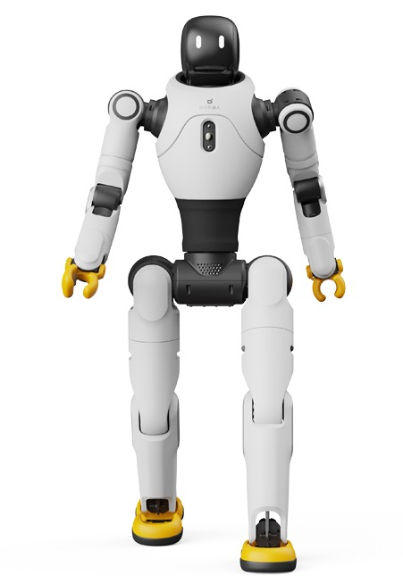
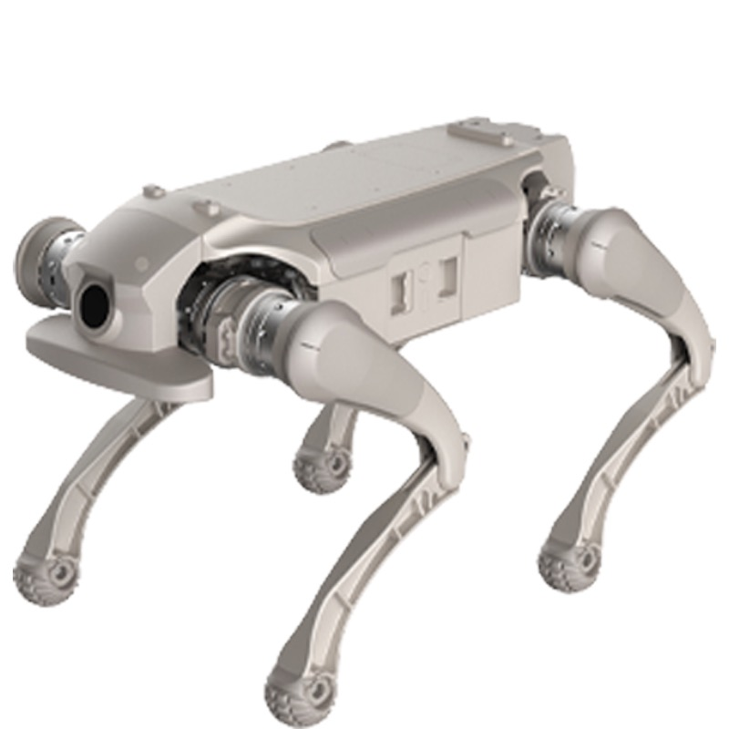
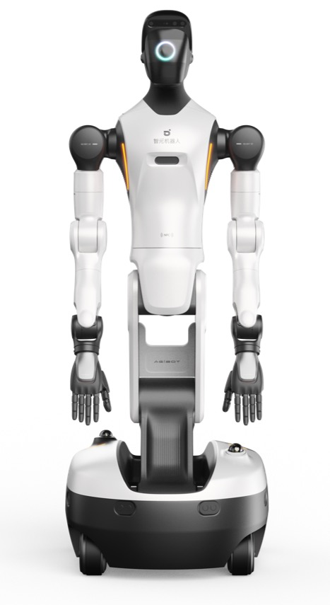
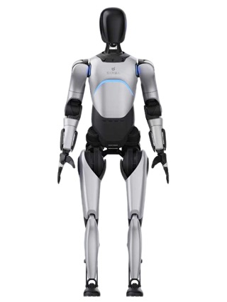
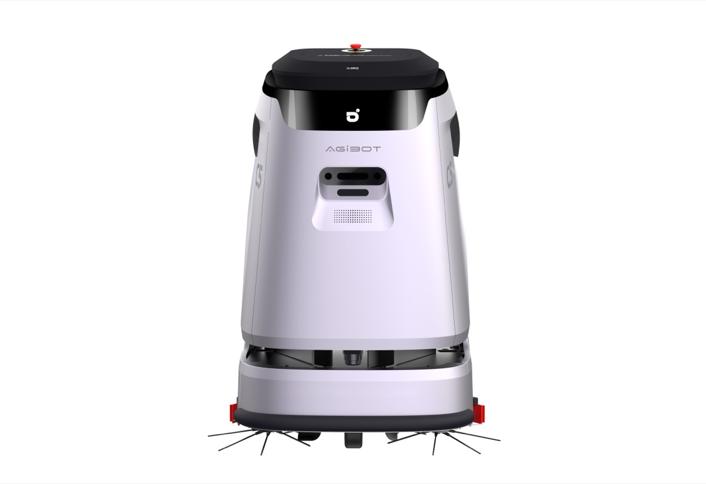
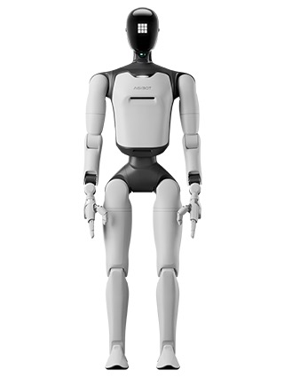

# AGIBOT × T01 — Products and Solutions

⬆ [AGIBOT profile](../AGIBOT.md) · [Brief](AGIBOT-T01-1-Brief.md) · [Playbook](AGIBOT-T01-3-Playbook.md)

Scope: only what matters for "robots that move, deliver and maintain the city". General company data is in the profile. What AGIBOT physically brings to Leukerbad is **not confirmed** — check at the booth first.

| Rank | Product | T01 role | Hackable in 48 h? |
|---|---|---|---|
| 1 | X2 (Ultra / Edu) | Guide, concierge, greeter | Yes — full public SDK |
| 2 | D1 Ultra (D1 Pro / Edu) | Small carrier for stairs and slopes | Yes — open SDK, velocity control only |
| 3 | G2 | Store, kiosk, fetch-and-hand-over | Only with AGIBOT staff + Genie Studio |
| 4 | A2 Ultra | Turnkey reception and route guidance | Configure, not program |
| 5 | C5 | Floor cleaning of public buildings | No public API |
| 6 | A3 Ultra, G2 Air, D2 Max | Next-generation service units | Unlikely to be handed out |

## Relevant products (ranked for this track)

### X2 (Neo / Ultra / Edu)

**Role:** the practical choice for a guide / concierge / wayfinding robot. Child-sized, safe around guests, with voice, screen and gestures out of the box.

| Spec | Value |
|---|---|
| Size | about **131 cm**, **35–39 kg** ⚠️ unverified (third-party datasheets) |
| DoF | **25–30** by variant ⚠️ unverified |
| Sensors exposed in SDK | LiDAR, RGB-D, front stereo, interaction camera, rear camera, head touch, IMU, GNSS |
| Navigation | SLAM (map build, map retrieval, relocalization) and navigation tasks — **optional module, X2 Ultra only**, enabled through after-sales support; **not supported on X2 Edu** |
| Compute | Edu: RK3588; Ultra: Orin NX ⚠️ unverified |
| Runtime, payload, IP rating | not public / not verified |

- **Status / price:** ✅ shipping. X2 Neo listed at **USD 25,600** on the official store ⚠️ unverified; other variants not public.
- **Developer interface (AimDK_X2, ROS 2, Python / C++):** motion-mode switching, locomotion velocity commands, preset and LinkCraft motions, joint and upper-body control, grippers / dexterous hands, TTS, audio playback, microphone stream, screen / emoji, LEDs. On-board development (native or container) on Ultra variants only; Edu is driven from an external PC over the network. Vision interface is marked "to be enabled"; the built-in interaction system can be disabled to run your own voice stack.

### D1 Ultra (also D1 Pro / Edu)

**Role:** the only AGIBOT platform likely on site that handles Leukerbad's stairs, slopes and wet ground. Use as a parcel / luggage / pharmacy carrier or a mobile sensor base.

| Spec | Value |
|---|---|
| Payload | **5 kg** effective |
| Speed | **3.7 m/s** max |
| Range | **6 ± 1 km** (lab data) |
| Terrain | **40°** slope, **16 cm** continuous stairs, **35 cm** jump |
| Protection | **IP54** |
| Size | **630 × 360 × 420 mm** standing; folds to 670 × 435 × 145 mm |
| Expansion | Ethernet, USB, power, SBUS, UART; supports add-on 3D LiDAR, depth camera, RTK, 4G |
| Weight, operating temperature, on-board compute | not on the product page |

- **Status / price:** ✅ shipping; price not public.
- **Developer interface:** open SDK on GitHub (C++ and Python 3, Ubuntu 22.04, x86_64 and aarch64 libraries). High level: stand / lie down, `move(vx, vy, yaw_rate)`, attitude control, jumps. Low level: per-joint position / velocity / torque commands. Sensors: IMU and joint states. Default robot IP over Wi-Fi or Ethernet, configured via SSH. **No built-in navigation, SLAM or follow mode in the SDK** — the product page says "intelligent follow" needs secondary development. URDF plus Isaac Sim and MuJoCo support.

### G2

**Role:** the robot behind AGIBOT's strongest T01 proof point (convenience-store operation: pick, restock, serve, wipe tables). Best for a kiosk or fetch-and-hand-over station.

| Spec | Value |
|---|---|
| Protection | **IP42** (indoor) |
| Build | automotive-grade components, force-controlled arms, sub-millimetre assembly claim |
| Interaction | expressive face, eye-gaze tracking, multi-user conversation |
| Arm payload, reach, chassis speed, runtime, compute | not on the product page |

- **Status / price:** ✅ shipping; price not public.
- **Developer interface:** no public robot SDK docs comparable to the X2. Tasks are taught through **Genie Studio** (teleoperation data → GO-model fine-tuning → deployment) and "Genie RL" rapid deployment. Assume you need an AGIBOT engineer and a Genie Studio account.

### A2 Ultra

**Role:** turnkey receptionist and exhibition guide — the product page names autonomous reception, route guidance with explanation and obstacle avoidance.

| Spec | Value |
|---|---|
| Size | **169 cm**, about **69 kg**, 75 cm wide |
| Mobility | up to **1.2 m/s**, **10°** ramps |
| Battery | **14.4 Ah**; about **3 h** standing, **1.5 h+** walking; hot-swap; about 2 h charge |
| Sensors | 3D LiDAR, RGB-D, RGB and fisheye cameras, array microphone |
| Compute | 16-core CPU board + Jetson Orin 64 GB |
| Connectivity | Wi-Fi, 4G / 5G |

- **Status / price:** ✅ shipping; company claims **1,000+** units in real-world operation; price not public.
- **Developer interface:** LinkSoul platform for knowledge base, wake word, persona, voice and greetings; dance and swarm-control tools. No public low-level SDK. Supported languages not stated.

### C5

**Role:** AGIBOT's one purpose-built "maintain the city" product — autonomous sweeping, scrubbing and dust-mopping for malls, stations, hospitals, hotels and offices.

| Spec | Value |
|---|---|
| Cleaning rate | up to **1,980 m²/h** |
| Scrub width / pressure | **550 mm** / **25 kg** |
| Tank / endurance | **90 L** / **3 h** scrubbing |
| Navigation | laser + vision fusion, automatic map updates, fall detection |
| Building integration | elevator and access-control linkage |
| Station | auto charge, fill, drain and tank self-clean (**1,800 W**, 200–240 V) |
| Fleet tools | robot, mobile and cloud control; scheduling; automatic job reports; remote diagnostics |
| Slope limit, robot size, weight | not on the product page |

- **Status / price:** ✅ shipping; price not public.
- **Developer interface:** none public. Useful in a hackathon only as a fleet member whose job reports you read manually, or as a reference design.

### A3 Ultra

**Role:** the service humanoid AGIBOT positions for long public-facing shifts. Relevant as direction rather than as a hackathon tool.

| Spec | Value |
|---|---|
| Size | **1.74 m**, **60 kg**, **51** active DoF |
| Arm payload | **5 kg** per arm |
| Runtime | up to **8 h** combined; direct, swap and **autonomous charging** |
| Positioning | **GPS, RTK, UWB** + 3D LiDAR, RGB-D, fisheye, stereo |
| Compute | NVIDIA Thor |

- **Status / price:** 🧪 launched July 2026; availability and price not public. USD model and robot model files are on GitHub. Outdoor operation is not explicitly claimed (GPS / RTK only suggests it — inference).

### G2 Air

**Role:** single-arm mobile manipulator aimed at retail, hospitality and logistics — the likely future "service counter" robot.

| Spec | Value |
|---|---|
| Arm | **7 DoF**, **3 kg** payload, **750–800 mm** reach |
| Base | under **800 mm** wide, **≥ 1.5 m/s**, zero-radius turning |

- **Status / price:** 🧪 announced April 2026; price and developer access not public.

### D2 Max

- All-terrain quadruped described as "Level 3 autonomous"; target uses include security patrol, inspection, emergency rescue and **logistics**. 🧪 announced April 2026; specs, price and SDK not public. Not expected on site.

## What AGIBOT already does in this domain

| Date | What | Robots | Source |
|---|---|---|---|
| 2026-11-02 to 11-03 | 24-hour trial in an operating convenience store, Xuhui District, Shanghai: **1,730 tasks** — 683 customer interactions, 369 product pickups / deliveries, 277 shelf checks and restocks, 147 coffee orders, 126 hot-food servings, 128 table cleanings. **4 of 6** robots passed the final assessment. Store brand not named | 6 × G2 | [AGIBOT news](https://www.agibot.com/article/231/detail/134.html) |
| 2026-10-28 | Company states service robots are working at **Guangzhou Metro** and the **Chimelong** tourism complex: guiding visitors, answering questions, interactive services (unit counts not given there) | not specified | [AGIBOT news](https://www.agibot.com/article/231/detail/131.html) |
| 2026-07-20 | **30+** robots ran visitor guidance and information services across WAIC 2026 venues | not specified | [Press release](https://www.aap.com.au/aapreleases/cision20260719ae07639/) |
| 2026-04-17 | "Hundreds of robots" per project across industrial handling, logistics sorting, retail services, security inspection and commercial operations (company statement, no customers named) | mixed | [AGIBOT news](https://www.agibot.com/article/231/detail/63.html) |
| ongoing | A2 Ultra sold as reception / exhibition guide; company claims 1,000+ units in operation | A2 Ultra | [Product page](https://www.agibot.com/products/A2_Ultra) |
| ongoing | C5 sold for malls, transport hubs, hospitals, hotels and offices; no named customer or deployment count found | C5 | [Product page](https://www.agibot.com/products/C5) |

- **Nothing found for:** outdoor street delivery, waste collection, snow or alpine operation, or any Swiss deployment.
- The 300-robot Chimelong figure and a 100-unit X2 retail greeting roll-out appear only in search summaries ⚠️ unverified.

## What they are building next in this domain

- **Multi-robot store operation:** the convenience-store trial ran on **Genie Master** (coordinates the fleet, corrects errors, keeps successful runs in long-term memory) and an **Embodied Execution Protocol** linking planning, execution and feedback. Stated next step: more roles and more real environments. Neither component is public.
- **Outcome metric:** "Worken" (active robots × autonomous hours × output efficiency), introduced 2026-10-28 — AGIBOT wants to be paid for work done, not units sold. Useful framing for a judging pitch.
- **Hardware:** AHA3 third-generation humanoid platform with liquid-cooled, **IP67** joints 🧪; A3 Ultra with autonomous charging and RTK; G2 Air for retail and hospitality; D2 Max for logistics and patrol. Inference: these point toward longer, less supervised and partly outdoor service shifts.
- **Software:** **Link-U OS 1.0** in partner trials, planned fully open source by end of 2026 🔭; WITA-Omni full-duplex interaction model with on-device deployment 🧪; GO-3 preview 🧪.
- **Europe:** sales and planned local production via Minth Group; no European service deployment published yet.

## Software, models and data that help for this track

| Asset | What it gives a T01 team | Access |
|---|---|---|
| AimDK_X2 | ROS 2 topics / services for walking, voice, screen, sensors; Python and C++ examples (set motion, take photo, map building, navigation) | ✅ public docs |
| AgentSDK sample (`agibot_agentsdk_sample_code`) | Hospital-triage robot: ASR text → LLM intent routing → knowledge-base answer → robot speech and whitelisted gestures; Chinese and English locale files. Swap the knowledge base for Leukerbad info | ✅ public code; needs AGIBOT platform credentials and `linksoul-agentsdk` wheel |
| LinkSoul | No-code persona, wake word and knowledge base (A2 / X2) | via AGIBOT account |
| D1 SDK (`agibot_D1_Edu-Ultra`) | Velocity and joint control, IMU, C++ / Python demos | ✅ public |
| X2 MuJoCo sim + `agibot_x2_urdf` | Test motion and behaviour logic off-robot | ✅ public |
| Genie Sim 3.0 | Isaac-based manipulation sim with ROS 2 runtime — rehearse a G-series pick / hand-over task | ✅ open source |
| GO-1 weights + AgiBot World dataset | Starting point for a manipulation policy on G1 / G2; fine-tuning inside 48 h is risky | ✅ open (OpenDriveLab repo, Hugging Face) |
| Genie Studio | Teleop data → fine-tune → deploy on G-series | commercial; ask staff |
| Genie Master, EEP, GO-2 / GO-3 | Fleet orchestration and newer models | not public |

## Gaps and limits for this track

- **Navigation is the weak link for builders.** X2 Edu has no SLAM / navigation interface; X2 Ultra needs the optional module switched on by support; D1 SDK is velocity-only. Plan to bring your own localization (AprilTags, external LiDAR / depth on an edge board) or keep routes short.
- **No outdoor proof.** All published service work is indoors (stores, metro, theme park, expo). G2 is IP42; A2 Ultra handles only 10° ramps; no cold-weather or snow data for any model.
- **Closed service products.** C5 and A2 Ultra are configured, not programmed. G2 work depends on Genie Studio access.
- **Thin public specs** for G2 (payload, reach, runtime) and X2 (runtime, payload) — measure on site.
- **Low carrying capacity:** 5 kg on D1 Ultra, 2–5 kg per humanoid arm. Fine for parcels and medicine, not luggage or waste bins.
- **Trial honesty:** in the store trial two of six robots failed the assessment and intervention rates were not published — treat it as a strong pilot, not a finished product.

## Sources
- [AGIBOT — Six G2 robots complete 1,730 tasks in 24-hour convenience-store trial (2026-11-06)](https://www.agibot.com/article/231/detail/134.html)
- [AGIBOT — Worken introduced at AGIBOT Innovation Day 2026 (2026-10-28)](https://www.agibot.com/article/231/detail/131.html)
- [AGIBOT — New generation of embodied AI robots and models (2026-04-17)](https://www.agibot.com/article/231/detail/63.html)
- [PR Newswire via AAP — Four new products at WAIC 2026 (2026-07-20)](https://www.aap.com.au/aapreleases/cision20260719ae07639/)
- [AGIBOT — official site and news list](https://www.agibot.com)
- [AGIBOT — G2 product page](https://www.agibot.com/products/G2)
- [AGIBOT — A2 Ultra product page](https://www.agibot.com/products/A2_Ultra)
- [AGIBOT — C5 product page](https://www.agibot.com/products/C5)
- [AGIBOT — D1 Ultra product page](https://www.agibot.com/products/D1Ultra)
- [AimDK_X2 documentation](https://x2-aimdk.agibot.com/en/latest/)
- [AimDK_X2 — Perception module (optional)](https://x2-aimdk.agibot.com/en/latest/Interface/perception/index.html)
- [GitHub — AgibotTech repositories](https://github.com/orgs/AgibotTech/repositories)
- [GitHub — AgibotTech/agibot_D1_Edu-Ultra](https://github.com/AgibotTech/agibot_D1_Edu-Ultra)
- [GitHub — AgibotTech/agibot_agentsdk_sample_code](https://github.com/AgibotTech/agibot_agentsdk_sample_code)
- [GitHub — AgibotTech/genie_sim](https://github.com/AgibotTech/genie_sim)
- [AGIBOT company profile (this repo)](../AGIBOT.md)
