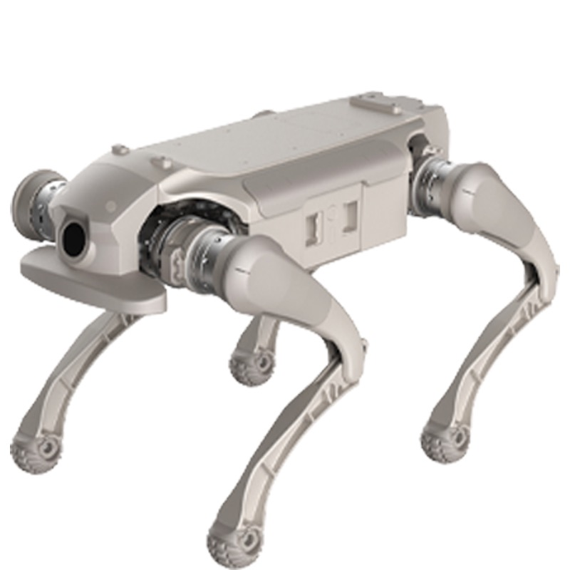
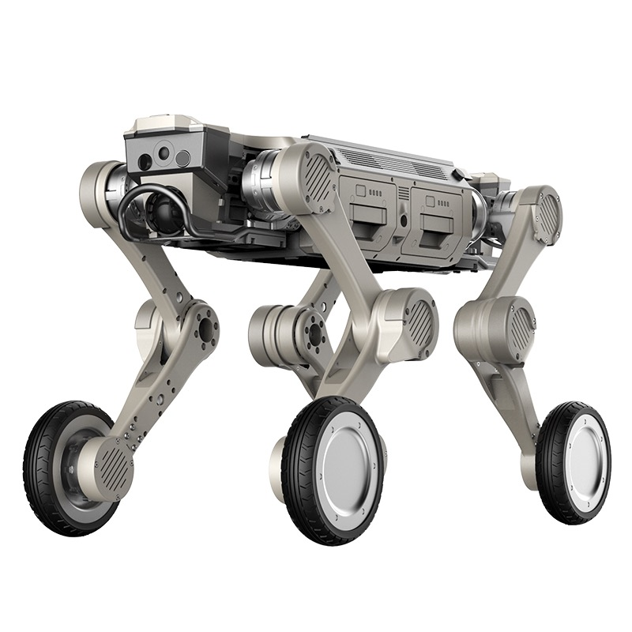
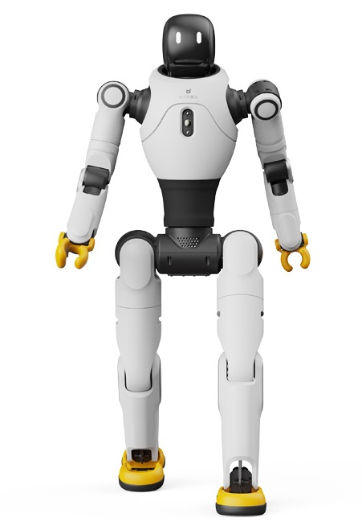
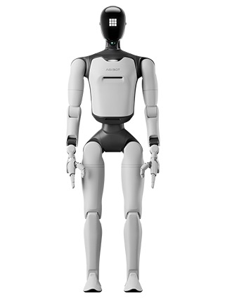
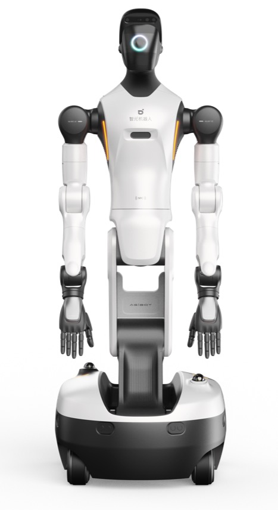

# AGIBOT × T02 — Products and Solutions

⬆ [AGIBOT profile](../AGIBOT.md) · [Brief](AGIBOT-T02-1-Brief.md) · [Playbook](AGIBOT-T02-3-Playbook.md)

> Which units AGIBOT actually brings to Leukerbad is **not confirmed**. Check at the booth before committing. Specs below are from official product pages (lab-test values) unless flagged.

## Relevant products (ranked for this track)

### D1 Ultra (also D1 Pro / Edu)

**Role in T02:** the hackable patrol / inspection / scout dog. Most likely AGIBOT platform a team can actually program on site.

| Spec | D1 Ultra | D1 Edu (D1 Pro identical hardware) |
|---|---|---|
| Payload | **5 kg** | **5 kg** |
| Max speed | **3.7 m/s** | **3.5 m/s** |
| Range / endurance | **6 ± 1 km** | **6 ± 1 km**, **1–2 h**; charge about 1 h (10→90%) |
| Slope / stairs | **40°** / **16 cm** continuous | **40°** / **16 cm** |
| Ingress protection | **IP54** | not listed |
| Operating temperature | not listed | **0 to 40 °C** |
| Weight | not listed | **15.5 kg** incl. battery |
| On-board | RL gait, self-balancing, anti-tipping | 8-core CPU, IMU, wide camera (HFOV 111°), real-time image transmission |
| Expansion | Ethernet, USB, power, SBUS, UART | same on **Edu**; **Pro has no expansion ports and no secondary development** |
| Supported add-ons | 3D LiDAR, depth camera, RTK, 4G, image-transmission module | positioning, LiDAR, depth camera, RTK, 4G / 5G |

- **Status / price:** ✅ shipping · price not public.
- **Developer interface:** open SDK on GitHub (`agibot_D1_Edu-Ultra`, BSD-3-Clause), **C++ and Python 3**, Ubuntu 22.04, prebuilt libs for x86_64 and aarch64.
  - High level: `standUp()`, `lieDown()`, `move(vx, vy, yaw_rate)`, `attitudeControl(...)`, `jump()`, `shakeHand()`.
  - Low level: `sendMotorCmd(...)` (joint position / velocity / torque).
  - State: `getQuaternion()`, `getRPY()`, `getBodyAcc()`, `getBodyGyro()`, `getMotorState()`.
  - Network: robot at `192.168.234.1` (Wi-Fi) or `192.168.168.168` (Ethernet).
  - **Not in the SDK README:** camera or LiDAR access, ROS 2 wrapper, mapping, navigation. Plan to bring your own sensor + companion computer.
  - Sim: URDF for Isaac Sim and MuJoCo.

### D1 Max / D1 MaxPro

**Role in T02:** the credible "real mission" platforms — weatherproof load carriers for rescue supply, sensor masts or casualty-site equipment. On-site presence ⚠️ unverified.

| Spec | D1 Max | D1 MaxPro |
|---|---|---|
| Locomotion | wheel-legged, switchable wheel / leg mode | legged |
| Rated payload | **25 kg** | **50 kg** sustained |
| Runtime | **≥ 5 h** unloaded / **≥ 3.5 h** full load | **5.5 h** unloaded / **≥ 2 h** full load (2,081 Wh, quick swap) |
| Range | **≥ 29 km** unloaded / **≥ 18 km** full load | not listed |
| Ingress protection | **IP67** | **IP67**, wades **20 cm** water |
| Terrain | **45°** slope; obstacle-crossing height stated as **80 cm** | continuous stairs up to **30 cm**, open-riser industrial stairs, self-righting |
| Operating temperature | not listed | **−20 to 55 °C** |
| Battery | dual, hot-swappable | quick swap |
| Scenarios named by AGIBOT | logistics, personnel search and rescue, task execution | heavy-load operation, logistics, emergency rescue |

- **Status / price:** ✅ listed on agibot.com · price not public · sensors and compute not listed in page text.
- **Developer interface:** `Agibot_D1_Max` and `Agibot_D1_MaxPro` repos (C++). D1 Max RobotSDK: high-level control over Wi-Fi (`192.168.234.1`, demo uses port `8082`), URDF included, API / state-transition docs and a raw protocol PDF for control without the SDK. **SDK version must match the robot system version (V3 / V4).** Python, ROS 2, low-level and sensor access: not stated.

### D2 Max

**Role in T02:** where AGIBOT is heading — pitched as an all-terrain "Level 3 autonomous" quadruped for security patrol, industrial inspection and emergency rescue.

| Spec | Value |
|---|---|
| All specs (payload, IP, runtime, sensors) | not public |
| "Level 3 autonomous" definition | not public |

- **Status:** 🧪 announced 2026-04-17, not in the product menu as of 2026-11-14 · price not public · developer interface not public. Do not plan a build around it.

### X2 (Neo / Ultra / Edu)

**Role in T02:** indoor public-safety front end — evacuation guide, safety announcer, check-in / headcount point in a hotel, spa or clinic. Not a rough-terrain robot.

| Spec | Value |
|---|---|
| Size / mass | about **131 cm**, **35–39 kg** ⚠️ unverified |
| Sensors exposed in SDK docs | IMU, LiDAR, RGB-D, stereo + interaction cameras, rear camera, head touch, GNSS (variant dependent) |
| Navigation | SLAM / navigation module optional; vision interface marked "to be enabled" in docs |
| Compute | Edu: RK3588 · Ultra: Orin NX ⚠️ unverified |

- **Status / price:** ✅ shipping · X2 Neo store price **USD 25,600** ⚠️ unverified.
- **Developer interface:** AimDK_X2 (ROS 2, Python / C++): locomotion velocity, motion modes, preset motions, TTS / mic, face screen, joint and end-effector control. SDK must match firmware. AgentSDK sample (LLM intent routing + whitelisted skills + knowledge base) exists as a hospital-reception example.

### A3 Ultra

**Role in T02:** AGIBOT's own "patrol and inspection" humanoid; reference for the vision, unlikely to be handed to teams.

| Spec | Value |
|---|---|
| Size / mass | **1.74 m**, **60 kg** (press release) |
| Compute | **700 TOPS** class (NVIDIA Thor per press release) |
| Autonomy features claimed | 360° perception, centimetre-level positioning, 5G, autonomous charging, 24/7 unattended operation |
| IP rating / outdoor rating | not stated |

- **Status:** 🧪 launched July 2026 · price and availability not public · "secondary development support" claimed, no public SDK docs. USD and robot model files are on GitHub.

### G2

**Role in T02:** teleoperated or learned manipulation at a hazard site (close a valve, flip a breaker, move an object) on flat indoor floors.

| Spec | Value |
|---|---|
| Ingress protection | **IP42** |
| Arms | force-controlled, dual-arm; payload / reach not on product page |
| Terrain | wheeled base — flat floors only |

- **Status:** ✅ shipping · price not public · programmed mainly through Genie Studio (commercial) with GO models; on-site availability and team access ⚠️ unverified.

## What AGIBOT already does in this domain

| Date | What | Evidence level |
|---|---|---|
| 2026-04-17 | "Security inspection" listed among production-ready solution areas, with "hundreds of robots" per project across all areas | Company statement, no customer or site named ([AGIBOT](https://www.agibot.com/article/231/detail/63.html)) |
| 2026-04-17 | D2 Max announced for security patrol, industrial inspection, emergency rescue | Announcement only |
| current | D1 Ultra page lists security patrol, inspection, emergency rescue; D1 Max lists personnel search and rescue; D1 MaxPro lists emergency rescue | Product positioning, not deployments |
| current | A3 Ultra page lists "patrol and inspection" as a scenario | Product positioning |

**Bottom line:** no named, dated public-safety, disaster-response or infrastructure-inspection deployment was found in official sources. Web search was unavailable during this pass, so trade-press coverage (for example Chinese-language inspection pilots) was not checked — ask the AGIBOT staff for references.

## What they are building next in this domain

- **D2 Max** 🧪 — flagship all-terrain quadruped, framed as moving quadrupeds from remote-controlled tools to highly autonomous systems (2026-04-17).
- **A3 Ultra** 🧪 — unattended, fleet-scale patrol and inspection with autonomous charging and 5G (July 2026).
- **SOP** (distributed online learning from deployed fleets) and outcome-based solution sales — *inference:* security inspection will be sold as a managed service, with autonomy improving from fleet data.
- **Worken** (Oct 2026) — a metric for productive robot work; *inference:* patrol / inspection hours are a natural candidate for it.
- No public roadmap for alpine, fire, flood or explosion-rated products.

## Software, models and data that help for this track

| Asset | Use in T02 | Access |
|---|---|---|
| `agibot_D1_Edu-Ultra` SDK | Velocity + posture + joint control, IMU / joint state | ✅ open, BSD-3-Clause |
| `Agibot_D1_Max`, `Agibot_D1_MaxPro` | High-level control, URDF, raw protocol doc | ✅ open |
| D1 URDF (Isaac Sim / MuJoCo) | Rehearse routes and controllers before touching hardware | ✅ open |
| AimDK_X2 + `agibot_x2_urdf` | Indoor humanoid behaviours, MuJoCo sim | ✅ docs public |
| `agibot_agentsdk_sample_code` | LLM-routed dialogue + whitelisted skills (reception example) — template for a safety concierge | ✅ sample; needs AGIBOT open-platform credentials and a LinkSoul AgentSDK wheel |
| AimRT | Robot middleware (ROS 2 interoperable) | ✅ open |
| Genie Sim 3.0, GO-1 / GO-2, AgiBot World | Manipulation only; relevant if you teleoperate or train G-series arm tasks | open / Genie Studio |

Nothing AGIBOT publishes covers SLAM, patrol scheduling, anomaly detection or thermal / gas sensing — use standard open tools (ROS 2 Nav2, open-vocabulary detectors, a VLM) on a companion computer.

## Gaps and limits for this track

- **No turnkey autonomy on the D1:** SDK README shows motion + proprioception only; camera stream access via SDK is unconfirmed.
- **Cold:** D1 Pro / Edu rated **0–40 °C**; D1 Ultra temperature not listed. Only D1 MaxPro states **−20 °C**.
- **D1 Pro is closed** (no ports, no secondary development) — verify the variant on site.
- **Small-dog limits:** 16 cm stairs and 5 kg payload restrict sensor masts and real rubble.
- **Version coupling:** D1 Max SDK tied to robot system version; X2 SDK tied to firmware.
- **No hazard-rated hardware:** no ATEX, fire or radiation ratings public.
- **Humanoids:** A-series has no public SDK beyond persona / motion tools; G2 is IP42 and wheeled.
- **Evidence:** domain claims are positioning statements; no verified customer case.

## Sources
- [AGIBOT — D1 Ultra product page](https://www.agibot.com/products/D1Ultra)
- [AGIBOT — D1 Pro / Edu product page](https://www.agibot.com/products/D1_Pro)
- [AGIBOT — D1 Max product page](https://www.agibot.com/products/D1_Max)
- [AGIBOT — D1 MaxPro product page](https://www.agibot.com/products/D1_MaxPro)
- [AGIBOT — A3 Ultra product page](https://www.agibot.com/products/A3Ultra)
- [AGIBOT — New generation of embodied AI robots and models (2026-04-17)](https://www.agibot.com/article/231/detail/63.html)
- [AGIBOT — official site, product menu and news](https://www.agibot.com)
- [AGIBOT — Product manuals and open source](https://www.agibot.com/DOCS/OS)
- [GitHub — AgibotTech repositories](https://github.com/orgs/AgibotTech/repositories?type=all)
- [GitHub — AgibotTech/agibot_D1_Edu-Ultra](https://github.com/AgibotTech/agibot_D1_Edu-Ultra)
- [GitHub — AgibotTech/Agibot_D1_Max](https://github.com/AgibotTech/Agibot_D1_Max)
- [GitHub — AgibotTech/agibot_agentsdk_sample_code](https://github.com/AgibotTech/agibot_agentsdk_sample_code)
- [AimDK_X2 documentation](https://x2-aimdk.agibot.com/en/latest/)
- [AGIBOT company profile (internal)](../AGIBOT.md)
