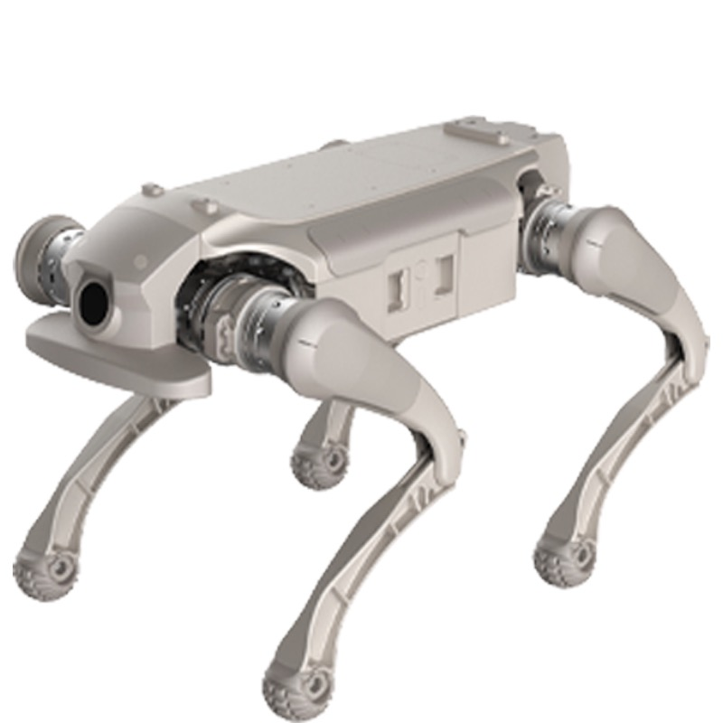
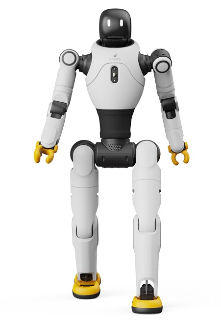
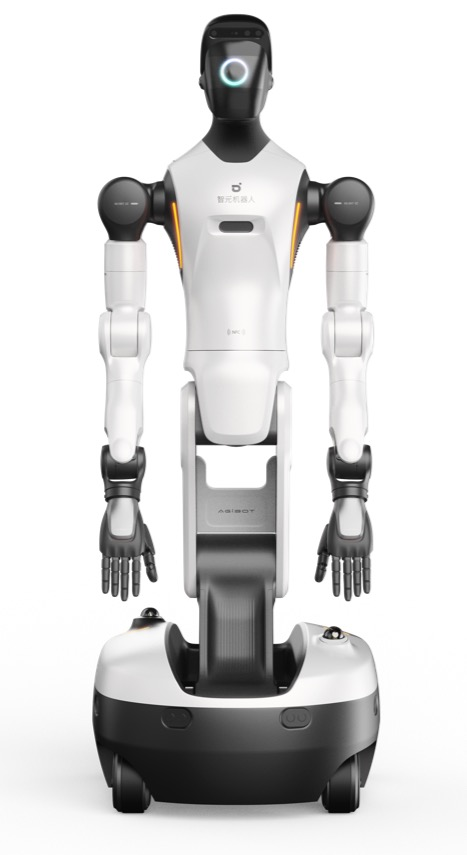
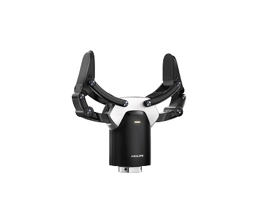
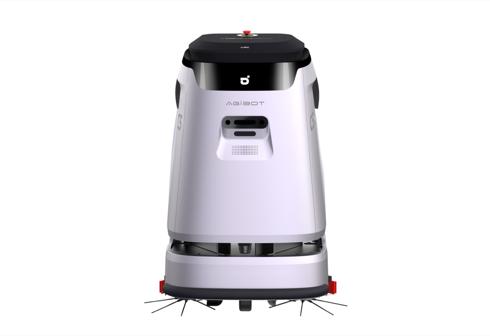

# AGIBOT × T03 — Products and Solutions

⬆ [AGIBOT profile](../AGIBOT.md) · [Brief](AGIBOT-T03-1-Brief.md) · [Playbook](AGIBOT-T03-3-Playbook.md)

> **Read this first:** AGIBOT has **no sustainability-specific product, deployment or reference code**. Everything below is general-purpose hardware repurposed for T03. What is physically on site is **not confirmed** — check the booth before committing.
> **Research caveat:** web search was unavailable for this pass; findings come from the company profile and official pages fetched directly. "Nothing found" means nothing on those pages, not proof that nothing exists.

## Relevant products (ranked for this track)

### D1 Ultra (also D1 Pro / Edu)

**Role in T03:** mobile sensor carrier — energy audit (thermal camera), air / water / snow monitoring, litter scouting. Best terrain match for Leukerbad and the most likely "hackable" AGIBOT unit on site.

| Spec | Value |
|---|---|
| Payload | **5 kg** |
| Speed / range | **3.7 m/s** max · **6 ± 1 km** |
| Protection | **IP54** |
| Terrain | **40°** slope · **16 cm** continuous stairs |
| Size (standing) | 630 × 360 × 420 mm |
| Built-in sensors | none listed — 3D LiDAR and depth camera are add-ons |
| Expansion | Ethernet, USB, power, SBUS, UART |
| Operating temperature, weight, payload power output | not stated on product page |

- **Status / price:** ✅ shipping · price not public.
- **Developer interface:** "open SDK for secondary development and payload mounting"; URDF for Isaac Sim and MuJoCo. Follow-me requires your own development. Depth of access (high-level velocity vs joint level) on the on-site unit: ⚠️ unverified — ask.

### X2 (Neo / Ultra / Edu)

**Role in T03:** public-facing "recycling coach" or energy-awareness guide — speech, screen, gestures. Not a manipulator for waste.

| Spec | Value |
|---|---|
| Size / mass | about **131 cm** · **35–39 kg** ⚠️ unverified |
| SDK | AimDK_X2 — ROS 2, Python and C++; supports X2 Ultra, X2 Ultra (new version), X2 Edu |
| Exposed | locomotion, preset motions, TTS, mic, screen (emoji / video), LED, RGB-D / stereo / rear camera topics, LiDAR, IMU, GNSS, gripper / dexterous-hand control |
| Optional / pending | SLAM and navigation are an optional module; "vision" is marked **to be enabled** |
| Dev modes | on-board development for Ultra variants only; Edu is driven from an external PC |

- **Status / price:** ✅ shipping · X2 Neo store price **USD 25,600** ⚠️ unverified.
- **Developer interface:** the best documented in the AGIBOT range, with Python and C++ examples (camera streaming, TTS, navigation, gripper). SDK version must match firmware.

### G2

**Role in T03:** dual-arm sorting of recyclables, disassembly / repair demos, resource-efficient restocking.

| Spec | Value |
|---|---|
| Protection | **IP42** (indoor) |
| Manipulation | force-controlled arms; sub-millimetre assembly claimed |
| Task deployment | "Genie RL" rapid deployment (details not public) |
| Payload, reach, runtime, compute | **not on product page** |
| Simulation | maintained Tier-1 robot in Genie Sim |

- **Status / price:** ✅ shipping · price not public.
- **Developer interface:** via Genie Studio (data collection, fine-tuning, deployment — commercial) with GO models. No public standalone SDK docs found; expect to need AGIBOT staff.

### G2 Air

**Role in T03:** lighter single-arm alternative for bin-to-bin sorting in tight spaces.

| Spec | Value |
|---|---|
| Arm | **7 DoF** · **3 kg** payload · **750–800 mm** reach |
| Base | width under **800 mm** · **≥ 1.5 m/s** · zero-radius turning |

- **Status / price:** 🧪 launched April 2026 · availability and price not public. Developer interface not public.

### OmniPicker 3

**Role in T03:** robust gripper for a waste-sorting cell — also on another vendor's arm.

| Spec | Value |
|---|---|
| Grip force | **140 N** max |
| Stroke | **110 ± 5 mm** |
| Payload / weight | **5 kg** / under **800 g** |
| Tactile | **0.1 N** force resolution |
| Repeatability | ± 0.1 mm |
| Interface | **CAN-FD / RS485** |
| Life | **1,000,000** full-load cycles |

- **Status / price:** ✅ listed · price not public.
- **Developer interface:** supply voltage, flange and SDK coverage not stated on the product page. The `agilink_omnihand_sdk` repo advertises C++ / Python / ROS 2 APIs "for all products" — whether that includes OmniPicker is ⚠️ unverified.

### C5

**Role in T03:** the only AGIBOT product touching a resource (water, cleaning energy). Weak hackathon target.

| Spec | Value |
|---|---|
| Throughput | up to **1,980 m²/h** · 550 mm scrub width |
| Water | **90 L** robot tank · 8 L workstation tank · auto fill and drain |
| Endurance | **3 h** scrubbing |
| Workstation | 1,800 W max · auto charge, fill, drain, sewage-tank self-clean |
| Integration | robot / mobile / cloud control, elevator and access-control linkage, automatic job reports |

- **Status / price:** ✅ shipping · price not public · low chance of being on site.
- **Developer interface:** no API documented. The page makes **no water-recycling, water-saving or energy claims** — do not assert them.

## What AGIBOT already does in this domain

**Nothing sustainability-specific was found.** Adjacent evidence only:

| Date | What | Relevance to T03 |
|---|---|---|
| 2026-04-17 | Partner conference names solution areas: industrial handling, **logistics sorting**, retail, security inspection, commercial operations; "hundreds of robots" across projects ([AGIBOT](https://www.agibot.com/article/231/detail/63.html)) | Sorting know-how exists, for parcels and parts — not waste |
| 2026-04-17 | D2 Max announced with **agriculture** among target applications ([AGIBOT](https://www.agibot.com/article/231/detail/63.html)) | Only green-adjacent application named |
| 2026-11-06 | Six G2 robots, **1,730 tasks** in a 24-hour convenience-store trial (see [profile](../AGIBOT.md)) | Shows sustained autonomous handling |
| ongoing | C5 commercial cleaning robot ([product page](https://www.agibot.com/products/C5)) | Automated cleaning; no resource-saving data published |

- No recycling, waste, EV-charging, building-energy or environmental-monitoring deployment, pilot or partner on the official pages read.
- No Swiss activity (per profile).

## What they are building next in this domain

- **Announced:** nothing aimed at sustainability.
- **Relevant direction (announced):** shift to outcome-based solutions; SOP fleet online learning; GO-2 ✅ / GO-3 🧪 for long-horizon manipulation; D2 Max 🧪 all-terrain quadruped.
- **Inference (ours, not AGIBOT's):** waste sorting and outdoor inspection are natural extensions of logistics sorting and the D-series, but no roadmap item says so.
- **Robot energy use:** A3 offers **10 h** runtime and **10 s** battery swap; A3 Ultra has autonomous charging — about uptime, not grid or emissions.

## Software, models and data that help for this track

| Asset | What you get | T03 use | Limits |
|---|---|---|---|
| **Genie Sim** (open source, MPL 2.0; v3.5.0 dated 2026-11-02) | Isaac Sim based, Docker; G2 maintained; reference URDFs for Franka, UR5, Aloha; LLM scene generation; benchmark against your own inference server; OpenPI / π0.5 backends | Build and test a sorting task in sim before touching hardware | Heavy GPU setup; no waste / recycling tasks listed; scenes are retail, industry, catering, home, office |
| **GO-1 / GO-1 Air** (open weights) | Inference about **7 GB** GPU; action-expert fine-tune about **24 GB**; full fine-tune about **70 GB**; LeRobot v2.1 format | Fine-tune a pick-and-sort skill from teleop demos | CC BY-NC-SA 4.0 (non-commercial); trained mainly on AGIBOT G1 data |
| **AgiBot World** dataset | 1M+ trajectories, 100+ scenes, 5 domains | Pretraining source | No waste-specific tasks confirmed |
| **AimDK_X2** | ROS 2 SDK with Python / C++ examples (TTS, cameras, navigation, gripper) | Recycling-coach or guide behaviour in hours | Vision "to be enabled"; firmware match required |
| **OmniHand SDK and URDFs** | C++ / Python / ROS 2 | End-effector on any arm | OmniPicker coverage ⚠️ unverified |
| **ACoT-VLA**, **Genie Envisioner** | Research code behind GO-2 and world models | Technical depth for judges | Not a 48-hour shortcut |

## Gaps and limits for this track

- **No domain proof:** zero public sustainability deployments; any impact number must come from your own measurement.
- **Hardware uncertainty:** on-site lineup is a guess; G-series may be demo-only.
- **Outdoor manipulation gap:** quadrupeds have no arm; wheeled manipulators are IP42. Snow and wet litter picking is out of reach with AGIBOT alone.
- **G-series access:** specs (payload, reach, runtime) not published for G2; development runs through commercial Genie Studio.
- **D1 sensing:** no built-in perception — you bring sensors, compute and mounting. Cold-weather rating not published.
- **C5:** closed product, no API, no resource-efficiency claims.
- **Energy story:** robots weighing tens of kilograms are not low-power; be ready to justify net benefit.

## Sources
- [AGIBOT company profile (internal)](../AGIBOT.md)
- [AGIBOT — D1 Ultra product page](https://www.agibot.com/products/D1Ultra)
- [AGIBOT — G2 product page](https://www.agibot.com/products/G2)
- [AGIBOT — C5 product page](https://www.agibot.com/products/C5)
- [AGILINK — OmniPicker 3](https://www.agilink-ai.com/omni-picker3.html)
- [AGIBOT — New generation of embodied AI robots and models (2026-04-17)](https://www.agibot.com/article/231/detail/63.html)
- [AimDK_X2 documentation](https://x2-aimdk.agibot.com/en/latest/)
- [GitHub — AgibotTech/genie_sim](https://github.com/AgibotTech/genie_sim)
- [GitHub — AgibotTech organisation](https://github.com/AgibotTech)
- [GitHub — OpenDriveLab/Agibot-World (GO-1, dataset)](https://github.com/OpenDriveLab/Agibot-World)
