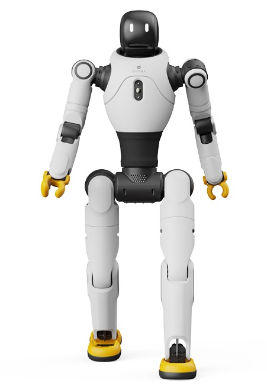
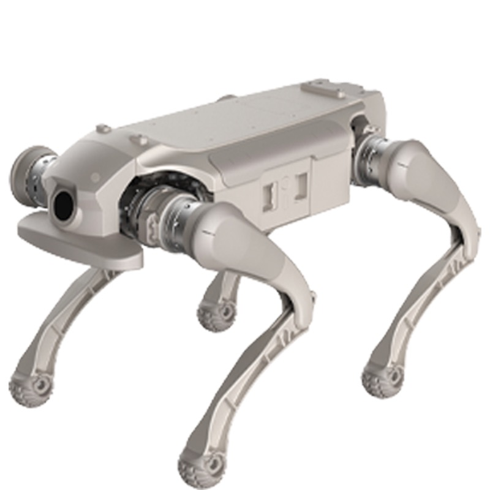
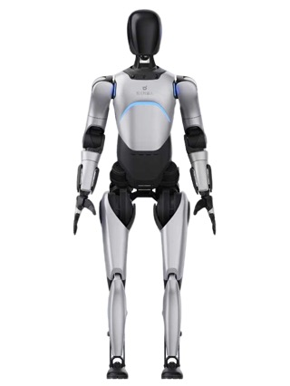
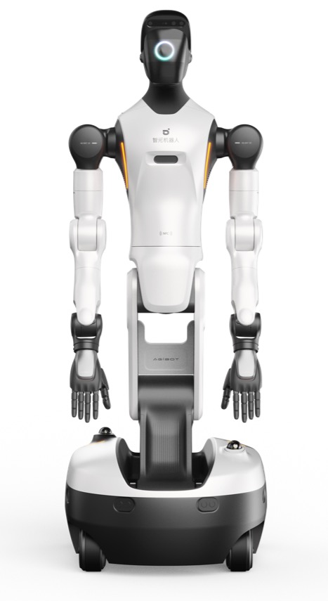
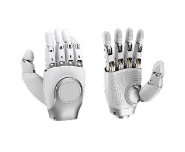
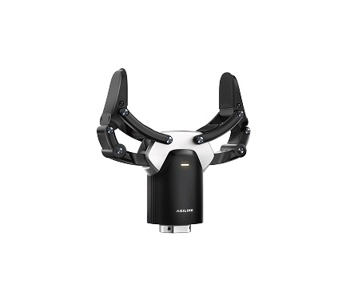

# AGIBOT × T04 — Products and Solutions

⬆ [AGIBOT profile](../AGIBOT.md) · [Brief](AGIBOT-T04-1-Brief.md) · [Playbook](AGIBOT-T04-3-Playbook.md)

> **Research note:** the web-search quota for this run was exhausted before the T04 news search could run. Everything below comes from official pages fetched directly (product pages, AimDK_X2 docs, GitHub, agilink-ai.com) plus the company profile. A missing care deployment therefore means "none found on official pages", not "proven absent".

**Bottom line:** AGIBOT gives you a well-documented *interaction* robot (X2 Ultra) and a rugged *carrier* (D1 Ultra). It does not give you safe physical assistance. Which units are actually on site is not confirmed.

## Relevant products (ranked for this track)

### X2 (Neo / Ultra / Edu)

**Role in T04:** companion, exercise coach, reminder and clinic-guide robot. Child-size, expressive, the only AGIBOT humanoid with a full public SDK.

| Spec (official AimDK_X2 docs) | X2 Ultra | X2 EDU | X2 Ultra (new version) |
|---|---|---|---|
| Height / weight | ~1.31 m / **~39 kg** | ~1.31 m / **~33 kg** | ~1.31 m / ~39 kg |
| Actuated DoF (arm DoF) | 30 (7 per arm) | 29 (7 per arm) | 31 (7 per arm) |
| Arm payload | **≤ 1 kg** across the workspace; up to 3 kg in one specific posture (no end-effector) | same | same |
| Walking speed | max 1.8 m/s; **≤ 0.8 m/s** recommended for daily use | same | same |
| Battery / runtime | ~421 Wh; **~2 h** at 0.5 m/s continuous walking | same | same |
| Compute | RK3588s + RK3588, plus **Orin NX 16 GB** development unit | RK3588 only, no high-performance board | as Ultra |
| Sensors | interaction RGB camera, front stereo, rear RGB, RGB-D, 3D LiDAR, head touch | none listed in the spec table | as Ultra + UWB |
| Operating temperature | −10 °C to 40 °C | same | same |
| IP rating | not public | not public | not public |

- **Status / price:** ✅ shipping. X2 Neo listed at USD 25,600 on the official store ⚠️ unverified (store page returned HTTP 429 during this run). Other variants: not public.
- **Developer interface (AimDK_X2, ROS 2, Python / C++):**
  - Motion: mode switching, locomotion commands, preset motions, upper-body control, joint control, RL policy deployment.
  - Interaction: TTS service, audio file / raw stream playback, **raw microphone stream topic**, volume, emoji and video on the face screen, LED strip, LinkSoul cloud agents.
  - End-effectors: OmniPicker gripper (position / velocity / effort, normalised 0–1) and OmniHand 2025 (**position control only**; force / velocity not enabled). Hand state up to 200 Hz; tactile data listed for one hardware revision only.
- **Variant traps (from the docs):**
  - The interaction interfaces page and the end-effector page both state they are **not supported on X2 EDU** — Ultra variants only.
  - On-board / container development is Ultra only; EDU is driven from an external PC.
  - Vision interface is marked "to be enabled" (per profile) — plan on your own camera.
  - Launch no more than about **2 ROS nodes per second** while the robot stands or walks; DDS flooding can make it fall.

### D1 Ultra (also D1 Pro / Edu)

**Role in T04:** carrier and patrol base — brings water, a medication box or a tablet; night rounds with a fall-detection camera; handles Leukerbad's ramps, snow slush and stairs better than any AGIBOT humanoid.

| Spec (official product page) | Value |
|---|---|
| Payload | **5 kg** effective |
| Size (standing) | 630 × 360 × 420 mm |
| Speed / range | max 3.7 m/s; range 6 ± 1 km |
| Protection | **IP54** |
| Terrain | 40° slope, 16 cm stairs |
| Built-in perception | none listed — depth camera, 3D LiDAR, RTK, 4G are expansions |
| Ports | Ethernet, USB, power, SBUS, UART |

- **Status / price:** ✅ shipping; price not public.
- **Developer interface:** open SDK and URDF (Isaac Sim, MuJoCo); GitHub repo `agibot_D1_Edu-Ultra`. Follow-me "requires user secondary development" — it is not built in. No voice interaction on board.

### A2 Ultra

**Role in T04:** adult-size receptionist / guide for a clinic lobby. Strong presence, weak hackability.

| Spec (official product page) | Value |
|---|---|
| Height / weight | 169 cm / about 69 kg |
| Arm | 7 DoF, about **2 kg** max load, 6-DoF hand |
| Speed / ramps | up to 1.2 m/s; 10° ramps |
| Runtime | about 3 h standing, 1.5 h+ walking; hot-swap battery |
| Perception | 3D LiDAR, RGB-D, RGB, fisheye; microphone array; face screen |
| Safety | wireless emergency stop; certifications cited: CR, CE-MD, CE-RED, FCC |

- **Status / price:** ✅ shipping; price not public.
- **Developer interface:** configuration rather than code — LinkSoul (knowledge base, wake word, persona, voice, greeting), AimMaster client, drag-and-drop action sequences, face-recognition greeting. No public low-level SDK.

### G2

**Role in T04:** the only AGIBOT platform that could credibly do fetch-and-handover or table-top assistance (wheeled base, two force-controlled arms, face and dialogue).

| Spec (official product page) | Value |
|---|---|
| Protection | **IP42**, automotive-grade components |
| Manipulation | force-controlled arms, sub-millimetre assembly claim |
| Interaction | expressive face, multi-user conversation, gaze tracking |
| Payload, reach, runtime, compute | not public on the product page |

- **Status / price:** ✅ shipping; price not public.
- **Developer interface:** via Genie Studio (teleoperation data, GO-model fine-tuning, deployment) and Genie RL; no public SDK docs found. Needs AGIBOT staff on site.

### OmniHand family (Ultra-T, Ultra, standard, Lite)

**Role in T04:** tactile end-effector for gentle handover or a tele-care demo; can go on another vendor's arm.

| Spec (agilink-ai.com, OmniHand 3) | Value |
|---|---|
| DoF | 10 active + 6 passive |
| Weight / payload | **510 g** / **5 kg** |
| Tactile | 300+ force-sensing taxels (fingertips, palm, back of hand) |
| Repeatability / close time | ±0.3 mm / 0.5 s |

- **Status / price:** ✅ listed; price not public.
- **Developer interface:** `agilink_omnihand_sdk` (C++, Python, ROS 2), URDF repos, toolbox for HMI and data collection. A separate **OmniGlove** (teleoperation / data-collection glove, C SDK on GitHub) exists — on-site availability not public.

### OmniPicker 3

**Role in T04:** simple, robust gripper for cup / pill-box handover. 140 N grip force, 1,000,000-cycle life (per profile). On X2 Ultra it accepts position, velocity and effort commands and reports "stalled" and "object dropped" states — useful for safe handover logic.

### GO-1 / GO-2 / GO-3 (preview)

**Role in T04:** learned manipulation (pour, pick, hand over) on G-series robots. GO-1 weights ✅ open; GO-2 ✅ through Genie Studio; GO-3 🧪 preview. Realistic in 48 hours only with a G1 / G2, a teleoperation rig and AGIBOT engineers helping.

## What AGIBOT already does in this domain

| Date | What | Relevance | Source |
|---|---|---|---|
| Oct 2026 | Official **AgentSDK sample code is a hospital-guide robot**: ASR text in, LLM intent routing with function calling, hospital knowledge-base retrieval, whitelisted robot skills, zh / en | Closest public artefact to healthcare; a template for a clinic concierge | [GitHub](https://github.com/AgibotTech/agibot_agentsdk_sample_code) |
| 2026-07-20 | More than 30 robots ran visitor guidance at WAIC 2026 | Guiding at scale, not care | [press release](https://www.aap.com.au/aapreleases/cision20260719ae07639/) |
| 2026-04-17 | Partner-conference release lists industrial, logistics, retail, security and commercial scenarios; "home" appears only for data collection (MEgo) and dexterous-hand "domestic tasks" | Care is not a named vertical | [AGIBOT](https://www.agibot.com/article/231/detail/63.html) |
| 2025 | Reported partnership with a Chinese postpartum / family-care group to develop care robots ⚠️ unverified (recalled, not re-checked in this run — ask on site) | Would be the only care-specific commercial link | no source confirmed |

- **Elderly-care or rehabilitation deployments, pilots or clinical partners:** none found on official pages.
- **Product pages** (A2 Ultra, G2, D1 Ultra): no mention of healthcare, elderly or hospital scenarios.
- **Switzerland / Europe care sector:** nothing found. European channel is Minth Group.

## What they are building next in this domain

- **No announced care roadmap.** Everything below is inference.
- *Inference:* the hospital-guide AgentSDK sample (Oct 2026) suggests hospital reception / wayfinding is a scenario AGIBOT is preparing partners for.
- *Inference:* WITA Omni (vision + audio + language + action interaction model), GCFM (text / audio / video to motion) and BFM (imitate a human from one demonstration) — all announced April 2026 🧪 — are the building blocks of a companion or exercise-mirroring robot. Developer access: not public.
- *Inference:* MEgo and OmniHand "domestic tasks" wording point to home manipulation data as a medium-term goal 🔭.
- TÜV Rheinland certification for the A-Series (Sept 2026, per profile) matters for any later European care-facility deployment.

## Software, models and data that help for this track

| Asset | Use in T04 | Access |
|---|---|---|
| AimDK_X2 | Speech out, mic in, screen, gestures, upper-body control | ✅ public docs; SDK version must match firmware |
| LinkSoul platform + AgentSDK (`linksoul-agentsdk`) | Custom agent with your own ASR / LLM / TTS behind AGIBOT's gateway | Needs AGIBOT app credentials (App ID, Key, Secret, Agent Code); wheel installed offline from an official package |
| `agibot_agentsdk_sample_code` | Clinic concierge skeleton: swap the knowledge base, keep the routing | ✅ GitHub; Python 3.10+; zh / en only |
| `agibot_x2_urdf` + X2 MuJoCo sim | Rehearse coaching motions before touching the robot | ✅ GitHub |
| `agibot_D1_Edu-Ultra` | Quadruped control for carry / patrol | ✅ GitHub |
| `agilink_omnihand_sdk`, `agilink_omniglove_sdk` | Tactile hand, glove teleoperation | ✅ GitHub |
| Genie Sim 3.0, GO-1 weights, AgiBot World dataset | Household-style manipulation policies for G-series | ✅ open; heavy for 48 hours |
| `IsaacCapture` | Teleoperation / egocentric capture infrastructure | ✅ GitHub; scope not verified |

## Gaps and limits for this track

- **No care reference:** no elderly-care, rehab or clinical deployment to cite in a pitch.
- **Not load-bearing:** X2 ≤ 1 kg, A2 Ultra about 2 kg per arm. No lifting, transfers or walking support.
- **Contact safety:** no product positioned for contact with a human body; OmniHand on X2 is position-only. A 33–39 kg biped can fall — keep a stand-off distance from frail users.
- **EDU limits:** if the on-site humanoids are X2 EDU, the documented voice / screen and end-effector interfaces do not apply and there is no Orin board or listed sensor suite.
- **Perception:** X2 vision interface not enabled in the SDK; D1 has no built-in camera. Bring your own camera and compute.
- **Language:** AgentSDK sample is Simplified Chinese / English. German and French (Leukerbad guests) need your own speech stack via the raw mic stream and audio playback.
- **Cloud dependence:** LinkSoul is a cloud service; region, latency and privacy terms for health-related conversation are not public.
- **Runtime:** about 2 h walking (X2); plan a charging rhythm for demos.
- **G2 unknowns:** payload, reach, SDK and on-site availability not public.

## Sources

- [AGIBOT company profile (this repo)](../AGIBOT.md)
- [AimDK_X2 documentation — overview](https://x2-aimdk.agibot.com/en/latest/)
- [AimDK_X2 — robot specifications](https://x2-aimdk.agibot.com/en/latest/about_agibot_X2/robot_specifications.html)
- [AimDK_X2 — interaction interfaces](https://x2-aimdk.agibot.com/en/latest/Interface/interactor/index.html)
- [AimDK_X2 — LinkSoul cloud interaction](https://x2-aimdk.agibot.com/en/latest/Interface/interactor/linksoul.html)
- [AimDK_X2 — end-effector control](https://x2-aimdk.agibot.com/en/latest/Interface/control_mod/endeffector.html)
- [AGIBOT — A2 Ultra product page](https://www.agibot.com/products/A2_Ultra)
- [AGIBOT — G2 product page](https://www.agibot.com/products/G2)
- [AGIBOT — D1 Ultra product page](https://www.agibot.com/products/D1Ultra)
- [AGILINK — OmniHand 3](https://www.agilink-ai.com/omni-hand3.html)
- [AGIBOT — New generation of embodied AI robots and models (2026-04-17)](https://www.agibot.com/article/231/detail/63.html)
- [GitHub — AgibotTech repositories](https://github.com/orgs/AgibotTech/repositories)
- [GitHub — agibot_agentsdk_sample_code](https://github.com/AgibotTech/agibot_agentsdk_sample_code)
- [PR Newswire via AAP — WAIC 2026 (2026-07-20)](https://www.aap.com.au/aapreleases/cision20260719ae07639/)
