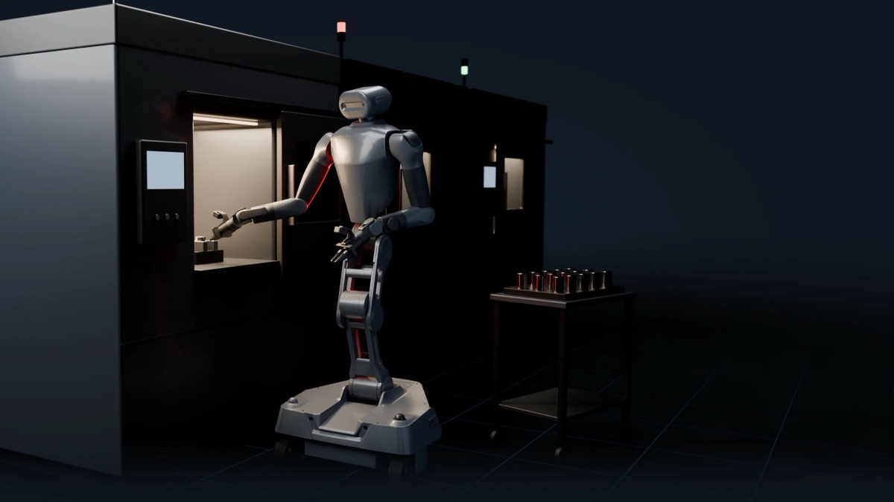
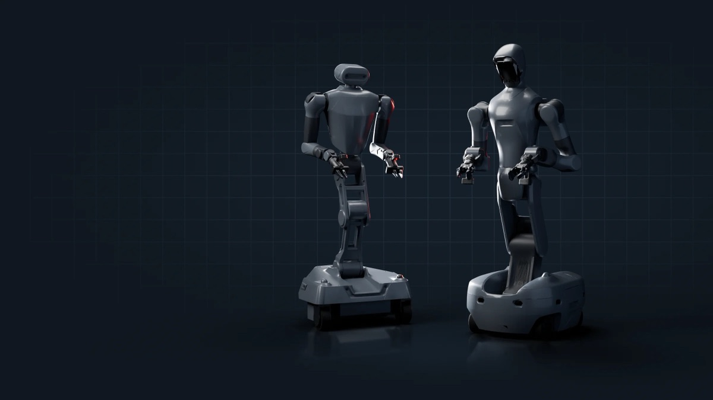
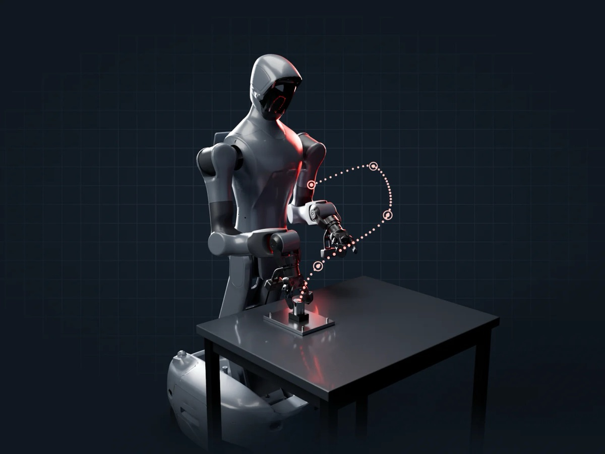
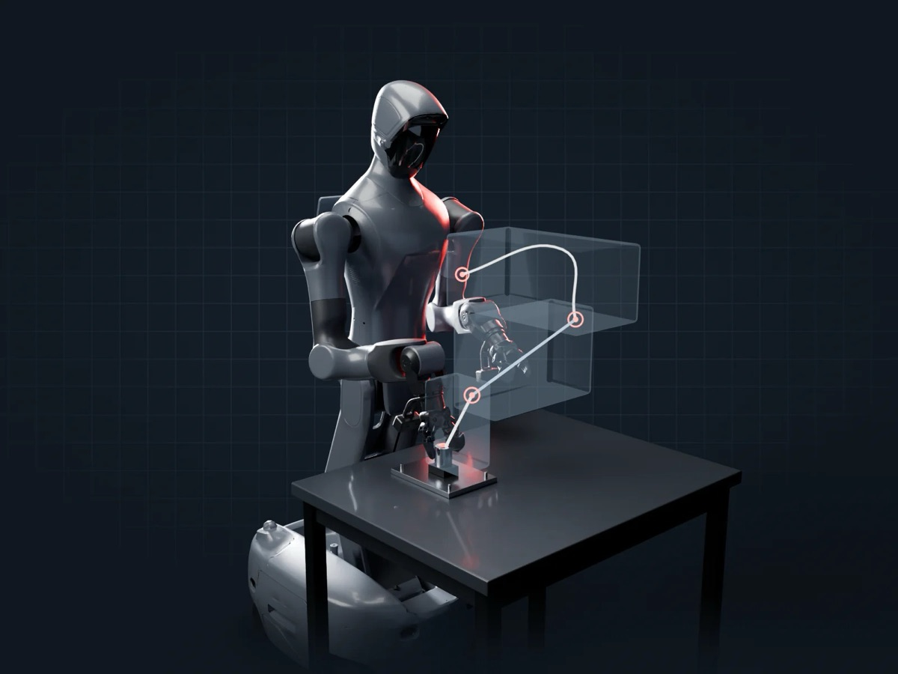
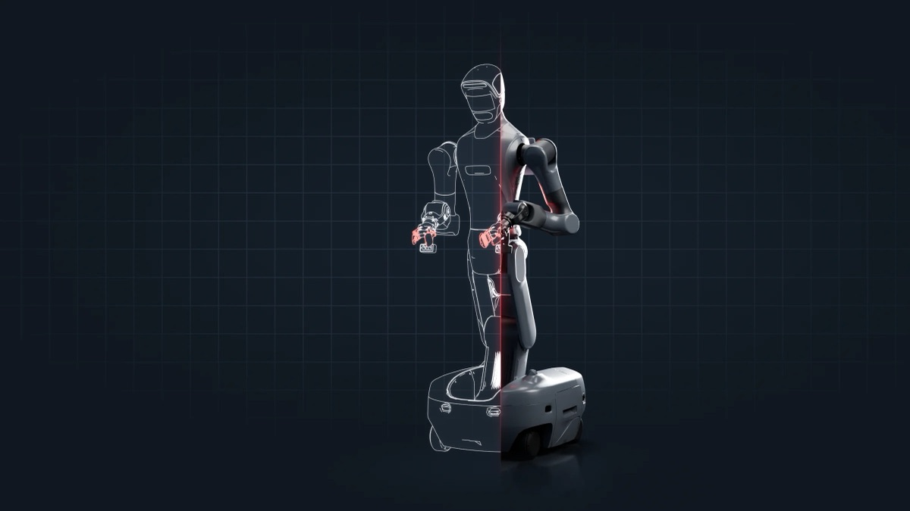
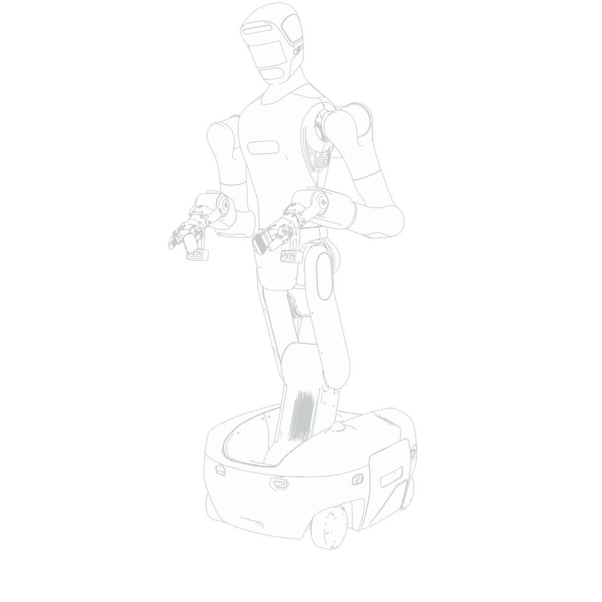

# Binabik AI — Product Portfolio

⬆ [Binabik AI profile](Binabik-AI.md) · [Developer guide](Binabik-AI-Developer-Guide.md) · [Roadmap and strategy](Binabik-AI-Roadmap-and-Strategy.md)

> **Read this first:** Binabik sells **no robot**. Everything below is software or a service that runs on someone else's wheeled dual-arm humanoid. The only platforms named publicly are **AgiBot G2** and **Galaxea R1 Pro** (both vendors are on site). Nothing is self-serve: no download, no public docs, no prices, no version numbers. Access at the hackathon depends on what the Binabik team hands out.

## Lineup map

Status icons: ✅ shipping/available · 🧪 announced/preview · 🔭 roadmap/concept. Track relevance: ● strong / ◐ partial / ○ none.

| Product | Category | Status | Launched | Price (if public) | Positioning (one line) | T01 | T02 | T03 | T04 |
|---|---|---|---|---|---|---|---|---|---|
| Binabik Solutions | Service: robot-as-a-service machine tending | 🧪 pilots / PoC, no named customer | 2026 (date not public) | Subscription; amount not public | Binabik brings robot, grippers and skills and runs the process for a factory | ○ | ○ | ◐ | ○ |
| Binabik Studio | Software workspace (simulator + code editor + teaching tools + dev kit) | 🧪 request access | 2026 (date not public) | not public | The tools Binabik uses internally, offered to automation teams | ● | ◐ | ◐ | ● |
| Binabik Teach | Software: demonstration capture | 🧪 part of Studio | not public | not public | Record one demonstration (by hand or teleoperation), all motion and camera frames | ● | ◐ | ◐ | ● |
| Binabik Skill Engine (Binabik Brain) | Software: task planner / skill mapper | 🧪 part of Studio | not public | not public | Splits a demonstration into steps and maps each to a library skill | ● | ◐ | ◐ | ● |
| Binabik Sim | Software: process simulator | 🧪 part of Studio | not public | not public | Rebuild the cell in simulation, validate and train with variations before the robot moves | ◐ | ◐ | ◐ | ◐ |
| Binabik Development Kit (BDK) | Software: skill library + hardware abstraction API | 🧪 request access | not public | not public | One skill set across robots; today AgiBot G2 and Galaxea R1 Pro | ● | ◐ | ◐ | ● |
| Binabik Academy | Training courses | 🧪 on request | not public | not public | Hands-on courses, on site or in Winterthur | ○ | ○ | ○ | ○ |

Track ratings assume the team gives you hands-on access and a supported robot. They are a judgement about fit, not a claim of existing deployments: Binabik has **no public deployment** in any of the four tracks.

**Naming note:** the home page calls the planner "Binabik Skill Engine"; the Solutions page calls the same step "Binabik Brain". Treated here as one product.

## Products

### Binabik Solutions

Robot-as-a-service for flexible machine tending. Binabik supplies the humanoid, custom grippers, the skills and ongoing operation; the customer needs no robotics team. Least relevant for the hackathon (it is a commercial engagement, not a tool), but it shows what the stack can already do.

| Item | Verified value |
|---|---|
| Robot shown | Galaxea R1 Pro (images); AgiBot G2 also named on the home page |
| Task scope | Take from conveyor, load / unload machine 1, transport part, load machine 2, unload and palletize; example machines: lathe, press |
| Cell concept | One robot moves between several machines instead of one fixed station |
| Learning flow | Demonstrate once → Brain splits into steps → train in simulation with varied parts, positions, lighting → same program runs on the real robot |
| Supervision | Every plan can be checked before the robot moves |
| Data | Processes and camera data stay in the customer's factory (company statement) |
| Engagement path | **1-day** workshop → proof of concept in Binabik lab + simulation → prototype in production → scaling |
| Timing claims | First application in months; follow-up installations in days (company statement) |
| Commercial model | One subscription covering hardware, software, updates and support; amount not public |
| Customers | None named |
| Cycle time, accuracy, uptime | not public |

- **Variants:** direct customer offer; joint offer with machine builders (machine sold together with a robot that operates it).
- **Typical applications:** CNC / press tending, part transport, palletizing.
- **Official page:** [binabik.ai/solutions](https://binabik.ai/solutions)

### Binabik Studio

The umbrella workspace: simulator, code editor and teaching tools in one place, plus the BDK. This is the product a hackathon team would actually touch.

| Item | Verified value |
|---|---|
| Contents | Binabik Sim, code editor, teaching tools (Teach + Skill Engine), BDK |
| Workflow | Simulation, code generation and on-robot testing in one workspace; simulation and real robot share one interface |
| Learning approach | Zero-shot / few-shot: show the task once, generalise over part variants, positions and tolerances (company statement) |
| API | Customers get the same API Binabik uses internally; start from a working program or write new ones |
| Speed claim | First demonstration to a running robot "in days" (company statement, ⚠️ unverified; no hackathon-scale figure exists) |
| Robots pictured | AgiBot G2, Galaxea R1 Pro |
| Programming languages | not public |
| OS / hardware requirements, GPU needs | not public |
| ROS 2 support | not public |
| Offline use | not public |
| Licence, price, version | not public |

- **Variants / access:** no EDU or developer edition is published. Access is by "Request access" only. Three stated audiences: manufacturers' own engineers (Studio + Academy + support), system integrators (Studio + BDK per robot delivered), machine builders (joint offer).
- **Typical applications:** teaching pick, carry, load and place tasks on a wheeled dual-arm humanoid.
- **Hackathon use:** candidate task layer for a fetch-and-deliver (T01) or carer-teaches-robot (T04) demo on a G2 or R1 Pro. Confirm in the first five minutes: which robots on site it drives today, whether there is a Python API, whether it needs internet.
- **Official page:** [binabik.ai/studio](https://binabik.ai/studio)

### Binabik Teach

Demonstration capture. An operator performs the task once and Teach records it.

| Item | Verified value |
|---|---|
| Input | One demonstration, by hand or by teleoperation |
| Recorded data | Every movement and camera frame |
| Demonstrations needed | **1** to start (company statement) |
| Teleoperation hardware | not public |
| Data format, export | not public |

- **Variants:** none published; delivered as part of Studio.
- **Typical applications:** an operator (or, in a hackathon story, a carer or city worker) shows the robot a task instead of programming it.
- **Official page:** [binabik.ai](https://binabik.ai) (described on the home page; no dedicated page)

### Binabik Skill Engine

Task planner, also called Binabik Brain. Turns a recorded demonstration into a sequence of reusable skills.

| Item | Verified value |
|---|---|
| Function | Segments the demonstration and maps each step to a skill from the BDK library |
| Missing skills | Built and added to the library (who builds them and how long it takes: not public) |
| Execution chain | Planned by the Brain → tested in simulation → executed on the real robot |
| Human check | Plan can be reviewed before the robot moves |
| Underlying models (VLA, LLM, other) | not public |
| Compute (edge / cloud) | not public for the current product |

- **Variants:** none published; delivered as part of Studio.
- **Typical applications:** multi-step manipulation sequences (take, load, unload, transport, palletize).
- **Official page:** [binabik.ai](https://binabik.ai) and [binabik.ai/solutions](https://binabik.ai/solutions)

### Binabik Sim

Process simulator: a digital copy of the production cell used to validate and train programs before they touch the real robot.

| Item | Verified value |
|---|---|
| Models | Machines, fixtures and cycle times of the customer's cell |
| Training | Task replayed "thousands of times" with varied parts, positions and lighting |
| Positioning | Explicitly "not a reinforcement-learning sandbox"; aimed at validating programs against real production |
| Sim-to-real | Same interface for simulation and real robot |
| Assets | Site images credit NVIDIA SimReady assets (CC BY 4.0) |
| Simulation engine | not public |
| Hardware requirements | not public |

- **Variants:** none published; delivered as part of Studio.
- **Typical applications:** checking reach, sequence and cycle time for a cell before deployment.
- **Hackathon caveat:** modelling a new environment in 48 hours is unproven; ask whether a ready scene exists for the on-site robots.
- **Official page:** [binabik.ai/studio](https://binabik.ai/studio)

### Binabik Development Kit (BDK)

Skill library plus hardware abstraction: the same set of skills on every supported robot, so a process built for one robot should run on the next.

| Item | Verified value |
|---|---|
| Supported robots today | **AgiBot G2**, **Galaxea R1 Pro** |
| Further platforms | Planned, none named, no dates |
| Skill list | not public |
| Programming languages, API reference | not public |
| Control level | Skill / task level; low-level joint control is not described |
| Licence, price | not public |
| Public repository | None for the BDK. The public org [github.com/binabik-ai](https://github.com/binabik-ai) holds only side tools and forks (see the [developer guide](Binabik-AI-Developer-Guide.md)) |

- **Variants:** offered to system integrators together with Studio "for every robot you deliver".
- **Typical applications:** porting one taught process between two different humanoids.
- **Hackathon use:** the cross-vendor angle. A team could show one taught task on both a G2 and an R1 Pro, if Binabik supports it on site (⚠️ unverified that both will be available with BDK).
- **Official page:** [binabik.ai/studio](https://binabik.ai/studio)

### Binabik Academy

Hands-on training on Binabik's robots and tools, from first steps in Studio to building your own skills. Held on site or in Winterthur. Curriculum, duration, dates and price are not public; booking is by enquiry. Not relevant for building during the hackathon. No dedicated image is published.

- **Official page:** [binabik.ai/studio](https://binabik.ai/studio)

## Accessories and ecosystem

| Item | What it is | Status | Notes |
|---|---|---|---|
| Centric gripper | Custom gripper for round parts | 🧪 shown as render | Designed per customer as part of Solutions; no specs, not sold separately |
| Vacuum gripper | Custom gripper for boxes and trays | 🧪 shown as render | Same |
| Parallel gripper with fingertip camera | Custom gripper with a camera in the fingertip | 🧪 shown as render | Same |
| AgiBot G2 | Third-party wheeled dual-arm humanoid | ✅ (AgiBot product) | Named BDK target; see the AgiBot profile for specs |
| Galaxea R1 Pro | Third-party wheeled dual-arm humanoid | ✅ (Galaxea product) | Named BDK target and the robot in Binabik's Solutions imagery |
| NVIDIA SimReady assets | Third-party 3D factory assets | ✅ | Credited on the site for simulation imagery |
| Machine integration | One-time integration of a machine's states and interfaces | 🧪 | Offered to machine builders; interface standards not named |

Sensors, compute add-ons and docks: none offered by Binabik.

## Legacy and discontinued

- **Quadruped patrol prototype (2025, before incorporation):** the software ran on a quadruped that patrolled an area and looked for changes. Not a product; the company has since focused on humanoids.

## Image credits

| File | Shows | Source URL |
|---|---|---|
| assets/binabik-ai-solutions.jpg | Render: Galaxea R1 Pro loading a machine tool | https://binabik.ai/images/renders/r1pro-machine.webp |
| assets/binabik-ai-studio.jpg | Render: the two supported robots (Galaxea R1 Pro, AgiBot G2) side by side | https://binabik.ai/images/renders/duo.webp |
| assets/binabik-ai-teach.jpg | Render: operator demonstrating a task to a humanoid at a machine | https://binabik.ai/images/renders/learn-demonstrate.webp |
| assets/binabik-ai-skill-engine.jpg | Render: demonstration split into steps, each matched to a skill | https://binabik.ai/images/renders/learn-interpret.webp |
| assets/binabik-ai-sim.jpg | Render: humanoid in a production cell next to its simulated twin | https://binabik.ai/images/renders/g2-sim-split.webp |
| assets/binabik-ai-bdk.jpg | Line drawing of the AgiBot G2 (a BDK target platform) | https://binabik.ai/images/renders/g2-line.png |

All images © Binabik AI, taken from binabik.ai; the site credits NVIDIA SimReady assets (CC BY 4.0) in its renders. These are illustrations, not software screenshots: no screenshot of Studio is public.

## Sources

- [Binabik AI — home](https://binabik.ai)
- [Binabik AI — Solutions](https://binabik.ai/solutions)
- [Binabik AI — Studio](https://binabik.ai/studio)
- [GitHub — binabik-ai organisation](https://github.com/binabik-ai)
- [Venture Kick — Binabik AI receives CHF 40,000 (13 Feb 2026)](https://www.venturekick.ch/Binabik-AI-receives-CHF-40000-from-Venture-Kick-to-accelerate-humanoid-deployment-across-industries)
- [Binabik AI company profile (this repository)](Binabik-AI.md)
