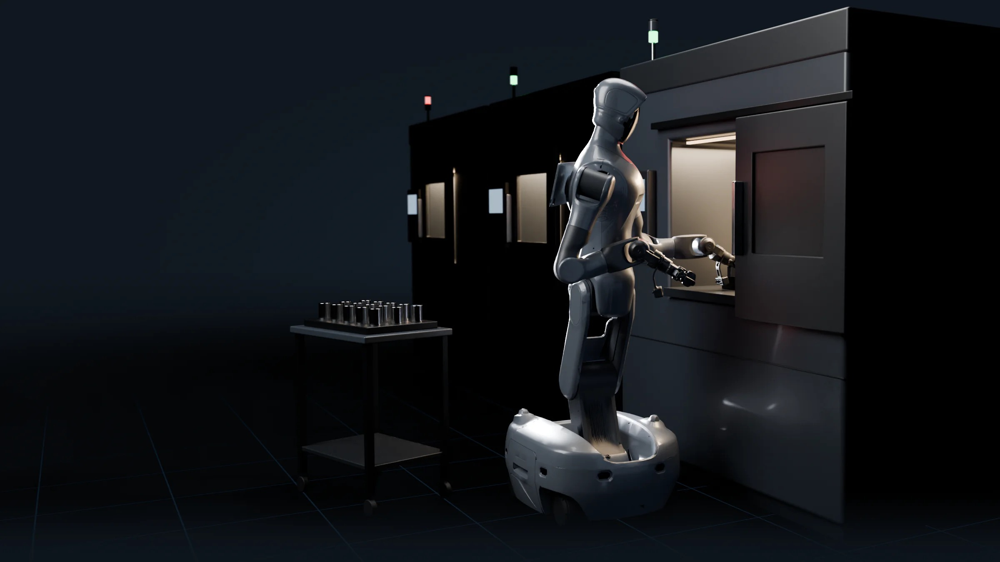
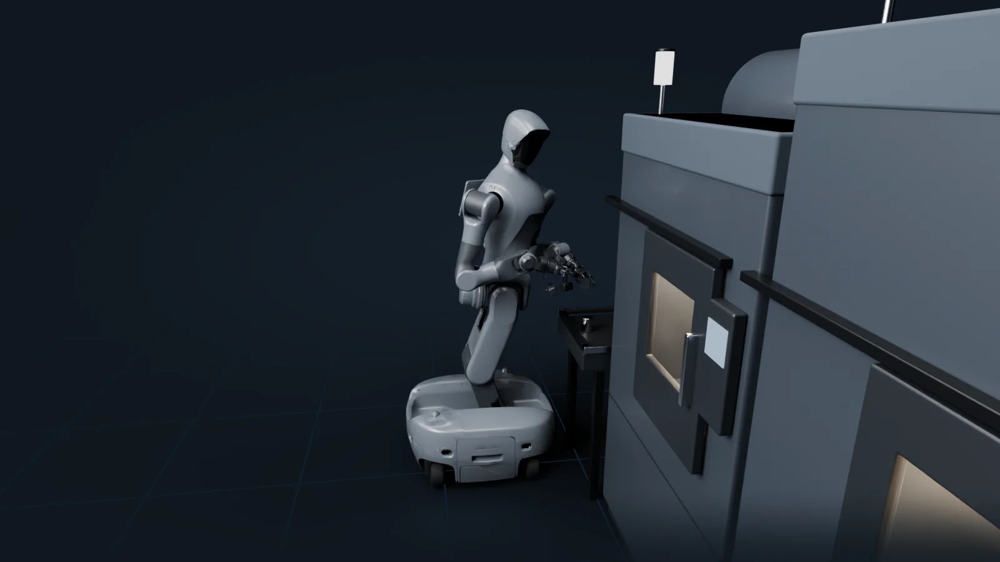
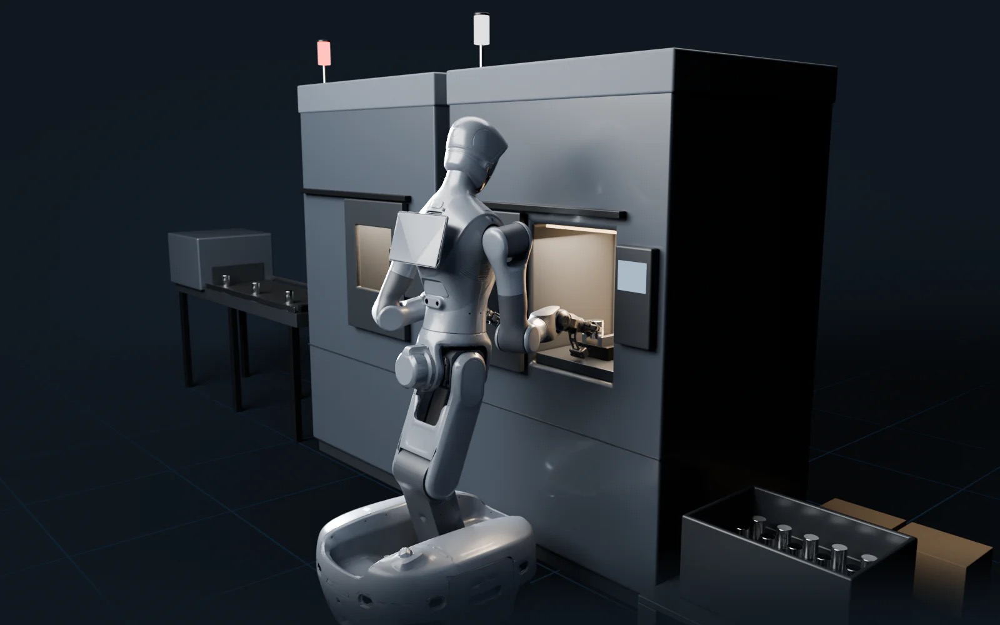
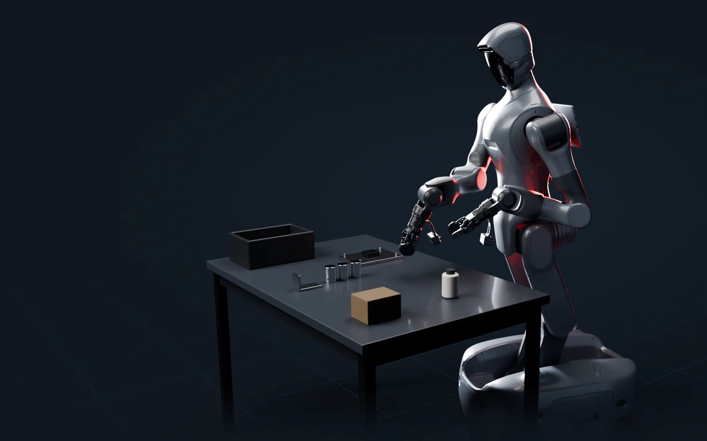
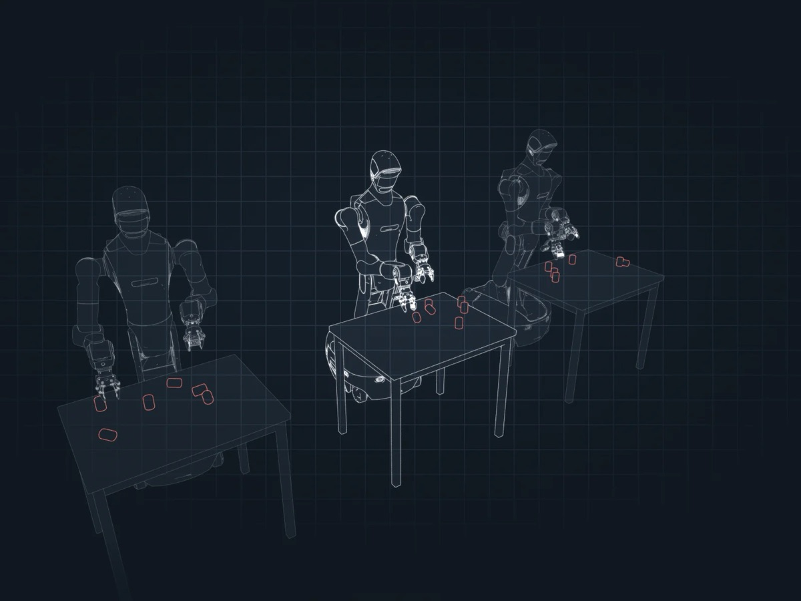
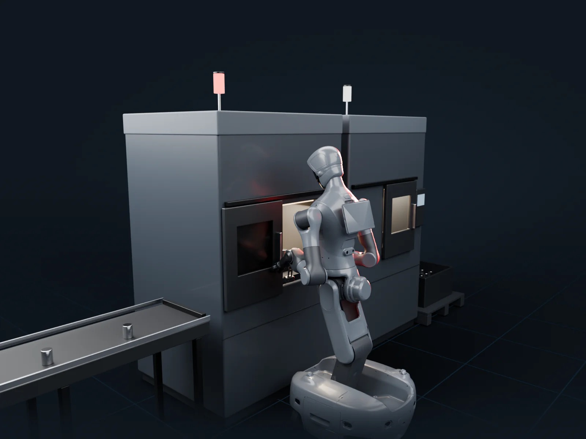
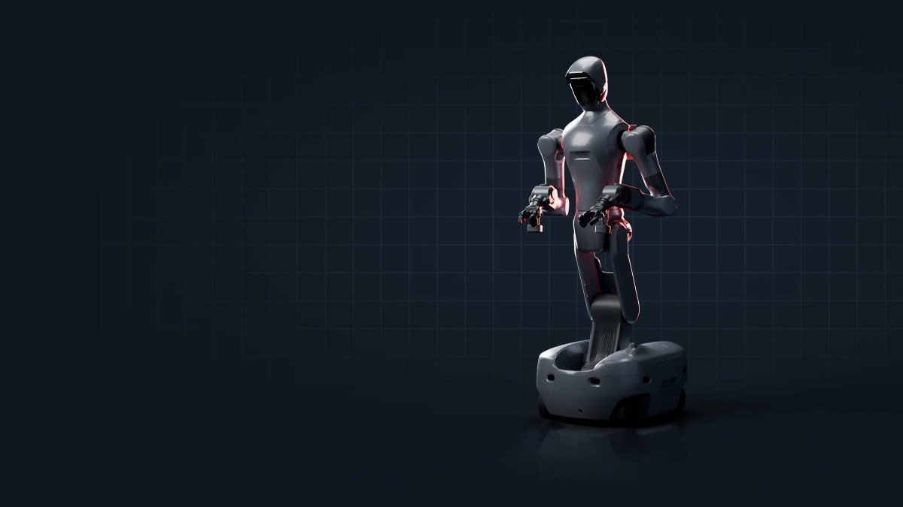
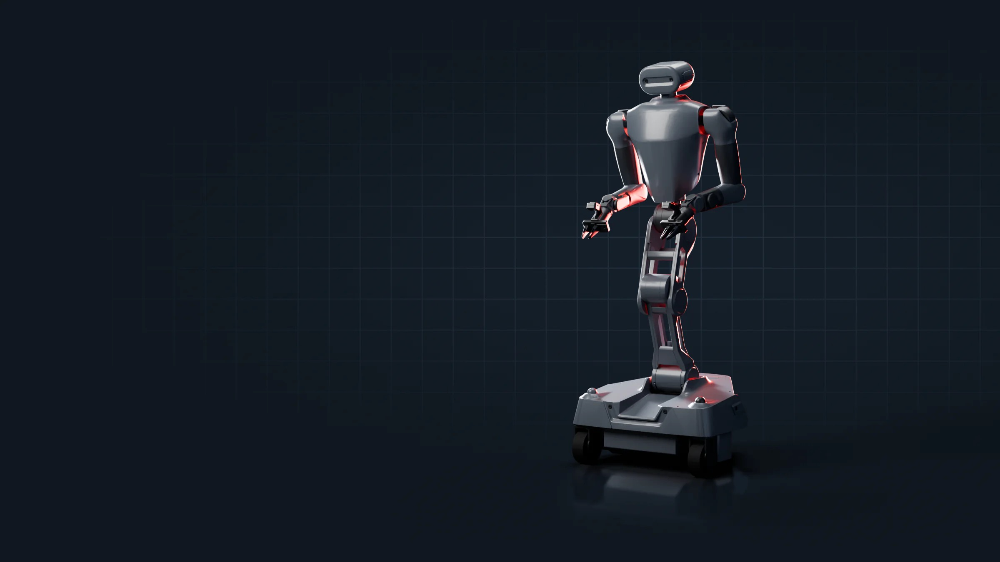
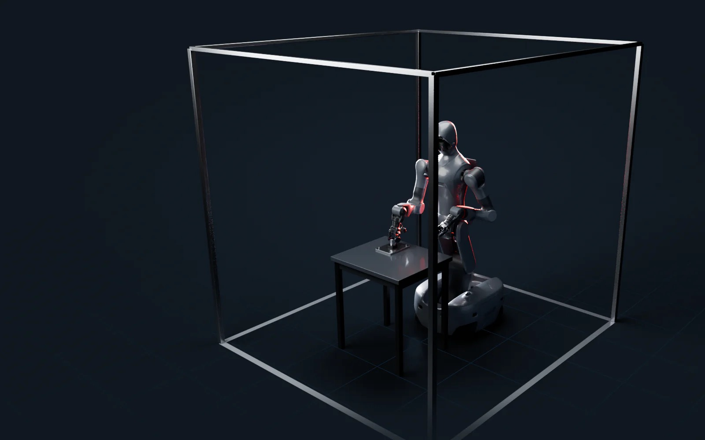
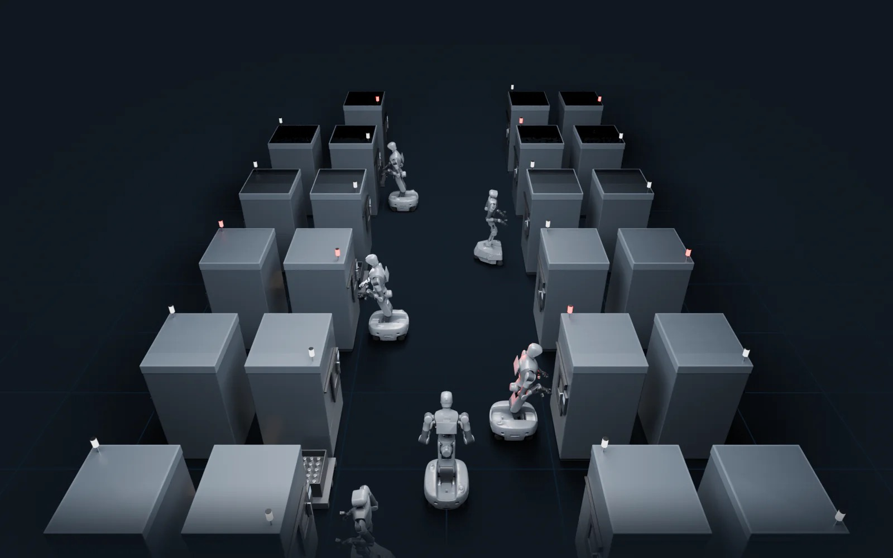

# Binabik AI — Solutions and Projects Register

⬆ [Binabik AI profile](Binabik-AI.md) · [Product portfolio](Binabik-AI-Products.md) · [Papers and research](Binabik-AI-Papers-and-Research.md) · [Roadmap and strategy](Binabik-AI-Roadmap-and-Strategy.md)

> **Coverage note:** Walked on 2026-11-14: the full `binabik.ai` sitemap (**18** URLs = 9 English pages + German mirror: home, Solutions, Studio, Team, About, Contact, Blog, privacy, terms), the navigation menu, the Careers page and all **8** job ads behind it (hosted on Dover, all dated 11 Nov 2026), the GitHub and Hugging Face organisations, and third-party coverage from Nov 2025 to Nov 2026 (Venture Kick ×3, Startupticker, S-GE, Technopark Winterthur, Organisator, Booster Magazine, ZHAW, ERF matchmaking). **One** web search (extended) was available and used. The site has **no** Industries, Use cases, Case studies, Customers, News or Press section (`/news` and `/press` return 404) and the blog is empty; there is no Chinese-language site. **Not accessible:** the LinkedIn company page and posts (blocked), `docs.binabik.ai` (login), a Fraunhofer PDF that surfaced in the search. Binabik is a ten-month-old, 8-person company: the public record is thin and this register is short on purpose.

**How to read the track tags:** Binabik markets **one** vertical (humanoid machine tending and intralogistics in factories) and has **no public deployment in any of the four hackathon tracks**. A track tag below means "this capability could be reused for that track in a hackathon build", not "Binabik sells this for that track".

Status icons: ✅ shipping/available/done · 🧪 announced/pilot/preview · 🔭 roadmap/planned.

## Solutions catalogue — everything they offer

| # | Solution / application | What it does | Products used | Maturity | Tracks | Source link |
|---|---|---|---|---|---|---|
| 1 | Machine tending as a service (Binabik Solutions) | Wheeled humanoid loads and unloads CNC lathes, mills and presses; Binabik supplies robot, grippers, skills and operation on one subscription | Solutions, Brain / Skill Engine, Sim, BDK | 🧪 first proof of concept "nearing completion" (Nov 2026); no named customer | T01 | [Solutions](https://binabik.ai/solutions) |
| 2 | Flexible cell: "One robot. Many machines." | One mobile robot serves several stations in sequence (conveyor → machine 1 → transport → machine 2 → pallet) and is re-tasked when the order mix changes | Solutions, Skill Engine | 🧪 shown as render / video loop only | T01 | [Solutions](https://binabik.ai/solutions) |
| 3 | Intralogistics: fetch, carry, stack | Fetch material, carry parts between stations, stack pallets; press coverage adds sorting and loading trolleys | Solutions, BDK skills | 🧪 named focus next to machine tending | T01 T03 | [Job ad (Head of Go-to-Market)](https://app.dover.com/apply/Binabik/405f62aa-6883-46c4-89cc-902a81d41e26) |
| 4 | Teach by demonstration (Binabik Teach) | Operator shows the task once, by hand or teleoperation; all motion and camera frames are recorded. Job ads say "a few recorded demonstrations" | Teach (part of Studio) | 🧪 request access | T01 T03 T04 | [Home](https://binabik.ai) |
| 5 | Skill segmentation and planning (Binabik Skill Engine / Binabik Brain) | Splits a demonstration into steps, maps each to a library skill, builds missing skills; sequences the task and recovers from errors | Skill Engine, BDK | 🧪 request access | T01 T02 T03 T04 | [Home](https://binabik.ai) |
| 6 | Process simulation and training (Binabik Sim) | Rebuilds the cell (machines, fixtures, cycle times) and replays the task thousands of times with varied parts, positions and lighting; described in job ads as a "custom simulator" | Sim (part of Studio) | 🧪 request access | T01 T03 T04 | [Studio](https://binabik.ai/studio) |
| 7 | Deployment with one interface for simulation and robot | The validated program runs unchanged on the real robot; operating data flows back into skill improvement | Studio, BDK | 🧪 | T01 T03 T04 | [Home](https://binabik.ai) |
| 8 | Hardware abstraction (Binabik Development Kit, BDK) | Same skill set on every supported robot, so a process built on one runs on the next | BDK | 🧪 request access | T01 T03 T04 | [Home](https://binabik.ai) |
| 9 | Platform integration: AgiBot G2 | Binabik stack runs on the G2 in the Winterthur lab | BDK | 🧪 in lab use | T01 T03 T04 | [Home](https://binabik.ai) |
| 10 | Platform integration: Galaxea R1 Pro | Binabik stack runs on the R1 Pro in the Winterthur lab; robot in most Solutions imagery | BDK | 🧪 in lab use | T01 T03 T04 | [Solutions](https://binabik.ai/solutions) |
| 11 | Binabik Studio workspace | Simulator, code editor, teaching workbench and BDK in one place; job ad describes a web app (React + TypeScript, Python backend) and a **Python API** for composing, testing and deploying robot programs | Studio | 🧪 request access; public docs gated | T01 T03 T04 | [Studio](https://binabik.ai/studio) |
| 12 | Custom grippers | Designed per customer part: centric gripper (round parts), vacuum gripper (boxes, trays), parallel gripper with fingertip camera | Solutions | 🧪 renders; not sold separately | T01 T03 | [Solutions](https://binabik.ai/solutions) |
| 13 | Supervised operation (plan preview) | Every plan can be checked by a person before the robot moves | Brain / Skill Engine | 🧪 | T01 T02 T04 | [Solutions](https://binabik.ai/solutions) |
| 14 | On-premise data handling | Process and camera data stay at the customer site | Solutions | 🧪 company statement | T04 | [Solutions](https://binabik.ai/solutions) |
| 15 | Shop-floor perception (in development) | Detect and localise parts, containers, fixtures and pallets; report uncertainty; hard cases named: reflective metal, clutter, changing light | Internal stack | 🔭 team being hired (Nov 2026) | T03 | [Job ad (Perception Engineer)](https://app.dover.com/apply/Binabik/77f890ce-79a0-4d5c-9cf8-61265c57140d) |
| 16 | General humanoid behaviours (early 2026 demo state) | Humanoid "can interact with people, pick and carry objects, and safely navigate shared environments" (founder statement, Feb 2026) | Earlier "agentic OS" stack | 🧪 demo-level; not on the current product pages | T01 T04 | [Venture Kick, 13 Feb 2026](https://www.venturekick.ch/Binabik-AI-receives-CHF-40000-from-Venture-Kick-to-accelerate-humanoid-deployment-across-industries) |
| 17 | Engagement path | **1-day** on-site workshop → proof of concept in Binabik's lab and simulation → prototype in the customer's production → scaling across the plant | Solutions | 🧪 offered | — | [Solutions](https://binabik.ai/solutions) |
| 18 | Machine-builder partner offer | Machine's states and interfaces integrated once; builder sells machine plus robot operator as one package | Solutions, BDK | 🧪 offered; no partner named | — | [Solutions](https://binabik.ai/solutions) |
| 19 | System-integrator offer | Studio plus BDK for every robot the integrator delivers | Studio, BDK | 🧪 offered | — | [Studio](https://binabik.ai/studio) |
| 20 | Binabik Academy | Hands-on courses on Binabik's robots and tools, on site or in Winterthur | Academy | 🧪 on request | — | [Studio](https://binabik.ai/studio) |
| 21 | `mcp-rosbags` (open source) | MCP server that lets an LLM agent analyse ROS bag recordings offline; Apache-2.0, **29** stars | — | ✅ public on GitHub | T02 T03 | [GitHub](https://github.com/binabik-ai/mcp-rosbags) |
| 22 | `mcp-lab` (open source) | Test MCP servers against different LLM providers; Apache-2.0 | — | ✅ public on GitHub | — | [GitHub](https://github.com/binabik-ai/mcp-lab) |
| 23 | Research checkpoint `act_PickPlaceRedBlock` | ACT-style pick-and-place policy from a Unitree G1 simulation task; no model card, no licence | — | ✅ public, research only | — | [Hugging Face](https://huggingface.co/binabik-ai/act_PickPlaceRedBlock) |
| 24 | Quadruped patrol and change detection (legacy) | 2025 prototype: ask a robot dog to patrol an area or look for changes | Earlier "agentic OS" stack | Discontinued prototype (focus moved to humanoids) | T01 T02 | [Venture Kick, 13 Feb 2026](https://www.venturekick.ch/Binabik-AI-receives-CHF-40000-from-Venture-Kick-to-accelerate-humanoid-deployment-across-industries) |
| 25 | Stated wider verticals | ERF profile lists healthcare, logistics, smart cities and infrastructure inspection, energy and utilities, defense and security, agri-tech, construction, mobility as areas of activity | — | 🔭 interests only, no offering | T01 T02 T03 T04 | [ERF matchmaking](https://www.b2match.com/e/erf2026/participations/705635) |

Stack facts from the Nov 2026 job ads (useful when planning an integration): **Python** for most of the robot stack, **ROS 2**, **MuJoCo**, **PyTorch**, cloud GPU, React + TypeScript front end. Whether Binabik Sim is built on MuJoCo is not stated.

### Machine tending as a service (Binabik Solutions)

- Binabik brings robot, grippers and skills, builds the process in simulation and runs it in the customer's production; the customer needs no robotics team.
- Named machines: CNC lathe, mill, press. Company claims: first application "in months", follow-up installations "in days".
- Maturity check: the Nov 2026 job ads say the **first proof of concept is nearing completion and pilots are next**; no paying customer yet.
- Track transfer (T01.2): the same "robot operates an existing machine through its door and controls" pattern fits tending service equipment in a facility. Nothing of that kind is offered.
- Official link: [binabik.ai/solutions](https://binabik.ai/solutions)

### Flexible cell: "One robot. Many machines."

- Six-step reference sequence on the site: take from conveyor → load machine 1 → unload machine 1 → transport part → load machine 2 → unload and palletize.
- The selling point is re-tasking: when production changes, the robot gets a new job instead of the cell being rebuilt.
- Track transfer (T01.2, T01.1): one mobile dual-arm robot serving several service points in turn.
- Official link: [binabik.ai/solutions](https://binabik.ai/solutions)

### Intralogistics: fetch, carry, stack

- Job ads name "machine tending and intralogistics" as the two focus areas: fetch material, carry parts, stack pallets.
- April 2026 press describes the robots taking over repetitive tasks such as **sorting and loading** (one outlet: loading trolleys) to ease staff shortages in logistics and production.
- No payload, speed or success-rate figures are public.
- Track transfer: T01.1 (indoor delivery and logistics), T03.1 / T03.6 (sorting and loading of items).
- Official link: [Head of Go-to-Market job ad](https://app.dover.com/apply/Binabik/405f62aa-6883-46c4-89cc-902a81d41e26) · [S-GE, 14 Apr 2026](https://www.s-ge.com/invest/en/articles/news/ai-robotics-start-binabik-establishes-presence-winterthur)

### Teach by demonstration (Binabik Teach)

- An operator performs the task once, by hand or by remote control; Teach records every movement and camera frame. The team has its own demonstration and teleoperation setups (hardware not named).
- Users: the customer's own operator, not a robotics engineer. In the workshop format the process is shown to the robot on the customer's floor in **one day**.
- Track transfer: T04.6 / T04.1 (a carer shows a fetch-and-hand-over routine), T01.2 (a facility worker shows a restocking task), T03.1 (show a sorting rule).
- Official link: [binabik.ai](https://binabik.ai)

### Skill segmentation and planning (Binabik Skill Engine / Binabik Brain)
- Segments the demonstration and maps each step to a skill in the BDK library; missing skills are built and added. A separate layer sequences tasks and recovers from errors (job ad).
- The approach mixes classical motion planning, perception and control with learned components; described as multi-agent orchestration of specialised models, skills and persistent memory.
- Underlying models are not named. Internship topics mention open VLAs (π0, SmolVLA, GR00T) as fine-tuning candidates, which is research, not product.
- Official link: [binabik.ai](https://binabik.ai) · [binabik.ai/solutions](https://binabik.ai/solutions)

### Process simulation and training (Binabik Sim)

- Models the customer's machines, fixtures and cycle times; each skill is refined across thousands of variations in parts, positions and lighting.
- Positioned as "not a reinforcement-learning sandbox": the goal is validating a program against real production. A systematic Sim-versus-real comparison is still an open internship topic.
- Hackathon caveat: building a new scene in 48 hours is unproven; ask whether a ready scene exists for the on-site robots.
- Official link: [binabik.ai/studio](https://binabik.ai/studio)

### Deployment with one interface for simulation and robot

- Simulation and robot share one interface, so the validated program is not rewritten for the real machine.
- Data collected in operation feeds back into the skills ("every shift adds experience", company statement).
- Planned benchmarks: success rate, cycle time, required operator assistance. No results are published.
- Official link: [binabik.ai](https://binabik.ai)

### Hardware abstraction (Binabik Development Kit, BDK)
- One skill set across robots; today **AgiBot G2** and **Galaxea R1 Pro**, "more platforms as the market moves" (none named).
- Under the hood (job ad): hardware abstraction layer, ROS 2 communication and timing, real-time control interfaces to arms, grippers and mobile base, logging and replay.
- Integrators are meant to build on the BDK and its APIs; no public reference, licence or price.
- Official link: [binabik.ai](https://binabik.ai) · [Robotics job ad](https://app.dover.com/apply/Binabik/c7d7e0c8-93a9-47a6-859b-a3fea278169d)

### Platform integration: AgiBot G2

- One of two robots in Binabik's Winterthur lab ("everything we build is meant to run on our G2 and R1 Pro").
- AgiBot is a vendor at the hackathon, which makes this the most direct on-site pairing. Whether Binabik will run its stack on an organiser-provided G2 is ⚠️ unverified.
- No formal AgiBot partnership announcement was found; the careers page speaks only of "strategic hardware partners across the leading humanoid manufacturers" without names.
- Official link: [binabik.ai](https://binabik.ai)

### Platform integration: Galaxea R1 Pro

- Second lab robot and the one shown in most Solutions renders.
- Galaxea is also a vendor at the hackathon. Same caveat: on-site support is ⚠️ unverified.
- Official link: [binabik.ai/solutions](https://binabik.ai/solutions)

### Binabik Studio workspace
- One workspace for simulation, code generation and on-robot testing; customers get "the same API we use".
- Job ad detail: web application plus a Python API, with cloud services for simulation and GPU training, licence activation and fleet updates being built.
- Company claim: first demonstration to a running robot "in days" (⚠️ unverified; no hackathon-scale figure).
- Official link: [binabik.ai/studio](https://binabik.ai/studio) · [Software & Infrastructure job ad](https://app.dover.com/apply/Binabik/83632fdf-3041-45b2-9110-240e9bcddd99)

### Custom grippers
- Three types shown: centric (round parts), vacuum (boxes and trays), parallel with fingertip camera; cameras and sensors added where the task needs them.
- Designed per customer inside a Solutions engagement; no catalogue, specs or prices.
- Track transfer: T03.1 (mixed-item sorting needs exactly this gripper choice), T01.1 (boxes and trays).
- Official link: [binabik.ai/solutions](https://binabik.ai/solutions)

### Supervised operation (plan preview)
- The plan produced by the Brain can be reviewed before any motion; the perception role is asked to make robots "recognize when they are uncertain".
- Track transfer: T04.2 and T02.7 (a person approves the robot's plan), T01.7 (transparent behaviour around people).
- Official link: [binabik.ai/solutions](https://binabik.ai/solutions)

### On-premise data handling
- Processes and camera data stay in the customer's facility; deployments are reviewed for network exposure before robots go on site (job ad).
- Track transfer: T04.6 (privacy in care settings). No healthcare certification or compliance statement exists.
- Official link: [binabik.ai/solutions](https://binabik.ai/solutions)

### Shop-floor perception (in development)
- Scope in the job ad: camera and hand-eye calibration, open-vocabulary detection, segmentation, 6-DoF pose estimation, VLMs, real time on the robot.
- Objects: parts in bins, chucks, containers, partially loaded pallets. An internal benchmark for reflective metal parts is a proposed student project.
- Track transfer: T03.1 / T03.6 (recognising and localising items to sort). Not a product.
- Official link: [Perception Engineer job ad](https://app.dover.com/apply/Binabik/77f890ce-79a0-4d5c-9cf8-61265c57140d)

### General humanoid behaviours (early 2026 demo state)
- In Feb 2026 the founders described a humanoid that interacts with people, picks and carries objects and navigates shared spaces safely.
- This wording has since disappeared from the website, which now talks only about machines and parts. Treat it as demo-level capability.
- Track transfer: T01.3 / T01.7, T04.1 / T04.5.
- Official link: [Venture Kick, 13 Feb 2026](https://www.venturekick.ch/Binabik-AI-receives-CHF-40000-from-Venture-Kick-to-accelerate-humanoid-deployment-across-industries)

### `mcp-rosbags` (open source)
- Lets an LLM agent query recorded robot data (ROS 1 / ROS 2 bags) through tool calls; self-serve, Apache-2.0, last updated Oct 2026.
- The only Binabik software a team can use without asking anyone.
- Track transfer: T02.3 / T02.4 and T03.7 (explain what a patrol or survey run recorded).
- Official link: [github.com/binabik-ai/mcp-rosbags](https://github.com/binabik-ai/mcp-rosbags)

### Quadruped patrol and change detection (legacy)
- State of the software when the team applied to Venture Kick (2025): a robot dog could be asked to patrol an area or look for changes.
- Not a product; the company narrowed to humanoids by late 2025. Robot model not named.
- Track transfer: T02.5, T02.3, T01.4. Ask the team whether any of that code still runs.
- Official link: [Venture Kick, 13 Feb 2026](https://www.venturekick.ch/Binabik-AI-receives-CHF-40000-from-Venture-Kick-to-accelerate-humanoid-deployment-across-industries)

### Engagement path and scaling (no track tag; context)

- Workshop (1 day, on site) → proof of concept (Binabik lab plus simulation) → prototype (customer production) → scaling (more machines, robots, processes).
- As of Nov 2026 Binabik itself is between step 2 and step 3: first proof of concept nearly done, pilots next. Multi-robot scaling is 🔭.
- Official link: [binabik.ai/solutions](https://binabik.ai/solutions)

## Projects register — past and current

| Date | Project / deployment / pilot / partnership | Partner or customer | Location | What happened (one line) | Tracks | Source link |
|---|---|---|---|---|---|---|
| 2026-11-14 to 16 | Leukerbad Robotics Hackathon | Organisers; 19 other robot companies | Leukerbad, CH | On the organisers' company list; what Binabik brings and which robots it supports on site is ⚠️ unverified | T01–T04 | [Profile](Binabik-AI.md) |
| 2026-11-11 | Hiring round: 8 roles published | — | Winterthur, CH | Ads state the first proof of concept is nearing completion, pilots are next, and the lab runs an AgiBot G2 and a Galaxea R1 Pro | — | [Careers](https://binabik.ai/open-positions) |
| 2026-10-06 | `mcp-rosbags` update | Open source | GitHub | Latest push to the rosbag-analysis MCP server | T02 T03 | [GitHub](https://github.com/binabik-ai/mcp-rosbags) |
| 2026-07-02 | First public model checkpoint | — | Hugging Face | `act_PickPlaceRedBlock` uploaded; Unitree G1 Isaac Lab fork updated the same day | — | [Hugging Face](https://huggingface.co/binabik-ai/act_PickPlaceRedBlock) |
| 2026-06-17 to 20 | VivaTech 2026, Swiss Pavilion (Hall 7.3) | Swisstech campaign | Paris, FR | One of **25** Swiss start-ups in the delegation; presented as an agentic OS for humanoids aimed at logistics and manufacturing, sold as B2B robot-as-a-service | — | [Startupticker](https://www.startupticker.ch/en/news/swiss-delegation-set-for-vivatech-2026) |
| 2026 (undated) | "Paid pilots in healthcare and logistics" | Not named | Not stated | Claim on the Dover careers page. ⚠️ unverified: no partner, date or detail, and the newer Nov 2026 ads say the company is only finishing its first proofs of concept | T04 | [Dover careers page](https://app.dover.com/jobs/binabik) |
| 2026 (undated) | "Strategic hardware partners across the leading humanoid manufacturers" | Not named | — | Claim on the Dover careers page; only AgiBot G2 and Galaxea R1 Pro are ever named as platforms. ⚠️ unverified as formal partnerships | — | [Dover careers page](https://app.dover.com/jobs/binabik) |
| 2026 (undated) | One-day machine-tending workshop | Willemin-Macodel SA (machine-tool builder) | Not stated | A LinkedIn post by a Binabik team member reportedly describes a workshop testing whether a humanoid can tend machines that make watch parts. ⚠️ unverified: seen only as a search summary, post not accessible, no outcome reported | — | [LinkedIn profile](https://www.linkedin.com/in/giovannitoffetti/) |
| 2026-04-14 | Move into Technopark Winterthur | Greater Zurich Area, House of Winterthur | Winterthur, CH | Location announced; **5** people, plan for **15** within a year | — | [S-GE](https://www.s-ge.com/invest/en/articles/news/ai-robotics-start-binabik-establishes-presence-winterthur) |
| 2026 (spring) | European Robotics Forum 2026 matchmaking | ERF / b2match | Not confirmed | Profile as "The Agentic Operating System for Physical AI"; lists nine application areas | T01–T04 (interest only) | [ERF matchmaking](https://www.b2match.com/e/erf2026/participations/705635) |
| By 2026-03-02 | Humanoid Forum: best start-up pitch | Humanoid Forum | Biel/Bienne, CH | Binabik won the start-up pitch award; ZHAW CAI ran live robot demos at the same event | — | [ZHAW](https://www.zhaw.ch/de/fokusthemen/interinterdisziplinaere-kompetenzzentren/datalab/news/newsdetail/event-news/zhaw-cai-praesentierte-physical-ai-und-robotik-am-humanoid-forum-in-biel) |
| Early 2026 | Parent-lab appearances (context) | ZHAW Centre for AI | Davos and elsewhere, CH | ZHAW CAI (the lab Binabik spun out of) showed its robots at WEF 2026 and Swiss Robotics Day and co-organises the Davos Tech Summit; Binabik's own role there is not stated | — | [ZHAW](https://www.zhaw.ch/de/fokusthemen/interinterdisziplinaere-kompetenzzentren/datalab/news/newsdetail/event-news/zhaw-cai-praesentierte-physical-ai-und-robotik-am-humanoid-forum-in-biel) |
| 2026-02-13 | Venture Kick Stage II | Venture Kick | Switzerland | **CHF 40,000**; money earmarked to explore new verticals while keeping the existing industrial collaboration | — | [Venture Kick](https://www.venturekick.ch/Binabik-AI-receives-CHF-40000-from-Venture-Kick-to-accelerate-humanoid-deployment-across-industries) |
| 2026-01-16 | Binabik GmbH incorporated | ZHAW Centre for AI (spin-off) | Winterthur, CH | Company founded; Venture Kick total stands at **CHF 50,000** | — | [Venture Kick profile](https://www.venturekick.ch/binabik) |
| 2026-01-09 | GR00T N1.6 fork | Open source | GitHub | Last update to the fork of NVIDIA Isaac GR00T (fine-tuning experiments) | — | [GitHub org](https://github.com/binabik-ai) |
| Nov 2025 – Feb 2026 | First proof of concept | Unnamed industrial partner | Not stated | During the three months of Stage I a humanoid was deployed "in realistic conditions" and demonstrated to the partner's leadership | — | [Venture Kick](https://www.venturekick.ch/Binabik-AI-receives-CHF-40000-from-Venture-Kick-to-accelerate-humanoid-deployment-across-industries) |
| 2025-11-06 | Venture Kick Stage I | Venture Kick | Switzerland | **CHF 10,000** for "agentic physical AI for general robotics"; pitch then covered any robot body, any task | — | [Venture Kick](https://www.venturekick.ch/CHF-10000-for-an-innovative-platform-that-empowers-teachers-agentic-physical-AI-for-general-robotics-a-novel-invivo-gene-editing-platform-orthopedic-surgery-with-robotic-flexible-articulation-and-nextgen-electronics-for-cryogenic-environments) |
| 2025 (before Nov) | Quadruped patrol prototype | — | Not stated | Software ran on a robot dog that could patrol an area or look for changes | T01 T02 | [Venture Kick](https://www.venturekick.ch/Binabik-AI-receives-CHF-40000-from-Venture-Kick-to-accelerate-humanoid-deployment-across-industries) |
| Aug–Sep 2025 | First open-source releases | Open source | GitHub | Organisation created; `mcp-lab` and `mcp-rosbags` published | — | [GitHub org](https://github.com/binabik-ai) |

**Reading the record:** one confirmed proof of concept (partner unnamed), one reported workshop, zero confirmed deployments, zero named customers. Sources disagree on pilots: an undated careers blurb claims paid pilots in healthcare and logistics, while the eight ads dated 11 Nov 2026 describe a company that is finishing its first proofs of concept. The newer, more specific wording is the safer one to rely on.

## Future projects and announced plans

| Announced | Planned for | What | Confidence | Tracks | Source link |
|---|---|---|---|---|---|
| 2026-11-11 | Next step, no date | Complete the first proof of concept and move to **industrial pilots**, then first paying customers | official | — | [Head of Go-to-Market job ad](https://app.dover.com/apply/Binabik/405f62aa-6883-46c4-89cc-902a81d41e26) |
| 2026-11-11 | No date | Pricing and packaging for Solutions (robot-as-a-service), **Studio licences**, Academy and machine-builder partnerships | official | — | [Head of Go-to-Market job ad](https://app.dover.com/apply/Binabik/405f62aa-6883-46c4-89cc-902a81d41e26) |
| 2026-11-11 | No date | Trade-fair presence; examples named: EMO, AMB, SINDEX, automatica, LogiMAT | inferred (examples in a job ad, no booking announced) | — | [Head of Go-to-Market job ad](https://app.dover.com/apply/Binabik/405f62aa-6883-46c4-89cc-902a81d41e26) |
| 2026-11-11 | No date | Studio platform build-out: Python API with documentation and examples, cloud simulation and GPU training, model registry, licence activation, fleet management and over-the-air updates | inferred (described as the job's scope) | T01 T03 T04 | [Software & Infrastructure job ad](https://app.dover.com/apply/Binabik/83632fdf-3041-45b2-9110-240e9bcddd99) |
| 2026-11-11 | No date | Customer-site deployments "mostly in Switzerland and neighboring countries" | official (travel expectation in job ad) | — | [Robotics job ad](https://app.dover.com/apply/Binabik/c7d7e0c8-93a9-47a6-859b-a3fea278169d) |
| 2026-11-11 | Thesis / internship cycle | Research topics: few-shot imitation learning for tight-tolerance placing, fine-tuning open VLAs on machine tending, RL fine-tuning with domain randomisation, automatic skill segmentation, learning from machine success / failure signals; results may become publications or open-source releases | official (topic list); outputs inferred | — | [Robot Learning internship](https://app.dover.com/apply/Binabik/eeea6c8b-77ef-46df-b9e8-e99ae36146d9) |
| 2026-11-11 | Thesis / internship cycle | Evaluation tooling: reflective-metal perception benchmark, Sim-versus-real comparison, automated skill regression tests, log visualisation in Studio | official (topic list) | T03 | [Robotics Software & Evaluation internship](https://app.dover.com/apply/Binabik/929df224-c3d7-4947-85f3-c94b89adc109) |
| 2026 (undated careers blurb) | "in 2026" | Further verticals beyond healthcare and logistics pilots | official claim, ⚠️ unverified and undated | T04 | [Dover careers page](https://app.dover.com/jobs/binabik) |
| 2026 (undated careers blurb) | Q3 2026 | Pre-seed round "closing in Q3 2026"; no closing was announced and the Nov 2026 ads still say "pre-seed company" | official claim, outcome ⚠️ unverified | — | [Dover careers page](https://app.dover.com/jobs/binabik) |
| 2026-04-14 | By about April 2027 | Grow from **5** to **15** people (8 on the team page in Nov 2026) | official | — | [S-GE](https://www.s-ge.com/invest/en/articles/news/ai-robotics-start-binabik-establishes-presence-winterthur) |
| 2026-02-13 | No date | Explore new verticals with Stage II money while strengthening the current industrial collaboration | official | T01–T04 (unspecified) | [Venture Kick](https://www.venturekick.ch/Binabik-AI-receives-CHF-40000-from-Venture-Kick-to-accelerate-humanoid-deployment-across-industries) |
| Site, Nov 2026 | "as the market moves" | BDK support for more robots beyond AgiBot G2 and Galaxea R1 Pro; none named | official | T01 T03 T04 | [Home](https://binabik.ai) |
| Site, Nov 2026 | "coming soon" | Solutions demo video ("From plan to robot") and a Studio film | official | — | [Solutions](https://binabik.ai/solutions) |
| Site, Nov 2026 | No date | Machine-builder partner programme and system-integrator channel; no partner announced | official (offer) | — | [Solutions](https://binabik.ai/solutions) |
| Site, Nov 2026 | No date | "Insights & Research" blog (section exists, zero posts) and public developer docs (portal exists behind a login) | inferred | — | [Blog](https://binabik.ai/blog) |

No dated product roadmap exists. Nothing announced targets urban services, safety, sustainability or care specifically.

## Solutions by track — quick index

### T01 Autonomous Urban Services
- **Intralogistics: fetch, carry, stack** (catalogue #3) — T01.1. Closest existing capability to a delivery demo; indoor, factory-style.
- **Flexible cell "One robot. Many machines."** (#2) and **Machine tending** (#1) — T01.2. One mobile dual-arm robot serving several service points or operating existing equipment.
- **Teach by demonstration** (#4) + **Skill Engine** (#5) — T01.2, T01.7. A facility worker shows the task once instead of programming it.
- **General humanoid behaviours** (#16) — T01.3, T01.7. Interact with people, pick and carry, move in shared space; demo-level, Feb 2026.
- **BDK on AgiBot G2 / Galaxea R1 Pro** (#8, #9, #10) — T01.1, T01.2. Both robots' vendors are on site; support there is ⚠️ unverified.
- **Supervised operation (plan preview)** (#13) — T01.7.
- **Custom grippers** (#12) — T01.1 (boxes and trays).
- **Quadruped patrol and change detection, legacy** (#24) — T01.4. Discontinued prototype.
- T01.5 (guidance and information) and T01.6 (navigation and path planning): **Nothing specific found.** Navigation is not marketed as a Binabik capability.

### T02 Resilient & Safe City
- **Quadruped patrol and change detection, legacy** (#24) — T02.5, T02.3. The only item that ever pointed at this track; 2025 prototype, no longer the focus.
- **`mcp-rosbags`** (#21) — T02.3, T02.4. Self-serve tool for having an LLM explain recorded sensor data after a run.
- **Supervised operation (plan preview)** (#13) — T02.7. Human approves the plan before the robot acts.
- **Skill Engine error recovery** (#5) — T02.7, loosely.
- **Stated interest** (#25): "defense and security" and "smart cities and infrastructure inspection" on the ERF profile — T02.5, T02.3. 🔭 words only.
- T02.1 (rescue), T02.2 (hazardous environments), T02.6 (complex terrain): **Nothing specific found.** Supported robots are wheeled, indoor, flat-floor platforms.

### T03 Sustainable City
- **Intralogistics with sorting and loading** (#3) — T03.1, T03.6. Sorting, loading trolleys and palletizing are named tasks.
- **Custom grippers** (#12) — T03.1. Vacuum for boxes and trays, centric for round items, parallel with fingertip camera.
- **Teach by demonstration** (#4) + **Skill Engine** (#5) — T03.1. Re-teach a sorting rule for a new item from one demonstration (company claim, unproven outside machine tending).
- **Shop-floor perception, in development** (#15) — T03.1, T03.6. Detect and localise items and containers; not a product.
- **Binabik Sim** (#6) — T03.1. Train a sorting skill over varied items and lighting, if a scene can be built in time.
- **`mcp-rosbags`** (#21) — T03.7. Analyse recorded environmental-survey data with an LLM.
- **Stated interest** (#25): "energy and utilities automation" on the ERF profile — T03.5. 🔭 words only.
- T03.2 (environmental monitoring robots), T03.3 (energy-efficient systems), T03.4 (sustainable infrastructure): **Nothing specific found.**

### T04 Elderly Care & Rehabilitation
- **"Paid pilots in healthcare"** (projects register, undated) — T04.2, T04.6. ⚠️ unverified one-line claim on a careers page; no partner, site or task described. Ask the team directly.
- **General humanoid behaviours** (#16) — T04.1, T04.5. Interact with people, pick and carry objects, navigate shared spaces; demo-level.
- **Teach by demonstration** (#4) + **Skill Engine** (#5) — T04.6, T04.1. A carer shows a routine once (fetch water, bring a walking aid, clear a tray).
- **Supervised operation (plan preview)** (#13) — T04.2. Carer sees and approves the plan before the robot moves.
- **On-premise data handling** (#14) — T04.6. Camera data stays on site; no medical certification.
- **BDK on AgiBot G2 / Galaxea R1 Pro** (#8, #9, #10) — T04.1. Wheeled dual-arm platforms suited to fetch-and-carry.
- **Stated interest** (#25): "healthcare robotics" on the ERF profile — T04.2. 🔭.
- T04.3 (rehabilitation training), T04.4 (mobility assistance and support), T04.7 (health monitoring): **Nothing specific found.**

## What they do NOT offer

- **No robot hardware.** Everything runs on third-party wheeled humanoids; only AgiBot G2 and Galaxea R1 Pro are named.
- **No self-serve product.** Studio and the BDK are request-access, the docs are behind a login, no public SDK, no price list. Only `mcp-rosbags` and `mcp-lab` can be used without the team.
- **No deployment or named customer in any hackathon track.** The only confirmed project is one industrial proof of concept with an unnamed partner.
- **No urban or outdoor capability:** no outdoor navigation, no legged or rough-terrain platform, no guidance, cleaning, inspection or security product (T01.4–T01.6, T02 all directions).
- **No navigation stack marketed.** Base mobility comes from the robot vendor; path planning is not a Binabik product.
- **No environmental sensing, waste, water or energy product** (T03.2–T03.5, T03.7).
- **No care product:** no rehabilitation, mobility-assistance, companionship or health-monitoring function, no physical human contact tasks, no medical or safety certification (T04.3, T04.4, T04.7).
- **No published performance data:** no success rates, cycle times, payloads, demonstration-to-skill times or benchmark results; the demo video is still "coming soon".
- **No released foundation model or dataset.** One undocumented research checkpoint; the "up to 85%" efficiency / cost-saving figure is a company claim with no evidence (⚠️ unverified).

## Image credits

| File | Shows | Source URL |
|---|---|---|
| assets/binabik-ai-sol-machine-tending.jpg | Render: wheeled humanoid loading a machine tool, parts table behind | https://binabik.ai/images/renders/machine-tending.webp |
| assets/binabik-ai-sol-flex-cell.jpg | Render (video poster): humanoid working along a row of machines | https://binabik.ai/images/renders/flex-cell.webp |
| assets/binabik-ai-sol-prototype.jpg | Render: humanoid at a machine with infeed conveyor and crates of finished parts ("prototype in production" step) | https://binabik.ai/images/renders/path-prototype.webp |
| assets/binabik-ai-sol-workshop.jpg | Render: humanoid handling small parts at a table ("workshop" step) | https://binabik.ai/images/renders/path-workshop.webp |
| assets/binabik-ai-sol-sim-training.jpg | Wireframe render: three robots repeating a table-top task with varied part positions | https://binabik.ai/images/renders/learn-simulate.webp |
| assets/binabik-ai-sol-deploy.jpg | Render: humanoid loading a machine next to a conveyor ("produce" step) | https://binabik.ai/images/renders/learn-produce.webp |
| assets/binabik-ai-sol-g2.jpg | Render: AgiBot G2 wheeled humanoid | https://binabik.ai/images/renders/g2-hero.webp |
| assets/binabik-ai-sol-r1pro.jpg | Render: Galaxea R1 Pro wheeled humanoid | https://binabik.ai/images/renders/r1pro-hero.webp |
| assets/binabik-ai-sol-poc.jpg | Render: humanoid at a table inside a frame cell ("proof of concept in our lab" step) | https://binabik.ai/images/renders/path-poc.webp |
| assets/binabik-ai-sol-scaling.jpg | Render: several humanoids serving rows of machines ("scaling" step) | https://binabik.ai/images/renders/path-scale.webp |

All images © Binabik AI, from binabik.ai; the site credits NVIDIA SimReady factory assets (CC BY 4.0). All are computer renders: **no photo of a real deployment is public.**

## Sources

- [Binabik AI — home](https://binabik.ai)
- [Binabik AI — Solutions](https://binabik.ai/solutions)
- [Binabik AI — Studio](https://binabik.ai/studio)
- [Binabik AI — About / Team](https://binabik.ai/about)
- [Binabik AI — Careers](https://binabik.ai/open-positions)
- [Binabik AI — Blog (empty)](https://binabik.ai/blog)
- [Binabik AI — sitemap](https://binabik.ai/sitemap.xml)
- [Dover — Binabik careers page](https://app.dover.com/jobs/binabik)
- [Dover — Head of Go-to-Market](https://app.dover.com/apply/Binabik/405f62aa-6883-46c4-89cc-902a81d41e26)
- [Dover — Member of Technical Staff, Robotics](https://app.dover.com/apply/Binabik/c7d7e0c8-93a9-47a6-859b-a3fea278169d)
- [Dover — Member of Technical Staff, Software & Infrastructure](https://app.dover.com/apply/Binabik/83632fdf-3041-45b2-9110-240e9bcddd99)
- [Dover — Perception Engineer](https://app.dover.com/apply/Binabik/77f890ce-79a0-4d5c-9cf8-61265c57140d)
- [Dover — Internship / Master's Thesis, Robot Learning](https://app.dover.com/apply/Binabik/eeea6c8b-77ef-46df-b9e8-e99ae36146d9)
- [Dover — Internship / Master's Thesis, Robotics Software & Evaluation](https://app.dover.com/apply/Binabik/929df224-c3d7-4947-85f3-c94b89adc109)
- [Dover — Internship, Product & Commercial Operations](https://app.dover.com/apply/Binabik/d1afcbc1-b1b2-4104-b07a-8e110901a1aa)
- [Dover — Internship, Marketing, Social Media & Administration](https://app.dover.com/apply/Binabik/53c1cb9b-1ebb-45e9-b564-ff405e27d934)
- [Venture Kick — Binabik AI receives CHF 40,000 (13 Feb 2026)](https://www.venturekick.ch/Binabik-AI-receives-CHF-40000-from-Venture-Kick-to-accelerate-humanoid-deployment-across-industries)
- [Venture Kick — Stage I winners incl. Binabik (6 Nov 2025)](https://www.venturekick.ch/CHF-10000-for-an-innovative-platform-that-empowers-teachers-agentic-physical-AI-for-general-robotics-a-novel-invivo-gene-editing-platform-orthopedic-surgery-with-robotic-flexible-articulation-and-nextgen-electronics-for-cryogenic-environments)
- [Venture Kick — Binabik GmbH profile](https://www.venturekick.ch/binabik)
- [startup.ch — Binabik GmbH profile](https://www.startup.ch/binabik)
- [Startupticker — Swiss delegation set for VivaTech 2026 (10 Jun 2026)](https://www.startupticker.ch/en/news/swiss-delegation-set-for-vivatech-2026)
- [Switzerland Global Enterprise — Binabik establishes presence in Winterthur (14 Apr 2026)](https://www.s-ge.com/invest/en/articles/news/ai-robotics-start-binabik-establishes-presence-winterthur)
- [Organisator — Binabik AI opens location in Winterthur (15 Apr 2026)](https://www.organisator.ch/en/management/2026-04-15/binabik-ai-eroeffnet-standort-in-winterthur/)
- [Technopark Winterthur — AI robotics startup Binabik is setting up shop in Winterthur (23 Apr 2026)](https://tpw.ch/en/news/ai-robotics-startup-binabik-is-setting-up-shop-in-winterthur/)
- [Booster Magazine — KI-Robotik-Start-up Binabik siedelt sich in Winterthur an (24 Apr 2026)](https://booster-magazine.ch/ki-robotik-start-up-binabik-siedelt-sich-in-winterthur-an/)
- [ZHAW — CAI at the Humanoid Forum in Biel (2 Mar 2026)](https://www.zhaw.ch/de/fokusthemen/interinterdisziplinaere-kompetenzzentren/datalab/news/newsdetail/event-news/zhaw-cai-praesentierte-physical-ai-und-robotik-am-humanoid-forum-in-biel)
- [ERF Matchmaking 2026 — Binabik profile](https://www.b2match.com/e/erf2026/participations/705635)
- [GitHub — binabik-ai organisation](https://github.com/binabik-ai)
- [GitHub — binabik-ai/mcp-rosbags](https://github.com/binabik-ai/mcp-rosbags)
- [GitHub — binabik-ai/mcp-lab](https://github.com/binabik-ai/mcp-lab)
- [Hugging Face — binabik-ai/act_PickPlaceRedBlock](https://huggingface.co/binabik-ai/act_PickPlaceRedBlock)
- [LinkedIn — Giovanni Toffetti (search result only; page not accessible)](https://www.linkedin.com/in/giovannitoffetti/)
