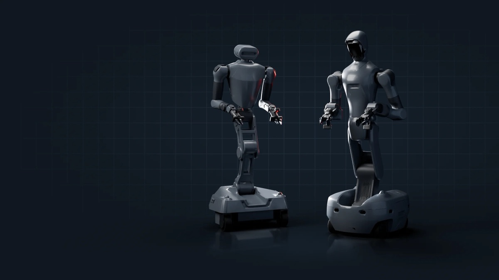
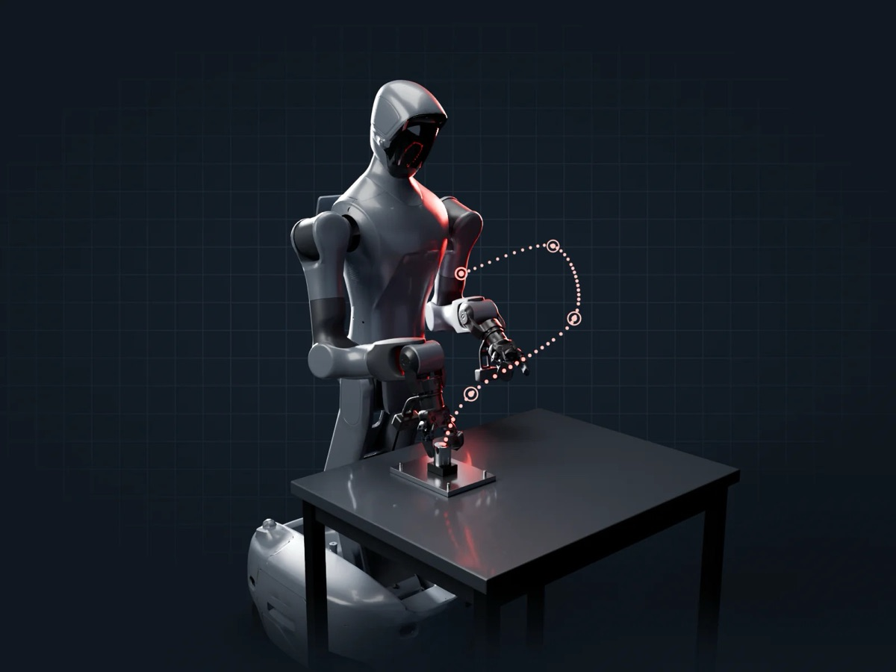
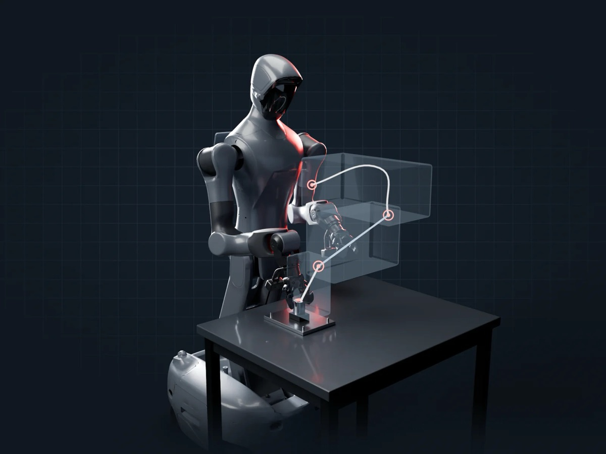
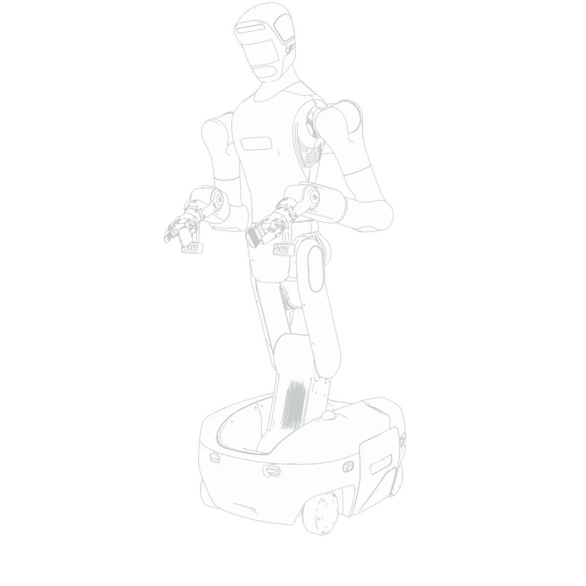
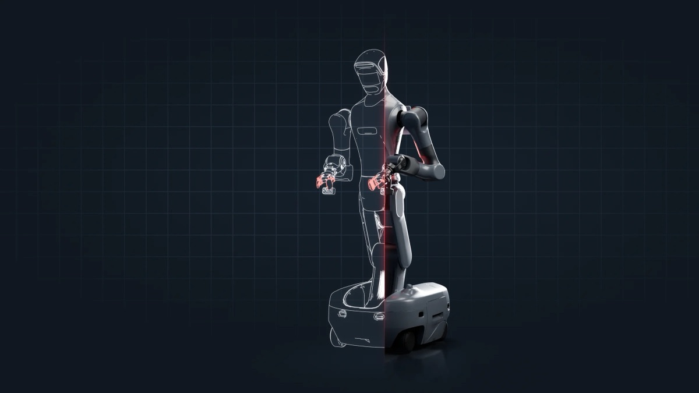
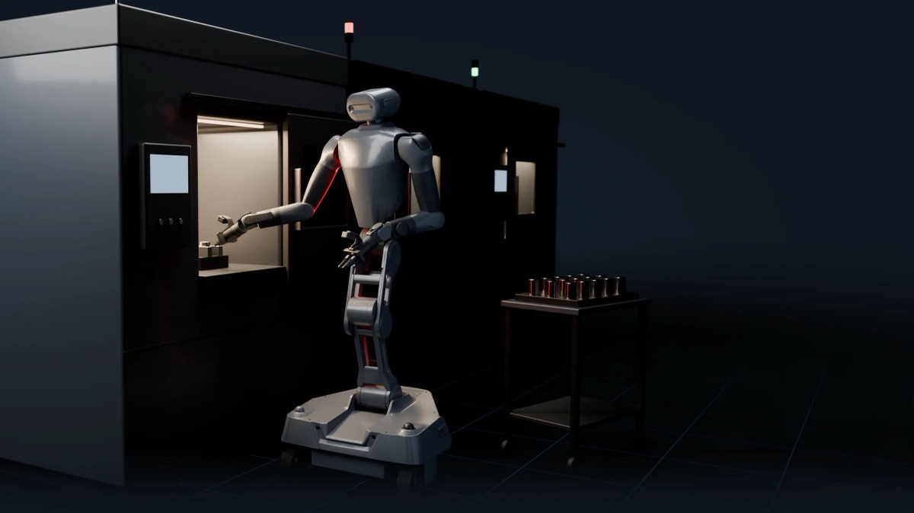

# Binabik AI × T01 — Products and Solutions

⬆ [Binabik AI profile](../Binabik-AI.md) · [Brief](Binabik-AI-T01-1-Brief.md) · [Playbook](Binabik-AI-T01-3-Playbook.md)

**Read this first:** Binabik sells software and a service, not a robot. Payload, reach, speed, runtime and IP rating therefore come from the robot you run it on (Galaxea R1 Pro or AgiBot G2; see those vendors' profiles). Binabik publishes **no** numeric specs, prices, API reference or version numbers. Everything below marked "not public" really is absent from the public record.

## Relevant products (ranked for this track)

### Binabik Studio

**Role in T01:** the workspace you would actually sit in: teach a service task, inspect the generated program, test in simulation, then run on the robot.

| Track-relevant item | Verified detail |
|---|---|
| What it bundles | Simulator, code editor, teaching tools and development kit in one workspace |
| Sim-to-real | Same interface for simulation and the real robot; a validated program is meant to run unchanged |
| Code access | Engineers get the same API Binabik uses internally; start from a generated program or write a new one |
| Navigation / mapping tools | not described |
| Outdoor or public-space features | not described |

- **Status:** 🧪 "Request access" only. **Price:** not public. **Availability at the event:** not confirmed; ask the team.
- **Developer control:** task and skill level (teach, edit program, simulate, run). Languages and low-level access not public.

### Binabik Teach

**Role in T01:** capture one demonstration of a service chore (pick a parcel, load a tray, restock a shelf) instead of scripting it.

| Track-relevant item | Verified detail |
|---|---|
| Input | **One** demonstration, by hand or by teleoperation |
| What is recorded | All movements and camera frames |
| Generalisation claim | Across part variants, positions and tolerances; zero-shot and few-shot (company claim) |
| Teleoperation hardware | not public |
| Time from demo to running skill | not public (the site says first customer applications take months, follow-ups days) |

- **Status:** 🧪 part of Studio. **Price:** not public.
- **Developer control:** you provide the demonstration; what you can tune afterwards is not public.

### Binabik Skill Engine (also "Binabik Brain")

**Role in T01:** turns the demonstration into an ordered plan of reusable skills, which is the part that makes "new chore in minutes" a believable pitch.

| Track-relevant item | Verified detail |
|---|---|
| Function | Splits a demonstration into steps and maps each to a library skill |
| Missing skills | Built and added to the library (by whom and how fast: not public) |
| Supervised operation | Every plan can be checked before the robot moves |
| Language / voice task input | not described |
| Long-horizon mission logic (routes, schedules, fleets) | not described |

- **Status:** 🧪 part of Studio. **Price:** not public.
- **Developer control:** review and approve plans; deeper editing not public.

### Binabik Development Kit (BDK)

**Role in T01:** the hardware abstraction that lets one taught task run on two different vendors' robots, both of which are in the room.

| Track-relevant item | Verified detail |
|---|---|
| Robots named | **AgiBot G2** and **Galaxea R1 Pro** run the same skill set; more planned, none named |
| Skill list | not public (site examples: load, unload, carry parts, stack a pallet) |
| Grippers in the service offer | Centric (round parts), vacuum (boxes, trays), parallel with fingertip camera |
| Mobile-base / navigation API | not described |
| Languages, ROS 2 | not public |

- **Status:** 🧪 request access; shipped to system integrators with each robot they deliver. **Price:** not public.
- **Developer control:** skill-level calls through one interface across robots. Joint-level control presumably stays with the robot vendor's SDK (inference).

### Binabik Sim

**Role in T01:** low. It is a process simulator for production cells; useful only if you want to rehearse a handling task before touching the robot.

| Track-relevant item | Verified detail |
|---|---|
| Models | Machines, fixtures, cycle times |
| Training | Skills trained over thousands of variations of parts, positions, lighting |
| Scope | Stated as not a reinforcement-learning sandbox |
| Assets / engine | NVIDIA SimReady factory assets; engine not named |
| Streets, buildings, crowds | not described |

- **Status:** 🧪 part of Studio. **Price:** not public.

### Binabik Solutions

**Role in T01:** none directly. It is a robot-as-a-service offer for factory machine tending. It matters only as evidence that pick, carry between stations and place are the company's daily work.

| Track-relevant item | Verified detail |
|---|---|
| Tasks | Load a lathe, unload a press or mill, carry parts to the next station, stack a pallet |
| Mobility | One robot moves between several machines in a cell (indoors) |
| Engagement | Workshop (1 day) → proof of concept → prototype → scaling |
| Data | Process and camera data stay at the customer site |

- **Status:** 🧪 pilots; no named customer. **Price:** subscription, amount not public.

**Not relevant for T01:** Binabik Academy (training courses, on request).

## What Binabik AI already does in this domain

**Nothing public in urban services.** No delivery, cleaning, concierge, wayfinding or municipal deployment, pilot or demo was found.

Closest evidence:

| When | What | Relevance to T01 | Source |
|---|---|---|---|
| 2025 | Early software ran on a quadruped that patrolled an area and looked for changes | Shows past work on mobile robots; no longer the product | [Venture Kick](https://www.venturekick.ch/Binabik-AI-receives-CHF-40000-from-Venture-Kick-to-accelerate-humanoid-deployment-across-industries) (via profile) |
| Late 2025 – early 2026 | Humanoid proof of concept with an unnamed industrial partner | Real-conditions handling, indoors, industrial | same |
| 2026-04-14 | Described as an orchestration platform for mobile humanoids that act on their situation and interact with people; targets sorting and loading in logistics and production | Logistics handling is adjacent to delivery | [S-GE](https://www.s-ge.com/invest/en/articles/news/ai-robotics-start-binabik-establishes-presence-winterthur) |
| Nov 2026 (site) | Machine tending on Galaxea R1 Pro, including carrying parts between stations | Pick, transport, place on a wheeled dual-arm robot | [binabik.ai/solutions](https://binabik.ai/solutions) |

## What they are building next in this domain

- **Announced:** more robot platforms beyond G2 and R1 Pro (no names, no dates).
- **Announced (Feb 2026):** Venture Kick funds are meant to explore additional verticals alongside the industrial one. Which verticals: not public.
- **Stated interest only (🔭):** the ERF 2026 profile lists logistics and warehouse automation, smart cities and infrastructure inspection, and mobility among areas of activity. No product, pilot or date is attached.
- **Hiring signals:** robotics, perception (parts, fixtures, pallets), software and infrastructure, robot learning from few demonstrations; open applications mention VLA models and reinforcement learning. None of the roles names navigation or outdoor mobility.
- **Inference:** an urban-services product is unlikely in the near term. The realistic bridge is logistics handling (sorting, loading, internal transport), which overlaps with indoor delivery.

## Software, models and data that help for this track

| Asset | Available? | Note |
|---|---|---|
| Studio / BDK access | 🧪 request only | The on-site team decides |
| Public docs, tutorials, examples | none for Studio / BDK | `docs.binabik.ai` is login-gated |
| Official GitHub org | ✅ [github.com/binabik-ai](https://github.com/binabik-ai) | Side tools only (`mcp-rosbags`, `mcp-lab`, Apache-2.0) plus three forks; no Studio / BDK code. See the [developer guide](../Binabik-AI-Developer-Guide.md) |
| Pretrained models, datasets | one research checkpoint, no datasets | ACT-style policy for a Unitree G1 simulation task on Hugging Face; not a product model |
| Navigation, SLAM, mapping | not described | Use the robot vendor's stack |
| Fallback building blocks | n/a from Binabik | Galaxea and AGIBOT ship their own SDKs and models; see their profiles |

## Gaps and limits for this track

- **No mobility story of its own.** Navigation, elevators, doors, kerbs, snow, slopes: none is covered publicly. The named robots are wheeled indoor platforms.
- **No self-serve path.** Without an engineer and an access grant you cannot start.
- **Time scale mismatch.** The website frames first applications in months; a 48-hour result needs a task close to skills that already exist (pick, carry, place, stack).
- **People-safety in public space** is not described beyond plan review before motion.
- **Unknowns that decide feasibility:** languages, internet dependency, compute needs, whether a team can add its own skill, whether both robots at the event are actually set up for the BDK.
- **Research note:** this page is based on Binabik's own site re-read on 2026-11-14 plus the company profile. A fresh news search could not be run in this pass, so very recent announcements may be missing.

## Sources
- [Binabik AI — home](https://binabik.ai)
- [Binabik AI — Solutions](https://binabik.ai/solutions)
- [Binabik AI — Studio](https://binabik.ai/studio)
- [Binabik AI — Open positions](https://binabik.ai/open-positions)
- [Switzerland Global Enterprise — Binabik establishes presence in Winterthur (14 Apr 2026)](https://www.s-ge.com/invest/en/articles/news/ai-robotics-start-binabik-establishes-presence-winterthur)
- [ERF Matchmaking 2026 — Binabik profile](https://www.b2match.com/e/erf2026/participations/705635)
- [Venture Kick — Binabik AI receives CHF 40,000 (13 Feb 2026)](https://www.venturekick.ch/Binabik-AI-receives-CHF-40000-from-Venture-Kick-to-accelerate-humanoid-deployment-across-industries) (re-verified 2026-11-14)
- [GitHub — binabik-ai organisation](https://github.com/binabik-ai)
- [Binabik AI company profile](../Binabik-AI.md)
