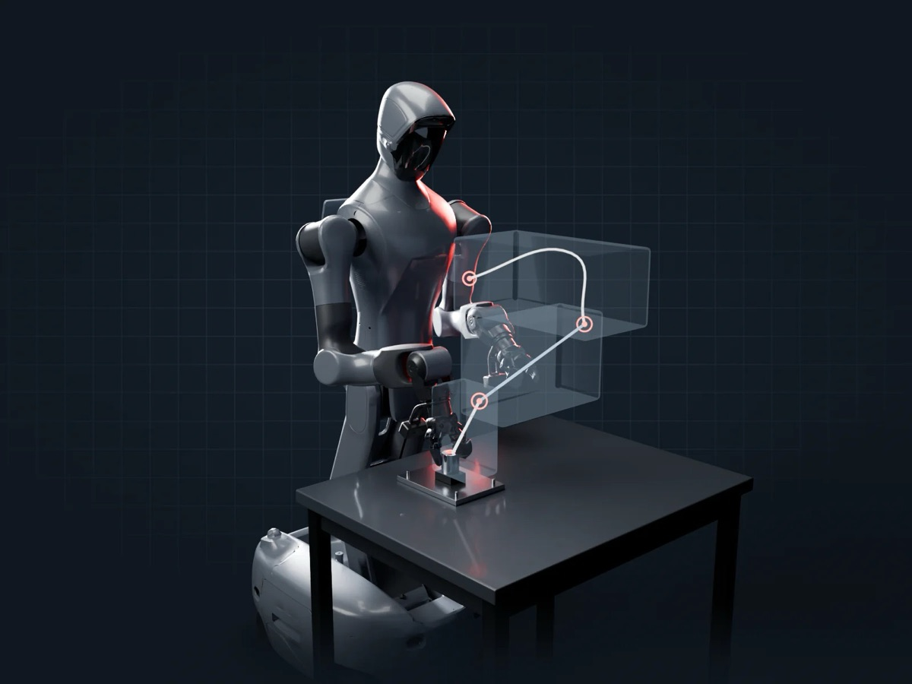
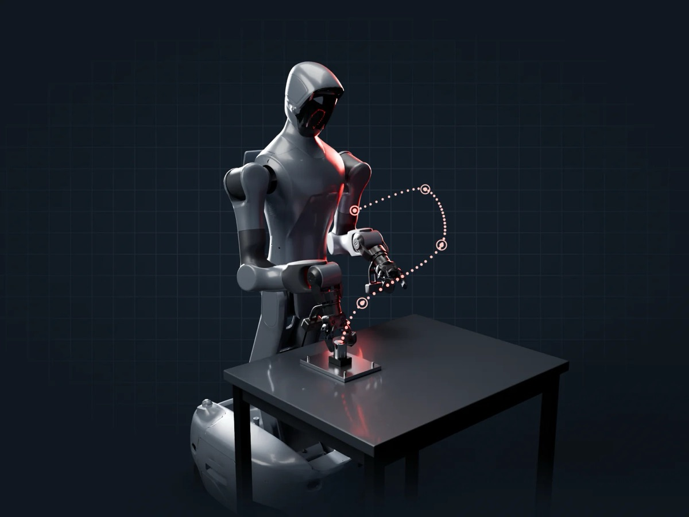
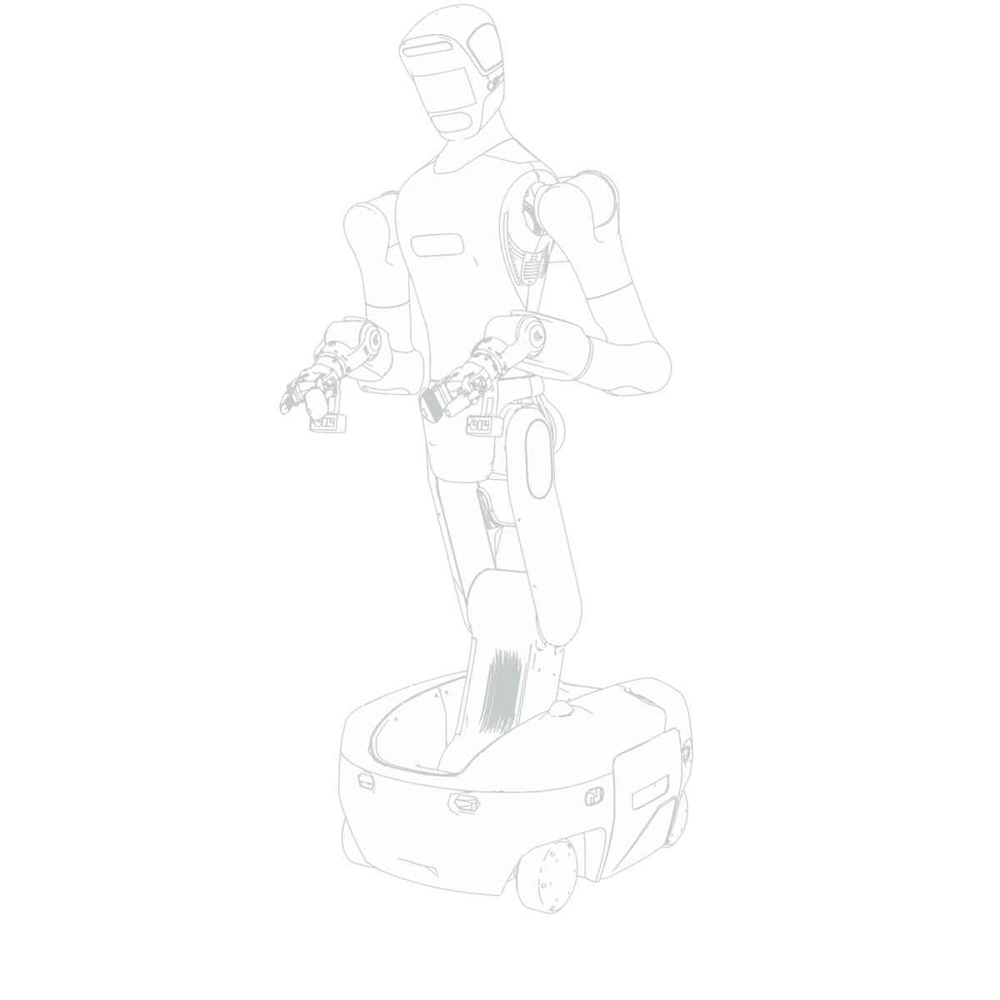
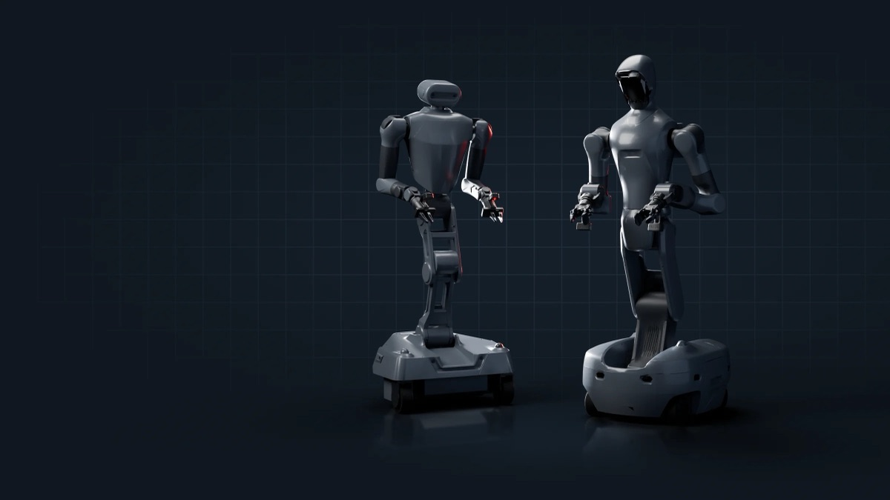
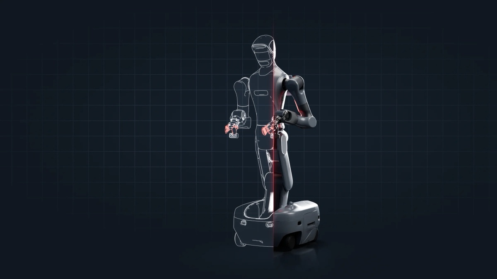
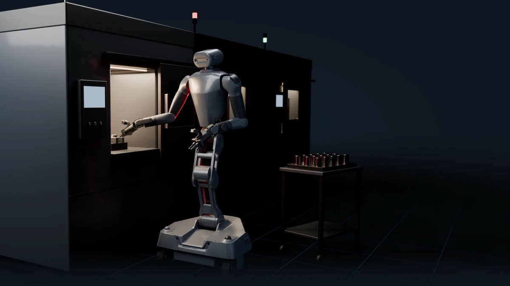

# Binabik AI × T02 — Products and Solutions

⬆ [Binabik AI profile](../Binabik-AI.md) · [Brief](Binabik-AI-T02-1-Brief.md) · [Playbook](Binabik-AI-T02-3-Playbook.md)

**Read this first:** Binabik AI is a software and service company with **no robot of its own** and **no product aimed at safety, inspection or emergency response**. Everything below is industrial machine-tending tooling viewed through a T02 lens. Hardware figures (payload, reach, runtime, IP rating, sensors) belong to the robot vendor, not to Binabik; none are published by Binabik. No prices, versions or API details are public.

## Relevant products (ranked for this track)

### Binabik Skill Engine

**Role in T02:** turns one demonstrated emergency procedure (for example "close valve, then flip breaker") into a sequence of reusable skills that the robot can replay when an alarm fires. This is the core of any Binabik-based T02 demo.

| Item | Verified detail |
|---|---|
| Function | Splits a demonstration into steps and maps each step to a skill in the library; missing skills are built and added |
| Learning input | One demonstration ("show the task once"); generalises over part variants, positions and tolerances (company claim) |
| Efficiency claim | "Up to 85%" better learning efficiency (⚠️ unverified company claim) |
| Planning for navigation, hazards or multi-robot dispatch | Not public |
| Compute requirements | Not public |

- **Status / price / availability:** 🧪 part of Studio, request access only. Price not public.
- **Developer control:** high-level task and skill sequence. Whether a team can add its own custom skill in code, or trigger a task from an external event (alarm, sensor), is not public. Ask on site.

### Binabik Teach

**Role in T02:** lets a domain expert (plant technician, firefighter) show the response once instead of programming it. Also the hook for a "teach from a safe distance" story if teleoperated capture works on site.

| Item | Verified detail |
|---|---|
| Function | Records every movement and camera frame of the operator's demonstration |
| Capture mode | By hand or teleoperation (per company profile); teleop hardware not named |
| Remote / long-distance teaching | Not public |
| Sensors recorded beyond cameras and motion | Not public |

- **Status / price / availability:** 🧪 part of Studio, request access only. Price not public.
- **Developer control:** start and stop a recording, feed it to the Skill Engine. Data format and export are not public.

### Binabik Development Kit (BDK)

**Role in T02:** the hardware abstraction that would let the same emergency skill run on whichever supported robot is free. In a resilience pitch this is the "swap the robot, keep the skill" argument.

| Item | Verified detail |
|---|---|
| Function | Gives every supported robot the same set of skills |
| Named robots | **AgiBot G2**, **Galaxea R1 Pro**; "more platforms as the market moves" (none named) |
| Quadrupeds, arms-only or other humanoids | Not public |
| Languages, ROS 2 support, low-level joint access | Not public |
| API parity | Company says customer engineers get the same API its own team uses |

- **Status / price / availability:** 🧪 request access, aimed at system integrators. Price not public.
- **Developer control:** skill-level calls on the robot. Assume joint-level and safety functions stay with the robot vendor's SDK.

### Binabik Studio

**Role in T02:** the workspace where teaching, simulation, code and on-robot testing happen. For a team this is the actual tool they would sit in front of.

| Item | Verified detail |
|---|---|
| Contents | Simulator, code editor and teaching tools in one workspace |
| Time to first result | "First demonstration to a running robot in days" (company statement; hours-scale use at a hackathon is ⚠️ unverified) |
| Sim-to-real | Simulation and robot share one interface, so a validated program runs on the robot unchanged |
| Offline / no-internet operation | Not public |

- **Status / price / availability:** 🧪 request access; can be used with the Binabik team or independently. Price not public.
- **Developer control:** code editor plus the company API. No public documentation.

### Binabik Sim

**Role in T02:** check a taught emergency procedure in simulation before the real robot touches a valve or switch. Useful as a safety argument, limited as a 48-hour tool.

| Item | Verified detail |
|---|---|
| Purpose | Process simulator for machines, fixtures and cycle times; explicitly not a reinforcement-learning sandbox |
| Training use | Each skill is improved across thousands of variations of parts, positions and lighting |
| Assets | NVIDIA SimReady factory assets credited; engine not named |
| City, terrain, weather or disaster scenes | Not public; nothing suggests they exist |

- **Status / price / availability:** 🧪 part of Studio. Price not public.
- **Developer control:** not public. Building a custom plant-room scene in 48 hours is unlikely without Binabik staff doing it.

### Binabik Solutions

**Role in T02:** not usable as a hackathon product (it is a subscription service for factories), but it is the template for the pitch: a robot that operates existing machines through their normal interfaces. Replace "lathe" with "pump room panel".

| Item | Verified detail |
|---|---|
| Offer | Robot-as-a-service machine tending: robot, grippers, skills and operation |
| Machine integration | Connects the robot to machine states and interfaces so it can load, unload and run the machine |
| Shown on | Galaxea R1 Pro |
| Customers | None named; one unnamed industrial proof of concept |

- **Status / price / availability:** 🧪 pilots / proof of concept. Subscription, amount not public.

*Binabik Academy (training courses) has no role in a 48-hour T02 build.*

## What Binabik AI already does in this domain

**Short answer: nothing shipping, one historical hint.**

| Date | What | Relevance to T02 | Source |
|---|---|---|---|
| 2025 (before incorporation) | Software ran on a quadruped that could be asked to patrol an area or look for changes | The only direct link to security patrol / change detection. Prototype only; the company has since narrowed to humanoids. No code, video or spec is public | [Venture Kick](https://www.venturekick.ch/Binabik-AI-receives-CHF-40000-from-Venture-Kick-to-accelerate-humanoid-deployment-across-industries) |
| By Feb 2026 | Humanoid that can interact with people, pick and carry objects and safely navigate shared environments | Shows navigation among people exists in some form; detail not public | [Venture Kick](https://www.venturekick.ch/Binabik-AI-receives-CHF-40000-from-Venture-Kick-to-accelerate-humanoid-deployment-across-industries) |
| 2026 | ERF 2026 matchmaking profile lists "smart cities and infrastructure inspection", "defense & security robotics" and "energy and utilities automation" among activity areas | A list of interests with no description behind it | [b2match](https://www.b2match.com/e/erf2026/participations/705635) |

- Deployments, pilots, customers or partners in emergency response, hazard monitoring, infrastructure inspection or public safety: **none public**.
- Search-and-rescue: not mentioned anywhere.

## What they are building next in this domain

- **Announced:** more robot platforms beyond AgiBot G2 and Galaxea R1 Pro (none named, no dates).
- **Announced (Feb 2026):** Venture Kick Stage II funds are meant to explore new verticals beyond the single industrial one. Which verticals is not stated.
- **Inference, not announced:** given the ERF activity list and the quadruped patrol prototype, infrastructure inspection or utilities operation is a plausible later vertical (🔭). There is no roadmap item, date or product for it.
- **Inference:** a strong T02 hackathon result on their stack would be useful evidence for them, which may make the team generous with support. Ask.

## Software, models and data that help for this track

| Asset | Available? | Note |
|---|---|---|
| Public SDK or docs | No | Studio / BDK by request only |
| Open-source repos | ✅ side tools only | [github.com/binabik-ai](https://github.com/binabik-ai): `mcp-rosbags` (LLM-queryable ROS bag analysis, Apache-2.0), `mcp-lab`, three forks. No Studio / BDK or patrol code |
| Pretrained models | One research checkpoint | ACT-style policy for a Unitree G1 simulation task on Hugging Face; not a product model. Positioning is small-data, few-shot teaching |
| Datasets | None released | |
| Patrol / change-detection code from the 2025 prototype | Not public | Worth asking whether it still runs |
| Sim scenes | Factory assets only | NVIDIA SimReady credited |

Practical consequence: apart from `mcp-rosbags` (offline analysis of recorded robot logs, usable for an "explain the incident" feature on any ROS robot), nothing from Binabik shortcuts a T02 build unless their engineers provide access in person. Perception, mapping and alarm logic must come from the team or from other vendors' open tooling.

## Gaps and limits for this track

- **No hardware.** Terrain capability, IP rating, payload, reach and runtime are whatever the host robot offers. Both named robots are wheeled indoor machines, which rules out snow, stairs and rubble.
- **No T02 function out of the box:** no inspection, anomaly detection, mapping, thermal or gas sensing, alerting or fleet dispatch.
- **Access risk:** not self-serve; an 8-person company can support only a few teams.
- **Robot coverage:** only two named platforms. Running on a quadruped today is not public, despite the 2025 prototype.
- **Time scale:** the company quotes "days" from demonstration to running robot. A 48-hour event leaves little margin.
- **Unknowns that decide feasibility:** languages, ROS 2, offline operation, external event triggers, custom skills, compute needs. All not public.
- **Research limit for this doc:** web search was unavailable during this track-specific pass, so findings rest on the company profile plus direct reads of the official pages listed below. A recent T02-relevant announcement could have been missed (⚠️ unverified).

## Sources
- [Binabik AI — home](https://binabik.ai)
- [Binabik AI — Studio](https://binabik.ai/studio)
- [Binabik AI — Solutions](https://binabik.ai/solutions) (via the company profile)
- [Venture Kick — Binabik AI receives CHF 40,000 (13 Feb 2026)](https://www.venturekick.ch/Binabik-AI-receives-CHF-40000-from-Venture-Kick-to-accelerate-humanoid-deployment-across-industries)
- [ERF Matchmaking 2026 — Binabik profile](https://www.b2match.com/e/erf2026/participations/705635)
- [GitHub — binabik-ai organisation](https://github.com/binabik-ai)
- [Binabik AI company profile (internal)](../Binabik-AI.md)
