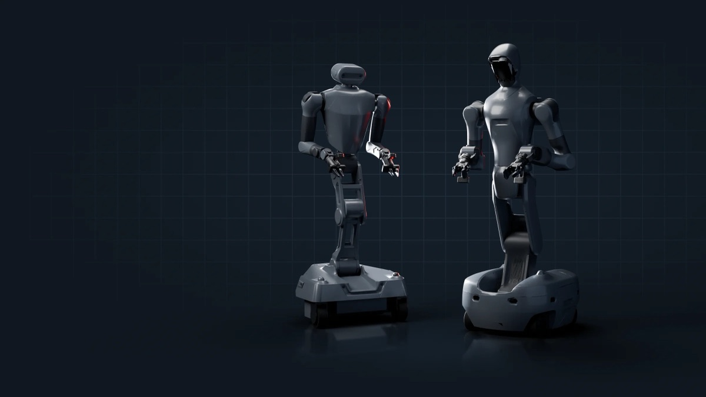
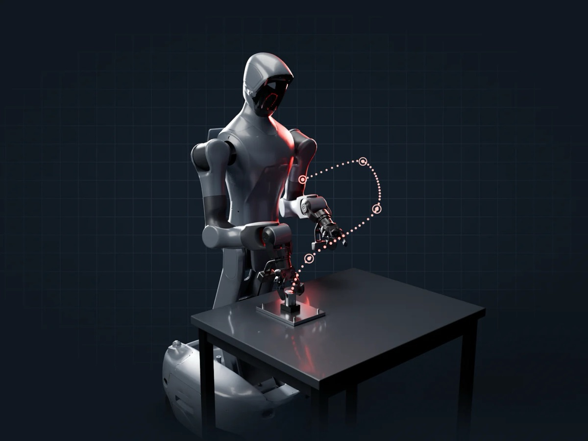
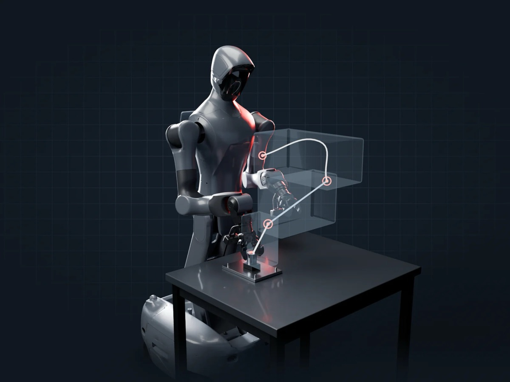
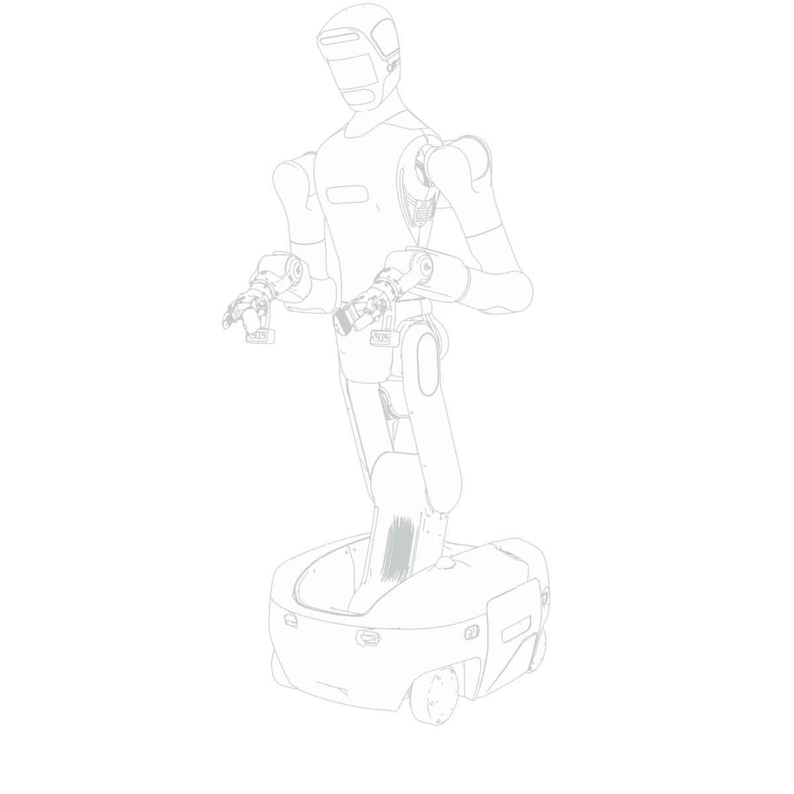
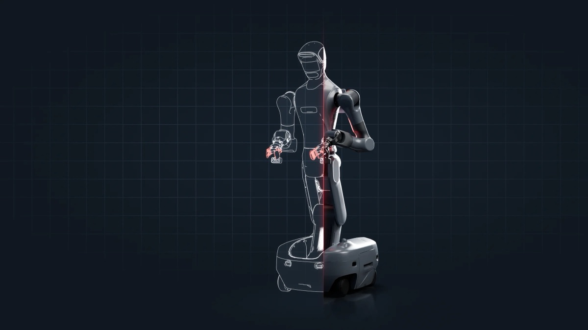
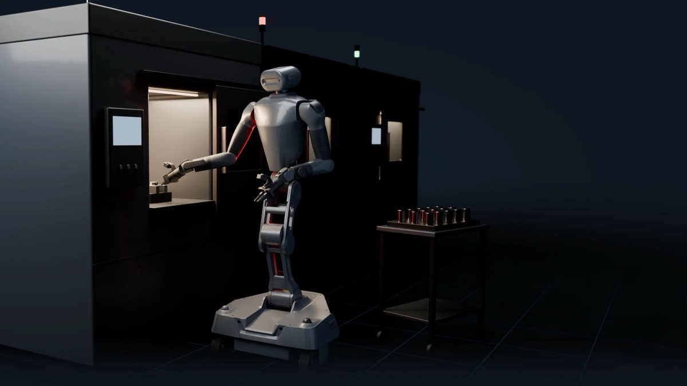

# Binabik AI × T03 — Products and Solutions

⬆ [Binabik AI profile](../Binabik-AI.md) · [Brief](Binabik-AI-T03-1-Brief.md) · [Playbook](Binabik-AI-T03-3-Playbook.md)

> **Read this first:** Binabik is software and service only. It publishes **no specs, prices or docs, and no code for Studio / BDK**, and nothing aimed at sustainability. Everything below is what its machine-tending stack could contribute to a T03 build, assuming the on-site team gives you access. Payload, reach, runtime and sensors are properties of the host robot (Galaxea R1 Pro or AgiBot G2): see those vendors' profiles.
>
> Research note: the track-specific web search could not be run (search quota exhausted). Findings rest on Binabik's own pages re-read on 2026-11-14, the ERF listing and the company profile. A sustainability pilot announced elsewhere would have been missed.

## Relevant products (ranked for this track)

### Binabik Studio

**Role in T03:** the single workspace you would actually sit in: simulator, code editor and teaching tools. It is the only route to every module below.

| Item | Verified detail |
|---|---|
| What it combines | Simulator + code editor + teaching tools + development kit |
| Sim-to-real | Same interface for simulation and robot; a validated program runs unchanged |
| Robots shown | **AgiBot G2**, **Galaxea R1 Pro** |
| Languages, OS, compute needs | not public |
| ROS 2 | not public (⚠️ unverified either way) |

- **Status / price / availability:** 🧪 "Request access" via contact form. Price not public. Hackathon access: ask on site.
- **You control:** adapt an existing program or write a new one with "the same API" Binabik uses internally. Exact API surface is not public.

### Binabik Teach

**Role in T03:** record one demonstration of a sorting, return-handling or stacking task instead of collecting a dataset.

| Item | Verified detail |
|---|---|
| Input | **One** demonstration, by hand or by teleoperation |
| Recorded | Robot movements and camera frames |
| Teleoperation hardware | not public |
| Demonstrations needed for a robust skill | not public; "up to 85%" learning-efficiency gain is a company claim (⚠️ unverified) |

- **Status:** 🧪 part of Studio. Price not public.
- **You control:** what is demonstrated and on which objects. Export format of the recording is not public.

### Binabik Skill Engine (Binabik Brain)

**Role in T03:** turns the demonstration into a step sequence (pick, carry, place, stack) and maps each step to a library skill. This is the part that could make a "new waste stream in ten minutes" claim credible.

| Item | Verified detail |
|---|---|
| Function | Segments a demonstration into steps; maps each step to a skill; missing skills are built and added |
| Pre-check | Plans can be checked before the robot moves |
| Object classification (material type) | not described; assume you bring your own classifier |
| Latency, model type, compute | not public |

- **Status:** 🧪 part of Studio. Price not public.
- **You control:** not public whether teams can edit the plan or add their own skill. Ask.

### Binabik Development Kit (BDK)

**Role in T03:** skill library with one interface across robots, so a sorting routine is not tied to one vendor.

| Item | Verified detail |
|---|---|
| Publicly shown task types | Take from conveyor, load, unload, transport part, palletize / stack |
| Named robots | **AgiBot G2**, **Galaxea R1 Pro**; more planned, none named |
| Grippers Binabik fits in its service | Centric (round parts), vacuum (boxes, trays), parallel with fingertip camera |
| Low-level joint control | not described; assume it stays with the robot vendor's SDK |

- **Status:** 🧪 request access; system integrators receive it with each robot delivered. Price not public.
- **You control:** skill-level calls. Signatures and languages are not public.

### Binabik Sim

**Role in T03:** rehearse the cell before the robot moves and vary items, positions and lighting. Useful for a "fewer failed trials, less scrap" argument, but only if Binabik builds or lends a scene.

| Item | Verified detail |
|---|---|
| Models | Machines, fixtures, cycle times |
| Training | Skills run over thousands of variations of parts, positions, lighting |
| Engine | not named; credits NVIDIA SimReady factory assets |
| Energy or emissions modelling | not mentioned |

- **Status:** 🧪 part of Studio. Price not public.
- **Reality check:** building a new scene for waste items inside 48 hours is unlikely without their help.

### Binabik Solutions

**Role in T03:** not a hackathon tool. It is the business model behind any pitch: "one robot, many machines" as a subscription (robot, grippers, skills, operation). Relevant as the deployment path if your concept is a robot that tends recycling or reuse machines.

- **Status:** 🧪 pilots / proof of concept, no named customer. Subscription price not public.
- **Engagement:** 1-day workshop → proof of concept in Binabik's lab → prototype on the customer site → scaling.

### Binabik Academy

**Role in T03:** none during the event. Training courses on site or in Winterthur, on request; price not public.

## What Binabik AI already does in this domain

**Nothing public.** No deployment, pilot, demo, partner or application page for waste, recycling, energy, environment, farming or circular economy.

Closest adjacent facts:

| Date | Fact | Relevance to T03 |
|---|---|---|
| 2025 | Earlier software ran on a quadruped that patrolled an area and detected changes ([Venture Kick](https://www.venturekick.ch/Binabik-AI-receives-CHF-40000-from-Venture-Kick-to-accelerate-humanoid-deployment-across-industries)) | Change detection is the nearest thing to monitoring. Not part of today's offering |
| Late 2025 – early 2026 | Humanoid proof of concept with an unnamed industrial partner ([Venture Kick](https://www.venturekick.ch/Binabik-AI-receives-CHF-40000-from-Venture-Kick-to-accelerate-humanoid-deployment-across-industries)) | Shows the stack ran on a real robot in an industrial setting |
| 2026 | ERF matchmaking profile lists "Energy & utilities automation", "Agri-tech robotics" and "Smart cities & infrastructure inspection" among areas of activity ([b2match](https://www.b2match.com/e/erf2026/participations/705635)) | 🔭 stated interest only; recycling and environment are not listed |
| Nov 2026 | Site shows machine tending only: load, unload, transport, palletize on Galaxea R1 Pro and AgiBot G2 ([Solutions](https://binabik.ai/solutions)) | Handling skills transfer to sorting and reuse loops |

## What they are building next in this domain

- **Announced:** more supported robots (none named), joint offers with machine builders, channel through system integrators using the BDK.
- **Announced (Feb 2026):** Venture Kick money is meant to explore further verticals beside the industrial one. Which verticals: not public.
- **Inference:** a robot that tends machines could tend sorting, washing or reverse-vending machines with the same skills. Binabik has not said it will pursue this.
- **Inference:** the "one robot, many machines" pitch is a resource-efficiency argument (one shared robot instead of fixed automation per machine). Binabik does not make this claim itself and publishes no energy or emissions numbers.

## Software, models and data that help for this track

| Asset | Available? |
|---|---|
| Open-source repos or examples | Side tools only: [github.com/binabik-ai](https://github.com/binabik-ai) has `mcp-rosbags`, `mcp-lab` and three forks; no Studio / BDK code |
| Pretrained models (grasping, VLA, waste classification) | None usable here; one research checkpoint (Unitree G1 simulation pick-and-place) is on Hugging Face |
| Datasets | None released |
| Simulation assets | NVIDIA SimReady factory assets are credited (factory content, not waste items) |
| Documentation | None public; the on-site engineers are the documentation |

**Shortcut that exists:** only the teach-once workflow itself, if you get access. Bring your own perception (for example a small material classifier on a D-Robotics RDK board) and your own impact numbers.

## Gaps and limits for this track

- **No domain product:** nothing for monitoring, energy, buildings, EV charging, water or green space.
- **No robot:** every physical limit is the host robot's. Indoor wheeled dual-arm platforms only; no outdoor, wet or snow use case.
- **No self-serve access:** without a Binabik engineer next to you, practical fit drops to about **1/5**.
- **Unknowns that decide feasibility:** language, ROS 2 bridge, internet dependency, time from demonstration to running skill, whether teams can add skills, whether it handles deformable or dirty items (bags, crushed cans, film).
- **Evidence:** no demo video (site says coming soon), no named customer, no measured success rates.
- **Capacity:** about 8 people in the whole company; expect support for a handful of teams at most.

## Sources
- [Binabik AI — home](https://binabik.ai)
- [Binabik AI — Solutions](https://binabik.ai/solutions)
- [Binabik AI — Studio](https://binabik.ai/studio)
- [ERF Matchmaking 2026 — Binabik profile](https://www.b2match.com/e/erf2026/participations/705635)
- [Venture Kick — Binabik AI receives CHF 40,000 (13 Feb 2026)](https://www.venturekick.ch/Binabik-AI-receives-CHF-40000-from-Venture-Kick-to-accelerate-humanoid-deployment-across-industries) (re-verified 2026-11-14)
- [GitHub — binabik-ai organisation](https://github.com/binabik-ai)
- [Binabik AI company profile (this repo)](../Binabik-AI.md)
