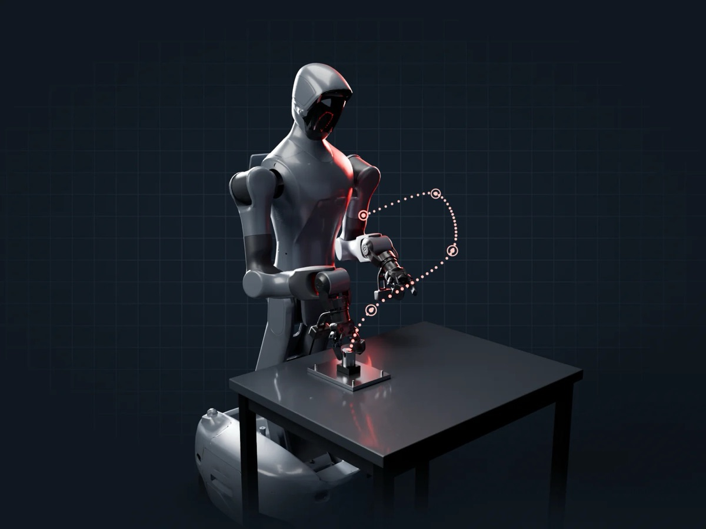
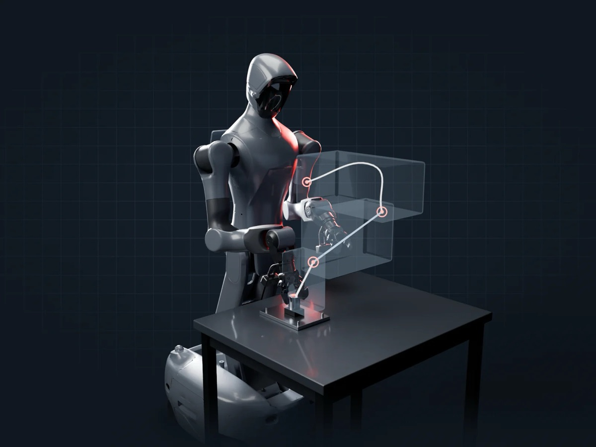
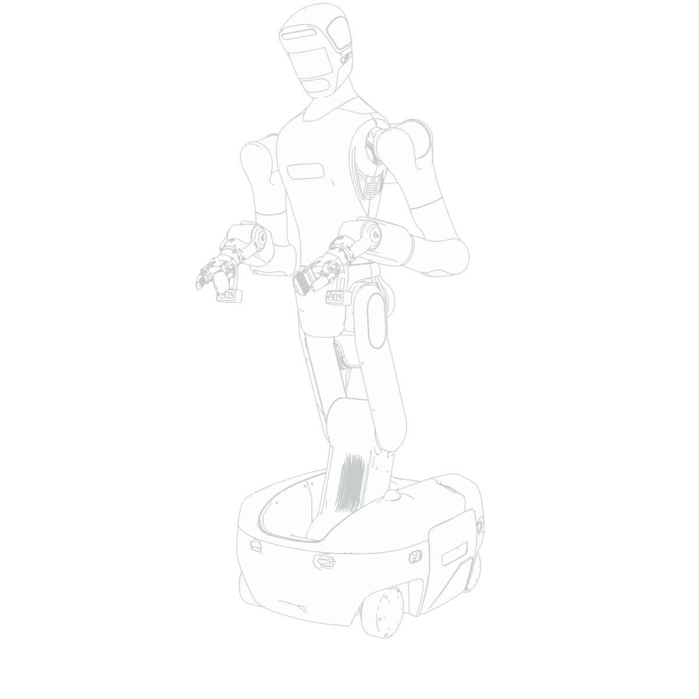
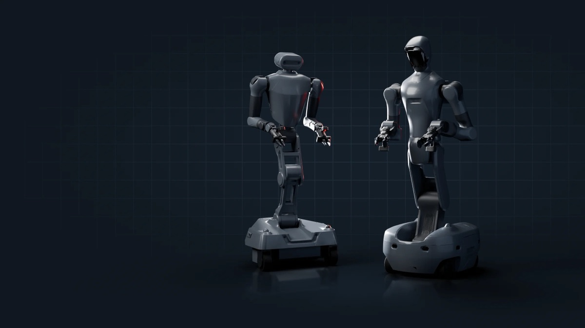
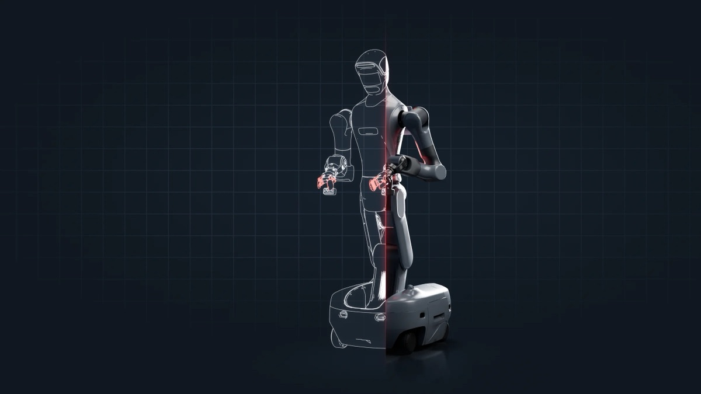

# Binabik AI × T04 — Products and Solutions

⬆ [Binabik AI profile](../Binabik-AI.md) · [Brief](Binabik-AI-T04-1-Brief.md) · [Playbook](Binabik-AI-T04-3-Playbook.md)

**Read this first:** Binabik AI sells software and a service, not a robot. Nothing below has a payload, reach, runtime or IP rating of its own; those come from the host robot (AgiBot G2 or Galaxea R1 Pro, see those vendors' profiles). Binabik publishes **no specs, versions, prices or docs, and no code for Studio / BDK**. Every product is 🧪 "request access". Nothing is built for care; the mapping to T04 below is our interpretation.

## Relevant products (ranked for this track)

### Binabik Teach

**Role in T04:** lets a carer, nurse or physiotherapist show a routine once instead of programming it. This is the main reason to consider Binabik for this track.

| Track-relevant item | Verified value |
|---|---|
| Input | One demonstration on the real equipment, **by hand or by remote control** |
| What is recorded | Robot movements and camera frames of the demonstration |
| Teleoperation device | not public |
| Demonstrations needed | Company says one ("few-shot", "show the task once"); real numbers per skill not public |
| Works with people in the scene | not public |

- **Status / price / availability:** 🧪 part of Studio, request access · price not public.
- **What you control:** starting and recording a demonstration. File formats and export are not public.
- **Naming note:** the name "Binabik Teach" is used on the company home page; the Studio page describes the same function as "teaching tools".

### Binabik Skill Engine (also called Binabik Brain)

**Role in T04:** turns the carer's demonstration into a sequence of reusable skills (pick, carry, place, open and so on), so "bring the pill box" and "bring the water bottle" share the same building blocks.

| Track-relevant item | Verified value |
|---|---|
| Function | Splits a demonstration into steps and matches each step to a skill in the library; missing skills are built and added |
| Human check | **Supervised operation: every plan can be checked before the robot moves** |
| Re-tasking | New jobs can be added without a new project (stated for factory order changes) |
| Natural-language or voice tasking | not public |
| Reaction to a person stepping into the path | not public |

- **Status / price / availability:** 🧪 part of Studio / Solutions · price not public.
- **What you control:** high-level task plans and their approval. Low-level joint or force control is not described; assume it stays with the robot vendor's SDK.

### Binabik Development Kit (BDK)

**Role in T04:** the layer that would let the same care skill run on either host robot at the event.

| Track-relevant item | Verified value |
|---|---|
| Named robots | **AgiBot G2**, **Galaxea R1 Pro**; more planned, none named |
| Interface | "The same API we use" (Studio page); delivered to system integrators with each robot |
| Languages, ROS 2, transport | not public |
| Skills in the library | Named examples are industrial: load, unload, transport, palletize. No care skills listed |
| Grippers | Existing designs: centric (round parts), vacuum (boxes, trays), parallel with fingertip camera. All designed for factory parts |

- **Status / price / availability:** 🧪 request access · price not public.
- **What you control:** skill calls through one interface across robots. Whether a hackathon team can add its own skill is not public.

### Binabik Studio

**Role in T04:** the workspace that bundles the three items above with the simulator and a code editor. If Binabik gives you anything, it will most likely be a Studio seat.

| Track-relevant item | Verified value |
|---|---|
| Contents | Simulator, code editor, teaching tools; simulation, code generation and on-robot testing in one place |
| Sim-to-real | Same interface for simulation and the real robot, so the program is not rewritten |
| Install requirements, offline use | not public |
| Data handling | Processes and camera data stay on the customer's site (stated for factories) |

- **Status / price / availability:** 🧪 request access · price not public.

### Binabik Sim

**Role in T04:** minor. Useful only if a patient room or therapy station can be modelled in time to test variations (object positions, lighting) before running near people.

| Track-relevant item | Verified value |
|---|---|
| Purpose | Process simulator: models machines, fixtures, cycle times; runs a process thousands of times with varied parts, positions, lighting |
| What it is not | Explicitly not a reinforcement-learning sandbox |
| Assets | Factory assets from NVIDIA SimReady; **no home, clinic or human models mentioned** |
| Engine, scene import formats | not public |

- **Status / price / availability:** 🧪 part of Studio · price not public.

### Low relevance for T04

| Product | Why it matters little here | Status |
|---|---|---|
| Binabik Solutions (robot-as-a-service machine tending) | A managed factory service with an engagement that takes months; not something a team can use in 48 hours. Its pattern "one robot tends several stations" is a useful analogy for tending therapy stations | 🧪 pilots, no named customer |
| Binabik Academy (training courses) | Courses on site or in Winterthur; no hackathon role beyond the engineers' informal coaching | 🧪 on request |

## What Binabik AI already does in this domain

**Nothing in elderly care or rehabilitation is public.** No deployment, pilot, demo, clinic partner or application page. The nearest evidence:

| Date | What | Relevance to T04 | Source |
|---|---|---|---|
| 2025 | Software ran on a quadruped that could patrol an area and look for changes | Weak link to night rounds / "something changed in the room" | [Venture Kick](https://www.venturekick.ch/Binabik-AI-receives-CHF-40000-from-Venture-Kick-to-accelerate-humanoid-deployment-across-industries) |
| By 13 Feb 2026 | Humanoid that can interact with people, pick and carry objects and safely navigate shared environments; proof of concept with an unnamed **industrial** partner | The capability set a care fetch-and-carry demo needs, shown in a factory context only | [Venture Kick](https://www.venturekick.ch/Binabik-AI-receives-CHF-40000-from-Venture-Kick-to-accelerate-humanoid-deployment-across-industries) |
| 2026 | ERF 2026 matchmaking profile lists "healthcare robotics" among about ten application sectors | Stated interest 🔭, not a product | [b2match](https://www.b2match.com/e/erf2026/participations/705635) |
| Nov 2026 | Website covers machine tending only; demo video "coming soon" | Confirms the industrial focus | [binabik.ai/solutions](https://binabik.ai/solutions) |

## What they are building next in this domain

- **Announced:** Stage II funding (Feb 2026) is meant to "explore new verticals" beyond the single industrial one. Which verticals is not public.
- **Announced:** more host robots beyond AgiBot G2 and Galaxea R1 Pro. No names or dates.
- **Inference:** care is a plausible later vertical because the same pick, carry and shared-space navigation skills apply and the ERF profile names healthcare. There is no roadmap item, hire or partner that confirms it. A strong hackathon result in T04 could be of real interest to them as a vertical test; ask.
- **Inference:** the April 2026 public messaging (logistics and production, labour shortage) and the current website point away from care in the near term.

## Software, models and data that help for this track

| Asset | Available? | Note |
|---|---|---|
| Public SDK or API docs | No | Studio and BDK are request-only |
| Official GitHub org, sample code | ✅ [github.com/binabik-ai](https://github.com/binabik-ai) | Side tools (`mcp-rosbags`, `mcp-lab`) and forks only; no Studio / BDK sample code |
| Pretrained models, datasets | One research checkpoint, no datasets | Unitree G1 simulation task on Hugging Face; not a care or product model. Positioning is small-data, one-demonstration teaching |
| Care or home simulation scenes | None mentioned | Only factory assets credited |
| Speech, dialogue, person or fall detection | Not offered publicly | Bring your own (host robot features, an edge board, open-source models) |
| On-site engineers | Most valuable asset | Their help is the documentation |

**Shortcut for a 48-hour build:** none that is self-serve. The realistic shortcut is a Binabik engineer setting up Studio on a host robot for your team and you teaching skills by demonstration instead of writing manipulation code.

## Gaps and limits for this track

- **Access gate:** no downloads, docs or public pricing. Without direct support the practical fit is about 1/5.
- **No own hardware:** you also need a slot on an AgiBot G2 or Galaxea R1 Pro, and those vendors' agreement to run third-party software on it.
- **No care evidence:** no clinical partner, no safety certification claims, no statements about working next to frail or unsteady people. "Safely navigate shared environments" is an interview statement, not a tested specification.
- **No physical-assist capability claimed:** no force-control, compliance or contact-task claims from Binabik itself. Do not plan transfers, massage or gait support on this stack.
- **Factory-shaped library:** skills, grippers and simulation assets are built for parts and machines. Soft, deformable or small care items (blister packs, cups with liquid, clothing) are untested as far as public information goes.
- **Unknown timing:** time from one demonstration to a reliable skill is not public. The "up to 85%" efficiency figure on the ERF 2026 listing is a company claim ⚠️ unverified.
- **Research limit for this doc:** the shared web-search quota ran out during this pass, so findings rest on the company's own pages, the Venture Kick interview, the S-GE article and the ERF listing. A care-specific announcement after April 2026 could have been missed.

## Sources
- [Binabik AI — home](https://binabik.ai)
- [Binabik AI — Solutions](https://binabik.ai/solutions)
- [Binabik AI — Studio](https://binabik.ai/studio)
- [Venture Kick — Binabik AI receives CHF 40,000 (13 Feb 2026)](https://www.venturekick.ch/Binabik-AI-receives-CHF-40000-from-Venture-Kick-to-accelerate-humanoid-deployment-across-industries)
- [Switzerland Global Enterprise — Binabik establishes presence in Winterthur (14 Apr 2026)](https://www.s-ge.com/invest/en/articles/news/ai-robotics-start-binabik-establishes-presence-winterthur)
- [ERF Matchmaking 2026 — Binabik profile](https://www.b2match.com/e/erf2026/participations/705635)
- [GitHub — binabik-ai organisation](https://github.com/binabik-ai)
