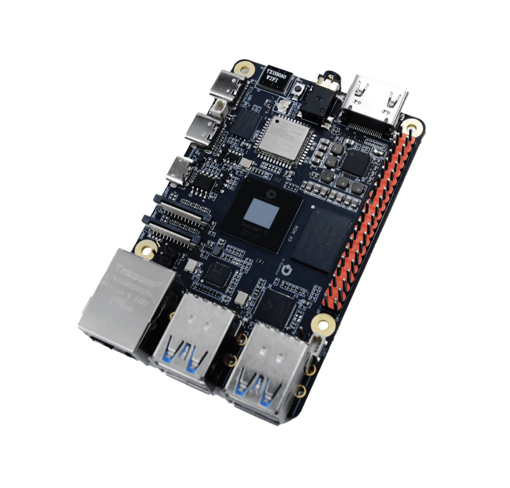
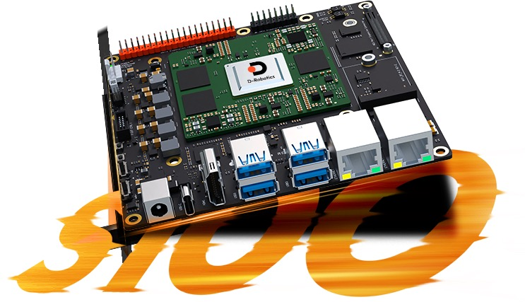
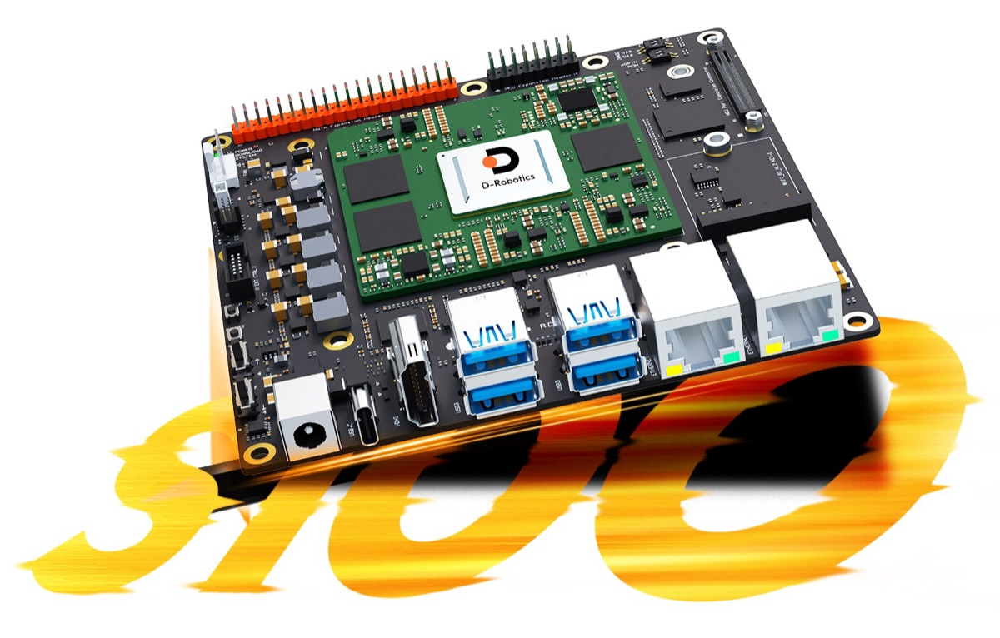
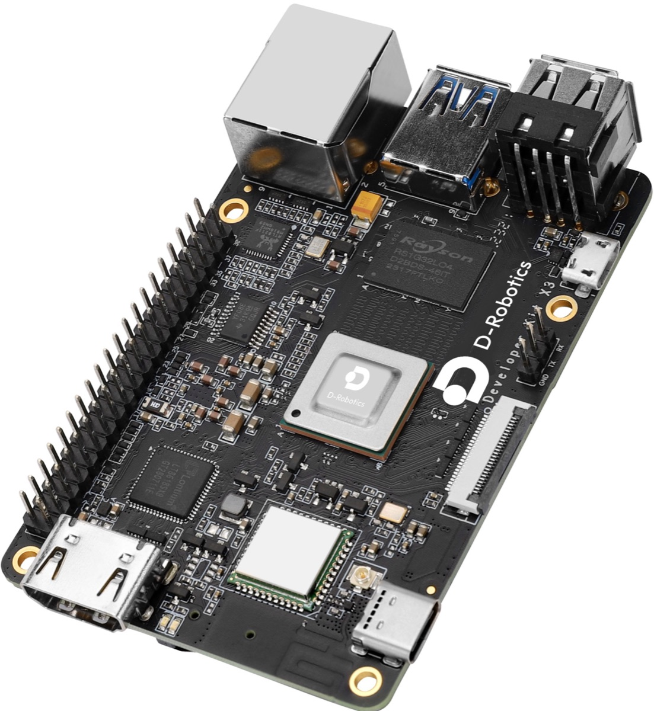
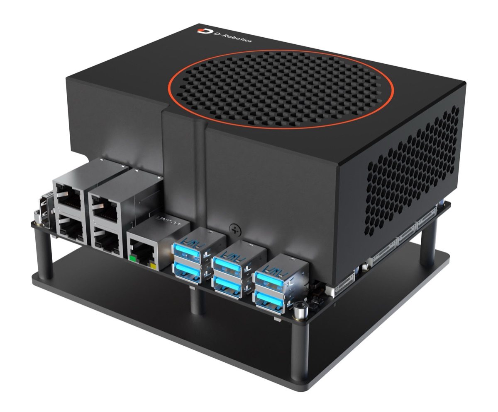
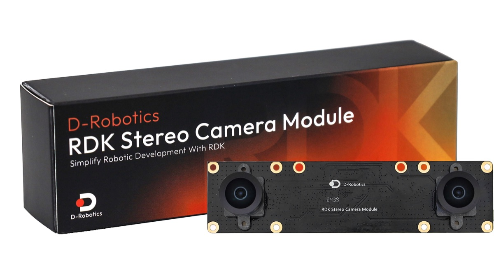
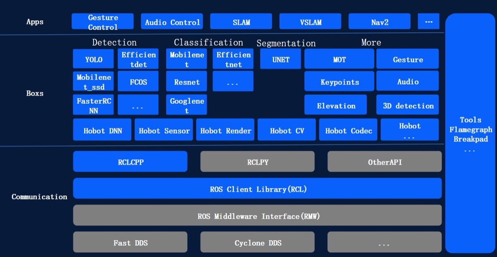
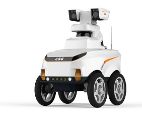

# D-Robotics — Product Portfolio

⬆ [D-Robotics profile](D-Robotics.md) · [Developer guide](D-Robotics-Developer-Guide.md) · [Roadmap and strategy](D-Robotics-Roadmap-and-Strategy.md)

> **Read this first:** D-Robotics sells robot *brains* (edge-AI boards + ROS 2 software), not robots. Every idea below needs a body from somewhere else: another vendor's arm / quadruped / mobile base, or a fixed camera post.
> **30-second pick:** vision node or small robot → **RDK X5**. Robot-learning policy (ACT / LeRobot) or AI plus real-time motor control on one board → **RDK S100 / S100P**. On-device VLA / LLM → S600, but it is unlikely to be on site.

## Lineup map

Track relevance: ● strong · ◐ partial · ○ none. Status: ✅ shipping · 🧪 announced / preview · 🔭 roadmap.

| Product | Category | Status | Launched | Price (if public) | Positioning (one line) | T01 | T02 | T03 | T04 |
|---|---|---|---|---|---|---|---|---|---|
| RDK X3 / X3 Module | Entry edge-AI board | ✅ | 2023 as Horizon RDK X3 (⚠️ unverified) | not public on official site | **5 TOPS**, Raspberry-Pi-class board for simple vision demos | ◐ | ◐ | ◐ | ◐ |
| RDK X5 / X5 Module | Mid edge-AI board | ✅ | 2024 (⚠️ exact date unverified) | about **USD 100–190** via resellers | **10 TOPS**, 8-core, the default hackathon board | ● | ● | ◐ | ● |
| RDK S100 | Embodied-AI kit | ✅ | 2025 | RMB 2,799 at launch; resellers USD 440–630+ | **80 TOPS** + real-time MCU cores on one SoC | ● | ● | ◐ | ● |
| RDK S100P | Higher-end embodied-AI kit | ✅ (limited outside China) | 2025–2026 (⚠️ unverified) | USD 899–999.99 via resellers | **128 TOPS**, 24 GB RAM, same board layout as S100 | ● | ● | ◐ | ● |
| RDK S600 | Flagship embodied-AI computer | 🧪 | Previewed Nov 2025; docs live Nov 2026 | not public | **560 TOPS**, 18 CPU cores, for on-device VLA / VLM | ◐ | ◐ | ○ | ◐ |
| RDK Ultra | Older high-compute board | ⚠️ unverified current status | 2024 tease (trade press) | not public | 96 TOPS; not on the 2026 product navigation | ○ | ○ | ○ | ○ |
| RDK Stereo Camera Module + cameras | Sensors / add-ons | ✅ | not public | not public | Stereo depth and MIPI cameras for RDK boards | ● | ● | ◐ | ● |
| TogetheROS.Bot (TROS) | Robot middleware | ✅ | not public | free, open source | ROS 2 with BPU-accelerated perception nodes | ● | ● | ◐ | ● |
| RDK Studio | Desktop dev workspace | ✅ | 2026 (⚠️ unverified) | free | Flash, connect and manage boards from a laptop | ◐ | ◐ | ◐ | ◐ |
| NodeHub + RDK Model Zoo | App / model library | ✅ | not public | free | Ready-made demos and pre-converted models, the 48-hour shortcut | ● | ● | ● | ● |
| One-stop cloud development platform | Cloud toolchain | 🧪 | Announced Nov 2025 | not public | Data loop, sim training field, agent service; do not plan around it | ○ | ○ | ○ | ○ |

Notes: TOPS are vendor INT8 figures and are not directly comparable with NVIDIA Jetson ratings. Official pages show no prices (only a distributor link); prices above are reseller or launch prices from the [profile](D-Robotics.md).

### Which board for which job

| You want to… | Pick | Why |
|---|---|---|
| Run a YOLO / pose / gesture model on one or two cameras | RDK X5 | 10 TOPS is enough, 5 V power, Wi-Fi 6 on board, most English docs |
| Put perception on a small battery robot or a fixed pole | RDK X5 | 5 V / 5 A or PoE, CAN FD for motor drivers |
| Run an imitation-learning policy (ACT via LeRobot) on an arm | RDK S100 | Documented ACT-on-S100 flow; 12 GB RAM |
| Combine AI and hard-real-time motor loops on one board | RDK S100 / S100P | 4x Cortex-R52+ MCU cores next to the AI cores |
| Fuse 3+ cameras or run larger models | RDK S100P | 128 TOPS, 24 GB RAM |
| Run a VLA / VLM fully on-device | RDK S600 | Only tier D-Robotics claims this for; probably not on site |

## Products

### RDK X5 (and X5 Module)

Raspberry-Pi-sized single-board computer built on the Sunrise 5 chip. The most likely board in D-Robotics' hackathon kit and the best-documented one in English.

| Spec | Value |
|---|---|
| CPU | 8x Arm Cortex-A55 @ **1.5 GHz** |
| AI accelerator (BPU) | **10 TOPS** |
| GPU | 32 GFLOPS |
| RAM | **4 GB or 8 GB** LPDDR4 |
| Storage | No on-board storage; microSD card |
| Cameras | 2x MIPI CSI (4-lane each), so a stereo pair fits natively |
| Video | H.264 / H.265 encode and decode up to 4K60 |
| Display | HDMI (up to 1080p60), 1x MIPI DSI |
| USB | 4x USB 3.0 Type-A host, 1x USB 2.0 Type-C device |
| Network | 1x Gigabit Ethernet with PoE (needs PoE module), **Wi-Fi 6**, Bluetooth 5.4 |
| Robot I/O | **1x CAN FD**, 28 GPIO (shared: 5 UART, 8 PWM, 3 I2C, 2 SPI, 1 I2S), 3.5 mm audio |
| Power | **5 V / 5 A** (USB-C) or PoE |
| OS | Ubuntu 22.04 (RDK OS), ROS 2 Humble via TROS |
| Dimensions / weight | not stated on the official page |

- **Variants:** 4 GB and 8 GB boards; RDK X5 Module (compute-module form factor for custom carrier boards, details in the RDK X docs). No EDU / developer tiers: every board has the same software access.
- **Typical applications:** detection / segmentation / pose on live camera streams, stereo depth, line following and Nav2 on small wheeled robots, voice front-ends, smart fixed sensors.
- **Hackathon caveats:** bring a good 5 V / 5 A supply and a fast microSD; custom models must be converted and INT8-quantised with the OpenExplorer toolchain, so start from Model Zoo models.
- **Official page:** [en.d-robotics.cc/rdkx5](https://en.d-robotics.cc/rdkx5) · [RDK X docs](https://developer.d-robotics.cc/rdk_x_doc/en/RDK)

### RDK S100

Embodied-AI developer kit that puts application CPU, AI accelerator and a real-time MCU on one SoC, so one board can run perception / policy and the motor loop. The natural choice for robot-learning demos.

| Spec | RDK S100 |
|---|---|
| CPU | 6x Arm Cortex-A78AE @ **1.5 GHz** |
| Real-time MCU | 4x Arm Cortex-R52+ @ 1.2 GHz |
| AI accelerator (BPU) | **80 TOPS** (INT8) |
| GPU | Arm Mali-G78AE, 100 GFLOPS |
| RAM | **12 GB** LPDDR5 |
| Storage | 64 GB eMMC + M.2 Key M (PCIe 3.0 x1) for NVMe |
| Cameras | Via camera expansion board (MIPI; GMSL cameras through add-on) |
| Display | HDMI, up to 2K60 |
| USB | 4x USB 3.0, 1x USB 2.0 Type-C (flash / debug) |
| Network | **2x Gigabit Ethernet**; Wi-Fi / Bluetooth only via M.2 Key E card (not built in) |
| Robot I/O | 40-pin main GPIO header, 16-pin MCU GPIO header, MCU port expansion connector, JTAG |
| Power | **12–20 V DC** (barrel jack) |
| Dimensions | 120 x 121 x 51 mm (with case) |
| OS | RDK OS (Ubuntu 22.04), TROS |

- **Variants:** S100 (this table) and S100P (below); same board, different SoC grade and RAM.
- **Typical applications:** ACT imitation-learning policies with LeRobot on an arm, multi-camera perception for humanoids / quadrupeds / mobile manipulators, sensor fusion plus low-level control on one computer.
- **Hackathon caveats:** needs a 12–20 V supply (plan a DC-DC if powering from a robot battery); no on-board Wi-Fi; compiled models (`.hbm`) are board-specific and do not run on the X5.
- **Official page:** [en.d-robotics.cc/rdks100](https://en.d-robotics.cc/rdks100) · [RDK S docs](https://developer.d-robotics.cc/rdk_s_doc/en/RDK)

### RDK S100P

Higher grade of the S100 kit on the same board layout: faster CPU clock, more AI throughput, double the RAM. (The picture is the shared S100-series render from the official page.)

| Spec | RDK S100P (differences from S100 in bold) |
|---|---|
| CPU | 6x Arm Cortex-A78AE @ **2.0 GHz** |
| Real-time MCU | 4x Arm Cortex-R52+ @ 1.2 GHz |
| AI accelerator (BPU) | **128 TOPS** (INT8) |
| RAM | **24 GB** LPDDR5 |
| Storage | 64 GB eMMC + M.2 Key M |
| Cameras | 3x 4-lane MIPI CSI, +4 GMSL via add-on (trade-press review figure) |
| Network / USB / display | Same as S100 (2x GbE, 4x USB 3.0, HDMI) |
| Power | 12–20 V DC; 90 W adapter and 0–45 °C operating range per trade-press review |
| Dimensions | 120 x 121 x 51 mm (with case) |

- **When to prefer it over S100:** several cameras at once, larger models, or headroom for a policy plus perception stack. Otherwise the S100 does the same job.
- **Known caveat:** the BMI088 IMU on the MCU expansion board is reported unsupported in some OS versions (see profile).
- **Official page:** [en.d-robotics.cc/rdks100](https://en.d-robotics.cc/rdks100)

### RDK X3 (and X3 Module)

Entry board on the Sunrise 3 chip with Raspberry-Pi-style interfaces. Fine for a single light model; choose the X5 if you can get one.

| Spec | Value (official page lists one shared table for board and Module) |
|---|---|
| CPU | 4x Arm Cortex-A53 @ 1.5 GHz |
| AI accelerator (BPU) | **5 TOPS** (dual-core Bernoulli BPU) |
| RAM | 2 GB or 4 GB LPDDR4 |
| Storage | microSD; 16 / 32 / 64 GB eMMC options (Module) |
| Cameras | 2x MIPI CSI (2-lane) |
| Video | H.265 encode / decode up to 4K60 |
| USB | 1x USB 3.0 + 2x USB 2.0 host, 1x Micro USB device |
| Network | Ethernet (RJ45), Wi-Fi 2.4 / 5 GHz, Bluetooth 4.2 |
| I/O | 40-pin header (I2C, UART, SPI, I2S, PWM), HDMI up to 1080p60 |
| Power | 5 V / 3 A |
| OS | Ubuntu 20.04 / 22.04 |

- **Variants:** RDK X3 board; RDK X3 Module (compute module, CM4-compatible per profile) with its carrier board.
- **Typical applications:** teaching kits, line-following cars, single-camera detection.
- **Official page:** [en.d-robotics.cc/rdkx3](https://en.d-robotics.cc/rdkx3)

### RDK S600 / Sunrise S600

Flagship embodied-AI computer aimed at running large policy / vision-language models on the robot. 🧪 Documentation is live, availability is reported as China-only so far; **do not expect it on site**.

| Spec | Value (official RDK S600 kit page) |
|---|---|
| CPU | **18x** Arm Cortex-A78AE @ 2.0 GHz |
| Real-time MCU | 6x Arm Cortex-R52+ |
| AI accelerator (BPU) | 4 BPU cores, up to **560 TOPS** |
| RAM | **32 GB or 64 GB** LPDDR5 |
| Storage | 64 GB or 256 GB UFS 3.1 + M.2 Key M NVMe |
| Network | 2x 1 GbE + **2x 10 GbE** + 1x 1 GbE (MCU domain); M.2 Key E for Wi-Fi / Bluetooth |
| USB | 6x USB 3.x Type-A host, 1x USB 2.0 Type-C (flash / debug) |
| Cameras | 2x MIPI connectors + 2x camera expansion connectors (overview page: six MIPI camera inputs) |
| Robot I/O | **9 CAN ports** (5 MCU domain + 4 main domain), 4 UART, 80-pin MCU expansion |
| Display | HDMI, up to 2K60 |
| Power | **12–28 V DC**, 24 V / 8 A adapter supplied |
| Dimensions | 140 x 123 x 78 mm |

- **Typical applications:** on-device VLA / VLM / LLM for humanoids and mobile manipulators. Reported adopters include Spirit AI (also at Leukerbad), UBTECH and Fourier (see profile).
- **Official page:** [RDK S600 kit docs](https://developer.d-robotics.cc/rdk_s_doc/en/01_Quick_start/01_hardware_introduction/02_rdk_s600/01_rdk_s600_kit) · [RDK S manual](https://developer.d-robotics.cc/rdk_s_doc/en/RDK)

### RDK Stereo Camera family + accessories

Official camera add-ons. The stereo module turns an X5 (two MIPI ports) into a depth sensor using the stereo-depth algorithms in TROS.

| Item | What the official page states |
|---|---|
| RDK Stereo Camera Module | "200W" (2 MP) stereo camera; baseline, FOV and sensor model not stated on the page |
| RDK X5 Camera RS800W | 8 MP, rolling shutter |
| RDK X3 Camera RS400W / RS800W | 4 MP / 8 MP, rolling shutter |
| S100 camera options | Camera expansion board, MIPI camera, GMSL camera (listed as S100 accessories) |

- **Typical applications:** obstacle depth for small mobile robots, person distance for fall or proximity detection, snow or object volume estimates.
- **Official page:** [en.d-robotics.cc/accessories](https://en.d-robotics.cc/accessories)

### TogetheROS.Bot (TROS)

D-Robotics' ROS 2 distribution layer: standard ROS 2 interfaces plus hardware-accelerated nodes, so existing ROS 2 packages keep working.

| Item | Detail |
|---|---|
| ROS 2 compatibility | Foxy / Humble / Jazzy interfaces |
| Supported boards | RDK X3, X5, S100, S600 (algorithm coverage varies by board; X5 and S100 have more than X3) |
| Core packages | `hobot_sensor` (camera input), `hobot_dnn` (BPU inference), `hobot_codec` (hardware video codec), `hobot_cv` (accelerated CV ops), `hobot_render` (web / HDMI visualisation), `hobot_image_publisher`, `hobot_tts` |
| Algorithm "Boxs" | Detection, classification, segmentation, body and hand analysis, stereo depth, speech, LLM / VLM examples |
| Sample apps | SLAM mapping, Navigation2, and more |
| Extras | Zero-copy inter-process communication |
| Price | Free, open source |

- **Why it matters in 48 h:** a camera → detection → web-view pipeline is a launch file, not a coding project.
- **Official page:** [TROS docs](https://developer.d-robotics.cc/tros_doc/en/tros)

### RDK Studio

Desktop workbench (the official page calls it an AI-native workbench for robotics) for flashing, connecting to and managing RDK boards. Per the profile: device manager, terminals, "Moss" AI assistant and a board-side agent; supports X3, X5, S100 / S100P. The official landing page gives no feature list, host-OS list or version, so treat details as ⚠️ unverified until you install it. No picture saved (no product image on the official page).

- **Official page:** [developer.d-robotics.cc/en/rdkstudio](https://developer.d-robotics.cc/en/rdkstudio)

### NodeHub + RDK Model Zoo

NodeHub is the application centre of ready-to-run robot demos (one-command deploy, code on GitHub); the Model Zoo is the GitHub repo of models already converted for the BPU.

| Item | Detail |
|---|---|
| NodeHub examples shown officially | Line following with obstacle avoidance, mapping and navigation, skeleton keypoints, visual-inertial odometry, Cartographer SLAM, robot-arm picking |
| Count | **200+** algorithms and demos (company figure, see profile); the live page did not show a count when checked |
| Model Zoo | YOLO family and other vision models with board-ready weights |
| Price | Free |

- **Use it for:** the first working demo on day 1; swap in your own model later only if time allows.
- **Official pages:** [NodeHub](https://developer.d-robotics.cc/en/nodehub) · [rdk_model_zoo on GitHub](https://github.com/D-Robotics/rdk_model_zoo)

### One-stop cloud development platform

🧪 Announced Nov 2025: data closed loop, a simulated "embodied training field" and an agent development service. Access terms, pricing and English availability are not public. Not usable as a hackathon dependency. No picture available.

### RDK Ultra

Older high-compute board teased at **96 TOPS** (trade press, 2024). It is not on the 2026 official product navigation; current status ⚠️ unverified. Not expected on site. No picture saved (no official product image found).

## Accessories and ecosystem

| Accessory | For | Note |
|---|---|---|
| RDK Stereo Camera Module | X5 (two MIPI ports) | 2 MP stereo pair |
| RDK X5 Camera RS800W | X5 | 8 MP rolling shutter |
| RDK X5 PoE Module | X5 | Power over the Ethernet cable; handy for fixed sensor nodes |
| RDK X5 Case / Power Adapter | X5 | Metal case; multi-country adapter |
| RDK X3 Camera RS400W / RS800W, Camera Adapter (24-pin to 15-pin), Case | X3 | Adapter allows Pi-style 15-pin cameras |
| S100 camera expansion board, MIPI camera, GMSL camera | S100 / S100P | Multi-camera and automotive-style GMSL links |
| S100 MCU port expansion board | S100 / S100P | Breaks out the real-time MCU domain (CAN etc.) |
| Third-party cameras listed in RDK docs | X3 (docs list) | OV5647, IMX219, IMX477 MIPI modules (Waveshare, Yahboom), USB cameras |
| M.2 Wi-Fi / Bluetooth card, NVMe SSD | S100 / S100P / S600 | Not included on board; check what the booth supplies |

- **Software add-ons:** OpenExplorer model-conversion toolchain, LeRobot fork with BPU tooling, `rdk-skills` agent repo (see [Developer guide](D-Robotics-Developer-Guide.md)).
- **No hands, grippers, docks or robot bodies** from D-Robotics. Pair with on-site hardware: a Unitree / Genisom / Magiclab quadruped as carrier, a Dobot / ROKAE / Flexiv arm as actuator, a SKYLANDX scanner for maps. Integration details are not documented by D-Robotics for these vendors (⚠️ unverified).
- **Where to buy:** official site links to distributors only; resellers named in the profile include DFRobot, Waveshare and OpenELAB.

## Legacy and discontinued

- **RDK Ultra:** see above; superseded in practice by the S100 series.
- **Horizon-branded predecessors** (Sunrise X3 Pi era, before the May 2024 spin-off): same lineage as RDK X3; older tutorials still apply in part. ⚠️ unverified detail.

## Image credits

| File | Shows | Source URL |
|---|---|---|
| assets/d-robotics-rdk-x5.jpg | RDK X5 board | https://en.d-robotics.cc/_next/static/media/rdkx5_board.aff2e805.png (from https://en.d-robotics.cc/rdkx5) |
| assets/d-robotics-rdk-x3.jpg | RDK X3 board | https://en.d-robotics.cc/images/rdkx3/rdk_x3_img.png (from https://en.d-robotics.cc/rdkx3) |
| assets/d-robotics-rdk-s100.jpg | RDK S100 series board render | https://en.d-robotics.cc/_next/static/media/s100.8a354787.png (from https://en.d-robotics.cc/rdks100) |
| assets/d-robotics-rdk-s100p.jpg | RDK S100 series board render (banner version; S100P shares the board) | https://en.d-robotics.cc/_next/static/media/s100_banner.b9c7c1ce.png (from https://en.d-robotics.cc/rdks100) |
| assets/d-robotics-rdk-s600.jpg | RDK S600 developer kit render (downscaled) | https://rdk-doc.oss-cn-beijing.aliyuncs.com/doc/img/01_Quick_start/image/hardware_interface/RDK_S600_Kit_Axonometric%20Front%20Right%2045.png (official docs CDN, from the RDK S600 kit page) |
| assets/d-robotics-stereo-camera.jpg | RDK Stereo Camera Module with box | https://en.d-robotics.cc/_next/static/media/3.a56f66c4.png (from https://en.d-robotics.cc/accessories) |
| assets/d-robotics-tros.jpg | TogetheROS.Bot architecture graphic | https://rdk-doc.oss-cn-beijing.aliyuncs.com/doc/img/05_Robot_development/image/TogetheROS.png (official docs CDN, from the TROS intro page) |
| assets/d-robotics-nodehub.jpg | NodeHub showcase picture (example service robot, not a D-Robotics product) | https://developer.d-robotics.cc/en/_next/static/images/nodehub_show1-fd9966f63daf7c12c68af1f122b85df9.png (from https://developer.d-robotics.cc/en/nodehub) |

No picture: RDK Ultra, RDK Studio, cloud platform (no suitable official image found).

## Sources

- [RDK X5 product page](https://en.d-robotics.cc/rdkx5)
- [RDK X3 product page](https://en.d-robotics.cc/rdkx3)
- [RDK S100 / S100P product page](https://en.d-robotics.cc/rdks100)
- [Accessories page](https://en.d-robotics.cc/accessories)
- [RDK S series manual](https://developer.d-robotics.cc/rdk_s_doc/en/RDK)
- [RDK S600 developer kit hardware page](https://developer.d-robotics.cc/rdk_s_doc/en/01_Quick_start/01_hardware_introduction/02_rdk_s600/01_rdk_s600_kit)
- [RDK X series manual](https://developer.d-robotics.cc/rdk_x_doc/en/RDK)
- [RDK X docs: accessory list](https://developer.d-robotics.cc/rdk_x_doc/en/Advanced_development/hardware_development/rdk_x5/accessory)
- [Introduction to TogetheROS.Bot](https://developer.d-robotics.cc/tros_doc/en/tros)
- [RDK Studio](https://developer.d-robotics.cc/en/rdkstudio)
- [NodeHub](https://developer.d-robotics.cc/en/nodehub)
- [rdk_model_zoo (GitHub)](https://github.com/D-Robotics/rdk_model_zoo)
- [D-Robotics profile in this pack](D-Robotics.md) (prices, S100P review figures, RDK Ultra, cloud platform and adopter claims are carried over from its cited sources: CNX Software, Hackster, KrASIA, 36Kr, DFRobot; web search was unavailable during this pass, so they were not re-checked)
