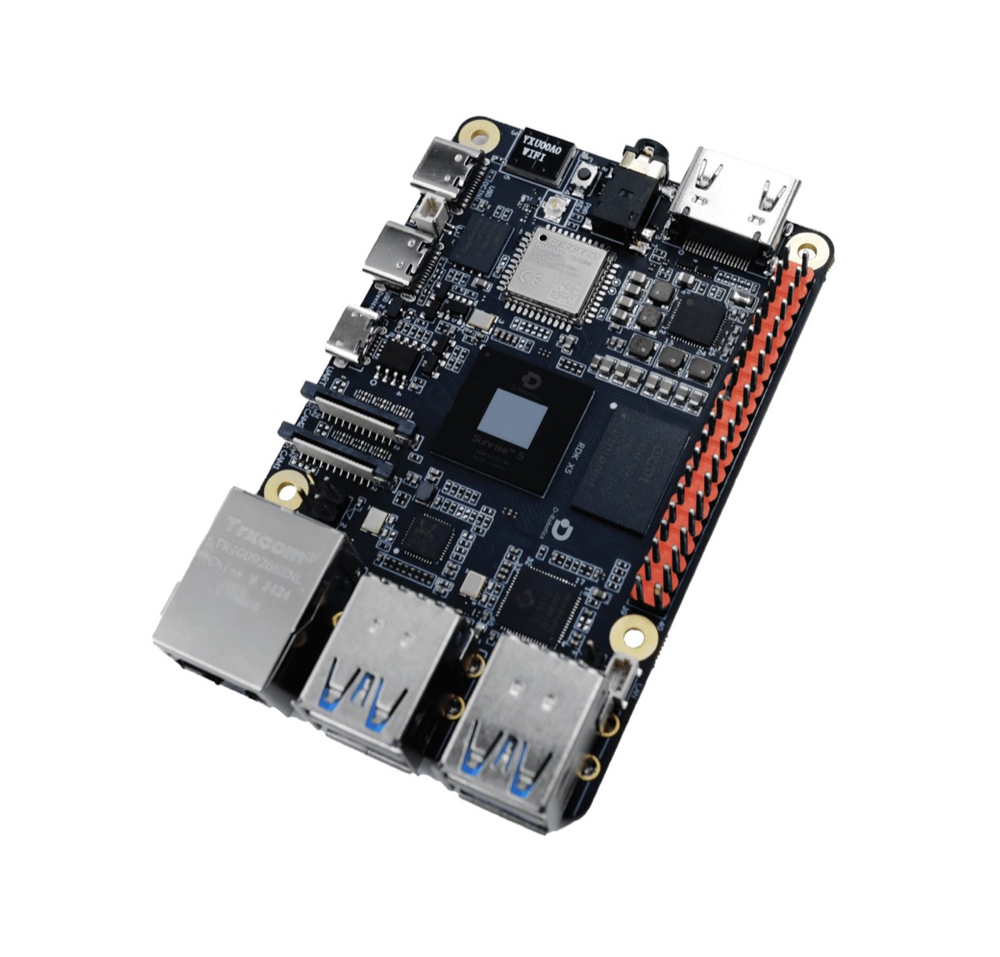
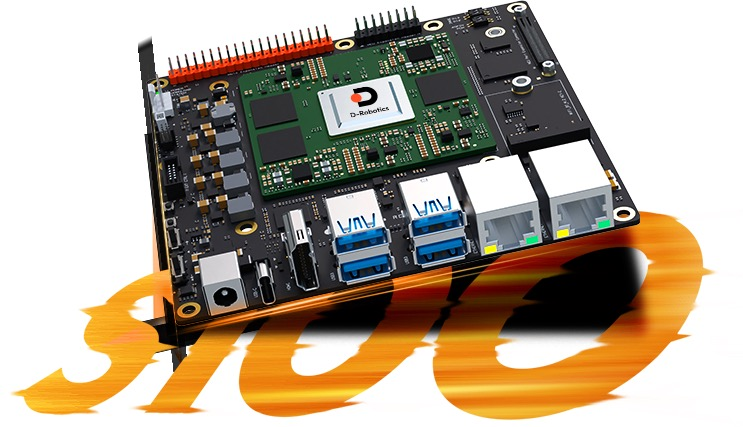
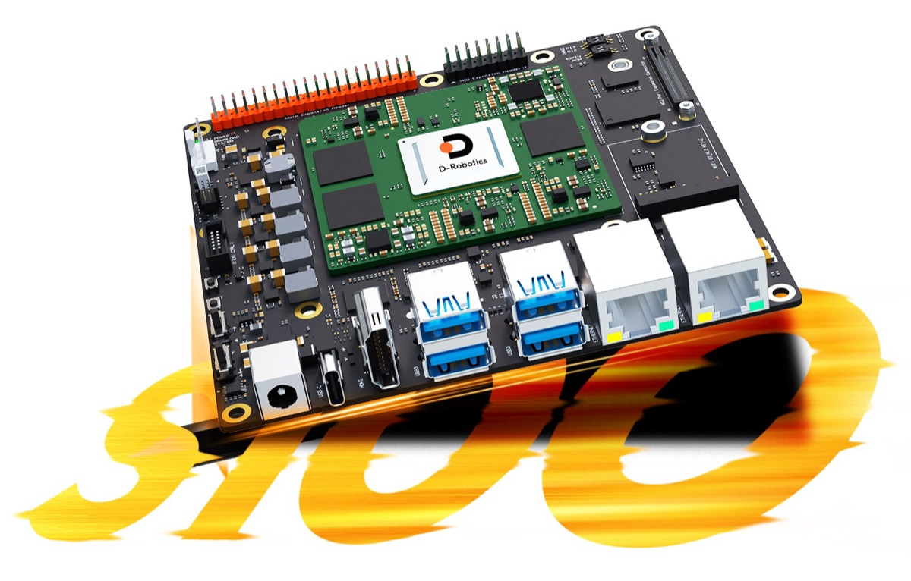
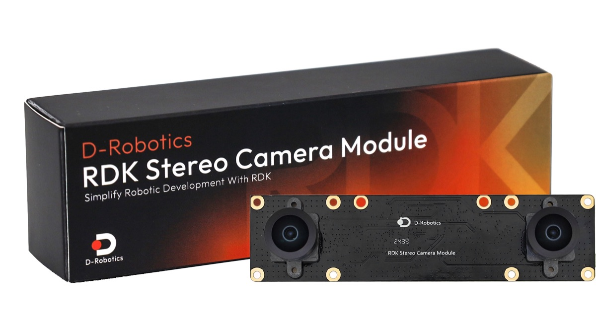
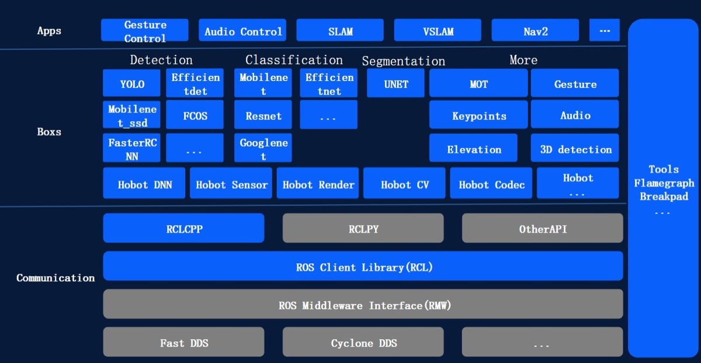
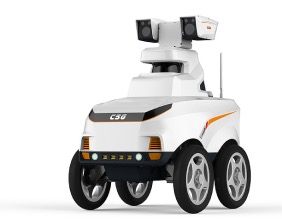
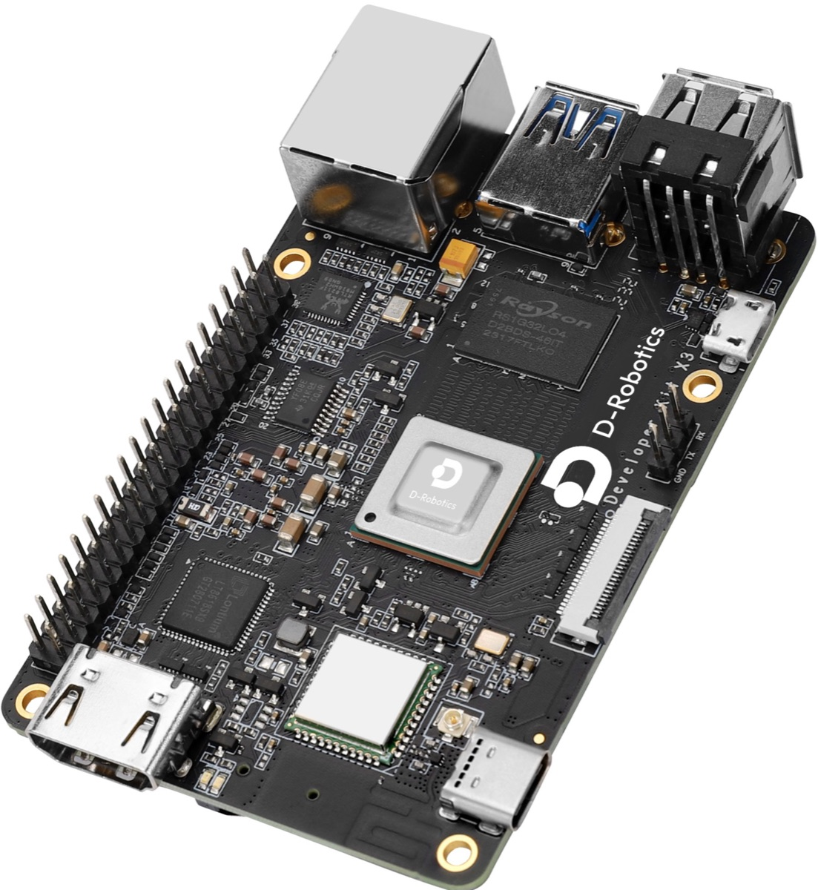

# D-Robotics × T01 — Products and Solutions

⬆ [D-Robotics profile](../D-Robotics.md) · [Brief](D-Robotics-T01-1-Brief.md) · [Playbook](D-Robotics-T01-3-Playbook.md)

> **Read this first:** D-Robotics sells compute boards and ROS 2 software, not robots. For T01 its role is the perception / navigation / voice computer on a base from another vendor, or a fixed smart camera. Which boards are actually on site is **not confirmed**.
> **Research note:** web search was unavailable for this track pass; the content below comes from official product pages, the official TogetheROS.Bot docs, official GitHub READMEs and the sources already in the company profile. Track-specific press (for example delivery-robot customers) could not be searched.

## Relevant products (ranked for this track)

### RDK X5

**Role in T01:** default choice. Small, 5 V powered perception computer for a delivery, follow-me, guide or cleaning robot; also works as a fixed "smart camera" (litter, bin, snow, crowd monitoring).

| Spec (official product page) | Value |
|---|---|
| CPU / AI | 8x Cortex-A55 @ 1.5 GHz · **10 TOPS** BPU · 32 GFLOPS GPU |
| RAM | **4 or 8 GB** LPDDR4 (no on-board storage, microSD) |
| Cameras | **2x 4-lane MIPI CSI** (enough for one stereo pair) + 4x USB 3.0 for USB cameras |
| Robot I/O | **1x CAN FD**, 28 GPIO (up to 5 UART, 8 PWM, 3 I2C, 2 SPI), GbE with PoE, Wi-Fi 6, BT 5.4 |
| Audio | 3.5 mm jack in / out (voice concierge) |
| Power | **5 V / 5 A** |
| Stereo depth claim | error under 1 % within 10 m (vendor figure) |
| Operating temperature / IP rating | not stated on the product page / none (bare board) |

- **Status / price:** ✅ shipping · about USD 100–190 depending on RAM and kit (reseller figures, see profile).
- **Developer interface:** full root Ubuntu 22.04, ROS 2 Humble + TogetheROS.Bot via `apt`; Python and C/C++. You control everything above the motor driver: camera pipelines, BPU inference, ROS topics, CAN / UART / PWM to your own base.

### RDK S100

**Role in T01:** step up when you want an on-device VLM (scene description, concierge), LiDAR 3D detection or several models at once.

| Spec | Value |
|---|---|
| CPU / AI | 6x Cortex-A78AE + 4x Cortex-R52+ real-time cores · **80 TOPS** |
| RAM | **12 GB** LPDDR5 |
| T01-relevant TROS packages only on S-series | `hobot_centerpoint` (LiDAR 3D object detection), `hobot_bev` (bird's-eye-view perception), `hobot_xlm` (DeepSeek LLM), InternVL3-8B in `hobot_llamacpp` |
| Nav2 / slam_toolbox | supported (documented for S100 and S100P) |

- **Status / price:** ✅ shipping · RMB 2,799 at launch; resellers USD 440–630+ (see profile).
- **Developer interface:** same Ubuntu 22.04 + ROS 2 Humble stack; the R52+ MCU cores can run motor loops next to the AI cores. Models must be compiled to `.hbm` for this board.

### RDK S100P

**Role in T01:** same as S100 with more headroom (**128 TOPS**, **24 GB**). Only worth it if the team actually has one in hand.

| Spec (CNX Software review) | Value |
|---|---|
| Cameras | 3x 4-lane MIPI CSI (+4 GMSL via add-on board) |
| Network | 2x GbE |
| Power | **12–20 V** (90 W adapter): can run from many robot battery rails with a regulator |
| Operating temperature | **0–45 °C**: below freezing outdoors is out of spec |
| Known issue | BMI088 IMU on the MCU expansion board unsupported in some OS versions |

- **Status / price:** ✅ shipping, availability outside China limited · USD 899–1,000 at resellers.

### RDK Stereo Camera family + accessories

**Role in T01:** depth for obstacle stop, follow distance and local occupancy without a LiDAR.

| Item (official accessories page) | Detail |
|---|---|
| RDK Stereo Camera Module | 2 MP ("200W") stereo camera; baseline, FOV and interface not listed on the page |
| RDK X5 Camera RS800W | 8 MP rolling-shutter MIPI camera |
| RDK X5 PoE Module | power the X5 over Ethernet (handy for a fixed street / lobby sensor) |
| Software | `hobot_stereonet` depth at **15–25 FPS** depending on model version (X5, S100); Stereo OCC package `dstereo_occupancy` (X5, S100); SDK repo `RDK-Stereo-Camera-SDK` |

- **Status / price:** ✅ listed · prices not shown on the official page.

### TogetheROS.Bot (TROS)

**Role in T01:** the reason to choose D-Robotics. BPU-accelerated ROS 2 nodes you launch instead of write.

| T01 need | Ready package (boards per official docs) |
|---|---|
| Follow a person | `body_tracking` (camera → `/cmd_vel`, real robot or Gazebo) · Human Body Following with `reid` (X5, S100, S600) |
| People / pose | `mono2d_body_detection` (X3, X5; **125 FPS** inference on X5) · `mono2d_yolo_pose` (S100, S600) |
| Depth / obstacles | `hobot_stereonet`, `dstereo_occupancy` (X5, S100) · `hobot_vio` (X3, X5) |
| Mapping / navigation | `slam_toolbox` (X3, X5, S100, S600) and Nav2 (X3, X5, S100 / S100P) via `apt` |
| Find arbitrary objects | `hobot_dosod` open-vocabulary detector (X5, S100, S600) · `hobot_yolo_world` (X5) |
| Litter | `mono2d_trash_detection` (PPYOLO; README lists RDK X3, X5 support ⚠️ unverified) |
| Talk to guests | `sensevoice_ros2` offline ASR + command words (needs the RDK audio board) · `hobot_tts` |
| Understand a scene | `hobot_llamacpp` VLMs: InternVL2.5-1B, InternVL3-1B / 2B, SmolVLM2 on X5; + InternVL3-8B on S100 |

- **Status / price:** ✅ free, open source.
- **Developer interface:** standard ROS 2 topics; results arrive as `ai_msgs`, so your planner is ordinary ROS 2 code.

### NodeHub + RDK Model Zoo

**Role in T01:** pre-converted models (YOLO family) and one-command demos, so you skip the quantization step. The X5 product page also points to Cartographer LiDAR SLAM, line-following-car and track-detection examples in NodeHub. ✅ free.

### RDK Studio

**Role in T01:** saves setup time only (flashing, terminals, device manager, AI assistant). ✅ free.

### RDK X3

**Role in T01:** fallback if X5 boards run out. **5 TOPS**; runs body tracking, line following, parking search, trash detection, Nav2 and slam_toolbox, but **not** the stereo depth, re-ID, VLM or open-vocabulary packages. ✅ shipping; price not confirmed.

**Not ranked:** RDK S600 (🧪, reported China-only, unlikely on site), RDK Ultra (⚠️ current status unverified), cloud development platform (🧪, no use inside 48 hours).

## What D-Robotics already does in this domain

No city-scale delivery, municipal-maintenance or public-space service deployment by D-Robotics itself was found. Its footprint is as a chip / board supplier inside other companies' robots, mostly consumer products.

| Date | What | Relevance to T01 | Source |
|---|---|---|---|
| 4 Sep 2026 (IFA Berlin) | Robots on Sunrise chips shown: **xLean TR1 floor-washing robot**, Vbot SuperDog, TCL "hey AiMe" companion | Cleaning and mobile robots in production use the chip family (specific chip per robot not stated) | [OpenELAB](https://openelab.io/blogs/learn/d-robotics-ifa-2026-home-robot-ai-chips-rdk) |
| Sep 2026 | **8M+** Sunrise chips shipped; S600 adopted by 20+ embodied-AI companies incl. Spirit AI (on site at Leukerbad) | Scale proof; possible on-site partner | [Kyodo PR Wire](https://kyodonewsprwire.jp/release/202609176168) |
| Mar 2026 (embedded world) | RDK S100 + LeRobot demo, Ultralytics YOLO26 demo, Vbot SuperDog | Demos are manipulation / vision, not navigation | [D-Robotics blog](https://en.d-robotics.cc/blog/d-robotics-returns-to-embedded-world-2026-with-the-theme-intelligence-embedded-robotics-reborn) |
| Nov 2025 | Chip customers cited: a robot vacuum maker, Insta360, a companion robot dog maker | Indoor cleaning navigation at volume | [36Kr](https://eu.36kr.com/en/p/3566819733830529) |
| Ongoing | Official examples for follow-me, parking search, line following, trash detection on small wheeled robots (third-party OriginBot kit named in the READMEs) | Education-scale building blocks for service robots | [body_tracking](https://github.com/D-Robotics/body_tracking), [mono2d_trash_detection](https://github.com/D-Robotics/mono2d_trash_detection) |

## What they are building next in this domain

- 🧪 **Sunrise S600 / RDK S600** (560 TOPS): on-device VLA / VLM for humanoids and mobile manipulators; reported China-only so far. TROS docs already list S600 support for slam_toolbox, re-ID following and speech.
- 🧪 **One-stop cloud platform** (data loop, simulated training field, agent development), announced Nov 2025.
- **Simulation:** the `drobotics_robosim` repo (ROS 2 Humble + Gazebo Classic 11) models a home-service differential-drive robot with stereo camera, IMU, 2D and 3D LiDAR to test slam_toolbox, Nav2, FAST-LIO2 and FAST-LIVO2. README is in Chinese; maturity ⚠️ unverified.
- **Inference (not announced):** the money raised in 2026 (about USD 670M) is aimed at chips for every compute tier and a full robot software platform, and customers are consumer cleaning robots, robot dogs and humanoids. Expect better navigation / spatial packages for those form factors, not a D-Robotics urban-service product.

## Software, models and data that help for this track

| Asset | What you get in 48 hours | Link |
|---|---|---|
| `body_tracking` | Person detection + tracking that outputs `/cmd_vel`; works with any base that accepts `/cmd_vel`; Gazebo mode for testing | [GitHub](https://github.com/D-Robotics/body_tracking) |
| `reid` | Person re-identification so the robot keeps following the same guest | [GitHub](https://github.com/D-Robotics/reid) |
| `hobot_stereonet` | Real-time stereo depth (15–25 FPS); model files via Git LFS | [GitHub](https://github.com/D-Robotics/hobot_stereonet) |
| Nav2 + slam_toolbox on RDK | Documented step by step, with TurtleBot3 in Gazebo on a PC | [Nav2](https://developer.d-robotics.cc/tros_doc/en/apps/navigation2) · [SLAM](https://developer.d-robotics.cc/tros_doc/en/apps/slam) |
| `hobot_dosod` | Open-vocabulary detection: example ships with COCO-80 classes; custom vocabularies need the extra deployment guide | [GitHub](https://github.com/D-Robotics/hobot_dosod) |
| `mono2d_trash_detection` | Garbage detector with swappable model file | [GitHub](https://github.com/D-Robotics/mono2d_trash_detection) |
| `hobot_llamacpp` | LLM / VLM node with BPU-accelerated GGUF models on Hugging Face (D-Robotics org) | [GitHub](https://github.com/D-Robotics/hobot_llamacpp) |
| `sensevoice_ros2` + `hobot_tts` | Fully offline speech in / out | [GitHub](https://github.com/D-Robotics/sensevoice_ros2) |
| `parking_search`, `line_follower` | Simple vision-to-motion behaviours for docking or lane following (X3-era) | [parking_search](https://github.com/D-Robotics/parking_search) · [line_follower](https://github.com/D-Robotics/line_follower) |
| `rdk_model_zoo` | Pre-converted detection / segmentation models | [GitHub](https://github.com/D-Robotics/rdk_model_zoo) |
| `drobotics_robosim` | Gazebo test bed for Nav2 / LiDAR SLAM | [GitHub](https://github.com/D-Robotics/drobotics_robosim) |

No public D-Robotics dataset for urban service tasks was found.

## Gaps and limits for this track

- **No mobility hardware.** Payload, speed, runtime and terrain capability come entirely from the partner robot.
- **Navigation is not turnkey.** The official Nav2 and slam_toolbox guides run against a simulated TurtleBot3; a real robot needs your own LiDAR driver, odometry and TF setup. The X5 has no LiDAR in the box.
- **Bare boards:** no IP rating, no enclosure for snow or wet streets; S100P is rated **0–45 °C**. November in Leukerbad is below that outdoors, so plan an indoor or sheltered demo.
- **Custom models cost time:** ONNX → INT8 BPU conversion with the OpenExplorer toolchain; compiled models are board-specific.
- **Package coverage differs by board** (see the TROS table); check your board before you plan around a package. Several English doc pages for X5 / S100-only packages did not load during research, so details such as occupancy grid size and exact camera models are ⚠️ unverified.
- **Small VLMs:** the X5 tops out at 1–2 B-parameter models; expect slow, short answers. Speed figures were not verified.
- **Voice needs the RDK audio board** (microphone array); availability on site ⚠️ unverified.
- **Bridging to other vendors' robots** (Unitree, AGIBOT and others) is your work; no official D-Robotics bridge for them was found.

## Sources
- [D-Robotics RDK X5 product page](https://en.d-robotics.cc/rdkx5)
- [D-Robotics accessories page](https://en.d-robotics.cc/accessories)
- [TogetheROS.Bot documentation index (feature support list)](https://developer.d-robotics.cc/tros_doc/en/tros)
- [TROS app: Navigation2](https://developer.d-robotics.cc/tros_doc/en/apps/navigation2)
- [TROS app: SLAM mapping](https://developer.d-robotics.cc/tros_doc/en/apps/slam)
- [TROS: body detection and tracking](https://developer.d-robotics.cc/tros_doc/en/boxs/body/mono2d_body_detection)
- [GitHub org: D-Robotics](https://github.com/D-Robotics)
- [GitHub: body_tracking](https://github.com/D-Robotics/body_tracking)
- [GitHub: reid](https://github.com/D-Robotics/reid)
- [GitHub: hobot_stereonet](https://github.com/D-Robotics/hobot_stereonet)
- [GitHub: hobot_llamacpp](https://github.com/D-Robotics/hobot_llamacpp)
- [GitHub: hobot_dosod](https://github.com/D-Robotics/hobot_dosod)
- [GitHub: sensevoice_ros2](https://github.com/D-Robotics/sensevoice_ros2)
- [GitHub: mono2d_trash_detection](https://github.com/D-Robotics/mono2d_trash_detection)
- [GitHub: parking_search](https://github.com/D-Robotics/parking_search)
- [GitHub: line_follower](https://github.com/D-Robotics/line_follower)
- [GitHub: drobotics_robosim](https://github.com/D-Robotics/drobotics_robosim)
- [GitHub: rdk_model_zoo](https://github.com/D-Robotics/rdk_model_zoo)
- [OpenELAB: D-Robotics at IFA 2026](https://openelab.io/blogs/learn/d-robotics-ifa-2026-home-robot-ai-chips-rdk)
- [Kyodo PR Wire: Series C release (17 Sep 2026)](https://kyodonewsprwire.jp/release/202609176168)
- [D-Robotics blog: embedded world 2026](https://en.d-robotics.cc/blog/d-robotics-returns-to-embedded-world-2026-with-the-theme-intelligence-embedded-robotics-reborn)
- [36Kr: DDC 2025 and S600](https://eu.36kr.com/en/p/3566819733830529)
- [CNX Software: RDK S100P review](https://www.cnx-software.com/2026/08/31/d-robotics-rdk-s100p-a-128-tops-alternative-to-nvidia-jetson-orin-nx-16gb-with-cortex-a78ae-r52-cores/)
- [KrASIA: RDK S100 launch](https://kr-asia.com/as-robots-get-smarter-d-robotics-ships-an-soc-kit-to-close-the-loop)
