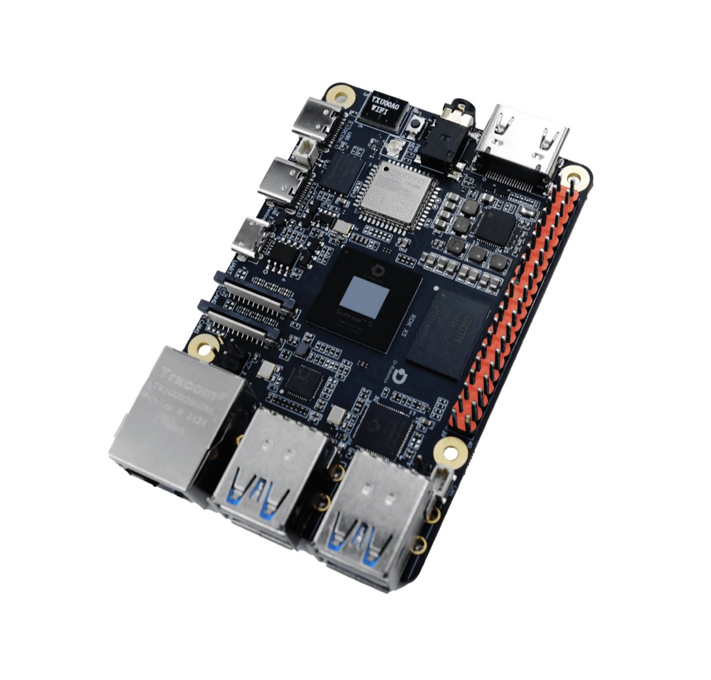
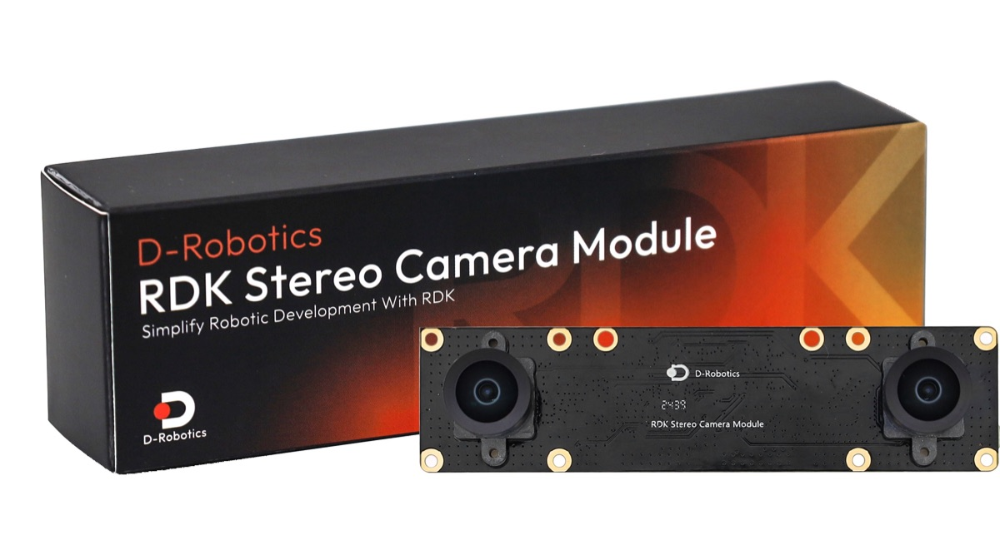
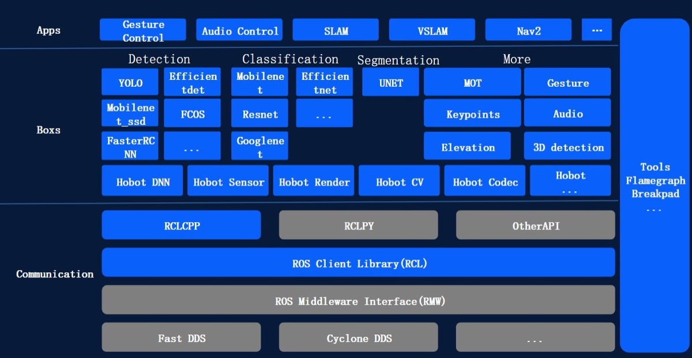
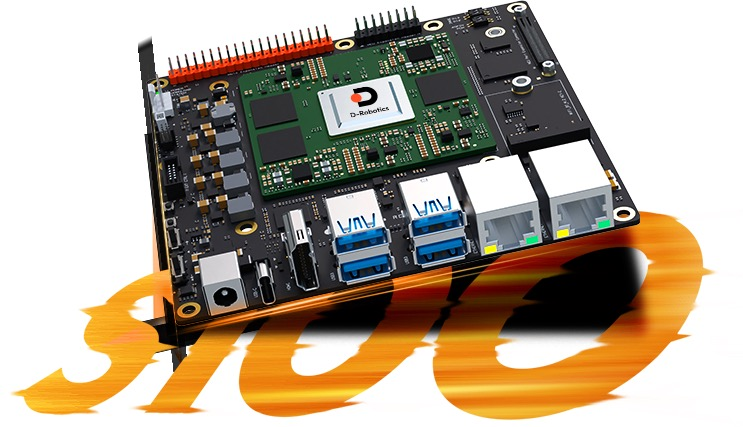
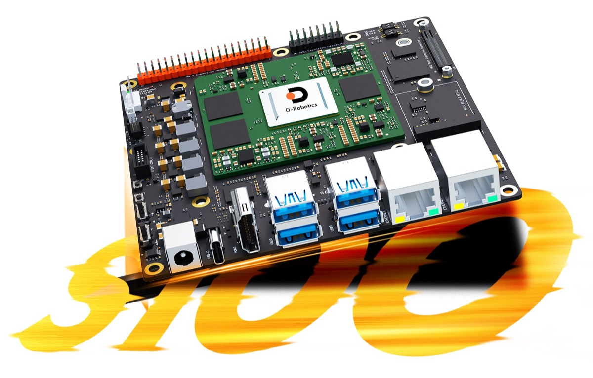
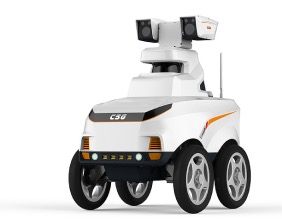

# D-Robotics × T02 — Products and Solutions

⬆ [D-Robotics profile](../D-Robotics.md) · [Brief](D-Robotics-T02-1-Brief.md) · [Playbook](D-Robotics-T02-3-Playbook.md)

**Read this first:** D-Robotics sells compute boards and a ROS 2 software stack, not robots. For T02 its role is the on-device perception and autonomy computer inside (a) a fixed hazard-watch node or (b) another vendor's quadruped / mobile base. Research note: the web-search quota was exhausted during this track pass, so the "what they already do" section relies on official pages and the company profile only.

## Relevant products (ranked for this track)

### RDK X5

**Role in T02:** default choice. Small, 5 V powered vision computer for a fixed sentinel node or a payload strapped to a quadruped.

| Spec | Value |
|---|---|
| CPU / AI | 8x Cortex-A55 @ 1.5 GHz · **10 TOPS** BPU · 32 GFLOPS GPU |
| RAM | **4 or 8 GB** LPDDR4 (take 8 GB for VLM or stereo + detection together) |
| Cameras | **2x 4-lane MIPI CSI** (stereo-ready) + 4x USB 3.0 for USB cameras |
| Video | H.264 / H.265 encode and decode up to 3840x2160 @ 60 fps (useful for teleop streams) |
| Network | Gigabit Ethernet **with PoE** (via PoE module accessory) · Wi-Fi 6 · Bluetooth 5.4 |
| Robot I/O | **1x CAN FD** · 28-pin header (up to 5 UART, 8 PWM, 3 I2C, 2 SPI, 1 I2S) |
| Power | **5 V / 5 A** input (power bank or PoE feasible). Measured consumption: not listed on the product page |
| Environment | Operating temperature and IP rating: not listed. Bare board, no enclosure rating (metal case accessory exists) |
| Stereo depth | Vendor claim: error **under 1 % within 10 m** |

- **Status / price:** ✅ shipping · about **USD 100–190** depending on RAM / kit / reseller (see profile).
- **Developer access:** full root on Ubuntu 22.04, ROS 2 Humble, Python / C++. You control everything: camera pipelines, BPU inference, GPIO / CAN, networking. Recommended RDK OS **3.5.0 or newer** for the Model Zoo.
- **Why first:** widest algorithm coverage in TogetheROS.Bot (YOLO-World, stereo depth, VIO, optical flow, VLM, CLIP all listed for X5), and D-Robotics' own Dream Keeper Challenge (running now, Nov–Dec 2026) is built on it, so docs and examples are fresh.

### RDK Stereo Camera family + accessories

**Role in T02:** gives metric distance (stand-off to a person, obstacle size, free-space) without a LiDAR.

| Spec | Value |
|---|---|
| RDK Stereo Camera Module | **2 MP** stereo camera (listed as "200W"). Baseline, FOV, shutter type: not on the accessories page |
| Mono cameras | RDK X5 Camera RS800W (8 MP, rolling shutter) |
| Depth algorithm | `hobot_stereonet` on X5 and S100: **15–25 FPS** depending on model version; outputs depth (mm), disparity and a point cloud (about 200K points) |
| Related packages | `dstereo_occupancy` (stereo occupancy, X5 / S100) · `stereo_imu_cam` (stereo + IMU camera, X5) · `hobot_vio` (X3 / X5) |
| Other accessories | RDK X5 PoE module, power adapter, metal case |
| Not found | Thermal, gas, radar or LiDAR accessories from D-Robotics |

- **Status / price:** ✅ listed on the official accessories page; price not shown (reseller links). Whether units are on site: ⚠️ unverified.
- **Developer access:** SDK repo (`RDK-Stereo-Camera-SDK`) plus ROS 2 launch files for X5 and S100 in `hobot_stereonet`.

### TogetheROS.Bot (TROS)

**Role in T02:** the shortcut. Pre-packaged, BPU-accelerated ROS 2 nodes so you assemble a pipeline instead of writing one.

| T02 need | Package (boards per official feature table) |
|---|---|
| Person / object detection | YOLO v8 / v10 (X5, S100) · `mono2d_body_detection` (X3, X5) · `mono2d_yolo_pose` (S100, S600) |
| "Find anything by text" | `hobot_yolo_world` (X5) · `hobot_dosod` (X5, S100, S600) · `hobot_clip` (X5, S100) |
| Segmentation | YOLOv8-Seg, `mono_edgesam` (X5, S100) |
| Follow / re-identify a person | `reid` human body following (X5, S100, S600) |
| Mapping and navigation | SLAM Mapping app (all boards) · Navigation2 app (X3, X5, S100) |
| Depth / free space | `hobot_stereonet`, `dstereo_occupancy` (X5, S100) |
| LiDAR / multi-camera 3D | `hobot_centerpoint`, `hobot_bev` (S100 only) |
| Scene description | `hobot_llamacpp` vision-language model (X5, S100) · `hobot_xlm` DeepSeek LLM (S100) |
| Voice | `Sensevoice` speech (X5, S100, S600) · `hobot_tts` |
| Operator view | `hobot_codec` (hardware video encode) · `hobot_render` (web / HDMI visualisation) |

- **Status / price:** ✅ free, open source, `apt install`; ROS 2 Foxy / Humble / Jazzy based.
- **Developer access:** standard ROS 2 topics and launch files; mix freely with community ROS 2 packages.

### RDK S100

**Role in T02:** step up when one board must run detection + stereo + a VLM together, or handle LiDAR detection, on a robot that can supply more power.

| Spec | Value |
|---|---|
| CPU / AI | 6x Cortex-A78AE + 4x Cortex-R52+ real-time cores · **80 TOPS** |
| RAM | **12 GB** LPDDR5 |
| T02 extras vs X5 | CenterPoint LiDAR detection, BEV, DeepSeek LLM node, MiniCPM5-2B VLM sample, Depth Anything V2, 3D ResNet video action classification |
| Environment | Not confirmed for S100; sibling S100P is rated **0–45 °C**. No IP rating |

- **Status / price:** ✅ shipping · RMB 2,799 at launch, resellers USD 440–630+ (see profile).
- **Developer access:** same RDK OS + TROS; real-time cores available for motor loops. Models must be compiled to `.hbm` for this board specifically.

### RDK S100P

**Role in T02:** only if on site and you need head-room (**128 TOPS, 24 GB**) or many cameras (3x MIPI CSI, +4 GMSL via add-on; 2x GbE). Needs **12–20 V** and a 90 W class supply, so it suits a larger robot, not a battery sentinel. **0–45 °C** operating range is a real limit for outdoor alpine use in November. ✅ shipping, USD 899–1,000 via resellers.

### NodeHub + RDK Model Zoo

**Role in T02:** pre-converted models, so you can skip the quantization toolchain. Details in the software section below. ✅ free.

### RDK Studio

**Role in T02:** saves setup hours (flashing, device manager, terminals, AI assistant) across several boards. ✅ free. Not a runtime component.

Not ranked: **RDK X3** (5 TOPS; works for a single-model sentinel but X5 costs little more), **RDK S600** (🧪 reported China-only), **RDK Ultra** (⚠️ status unverified), **cloud platform** (🧪 thin English documentation).

## What D-Robotics already does in this domain

**Honest summary: no public emergency-response, infrastructure-inspection or security-patrol deployment by D-Robotics was found.** What exists is adjacent:

| When | What | Relevance to T02 |
|---|---|---|
| Sep 2026 | Series C release: platforms power robots "from humanoids and quadrupeds to home-service, companion and logistics AMR robots"; industrial wheeled robots named as a partner category. No inspection, security or emergency use named ([Kyodo PR Wire](https://kyodonewsprwire.jp/release/202609176168)) | Chips run in mobile robots at scale (8M+ shipped), but not in the safety domain specifically |
| Sep 2026 | IFA Berlin: Vbot SuperDog (consumer quadruped) shown on Sunrise chips ([OpenELAB](https://openelab.io/blogs/learn/d-robotics-ifa-2026-home-robot-ai-chips-rdk)) | Evidence the compute works on a legged platform |
| Nov–Dec 2026 | Robotics Dream Keeper Challenge 2026 Winter on RDK X5 (Build stage Nov 11–26) ([GitHub](https://github.com/D-Robotics/Robotics-Dream-Keeper-Challenge-Winter)) | Not safety-themed, but fresh X5 guides and an example project |
| ongoing | Model Zoo lists a **HIMLoco legged-locomotion policy for Unitree Go2 on RDK X5**; the sample runs the policy on prepared observations and saves actions (offline inference, not a robot driver) ([rdk_model_zoo](https://github.com/D-Robotics/rdk_model_zoo)) | Hint of Go2 familiarity; do not plan on it as a locomotion controller |
| ongoing | Official application list for X5: VIO, human and skeleton keypoint detection, Cartographer LiDAR SLAM ([RDK X5 page](https://en.d-robotics.cc/rdkx5)) | Building blocks for patrol and search |

Switzerland / alpine-hazard activity: none found.

## What they are building next in this domain

- **Announced:** more Sunrise chips "across all computing levels" and a software platform covering the whole robot development chain (Series C, Sep 2026). Nothing safety-specific.
- **Announced:** 🧪 RDK S600 (560 TOPS) for on-device VLA / VLM, reported China-only so far.
- **Visible in the repos (2026):** VLM / LLM samples (MiniCPM5-2B, Gemma4), VLA samples (ACT, Pi0), stereo depth for S600, a robot-learning workbench for X5.
- **Inference (not a company statement):** the direction is on-device language-and-vision reasoning. For T02 that means "robot describes what it sees and why it matters" is becoming feasible on the board; a dedicated inspection or public-safety product line is not signalled.

## Software, models and data that help for this track

| Asset | What you get | Notes |
|---|---|---|
| [rdk_model_zoo](https://github.com/D-Robotics/rdk_model_zoo) | Pre-converted Ultralytics YOLO (v5u to YOLO26: detect, segment, pose, OBB), YOLOE, YOLOWorld (X5), ByteTrack and HobotMot tracking, MobileSAM / EfficientSAM, PaddleOCR, LPRNet, CLIP (X5), DINOv2 / SigLIP (S100), Depth Anything V2 (S100), 3D ResNet action classification (S100), speech ASR / KWS (S100) | No fire, smoke or thermal models. FPS tables are in the online catalogue, not verified here |
| [hobot_stereonet](https://github.com/D-Robotics/hobot_stereonet) | Stereo depth + point cloud, launch files for X5 and S100 | Model files use Git LFS: run `git lfs pull` or the model is an empty pointer |
| [TogetheROS.Bot](https://developer.d-robotics.cc/tros_doc/en/tros) | SLAM, Navigation2, open-vocabulary detection, VLM node, re-ID following, speech, web render | See table above |
| VLM samples | MiniCPM5-2B on S100 / S100P; `hobot_llamacpp` VLM node on X5 and S100 | Speed and quality on X5: ⚠️ unverified, test early |
| [RDK-Stereo-Camera-SDK](https://github.com/D-Robotics/RDK-Stereo-Camera-SDK) | Camera SDK | |
| Datasets | None from D-Robotics for hazards | Bring a public fire / smoke / person dataset, or avoid training by using open-vocabulary detection |

## Gaps and limits for this track

- **No robot, no mobility, no manipulator.** Every mobile concept depends on another vendor's platform and its SDK.
- **No ruggedisation.** Bare boards: no IP rating; S100P rated 0–45 °C; X5 range not published on the product page. Outdoor snow demos need an enclosure and should be staged, not left out.
- **No hazard-specific models** (fire, smoke, rockfall, avalanche, flood). Custom training requires ONNX to board-format INT8 conversion through OpenExplorer, a known time sink.
- **No thermal / gas / radar sensors** in the official accessory list; LiDAR is supported in software (Cartographer, CenterPoint on S100) but you must source the sensor.
- **10 TOPS on X5** limits how many models run at once; VLMs on X5 are likely slow.
- **Not a safety-rated system.** Fine for a demo; do not present it as certified protection.
- **No public safety-domain reference customers** to cite in your pitch.
- TOPS figures are vendor numbers, not comparable to Jetson ratings.

## Sources

- [D-Robotics company profile (this repo)](../D-Robotics.md)
- [RDK X5 product page](https://en.d-robotics.cc/rdkx5)
- [D-Robotics accessories page](https://en.d-robotics.cc/accessories)
- [Introduction to TogetheROS.Bot (feature and board table)](https://developer.d-robotics.cc/tros_doc/en/tros)
- [D-Robotics GitHub org](https://github.com/D-Robotics)
- [rdk_model_zoo](https://github.com/D-Robotics/rdk_model_zoo)
- [rdk_model_zoo samples](https://github.com/D-Robotics/rdk_model_zoo/tree/main/samples)
- [hobot_stereonet](https://github.com/D-Robotics/hobot_stereonet)
- [RDK-Stereo-Camera-SDK](https://github.com/D-Robotics/RDK-Stereo-Camera-SDK)
- [Robotics Dream Keeper Challenge 2026 Winter](https://github.com/D-Robotics/Robotics-Dream-Keeper-Challenge-Winter)
- [Kyodo PR Wire: USD 400M Series C (17 Sep 2026)](https://kyodonewsprwire.jp/release/202609176168)
- [OpenELAB: D-Robotics at IFA 2026](https://openelab.io/blogs/learn/d-robotics-ifa-2026-home-robot-ai-chips-rdk)
- [CNX Software: RDK S100P review (31 Aug 2026)](https://www.cnx-software.com/2026/08/31/d-robotics-rdk-s100p-a-128-tops-alternative-to-nvidia-jetson-orin-nx-16gb-with-cortex-a78ae-r52-cores/)
