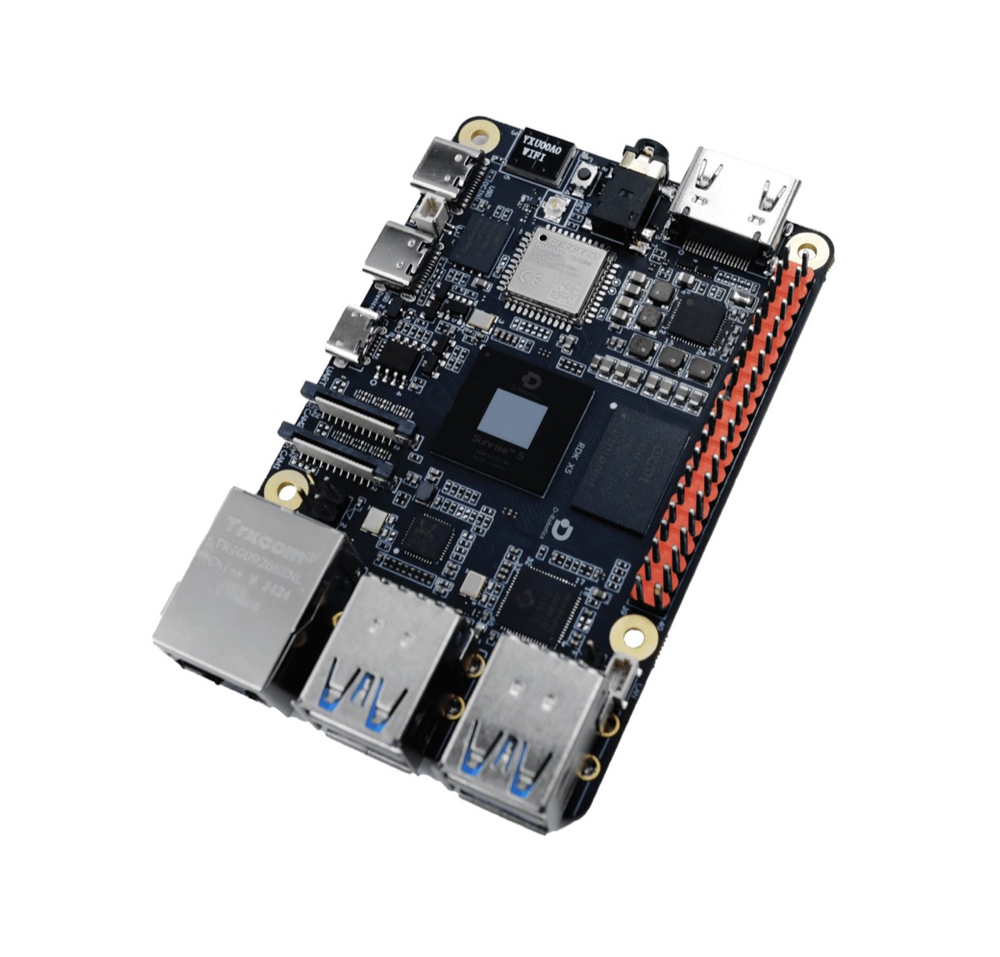
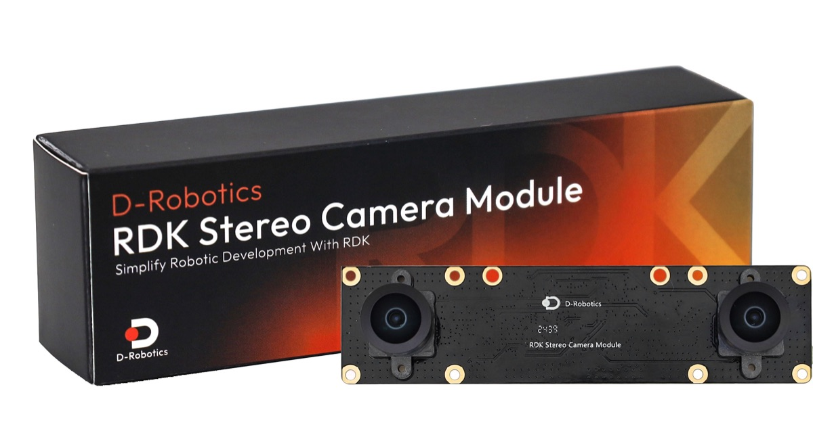
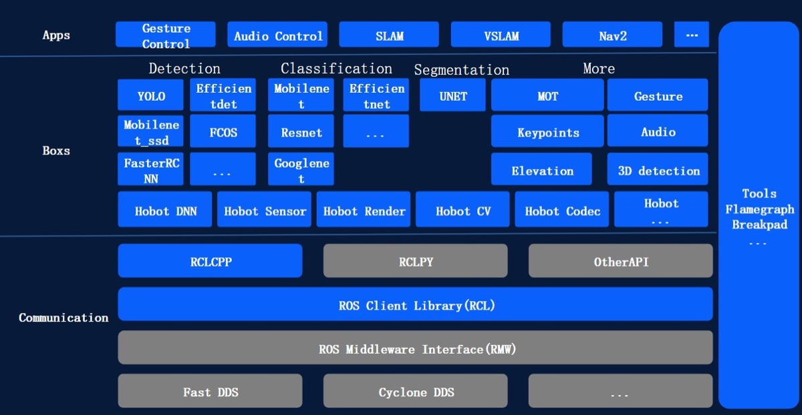
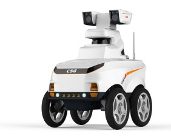
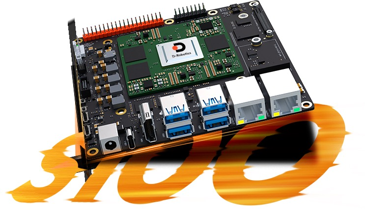
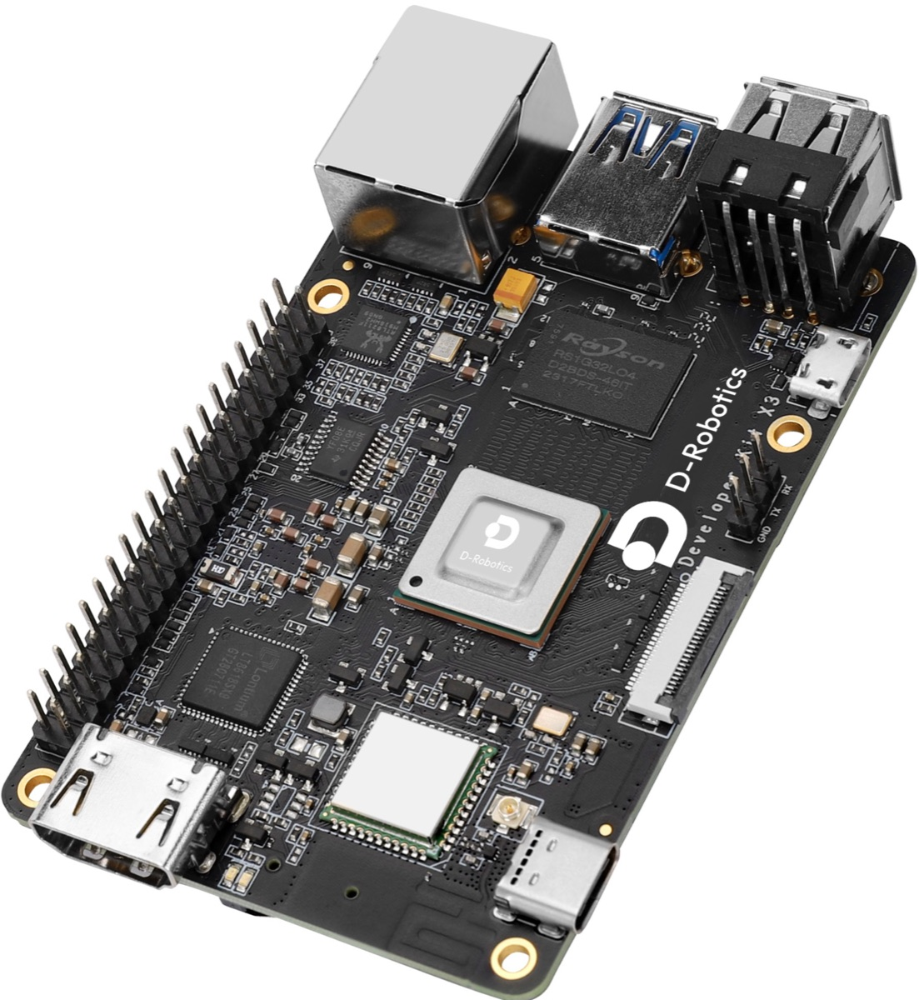

# D-Robotics × T03 — Products and Solutions

⬆ [D-Robotics profile](../D-Robotics.md) · [Brief](D-Robotics-T03-1-Brief.md) · [Playbook](D-Robotics-T03-3-Playbook.md)

**Read this first:** D-Robotics sells compute boards and robot software, not robots. For T03 it is the perception / decision layer of a sorting cell, a patrol robot or a fixed monitoring node. Everything that moves comes from another vendor. Research note: this page is based on official D-Robotics pages and repos; no sustainability-specific deployment turned up in them.

## Relevant products (ranked for this track)

### RDK X5

**Role in T03:** the default choice. Small, cheap, low-power vision computer for waste recognition, litter detection, meter / scene reading, or as the camera brain of another vendor's arm.

| Spec | Value |
|---|---|
| AI accelerator | **10 TOPS** BPU (vendor figure) |
| CPU / RAM | 8x Cortex-A55 @ 1.5 GHz · **4 or 8 GB** LPDDR4 |
| Power input | **5 V / 5 A** USB-C (so the supply caps it at 25 W); measured draw: not public |
| Power over Ethernet | Yes, with the RDK X5 PoE Module accessory |
| Cameras | **2x 4-lane MIPI CSI** (stereo-ready) + 4x USB 3.0 for USB cameras |
| Robot I/O | **CAN FD**, 28 GPIO (UART, PWM, I2C, SPI, I2S), GbE, Wi-Fi 6, Bluetooth 5.4 |
| Size / temperature | 85 x 56 x 20 mm · **−20 to 60 °C** (CNX Software); bare board, no IP rating |
| Storage | microSD only |

- **Status / price:** ✅ shipping · about **USD 90–190** depending on RAM, kit and reseller.
- **Developer access:** full root on Ubuntu 22.04 + ROS 2 Humble. You control cameras, BPU inference (Python / C++), GPIO, PWM and CAN directly. Accelerated ROS 2 nodes install with `apt` from TogetheROS.Bot.

### RDK Stereo Camera family + accessories

**Role in T03:** 3D position of an item for an arm to pick, or obstacle depth for a patrol robot.

| Item | Listed spec |
|---|---|
| RDK Stereo Camera Module | 2 MP stereo ("200W"); baseline and depth range not listed on the product page |
| RDK X5 Camera RS800W | 8 MP, rolling shutter |
| RDK X5 PoE Module | Single-cable power + data for fixed nodes |
| RDK X5 Case | Metal case (useful as minimal protection) |

- **Status / price:** ✅ listed on the official accessories page · prices not shown (reseller only).
- **Developer access:** `mipi_cam` ROS 2 driver; stereo depth via the `hobot_stereonet` node (X5 and S100). The vendor claims under 1 % depth error within 10 m (⚠️ unverified, vendor figure).

### TogetheROS.Bot (TROS)

**Role in T03:** ready-made BPU-accelerated ROS 2 nodes, so you wire perception to a robot instead of writing inference code.

| Node (doc name) | Use in T03 | X5 | S100 |
|---|---|---|---|
| YOLO-World (open vocabulary) | Detect waste classes from text prompts | ✅ | — |
| DOSOD (open vocabulary) | Same idea, also on S boards | ✅ | ✅ |
| YOLO detection / YOLOv8-Seg | Fixed-class detection and masks | ✅ | ✅ |
| EdgeSAM / MobileSAM | Segment an item for grasp planning | ✅ | EdgeSAM only |
| Stereo depth / stereo occupancy | 3D pick point, obstacle avoidance | ✅ | ✅ |
| Vision-language model (`hobot_llamacpp`) | "What is this and which bin?" style reasoning | ✅ | ✅ |
| CLIP text-image retrieval | Zero-shot material classification | ✅ | ✅ |
| SenseVoice ASR + TTS | Voice feedback for a bin or kiosk | ✅ | ✅ |
| SLAM mapping / Navigation2 | Patrol robot navigation | ✅ | ✅ |

- **Status / price:** ✅ free, open source.
- **Developer access:** standard ROS 2 topics. Example: YOLO-World publishes to `/hobot_yolo_world`; the vocabulary is set with the `texts` parameter and can be changed at run time by publishing a string to `/target_words`. The VLM node takes a prompt on `/prompt_text` and answers on `/llama_cpp_node`.

### NodeHub + RDK Model Zoo

**Role in T03:** pre-converted models, which removes the slowest step (model conversion) from a 48-hour build.

| Category | Models listed in `rdk_model_zoo` |
|---|---|
| Detection / segmentation | Ultralytics YOLO (v5u to YOLO26: detect, segment, pose, classify, OBB), YOLOE, FCOS |
| Open vocabulary / zero-shot | YOLO-World (X5 only), CLIP, SigLIP, DINOv2 |
| Promptable segmentation | MobileSAM, EfficientSAM |
| Depth | Depth Anything V2 (S100), YOLO26 Depth |
| VLM / LLM | Gemma4-E2B (VLM), MiniCPM5-2B |
| Robot learning | ACT and Pi0 samples (as submodules) |

- **Status / price:** ✅ free. Main target is RDK X5 (RDK OS 3.5.0 or later); S100 / S100P / S600 also covered; **RDK X3 is archive only**.
- **Developer access:** Python samples per model; your own model still needs OpenExplorer conversion.

### RDK S100

**Role in T03:** only if you need more than the X5: a larger on-board VLM, a learned manipulation policy, or real-time motor control on the same board.

| Spec | Value |
|---|---|
| AI accelerator | **80 TOPS** (S100P: **128 TOPS**) |
| CPU / RAM | 6x Cortex-A78AE + 4x Cortex-R52+ real-time cores · **12 GB** (S100P: 24 GB) |
| VLMs documented in `hobot_llamacpp` | InternVL up to **8B** on S100 (X5: up to 2B) |
| Robot learning | LeRobot **ACT** policy documented on the forum |
| Power / temperature (S100P) | 12–20 V, 90 W adapter · **0–45 °C** |

- **Status / price:** ✅ shipping · S100 about USD 390–630, S100P about USD 899–1,000 (reseller figures).
- **Developer access:** same RDK OS / TROS stack plus MCU cores for motor loops.
- **Sustainability trade-off:** more capable but a much larger power budget than the X5; harder to argue "low-power edge AI".

### RDK X3

**Role in T03:** legacy. The only purpose-built waste demo (`mono2d_trash_detection`) targets it, but the Model Zoo now treats X3 as archive only. Use it only if it is the board you are handed.

| Spec | Value |
|---|---|
| AI accelerator | **5 TOPS** |
| Status | ✅ shipping; price not confirmed |

## What D-Robotics already does in this domain

Honest summary: **no sustainability-branded product, pilot or partnership found.** The adjacent evidence is:

| When | What | Relevance to T03 | Source |
|---|---|---|---|
| Date not public | **GOAT G1 robotic lawn mower** shown on the official home page as a product built on its chips (centimetre-level positioning, obstacle avoidance) | Green-space care, outdoor autonomy | [Official site](https://en.d-robotics.cc/) |
| Date not public | Open-source ROS 2 **garbage-detection node** `mono2d_trash_detection` (PPYOLO trained with PaddleDetection, listed for RDK X3) | Litter / waste detection starting point | [GitHub](https://github.com/D-Robotics/mono2d_trash_detection) |
| Date not public | YOLO-World node for RDK X5 ships with the default vocabulary **"red bottle, trash bin"** | Shows waste items are a tested example case | [GitHub](https://github.com/D-Robotics/hobot_yolo_world) |
| 2026 (blog, exact date not visible) | Community post about a robot arm with an RDK "AI brain" that sorts cubes | Sorting-cell pattern | [Blog index](https://en.d-robotics.cc/blog) |
| 2026 (blog, exact date not visible) | **Kago** rideable AI outdoor wagon on Kickstarter, powered by D-Robotics | Outdoor light logistics | [Blog index](https://en.d-robotics.cc/blog) |
| Sep 2026 | xLean TR1 floor-washing robot and other consumer robots on Sunrise chips at IFA | Cleaning automation | [Profile](../D-Robotics.md) |

## What they are building next in this domain

- Nothing announced that targets waste, energy or environmental monitoring.
- **Stated direction:** chips at every compute tier plus a full robot software platform; consumer robots (mowers, cleaners, companions) up to humanoids. See the [profile](../D-Robotics.md).
- **Recent official blog topics (2026):** choosing edge computers for mobile robots (mentions camera-only mowers), Ultralytics YOLO benchmarks on RDK, and the open-source **X-Lens** real-time metric depth model (40 M parameters).
- **Inference (not a company statement):** outdoor consumer robots such as mowers are the closest thing to a "sustainable city" product line; expect more camera-only outdoor autonomy rather than recycling or energy products.

## Software, models and data that help for this track

| Asset | What you get | Link |
|---|---|---|
| `hobot_yolo_world` | Text-prompted detection on X5; runtime vocabulary via `/target_words` | [GitHub](https://github.com/D-Robotics/hobot_yolo_world) |
| `hobot_llamacpp` | On-board VLMs: SmolVLM2-256M / 500M, InternVL2.5-1B, InternVL3-1B / 2B on X5 (8B on S100). Sample X5 log: about **20 tokens/s** generation | [GitHub](https://github.com/D-Robotics/hobot_llamacpp) |
| `rdk_model_zoo` | Pre-converted YOLO, SAM, CLIP, depth, ACT / Pi0 samples | [GitHub](https://github.com/D-Robotics/rdk_model_zoo) |
| `mono2d_trash_detection` | Garbage detector + links to training and conversion tutorials (X3 era) | [GitHub](https://github.com/D-Robotics/mono2d_trash_detection) |
| TROS docs | Stereo depth, SLAM, Navigation2, ASR / TTS, "Vision-Speech Box" app | [TROS docs](https://developer.d-robotics.cc/tros_doc/en/tros) |
| Datasets | D-Robotics publishes no waste dataset. Public sets such as TACO or TrashNet are the usual choice (third party; check licences) | — |

## Gaps and limits for this track

- **No actuation:** no arm, gripper, base or conveyor. A physical T03 demo needs a second vendor.
- **No domain product:** no waste, energy, water or air-quality solution, sensor or reference design.
- **Open vocabulary has limits:** the YOLO-World node reads text features from a local library; which words are covered is not documented (⚠️ unverified). Its sample log suggests seconds, not milliseconds, per first inference.
- **Custom models cost time:** ONNX → INT8 conversion with OpenExplorer on an x86 machine; compiled models are board-specific.
- **Power numbers:** no official measured power draw for the X5; bring a USB-C power meter if "low power" is your pitch.
- **Environment:** bare boards, no IP rating. X5 is listed at −20 to 60 °C by trade press, S100P at 0–45 °C; neither is weatherproof.
- **Legacy mismatch:** the one waste-specific demo targets the RDK X3, which the Model Zoo now treats as archive only.
- **Ecosystem:** no CUDA; fewer third-party tutorials than Jetson.

## Sources

- [D-Robotics official site (EN)](https://en.d-robotics.cc/)
- [RDK X5 product page](https://en.d-robotics.cc/rdkx5)
- [Accessories page](https://en.d-robotics.cc/accessories)
- [D-Robotics blog index](https://en.d-robotics.cc/blog)
- [Introduction to TogetheROS.Bot (feature and board support table)](https://developer.d-robotics.cc/tros_doc/en/tros)
- [GitHub: rdk_model_zoo](https://github.com/D-Robotics/rdk_model_zoo)
- [GitHub: hobot_yolo_world](https://github.com/D-Robotics/hobot_yolo_world)
- [GitHub: hobot_llamacpp](https://github.com/D-Robotics/hobot_llamacpp)
- [GitHub: mono2d_trash_detection](https://github.com/D-Robotics/mono2d_trash_detection)
- [CNX Software: RDK X5](https://www.cnx-software.com/2025/06/30/d-robotics-rdk-x5-development-board-features-sunrise-x5-octa-core-soc-with-10-tops-bpu-for-ros-projects/)
- [D-Robotics company profile (S100 / S100P specs, prices, LeRobot ACT, IFA 2026; see its source list)](../D-Robotics.md)
