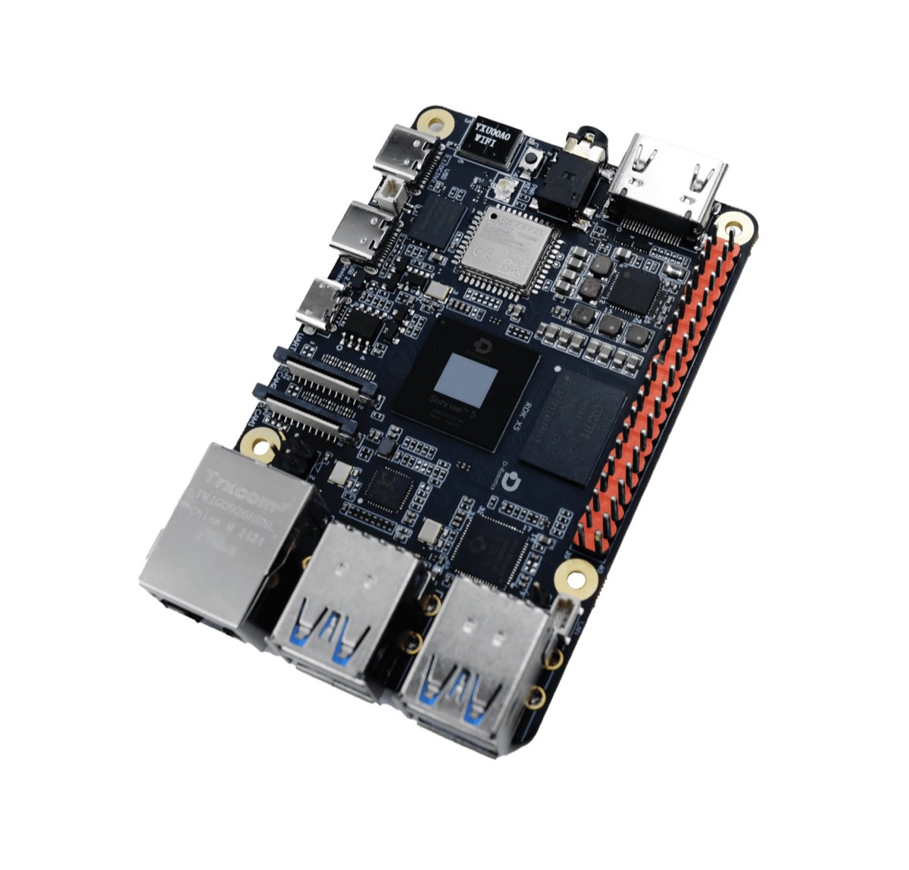
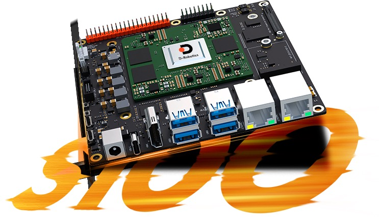
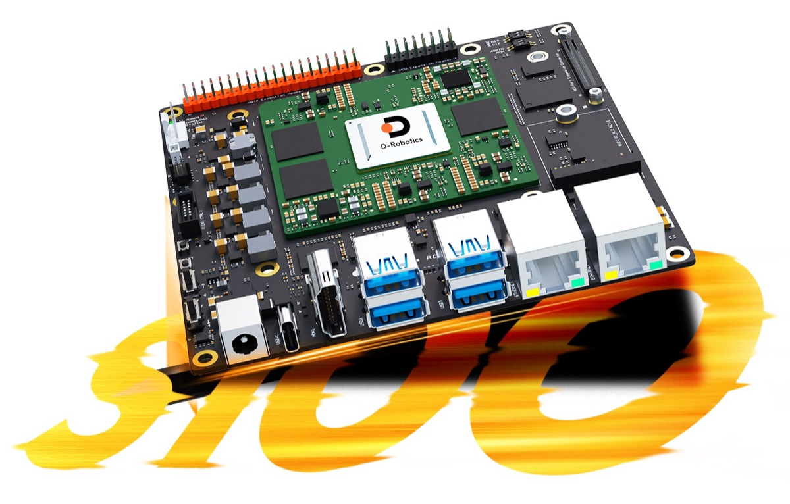
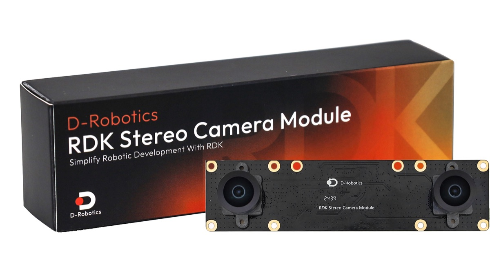
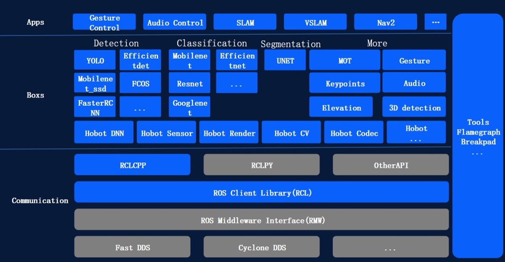
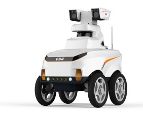

# D-Robotics × T04 — Products and Solutions

⬆ [D-Robotics profile](../D-Robotics.md) · [Brief](D-Robotics-T04-1-Brief.md) · [Playbook](D-Robotics-T04-3-Playbook.md)

**Read this first:** D-Robotics sells robot compute (boards + ROS 2 software), not robots. For T04 its role is the **sensing and on-device AI layer**: fall / pose / gesture / voice / small VLM. Payload, reach, force control and IP rating do not apply; those come from whichever robot you pair it with. What they bring on site is not confirmed (see profile).

## Relevant products (ranked for this track)

### RDK X5

**Role in T04:** the default pick. A low-cost camera node for fall detection, exercise / pose tracking, gesture input and voice prompts; small enough to mount in a room, on a walker or on another vendor's robot.

| Track-relevant spec | Value |
|---|---|
| AI compute | **10 TOPS** BPU · 8x Cortex-A55 · **4 or 8 GB** RAM |
| Body + head + face + hand detection with body keypoints | **125 FPS** model inference (camera-limited to about 30 FPS in the sample log) |
| Fall detection app | ✅ documented for RDK X3 / X5 |
| Hand gestures | 8 static (ThumbUp, Victory, Mute, Palm, Okay, ThumbLeft, ThumbRight, Awesome) + 3 dynamic pinch gestures; X3 / X5 |
| Voice | Offline ASR (`sensevoice_ros2`), TTS (`hobot_tts`) |
| On-device VLM | SmolVLM2-256M / 500M, InternVL2.5-1B, InternVL3-1B / 2B via `hobot_llamacpp`; sample log about **20 tokens/s** generation, about 11 s model load |
| Cameras | MIPI or USB (`CAM_TYPE=mipi|usb`); two USB cameras at once need a UVC bandwidth workaround (forum) |
| OS | Ubuntu 22.04 + ROS 2 Humble (TogetheROS.Bot via `apt`) |

- **Status / price:** ✅ shipping · about **USD 100–190** depending on RAM / kit / reseller.
- **Developer control:** full root Linux; Python / C++; every result is a ROS 2 topic; browser preview of boxes and keypoints at `http://<board-IP>:8000`.

### RDK S100

**Role in T04:** step up when you want a larger on-board VLM ("describe what the resident is doing"), a talking avatar, or a learned manipulation policy next to perception.

| Track-relevant spec | Value |
|---|---|
| AI compute | **80 TOPS** · 6x Cortex-A78AE + 4x Cortex-R52+ real-time cores · **12 GB** RAM |
| Pose | `mono2d_yolo_pose` node listed for S100 / S600; Ultralytics YOLO pose in the Model Zoo |
| Person following | `reid` node (X5 / S100 / S600) |
| VLM / LLM | `hobot_llamacpp` up to InternVL3-8B; DeepSeek LLM node (`hobot_xlm`); Model Zoo: Gemma4-E2B VLM chat, MiniCPM5-2B |
| Speech / avatar | Model Zoo: Wav2Vec2 ASR, Paraformer, keyword spotting, LiteAvatar audio-driven avatar |
| Depth | Stereo depth (`hobot_stereonet`), Depth Anything V2 |
| Robot learning | LeRobot **ACT** policy on SO-100 arms: about **50 ms** on the BPU to generate 50 actions (forum post, Apr 2025) |

- **Status / price:** ✅ shipping · RMB 2,799 at launch; resellers USD 440–630+.
- **Developer control:** same ROS 2 stack; R52+ cores can run motor loops. ⚠️ unverified whether the X5 fall-detection package runs unchanged on S100 (it is documented for X3 / X5 only).

### RDK S100P

**Role in T04:** same as S100 with more headroom (**128 TOPS**, **24 GB**) for a VLM plus perception plus policy at once. Only worth it if a unit is actually on the table.

- **Status / price:** ✅ (limited outside China) · USD 899–999.
- **Limits:** operating range **0–45 °C** (indoor care use is fine); BMI088 IMU on the MCU expansion board unsupported in some OS versions.

### RDK Stereo Camera family + accessories

**Role in T04:** metric depth for "how far is the person from the bed / chair / robot", gait distance, or obstacle-free approach by a mobile robot.

- Stereo depth node on X5 / S100; stereo occupancy node available.
- Camera specs (baseline, range, FoV): not confirmed here; check the unit on site.
- **Status:** ✅ · price not confirmed.

### TogetheROS.Bot (TROS)

**Role in T04:** where the 48-hour shortcuts live. Install with `apt`, launch one file per capability.

| Capability | Package | Boards (per docs) |
|---|---|---|
| Body / head / face / hand boxes + body keypoints + tracking IDs | `mono2d_body_detection` | X3, X5 |
| **Fall detection** from keypoints | `hobot_falldown_detection` | X3, X5 |
| Skeleton pose (YOLO) | `mono2d_yolo_pose` | S100, S600 |
| Hand keypoints, gestures | `hand_lmk_detection`, `hand_gesture_detection`, MediaPipe variant | X3, X5 (MediaPipe: X5, S100) |
| Face landmarks (106 pts), face age | `mono_face_landmarks_detection`, `mono_face_age_detection` | X3, X5 |
| Person following | `reid` | X5, S100, S600 |
| Offline ASR + wake word | `sensevoice_ros2` | X3, X5, S100, S100P, S600 |
| TTS | `hobot_tts` | X3, X5, S100, S600 |
| VLM / LLM | `hobot_llamacpp`, `hobot_xlm` | X5, S100 / S100 |
| SLAM, Navigation2 | `slam`, `navigation2` | X3, X5, S100 |

- **Status:** ✅ free, open source.

### NodeHub + RDK Model Zoo

**Role in T04:** pre-converted models so you skip the quantization toolchain. Model Zoo targets X5, S100, S100P, S600 (X3 branch is archived). The English NodeHub page showed an empty project list when checked today; use the TROS docs and GitHub instead.

### RDK Studio

**Role in T04:** convenience only: flashing, device management, terminals. Saves setup time in the first hours.

**Not ranked:** RDK S600 (🧪, reported China-only), RDK Ultra (status unverified), cloud platform (🧪, not needed for 48 hours), RDK X3 (works for fall detection but Model Zoo support is archived).

## What D-Robotics already does in this domain

**Nothing care- or rehab-specific was found:** no clinical pilot, care-home deployment, medical partner or T04-style application page.

Adjacent evidence only:

| Date | What | Relevance | Source |
|---|---|---|---|
| Docs current; repo last updated **30 Jul 2024** | "Pose detection" app in TogetheROS.Bot that currently supports only **fall detection** (X3 / X5). Docs test it by rotating the camera 90° | A reference demo, not a validated product | [TROS docs](https://developer.d-robotics.cc/tros_doc/en/apps/fall_detection) · [GitHub](https://github.com/D-Robotics/hobot_falldown_detection) |
| Sep 2026 (IFA Berlin) | TCL "hey AiMe" **companion robot** shown as a Sunrise-chip product (exact chip not stated) | Companionship hardware in the consumer market | [OpenELAB](https://openelab.io/blogs/learn/d-robotics-ifa-2026-home-robot-ai-chips-rdk) |
| Mar 2026 (embedded world) | Gravity Program start-ups: "Aura" home companion, "BirdieSense" golf coaching system (no technical detail published) | Home-companion and movement-coaching start-ups in the ecosystem | [D-Robotics blog](https://en.d-robotics.cc/blog/d-robotics-returns-to-embedded-world-2026-with-the-theme-intelligence-embedded-robotics-reborn) |
| Sep 2026 | S600 customers include Fourier (a humanoid maker with rehabilitation-robot roots); whether any care product uses the chip is not public | Indirect | [Kyodo PR Wire](https://kyodonewsprwire.jp/release/202609176168) |
| Apr 2025 | LeRobot ACT on SO-100 arms with RDK S100 / X5 | Basis for a learned handover / fetch skill | [Forum](https://forum-en.d-robotics.cc/t/lerobot-act-policy-on-rdk/391) |

## What they are building next in this domain

- **Announced:** nothing aimed at care or rehabilitation.
- **Announced, general:** Sunrise chips at every compute tier plus a full robot software platform (2026 funding rounds); S600 for on-device VLA / VLM (🧪, China-only so far).
- **Inference (not a company statement):** the consumer push (companion robots, home robots at IFA 2026) makes home monitoring and companionship the nearest route into elder care; expect partners, not D-Robotics, to ship care products.

## Software, models and data that help for this track

| Need | Shortcut | Note |
|---|---|---|
| Fall event | `ros2 launch hobot_falldown_detection hobot_falldown_detection.launch.py` | Sensitivity parameter 0–3; publishes an event per tracked person ID |
| Joint angles for exercise coaching | Keypoints from `mono2d_body_detection` (X5) or `mono2d_yolo_pose` (S100) | 2D only: compute angles in the image plane; place the camera side-on or front-on |
| Language-free "I'm OK / help" reply | `hand_gesture_detection` (ThumbUp, Palm ...) | Avoids speech-language problems |
| Voice check-in | `sensevoice_ros2` (offline, wake word) + `hobot_tts` | Examples and defaults are Chinese; German / French support not stated ⚠️ unverified |
| Scene understanding | `hobot_llamacpp` VLM on a camera topic | Seconds per answer on X5; use for slow "what happened" summaries, not alarms |
| Learned arm skill | [rdk_LeRobot_tools](https://github.com/D-Robotics/rdk_LeRobot_tools) + ACT | Needs data collection, GPU training (about 4 h in the post) and model conversion |
| Datasets | None for elderly, falls or rehab from D-Robotics | Bring your own or record on site |

## Gaps and limits for this track

- **No actuation:** cannot lift, fetch, feed or massage without another vendor's hardware.
- **No force sensing or safety rating:** developer boards; not medical devices, not safety controllers.
- **Fall demo is basic:** keypoint-based, documented for X3 / X5, repo untouched since mid-2024; expect false alarms (lying on a sofa, bending) until you add your own logic.
- **Board fragmentation:** nodes differ between X5 and S100; compiled models are board-specific; custom models need the OpenExplorer quantization step.
- **Language:** stock speech examples are Chinese; Leukerbad guests speak German, French, English.
- **Research note:** web search was unavailable for this pass; findings come from official docs, official GitHub and the profile's sources. A care deployment that exists only in Chinese-language press could have been missed.

## Sources
- [TogetheROS.Bot docs index](https://developer.d-robotics.cc/tros_doc/en/tros)
- [TROS: pose (fall) detection app](https://developer.d-robotics.cc/tros_doc/en/apps/fall_detection)
- [TROS: human body detection and keypoints](https://developer.d-robotics.cc/tros_doc/en/boxs/body/mono2d_body_detection)
- [TROS: hand gesture recognition](https://developer.d-robotics.cc/tros_doc/en/boxs/body/hand_gesture_detection)
- [GitHub: hobot_falldown_detection](https://github.com/D-Robotics/hobot_falldown_detection)
- [GitHub: hobot_llamacpp](https://github.com/D-Robotics/hobot_llamacpp)
- [GitHub: sensevoice_ros2](https://github.com/D-Robotics/sensevoice_ros2)
- [GitHub: rdk_model_zoo](https://github.com/D-Robotics/rdk_model_zoo)
- [NodeHub](https://developer.d-robotics.cc/en/nodehub)
- [Forum: LeRobot ACT policy on RDK](https://forum-en.d-robotics.cc/t/lerobot-act-policy-on-rdk/391)
- [D-Robotics blog: embedded world 2026](https://en.d-robotics.cc/blog/d-robotics-returns-to-embedded-world-2026-with-the-theme-intelligence-embedded-robotics-reborn)
- [OpenELAB: D-Robotics at IFA 2026](https://openelab.io/blogs/learn/d-robotics-ifa-2026-home-robot-ai-chips-rdk)
- [Kyodo PR Wire: Series C (17 Sep 2026)](https://kyodonewsprwire.jp/release/202609176168)
- [D-Robotics profile (general research and prices)](../D-Robotics.md)
