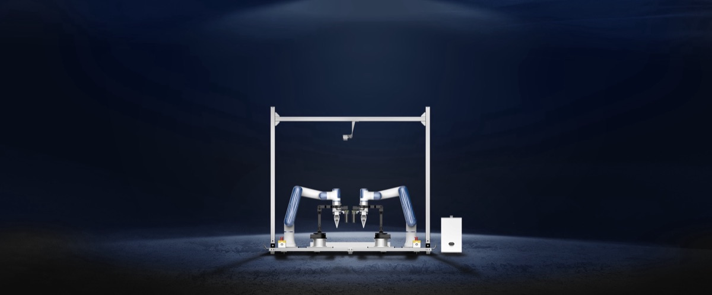

# Dobot Robotics — Developer Guide (hackathon edition)

⬆ [Dobot Robotics profile](Dobot.md) · [Product portfolio](Dobot-Products.md) · [Roadmap and strategy](Dobot-Roadmap-and-Strategy.md)

> **Scope.** Covers every Dobot platform with public developer material: 6-axis arms (CRA / CRAF / CRS / CR 30H / Nova / Magician E6), 4-axis arms (MG400 / M1 Pro), X-Trainer, Atom humanoid (Atom, Atom Max, Atom-W, Atom D), Rover X1 quadruped and the Hexplorer hexapod. What is physically at Leukerbad is **not confirmed** — ask the booth for model, controller firmware (V3 or V4) and end-effector before you clone anything.
> **How this was checked.** Repo READMEs, the official TCP/IP V4 interface guide (PDF) and the Atom SDK guide v2.1 (PDF) were opened on 2026-11-14. Anything not seen in those is marked ⚠️ unverified.


## TL;DR — how you program it

- **Arms = plain TCP sockets.** Every 6-axis arm on V4 firmware (CRA, CRAF, CR 30H, Nova 2 / 5, Magician E6) takes ASCII commands such as `MovJ(...)` on port **29999** and streams a 1,440-byte state packet every **8 ms** on port **30004**. No licence, no vendor runtime; Python wrapper is one file (`dobot_api.py`).
- **Streaming control tops out at about 33 Hz.** `ServoJ` / `ServoP` (joint / Cartesian target following) are the "real-time" interface; Dobot recommends a **30 ms** call interval (minimum point time 0.02 s). There is **no public joint-torque command** for the arms.
- **ROS 2 Humble is first-class.** `DOBOT_6Axis_ROS2_V4` (MIT, V4.6.5) ships URDF / Xacro, MoveIt configs and Gazebo launch files for **12 models** including Nova 2, Nova 5, E6, CR5 and CR30H.
- **Learning stack is thin but real.** Official LeRobot-format dataset + ACT checkpoint for CR5A (simulation), X-Trainer teleop / HDF5 recorder, Isaac Gym RL frameworks for Atom and the quadruped, DobotTrack VLA weights. The flagship models (**KONGYI / DobotWAM, DOBOT-VLA, ROM-1**) are closed.
- **Legged and humanoid robots use DDS + RPC, not the arm protocol.** Atom: CycloneDDS at about **833 Hz** plus RPC from the on-board PC2. Rover X1: gRPC high level (works over Wi-Fi) and CycloneDDS low level (wired only).

## SDKs and interfaces

**Which repo for which robot**

| Robot on the table | Firmware | Use this |
|---|---|---|
| CRA, CRAF, CRS, CR 30H, Nova 2 / 5, Magician E6 | V4 (4.4+) | `TCP-IP-Python-V4`, `TCP-IP-CR-CPP-V4`, `DOBOT_6Axis_ROS2_V4` |
| Older CR3 / CR5 / CR10 / CR16, Nova on old firmware | V3 (3.5.5+) | `TCP-IP-Python-V3`, `TCP-IP-CR-CPP-V3`, `DOBOT_6Axis_ROS2_V3` |
| MG400, M1 Pro | 4-axis protocol | `TCP-IP-4Axis-Python`, `TCP-IP-4Axis-CPP`, `MG400_ROS`, `M1Pro-ROS` |
| Magician, Magician Lite, Magician Go | USB serial protocol | DobotLab / DobotStudio, `Magician_ROS` (2022, ROS 1) |
| X-Trainer | Nova 2 V4 + leader arms | `dobot_xtrainer`, `Embodylink` |
| Atom family | — | `dobot_atom_sdk`, `dobot_atom_ros2`, `dobot_atom_urdf`, `atom-locomotion-training` |
| Rover X1 (legged / wheel-legged) | — | `dobot_quad_sdk`, `dobot_rover_simulation` |
| Hexplorer hexapod | — | `dobot_hex_sdk` |

**Full register** (last push dates from the GitHub API on 2026-11-14)

| SDK / repo | Language | What it controls | Link | Notes |
|---|---|---|---|---|
| TCP-IP-Python-V4 | Python 3.6+ | CRA / E6 / Nova (V4) | [GitHub](https://github.com/Dobot-Arm/TCP-IP-Python-V4) | ✅ MIT. Pushed **2026-11-13**. `dobot_api.py` (Dashboard + Feedback classes), `main.py`, Tk GUI `ui.py`, `GetError` alarm lookup. Needs only `numpy`, `requests` |
| TCP-IP-CR-CPP-V4 | C++11 | CRA / E6 (V4.4+) | [GitHub](https://github.com/Dobot-Arm/TCP-IP-CR-CPP-V4) | ✅ MIT. Linux x86 / ARM and Windows (Visual Studio). README documents controller IPs and ports |
| TCP-IP-Protocol-6AXis-V4 | PDF | Protocol reference (V4) | [GitHub](https://github.com/Dobot-Arm/TCP-IP-Protocol-6AXis-V4) | ✅ "TCP_IP Remote Control Interface Guide V4.5.1" (EN + CN). The authoritative command list |
| TCP-IP-V4-CSharp · TCP-IP-CRA-E6-Java-main · TCP-IP-V4-MATLAB · TCP-IP-CRA-E6-LabVIEW-main | C#, Java, MATLAB, LabVIEW | CRA / E6 (V4) | [C#](https://github.com/Dobot-Arm/TCP-IP-V4-CSharp) · [Java](https://github.com/Dobot-Arm/TCP-IP-CRA-E6-Java-main) · [MATLAB](https://github.com/Dobot-Arm/TCP-IP-V4-MATLAB) · [LabVIEW](https://github.com/Dobot-Arm/TCP-IP-CRA-E6-LabVIEW-main) | ✅ Demo wrappers; less actively maintained than Python |
| DOBOT_6Axis_ROS2_V4 | C++ / Python | CR3 / 5 / 7 / 10 / 12 / 16 / 20, CR30H, CR10AF, E6, Nova 2, Nova 5 | [GitHub](https://github.com/Dobot-Arm/DOBOT_6Axis_ROS2_V4) | ✅ MIT. Ubuntu 22.04 + **ROS 2 Humble**. MoveIt, Gazebo, RViz. Pushed 2026-11-06 |
| DOBOT_6Axis_ROS2_V3 | Python | CR3 / 5 / 7 / 10 / 12 / 16 (V3) | [GitHub](https://github.com/Dobot-Arm/DOBOT_6Axis_ROS2_V3) | ✅ ROS 2 Humble, MoveIt + Gazebo |
| TCP-IP-ROS-6AXis | C++ | CR / CRA / E6 / Nova | [GitHub](https://github.com/Dobot-Arm/TCP-IP-ROS-6AXis) | ✅ MIT. **ROS 1** Kinetic / Melodic / Noetic |
| TCP-IP-Python-V3 · TCP-IP-CR-CPP-V3 · TCP-IP-Protocol-6AXis-V3 | Python, C++, PDF | CR / Nova on V3.5.5+ | [Python](https://github.com/Dobot-Arm/TCP-IP-Python-V3) · [C++](https://github.com/Dobot-Arm/TCP-IP-CR-CPP-V3) · [Protocol](https://github.com/Dobot-Arm/TCP-IP-Protocol-6AXis-V3) | ✅ Legacy generation; different ports and command syntax |
| TCP-IP-4Axis-Python · TCP-IP-4Axis-CPP · TCP-IP-Protocol-4AXis | Python, C++, PDF | MG400 / M1 Pro | [Python](https://github.com/Dobot-Arm/TCP-IP-4Axis-Python) · [C++](https://github.com/Dobot-Arm/TCP-IP-4Axis-CPP) · [Protocol](https://github.com/Dobot-Arm/TCP-IP-Protocol-4AXis) | ✅ MIT. Separate protocol variant |
| MG400_ROS · M1Pro-ROS · Magician_ROS | C / C++ | MG400, M1 Pro, Magician | [MG400](https://github.com/Dobot-Arm/MG400_ROS) · [M1 Pro](https://github.com/Dobot-Arm/M1Pro-ROS) · [Magician](https://github.com/Dobot-Arm/Magician_ROS) | ✅ ROS 1, last touched 2022–2024 |
| dobot_ros2_vision | Python | CR3 vision workstation | [GitHub](https://github.com/Dobot-Arm/dobot_ros2_vision) | ⚠️ README says it works **only** on Dobot's EG0053-01 training bench; uses CUDA 11.8 |
| dobot_xtrainer | Python (PyQt) | X-Trainer teleop + data processing | [GitHub](https://github.com/Dobot-Arm/dobot_xtrainer) | ✅ GPL-3.0. Depends on `pyrealsense2`, `h5py`, Dynamixel and Feetech servo SDKs. README is two lines |
| Embodylink (DobotRX) | Python / Qt 5.12 | Data collection, annotation, training management, teleop | [GitHub](https://github.com/Dobot-Arm/Embodylink) | ✅ GPL-3.0-only. Ubuntu 20.04.6, Python 3.8. README covers build / packaging only |
| dobot_atom_sdk | C++ | Atom high-level RPC + low-level DDS | [GitHub](https://github.com/Dobot-Arm/dobot_atom_sdk) | ✅ Ubuntu 20.04, GCC 9.4. Samples: `rpc_test`, `bridge_test`, `record_joint`, `joystick_control_amr` |
| dobot_atom_ros2 | C++ | Atom ROS 2 topics, URDF, Gazebo | [GitHub](https://github.com/Dobot-Arm/dobot_atom_ros2) | ✅ Foxy (20.04) or Humble (22.04); CycloneDDS |
| dobot_atom_urdf | URDF | Atom, Atom-W models | [GitHub](https://github.com/Dobot-Arm/dobot_atom_urdf) | ✅ Model files only |
| atom-locomotion-training ("ATOM Learning") | Python | RL locomotion for Atom (P2 / P3) | [GitHub](https://github.com/embodied-dobot/atom-locomotion-training) | ✅ Isaac Gym Preview 4 → MuJoCo sim2sim; PPO; ONNX export. Hosted in a third org, `embodied-dobot` |
| dobot_quad_sdk | Python 3.10+ / C++ | Rover X1, legged and wheel-legged | [GitHub](https://github.com/Dobot-Team/dobot_quad_sdk) | ✅ MIT. gRPC high level + CycloneDDS low level; Ubuntu 22.04; Docker file included |
| dobot_rover_simulation | Python | Quadruped RL training + sim2real | [GitHub](https://github.com/Dobot-Team/dobot_rover_simulation) | ✅ BSD-3. `dobot_rl_gym` (legged_gym refactor, Isaac Gym, MuJoCo sim2sim) + `dobot_sim2real` (ONNX deploy) |
| dobot_hex_sdk | C++ | Hexplorer hexapod joint motors | [GitHub](https://github.com/Dobot-Team/dobot_hex_sdk) | ✅ MIT |
| dobot_ethernet_master_sdk | C / C++ | Up to 30 servo motors over UDP, 1 ms cycle | [GitHub](https://github.com/Dobot-Team/dobot_ethernet_master_sdk) | ⚠️ Badge says proprietary licence; x86_64 and aarch64 `.so` only |
| dobot_track · dobot_roam | Python | Person-following and roaming VLA policies | [dobot_track](https://github.com/Dobot-Team/dobot_track) · [dobot_roam](https://github.com/Dobot-Team/dobot_roam) | ✅ / 🧪 Research code; see [Papers and research](Dobot-Papers-and-Research.md) |
| voice_txt_command | C++ / Python | Voice → Whisper → Grounding DINO → KCF tracker | [GitHub](https://github.com/Dobot-Arm/voice_txt_command) | ✅ Perception demo, robot-agnostic; benchmarked on an RTX 5090 |
| dobotplus · DebugTools · DobotVisionStudio_QtModule · DobotCameraCalibrate | HTML / Qt | Dobot+ plugins, studio plugins, Hikrobot VisionMaster bridge, camera calibration | [Dobot-Arm org](https://github.com/Dobot-Arm) | Tooling around DobotStudio Pro; not needed for a first demo |
| DobotStudio Pro · CRStudio app | Blockly, Lua | All arms | [Download center](https://www.dobot-robots.com/service/download-center) | ✅ No-code path; also the place to switch the controller into TCP/IP mode |
| Siemens SRCI function blocks | PLC (TIA Portal) | Dobot cobots over PROFINET | [Dobot news](https://www.dobot-robots.com/insights/news/dobot-integrates-siemens-srci-for-faster-plc-controlled-cobot-deployment.html) | 🧪 "Limited release" announced Jan 2026 |
| RiACT RiFLEX | No-code app layer | CRA / CRH cobots | [Dobot news](https://www.dobot-robots.com/insights/news/dobot-and-riact-formalize-partnership-to-democratize-smart-automation.html) | ✅ Third-party (Danish) robot OS, partnership formalised Jul 2026 |

## Control levels

**6-axis arms (V4 TCP/IP protocol)**

| Level | Interface | Rate / limits | Notes |
|---|---|---|---|
| Task / script | `RunScript(project)` runs a DobotStudio Pro Blockly or Lua project | — | Blockly projects are saved with a `blockly_` prefix |
| Point-to-point motion | `MovJ`, `MovL`, `Arc`, `Circle`, `MovLIO` / `MovJIO`, relative moves (`RelMovJTool`, `RelMovLUser`, `RelJointMovJ` …), `RunTo`, `StartPath` (replay a recorded trajectory) | Queued; each returns a queue ID | Targets as `pose={x,y,z,rx,ry,rz}` (mm, deg) or `joint={j1..j6}`; optional `user`, `tool`, `a`, `v`, `cp` |
| Streaming servo | `ServoJ(joints, t, aheadtime, gain)`, `ServoP(pose, …)` | Recommended **33 Hz** (30 ms); `t` ≥ **0.02 s**; `aheadtime` 20–100, `gain` 200–1000 | Not scaled by the global speed factor, but still clamped by speed limits. This is what teleop and learned policies use |
| State feedback | Port **30004** | **8 ms** (125 Hz), 1,440-byte little-endian packet | Joint position / speed / current / torque (target and actual), TCP pose and speed, TCP force (estimated from current **and** raw 6-axis sensor value), DI / DO, robot mode, collision and SafeSkin flags, quaternions. Ports 30005 (200 ms) and 30006 (50 ms default) carry the same data slower |
| Force control | `EnableFTSensor`, `SixForceHome`, `GetForce`, `ForceDriveMode`, `FCForceMode`, `FCSetStiffness` / `FCSetDamping` / `FCSetMass` / `FCSetForce`, `FCOff` | — | In the Python V4 API; needs a flange 6-axis sensor (**CRAF**, or an added sensor). Not in the V4.5.1 PDF — newer firmware (API is at **V4.6.5**) ⚠️ check controller version |
| Hand guiding | `StartDrag` / `StopDrag`, `DragSensivity` | — | Joint drag on all cobots; force-control drag with a sensor |
| Safety settings | `SetCollisionLevel(0–5)`, `SetBackDistance`, `SetPostCollisionMode`, `EnableSafeSkin`, `SetSafeWallEnable`, `SetWorkZoneEnable` | — | Level 0 disables collision detection — do not |
| I/O and fieldbus | `DO` / `DOInstant`, `DI`, `AO` / `AI`, `ToolDO`, `ToolDI`, `SetTool485`, `SetToolPower`; Modbus TCP / RTU master (`ModbusCreate`, `GetHoldRegs` …) | — | "Instant" variants bypass the motion queue. RS485 at the flange drives most electric grippers |
| Kinematics | `PositiveKin`, `InverseKin`, `GetAngle`, `GetPose` | — | Controller IK uses the calibrated DH model (the ROS 2 package uses it for final accuracy) |
| Process packages | Conveyor tracking (`CnvInit`, `StartSyncCnv` …), pallet (`CreateTray`), welding and seam tracking | — | In the Python API; useful for a T03 conveyor-sorting demo |
| Joint torque / current command | **Not exposed** | — | The feedback packet reports a "torque mode" flag, but no public command sets joint torque. Research papers treat Dobot arms as position-commanded black boxes (see [Papers and research](Dobot-Papers-and-Research.md)) |

**Other platforms**

| Platform | High level | Low level | Rates |
|---|---|---|---|
| X-Trainer | Leader-follower teleop GUI; open APIs for leader / follower joints, gripper, RGB-D | Follower arms are Nova 2 → same V4 protocol | **25 Hz** end-to-end interface (product page) |
| Atom family | RPC: state-machine switch (`SetFsmId`), base velocity (`SetVel(vx, vy, vyaw, duration)`), upper-limb control switch, whole-body RPC, TTS / ASR audio services, SLAM navigation (mapping, localisation, single-point goals) | DDS: per-joint `q_ref`, `dq_ref`, `tau_forward` for legs and arms, dexterous-hand commands, wheeled-chassis (AMR) velocity. **Requires debug mode** | Upper / lower body state and command topics about **833 Hz** (1,200 µs cycle); hands about 125 Hz; chassis state 40 Hz; BMS 10 Hz |
| Rover X1 | gRPC: state machine, velocity commands, balance-stand pose (roll / pitch / yaw / height), choreographed motions, LEDs, wheel / leg mode, RTSP video | CycloneDDS: motor commands, IMU, motor and battery state, RGB + depth streams. Run `kill_robot` first to stop the stock controller | Loop rates not stated in the README |
| Hexplorer | ROS 2, high-level SDK (Python / C++) | Low-level SDK, custom gait / terrain modules | Not stated |

**Editions — what unlocks what**

- **Arms:** no EDU / developer tiering. Every controller exposes the full TCP/IP API; what differs is hardware (force sensor on CRAF, SafeSkin on CRS, joint torque sensors on CR 30HT and the new CRH).
- **Atom:** developers get **PC2 only**; PC1 (motion control) is closed. Atom Max can be ordered with an "Embodied AI Set" (URDF models, open-source training framework, multi-modal data tools). Atom D is the data-collection variant (dual 7-DoF arms, wrist cameras). PC2 login credentials come from Dobot support.
- **Rover X1:** Wi-Fi gives high-level gRPC only; low-level DDS needs the wired port.
- **CRH (all-joint torque sensors) and LUMO:** no public SDK or documentation yet 🧪.

## ROS 2 and middleware

| Item | Detail |
|---|---|
| Arm driver | `dobot_bringup_v4` — TCP bridge exposing each protocol command as a ROS 2 service (`dobot_msgs_v4`) |
| Distro | **Ubuntu 22.04 + ROS 2 Humble** (the V4 README's install line clones branch `feature/v4-optimization`) |
| Model selection | `export DOBOT_TYPE=cr5` (values: `cr3, cr5, cr7, cr10, cr12, cr16, cr20, me6, cr10af, nova2, nova5, cr30h`) and `export IP_address=192.168.5.1` |
| Joint states | `/joint_states_robot` at **10 Hz** (from port 30004), relayed to `/joint_states` |
| MoveIt 2 | Per-model `*_moveit` configs; OMPL / CHOMP; `FollowJointTrajectory` action served by `action_move_server`, which replays waypoints through `ServoJ` |
| Accurate Cartesian goals | `send_pose_target.py x y z rx ry rz [--plan-only]` uses controller IK (calibrated DH) + OMPL path |
| Gazebo | `dobot_gazebo` (classic Gazebo via `ros-humble-gazebo-*`), with or without MoveIt controllers |
| Descriptions | `cra_description` — URDF / Xacro + STL meshes for all supported models |
| Demos | `dobot_demo` (MovJ / MovL / DO), `servo_action` client |
| ROS 1 | `TCP-IP-ROS-6AXis` for Kinetic / Melodic / Noetic |
| Atom | ROS 2 Foxy / Humble over **CycloneDDS** (`rmw_cyclonedds_cpp`); set the network interface in `CYCLONEDDS_URI`; the SDK guide states the robot's DDS topics are directly visible to ROS 2 |
| Rover X1 | CycloneDDS (own middleware package in `dist/`), no ROS 2 package published |
| Hexplorer | Ships with Ubuntu 22.04 and ROS 2 Humble pre-installed (Chinese product page) |
| Industrial buses | Modbus TCP / RTU on all controllers; EtherNet/IP and PROFINET on CRA-class; EtherCAT listed for PULSA; Siemens SRCI 🧪 |

No Isaac ROS, micro-ROS or ros2_control hardware interface for the arms was found ⚠️ unverified.

## Simulation and digital twins

| Tool | Robots | What you get | Status |
|---|---|---|---|
| RViz + MoveIt virtual demo (`moveit_demo.launch.py`) | 12 arm models | Plan and visualise with no robot connected | ✅ |
| Gazebo + MoveIt co-simulation (`gazebo_moveit.launch.py`) | Same | Physics simulation of the arm | ✅ |
| Cloud virtual controller | 6-axis and 4-axis controllers | A hosted controller you can point the TCP/IP API or DobotStudio Pro at; **12-hour** free licence via a web form | ✅ (approval is manual — do not count on it during the event) |
| DobotStudio Sim | Cell layout | Browser tool: CAD import, drag-and-drop programs, reachability / collision / cycle-time checks, export to DobotStudio Pro | ✅ [dobotsim.dobot-robots.com](https://dobotsim.dobot-robots.com) |
| DobotStudio Pro virtual controller | Arms | Offline program test inside the desktop app | ✅ |
| Isaac Sim / Isaac Lab | CR5A + DH AG95 gripper | Dobot's own LeRobot dataset was teleoperated in Isaac Sim / Isaac Lab; the scene / USD assets are **not published** | ⚠️ assets not found |
| Atom Gazebo (`atom_gazebo`) | Atom-W P3 (default), arms-only launch | Full-body and arms-only simulation | ✅ |
| ATOM Learning | Atom P2 / P3 | Isaac Gym Preview 4 training → MuJoCo sim2sim; URDF + MJCF included | ✅ needs NVIDIA GPU |
| dobot_rl_gym / dobot_sim2real | Dobot quadruped | Isaac Gym training, MuJoCo sim2sim, ONNX export, shared sim / real control code with staged stand-up and fall protection | ✅ |
| RoboPilot "simulation = reality" | CRA, E6, Nova | Integrated simulation with "one-click" sim-to-real, per the Chinese product page | ⚠️ no public repo or docs found |

Dobot has been an NVIDIA physical-AI ecosystem partner since March 2025 (company milestone list); beyond the dataset note above, no official Isaac asset pack was found.

## AI stack



| Layer | What exists | Open? | Use at the hackathon |
|---|---|---|---|
| Foundation model | **KONGYI WAM / DobotWAM** — world-action model adding point-cloud and depth inputs to a VLA; company-reported **99.25%** average on four LIBERO suites (launched May 2026, powers LUMO) | ❌ No weights, API or paper | None directly |
| Humanoid models | **DOBOT-VLA** (end-to-end model behind the Atom popcorn-vending demo), **ROM-1** (operator model, 24 Hz), **NDS** (Transformer-based dexterity system, 200 Hz) | ❌ Proprietary | Only via Dobot staff demos |
| Arm "brain" kit | **RoboPilot** — edge-AI add-on with built-in segmentation / tracking, real-time obstacle avoidance and demo code "from recognition to grasp"; compatible with CRA, Magician E6, Nova (Chinese site) | ⚠️ Commercial kit; no public repo found | Ask whether one is on site |
| Imitation-learning data | [CR5A-Pick_Orange](https://huggingface.co/datasets/Dobot-Official/CR5A-Pick_Orange) — **LeRobot v3.0**, 51 episodes, 25,484 frames, 30 Hz, 7-D joint state / action, wrist + front 640×480 RGB, simulation | ✅ MIT | Template for the feature layout of a CR5A LeRobot dataset |
| Pretrained policy | [CR5A-act-Pick_Orange](https://huggingface.co/Dobot-Official/CR5A-act-Pick_Orange) — ACT checkpoint trained on the dataset above | ✅ MIT | Starting config; simulation-only, needs sim-to-real checks |
| Bimanual data | [X-Trainer-clothes](https://huggingface.co/datasets/Dobot-Official/X-Trainer-clothes) (150 episodes, Nova 2); third-party [GM-100 X-Trainer set](https://huggingface.co/datasets/rhos-ai/gm100-xtrainer) | ✅ Apache-2.0 / MIT | Pretraining or format reference |
| Fresh uploads | `ATOM_Trainer` model; `ATOM_10.23`, `ATOM_10.26_put`, `jianada-parts-sorting` datasets (updated 2 days before this check) | 🧪 Undocumented | Watch [Dobot-Official on Hugging Face](https://huggingface.co/Dobot-Official) |
| Teleoperation | X-Trainer leader arms (Dynamixel / Feetech servos) → Nova 2 followers, RealSense cameras, HDF5 output (`h5py`); Atom Max VR / MR teleop (full-body or segmented); third-party phone teleop for CR5 (Phone2Act) | ✅ `dobot_xtrainer` GPL-3.0 | Fastest way to 50–100 demonstrations |
| Data management | **Embodylink / DobotRX** — collection, annotation, training management, teleop | ✅ GPL-3.0-only, sparse docs | Optional |
| Training code | **Not in the public X-Trainer repo.** The product page promises an SDK covering collect → train → infer; policy types (ACT, diffusion) are not named ⚠️ | Partly | Bring your own LeRobot / ACT training loop |
| LeRobot support | No official LeRobot robot class for Dobot arms found. Bridge = a thin wrapper: read `GetAngle` / port 30004, write `ServoJ` at 30 Hz | DIY | About 100 lines of Python |
| Navigation VLA | [DobotTrack](https://github.com/Dobot-Team/dobot_track) (0.8B, person following, weights public, runs on Jetson Orin Nano per the paper); DobotRoam (README-level) | ✅ / 🧪 | Follow-me behaviour on any mobile base with a front camera |
| Locomotion RL | ATOM Learning, dobot_rl_gym | ✅ | Only if the legged hardware is on site |
| Voice + open-vocabulary perception | `voice_txt_command` (Whisper + spaCy + Grounding DINO + KCF) | ✅ | Drop-in "say the object" front end for a sorting or fetch demo |
| LLM hooks on Atom | Audio RPCs for TTS / ASR and a `Pc2PlayDify` call (question text to a Dify app) in the SDK guide | ✅ on Atom | Conversational layer on the humanoid |

## Compute, sensors and connectivity

**Arms**

| Item | Detail |
|---|---|
| Controller IPs | LAN1 **192.168.5.1**, LAN2 **192.168.200.1**, Wi-Fi **192.168.9.1** (C++ V4 README). Set your PC to a static address in the same subnet |
| Ports | 29999 (commands, V4), 30004 / 30005 / 30006 (feedback). V4 has **no port 30003** (that was the V3 motion port) |
| Compute | None for user code — run your stack on a laptop. Controllers are closed |
| Cameras | Not built in. Options: VX500 smart camera (CRA family), RealSense on the flange (X-Trainer uses `pyrealsense2`), any USB camera on your laptop. `DobotCameraCalibrate` repo for hand-eye calibration |
| Force / proximity | CRAF flange 6-axis sensor; SafeSkin on CRS (state flags in the feedback packet); current-based TCP force estimate on every arm |
| Tool interface | 24 V tool I/O (2 DI / 2 DO on Nova and E6) + RS485; Dobot+ ecosystem lists OnRobot, SCHUNK, Schmalz, Robotiq and others; a DH-Robotics AG95 gripper is used in Dobot's own CR5A dataset |
| Power | Magician E6 and CRA: mains. Nova: **30–60 V DC** controller (battery / mobile-base friendly) |

**Legged and humanoid**

| Robot | Compute | Sensors | Network |
|---|---|---|---|
| Atom Max / Atom-W / Atom D | PC1 (closed, motion control) + **PC2** (open, Ubuntu 20.04; **1500 TOPS** AI module on Atom Max per the product page) | Head depth camera (Intel RealSense D455) + HD stereo camera; head LiDAR **RoboSense Airy** on Atom Max; chassis 2D LiDAR on Atom-W (up to 1,024 points per scan); IMU; DH-Robotics gripper or 6-DoF hands | Robot at **192.168.8.234**, PC2 at **192.168.8.13** (remote login, port 3390); PC on 192.168.8.x |
| Rover X1 | Not documented in the SDK | RGB + depth streams (dual depth cameras per Dobot news), IMU, motor and battery telemetry | Wired **192.168.5.2**; Wi-Fi SSID `Rover-*` → **192.168.1.6** |
| Hexplorer | x86-64 Core i5 / i7 + 40 TOPS GPU module | Livox Mid-360 LiDAR, RealSense D435, IMU, joint force sensing | Not documented |
| E6 ROS Mobile Platform | Industrial PC (≥ 4 GB RAM), ROS | Dual LiDAR, configurable 2D / 3D camera | ROS version and repo not published ⚠️ |

## First 60 minutes checklist

**A. Any V4 arm (Magician E6, Nova, CRA) — the likely case**

1. **(0–5 min) Identify.** Model, controller firmware (DobotStudio Pro → About; you need **V4.4 or later**), end-effector, payload. Locate the **emergency stop** and test it.
2. **(5–10 min) Wire up.** Ethernet from laptop to controller **LAN1**. Set laptop IPv4 to `192.168.5.100/24`. `ping 192.168.5.1`.
3. **(10–20 min) Bring up in DobotStudio Pro.** Connect, clear alarms, enable, jog each joint slowly, try drag-teach. Set the tool payload and centre of mass. Then **switch the controller to TCP/IP (remote) mode** and close or disconnect DobotStudio Pro so port 29999 is free.
4. **(20–25 min) Get the SDK.** `git clone https://github.com/Dobot-Arm/TCP-IP-Python-V4 && pip install numpy requests`.
5. **(25–35 min) Hello world over a raw socket** (replies look like `0,{...},Command();` — a leading `0` means accepted):

   ```python
   import socket
   s = socket.create_connection(("192.168.5.1", 29999), timeout=5)
   def cmd(c):
       s.sendall(c.encode()); return s.recv(1024).decode()
   print(cmd("RobotMode()"))          # 4 disabled, 5 enabled/idle, 7 running, 9 error
   print(cmd("ClearError()"))
   print(cmd("EnableRobot()"))        # wait a few seconds before moving
   print(cmd("SpeedFactor(10)"))      # 10 % global speed for the first moves
   print(cmd("GetAngle()"))           # joint angles, degrees
   print(cmd("GetPose()"))            # x,y,z (mm), rx,ry,rz (deg)
   print(cmd("RelJointMovJ(0,0,0,0,0,10)"))   # rotate J6 by +10 deg
   ```

6. **(35–45 min) Read sensors.** Run `python main.py` from the repo (edit the IP): it starts a thread on port **30004** and prints robot mode and DI / DO every 2 s. Extend `GetFeed` to read `QActual`, `ToolVectorActual`, `TCPForce`. Toggle an output with `ToolDO(1,1)` / `DO(1,1)` to fire the gripper or suction cup.
7. **(45–55 min) Cartesian move + streaming.** `MovJ(pose={x,y,z,rx,ry,rz})` to a pose you copied from `GetPose()` with z raised 20 mm; then a `ServoJ` loop at 30 ms with small increments to confirm smooth following.
8. **(55–60 min) Optional ROS 2.** On Ubuntu 22.04 / Humble: build `DOBOT_6Axis_ROS2_V4`, `export DOBOT_TYPE=me6` (or `nova5`, `cr5` …), `ros2 launch dobot_moveit moveit_demo.launch.py` for the virtual demo, then `dobot_bringup_ros2.launch.py` + `dobot_moveit.launch.py` for the real arm.

**B. Atom (only with Dobot staff present)**

1. Robot secured in a clear area as staff instruct; confirm the state machine and the emergency stop with them.
2. PC to 192.168.8.x, `ping 192.168.8.234`. Edit `config/cyclonedds.xml` with your interface name.
3. Build `dobot_atom_sdk` (`cmake .. && make`), run `./rpc_test` → read the FSM ID, switch to a velocity-capable state (301 or 302), send a small `SetVel`.
4. `ros2 topic list` (after sourcing `setup.sh` from `dobot_atom_ros2`) to see upper / lower body state topics; echo one.
5. Low-level `bridge_test` only after staff switch the robot to **debug mode**.

**C. Rover X1**

1. Join Wi-Fi `Rover-*` (robot 192.168.1.6) or wire to 192.168.5.2.
2. `cd high_level/python && pip install .` → `python3 examples/e1_get_available_motions.py` → `e3_auto_state_switch.py`.
3. Camera: `robot.video.open()` returns an RTSP address. IMU: low-level `e4_imu_state_sub.py` (wired only).

## Known gotchas and safety

- **V3 vs V4 is the number-one time sink.** Different repos, ports and command syntax. V4 dropped port 30003 and sends motion commands on 29999. A CR5 (non-"A") is probably V3.
- **"Control Mode Is Not Tcp"** → switch mode in DobotStudio Pro (newer firmware also accepts `RequestControl()`, only while powered off or disabled).
- **"Connection refused / port occupied"** → another client (often DobotStudio Pro or a teammate's script) holds 29999. One commander at a time.
- **`PowerOn()` takes about 10 s.** Sending motion before initialisation finishes can cause abnormal motion (protocol guide warning).
- **Queue vs instant.** `DO` waits for queued motions; `DOInstant` fires now. Use `GetCurrentCommandID` or the feedback packet to know when a move finished — commands return immediately.
- **Settings sent over TCP only live in TCP/IP mode**; values set in DobotStudio Pro apply otherwise.
- **`ServoJ` ignores the global speed factor.** A bad target jumps at full permitted speed. Rate-limit your own targets, keep `t` ≥ 0.03 s, start with `gain` at default 500.
- **Feedback sanity check:** verify `TestValue == 0x0123456789ABCDEF` in each packet before trusting it (the official demo does).
- **ROS 2 joint states are only 10 Hz** in the stock bridge; read port 30004 directly for control loops.
- **MoveIt execution goes through `ServoJ` waypoint replay** — fine for pick-and-place, not for contact-rich tasks.
- **Payload matters.** Wrong payload / centre of mass degrades collision detection and drag-teach. Magician E6: 750 g including the gripper.
- **Collision detection is not a safety function for people's faces or frail users.** For T04 demos keep speeds low, use level 4–5 collision sensitivity, define safe walls / work zones, and keep a hand on the E-stop. SafeSkin senses conductive objects best.
- **Wi-Fi control is possible (192.168.9.1) but use the cable** for anything streaming.
- **Atom:** low-level DDS control requires debug mode; development is supported on Ubuntu 20.04 only (not macOS / Windows); PC1 is off limits. **Rover X1:** run `kill_robot` (robot goes passive after 5 s) before raw motor control and put it on a stand first.
- **Licences:** X-Trainer and Embodylink code is GPL-3.0 — relevant if you publish a derived tool. Feetech servo SDK inside `dobot_xtrainer` has no licence statement.
- **Simulation-trained ACT checkpoint** is explicitly not validated on hardware; add action clamps before running it on a real CR5A.

## Community resources

| Resource | Link | Good for |
|---|---|---|
| GitHub — Dobot-Arm (arms, X-Trainer, Atom) | https://github.com/Dobot-Arm | Issues are the de-facto support forum; key repos were pushed in Nov 2026 |
| GitHub — Dobot-Team (legged, VLA research) | https://github.com/Dobot-Team | Rover X1 SDK, RL, DobotTrack |
| GitHub — embodied-dobot | https://github.com/embodied-dobot/atom-locomotion-training | Atom RL |
| Hugging Face — Dobot-Official | https://huggingface.co/Dobot-Official | Datasets, ACT checkpoint |
| Download center | https://www.dobot-robots.com/service/download-center | Manuals, DobotStudio Pro, firmware, TCP/IP guides, Atom SDK guide |
| Atom SDK application development guide v2.1 | [PDF](https://a.storyblok.com/f/298593/x/ad7c499105/dobot-atom-series-humanoid-robot-sdk-application-development-guide_v2-1_20260826_en.pdf) | Joint limits, DDS topics, RPC list, SLAM, ATOM Learning |
| TCP/IP V4 interface guide | [Repo with PDF](https://github.com/Dobot-Arm/TCP-IP-Protocol-6AXis-V4) | Every command, feedback byte map, error codes |
| DobotStudio Sim | https://www.dobot-robots.com/sim.html | Browser cell simulation |
| Third-party recipes | [Papers and research](Dobot-Papers-and-Research.md) | Phone teleop → LeRobot → GR00T fine-tune on CR5; voice + LLM pick on Magician; X-Trainer bring-up agent |
| Support contact | sales@dobot-robots.com (general); Dobot Europe GmbH, Neu-Isenburg (Germany) | Credentials for Atom PC2, virtual-controller licences |

No official Discord or public developer forum was found ⚠️ unverified; at the event the booth engineers are the fastest channel.

## Sources

- [Dobot-Arm on GitHub](https://github.com/Dobot-Arm)
- [Dobot-Team on GitHub](https://github.com/Dobot-Team)
- [TCP-IP-Python-V4 (README, dobot_api.py, DobotDemo.py)](https://github.com/Dobot-Arm/TCP-IP-Python-V4)
- [TCP-IP-CR-CPP-V4 README](https://github.com/Dobot-Arm/TCP-IP-CR-CPP-V4)
- [TCP-IP-Protocol-6AXis-V4 — Remote Control Interface Guide V4.5.1 (PDF in repo)](https://github.com/Dobot-Arm/TCP-IP-Protocol-6AXis-V4)
- [DOBOT_6Axis_ROS2_V4 README](https://github.com/Dobot-Arm/DOBOT_6Axis_ROS2_V4)
- [DOBOT_6Axis_ROS2_V3 README](https://github.com/Dobot-Arm/DOBOT_6Axis_ROS2_V3)
- [TCP-IP-ROS-6AXis README](https://github.com/Dobot-Arm/TCP-IP-ROS-6AXis)
- [TCP-IP-4Axis-Python](https://github.com/Dobot-Arm/TCP-IP-4Axis-Python)
- [dobot_ros2_vision README](https://github.com/Dobot-Arm/dobot_ros2_vision)
- [dobot_xtrainer (README, requirements, third-party licences)](https://github.com/Dobot-Arm/dobot_xtrainer)
- [Embodylink README](https://github.com/Dobot-Arm/Embodylink)
- [dobot_atom_sdk README](https://github.com/Dobot-Arm/dobot_atom_sdk)
- [dobot_atom_ros2 README](https://github.com/Dobot-Arm/dobot_atom_ros2)
- [dobot_atom_urdf](https://github.com/Dobot-Arm/dobot_atom_urdf)
- [Atom series SDK application development guide v2.1 (PDF)](https://a.storyblok.com/f/298593/x/ad7c499105/dobot-atom-series-humanoid-robot-sdk-application-development-guide_v2-1_20260826_en.pdf)
- [atom-locomotion-training (ATOM Learning)](https://github.com/embodied-dobot/atom-locomotion-training)
- [dobot_quad_sdk README](https://github.com/Dobot-Team/dobot_quad_sdk)
- [dobot_rover_simulation README](https://github.com/Dobot-Team/dobot_rover_simulation)
- [dobot_ethernet_master_sdk README](https://github.com/Dobot-Team/dobot_ethernet_master_sdk)
- [voice_txt_command README](https://github.com/Dobot-Arm/voice_txt_command)
- [Hugging Face — Dobot-Official](https://huggingface.co/Dobot-Official)
- [Hugging Face — CR5A-Pick_Orange dataset card](https://huggingface.co/datasets/Dobot-Official/CR5A-Pick_Orange)
- [DobotStudio Sim](https://www.dobot-robots.com/sim.html)
- [X-Trainer product page](https://www.dobot-robots.com/products/humanoid-robots/x-trainer.html)
- [Atom product page](https://www.dobot-robots.com/products/humanoid-robots/atom.html)
- [RoboPilot product page (Chinese site)](https://www.dobot.cn/products/humanoid-robots/robopilot.html)
- [Hexplorer product page (Chinese site)](https://www.dobot.cn/products/humanoid-robots/bionic-robot.html)
- [Dobot news — Siemens SRCI integration](https://www.dobot-robots.com/insights/news/dobot-integrates-siemens-srci-for-faster-plc-controlled-cobot-deployment.html)
- [Dobot news — RiACT partnership](https://www.dobot-robots.com/insights/news/dobot-and-riact-formalize-partnership-to-democratize-smart-automation.html)
- [Dobot news — APEC PPSTI (Rover X1 dual depth cameras)](https://www.dobot-robots.com/insights/news/dobot-showcases-multi-form-embodied-intelligence-at-apec-ppsti.html)
- [HKEX interim results announcement, 2026-08-24 (KONGYI WAM description)](https://www1.hkexnews.hk/listedco/listconews/sehk/2026/0824/2026082400904.pdf)
- [Dobot contact page (offices)](https://www.dobot-robots.com/about/contact-us)
- [Dobot Robotics profile (this repo)](Dobot.md) · [Papers and research (this repo)](Dobot-Papers-and-Research.md)
