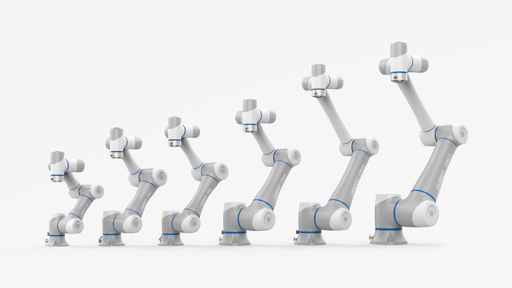
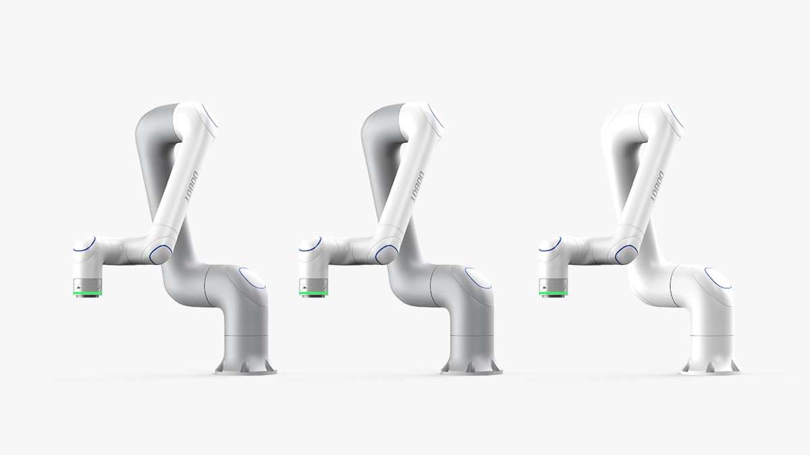
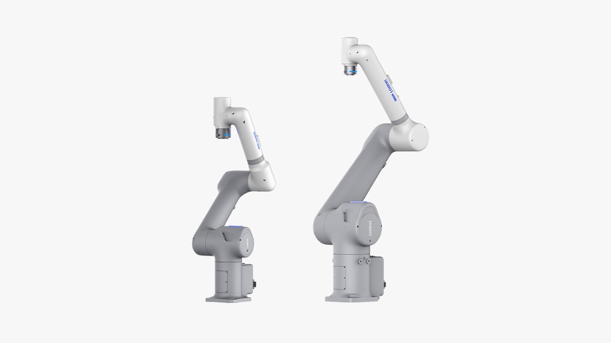
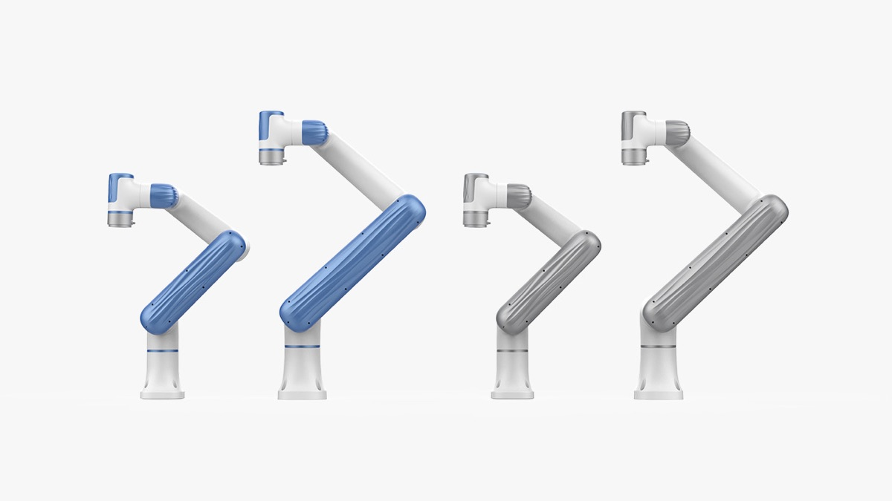
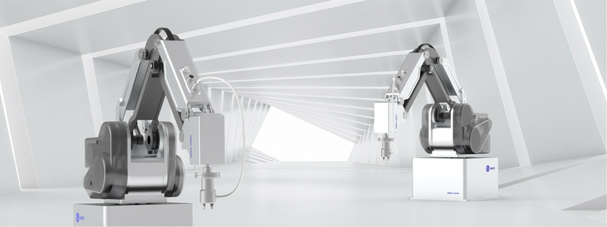
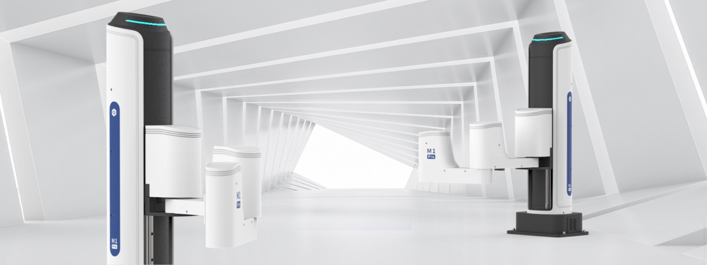
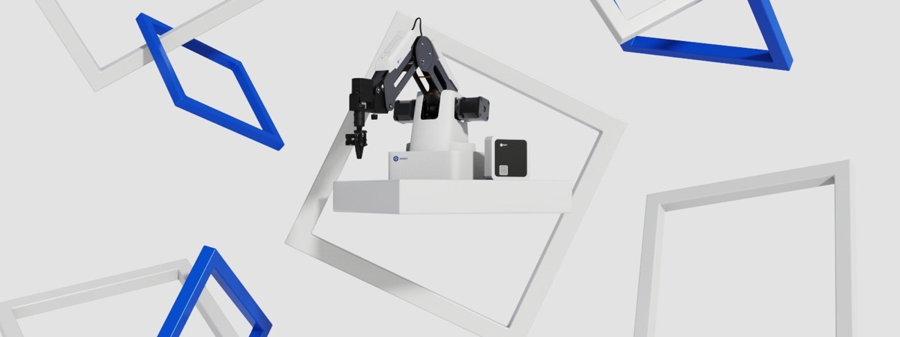
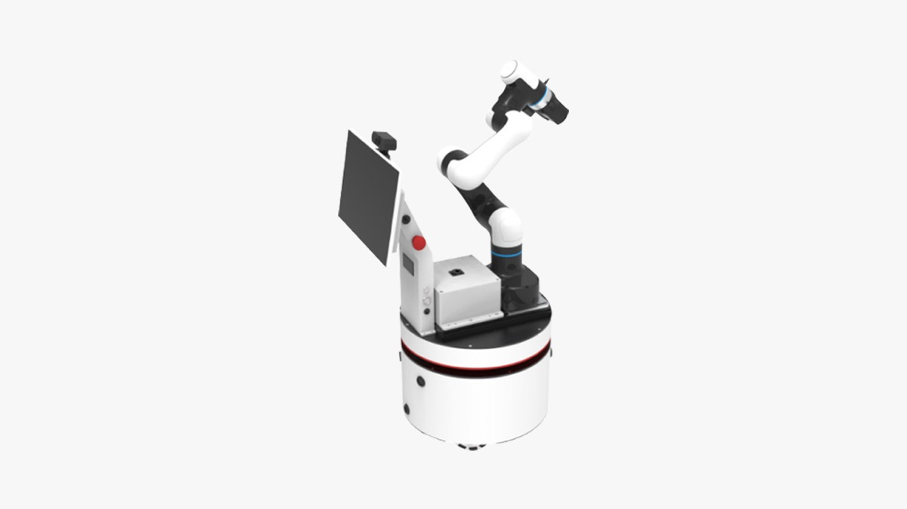
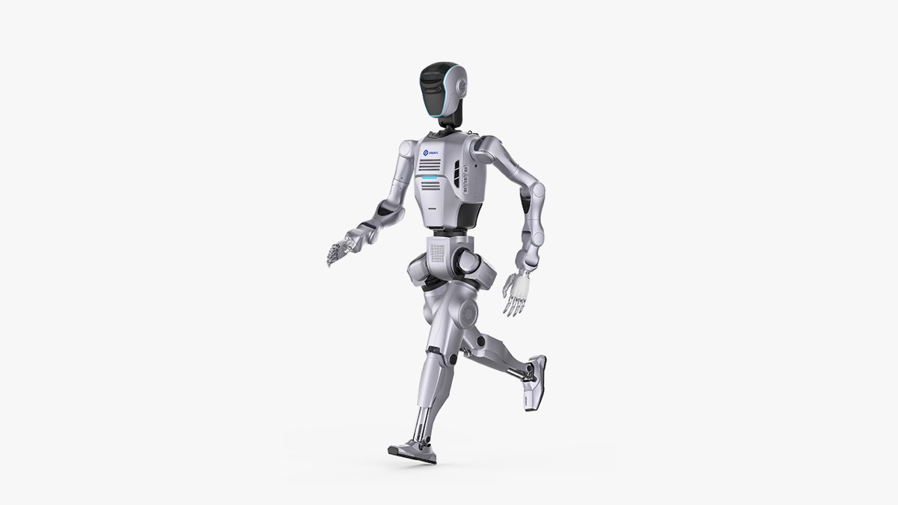
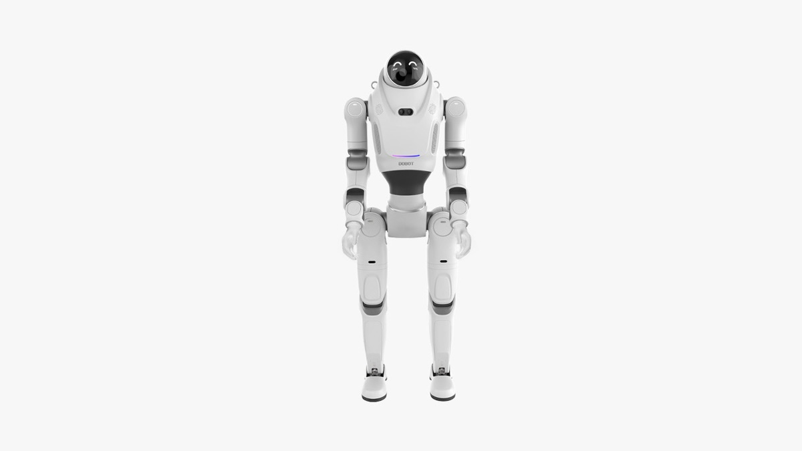

# Dobot Robotics — Product Portfolio

⬆ [Dobot Robotics profile](Dobot.md) · [Developer guide](Dobot-Developer-Guide.md) · [Roadmap and strategy](Dobot-Roadmap-and-Strategy.md)

> **Pick in 30 seconds:** need a safe, light arm you can script today → **Magician E6** (desk, 750 g) or **Nova 2 / Nova 5** (2 / 5 kg, 30–60 V DC controller). Need real payload or force sensing → **CR5A / CR5AF**. Want imitation learning → **X-Trainer**. Humanoid showpiece → **Atom** (SDK exists) or **LUMO** (no public developer material).
> What Dobot actually brought is **not confirmed** — check the booth before committing.
> Research note: spec values below come from Dobot's official product pages (fetched 2026-11-14). Launch years and all prices are weaker: several could not be re-checked today and are marked ⚠️.

## Lineup map

Track relevance: ● strong · ◐ partial · ○ none. Status: ✅ shipping · 🧪 announced / preview · 🔭 roadmap.

| Product | Category | Status | Launched | Price (if public) | Positioning (one line) | T01 | T02 | T03 | T04 |
|---|---|---|---|---|---|---|---|---|---|
| CRA series | 6-axis cobot, 3–30 kg | ✅ | 2023 ⚠️ unverified | not public | Mainline industrial cobot; same V4 API as E6 / Nova | ◐ | ◐ | ● | ◐ |
| CRAF (CR5AF / 10AF / 20AF) | CRA + flange 6-axis force sensor | ✅ | 2025 ⚠️ unverified | not public | Force-controlled contact tasks, feather-light hand guiding | ○ | ◐ | ◐ | ● |
| CRA-IP68 (CR5AP / 10AP / 20AP) | Sealed cobot | ✅ | not public | not public | Dust, oil, water-mist environments | ◐ | ● | ◐ | ○ |
| CR 30H / 30HT / 30H-Food | Heavy-payload cobot | ✅ | 2025 | not public | 30 kg at 300°/s; palletizing | ○ | ○ | ◐ | ○ |
| CRH series | Cobot with all-joint torque sensors | 🧪 | Oct 2026 | not public | Fast force-sensitive arm for welding, spraying, inspection | ○ | ◐ | ○ | ◐ |
| CRS series (CR3AS / 5AS / 10AS) | Cobot with SafeSkin | ✅ | not public | not public | Pre-collision proximity sensing built in | ◐ | ○ | ◐ | ● |
| PULSA 7 / 12 | High-speed industrial cobot | 🧪 | Oct 2026 | not public | 790°/s J6, IP67, switchable collaborative mode | ○ | ○ | ◐ | ○ |
| Nova 2 / Nova 5 | Compact commercial cobot | ✅ | 2022 ⚠️ unverified | not public | Retail (Nova 2) and physiotherapy (Nova 5); DC-powered | ● | ◐ | ◐ | ● |
| MG400 | 4-axis desktop arm | ✅ | 2020 ⚠️ unverified | not public | A4-footprint fast pick-and-place | ◐ | ○ | ● | ○ |
| M1 Pro | 4-axis SCARA | ✅ | not public | not public | Light-industry SCARA with built-in controller | ○ | ○ | ◐ | ○ |
| Magician E6 | 6-axis desktop education / research arm | ✅ | 2023 ⚠️ unverified | not public | Smallest arm on the full V4 API; plug-and-play | ◐ | ○ | ● | ◐ |
| Magician / Lite / Go | 4-axis education arms and kits | ✅ | Magician about 2016 ⚠️ unverified | not public | Classroom arms; older USB protocol | ○ | ○ | ◐ | ○ |
| E6 ROS Mobile Platform | Mobile base + Magician E6 | ✅ | 2026 ⚠️ unverified | not public | ROS mobile manipulation teaching rig (SLAM, nav, grasp) | ● | ◐ | ◐ | ◐ |
| X-Trainer | Dual-arm teleop / data-collection rig | ✅ | 2024 | not public | Collect demos → train → infer on 2 x Nova 2 | ◐ | ○ | ◐ | ● |
| Atom / Atom Max / Atom D | Full-size humanoid | ✅ | Mar 2025 (mass production Jun 2025) | CNY **199,000** at launch (about US$27,500) | Industrial / commercial humanoid with SDK | ◐ | ◐ | ○ | ◐ |
| LUMO | Compact embodied-AI humanoid | 🧪 | Oct 2026 | about US$12,000 on a third-party listing ⚠️ unverified | Companion / research / service robot running DobotWAM | ◐ | ○ | ○ | ● |
| Rover X1 (INFFNI) | Wheel-legged consumer quadruped | ✅ | Nov 2025 (China) | CNY **7,499** at China launch | Home follow / patrol / carry robot | ◐ | ◐ | ○ | ◐ |
| Kongyi DobotWAM | Embodied foundation model | 🧪 | Jun 2026 | not public | Proprietary "brain" for LUMO; no public weights | ○ | ○ | ○ | ◐ |
| DobotStudio Pro / Sim / DobotLab | Software | ✅ | Sim: 2026 ⚠️ unverified | not public (Sim runs in browser) | Blockly + Lua programming, browser simulation, classroom software | ◐ | ◐ | ◐ | ◐ |

## Products

### CRA series

Dobot's mainline 6-axis collaborative arm family. Standalone PLd Cat.3 safety controller, DobotStudio Pro, and the V4 TCP/IP API. **CR3A / CR5A are the realistic hackathon sizes.**

| Model | Payload | Working radius | Weight |
|---|---|---|---|
| **CR3A** | **3 kg** | 620 mm | 16.5 kg |
| **CR5A** | **5 kg** | 900 mm | 25 kg |
| CR7A | 7 kg | 800 mm | 24.5 kg |
| CR6AL | 6 kg | 1,800 mm | see datasheet |
| CR10A | 10 kg | 1,300 mm | 40 kg (CR10AS figure) |
| CR12A | 12 kg | 1,200 mm | see datasheet |
| CR16A | 16 kg | 1,000 mm | see datasheet |
| CR16AL | 16 kg | 1,300 mm | see datasheet |
| CR20A | 20 kg | 1,700 mm | see datasheet |
| CR30A | 30 kg | 1,305 mm | see datasheet |

(The official weight row has merged cells for the larger models, so only the unambiguous values are listed.)

| Spec | Value |
|---|---|
| DoF | 6 |
| Max joint speed | up to **223°/s** |
| Max linear speed | 3–5.5 m/s depending on model |
| Absolute accuracy | under 0.4 mm (laser-calibrated) |
| Repeatability | ±0.02 mm (5 kg) / ±0.03 mm (10 kg) / ±0.05 mm (20 kg) — from the CRAF / CRS pages |
| Safety | PLd Cat.3 safety controller, **20+ safety functions**, ISO 13849-1, ISO 10218-1, ISO/TS 15066 |
| Brake | Electromagnetic, engages within 18 ms on power loss |
| Controller I/O | **24 DI / 24 DO** (PNP and NPN) |
| Fieldbus | Modbus TCP/RTU, EtherNet/IP, PROFINET |
| Options | SafeSkin (pre-collision sensing at 15 cm), teach pendant (10.1 in), VX500 smart camera |
| Software | DobotStudio Pro (Blockly, Lua, plugins, virtual controller) |

**Variants**

| Variant | What it adds | Models |
|---|---|---|
| **CRAF** | 6-axis force sensor in the flange; constant-force control; drag-start force **under 2 N**; tool-side RS485 / I/O stays free | CR5AF (5 kg / 900 mm), CR10AF (10 kg / 1,300 mm), CR20AF (20 kg / 1,700 mm) |
| **CRA-IP68** | IP68 arm (SGS, IEC 60529, 72-hour test), internal positive pressure, fluororubber seals, IP54 cabinet; not for prolonged underwater use | CR5AP, CR10AP, CR20AP |
| CR20A | High-payload model with its own page | 20 kg / 1,700 mm |

- **Typical applications:** welding, palletizing, machine tending, assembly, gluing, polishing, inspection.
- **Hackathon use:** T03 sorting cells, T04 force-guided assistance (CRAF), T02 wet / dusty manipulation (IP68 — unlikely on site).
- Official pages: [CRA series](https://www.dobot-robots.com/products/cra-series/dobot-cra-series.html) · [CRAF](https://www.dobot-robots.com/products/cra-series/dobot-craf-series.html) · [CRA-IP68](https://www.dobot-robots.com/products/cra-series/dobot-cra-ip68-series.html)

### CR 30H

Heavy-payload cobot for palletizing and handling. Too heavy for a hackathon table — listed for completeness.

| Spec | Value |
|---|---|
| Payload / reach | **30 kg** / 1,800 mm |
| Weight | 100 kg (CR 30HT: 102 kg) |
| Repeatability | ±0.05 mm |
| Max joint speed | J1/J2 150°/s, J3 200°/s, J4–J6 **300°/s**; TCP up to 6 m/s |
| Control cycle | 1 kHz |
| IP rating | IP65 / IP67 |
| Power | Typical 500 W, max 2,500 W; cabinet 200–240 V AC single phase (19 kg) |
| Controller I/O | 24 DI / 24 DO, 2 AI / 2 AO, 10 safety in / 10 safety out; 2 x Ethernet (TCP/IP, Modbus TCP, EtherNet/IP, PROFINET), RS485 |

- **Variants:** CR 30H (standard) · **CR 30HT** (joint torque sensors, 0.1% F.S., one-hand drag-teach) · CR 30H-Food (NSF-certified components, food-grade grease).
- Cybersecurity compliance with ISO 10218-1:2025 verified by SGS (Feb 2026, company statement).
- Official page: [CR 30H](https://www.dobot-robots.com/products/cr-30h/cr-30h-collaborative-robots.html)

### CRH series

🧪 Unveiled 2026-10-20 in Frankfurt. No product page or spec sheet found; values are from Dobot's press release.

| Spec | Value |
|---|---|
| Payload | **7 kg** and **12 kg** versions |
| Sensing | Torque sensors on **all joints** |
| Speed | J6 450°/s; instantaneous TCP speed 7 m/s |
| Safety | TÜV certified, ISO 13849, **30+ configurable safety functions** |
| Other | HyperMove vibration control; internal cable routing for vision and tooling |
| Reach, weight, availability, price | not public |

- **Target applications:** welding, spraying, inspection.
- **Why it matters:** the only Dobot arm with joint-level torque sensing across all joints; whether torque-level control is exposed to developers is not public.
- Source: [Dobot news, Oct 2026](https://www.dobot-robots.com/insights/news/dobot-unveils-three-new-products-at-its-2026-robotics-ecosystem-conference.html)

### CRS series

CRA-class arms with **SafeSkin** fitted as standard (proximity + contact sensing, so the arm stops before touching a person).

| Spec | CR3AS | CR5AS | CR10AS |
|---|---|---|---|
| Payload | 3 kg | **5 kg** | 10 kg |
| Working radius | 620 mm | 900 mm (max reach 1,096 mm) | 1,300 mm |
| Weight | 16.5 kg | 25 kg | 40 kg |
| Repeatability | ±0.02 mm | ±0.02 mm | ±0.03 mm |

| CR5AS detail | Value |
|---|---|
| Joint speed | J1–J3 180°/s, J4–J6 223°/s; max linear speed 2 m/s |
| Rated voltage / power | 48 V DC / 150 W |
| IP rating | IP54 |
| Communication | TCP/IP, Modbus, Wi-Fi; RS485 at the tool |
| Controller I/O | 16 DI, 16 DO/DI, 2 AI/AO, 1 ABZ encoder |
| SafeSkin | Senses people, metal, liquids at **5–15 cm**; 0.01 s sensing cycle; 0.1 s stop; weak on non-conductive objects |

- **Hackathon use:** best fit when a robot must work right next to elderly or untrained people (T04).
- Official page: [CR5AS](https://www.dobot-robots.com/products/crs-series/cr5s.html)

### PULSA

🧪 High-speed "industrial cobot" unveiled Oct 2026; can switch between unattended high-speed mode and collaborative mode.

| Spec | PULSA 7 | PULSA 12 |
|---|---|---|
| Payload | **7 kg** | **12 kg** |
| Reach | 910 mm | 1,450 mm |
| Body weight | 44 kg | 125 kg |
| Repeatability | ±0.02 mm | ±0.03 mm |
| Max J6 speed | **790°/s** | 735°/s |
| Protection | IP67; ISO Class 5 cleanroom | same |
| Mounting | Any angle | same |
| Cabinet | HPC1026, 11.3 kg, 220–240 V | HPC3526, 11.6 kg |

- Through-arm routing: 4 x Ø4 mm air tubes + 12-pin I/O. Controller: 24 DI / 24 DO, 16 in / 16 out safety I/O; PROFINET, EtherCAT, EtherNet/IP, Modbus TCP.
- Safety: ISO 13849-1 PLd Cat.3, 20+ configurable safety functions. Page notes final specs are subject to the test report.
- Unlikely on site (weight, mains cabinet). Official page: [PULSA](https://www.dobot-robots.com/products/pulsa/pulsa.html)

### Nova series

Lightweight commercial cobots with a palm-size DC controller — the most portable "real" cobot Dobot sells. Dobot labels **Nova 2 "for retail"** and **Nova 5 "for physiotherapy"**.

| Spec | Nova 2 | Nova 5 |
|---|---|---|
| DoF | 6 | 6 |
| Payload | **2 kg** | **5 kg** |
| Working radius | **625 mm** | **850 mm** |
| Weight | **11 kg** | **14 kg** |
| Max TCP speed | 1.6 m/s | 2 m/s |
| Max joint speed | 135°/s | 100°/s |
| Repeatability | ±0.05 mm | ±0.05 mm |
| IP rating (arm) | IP54 | IP54 |
| Noise | 65 dB(A) | 70 dB(A) |
| Power (typical / max) | 100 W / 250 W | 230 W / 770 W |
| Tool I/O | 2 DI, 2 DO, RS485 | same |
| Mounting | Any angle | Any angle |

| Controller | Value |
|---|---|
| Size / weight | 200 x 120 x 55 mm / **1.3 kg** |
| Input power | **30–60 V DC** (battery or mobile-base friendly) |
| I/O | 8 DI, 8 DO, 2 AI, 2 AO (0–10 V) |
| Ports | 2 x Ethernet (TCP/IP, Modbus TCP), 2 x USB (Wi-Fi module), 1 x RS485 (Modbus RTU) |
| Controller IP | IP20 |
| Teaching | PC or app (Android, iOS); drag-teach trajectory replay |

- **Safety:** 5 adjustable collision-detection levels, stop within 0.01 s of a detected collision, pose hold on power loss.
- **Variants:** standard (customisable shell colours) and "Nova Series for Industrial Applications" (same 2 kg / 5 kg sizes).
- **Typical applications:** coffee / beverage kiosks, retail, massage / physiotherapy, light assembly.
- **Hackathon use:** T04 guided-exercise or handover demos; T01 kiosk / service cell; easiest arm to mount on another vendor's mobile base (DC input).
- Official page: [Nova series](https://www.dobot-robots.com/products/nova-series/dobot-nova-series.html)

### MG400

4-axis desktop arm with a footprint smaller than an A4 sheet; fast and simple for top-down picking.

| Spec | Value |
|---|---|
| DoF | 4 |
| Payload | **500 g** rated (max 750 g) |
| Working radius | **440 mm** |
| Repeatability | ±0.05 mm |
| Max joint speed | 300°/s (all joints) |
| Weight / base | 8 kg / 190 x 190 mm |
| Power | 100–240 V AC; 48 V; 150 W |
| Communication | TCP/IP, Modbus TCP |
| Programming | Drag-to-teach, Blockly, Lua |

- **Caveat:** 4-axis arms use a separate TCP/IP protocol variant from the 6-axis V4 API (see [developer guide](Dobot-Developer-Guide.md)); tool always points down.
- **Hackathon use:** T03 conveyor / bin sorting where speed matters more than orientation.
- Official page: [MG400](https://www.dobot-robots.com/products/desktop-four-axis/mg400.html)

### M1 Pro

4-axis SCARA with integrated controller for light-industry pick-and-place.

| Spec | Value |
|---|---|
| DoF | 4 (J3 is a 5–245 mm vertical stroke) |
| Payload | **1.5 kg** |
| Working radius | **400 mm** |
| Repeatability | ±0.02 mm |
| Speed | J1/J2 180°/s, J3 1,000 mm/s, J4 1,000°/s |
| Weight | 15.7 kg |
| Power | 100–240 V AC |
| Communication | TCP/IP, Modbus TCP, Modbus RTU; encoder input for conveyor tracking |

- Official page: [M1 Pro](https://www.dobot-robots.com/products/dobot-series/m1-pro.html)

### Magician E6

Desktop 6-axis cobot for education and research with a built-in controller. **Most likely arm on site and the lowest-risk starting point**: wall plug, one Ethernet cable, same V4 API as CRA and Nova.

| Spec | Value |
|---|---|
| DoF | 6 |
| Payload | **750 g** |
| Working radius | **450 mm** |
| Repeatability | ±0.1 mm |
| Max TCP speed | 0.5 m/s |
| Max joint speed | 120°/s |
| Joint ranges | J1 ±360°, J2 ±135°, J3 ±154°, J4 ±160°, J5 ±173°, J6 ±360° |
| Weight | **≤ 7.2 kg** |
| Base | 162 x 120 x 103 mm |
| Power | 100–240 V AC; 48 V DC 5 A; 130 W |
| Ethernet | **2 ports** (TCP/IP, Modbus TCP) |
| Tool I/O | 2 DI, 2 DO, 24 V |
| Base I/O | **16 DI / 16 DO**, 24 V (max 2 A total, 0.5 A per channel) |
| Other ports | Emergency stop, ABZ encoder |
| IP rating | IP20 |
| Environment | 0–40 °C |
| Software | DobotStudio Pro (Blockly, Lua, drag-teach replay) |

- **Limits to plan around:** 750 g includes the gripper; slow (0.5 m/s); IP20, indoor only.
- **Accessories:** ES01 electric suction cup (plug-and-play), grippers and cameras via the tool connector; E6 ROS Mobile Platform (below).
- **Hackathon use:** T03 vision sorting, T04 table-top assistance (pill / cup handover with light objects), any policy-learning prototype.
- Official page: [Magician E6](https://www.dobot-robots.com/products/education/magician-e6.html)

### Magician / Magician Lite / Magician Go

Classroom-grade 4-axis arms. Useful as cheap props, not as a serious manipulation platform.

| Spec | Magician | Magician Lite |
|---|---|---|
| DoF | 4 | 4 |
| Payload | **500 g** | **250 g** |
| Reach | 320 mm | 340 mm |
| Repeatability | ±0.2 mm | 0.2 mm |
| Weight | 3.4 kg net | not checked |
| Communication | USB / Wi-Fi* / Bluetooth* (*add-on) | via Magic Box (12 interfaces, Bluetooth) |
| Power | 12 V 6.5 A DC, 78 W max | not checked |
| Tools | Gripper, suction, pen, 3D-print head, laser | Soft gripper, suction cup, pen holder |
| Software | DobotLab, DobotStudio, DobotBlockly; SDK = communication protocol + program library | DobotLab (graphical, Python) |

- **Magician Go:** mecanum-wheel mobile base for Magician Lite with two AI cameras (chassis front + arm tip), odometry, on-device image / text / face recognition; programmed in DobotLab (graphical and Python).
- **Kits:** Vision Kit, Sensor Kits, Basic AI Kit, Sliding Rail Kit, conveyor belt.
- **Caveat:** these use the older Magician serial protocol, not the V4 TCP/IP API.
- Official pages: [Magician](https://www.dobot-robots.com/products/education/magician.html) · [Magician Lite](https://www.dobot-robots.com/products/education/magician-lite.html) · [Magician Go](https://www.dobot-robots.com/products/education/magician-go.html)

### E6 ROS Mobile Platform

Dobot's own mobile manipulator for teaching: a LiDAR mobile chassis carrying a Magician E6. The only Dobot product that covers navigation + grasping in one unit.

| Spec (mobile chassis) | Value |
|---|---|
| Arm | Magician E6 |
| Size / weight | ≤ 520 x 520 x 350 mm / ≤ 25 kg |
| Chassis payload | ≤ **50 kg** |
| Battery life | ≥ **6 h** no load; > 2 h loaded (24 V) |
| Max speed | ≥ 0.5 m/s |
| Navigation accuracy | ±5 cm; stop precision 5 mm |
| LiDAR | Dual LiDAR (minimum), ±3 cm, range ≥ 20 m |
| Drive | Independently suspended wheels, turns on the spot |
| Compute | Industrial PC, RAM ≥ 4 GB, storage ≥ 64 GB, ROS |
| Cameras | Configurable 2D / 3D |

- **Taught capabilities:** SLAM mapping, obstacle avoidance, autonomous navigation, path planning, vision recognition, mobile grasping.
- ROS version and repo: not stated on the page ⚠️ unverified. Indoor flat floors only.
- **Hackathon use:** T01 indoor delivery / fetch demo if Dobot brought one.
- Official page: [E6 ROS Mobile Platform](https://www.dobot-robots.com/products/education/ros-mobile-platform.html)

### X-Trainer

Leader-follower dual-arm rig for imitation learning: two light "master" handles drive two Nova 2 arms while cameras record.

| Spec | Value |
|---|---|
| Follower arms | 2 x Nova 2 (6-axis each) |
| Payload | **2 kg** per arm, 3 kg dual-arm |
| Reach | 625 mm per arm; up to 1,200 mm dual-arm span |
| Repeatability | ±0.05 mm |
| Top speed | 1.6 m/s |
| Control interface | **25 Hz** end-to-end motion interface |
| Leader handles | Under 400 g hand load; unlock and record buttons |
| Safety | 5-level collision detection, ISO 15066 (Nova 2); auto de-sync on power loss / alarm; handle-drop detection; EVA-foam padded workspace |
| Data access | Leader / follower joint angles, gripper control, camera RGB / depth via open APIs |
| SDK | Covers data collection → model training → autonomous inference |

- **Company claim:** a routine task (dish washing, folding clothes) can be trained in about 2 hours.
- Supported policy types and dataset formats: not stated on the product page ⚠️ unverified — check the `dobot_xtrainer` repo.
- **Hackathon use:** fastest route to a learned bimanual skill (T04 meal / dressing aids, T03 sorting). Needs a GPU machine for training.
- Official page: [X-Trainer](https://www.dobot-robots.com/products/humanoid-robots/x-trainer.html)

### Atom

Full-size humanoid aimed at repetitive industrial and commercial work (line-side handling, beverage preparation, pharmacy dispensing).

| Spec | Value |
|---|---|
| Upper-body DoF (Atom) | **28**, 200 Hz control |
| Vision (Atom) | Binocular RGB |
| Gait | Straight-knee walking; company claims 42% less energy than bent-knee gait |
| Workstation heights | 700–1,000 mm |
| On-board model | ROM-1: 100M parameters, 24 Hz end-to-end control (proprietary) |
| Height / weight | Not on the official page (resellers: 1.53 m, 62 kg ⚠️ unverified) |
| Battery / runtime, payload | not public |

| Variant | What you get |
|---|---|
| **Atom** | Base humanoid as above |
| **Atom Max** | **41 DoF**, 6-DoF dexterous hands, 60 fps Full HD vision, Intel RealSense D455, **1500 TOPS** AI module, VR/MR teleoperation (full-body or segmented). Optional "Embodied AI Set": URDF models, open-source training framework, multi-modal data tools |
| **Atom D (Data Collection / Trainer)** | Dual 7-DoF arms + 2-DoF head, swappable end-effectors (hands, grippers, wrist cameras), RealSense D455 (6 m range), 60 fps binocular camera, Ethernet for external data collection |

- **Developer access:** `dobot_atom_sdk`, `dobot_atom_ros2`, `dobot_atom_urdf` on GitHub plus an official SDK guide (v2.1, Aug 2026).
- **Price:** CNY **199,000** (about US$27,500) at the 2025 launch; reseller prices are much higher.
- **Hackathon reality:** if present, expect supervised, limited access.
- Official page: [Atom](https://www.dobot-robots.com/products/humanoid-robots/atom.html)

### LUMO

🧪 Compact embodied-AI humanoid launched Oct 2026 (page title: "LUMO L1"). Aimed at home companionship, research / education and commercial service.

| Item | Value |
|---|---|
| Model | Runs Kongyi DobotWAM (vision-language-action, 3D spatial understanding) |
| Interaction | Reads emotion and intent from voice and vision |
| Memory | Long-term memory stored **locally** by default |
| DoF, height, weight, battery, payload | **not public** — the official page has no spec sheet |
| SDK / developer access | not public |
| Price | about US$12,000 on a third-party listing ⚠️ unverified |

- Naming is inconsistent: "all-terrain embodied intelligent robot" in the press release, "humanoid robot" on the product page.
- **Hackathon use:** attractive T04 companion story, but treat as demo-only unless Dobot staff confirm programmable access.
- Official pages: [LUMO overview](https://www.dobot-robots.com/insights/case-studies/1283.html) · [LUMO product entry](https://www.dobot-robots.com/products/humanoid-robots/1284.html)

### Rover X1

Consumer wheel-legged quadruped sold under Dobot's **INFFNI** sub-brand (Flex variant and character versions shown at IFA 2026).

| Item | Value |
|---|---|
| Mobility | Hybrid wheel-leg |
| Functions | Follow, patrol, carry small loads |
| Price | CNY **7,499** (about US$1,030) at China launch, Nov 2025; about EUR 2,600+ at EU resellers ⚠️ unverified |
| Weight, payload, battery, sensors | no official spec page found — not public |
| SDK | Reported by resellers only ⚠️ unverified |

- No official product page; see the [INFFNI at CES 2026 news item](https://www.dobot-robots.com/insights/news/inffni-a-sub-brand-of-dobot-robotics-makes-its-mark-at-ces-2026.html).

### Kongyi DobotWAM

🧪 Dobot's proprietary embodied foundation model (announced Jun 2026); the stated brain for LUMO and future embodied products.

- Company-reported **99.25%** on LIBERO suites ⚠️ unverified independently.
- Weights, API and licence: **not public**. Nothing to build on directly at the hackathon.
- Related proprietary model: ROM-1 on Atom (100M parameters).

### DobotStudio Pro / DobotStudio Sim / DobotLab

| Tool | For | What it does |
|---|---|---|
| **DobotStudio Pro** | CRA, CRS, Nova, Magician E6, MG400, M1 Pro | Blockly and Lua programming, drag-teach replay, ecosystem plugins (grippers, force sensors, 2D/3D vision), process packages (welding, palletizing, CNC), logs, virtual controller; runs on PC, tablet, teach pendant |
| **CRStudio app** | CR / Nova | Android / iOS teaching app |
| **DobotStudio Sim** | Cell design and validation | Browser-based (no install): CAD import, drag-and-drop programming, collision and reachability checks, cycle-time analysis, transfer programs to DobotStudio Pro, shareable links |
| **Cloud virtual controller** | Trying the API without hardware | Free trial with a 12-hour licence (request form on the site) |
| **DobotLab** | Magician, Magician Lite, Magician Go | Classroom software: graphical and Python programming |

- Official page: [DobotStudio Sim](https://www.dobot-robots.com/sim.html)

## Accessories and ecosystem

| Item | Type | Works with | Notes |
|---|---|---|---|
| **SafeSkin** | Proximity / contact skin | CRA (option), CRS (standard) | Senses at 5–15 cm; 0.01 s cycle; 0.1 s stop; human-robot speed up to 1 m/s |
| **VX500 Smart Camera** | Wrist camera | CRA family | 5 MP, LED light, 2.5D localisation, ±0.26 mm spatial compensation; plug-and-play |
| **ES01 Electric Suction Cup** | End-effector | Magician E6 | 250 g, max load 700 g, 55 kPa, no external air, 24 V, I/O-controlled |
| Teach Pendant | HMI | CRA family | 10.1 in, 3-position enable switch, 12 jog buttons |
| Collaborative Robot Universal Training Platform | Education bench | 6-axis cobots | Specs not checked |
| Vision Kit, Sensor Kits, Basic AI Kit, Sliding Rail Kit, conveyor | Education kits | Magician / Magician Lite | Classroom add-ons |
| Magic Box | External controller | Magician Lite | 12 interfaces, Bluetooth |
| **Dobot+ ecosystem** | Third-party plugins | CRA / Nova / E6 via DobotStudio Pro | Partners named by Dobot in 2026: Siemens, SCHUNK, Mech-Mind, SICK, Piab, SEER, OnRobot, Schmalz |
| Embodylink | Data collection / annotation / teleop toolkit | X-Trainer, Atom | See [developer guide](Dobot-Developer-Guide.md) |

Dexterous hands: Atom Max ships with 6-DoF hands; a stand-alone Dobot hand product was not found.

## Legacy and discontinued

- **CR series (CR3 / CR5 / CR10 / CR16, non-"A")** — predecessor of CRA; still referenced in manuals and the V3 TCP/IP protocol. If the arm on site is an older CR, use the V3 repos.
- **M1** — predecessor of M1 Pro.
- **Original Magician** — still sold for education but the design dates from Dobot's first years; older protocol.
- Dobot keeps an "old website" link in its navigation for earlier products.

## Image credits

All images © Dobot, downloaded from the official site on 2026-11-14 and converted to JPEG.

| File | Shows | Source URL |
|---|---|---|
| assets/dobot-cra.jpg | CR / CRA family line-up | https://www.dobot-robots.com/media/upload/2023/CRA/crv500/CR%E7%B3%BB%E5%88%97.jpg |
| assets/dobot-cr30h.jpg | CR 30H | https://www.dobot-robots.com/media/upload/2025/06/cr30h_tab.jpg |
| assets/dobot-pulsa.jpg | PULSA | https://www.dobot-robots.com/media/upload/2026/pulsa-tab.jpg |
| assets/dobot-nova.jpg | Nova 2 and Nova 5 in two colours | https://www.dobot-robots.com/media/upload/2025/05/nova/tab.jpg |
| assets/dobot-mg400.jpg | MG400 page banner (resized) | https://www.dobot-robots.com/media/upload/header/banner-pc/DOBOT%20mg400%20desktop%20robotic%20arm-suitable%20for%20rich%20light-load%20application%20use.jpg |
| assets/dobot-m1-pro.jpg | M1 Pro page banner | https://www.dobot-robots.com/media/upload/header/banner-pc/DOBOT%20m1%20pro%20scara%20robot-perfect%20choice%20for%20small%20and%20medium-sized%20factories.jpg |
| assets/dobot-magician-e6.jpg | Magician E6 | https://www.dobot-robots.com/media/upload/2023/e6/e6-menu.jpg |
| assets/dobot-magician.jpg | Magician page banner | https://www.dobot-robots.com/media/upload/header/banner-pc/Magician.jpg |
| assets/dobot-e6-ros-platform.jpg | E6 ROS Mobile Platform | https://www.dobot-robots.com/media/upload/2026/e6/tab.jpg |
| assets/dobot-x-trainer.jpg | X-Trainer page banner (resized) | https://www.dobot-robots.com/media/upload/2024/x-trainer/banner.png |
| assets/dobot-atom.jpg | Atom humanoid | https://www.dobot-robots.com/media/upload/2025/07/atom/tab.jpg |
| assets/dobot-lumo.jpg | LUMO (site navigation thumbnail labelled "DOBOT LUMO Humanoid Robot") | https://www.dobot-robots.com/media/upload/2026/humanoid/human-tab.jpg |

No picture saved for: CRH, CRS, Rover X1, DobotWAM, DobotStudio (12-picture cap, or no official image found).

## Sources

- [Dobot Robotics profile (this repo)](Dobot.md) — prices, launch dates, Rover X1 and DobotWAM facts carried over from the profile's sources
- [CRA series](https://www.dobot-robots.com/products/cra-series/dobot-cra-series.html)
- [CRAF series](https://www.dobot-robots.com/products/cra-series/dobot-craf-series.html)
- [CRA-IP68 series](https://www.dobot-robots.com/products/cra-series/dobot-cra-ip68-series.html)
- [CR 30H](https://www.dobot-robots.com/products/cr-30h/cr-30h-collaborative-robots.html)
- [CR5AS / CRS series](https://www.dobot-robots.com/products/crs-series/cr5s.html)
- [PULSA](https://www.dobot-robots.com/products/pulsa/pulsa.html)
- [Nova series](https://www.dobot-robots.com/products/nova-series/dobot-nova-series.html)
- [Nova series for industrial applications](https://www.dobot-robots.com/products/nova-series/nova-series-for-industrial-applications.html)
- [MG400](https://www.dobot-robots.com/products/desktop-four-axis/mg400.html)
- [M1 Pro](https://www.dobot-robots.com/products/dobot-series/m1-pro.html)
- [Magician E6](https://www.dobot-robots.com/products/education/magician-e6.html)
- [Magician](https://www.dobot-robots.com/products/education/magician.html)
- [Magician Lite](https://www.dobot-robots.com/products/education/magician-lite.html)
- [Magician Go](https://www.dobot-robots.com/products/education/magician-go.html)
- [E6 ROS Mobile Platform](https://www.dobot-robots.com/products/education/ros-mobile-platform.html)
- [ES01 Electric Suction Cup](https://www.dobot-robots.com/products/conveyor-belt/865.html)
- [X-Trainer](https://www.dobot-robots.com/products/humanoid-robots/x-trainer.html)
- [Atom](https://www.dobot-robots.com/products/humanoid-robots/atom.html)
- [LUMO overview](https://www.dobot-robots.com/insights/case-studies/1283.html)
- [LUMO product entry](https://www.dobot-robots.com/products/humanoid-robots/1284.html)
- [DobotStudio Sim](https://www.dobot-robots.com/sim.html)
- [Dobot news: three new products at the 2026 Robotics Ecosystem Conference](https://www.dobot-robots.com/insights/news/dobot-unveils-three-new-products-at-its-2026-robotics-ecosystem-conference.html)
- [Dobot news: INFFNI at CES 2026](https://www.dobot-robots.com/insights/news/inffni-a-sub-brand-of-dobot-robotics-makes-its-mark-at-ces-2026.html)
- [Dobot-Arm on GitHub](https://github.com/Dobot-Arm)
