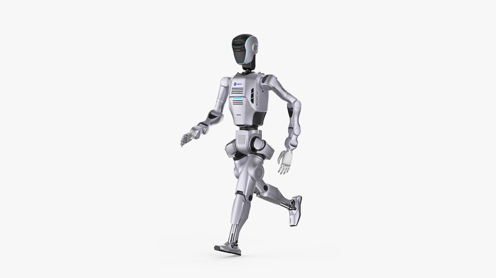

# Dobot Robotics — Roadmap and Strategy

⬆ [Dobot Robotics profile](Dobot.md) · [Product portfolio](Dobot-Products.md) · [Developer guide](Dobot-Developer-Guide.md) · [Solutions and projects](Dobot-Solutions-and-Projects.md)

> **In one paragraph.** Dobot (Shenzhen Dobot Corp Ltd, 越疆科技, HKEX: 2432) is a cobot volume leader (**100,000+** robots shipped) that is spending heavily to become a multi-form embodied-AI company: "**One Brain, Multiple Bodies**" — one proprietary foundation model (KONGYI WAM / DobotWAM) driving arms, dual-arm rigs, humanoids, quadrupeds and hexapods. H1 2026 revenue doubled to **RMB 316.3M**; embodied-AI robots went from 1.4% to **14.3%** of revenue; R&D is **32.1%** of revenue and losses are widening by design. Europe (Germany first) is the named overseas priority.
> **Sourcing.** Financial and strategy statements come from the HKEX interim announcement of 2026-08-24 (opened and read on 2026-11-14) and Dobot's own English and Chinese newsrooms. Items taken only from secondary press are marked ⚠️.

## Company trajectory

| Date | Milestone |
|---|---|
| 2015-06 / 2015-07-30 | First desktop arm crowdfunded; company founded in Shenzhen by Liu Peichao ("Jerry Liu", founder and CEO) |
| 2016-08 → 2016-12 | Magician desktop arm; M1 SCARA; first funding round |
| 2019-04 | **CR5**, first 6-axis cobot |
| 2020-12 | CR3 / CR10 / CR16 and MG400 desktop arm |
| 2021-08 → 2021-12 | Named a national "Little Giant" enterprise; Suzhou subsidiary founded. MATRIX.OS teleoperation system (heterogeneous leader arms, under 10 ms delay) released the same year per a later Chinese news item |
| 2022-08 → 2022-12 | Nova series for retail; **10,000th** robot built at the Rizhao (Shandong) plant, a **53,000 m²** site; AMMR (mobile manipulator) solution |
| 2023-03 → 2023-05 | Magician E6; CR20A; **CRA series** + VX500 smart camera |
| 2023-09-26 | **Dobot Europe GmbH** founded, first German office near Frankfurt (68,000 robots sold worldwide at that point) |
| 2024-04 | **X-Trainer** dual-arm data-collection and training system |
| 2024-11 | Selected for a China National Key R&D Programme project on **robotic dismantling of retired EV battery packs** (dual-arm system, flexible disassembly) |
| 2024-12 | Nova-based special-purpose robots win two events at Gansu's first nuclear-industry robot competition (pipe cut-line marking in a hot cell; radioactive-liquid clean-up, with teleoperation) |
| 2024-12-23 | **Listed on the Hong Kong Stock Exchange** (2432.HK), 40M new H shares at HK$18.8; net proceeds about **HK$756.7M** including over-allotment |
| 2025-01-15 | Thailand branch opens (Bangkok); SiS Distribution named core Thai distributor |
| 2025-03-18 | **Atom** humanoid launched and put on pre-sale from **CNY 199,000** (1.53 m, 62 kg, 41 DoF per the Chinese release); Dobot joins NVIDIA's physical-AI partner ecosystem |
| 2025-04 | Three-year warranty across the cobot range; co-leads a Chinese national standard on industrial-robot dynamic-stability testing |
| 2025-05-12 | Strategic cooperation with **Tencent Cloud** (cloud model + edge + robot terminal, remote control, voice) |
| 2025-06-03 | Strategic partnership with **Yaoshibang (药师帮)** for embodied robots in pharmacies and drug warehouses |
| 2025-06-27 | Nagoya launch: Atom **mass production and first deliveries**, CR 30H, Nova 2s |
| 2025-07-15 | First H-share placing: 19.1M shares at HK$54.3, net about **HK$1,022.2M** |
| 2025-07-24 | Malaysia subsidiary opens |
| 2025-08-08 | **Atom II** (second-generation humanoid platform) announced at WRC Beijing by chief scientist Lang Xulin |
| 2025-09 / 2025-10 | CIIF Shanghai: **ATOM-W** wheeled humanoid and a multi-form "super factory" demo (arms + humanoid + multi-legged + wheeled working together) |
| 2025-11 | **Rover X1** wheel-legged home robot launched in China at CNY 7,499; second H-share placing on 2025-11-06: 16.66M shares at HK$46.8, net about **HK$771.0M** |
| 2025-12 | Atom runs a popcorn counter at Shenzhen K11 Art House cinema (company figures: 14 h continuous operation, 1,000+ servings a day) |
| 2026-01 | Premier Li Qiang views Dobot's cobots and Atom in Shenzhen (Jan 3–5); **INFFNI** consumer sub-brand debuts at CES (Jan 6–9); Siemens **SRCI** integration reaches limited release (Jan 19; Dobot says it is the third cobot maker to publish one) |
| 2026-02 | CR 30H series passes SGS verification against the cybersecurity requirements of ISO 10218-1:2025; RBTX (igus) partner launch in the UK; APEC PPSTI showcase in Guangzhou |
| 2026-03 | FY2025 results: revenue **RMB 492M** (+31.7%), net loss RMB 84M (per the company profile); **third batch** of full-size Atom humanoids enters delivery (Mar 24) |
| 2026-05 | **KONGYI WAM / DobotWAM** embodied foundation model launched (99.25% average on four LIBERO suites, company-reported) |
| 2026-06 | RTJ 2026 (Aichi): **Atom Max** (41 DoF) debut, "One Brain, Multiple Bodies" platform; Automate 2026 (Chicago): CR12H, IC12 high-speed robot, Dobot × Festo humanoid pick-and-place demo. A-share listing application accepted by the Shenzhen Stock Exchange (announced Jun 22) ⚠️ secondary press |
| 2026-07-23 | Formal strategic partnership with Danish software firm **RiACT** (RiFLEX robot OS) |
| 2026-08-24 | H1 2026 results: revenue **RMB 316.3M** (+106.6%), loss RMB 107.9M, **1,065** employees |
| 2026-09-04 → 09-08 | IFA Berlin: Rover X1, **LUMO**, Pandabo (panda-styled mobile robot), Rover X1 "Auton Roamer Sinoceratops" |
| 2026-10-20 | Robotics Ecosystem Conference, Frankfurt: **LUMO, PULSA, CRH** launched; about 200 European attendees; education forum with Fraunhofer institutes, TUM and Tecnalia |
| 2026-11 | DobotTrack person-following VLA paper, code and weights released (Nov 6–11); new Atom and parts-sorting dataset repos appear on Hugging Face (Nov 12) |

## Current focus projects

| Focus | What is happening | Evidence | Status |
|---|---|---|---|
| "One Brain, Multiple Bodies" | KONGYI WAM as unified brain; a whole-body motion + local force-control "cerebellum"; central domain controller and cross-form swarm coordination across humanoid, multi-legged, dual-arm and single-arm robots | HKEX interim report; RTJ 2026 news | 🧪 architecture stated, model closed |
| Embodied-AI commercialisation | **231** embodied-AI customers (nearly 100 industrial); named on-site deployments at Valeo, Leapmotor, KEBODA, OPT Machine Vision, Shanghai Kostal-Huayang, Shanghai Beukay Cosmetics (with Tencent RoboticsX Lab) and an unnamed European Fortune 500 cosmetics company; tasks: material handling, machine tending, inspection, precision assembly | HKEX interim report | ✅ / 🧪 mix of orders, pilots and small batches |
| Atom family scale-up | Three delivery batches by Mar 2026; variants Atom, Atom Max, Atom-W (wheeled), Atom D (data collection); SDK guide v2.1 (Aug 2026) adds trajectory record / replay, SLAM navigation and RL training | Chinese newsroom; SDK guide | ✅ shipping |
| Commercial-service humanoids | Popcorn and beverage counters, pharmacy dispensing (Yaoshibang), retail restocking; Chinese material also lists massage, moxibustion and rehabilitation training as target scenarios | Chinese newsroom, RoboPilot page | 🧪 pilots; health scenarios are positioning, not documented deployments |
| Cobot core | Six-axis cobots **RMB 196.9M** in H1 2026 (+110.4%, 62.2% of revenue); integrated palletizing / welding cells +89.7%; SRCI and RiACT lower integration effort | HKEX interim report; newsroom | ✅ |
| Consumer line (INFFNI) | Rover X1 plus character robots; LUMO as companion / research / service robot | CES and IFA news | ✅ Rover X1 · 🧪 LUMO |
| Legged research stack | Rover X1 SDK, RL sim2real framework, Hexplorer hexapod (18 DoF, 10 kg rated payload, Mid-360 LiDAR; arm kit, remote video and wireless charging "coming later") | Dobot-Team GitHub; Chinese product page | ✅ / 🔭 options |
| Navigation VLAs | DobotTrack (0.8B parameters, quadruped person following), DobotRoam (waypoint policy) | arXiv 2611.09041; GitHub | ✅ code + weights · 🧪 Roam |
| Data pipeline | X-Trainer, Atom D, Embodylink / DobotRX; LeRobot-format releases on Hugging Face | GitHub; Hugging Face | ✅ small scale |
| Battery-recycling robotics | National key R&D project: dual-arm system, irregular-part recognition and flexible disassembly of retired EV packs | Chinese newsroom (2024-12-31) | 🧪 multi-year programme; progress since not found |

## Announced and upcoming products

| Product | What | Date | Status |
|---|---|---|---|
| **CRH series** (7 kg / 12 kg) | Cobot with torque sensors on all joints, HyperMove vibration control, TÜV-certified, 30+ safety functions; a CR12H CNC-tending cell was already shown at Automate (Jun 2026) | Launched 2026-10-20; ship date not public | 🧪 |
| **PULSA 7 / 12** | High-speed "industrial cobot", J6 up to 790°/s, switchable collaborative mode | Launched 2026-10-20; ship date not public | 🧪 |
| **LUMO (L1)** | Compact embodied-AI robot on DobotWAM; emotion / intent recognition, local long-term memory; product page calls it an "open platform" but no SDK is published | Shown IFA Sep 2026, launched 2026-10-20; price and availability not public | 🧪 |
| **IC12** high-speed industrial robot | Shown doing fast pick-and-place at Automate 2026; relationship to PULSA 12 not stated ⚠️ | Jun 2026 | 🧪 |
| **Atom II / Atom Max / Atom-W** | Second-generation humanoid platform (Aug 2025), 41-DoF Max (Japan debut Jun 2026), wheeled W (Oct 2025) | Rolling | ✅ deliveries reported; per-variant availability outside China not public |
| **Hexplorer options** | Collaborative-arm kit, long-range control + video kit, wireless auto-charging | "Later" (no date) | 🔭 |
| **Rover X1 features** | Vision obstacle avoidance while filming and AI voice interaction listed as pre-research features to arrive by OTA | No date | 🔭 |
| **INFFNI character robots** | Pandabo, Rover X1 Auton Roamer Sinoceratops | Shown Sep 2026 | 🧪 |
| **Siemens SRCI** | PLC-native control of Dobot cobots from TIA Portal | Limited release Jan 2026; general release date not public | 🧪 |
| **DobotWAM iterations** | Stated R&D priorities: industrial generalisation, long-horizon tasks, environmental adaptability | Ongoing | 🔭 no public release plan for weights |
| **Next-generation humanoid and multi-legged models** | Named use of the planned A-share proceeds (about two-thirds for embodied-intelligence products) ⚠️ secondary press | After listing | 🔭 |
| **DobotTrack real-world dataset** | 126 quadruped following episodes | "Coming soon" | 🔭 |

## Strategic direction and markets

**Stated strategy (HKEX interim report, "Outlook")**

1. Keep R&D high on embodied large models, high-precision force control, visual perception and motion control; iterate humanoid, multi-legged and dual-arm products for performance **and cost**.
2. Move overseas business from "market coverage" to intensive development: deepen the **high-end European industrial market**, use benchmark countries as showcases, bring embodied-AI products to Europe; grow Asia-Pacific and the Americas.
3. Make overseas subsidiaries substantive (local sales, technical and service teams) — export "brand, technology and services", not only products.
4. Broaden financing channels and equity incentives to hire global robotics / AI talent.

**Business mix, H1 2026**

| Cut | Figure |
|---|---|
| Revenue | **RMB 316.3M** (+106.6%); gross margin 47.4% |
| By product | Six-axis cobots 62.2% · four-axis 13.2% · **embodied-AI robots 14.3%** (RMB 45.2M, up about 20×) · integrated robots 8.7% · other 1.6% |
| By setting | Industrial 62.8% · education 23.4% · commercial 8.1% (retail, health and physiotherapy) · other 5.7% |
| By geography | Mainland China RMB 163.3M · **overseas RMB 153.0M (about 48%)** |
| R&D | About RMB 100M, **32.1%** of revenue (+148% year on year) |
| Result | Loss RMB 107.9M; adjusted loss RMB 64.0M |
| People | **1,065** employees at 2026-06-30 |

**Funding**

| Event | Detail |
|---|---|
| HK IPO, 2024-12-23 | Net about HK$756.7M. Planned use: 40% cobot technology, 27% production lines, 16% alliances / investments / acquisitions, 7% overseas sales channels, 10% working capital (to be spent by end of 2029; HK$400.9M unused at mid-2026) |
| Placings, Jul and Nov 2025 | Net about HK$1,022.2M + HK$771.0M, earmarked for intelligent-robot R&D and related purposes |
| Planned Shenzhen A-share listing | Confirmed as "planned public offering on the Shenzhen Stock Exchange" in the interim report (listing expenses booked). Size about **RMB 1.2B (about US$177M)**, application accepted Jun 2026, approval reported for Jul 2026 — these three details are from secondary press only ⚠️ |
| Guidance | About 50% revenue growth targeted for 2026, losses to continue (Yicai, carried over from the profile; not re-opened) ⚠️ |
| Market position | 13.2% global cobot share and No. 1 by sales in 2025 — secondary press only ⚠️; Dobot itself claims No. 1 cobot exporter in China |

**Geography and presence**

| Region | Presence |
|---|---|
| China | HQ Shenzhen (Nanshan); factory Rizhao, Shandong; Suzhou subsidiary |
| **Europe** | **Dobot Europe GmbH**, Werner-Heisenberg-Straße 2, 63263 Neu-Isenburg (Frankfurt area), since Sep 2023. 2026 ecosystem conference held in Frankfurt. 2026 trade-show pages on the official site include MACH and PPMA (UK), MECSPE (Italy), BIEMH, Advanced Factories, Expoquimia and Logistics & Automation (Spain), Elmia Automation (Sweden), Automatik (Denmark), STOM, Warsaw Industry Automatica and Poland Coatings Expo (Poland), plus IFA Berlin. European case-study titles on the site include Breezy (Poland), Limbach Group and Gerhard Haas (Germany), Juicy (Croatia) and university labs in Bristol, Edinburgh, Essex and Heriot-Watt |
| **Switzerland** | **No Swiss office, subsidiary or named distributor found.** Switzerland appears only as a country option in contact forms. Swiss buyers are presumably served from Dobot Europe GmbH or regional resellers ⚠️ unverified |
| Americas | Dobot USA LLC (Dallas, Texas); Dobot Mexico (Monterrey) |
| Asia-Pacific | Dobot Japan (Tokyo), Thailand (Bangkok), Malaysia (Subang); Korea listed on the contact page |
| Channel | About 200 sales partners (2023 figure); products in 100+ countries (company claim) |

**Partnerships to know**

| Partner | What | Date |
|---|---|---|
| Siemens | SRCI integration; ecosystem-conference partner | 2026-01 / 2026-10 |
| SCHUNK, Mech-Mind, SICK, Piab, SEER, OnRobot, Schmalz | Named ecosystem partners at the Frankfurt conference | 2026-10 |
| RiACT (Denmark) | RiFLEX no-code robot OS pre-integrated with CRA / CRH; earlier joint CNC project at LHM | 2025-07 / 2026-07 |
| RBTX / igus (UK) | Partner launch event built around Nova 5 | 2026-02 |
| Festo | Joint humanoid pick-and-place demo at Automate | 2026-06 |
| Tencent Cloud; Tencent RoboticsX Lab | Cloud + edge + robot stack; joint deployment at a cosmetics maker | 2025-05; 2026 |
| Yaoshibang | Pharmacy and drug-warehouse robots | 2025-06 |
| NVIDIA | Physical-AI ecosystem partner | 2025-03 |
| Amazon Web Services | CR10A chess demo on Amazon Bedrock at re:Invent | 2024-12 |
| Fraunhofer institutes, TUM, Tecnalia | Speakers at the education forum of Dobot's "Global Education and Advanced Research Institute"; cooperation offered on curricula, labs, faculty training, joint research | 2026-10 |
| SiS Distribution (Thailand) | Core distributor | 2025-01 |

## Research and open-source activity

- **Posture:** SDKs, small datasets and narrow research models are open; the foundation models (KONGYI WAM / DobotWAM, DOBOT-VLA, ROM-1, NDS) are closed. Details and paper list: [Papers and research](Dobot-Papers-and-Research.md).
- **Three GitHub organisations:** [Dobot-Arm](https://github.com/Dobot-Arm) (44 repos — arm APIs, ROS 2, X-Trainer, Atom SDK), [Dobot-Team](https://github.com/Dobot-Team) (10 repos — Rover X1 SDK, RL sim2real, hexapod SDK, DobotTrack, DobotRoam) and [embodied-dobot](https://github.com/embodied-dobot/atom-locomotion-training) (Atom RL training).
- **Cadence in 2026:** Python V4 API pushed 2026-11-13; ROS 2 V4 package 2026-11-06 (protocol V4.6.5); Atom SDK guide v2.0 (Jul) and v2.1 (Aug); X-Trainer and Embodylink re-licensed / pushed Aug 2026; DobotTrack code Nov 2026.
- **Papers:** two company-affiliated arXiv papers so far, both 2026 (DobotTrack, and the AdaPT humanoid-tennis work deployed on Atom). No paper for DobotWAM.
- **Hugging Face:** [Dobot-Official](https://huggingface.co/Dobot-Official) — CR5A LeRobot dataset + ACT checkpoint (Sep 2026), X-Trainer clothes dataset (150 episodes), Atom dataset repos refreshed in the week of the hackathon.
- **Benchmarks claimed:** 99.25% average on LIBERO-Spatial / Object / Goal / 10, stated to exceed published results of mainstream public models including GR00T-N1.7 (company statement in the HKEX report; not independently reproduced).
- **Standards and public programmes:** co-led China's national test method for industrial-robot dynamic stability (2025); national key R&D project on EV-battery dismantling (2024); a standards expert on humanoid safety spoke at the Frankfurt conference.
- **Education:** education is **23.4%** of product revenue; Dobot co-organises robot contests and now runs a named education and research institute engaging European universities.

## What would impress this company at the hackathon

**This section is inference** from the strategy above — not something Dobot has said about the event.

What Dobot is trying to prove in Europe right now: (1) its arms are a credible physical-AI platform, not just cheap cobots; (2) embodied AI creates "measurable value" outside the lab — the exact wording of its Frankfurt keynote; (3) European universities and integrators can build on its stack. A hackathon result that supplies evidence for any of these is useful to them.

| Track | What would land | Why it matches Dobot's agenda |
|---|---|---|
| **T01 Autonomous Urban Services** (T01.1, T01.3, T01.5, T01.7) | A service-counter or hand-over cell: Nova or E6 + camera + voice / LLM front end, serving real visitors for hours; or a Dobot arm mounted on another vendor's mobile base via the 30–60 V DC Nova controller; DobotTrack "follow me" on a partner base | Mirrors the K11 popcorn and pharmacy-counter pilots; shows "one brain, multiple bodies" working across vendors; reuses Dobot's own open VLA |
| **T02 Resilient & Safe City** (T02.2, T02.7) | Teleoperated manipulation with graceful autonomy hand-off (valve, switch, sample handling) with force feedback from the 8 ms state stream; operator-following quadruped | Dobot already markets teleop for nuclear / hazardous work and has an IP68 arm; a clean operator interface is a gap in its public stack |
| **T03 Sustainable City** (T03.1, T03.6) | Vision-guided sorting or **disassembly** (e-waste, battery modules, bottle caps) with measured throughput and error rate; conveyor tracking via the built-in `Cnv*` commands; a published LeRobot dataset of the task | Directly adjacent to Dobot's national battery-dismantling project and its "parts sorting" dataset uploads; numbers speak to the "measurable value" theme |
| **T04 Elderly Care & Rehabilitation** (T04.1, T04.3, T04.6) | Safe guided-exercise or assisted-reach demo on Nova 5 / CRAF with force limits, SafeSkin, logged range-of-motion data and a clear safety case; drink / medication hand-over with speech | Dobot labels Nova 5 "for physiotherapy" and books "health and physiotherapy" revenue, yet has **no published clinical or research evidence** — a well-instrumented prototype fills that hole |

**Cross-track signals that should score with Dobot engineers**

- **Use the open pieces end to end:** V4 TCP/IP API or ROS 2 package → teleop or scripted demos → LeRobot dataset → ACT or small VLA → closed-loop run on the real arm. Dobot's own public chain stops at simulation; a real-robot loop is new.
- **Publish artefacts:** a LeRobot robot wrapper for Dobot arms, a cleaned dataset on Hugging Face, or a fix / pull request to `TCP-IP-Python-V4` or `DOBOT_6Axis_ROS2_V4`.
- **Quantify:** success rate over 20+ trials, cycle time, intervention count, hours of unattended running. Dobot's messaging is about moving from demo to investment decision.
- **Respect the safety envelope:** payload set correctly, collision level and safe zones configured, speed limits near people — the company sells on certified safety (PLd Cat.3, ISO/TS 15066, new ISO 10218-1:2025 cybersecurity verification).
- **Cross-embodiment or multi-robot coordination:** two different robots sharing one policy or task plan is the literal form of their strategy slogan.
- **Low integration cost:** something an SME integrator could redeploy in a day (the RiACT / SRCI storyline).

What is unlikely to impress: demos that depend on closed Dobot models you cannot access, pure simulation with no hardware run, or anything that needs joint-torque control the arms do not expose.

## Sources

- [HKEX — Shenzhen Dobot Corp Ltd interim results announcement for the six months ended 30 June 2026 (2026-08-24)](https://www1.hkexnews.hk/listedco/listconews/sehk/2026/0824/2026082400904.pdf)
- [Dobot — About us (key milestones 2015–2026)](https://www.dobot-robots.com/about/about-dobot)
- [Dobot — Contact us (offices)](https://www.dobot-robots.com/about/contact-us)
- [Dobot news — Three new products at the 2026 Robotics Ecosystem Conference](https://www.dobot-robots.com/insights/news/dobot-unveils-three-new-products-at-its-2026-robotics-ecosystem-conference.html)
- [Dobot news — Three new products at the 2026 European Ecosystem Conference](https://www.dobot-robots.com/insights/news/dobot-unveils-three-new-products-at-its-2026-european-ecosystem-conference.html)
- [Dobot news — IFA Berlin 2026](https://www.dobot-robots.com/insights/news/dobot-brings-the-future-of-robotics-to-ifa-berlin-2026.html)
- [Dobot news — RiACT strategic partnership](https://www.dobot-robots.com/insights/news/dobot-and-riact-formalize-partnership-to-democratize-smart-automation.html)
- [Dobot news — Dobot and RiACT at LHM](https://www.dobot-robots.com/insights/news/dobot-and-riact-power-lhms-cnc-machining-with-scalable-smart-automation.html)
- [Dobot news — Automate 2026](https://www.dobot-robots.com/insights/news/dobot-showcases-intelligent-automation-at-automate-2026.html)
- [Dobot news — RTJ 2026](https://www.dobot-robots.com/insights/news/dobot-showcases-humanoid-robots-and-automation-solutions-at-rtj-2026.html)
- [Dobot news — Siemens SRCI integration](https://www.dobot-robots.com/insights/news/dobot-integrates-siemens-srci-for-faster-plc-controlled-cobot-deployment.html)
- [Dobot news — CR 30H cybersecurity verification (ISO 10218-1:2025)](https://www.dobot-robots.com/insights/news/dobot-cr-30h-series-achieves-sgs-verified-compliance-with-iso.html)
- [Dobot news — RBTX partnership event](https://www.dobot-robots.com/insights/news/dobot-x-rbtx-partnership-demonstrates-new-pathways-for-accessible-automation.html)
- [Dobot news — APEC PPSTI](https://www.dobot-robots.com/insights/news/dobot-showcases-multi-form-embodied-intelligence-at-apec-ppsti.html)
- [Dobot news — INFFNI at CES 2026](https://www.dobot-robots.com/insights/news/inffni-a-sub-brand-of-dobot-robotics-makes-its-mark-at-ces-2026.html)
- [Dobot news — Global delivery of Atom (Nagoya, Jun 2025)](https://www.dobot-robots.com/insights/news/dobot-debuted-global-delivery-of-humanoid-robot.html)
- [Dobot news — Next-generation cobots in Nagoya (CR 30H, Nova 2s)](https://www.dobot-robots.com/insights/news/dobot-unveils-next-generation-collaborative-robots-in-nagoya.html)
- [Dobot news — Malaysia subsidiary](https://www.dobot-robots.com/insights/news/dobot-malaysia-opens-to-accelerate-smart-manufacturing-in-southeast-asia.html)
- [Dobot news — Thailand branch](https://www.dobot-robots.com/insights/news/dobot-thailand-opens-to-advance-smart-manufacturing-across-southeast-asia.html)
- [Dobot news — SiS partnership](https://www.dobot-robots.com/insights/news/dobot-partners-with-sis-to-accelerate-smart-manufacturing-in-southeast-asia.html)
- [Dobot news — Hong Kong listing](https://www.dobot-robots.com/insights/news/dobot-robotics-successfully-listing-hong-kong-stock-exchange.html)
- [Dobot news — German market expansion / Dobot Europe GmbH (2023)](https://www.dobot-robots.com/insights/news/dobot-robotics-expands-its-offering-in-the-german-market.html)
- [Dobot news — Rizhao manufacturing plant (2022)](https://www.dobot-robots.com/insights/news/dobot-opens-largest-cobot-manufacturing-plant-in-china.html)
- [Dobot news — AWS re:Invent 2024 chess demo](https://www.dobot-robots.com/insights/news/dobot-partnered-with-amazon-to-achieve-interactive-chess-experience-powered-by-generative-ai-at-aws-re-invent-2024.html)
- [Dobot — events index](https://www.dobot-robots.com/insights/event) · [case-studies index](https://www.dobot-robots.com/insights/case-studies)
- [Dobot China — Third batch of Atom deliveries (2026-03-24)](https://www.dobot.cn/news/blog/1546.html)
- [Dobot China — Premier Li Qiang visit (2026-01-06)](https://www.dobot.cn/news/blog/1547.html)
- [Dobot China — Humanoid in three commercial scenarios, K11 popcorn figures (2026-01-22)](https://www.dobot.cn/news/blog/1527.html)
- [Dobot China — CIIF 2025, ATOM-W (2025-10-13)](https://www.dobot.cn/news/blog/1394.html)
- [Dobot China — WRC 2025, Atom II (2025-08-15)](https://www.dobot.cn/news/blog/1341.html)
- [Dobot China — Yaoshibang partnership (2025-06-19)](https://www.dobot.cn/news/blog/1294.html)
- [Dobot China — Tencent Cloud cooperation (2025-05-13)](https://www.dobot.cn/news/blog/1263.html)
- [Dobot China — National standard on dynamic stability (2025-04-17)](https://www.dobot.cn/news/blog/1239.html)
- [Dobot China — Three-year warranty (2025-04-17)](https://www.dobot.cn/news/blog/1238.html)
- [Dobot China — Atom pre-sale from CNY 199,000 (2025-04-17)](https://www.dobot.cn/news/blog/1237.html)
- [Dobot China — National key R&D project on EV-battery dismantling (2024-12-31)](https://www.dobot.cn/news/blog/1123.html)
- [Dobot China — Nuclear-industry robot competition (2024-12-12)](https://www.dobot.cn/news/blog/1095.html)
- [Dobot China — Hexplorer product page](https://www.dobot.cn/products/humanoid-robots/bionic-robot.html)
- [Dobot China — Rover X1 product page](https://www.dobot.cn/products/humanoid-robots/rover-x1.html)
- [Dobot China — RoboPilot product page](https://www.dobot.cn/products/humanoid-robots/robopilot.html)
- [Dobot — LUMO L1 page](https://www.dobot-robots.com/insights/case-studies/1283.html)
- [Atom series SDK application development guide v2.1 (PDF)](https://a.storyblok.com/f/298593/x/ad7c499105/dobot-atom-series-humanoid-robot-sdk-application-development-guide_v2-1_20260826_en.pdf)
- [GitHub — Dobot-Arm](https://github.com/Dobot-Arm) · [Dobot-Team](https://github.com/Dobot-Team) · [embodied-dobot/atom-locomotion-training](https://github.com/embodied-dobot/atom-locomotion-training)
- [Hugging Face — Dobot-Official](https://huggingface.co/Dobot-Official)
- [ManbotAI — Dobot H1 2026 results commentary (secondary; A-share size, market share)](https://manbotai.com/ai-robot/dobot-h1-2026-financial-growth)
- [ScanX — Dobot seeks $177m Shenzhen listing (secondary; seen as a search result only, page not opened)](https://scanx.trade/stock-market-news/ipo/dobot-seeks-177m-shenzhen-listing-to-fund-humanoid-robots/44015167)
- [Dobot Robotics profile (this repo)](Dobot.md) · [Papers and research (this repo)](Dobot-Papers-and-Research.md)
