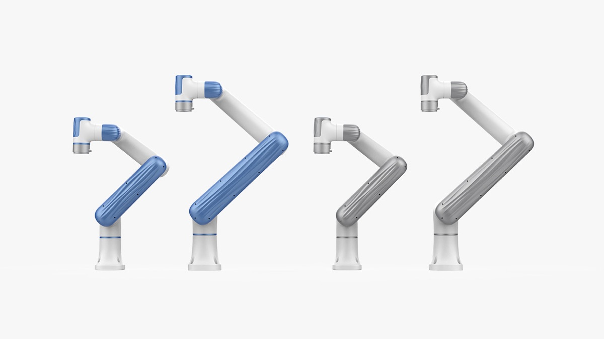
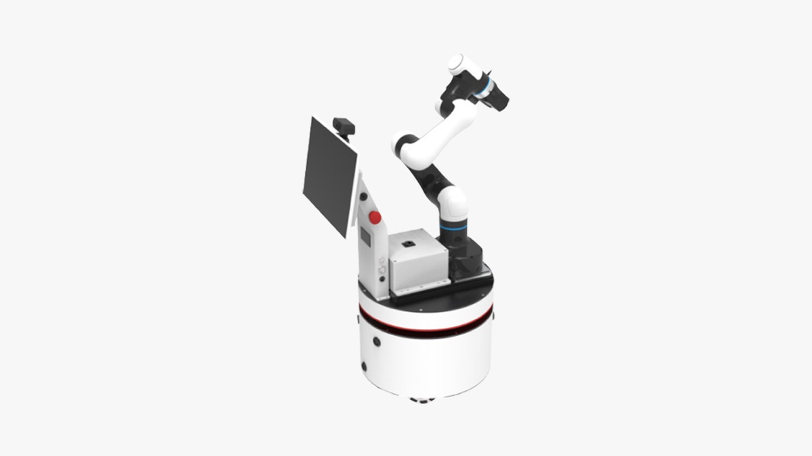
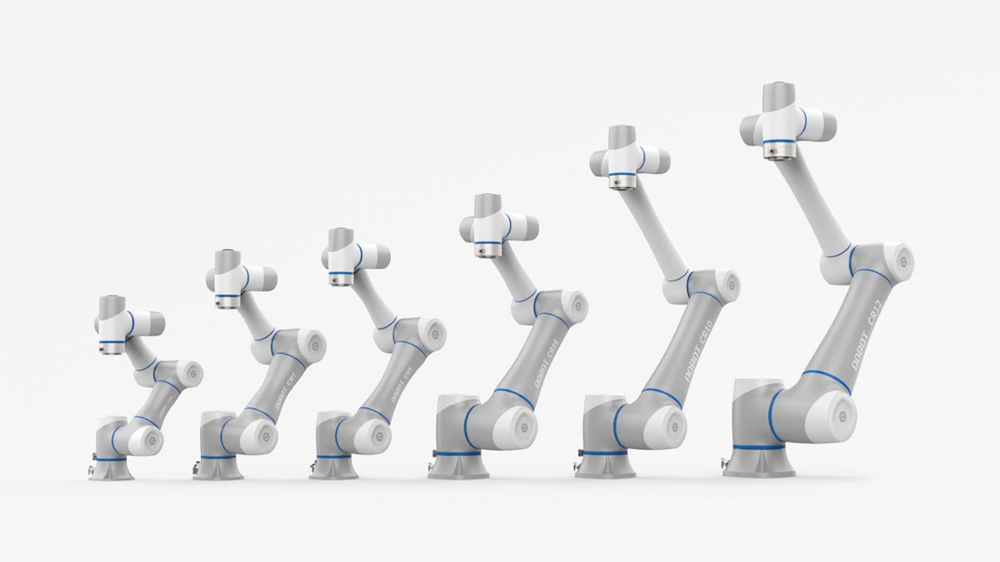
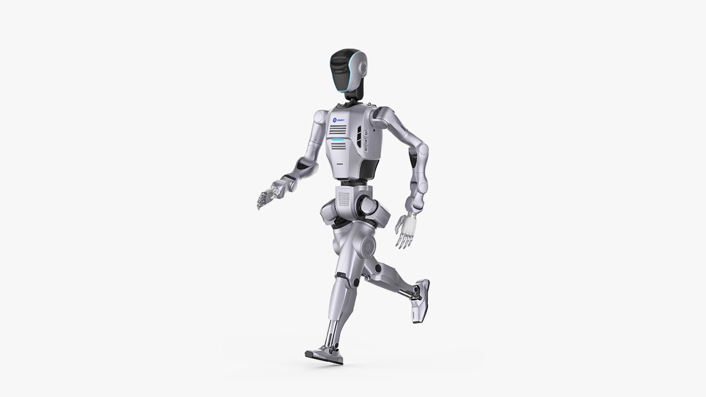
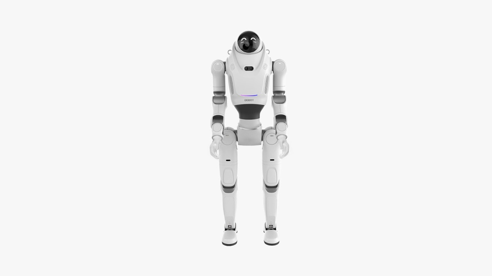

# Dobot Robotics × T01 — Products and Solutions

⬆ [Dobot Robotics profile](../Dobot.md) · [Brief](Dobot-T01-1-Brief.md) · [Playbook](Dobot-T01-3-Playbook.md)

**Read this first:** Dobot is an arm company. For T01 it covers the *manipulation* end of a city service (prepare, pick, hand over, load) well, and the *mobility* end poorly. What Dobot actually brings to Leukerbad is **not confirmed** — check the booth before you commit.

**Research note:** web search was unavailable in this pass; everything below comes from Dobot's own pages, its GitHub account and the company profile. Third-party deployments may exist that are not listed here.

## Relevant products (ranked for this track)

### Nova series (Nova 2, Nova 5)

**Role in T01:** the service-counter arm. Dobot labels Nova 2 "For Retail"; it is light, quiet and DC-powered, so it is also the most plausible Dobot arm to bolt onto another vendor's mobile base.

| Spec | Nova 2 | Nova 5 |
|---|---|---|
| Payload | **2 kg** | **5 kg** |
| Reach | **625 mm** | **850 mm** |
| Arm weight | **11 kg** | **14 kg** |
| Max TCP speed | 1.6 m/s | 2 m/s |
| Repeatability | ±0.05 mm | ±0.05 mm |
| Protection | IP54 (arm) | IP54 (arm) |
| Power, typical / max | 100 W / 250 W | 230 W / 770 W |
| Operating temperature | **0–50 °C** | **0–50 °C** |
| Noise | 65 dB(A) | 70 dB(A) |
| Controller | 200 × 120 × 55 mm, **1.3 kg**, IP20, **30–60 V DC** input, 24 V I/O | same |
| Safety | Collision stop in **0.01 s**; five adjustable protection levels; holds posture on power loss | same |

- **Status / price:** ✅ shipping · price not public · availability on site unconfirmed.
- **Developer interface:** V4 TCP/IP API (Python, C++, ROS 2 Humble with MoveIt). Joint and Cartesian moves (MovJ, MovL, Arc), digital I/O, tool RS485, drag-to-teach and trajectory replay, phone / tablet app. Torque-level control: not documented.

### E6 ROS Mobile Platform

**Role in T01:** Dobot's only arm-on-wheels. An education-grade indoor mobile manipulator (base + Magician E6) — the one product that lets you show "move *and* manipulate" with Dobot hardware alone.

| Spec | Value (official page) |
|---|---|
| Base size / weight | ≤ 520 × 520 × 350 mm / ≤ **25 kg** |
| Base payload | ≤ **50 kg** |
| Drive | Independently suspended wheels, turns on the spot |
| Max speed | ≥ **0.5 m/s** |
| Runtime | ≥ 6 h no load; **> 2 h** loaded |
| Navigation accuracy | ± 5 cm; stop precision 5 mm |
| Sensors | Dual LiDAR (range ≥ 20 m, ± 3 cm); configurable 2D / 3D cameras |
| Compute | Industrial PC, ≥ 4 GB RAM, ≥ 64 GB storage; 24 V system |
| Arm | Magician E6 (**750 g** payload, 450 mm reach) |
| Stated functions | SLAM mapping, obstacle avoidance, autonomous navigation, path planning, vision-based mobile grasping |

- **Status / price:** ✅ listed on the official site · price not public · on-site presence unknown.
- **Developer interface:** "ROS-based custom development" on the industrial PC. ROS version, SLAM / navigation package names, camera model and gripper are **not stated** on the page ⚠️ unverified — ask before planning around Nav2.

### Magician E6

**Role in T01:** the most likely arm on a hackathon table. Good for a scaled-down kiosk, sorting or hand-over demo with light objects.

| Spec | Value |
|---|---|
| Payload / reach | **750 g** / **450 mm** |
| Repeatability | ± 0.1 mm |
| Weight | ≤ 7.2 kg |
| Max joint / TCP speed | 120 °/s / 0.5 m/s |
| Power | 100–240 V AC adapter; 48 V DC, 5 A; 130 W |
| Protection | **IP20** (indoor only) |
| I/O | Base: 16 DI / 16 DO; tool: 2 DI / 2 DO, 24 V; 2 × Ethernet (TCP/IP, Modbus TCP) |

- **Status / price:** ✅ shipping · price not public.
- **Developer interface:** same V4 API and ROS 2 package as CRA / Nova (repo lists "E6 / ME6"). No gripper is listed specifically for the E6 on the product page — confirm the end-effector on site.

### CRA series (CR3A, CR5A, CR7A, CR6AL, CR10A, CR12A, CR16A, CR16AL, CR20A, CR30A; CRAF and CRA-IP68 variants)

**Role in T01:** the "real kiosk" arm. Dobot's own kiosk solution pages use CR3-class cobots; a CR3A / CR5A gives more reach and payload than Nova for loading parcels or handling crates.

| Spec | Value |
|---|---|
| Payload range | **3–30 kg** across the line |
| Reach range | **620–1,800 mm** |
| Weight | CR3A 16.5 kg; CR5A 25 kg |
| Repeatability | ± 0.02 to ± 0.05 mm |
| Safety | PLd Cat. 3 controller, 20+ safety functions; optional SafeSkin pre-collision sensing |
| Variants | CRAF (torque sensor); CRA-IP68 (washdown / wet environments) |
| Fieldbus | Modbus TCP/RTU, EtherNet/IP, PROFINET |

- **Status / price:** ✅ shipping · price not public · heavier models are unlikely on site.
- **Developer interface:** V4 TCP/IP API, ROS 2 Humble + MoveIt configs, DobotStudio Pro (block + Lua), Dobot+ plugins for third-party grippers and cameras.

### Rover X1 (INFFNI sub-brand; Flex variant)

**Role in T01:** a possible small "carrier / follower" for indoor or dry outdoor demos. Consumer-grade — treat it as a prop unless Dobot confirms an SDK on site.

| Spec | Value |
|---|---|
| Mobility | Hybrid wheel-leg; press reports smooth floors, grass and inclines |
| Perception | "Dual-vision tracking" (press wording) |
| Carrying | Carries small household items; **no payload figure public** |
| Modes named in press | Follow / filming, home patrol, coding education, companionship |
| Speed, runtime, IP rating | not public in sources used |

- **Status / price:** ✅ shipping · CNY **7,499** (about US$1,030) at China launch.
- **Developer interface:** SDK reported by resellers only ⚠️ unverified; no official spec or developer page found.

### Atom (Atom, Atom Max, Atom D / Trainer)

**Role in T01:** showpiece for a "robot staff member" concept (drinks, counter service). Dobot's product page names **coffee-shop beverage preparation** and **night-time pharmacy dispensing** as scenarios.

| Spec | Value (official page) |
|---|---|
| Upper body | Atom: **28 DoF**, 200 Hz control |
| Hands | Atom Max: 6-DoF dexterous hands |
| Vision | Binocular RGB; Max / D add RealSense D455 depth |
| Compute | Atom Max: **1500 TOPS** AI module |
| Gait | Straight-knee walking; works at 700–1,000 mm counter heights |
| Teleop | Atom Max: VR / MR, full-body or segmented |
| Walking speed, runtime, arm payload | not on the official page |

- **Status / price:** ✅ in production since Jun 2025 · CNY 199,000 at launch · hands-on access at the hackathon is doubtful.
- **Developer interface:** `dobot_atom_sdk`, `dobot_atom_ros2`, `dobot_atom_urdf`, plus an official SDK guide (v2.1, Aug 2026). ROM-1 and DobotWAM models are proprietary.

### X-Trainer

**Role in T01:** teach a hard-to-script service skill (bagging, folding, packing an odd-shaped item) by demonstration instead of code.

| Spec | Value |
|---|---|
| Arms | 2 × Nova 2 followers, **2 kg** each (3 kg dual), 625 mm reach |
| Interface | **25 Hz** end-to-end; leader handles under 400 g |
| Workflow | Collect → train → infer in the vendor SDK |

- **Status / price:** ✅ shipping · price not public.
- **Developer interface:** `dobot_xtrainer` and `Embodylink` repos. Supported policy types are not stated on the product page ⚠️ unverified.

### LUMO

**Role in T01:** concept only. Dobot describes it as an embodied-AI humanoid for home companionship, research / education and "commercial applications" — a natural greeter or guide, but there is no spec sheet and no developer material.

- **Status / price:** 🧪 launched Oct 2026, availability not public · about US$12,000 on a third-party listing ⚠️ unverified.
- **Developer interface:** not public.

## What Dobot Robotics already does in this domain

| What | Detail | Date | Source |
|---|---|---|---|
| "New Retail" industry line | Dobot markets cobots for robot noodle houses, unmanned ice-cream shops, digital coffee stations and unmanned beverage bars (order online or by QR code). Recommended: MG400, Nova, CRA, VX500 camera. No customers named | undated page (live 2026) | [New Retail](https://www.dobot-robots.com/industries/new-retail.html) |
| Automated milk-tea machine | CR3 takes a cup, collects tapioca, tea and ice, passes it to lid sealing; **90 s per drink** (lab figure), unstaffed. Customer not named | undated | [Solution page](https://www.dobot-robots.com/insights/case-studies/automated-milk-tea-machine.html) |
| Automated ice-cream booth | CR3 picks a cone, fills it and hands it to the customer. Customer not named | undated | [Solution page](https://www.dobot-robots.com/insights/case-studies/automated-ice-cream-booth.html) |
| AI-driven fast-food kiosk | Self-order, self-pay, automated preparation, round-the-clock; page recommends CR20A + VX500. Reads as a solution concept, not a named deployment | undated | [Solution page](https://www.dobot-robots.com/insights/case-studies/ai-driven-robot-fast-food-kiosk-experience.html) |
| Atom service scenarios | Coffee-shop drinks and night-time pharmacy dispensing named as use cases (claims, no named sites) | product page, 2026 | [Atom](https://www.dobot-robots.com/products/humanoid-robots/atom.html) |
| Mobile bases via partners | Dobot+ catalogue lists SEER AMB mobile bases and an Ewellix lifting column; SEER was a named partner at the Frankfurt conference | 2026-10-20 | [Frankfurt news](https://www.dobot-robots.com/insights/news/dobot-unveils-three-new-products-at-its-2026-robotics-ecosystem-conference.html) |
| Swiss reference (logistics, not urban service) | Cave du Rhodan Mounir Weine, Switzerland: CR20A palletizes wine boxes, delivered with Swiss integrator zmb (zaugg maschinenbau ag). Town not on the page; the winery is in Valais ⚠️ unverified here | undated | [Case study](https://www.dobot-robots.com/insights/case-studies/wine-box-palletizing-automation-with-dobot-cr20a.html) |
| Consumer mobility | Rover X1 and LUMO shown at CES and IFA under the INFFNI sub-brand | Jan and Sep 2026 | [IFA news](https://www.dobot-robots.com/insights/news/dobot-brings-the-future-of-robotics-to-ifa-berlin-2026.html) |

**Nothing found** for: street or sidewalk delivery, hotel / hospital delivery robots, cleaning or sweeping, waste-collection logistics, wayfinding or municipal services. Dobot's track record here is **stationary service cells**, not robots that travel through a town.

## What they are building next in this domain

- **Embodied service robots, not delivery vehicles (inference):** new launches relevant to services are humanoid / companion products — Atom (2025), LUMO (Oct 2026, 🧪) — driven by the Kongyi DobotWAM model (Jun 2026, closed weights). Nothing announced points to an outdoor delivery or cleaning platform.
- **LUMO for "commercial applications":** official wording; which commercial roles is not specified 🔭.
- **INFFNI consumer line:** Rover X1 and character variants target homes; a city-service version is not announced.
- **CRH and PULSA (Oct 2026, 🧪):** force-sensitive and high-speed industrial arms; marginal for T01.
- **Europe push:** Frankfurt ecosystem conference and EMEA case studies (including Switzerland) suggest more European integrator support — useful if your project continues after the hackathon (inference).

## Software, models and data that help for this track

| Asset | What it gives you in 48 hours | Notes |
|---|---|---|
| [TCP-IP-Python-V4](https://github.com/Dobot-Arm/TCP-IP-Python-V4) | Scripted arm control in minutes: enable, MovJ / MovL / Arc, alarms, GUI demo | CRA / E6 / Nova; README requires version **V4.4.0.0+**; ports 29999 and 30004; PC on 192.168.5.x; switch robot to TCP/IP mode in DobotStudio Pro; updated 2026-11-13 |
| [DOBOT_6Axis_ROS2_V4](https://github.com/Dobot-Arm/DOBOT_6Axis_ROS2_V4) | ROS 2 bring-up, MoveIt planning, Gazebo sim, pose-target script | **Ubuntu 22.04 + ROS 2 Humble only**; MoveIt configs for CR, CRAF, E6, Nova 2 / 5; trajectories executed through ServoJ; joint states published at 10 Hz |
| TCP-IP-4Axis-Python | Same idea for MG400 / M1 Pro | Different API from the 6-axis arms |
| DobotCameraCalibrate | Hand-eye calibration helper | Saves hours on the camera-to-arm transform |
| voice_txt_command | Voice → target-object segmentation demo | A fork; good seed for "order by voice" |
| dobot_xtrainer, Embodylink | Teleop, data collection, annotation, training management | For imitation-learning concepts; policy types ⚠️ unverified |
| dobot_atom_sdk / dobot_atom_ros2 / dobot_atom_urdf | Humanoid control and simulation | Only if an Atom is made available |
| DobotStudio Pro | Drag-to-teach, block and Lua programming | Fastest fallback: record the motion by hand |
| DobotStudio Sim | Vendor simulator | Lets part of the team work without the robot |
| Kongyi DobotWAM, ROM-1 | — | Proprietary; no public weights. Do not plan around them |

No public Dobot datasets for service or urban tasks were found.

## Gaps and limits for this track

- **No outdoor mobility.** The only Dobot mobile manipulator is an indoor education platform (0.5 m/s, ± 5 cm, 750 g arm payload). Streets, slopes, snow and stairs need Unitree, AGIBOT, Genisom or Magiclab hardware.
- **Cold.** Nova is rated **0–50 °C** and IP54; Magician E6 is IP20. A mid-November outdoor demo at 1,400 m is outside spec — keep the arm indoors or sheltered.
- **No navigation or fleet software from Dobot** beyond what ships on the E6 ROS platform (stack not documented publicly).
- **No public AI models.** Perception and task planning are yours to bring.
- **Control depth.** High-level position control is the supported path; the ROS 2 package reports joint states at 10 Hz. No documented torque control; force sensing needs CRAF or CRH.
- **Proof points are thin.** Kiosk pages are undated and name no customers; there is no documented Dobot project in municipal, delivery or cleaning services.
- **Rover X1 and LUMO** have no official developer documentation.
- **API generation trap.** V4 repos need V4 controller firmware; older units need the V3 repos.

## Sources
- [Dobot company profile (this vault)](../Dobot.md)
- [Nova series](https://www.dobot-robots.com/products/nova-series/dobot-nova-series.html)
- [E6 ROS Mobile Platform](https://www.dobot-robots.com/products/education/ros-mobile-platform.html)
- [Magician E6](https://www.dobot-robots.com/products/education/magician-e6.html)
- [CRA series](https://www.dobot-robots.com/products/cra-series/dobot-cra-series.html)
- [Atom humanoid](https://www.dobot-robots.com/products/humanoid-robots/atom.html)
- [X-Trainer](https://www.dobot-robots.com/products/humanoid-robots/x-trainer.html)
- [LUMO overview page](https://www.dobot-robots.com/insights/case-studies/1283.html)
- [New Retail industry page](https://www.dobot-robots.com/industries/new-retail.html)
- [Food & Beverage industry page](https://www.dobot-robots.com/industries/food-beverage.html)
- [Automated milk tea machine](https://www.dobot-robots.com/insights/case-studies/automated-milk-tea-machine.html)
- [Automated ice cream booth](https://www.dobot-robots.com/insights/case-studies/automated-ice-cream-booth.html)
- [AI-driven robot fast food kiosk](https://www.dobot-robots.com/insights/case-studies/ai-driven-robot-fast-food-kiosk-experience.html)
- [Cave du Rhodan wine-box palletizing case study](https://www.dobot-robots.com/insights/case-studies/wine-box-palletizing-automation-with-dobot-cr20a.html)
- [Case studies index](https://www.dobot-robots.com/insights/case-studies)
- [Dobot: three new products at the 2026 Robotics Ecosystem Conference](https://www.dobot-robots.com/insights/news/dobot-unveils-three-new-products-at-its-2026-robotics-ecosystem-conference.html)
- [Dobot at IFA Berlin 2026](https://www.dobot-robots.com/insights/news/dobot-brings-the-future-of-robotics-to-ifa-berlin-2026.html)
- [TechNode: Rover X1 debut](https://technode.com/2025/11/04/dobot-rover-x1-robot-dog-debuts-at-1030-carries-items-and-follows-for-filming/)
- [Dobot-Arm on GitHub](https://github.com/Dobot-Arm)
- [TCP-IP-Python-V4](https://github.com/Dobot-Arm/TCP-IP-Python-V4)
- [DOBOT_6Axis_ROS2_V4](https://github.com/Dobot-Arm/DOBOT_6Axis_ROS2_V4)
