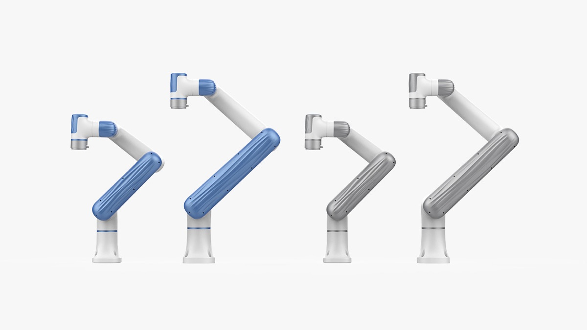
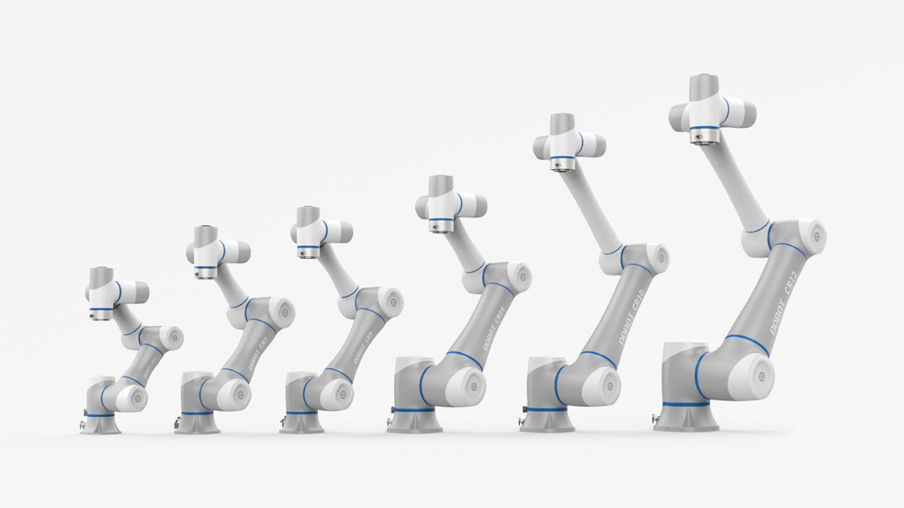
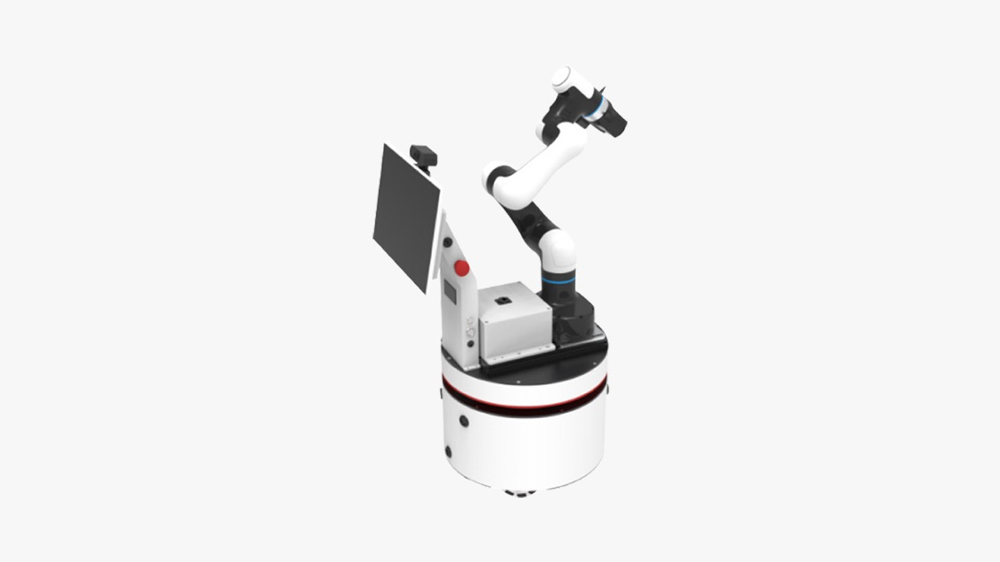
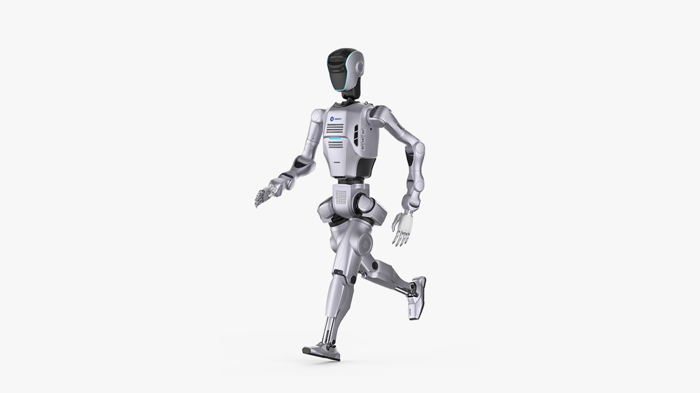
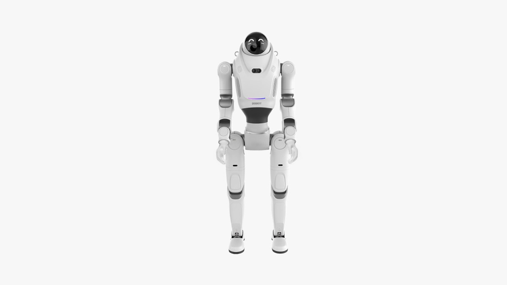

# Dobot Robotics × T02 — Products and Solutions

⬆ [Dobot Robotics profile](../Dobot.md) · [Brief](Dobot-T02-1-Brief.md) · [Playbook](Dobot-T02-3-Playbook.md)

> **Bottom line:** Dobot is an arm company. For T02 it contributes manipulation ("the hands") to an inspection or remote-intervention system. It has **no documented deployments** in emergency response, security, hazard monitoring or infrastructure inspection.
> **Research note:** open web search was not available in this pass; everything below comes from Dobot's own product pages and GitHub, read directly on 2026-11-14. Third-party integrator projects in this domain may exist but were not searched.

## Relevant products (ranked for this track)

### Nova series (Nova 2, Nova 5)

**Role in T02:** the most realistic arm to mount on another vendor's mobile base (quadruped, wheeled platform) for "go there and operate it" tasks: press a button, flip a breaker, turn a small valve, hold a sensor against a surface.

| Spec | Nova 2 | Nova 5 |
|---|---|---|
| Payload | **2 kg** | **5 kg** |
| Reach | 625 mm | 850 mm |
| Arm weight | **11 kg** | **14 kg** |
| Power (typical / max) | **100 W / 250 W** | 230 W / 770 W |
| Max TCP speed | 1.6 m/s | 2 m/s |
| Arm IP rating | IP54 | IP54 |
| Controller | 200 × 120 × 55 mm, **1.3 kg**, **30–60 V DC** input, **IP20** | same |
| Operating temperature | 0–50 °C | 0–50 °C |
| Collision handling | 5 protection levels; stop within 0.01 s of detection | same |

- **Status:** ✅ shipping. **Price:** not public. **On site:** plausible, not confirmed.
- **Developer interface:** V4 TCP/IP API (Python, C++, ROS 2). Joint / Cartesian moves, streaming servo commands, drag-teach, collision level, tool I/O.
- **Caveat:** Dobot's page does not describe mobile or battery mounting; the fit follows from the DC input and small controller (inference). Controller is IP20 — it needs an enclosure anywhere damp.

### CRA series (CR3A, CR5A, CR7A, CR6AL, CR10A, CR12A, CR16A, CR16AL, CR20A, CR30A; CRAF and CRA-IP68 variants)

**Role in T02:** fixed-base inspection or teleoperation cell (CR3A / CR5A); the IP68 and force-sensor variants are the only Dobot arms with a genuine harsh-environment or contact-task story.

| Spec | Value |
|---|---|
| Payload / reach (whole range) | **3–30 kg** / 620–1,800 mm |
| Power consumption | 120 W (CR3A), 150 W (CR5A, CR7A), 350 W (CR6AL to CR16AL), 500 W (CR20A, CR30A) |
| Operating temperature | **0–50 °C** |
| Safety | Stand-alone safety controller, PLd Cat.3, 20+ safety functions; ISO 10218-1, ISO/TS 15066 |
| Power loss behaviour | Brake engages within **18 ms**, holds within 1 mm |
| SafeSkin (optional) | Pre-collision sensing at **15 cm**, 0.01 s monitoring, 0.1 s response |
| Vision (optional) | VX500 smart camera, 5 MP |
| Mounting | Any angle |

**Variant: CRA-IP68 (CR5AP, CR10AP, CR20AP)**

| Spec | Value |
|---|---|
| Payload / reach | 5 kg / 900 mm · 10 kg / 1,300 mm · 20 kg / 1,700 mm |
| Arm protection | **IP68**, SGS-certified to IEC 60529, 72-hour test; "not suitable for prolonged underwater use" |
| Controller protection | IP54 cabinet |
| Materials | Fluororubber exterior seals (oil / cutting-fluid resistant); positive internal air pressure |
| Stated environments | Dust, high humidity, water mist, oil |
| Not claimed | Outdoor use, explosion-proof (ATEX), low temperature |

**Variant: CRAF (CR5AF, CR10AF, CR20AF)**

| Spec | Value |
|---|---|
| Sensor | 6-axis force sensor at the flange (range and resolution not public) |
| Sensitivity | Drag start below **2 N**; collision detection down to **1 N** |
| Functions | Constant-force control, compliant control, surface scanning, orientation-locked drag |

- **Status:** ✅ shipping (all three lines). **Price:** not public. **On site:** a small CR3A / CR5A is plausible; IP68 and CRAF units are unlikely ⚠️ unverified.
- **Developer interface:** same V4 API; force-control commands (`FCForceMode`, `FCSetForce`, `FCSetStiffness`, `GetForce` and others) are present in the Python SDK and need the force sensor.

### E6 ROS Mobile Platform

**Role in T02:** Dobot's only arm-on-wheels product. Good for an **indoor** patrol-and-manipulate prototype (corridor, plant room, data room). Education-grade.

| Spec | Value |
|---|---|
| Arm | Magician E6 (**750 g** payload, 450 mm reach) |
| Base | Independently suspended wheels, turns on the spot |
| Sensors | At least 2 LiDARs; configurable 2D / 3D cameras |
| Compute | Industrial PC (at least 4 GB RAM, 64 GB storage), ROS |
| Navigation | SLAM mapping, obstacle avoidance, path planning; **±5 cm** accuracy |
| Speed | At least 0.5 m/s |
| Chassis payload | Up to 50 kg |
| Battery | 24 V; at least **6 h** unloaded, over **2 h** loaded |
| Size / weight | Up to 520 × 520 × 350 mm, up to 25 kg |

- **Status:** ✅ listed. **Price:** not public. **On site:** unknown — ask. ROS version not stated.
- **Limit:** indoor, flat floors, sub-kilogram payload.

### Magician E6

**Role in T02:** the likeliest arm on site; enough for a table-top mock-up (panel inspection, button pressing, sample pick-up). **750 g** payload, **450 mm** reach, at most 7.2 kg, same V4 API as CRA and Nova, 16 DI / 16 DO at the base. ✅ shipping; price not public.

### X-Trainer

**Role in T02:** ready-made leader–follower teleoperation — the quickest way to show "operator stays safe, robot hands go in", and to record demonstrations for a learned skill.

| Spec | Value |
|---|---|
| Followers | 2 × Nova 2 (2 kg per arm, 625 mm reach) |
| Leaders | Hand-held, under 400 g |
| Interface rate | 25 Hz end-to-end |
| Software | `dobot_xtrainer` repo (teleoperation + data collection, GPL-3.0, README in Chinese) |

- **Status:** ✅ shipping. **Price:** not public. **On site:** plausible, not confirmed.
- **Limit:** built for same-room teleoperation; long-distance / networked operation is something you would build yourself. Supported policy types are not stated ⚠️ unverified.

### Atom (Atom, Atom Max, Atom D / Trainer)

**Role in T02:** showpiece for teleoperated intervention with a human-shaped robot. Realistically a stretch for 48 hours.

| Spec | Value |
|---|---|
| Atom Max | 41 DoF, 6-DoF hands, RealSense D455, 1500 TOPS AI module, **VR / MR teleoperation** (full-body or segmented) |
| Atom | 28 upper-body DoF, binocular RGB, straight-knee walking |
| Runtime, walking speed, IP rating, arm payload | Not stated on the official page |
| Scenarios Dobot lists | Factory material handling, coffee preparation, **night-time pharmacy dispensing**; no inspection, patrol or rescue scenario |

- **Status:** ✅ shipping (mass production since Jun 2025). **Price:** CNY 199,000 at 2025 launch. **On site:** possible as a showpiece; hands-on access likely limited.
- **Developer interface:** `dobot_atom_sdk`, `dobot_atom_ros2`, URDF, official SDK guide v2.1.

### Rover X1 and LUMO (low confidence)

- **Rover X1** ✅ — consumer wheel-legged quadruped (INFFNI sub-brand) with follow and patrol modes reported by press. No official spec page, SDK only reported by resellers ⚠️ unverified. Indoor / home-grade; do not plan a field robot around it.
- **LUMO** 🧪 — called an "all-terrain embodied intelligent robot" by Dobot (Oct 2026). No spec sheet, no developer material, no stated safety or patrol use. Treat as a demo object.

### CRH series (not expected on site)

🧪 Unveiled Oct 2026: 7 kg / 12 kg, torque sensors on **all joints**, 30+ safety functions, TÜV-certified. Dobot names **inspection** as one target use alongside welding and spraying. Availability date not public.

## What Dobot Robotics already does in this domain

**Nothing documented that is specific to T02.** Checked: the official case-study list (12 entries — palletizing, glass handling, refurbishment, university labs), application pages (assembly, gluing, palletizing, welding, polishing, sorting) and industry pages (automotive, chemical, electronics, food, medical, machining, retail, semiconductor, education, research).

Closest adjacent items:

| Item | Date | Relevance to T02 |
|---|---|---|
| [Chemical industry page](https://www.dobot-robots.com/industries/chemical.html): cobots pitched to keep workers away from high temperature, toxic gas and radiation; tasks listed are labeling, film pasting, machine loading, measuring | undated | Generic "remove people from hazard" message; no named customer, no explosion-proof claim |
| [CRA-IP68](https://www.dobot-robots.com/products/cra-series/dobot-cra-ip68-series.html): SGS-certified IP68 arm for dust, mist and oil | undated | A sealed arm exists, aimed at machine shops, not at outdoor or emergency use |
| [CRH launch](https://www.dobot-robots.com/insights/news/dobot-unveils-three-new-products-at-its-2026-robotics-ecosystem-conference.html): "inspection" named as a target application | 2026-10-20 | Industrial quality inspection, not infrastructure inspection (inference) |
| Atom page: night-time pharmacy dispensing listed as a scenario | undated | Weak link to "keeping services running" out of hours |
| [Cave du Rhodan case](https://www.dobot-robots.com/insights/case-studies/wine-box-palletizing-automation-with-dobot-cr20a.html): CR20A palletizing wine cartons in Switzerland, deployed with integrator zmb (zaugg maschinenbau ag) | undated | Not T02, but shows a Swiss integrator and Dobot EMEA support exist. The winery is in Salgesch, Valais, close to Leukerbad ⚠️ unverified (location not stated on Dobot's page) |

Ecosystem partners named at the Oct 2026 Frankfurt conference that matter for T02-style builds: **SEER** (mobile robots), **SICK** (safety sensors), **Mech-Mind** (3D vision). Their specific joint demos were not described.

## What they are building next in this domain

- **No announced safety, security or emergency-response product or programme.**
- **CRH (🧪 Oct 2026):** all-joint torque sensing makes contact-rich work (turning, plugging, probing) easier — useful for intervention tasks once it ships. Inference: this is the first Dobot arm that would suit unstructured contact without an add-on sensor.
- **LUMO + DobotWAM (🧪):** Dobot's direction is mobile embodied robots driven by its own foundation model. "All-terrain" wording hints at mobility beyond flat floors, but nothing is specified. Inference only: patrol or inspection uses are possible later; none are announced.
- **Atom Max VR / MR teleop (✅):** the existing building block closest to "remote operation in hazardous environments"; Dobot markets it for data collection and research, not hazard work.

## Software, models and data that help for this track

| Asset | What it gives you | Notes |
|---|---|---|
| [TCP-IP-Python-V4](https://github.com/Dobot-Arm/TCP-IP-Python-V4) | Python control of CRA / E6 / Nova. Motion: `MovJ`, `MovL`, `Arc`, relative moves, `MoveJog`. Streaming: `ServoJ`, `ServoP`. Safety: `SetCollisionLevel`, `EnableSafeSkin`. Teach: `StartDrag`, `StartPath` (replay a recorded trajectory). Tool I/O, Modbus. Force: `FC*` commands, `GetForce` (sensor required) | Needs controller firmware **V4.4.0.0 or above**; uses ports 29999 (commands) and 30004 (real-time feedback). Feedback includes joint positions, currents, motor temperatures and TCP force fields. Feedback period not stated in the repo ⚠️ unverified |
| [DOBOT_6Axis_ROS2_V4](https://github.com/Dobot-Arm/DOBOT_6Axis_ROS2_V4) | **ROS 2 Humble** (Ubuntu 22.04) driver, **MoveIt** configs, **Gazebo** simulation, FollowJointTrajectory action | v4.6.5. Lists CR3–CR20, CR30H, CR10AF, E6, Nova 2 / 5. `/joint_states_robot` publishes at **10 Hz** — too slow for tight closed-loop control through ROS; use the Python feedback port for that |
| [dobot_xtrainer](https://github.com/Dobot-Arm/dobot_xtrainer) | Leader–follower teleoperation and data collection for X-Trainer | GPL-3.0, Chinese README, few commits |
| `dobot_atom_sdk`, `dobot_atom_ros2`, [Atom SDK guide v2.1](https://a.storyblok.com/f/298593/x/ad7c499105/dobot-atom-series-humanoid-robot-sdk-application-development-guide_v2-1_20260826_en.pdf) | Humanoid control and ROS 2 integration | Only relevant if an Atom is on site and bookable |
| DobotStudio Pro | Drag-to-teach, Blockly, Lua | Fastest way to record inspection waypoints without code |
| Kongyi DobotWAM, ROM-1 | Proprietary models | No public weights — not usable in a hackathon |

**No T02-specific datasets, perception models or inspection software from Dobot.** Bring your own vision stack (open VLM, gauge-reading or anomaly-detection models).

## Gaps and limits for this track

- **No mobility** except the education-grade E6 ROS Mobile Platform (indoor) and the consumer Rover X1.
- **Not field-rated on the likely kit:** arms IP54, Nova controller IP20, operating range **0–50 °C** — not for Leukerbad's November outdoors. Only CRA-IP68 is sealed, and it is not claimed for outdoor or sub-zero use.
- **No explosion-proof (ATEX) claim** on any product found.
- **No perception or mapping stack** for situational awareness; no thermal, gas or LiDAR payloads of its own.
- **Force control is variant-dependent** (CRAF, CRH). Standard arms offer collision detection and drag-teach only.
- **Teleoperation is local** (X-Trainer, Atom Max VR). No vendor remote-operation service over a network.
- **No reference customers** in public safety, utilities, transport infrastructure or civil protection.
- **On-site inventory is a guess** — confirm models, firmware (V4), grippers and cameras at the booth before committing.

## Sources

- [Dobot CRA series](https://www.dobot-robots.com/products/cra-series/dobot-cra-series.html)
- [Dobot CRA-IP68 series](https://www.dobot-robots.com/products/cra-series/dobot-cra-ip68-series.html)
- [Dobot CRAF series](https://www.dobot-robots.com/products/cra-series/dobot-craf-series.html)
- [Dobot Nova series](https://www.dobot-robots.com/products/nova-series/dobot-nova-series.html)
- [Dobot E6 ROS Mobile Platform](https://www.dobot-robots.com/products/education/ros-mobile-platform.html)
- [Dobot Magician E6](https://www.dobot-robots.com/products/education/magician-e6.html)
- [Dobot X-Trainer](https://www.dobot-robots.com/products/humanoid-robots/x-trainer.html)
- [Dobot Atom](https://www.dobot-robots.com/products/humanoid-robots/atom.html)
- [Dobot chemical industry page](https://www.dobot-robots.com/industries/chemical.html)
- [Dobot case studies list](https://www.dobot-robots.com/insights/case-studies)
- [Case study: Cave du Rhodan wine-box palletizing with CR20A](https://www.dobot-robots.com/insights/case-studies/wine-box-palletizing-automation-with-dobot-cr20a.html)
- [Dobot news: three new products at the 2026 Robotics Ecosystem Conference](https://www.dobot-robots.com/insights/news/dobot-unveils-three-new-products-at-its-2026-robotics-ecosystem-conference.html)
- [GitHub: Dobot-Arm](https://github.com/Dobot-Arm)
- [GitHub: TCP-IP-Python-V4](https://github.com/Dobot-Arm/TCP-IP-Python-V4)
- [GitHub: DOBOT_6Axis_ROS2_V4](https://github.com/Dobot-Arm/DOBOT_6Axis_ROS2_V4)
- [GitHub: dobot_xtrainer](https://github.com/Dobot-Arm/dobot_xtrainer)
- [Atom SDK application development guide v2.1 (PDF)](https://a.storyblok.com/f/298593/x/ad7c499105/dobot-atom-series-humanoid-robot-sdk-application-development-guide_v2-1_20260826_en.pdf)
- [Dobot Robotics company profile (this vault)](../Dobot.md)
