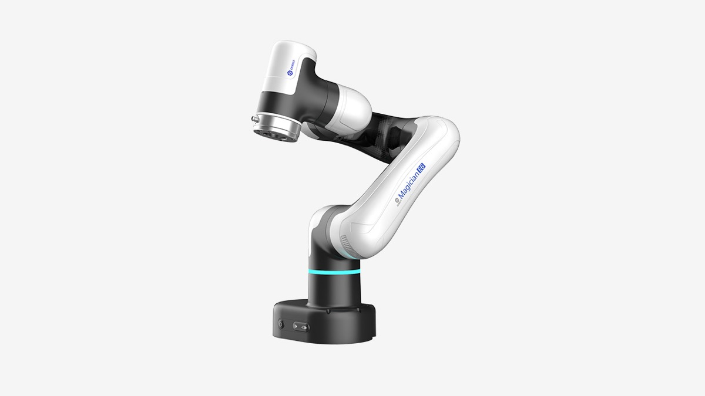
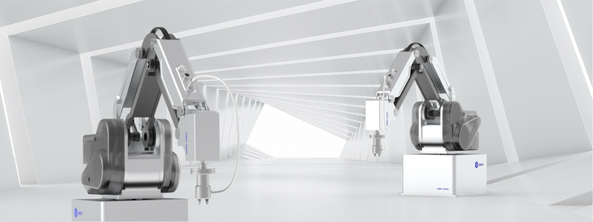
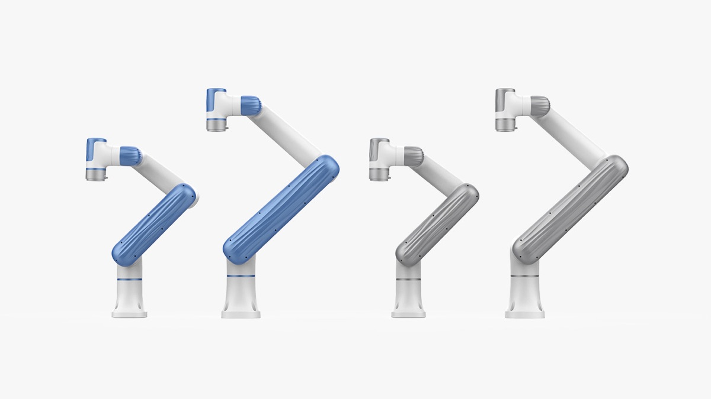
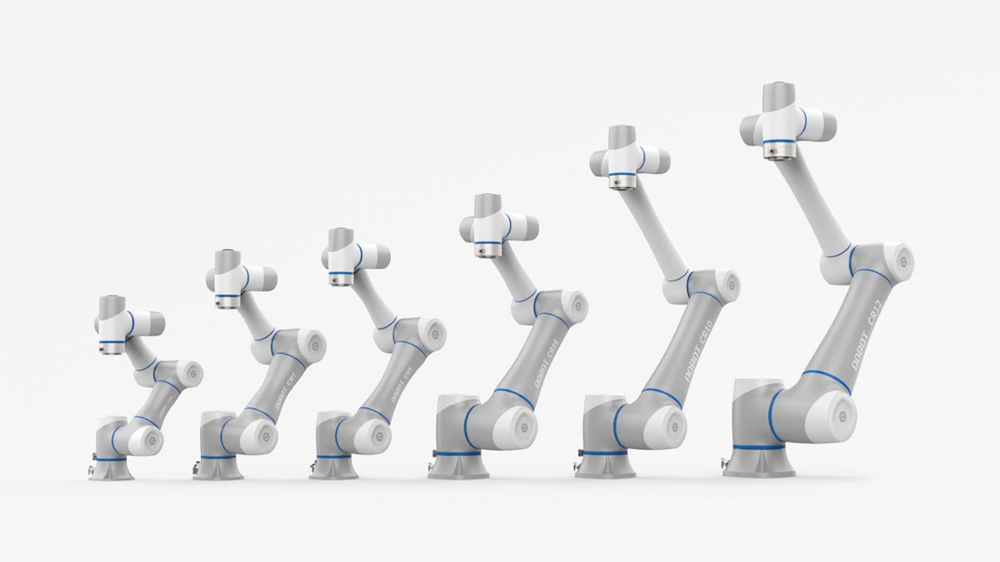
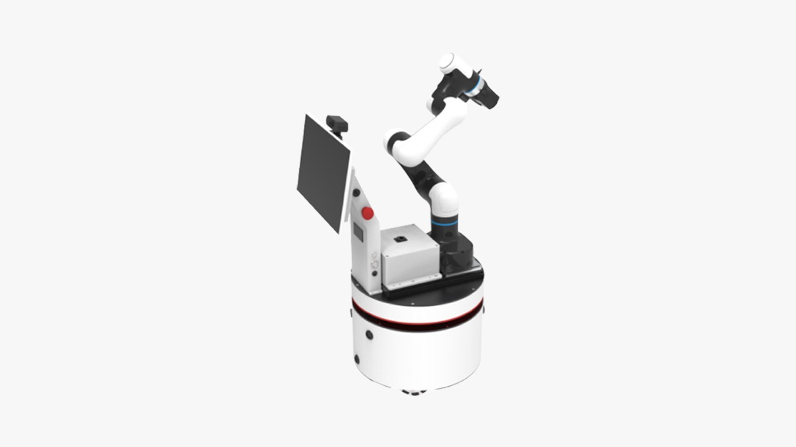

# Dobot Robotics × T03 — Products and Solutions

⬆ [Dobot Robotics profile](../Dobot.md) · [Brief](Dobot-T03-1-Brief.md) · [Playbook](Dobot-T03-3-Playbook.md)

> **Research note:** web search was unavailable for this pass. Everything below comes from Dobot's official site and its GitHub account, fetched directly. Third-party integrator projects (EV charging, waste sorting, agriculture) were **not** searched, so "nothing found" means "nothing on Dobot's own pages".
> **On-site inventory is a best guess** — confirm models, grippers and firmware (V4) at the Dobot booth first.

## Relevant products (ranked for this track)

### Magician E6

**Role:** the default arm for a tabletop sorting, grading or lab-handling cell. Six axes let it reach into bins and orient objects; same V4 API as the cobots, so code ports to Nova / CRA.

| Spec | Value |
|---|---|
| Payload / reach | **750 g** / **450 mm** |
| Repeatability | ±0.1 mm |
| Speed | 0.5 m/s TCP, 120°/s joints |
| Weight / protection | ≤7.2 kg / **IP20**, 0–40 °C |
| Power | 100–240 V AC in, 48 V DC 5 A, **130 W** |
| I/O | Base 16 DI / 16 DO (24 V, 0.5 A per channel); tool 2 DI / 2 DO |
| Comms | 2 Ethernet ports, TCP/IP + Modbus TCP |

- **Status:** ✅ shipping. Price: not public.
- **Developer control:** joint / Cartesian moves, digital I/O, drag-teach via `TCP-IP-Python-V4`; ROS 2 Humble + MoveIt + Gazebo via `DOBOT_6Axis_ROS2_V4` (E6 listed as supported). Official accessories: electric suction cup (ES01), vision kit, mini conveyor belt kit, sliding rail. No E6-specific gripper listed on the page.

### MG400

**Role:** fastest pick-and-place for flat, light items (cans, cartons, batteries, caps). Four axes mean top-down picks only.

| Spec | Value |
|---|---|
| Payload / reach | **500 g** rated (750 g max) / **440 mm** |
| Repeatability | ±0.05 mm |
| Speed | **300°/s** per joint |
| Weight / footprint | 8 kg / 190 × 190 mm |
| Power | 100–240 V AC, **150 W** |
| Protection | **IP20**, 0–40 °C |
| Comms | TCP/IP, Modbus TCP; encoder (ABZ) input for conveyor use |

- **Status:** ✅ shipping. Price: not public.
- **Developer control:** separate 4-axis API (`TCP-IP-4Axis-Python`, `TCP-IP-4Axis-CPP`) — **not** the V4 repos. Lua / Blockly in DobotStudio Pro. Dobot's download page lists MG400 training guides for conveyor demos, vision palletizing and chip sorting.

### Nova series (Nova 2, Nova 5)

**Role:** the "runs from a battery" option for a public kiosk (return station, reuse counter) and the arm used in Dobot's one circular-economy reference (Breezy).

| Spec | Nova 2 | Nova 5 |
|---|---|---|
| Payload / reach | **2 kg** / 625 mm | **5 kg** / 850 mm |
| Weight | 11 kg | 14 kg |
| Repeatability | ±0.05 mm | ±0.05 mm |
| Max TCP speed | 1.6 m/s | 2 m/s |
| Power typical / max | **100 W** / 250 W | **230 W** / 770 W |
| Protection (arm) | IP54 | IP54 |
| Controller | 200 × 120 × 55 mm, 1.3 kg, **30–60 V DC** input, IP20 | same |

- **Status:** ✅ shipping. Price: not public.
- **Developer control:** V4 Python / C++ / ROS 2 (Nova2 and Nova5 listed in the ROS 2 repo); collision detection with 5 levels, stop within 0.01 s; drag-teach; CRStudio mobile app.

### CRA series (CR3A, CR5A, CR10A most relevant)

**Role:** when the object is heavier than 750 g (glass bottles, crates, EV-charging connector, small appliances). Needs rigid mounting.

| Spec | CR3A | CR5A | CR10A |
|---|---|---|---|
| Payload | **3 kg** | **5 kg** | **10 kg** |
| Reach | 620 mm | 900 mm | 1,300 mm |
| Weight | 16.5 kg | 25 kg | 40 kg |
| Repeatability | ±0.02 mm | ±0.02 mm | ±0.03 mm |
| Power consumption | **120 W** | **150 W** | 350 W |

- IP54 is listed on the series page (per-model mapping not confirmed ⚠️ unverified). **CRA-IP68** and **CRAF** (torque sensor) variants exist; details not on the series page.
- Optional **SafeSkin**: 15 cm pre-collision sensing (company figure).
- **Status:** ✅ shipping. Price: not public.
- **Developer control:** V4 API, ROS 2 Humble + MoveIt; Modbus, EtherNet/IP, PROFINET for talking to conveyors or PLCs.

### X-Trainer

**Role:** teach-by-teleoperation for tasks that are hard to script — opening devices, unscrewing, separating mixed materials (disassembly for reuse).

| Spec | Value |
|---|---|
| Arms | 2 × Nova 2 followers, leader handles under 400 g |
| Payload | **2 kg** single arm, 3 kg dual |
| Reach | 625 mm per arm |
| Interface | **25 Hz** end-to-end; APIs expose leader / follower joints, gripper, RGB + depth |
| Training time claim | about 2 hours for a routine task (company claim; examples shown are dish-washing and clothes folding) |

- **Status:** ✅ shipping. Price: not public.
- **Developer control:** `dobot_xtrainer` (GPL-3.0; teleop + data processing; dependencies include `h5py` and `pyrealsense2`, which points to HDF5 episodes and RealSense cameras — inference). Supported policies (ACT, diffusion, LeRobot) are **not stated** on the product page or README ⚠️ unverified.

### E6 ROS Mobile Platform

**Role:** Dobot's only arm-on-wheels (education grade) — would suit an indoor "collect and sort" demo. Specs not checked ⚠️ unverified; presence on site unlikely. Status ✅ listed. Price: not public.

### Magician / Magician Lite / Magician Go and classroom kits

**Role:** only if nothing else is free. Useful accessories exist: **Vision Kit** (5 MP USB 3.0 colour camera, 2592 × 1944, 12 mm lens, ring light, DobotVisionStudio with colour / barcode / character recognition demos; listed for Magician and M1), mini conveyor belt, **Basic AI Kit** (Arduino Mega-compatible board, Pixy CMUcam5, voice module). Arm specs not checked ⚠️ unverified. Status ✅.

### DobotStudio Pro / DobotStudio Sim / DobotLab

**Role:** no-code fallback (Blockly, Lua, drag-teach) to get a pick-place loop running before the Python stack is ready. Status ✅. Note: teach-and-playback was removed for MG400 / M1 Pro in DobotStudio Pro v2.4.1 (per changelog on the MG400 page).

**Not ranked (little T03 value):** Atom, LUMO, Rover X1, PULSA, CRH, CR 30H, Kongyi DobotWAM (closed weights).

## What Dobot Robotics already does in this domain

Short answer: **one genuine circular-economy reference, generic sorting capability, nothing city-scale.**

| When | What | Relevance | Source |
|---|---|---|---|
| Undated (about 2025 ⚠️ unverified) | **Breezy, Poland** — Nova-series cobots in a **600 m²** electronics-refurbishment "smart factory" run by a **4-person** team: audio test, camera defect inspection, sorting into quality grades. Partner: ASBIS Robotic Solutions. Claimed 70% cost saving, 300% efficiency gain (company figures) | Reuse / second-life grading — the closest thing to a T03 deployment | [Case study](https://www.dobot-robots.com/insights/case-studies/dobot-powers-breezys-robotic-solutions-to-transform-refurbishment-in-poland.html) |
| Undated | **Bin-picking / sorting application page** — cobots + 3D vision pick from unsorted piles; claims 90% identification accuracy and 30% efficiency gain under lab conditions. No named robot, camera or customer | Shows the capability class, not a waste deployment | [Application page](https://www.dobot-robots.com/applications/sorting.html) |
| Undated | **Cave du Rhodan Mounir Weine (Swiss winery)** — CR20A palletizes wine cartons; integrator zmb (zaugg maschinenbau ag) with DOBOT EMEA. Town not stated on the page (the winery is in Salgesch, Valais, near Leuk ⚠️ unverified) | Not a sustainability case, but a **Swiss, probably Valais, reference** and a local integrator name | [Case study](https://www.dobot-robots.com/insights/case-studies/wine-box-palletizing-automation-with-dobot-cr20a.html) |
| Undated | University labs using MG400 / E6 / CR5A / X-Trainer (Bristol Robotics Laboratory, Edinburgh, Essex, Heriot-Watt, Sabancı) | Evidence the arms are research-friendly; no sustainability topics | [Case studies](https://www.dobot-robots.com/insights/case-studies) |

- **Not found on Dobot's own pages:** waste or recycling plants, litter picking, EV-charging automation, agriculture / vertical farming, environmental monitoring, building energy. Dobot's industry pages cover automotive, chemical, consumer electronics, food and beverage, medical, metal, new retail, semiconductor, education and research lab.
- No sustainability or energy-saving claims appear on the product pages; only raw power-consumption figures.

## What they are building next in this domain

- **No announced T03-specific roadmap.** 🔭
- **Inference:** the Oct 2026 launches (CRH with all-joint torque sensors, PULSA high-speed arms) target welding, spraying, inspection and fast handling — CRH-class force sensing would help disassembly / repair tasks, but availability is not public 🧪.
- **Inference:** Kongyi DobotWAM and X-Trainer / Embodylink point to learned manipulation for unstructured objects, which is what mixed-waste and refurbishment handling needs; weights are closed and no waste-related demos were found.

## Software, models and data that help for this track

| Asset | What it gives you | Notes |
|---|---|---|
| [TCP-IP-Python-V4](https://github.com/Dobot-Arm/TCP-IP-Python-V4) | Python API + demo for CRA / E6 / Nova (enable, MovJ, MovL, Arc, I/O) | Python 3.6+; controller V4.4.0.0+; PC on 192.168.5.x; ports 29999 and 30004. Updated 2026-11-13 |
| [DOBOT_6Axis_ROS2_V4](https://github.com/Dobot-Arm/DOBOT_6Axis_ROS2_V4) | ROS 2 **Humble** (Ubuntu 22.04) packages, URDF / XACRO (`cra_description`), **MoveIt** on real robot, **Gazebo** co-simulation | Joint states published at 10 Hz; default wired robot IP 192.168.5.1. Updated 2026-11-06 |
| [TCP-IP-4Axis-Python](https://github.com/Dobot-Arm/TCP-IP-4Axis-Python) | Python API for MG400 / M1 Pro | Separate from V4. Updated 2026-07-30 |
| [dobot_xtrainer](https://github.com/Dobot-Arm/dobot_xtrainer) | Teleoperation + data collection UI for X-Trainer | GPL-3.0; README is minimal and in Chinese |
| [Embodylink](https://github.com/Dobot-Arm/Embodylink) | Data collection, annotation, training management, teleop toolkit | GPL-3.0; Ubuntu 20.04, Python 3.8, Qt build; setup looks heavy for 48 h |
| DobotCameraCalibrate | Camera-to-robot calibration tool (C++) | On the same GitHub account; not reviewed |
| voice_txt_command | Voice command → target-object segmentation demo (fork) | Could front a "tell the robot what to sort" demo; not reviewed |
| DobotVisionStudio_QtModule / dobot_ros2_vision | Hikrobot VisionMaster integration (Windows) / ROS 2 vision for one specific workstation (EG0053-01) | Narrow; probably not worth the time |

- **No Dobot waste / recycling dataset or pretrained detector exists.** Bring your own: an open detector (YOLO-family) fine-tuned on a public litter dataset such as TACO, or a VLM for zero-shot material labels. These are third-party; check licences yourself.

## Gaps and limits for this track

- **No domain product:** no waste-sorting, EV-charging, farming or monitoring solution from Dobot itself. You are buying a reliable arm, not a head start on the problem.
- **Payload and environment:** E6 / MG400 are IP20 and under 1 kg — fine for cans, PET, batteries, phones; not for glass crates, wet waste, snow or outdoor use.
- **No mobility** apart from the education-grade E6 ROS platform (probably not on site) and the consumer Rover X1 (no arm, SDK unverified).
- **No native force control** on standard arms; CRAF / CRH needed, unlikely on site. Disassembly must rely on compliance in the gripper or on learned policies.
- **API fragmentation:** V4 (CRA / E6 / Nova) vs V3 (older firmware) vs 4-axis (MG400 / M1 Pro). Check before cloning.
- **Vision is yours to build:** the Vision Kit and DobotVisionStudio are classroom tools tied to Magician / M1 and Windows.
- **X-Trainer learning stack is poorly documented** in public; policy training on site needs a GPU and booth support.
- **Foundation model (DobotWAM) is closed** — not usable by teams.
- **Evidence gaps:** case studies are undated; all performance figures are company lab numbers.

## Sources

- [Dobot official site](https://www.dobot-robots.com/)
- [Magician E6 product page](https://www.dobot-robots.com/products/education/magician-e6.html)
- [MG400 product page](https://www.dobot-robots.com/products/desktop-four-axis/mg400.html)
- [Nova series product page](https://www.dobot-robots.com/products/nova-series/dobot-nova-series.html)
- [CRA series product page](https://www.dobot-robots.com/products/cra-series/dobot-cra-series.html)
- [X-Trainer product page](https://www.dobot-robots.com/products/humanoid-robots/x-trainer.html)
- [Dobot Vision Kit](https://www.dobot-robots.com/products/conveyor-belt/dobot-vision-kit.html)
- [Basic AI Kit for Magician](https://www.dobot-robots.com/products/conveyor-belt/basic-ai-kit-for-magician.html)
- [Bin picking / sorting application page](https://www.dobot-robots.com/applications/sorting.html)
- [Case studies index](https://www.dobot-robots.com/insights/case-studies)
- [Case study: Breezy refurbishment, Poland](https://www.dobot-robots.com/insights/case-studies/dobot-powers-breezys-robotic-solutions-to-transform-refurbishment-in-poland.html)
- [Case study: Cave du Rhodan wine-box palletizing with CR20A](https://www.dobot-robots.com/insights/case-studies/wine-box-palletizing-automation-with-dobot-cr20a.html)
- [Case study: Embodied AI at Bristol Robotics Laboratory](https://www.dobot-robots.com/insights/case-studies/building-the-future-of-embodied-ai-robotics-at-bristol-robotics-laboratory.html)
- [Dobot-Arm on GitHub (repository list)](https://github.com/Dobot-Arm?tab=repositories)
- [TCP-IP-Python-V4](https://github.com/Dobot-Arm/TCP-IP-Python-V4)
- [DOBOT_6Axis_ROS2_V4](https://github.com/Dobot-Arm/DOBOT_6Axis_ROS2_V4)
- [dobot_xtrainer](https://github.com/Dobot-Arm/dobot_xtrainer)
- [Embodylink](https://github.com/Dobot-Arm/Embodylink)
- [Dobot company profile (internal)](../Dobot.md)
