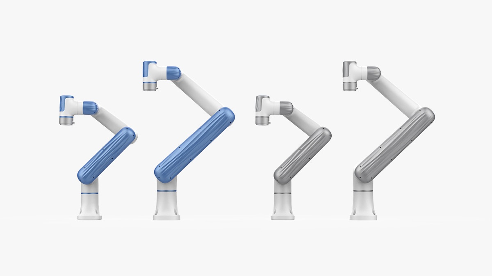
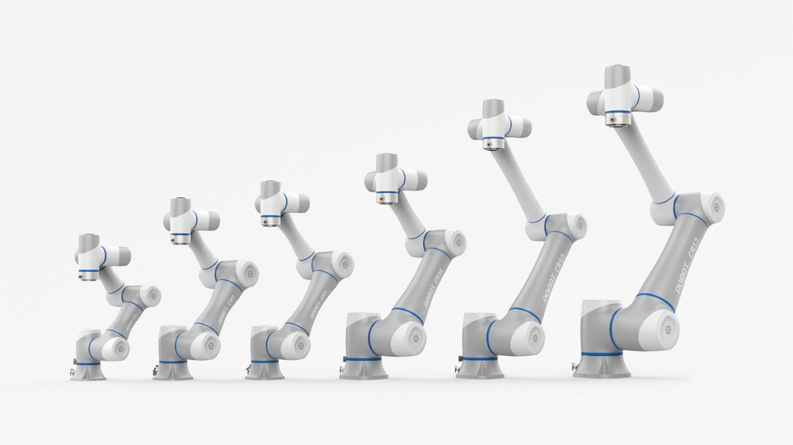
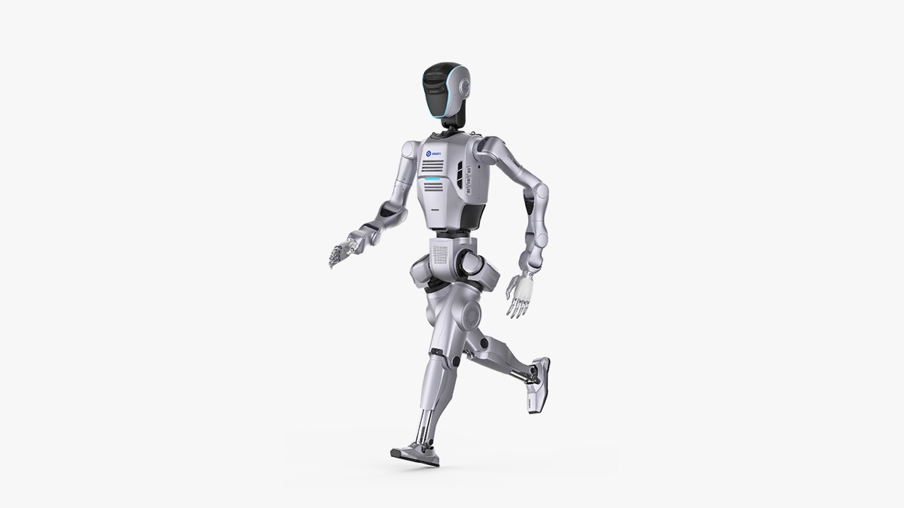
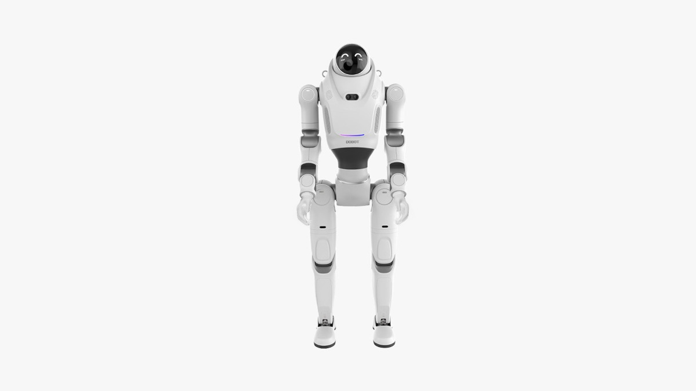

# Dobot Robotics × T04 — Products and Solutions

⬆ [Dobot Robotics profile](../Dobot.md) · [Brief](Dobot-T04-1-Brief.md) · [Playbook](Dobot-T04-3-Playbook.md)

> **Read this first:** what Dobot actually brings to Leukerbad is not confirmed. Ranking below assumes availability; ask the booth which models and firmware (V4.4.0.0 or later) are on site.

## Relevant products (ranked for this track)

### Nova series (Nova 2, Nova 5)

**Role in T04:** first choice. Compact commercial cobot that runs on low-voltage DC; Dobot labels **Nova 5 "For Physiotherapy"** and Nova 2 for retail. Suits bedside handover, assisted feeding, exercise coaching.

| Spec | Nova 2 | Nova 5 |
|---|---|---|
| Payload | **2 kg** | **5 kg** |
| Reach | 625 mm | **850 mm** |
| Arm weight | 11 kg | 14 kg |
| Max TCP speed | 1.6 m/s | 2 m/s |
| Repeatability | ±0.05 mm | ±0.05 mm |
| Noise | 65 dB(A) | 70 dB(A) |
| Power (typical / max) | 100 W / 250 W | 230 W / 770 W |
| Protection | IP54 arm, IP20 controller | same |
| Safety | **5 adjustable collision levels**; stop **0.01 s** after collision detection; posture hold on power loss | same |
| Controller | 1.3 kg, **30–60 V DC**, 3 m cable; teach from PC or phone app | same |
| Tool I/O | 2 DI, 2 DO, RS485 | same |
| Mounting | any angle | any angle |

- **Status:** ✅ shipping. **Price:** not public.
- **Force control:** none stated for Nova (collision detection only).
- **Developer interface:** V4 TCP/IP API (Python, C++, ROS 2). Joint and Cartesian moves, streaming `ServoJ` / `ServoP`, drag mode on/off, collision level, safe walls / work zones, digital and tool I/O, trajectory replay. No documented torque-level control.

### CRA series (CR3A / CR5A) and CRAF force-sensor variants

**Role in T04:** the only Dobot arms with real **force control today** (CRAF). Needed for any demo with deliberate body contact: massage-style constant force, guided limb motion, compliant handover.

| Spec | CR3A | CR5A | CR5AF | CR10AF |
|---|---|---|---|---|
| Payload | 3 kg | 5 kg | 5 kg | 10 kg |
| Reach | 620 mm | 900 mm | 900 mm | 1,300 mm |
| Repeatability | ±0.02 mm | ±0.02 mm | ±0.02 mm | ±0.03 mm |
| Weight | 16.5 kg | 25 kg | not checked | not checked |
| Max linear speed | 3 m/s | 4 m/s | not checked | not checked |
| Force sensing | no (optional SafeSkin: 15 cm pre-collision sensing) | no | **6-axis force sensor at the flange** | same |

- **CRAF force figures (company):** drag-start force **<2 N**; collision detection sensitivity down to **1 N**; constant-force mode with automatic compensation; whole flange is a drag zone, orientation can be locked. Sensor range and accuracy: not public.
- **Safety:** separate PLd Cat.3 safety controller, 20+ safety functions, ISO/TS 15066 stated on the CRA page.
- **Status:** ✅ shipping (CR20AF also exists). **Price:** not public. Heavier than Nova and needs firmer mounting.
- **Developer interface:** same V4 API. `dobot_api.py` exposes `EnableFTSensor`, `SixForceHome`, `GetForce`, `ForceDriveMode`, `FCForceMode`, `FCSetForce`, `FCSetStiffness`, `FCSetDamping`, `FCSetForceLimit`, `FCOff`. That these calls require the CRAF sensor is an inference ⚠️ unverified. ROS 2 package lists CR10AF and contains `cr3af_moveit` / `cr5af_moveit` folders.

### Magician E6

**Role in T04:** most likely on site; good enough for spoon-level feeding, pill-box sorting and exercise-target demos. Too small and weak for anything load-bearing.

| Spec | Value (from the company profile) |
|---|---|
| Payload | **750 g** |
| Reach | 450 mm |
| Repeatability | ±0.1 mm |
| Weight | ≤7.2 kg |
| Interfaces | 2 Ethernet (TCP/IP, Modbus TCP), 16 DI / 16 DO |

- **Status:** ✅ shipping. **Price:** not public.
- **Developer interface:** same V4 Python / ROS 2 stack as Nova and CRA, so code ports upward to a bigger arm.

### X-Trainer

**Role in T04:** dual-arm teleoperation — a remote caregiver operating two arms (tele-care), or collecting demonstrations for a bimanual task (open a pill bottle, pour a drink).

| Spec | Value (from the company profile) |
|---|---|
| Follower arms | 2 x Nova 2 |
| Payload | 2 kg per arm |
| Reach | 625 mm per arm |
| End-to-end interface rate | 25 Hz |

- **Status:** ✅ shipping. **Price:** not public.
- **Developer interface:** `dobot_xtrainer` repo (teleoperation + data processing, GPL-3.0, only 3 commits, README in Chinese). Supported policy types (ACT, diffusion, LeRobot format) are **not stated** in the README ⚠️ unverified.

### Atom (Atom, Atom Max, Atom D)

**Role in T04:** showpiece at best. The official page lists "pharmacy nighttime dispensing" among target tasks — the closest Dobot humanoid claim to care logistics.

| Spec | Value |
|---|---|
| Upper-body DoF (Atom) | 28 |
| Atom Max | 41 DoF, 6-DoF hands, RealSense D455, VR/MR teleoperation |
| Arm payload, battery runtime, walking speed | not on the official page |

- **Status:** ✅ in production since Jun 2025; on-site access unlikely. **Price:** CNY 199,000 at 2025 launch (profile).
- **Developer interface:** `dobot_atom_sdk`, `dobot_atom_ros2`, URDF (see profile). Not a 48-hour platform unless Dobot staff support it.

### LUMO

**Role in T04:** conceptually the most relevant (Dobot says it is "designed for home companionship", with emotional interaction and continuous learning), practically unusable for a build.

| Spec | Value |
|---|---|
| Dimensions, sensors, battery, payload | not public |
| SDK / developer access | not public |

- **Status:** 🧪 launched Oct 2026, no availability date. **Price:** not public (about US$12,000 on a third-party listing ⚠️ unverified).

### CRH series

**Role in T04:** future option — torque sensors on **all joints** (7 kg / 12 kg) would allow whole-arm compliance, which is what physical human-robot interaction really needs.

- **Status:** 🧪 unveiled 2026-10-20, availability not public; marketed for welding, spraying, inspection, not care. Do not plan on it.

## What Dobot Robotics already does in this domain

Short answer: **positioning and adjacent lab automation, no documented care or rehabilitation deployment.**

| When | What | Evidence |
|---|---|---|
| Current (page read 2026-11-14) | Nova 5 labelled "For Physiotherapy"; Nova line pitched for "beverage, restaurants, physiotherapy" | [Nova page](https://www.dobot-robots.com/products/nova-series/dobot-nova-series.html) |
| Current | Healthcare industry page claims use in "patient care, item delivery, reagent packaging and sample testing"; recommends MG400, VX500 camera and CRA | [Healthcare page](https://www.dobot-robots.com/industries/medical.html) |
| Undated | Case study: quality-inspection automation for an unnamed in-vitro diagnostics provider | same page |
| Undated | Case study: nucleic-acid extraction pipetting and mixing with a CR3 cobot | same page |
| Current | Atom page lists pharmacy night-time dispensing as a target task (no customer named) | [Atom page](https://www.dobot-robots.com/products/humanoid-robots/atom.html) |
| 2026-10 | LUMO launched as a home-companionship robot | [LUMO page](https://www.dobot-robots.com/insights/case-studies/1283.html) |

- **Massage / moxibustion robots built on Dobot arms:** widely assumed integrator applications, but **not mentioned on any official page read here** (Nova, CRA, CRAF, Healthcare) ⚠️ unverified.
- **Named clinics, care homes, rehabilitation partners, Swiss deployments:** none found.

## What they are building next in this domain

- **LUMO + Kongyi DobotWAM** 🧪 — a companion robot with voice and vision emotion / intent recognition and local long-term memory, running Dobot's own foundation model. This is the clearest signal toward home and care use; no elderly-care programme is announced (inference: companionship is the consumer entry point).
- **CRH all-joint torque sensing** 🧪 — hardware that makes contact-rich tasks practical; Dobot targets industry first (inference: physiotherapy integrators are a natural later market).
- **INFFNI consumer sub-brand** (Rover X1) ✅ — home robots that follow and carry small loads; no care positioning.
- **Dedicated rehabilitation or medical-device roadmap:** not public.

## Software, models and data that help for this track

| Asset | What it gives you | Notes |
|---|---|---|
| [TCP-IP-Python-V4](https://github.com/Dobot-Arm/TCP-IP-Python-V4) | Python control of CRA / E6 / Nova | Firmware **V4.4.0.0+**; PC on 192.168.5.x; ports **29999** and **30004**; Python 3.6+, numpy; `main.py` example and a Tk GUI |
| Key API calls for T04 | `StartDrag` / `StopDrag`, `DragSensivity`, `SetCollisionLevel`, `SpeedFactor`, `SetSafeWallEnable`, `SetWorkZoneEnable`, `ServoJ` / `ServoP`, `GetPose`, `StartPath`, `FC*` force-control family | Read from `dobot_api.py`; streaming rates and feedback fields (joint current / torque) ⚠️ unverified |
| [DOBOT_6Axis_ROS2_V4](https://github.com/Dobot-Arm/DOBOT_6Axis_ROS2_V4) | ROS 2 **Humble** on Ubuntu 22.04, **MoveIt + Gazebo**, MIT licence | Lists Nova2, Nova5, E6, CR3–CR30H, CR10AF; branch `feature/v4-optimization`; `/joint_states_robot` at 10 Hz; MoveIt executes through ServoJ |
| DobotStudio Pro | Blockly / Lua, drag-to-teach, trajectory replay | Fastest no-code baseline |
| [voice_txt_command](https://github.com/Dobot-Arm/voice_txt_command) | Voice → text → open-vocabulary detection → tracking (Whisper, spaCy, Grounding DINO, KCF) | Useful for "bring me the brown cup"; no robot integration in the README; benchmarked on an RTX 5090, needs a GPU |
| [dobot_xtrainer](https://github.com/Dobot-Arm/dobot_xtrainer) / [Embodylink](https://github.com/Dobot-Arm/Embodylink) | Teleop, data collection, training management (GPL-3.0) | Thin documentation; Embodylink targets Ubuntu 20.04 + Qt |
| DobotWAM, ROM-1 | Foundation models | Closed; no public weights |
| Care or rehab datasets | — | None published by Dobot |

## Gaps and limits for this track

- **No mobility:** arms are fixed-base. Fall detection, night rounds and walking support need another vendor.
- **Force control only on CRAF** (and future CRH). Nova / CRA / E6 detect collisions but do not regulate contact force — unsafe basis for massage or limb guidance.
- **Not a medical device:** no medical certification found for any model (not public). "For Physiotherapy" is a marketing label.
- **No reference deployments** in care or rehab to learn from; no care datasets or pretrained models.
- **Payload:** fine for cups, cutlery, pill boxes; not for patient lifting or transfer.
- **End-effectors:** grippers are third-party (Dobot+ ecosystem); what is on site is unknown.
- **Research limit:** web search was unavailable in this pass; only official Dobot pages and GitHub were read, so third-party massage / physiotherapy integrator cases could not be checked.

## Sources
- [Dobot Robotics profile (this repo)](../Dobot.md)
- [Dobot Nova series](https://www.dobot-robots.com/products/nova-series/dobot-nova-series.html)
- [Dobot CRA series](https://www.dobot-robots.com/products/cra-series/dobot-cra-series.html)
- [Dobot CRAF series](https://www.dobot-robots.com/products/cra-series/dobot-craf-series.html)
- [Dobot Healthcare industry page](https://www.dobot-robots.com/industries/medical.html)
- [Dobot Atom](https://www.dobot-robots.com/products/humanoid-robots/atom.html)
- [LUMO overview page](https://www.dobot-robots.com/insights/case-studies/1283.html)
- [TCP-IP-Python-V4 (GitHub)](https://github.com/Dobot-Arm/TCP-IP-Python-V4)
- [dobot_api.py in TCP-IP-Python-V4](https://github.com/Dobot-Arm/TCP-IP-Python-V4/blob/main/dobot_api.py)
- [DOBOT_6Axis_ROS2_V4 (GitHub)](https://github.com/Dobot-Arm/DOBOT_6Axis_ROS2_V4)
- [dobot_xtrainer (GitHub)](https://github.com/Dobot-Arm/dobot_xtrainer)
- [Embodylink (GitHub)](https://github.com/Dobot-Arm/Embodylink)
- [voice_txt_command (GitHub)](https://github.com/Dobot-Arm/voice_txt_command)
