# Flexiv Robotics — Product Portfolio

⬆ [Flexiv Robotics profile](Flexiv.md) · [Developer guide](Flexiv-Developer-Guide.md) · [Roadmap and strategy](Flexiv-Roadmap-and-Strategy.md)

> **Read this first:** everything Flexiv sells is built around one idea — a 7-axis arm with fine whole-arm force control. Pick Flexiv when your demo is about **contact** (touching a body, plugging, wiping, inserting, polishing). Pick something else when you need legs, outdoor mobility or a ready-made VLA model.
> **Fastest hackathon path:** Rizon 4 / 4s + Grav gripper + Python RDK (non-real-time primitives) + your own camera and PC.
> What is physically on site is **not confirmed** — ask at the booth. Spec values below are taken from Flexiv's own product pages on 2026-11-14 unless marked.

## Lineup map

Track relevance: ● strong · ◐ partial · ○ none. Status: ✅ shipping/available · 🧪 announced/preview · 🔭 roadmap/concept. Prices: Flexiv publishes none.

| Product | Category | Status | Launched | Price (if public) | Positioning (one line) | T01 | T02 | T03 | T04 |
|---|---|---|---|---|---|---|---|---|---|
| Rizon 4 | 7-DoF force-controlled arm | ✅ | 2019 ⚠️ unverified | not public | Workhorse arm, **4 kg**, used in every public developer workflow | ◐ | ◐ | ● | ● |
| Rizon 4s | Rizon 4 + wrist F/T sensor | ✅ | not public | not public | Most sensitive model: **0.03 N** force sensing | ◐ | ◐ | ● | ● |
| Rizon 10 | 7-DoF force-controlled arm | ✅ | not public | not public | Heavier tools and parts, **10 kg**, up to 350 N | ◐ | ◐ | ● | ◐ |
| Rizon 10s | Rizon 10 + wrist F/T sensor | ✅ | not public | not public | 10 kg payload with 0.1 N sensing | ◐ | ◐ | ● | ◐ |
| Enlight L | Compact next-gen 7-DoF arm | ✅ (delivery status ⚠️ unverified) | June 2026 | not public | **15 kg** arm, 5 kg payload, built for people-facing spaces | ◐ | ◐ | ● | ● |
| Mico (Armor / Core / Plus / Ultra) | Dual-arm platform (2 × Enlight) | ✅ (delivery status ⚠️ unverified); Ultra 🔭 | June 2026 | not public | Compact bimanual platform for embodied-AI work | ◐ | ○ | ◐ | ● |
| AICO (1, 2-4, 2-10) | Mobile single / dual-arm platform (Rizon) | ✅ listed | not public | not public | Wheeled research platform with laser SLAM | ● | ◐ | ◐ | ◐ |
| FMR 300 | Autonomous mobile robot | ✅ | Dec 2025 | not public | Indoor AMR base, **272 kg** payload | ● | ◐ | ◐ | ○ |
| Mobile Manipulator | FMR 300 + Rizon arm | ✅ listed | not public | not public | Mobile workstation; arm corrects docking error by touch | ● | ◐ | ● | ◐ |
| Mello | Robotic massage system | 🧪 release slated Q4 2026 | previewed 2026 | not public | Retail massage cell, standardized 15-minute session | ○ | ○ | ○ | ● |
| Moonlight | 3-DoF force-controlled parallel robot | ✅ | not public | not public | In-line polishing, deburring, loading | ○ | ○ | ◐ | ○ |
| Grav | 2-finger force-controlled gripper | ✅ | not public | not public | Default gripper, 1–100 N, IP67 | ● | ◐ | ● | ● |
| Grav Enhanced | Gripper with gecko-style adhesive pads | ✅ | not public | not public | Grabs round, large or awkward objects up to 5 kg | ● | ◐ | ● | ◐ |
| Flexiv Elements / Elements Studio | Programming software | ✅ | not public | not public | No-code task editor on teach pendant / desktop | ◐ | ◐ | ◐ | ◐ |
| RDK / DRDK / TDK / PDK / AMR SDK / Trainer | Developer software | ✅ | — | free (Apache-2.0); robot-side RDK license required | C++/Python control at 1 kHz, teleop, data collection, ROS 2 | ● | ● | ● | ● |

## Products

### Rizon 4
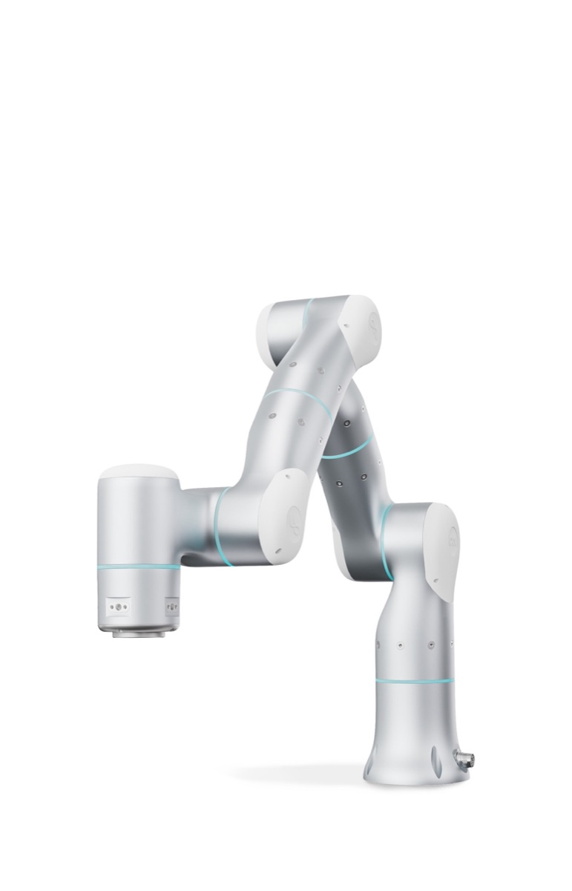

The standard Flexiv arm and the **most likely unit on site**. Seven joints with torque sensing in every joint, so the whole arm (not only the wrist) senses and controls force.

| Spec | Value |
|---|---|
| Degrees of freedom | **7** |
| Payload | **4 kg** |
| Reach | **876 mm** |
| Arm weight | 20 kg |
| Force sensing accuracy | **0.1 N** |
| Maximum TCP force | 200 N |
| Pose repeatability (ISO 9283) | ±0.05 mm |
| Typical TCP linear speed | 1.0 m/s |
| Protection rating | IP65 |
| Mounting | Any orientation |
| Tool flange | ISO 9409-1-50-4-M6 |
| Operating conditions | 0–45 °C, 20–80 % humidity non-condensing |
| Noise | < 70 dB |
| Certification | CE and ETL |
| Controller | Hesper (see accessories): 12 kg, 500 W, 16 DI / 16 DO, Profinet, Modbus TCP/IP |
| Compute for your AI | External PC over wired Ethernet (no user GPU in the arm ⚠️ unverified) |
| Battery | None — mains powered, stationary |

- **Variants:** Rizon 4 / 4s / 10 / 10s. No EDU or "developer edition" is published; programmatic access depends on an **RDK license activated on the robot**, not on the hardware model.
- **Developer support:** RDK (C++/Python), ROS 2 (`flexiv_ros2`), NVIDIA Isaac support since Sept 2026, Flexiv Trainer for teleop data collection.
- **Typical applications:** polishing and sanding, plug / connector insertion, assembly, lab automation, massage, CNC tending.
- **Hackathon use:** T04 guided-movement or contact-therapy demo; T03 force-guided sorting or disassembly; T01 plug-in / handover station.
- Official page: https://www.flexiv.com/product/rizon

### Rizon 4s (Rizon 4 + wrist F/T sensor)
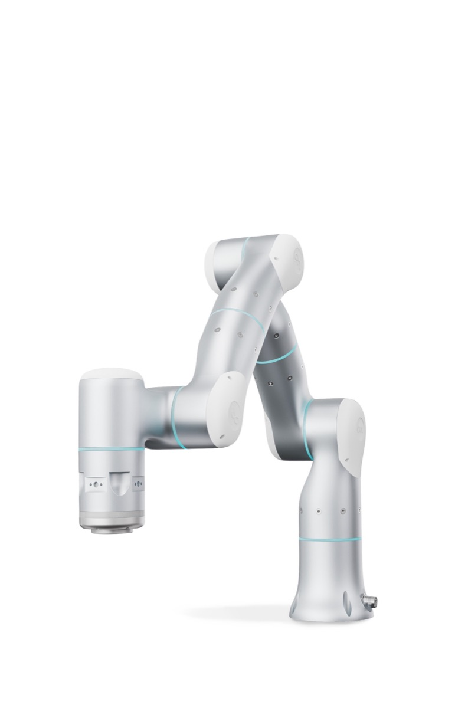

Rizon 4 with an added force/torque sensor at the wrist (the product page labels it "Rizon 4 + F/T Sensor"). Choose it when the contact force is very small — skin, fragile objects, thin parts.

| Spec | Value | Difference vs Rizon 4 |
|---|---|---|
| Degrees of freedom | 7 | same |
| Payload | 4 kg | same |
| Reach | **919 mm** | +43 mm |
| Arm weight | 21 kg | +1 kg |
| Force sensing accuracy | **0.03 N** | about 3× finer |
| Maximum TCP force | **150 N** | lower (200 N on Rizon 4) |
| Repeatability / speed / IP | ±0.05 mm · 1.0 m/s · IP65 | same |

- **Typical applications:** delicate assembly, surface following, body-contact work.
- Official page: https://www.flexiv.com/product/rizon

### Rizon 10
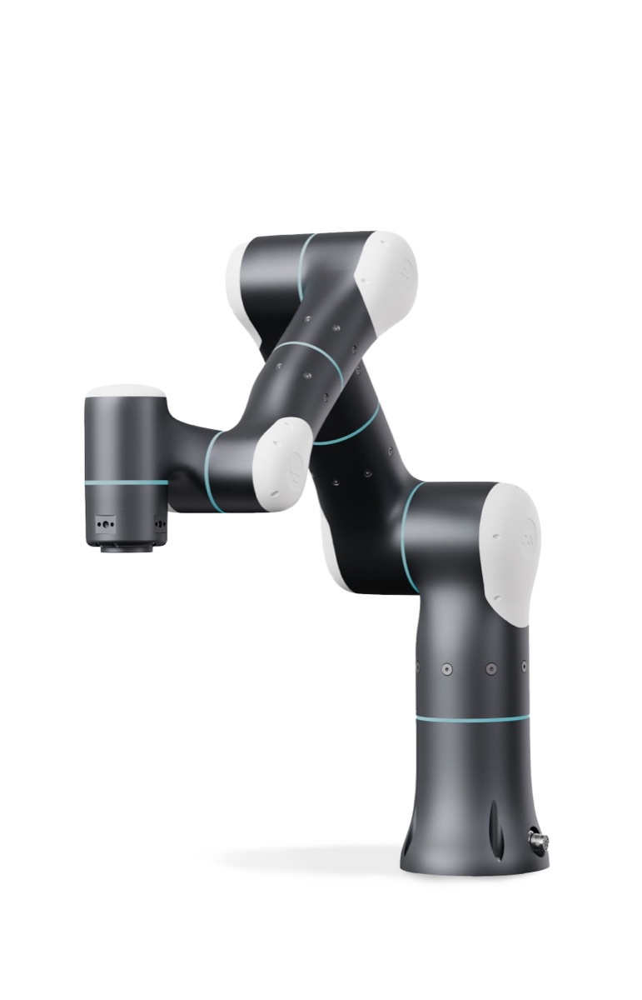

The larger arm for heavier tools and higher pushing force. Less likely to travel to a mountain venue (38 kg arm).

| Spec | Value |
|---|---|
| Degrees of freedom | 7 |
| Payload | **10 kg** |
| Reach | **941 mm** |
| Arm weight | 38 kg |
| Force sensing accuracy | 0.2 N |
| Maximum TCP force | **350 N** |
| Pose repeatability | ±0.05 mm |
| Typical TCP linear speed | 1.0 m/s |
| Protection rating | IP65 |
| Tool flange | ISO 9409-1-50-4-M6 |

- **Typical applications:** car-body polishing, heavy-tool finishing, machine tending.
- Official page: https://www.flexiv.com/product/rizon

### Rizon 10s (Rizon 10 + wrist F/T sensor)
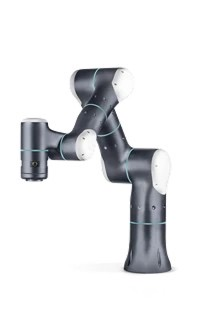

Rizon 10 with wrist F/T sensor: **10 kg** payload · **984 mm** reach · 39 kg · force sensing **0.1 N** · max TCP force 350 N · ±0.05 mm · IP65.

- Official page: https://www.flexiv.com/product/rizon

### Enlight L
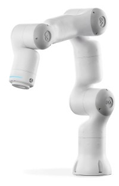

Flexiv's 2026 arm: smaller and lighter than Rizon, designed for people-facing settings (the product page names homes, schools and offices). **Plausible on site** — it ships in a carry case and weighs 15 kg.

| Spec | Value |
|---|---|
| Degrees of freedom | **7** |
| Payload | **5 kg** |
| Reach | **752 mm** |
| Arm weight | **15 kg** |
| Force sensing accuracy | 0.1 N |
| Max. controllable force range | **400 N** |
| Pose repeatability (ISO 9283) | ±0.05 mm |
| Typical TCP linear speed | 1.0 m/s |
| Joint range | **720°** rotation in four joints |
| Protection rating | IP65 |
| Mounting | Any orientation |
| Tool flange | ISO 9409-1-50-4-M6 (same as Rizon, so Grav fits mechanically) |
| Noise | < 70 dBA |
| Safety | "AEGIS" safety system; design follows IEC 61508 and ISO 10218-1:2025 |
| Controller | Orion control hub (one hub can run several arms), or split RCM + PSM modules — see accessories |
| Whole-body touch sensing | Stated in launch coverage (see profile); not in the spec table |

- **Variants:** only "Enlight L" is listed. Other sizes: not public.
- **Typical applications:** light assembly, service and research tasks, dual-arm platforms (Mico).
- **Hackathon caveat:** newest product — confirm RDK version and example coverage at the booth before committing.
- Official page: https://www.flexiv.com/product/enlight

### Mico (Armor / Core / Plus / Ultra)
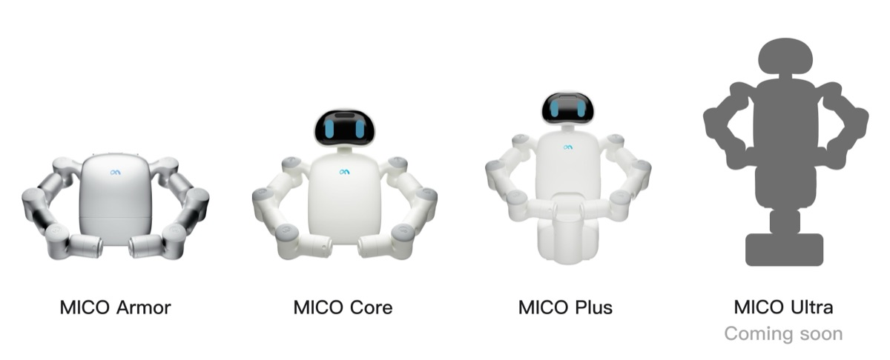

A compact dual-arm system made of two Enlight arms on a modular body, sold in four fixed configurations and pitched at embodied-AI development.

| Spec | Mico Armor | Mico Core | Mico Plus | Mico Ultra |
|---|---|---|---|---|
| Degrees of freedom | 2 × 7 | 2 × 7 | 2 × 7 | not public |
| Payload | 2 × 5 kg | 2 × 5 kg | 2 × 5 kg | not public |
| Weight | 55 kg | **53 kg** | 79 kg | not public |
| Reach per arm | 752 mm | 752 mm | 752 mm | not public |
| Force sensing accuracy | 0.1 N | 0.1 N | 0.1 N | not public |
| Pose repeatability | ±0.05 mm | ±0.05 mm | ±0.05 mm | not public |
| Control interface | RDK 1 kHz real-time / non-real-time | same | same | not public |
| Operating temperature | 0–45 °C | same | same | not public |

- What physically differs between Armor, Core and Plus (base, head, sensors, mobility): **not stated in the spec table** — ask Flexiv. Mico Ultra is named only 🔭.
- **Typical applications:** bimanual manipulation research, teleoperation data collection, policy training.
- Official page: https://www.flexiv.com/product/robot-system

### AICO (1, 2-4, 2-10)
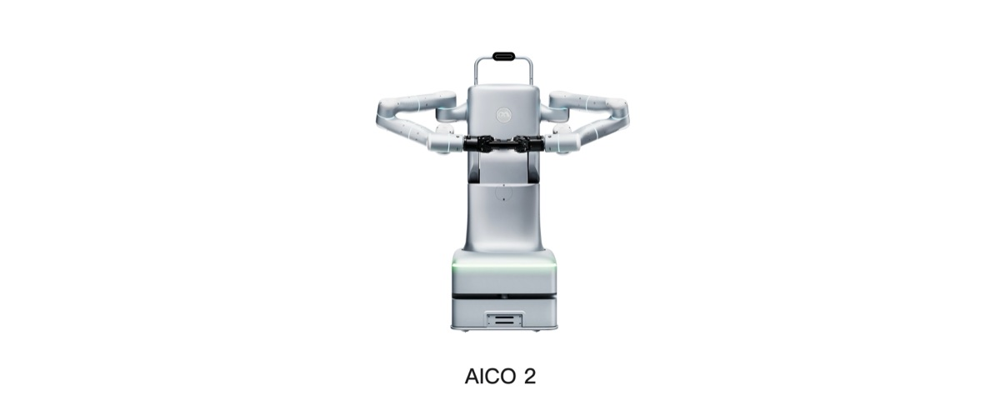

Wheeled platform carrying one or two Rizon arms, described by Flexiv as a human-inspired platform for embodied-intelligence development. Heavy (185–395 kg), so **unlikely on site**.

| Spec | AICO 1 | AICO 2-4 | AICO 2-10 |
|---|---|---|---|
| Arms / DoF | 1 × 7 | 2 × 7 | 2 × 7 |
| Payload | 4 kg | 2 × 4 kg | 2 × 10 kg |
| Reach | 780 mm | 780 mm | 845 mm |
| Weight | 185 kg | 281 kg | 395 kg |
| Navigation | Laser SLAM | Laser SLAM | Laser SLAM |
| Drive | Four-wheel independent steering | Dual-wheel differential | Dual-wheel differential |
| Battery life (overall) | **4 h** | **6 h** | **4 h** |
| Force sensing accuracy | 0.1 N / 0.03 N | 0.1 N / 0.03 N | 0.2 N / 0.1 N |
| Pose repeatability | ±0.05 mm | ±0.05 mm | ±0.05 mm |

- The two force-sensing values correspond to arms without / with the wrist F/T sensor.
- Official page: https://www.flexiv.com/product/robot-system

### FMR 300
Flexiv's first in-house autonomous mobile robot (launched December 2025). No dedicated product page found on flexiv.com; values below are from trade press coverage of the launch. No picture saved.

| Spec | Value |
|---|---|
| Payload | **272 kg** (600 lb) |
| Footprint | 78.7 × 60.9 cm |
| Height | 86.3 cm |
| Navigation | Laser SLAM |
| Drive | Two-wheel differential |
| Battery | 72 Ah lithium-iron |
| Runtime | Up to **8 h** under typical workload |
| Charging | Drives itself to the dock when low |
| Safety | Built-in collision detection; vision can be added for crowded spaces |
| Developer access | `flexiv_amr_sdk` (C++) and `flexiv_amr_ros2` on GitHub |
| IP rating, speed | not public |

- **Typical applications:** lab automation, CNC loading / unloading, mobile grinding and polishing stations.
- **Hackathon caveat:** indoor flat-floor base — not for snow, slopes or outdoor Leukerbad terrain.

### Mobile Manipulator

FMR 300 base with a Rizon-series arm on top. The selling point: the arm uses force sensing to find the workpiece and cancel the base's parking error, so no vision calibration is needed for docking tasks.

- **Specs:** no separate spec table published — combine the FMR 300 and Rizon tables above. Total weight, runtime with arm: not public.
- **Typical applications:** mobile CNC tool changing and tending, lab sample handling, mobile polishing.
- **Hackathon use:** the only Flexiv route to a moving T01 demo (indoor delivery + contact task) — only if a base is actually on site.
- Official page: https://www.flexiv.com/product/robot-system

### Mello
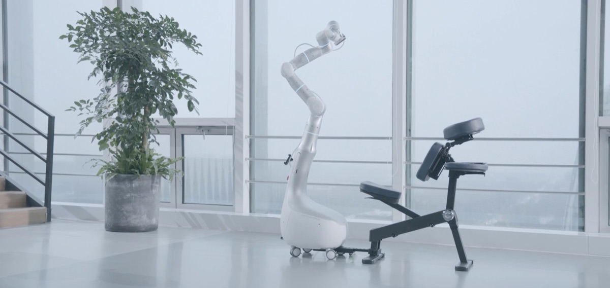

A packaged robotic massage station: 7-DoF force-controlled arm, AI body tracking and a customer-facing interface, delivering a standardized **15-minute** massage. Positioned as a retail wellness product (not presented as a medical device). 🧪 commercial release slated Q4 2026.

| Spec | Value |
|---|---|
| Degrees of freedom | 7 |
| Force sensing accuracy | 0.1 N |
| Force control response frequency | **1000 Hz** |
| Maximum output force | 200 N |
| Power source | 220–240 V, 50/60 Hz |
| Power consumption | 500 W |
| Operating temperature | 0–45 °C |
| Form factor | Arm on a wheeled pedestal next to a massage chair (per official image) |
| Sensors, dimensions, weight | not public |

- **Developer access:** not public — treat it as a closed product. For a hackable T04 build, use a bare Rizon 4s or Enlight L instead.
- **Local relevance:** direct fit for a thermal-spa and rehabilitation town; a strong reference for what Flexiv considers safe body contact.
- Official page: https://www.flexiv.com/product/robot-system

### Moonlight
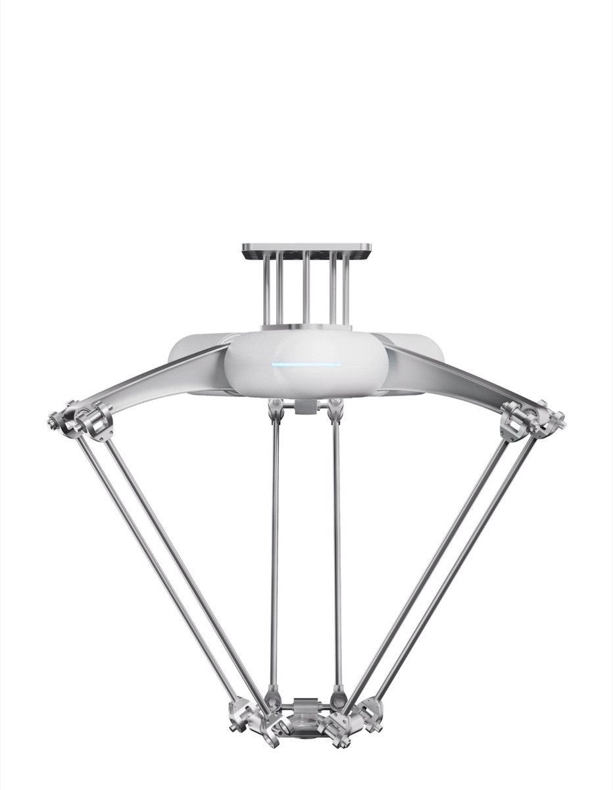

A 3-DoF parallel (delta-style) robot with force control, for fast in-line processing. Industrial; low hackathon relevance.

| Spec | Value |
|---|---|
| Degrees of freedom | 3 |
| Weight | 38 kg |
| Maximum working diameter | 1200 mm |
| Maximum working height | 400 mm |
| Pose repeatability (ISO 9283) | ±0.05 mm |
| Typical TCP speed / acceleration | 1.5 m/s · 15 m/s² |
| Protection rating | IP65 |
| Mounting | Any orientation |
| Tool flange | ISO 9409-1-50-4-M6 (hollow flange) |
| Robot base | Ø 206 mm |
| Controller | Hesper |
| Payload | not stated on product page |

- **Typical applications:** in-line polishing, deburring, bolt tightening, adaptive loading / unloading, transplanting.
- Official page: https://www.flexiv.com/product/moonlight

### Grav
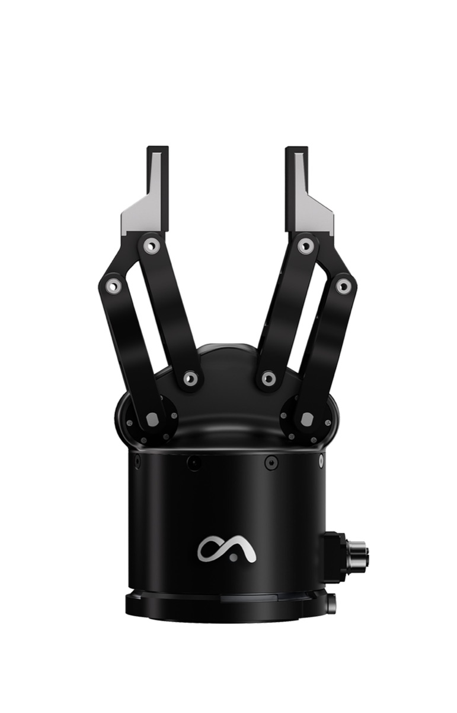

Two-finger force-controlled gripper that plugs into the arm's tool flange and is driven through the arm (no separate controller or code needed).

| Spec | Value |
|---|---|
| Stroke | **0–100 mm** |
| Gripping force (optimal range) | **1–100 N** |
| Force control accuracy | 1 N (page text also quotes 0.5 N minimum force-control precision) |
| Gripping speed | 1–200 mm/s |
| Finger position repeatability | 0.1 mm |
| Weight | 0.9 kg |
| Dimensions | 102 × 192 × 84 mm |
| Protection rating | **IP67** |
| Operating temperature | −20 to +45 °C |
| Communication | Integrated into the robot arm |
| Mechanical interface | ISO 9409-1-50-4-M6 |
| Safety | Meets ISO/TS 15066 per Flexiv |

- **Typical applications:** delicate-object handling, in-hand reorientation, connector insertion (used with Rizon 4 in the NVIDIA Isaac cable-insertion workflow).
- Official page: https://www.flexiv.com/product/grav

### Grav Enhanced
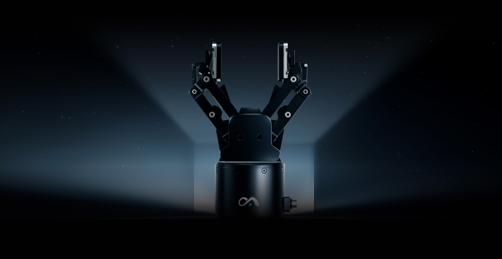

Grav variant with two clamping modes and gecko-inspired dry-adhesive pads: a rigid pinch for precise contact, and a wrap-around adhesive grasp for round, large or irregular objects.

| Spec | Value |
|---|---|
| Stroke | P-mode (parallel): 0–100 mm · V-mode: 120°–160° |
| Gripping force (optimal range) | 1–45 N |
| Max object weight | **5 kg** |
| Force control accuracy | 1 N |
| Gripping speed | 1–200 mm/s |
| Weight | 1.3 kg |
| Dimensions | 102 × 225 × 84 mm |
| Protection rating | IP65 |
| Operating temperature | "20 to +45 °C" as printed on the page (probably −20; ⚠️ unverified) |
| Option | Automated self-cleaning station for the pads |

- **Typical applications:** high-mix picking — bottles, balls, produce, bags; good for T03 sorting demos with unknown objects.
- Official page: https://www.flexiv.com/product/grav

### Flexiv Elements / Elements Studio
Graphical task-programming software. **Elements** runs on the teach pendant (works with all Flexiv robots) for building and editing tasks from force-control primitives; **Elements Studio** is the desktop version, which can also drive simulated robots (it connects to NVIDIA Isaac Sim via Flexiv's `isaac_sim_ws` and to other simulators via `flexiv_sim_plugin`).

- **Why it matters:** plans built in Elements can be triggered from the RDK — the quickest way to mix a no-code contact skill with your own Python logic.
- **Extras:** `flexiv_elements_container` runs several Elements instances in Docker.
- Licensing, download access and version details: not public / ⚠️ unverified in this pass. No picture saved.

### RDK / DRDK / TDK / PDK / AMR SDK / Trainer
Flexiv's open developer stack (all Apache-2.0 on GitHub; the robot itself needs an RDK license and Remote mode).

| Kit | What it does | Languages / OS | Repo |
|---|---|---|---|
| **RDK** | Real-time (1 kHz) joint / Cartesian / force streaming and non-real-time plan + primitive execution | C++, Python; Linux, macOS, Windows, QNX (C# bindings in a separate repo) | [flexiv_rdk](https://github.com/flexivrobotics/flexiv_rdk) |
| **ROS 2** | ros2_control, MoveIt, URDFs | Humble / Jazzy | [flexiv_ros2](https://github.com/flexivrobotics/flexiv_ros2) |
| **DRDK** | Dual-arm control | C++; Linux only | [flexiv_drdk](https://github.com/flexivrobotics/flexiv_drdk) |
| **TDK** | Leader-follower teleoperation with force feedback | C++, Python; Linux, macOS | [flexiv_tdk](https://github.com/flexivrobotics/flexiv_tdk) |
| **PDK** + Composer Studio | Motion and scan-path planning for workcells | Python | [flexiv_pdk](https://github.com/flexivrobotics/flexiv_pdk) |
| **DDK** | Data distribution (robot state streaming) | C++; Linux, Windows | [flexiv_ddk](https://github.com/flexivrobotics/flexiv_ddk) |
| **AMR SDK** | FMR base control; ROS 2 wrapper in `flexiv_amr_ros2` | C++ | [flexiv_amr_sdk](https://github.com/flexivrobotics/flexiv_amr_sdk) |
| **Trainer** | Record teleop demos (LeRobot format) and train policies | Python | [flexiv_trainer](https://github.com/flexivrobotics/flexiv_trainer) |
| **Isaac Sim workspace** | Flexiv robots in NVIDIA Isaac Sim, driven by Elements Studio or RDK | Python | [isaac_sim_ws](https://github.com/flexivrobotics/isaac_sim_ws) |

- Details, setup steps and code paths: see the [Developer guide](Flexiv-Developer-Guide.md).

## Accessories and ecosystem

| Item | Type | Key facts | Status |
|---|---|---|---|
| **Hesper** controller | Control box for Rizon and Moonlight | 12 kg · 500 W · 423 × 230 × 230 mm · 16 DI / 16 DO · Profinet, Modbus TCP/IP · IP20 | ✅ |
| **Orion** control hub | Control box for Enlight / Mico | 10.5 kg · 345 × 330 × 132 mm · 100–240 VAC · about 250 W single-arm, 450 W dual-arm · 16 DI/DO + 2 AI/AO · one hub runs multiple arms · safety functions to IEC 61508 SIL 2 | ✅ |
| **RCM** + **PSM** | Split control module and power module (Enlight) | RCM: 3.5 kg, 48 VDC input, 16 DI/DO + 2 AI/AO · PSM: 3.5 kg, 100–240 VAC in, 48 V / 0–40 A out — suits mobile or embedded builds | ✅ |
| Teach Pendant | Handheld programming unit | Runs Flexiv Elements; works with all Flexiv robots | ✅ |
| Motion Bar | Handheld enabling device | Mode switching, task start, emergency stop | ✅ |
| Wrist F/T sensor | Sensor option | Turns Rizon 4 / 10 into the "s" models (0.03 N / 0.1 N) | ✅ |
| Grav / Grav Enhanced | Grippers | See product sections; self-cleaning station optional for Enhanced | ✅ |
| Camera Module | Vision add-on | Flexiv-branded camera for visual guidance; model and specs not public | ✅ |
| Pipeline Package | Cable conduit | Protects tool cabling in continuous operation (Rizon) | ✅ |
| External Axis | Extra axis | Adds degrees of freedom (Rizon, Moonlight); specs not public | ✅ |
| Mobile Workbench | AMR / AGV integration | Rizon on a mobile base (see Mobile Manipulator) | ✅ |
| Third-party tools | End-of-arm tooling | Any tool matching the ISO 9409-1-50-4-M6 flange; other vendors' hands on site (for example a dexterous hand) would need your own adapter and wiring ⚠️ unverified | — |
| Cameras for Trainer | Third-party | Intel RealSense and Orbbec supported for data collection (per profile) | ✅ |

## Legacy and discontinued

- **flexiv_ros (ROS 1):** repository last updated Nov 2024 — use `flexiv_ros2`.
- **Noema Edge / flexiv_aidk (AI Development Kit):** repository last updated March 2024; "Noema" does not appear on current product pages — treat as dormant ⚠️ unverified.
- No discontinued arm models are listed publicly.

## Image credits

All images © Flexiv, downloaded from Flexiv's official CDN (`oss-flexiv-web-com.flexiv.com`) on 2026-11-14 and converted to JPEG.

| File | Shows | Source URL |
|---|---|---|
| assets/flexiv-rizon-4.jpg | Rizon 4 arm | https://oss-flexiv-web-com.flexiv.com/uploaded/en/ProductParameter/cover/2023/09/11/64pbnm2oda2.png |
| assets/flexiv-rizon-4s.jpg | Rizon 4 + F/T sensor | https://oss-flexiv-web-com.flexiv.com/uploaded/en/ProductParameter/cover/2023/09/11/kx08laz0jsc.png |
| assets/flexiv-rizon-10.jpg | Rizon 10 arm | https://oss-flexiv-web-com.flexiv.com/uploaded/en/ProductParameter/cover/2023/09/11/223v2a7t10z.png |
| assets/flexiv-rizon-10s.jpg | Rizon 10 + F/T sensor (small thumbnail, 200 px wide) | https://oss-flexiv-web-com.flexiv.com/uploaded/en/ProductParameter/cover/2026/03/25/8lxf2jipw8b.png |
| assets/flexiv-enlight-l.jpg | Enlight L arm (small thumbnail, 200 px wide) | https://oss-flexiv-web-com.flexiv.com/uploaded/en/ProductParameter/cover/2026/03/25/8yh3lkwqwi.png |
| assets/flexiv-mico.jpg | Mico dual-arm platform | https://oss-flexiv-web-com.flexiv.com/image/product/robot-system/mico-en.png |
| assets/flexiv-aico.jpg | AICO mobile platform | https://oss-flexiv-web-com.flexiv.com/image/product/robot-system/aico.png |
| assets/flexiv-mobile-manipulator.jpg | Mobile Manipulator (FMR 300 + Rizon) | https://oss-flexiv-web-com.flexiv.com/image/product/robot-system/mobile-manipulator.png |
| assets/flexiv-mello.jpg | Mello massage system | https://oss-flexiv-web-com.flexiv.com/image/product/robot-system/mello.png |
| assets/flexiv-moonlight.jpg | Moonlight parallel robot | https://oss-flexiv-web-com.flexiv.com/uploaded/en/ProductParameter/cover/2023/09/11/cof9bfywubc.png |
| assets/flexiv-grav.jpg | Grav gripper | https://oss-flexiv-web-com.flexiv.com/uploaded/en/ProductParameter/cover/2023/09/11/zbs0qcf8mff.png |
| assets/flexiv-grav-enhanced.jpg | Grav Enhanced gripper (page hero image) | https://oss-flexiv-web-com.flexiv.com/image/product/grav/bg-grav-enhanced.jpg |

## Sources
- [Flexiv — Rizon product page](https://www.flexiv.com/product/rizon)
- [Flexiv — Enlight product page](https://www.flexiv.com/product/enlight)
- [Flexiv — Robot Station / System page (Mico, AICO, Mello, Mobile Manipulator)](https://www.flexiv.com/product/robot-system)
- [Flexiv — Moonlight product page](https://www.flexiv.com/product/moonlight)
- [Flexiv — Grav product page](https://www.flexiv.com/product/grav)
- [GitHub — flexivrobotics organisation (repository list)](https://github.com/orgs/flexivrobotics/repositories)
- [GitHub — flexiv_rdk](https://github.com/flexivrobotics/flexiv_rdk)
- [Automated Warehouse — Flexiv launches its first self-developed AMR (2025-12-04)](https://www.automatedwarehouseonline.com/flexiv-launches-its-first-self-developed-amr/)
- [Flexiv Robotics profile (this repo) — launch dates, Mello release timing, Trainer camera support](Flexiv.md)
