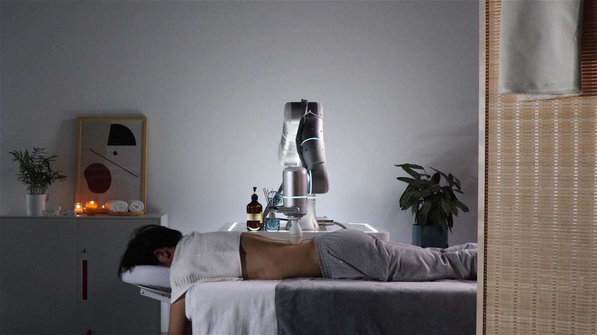
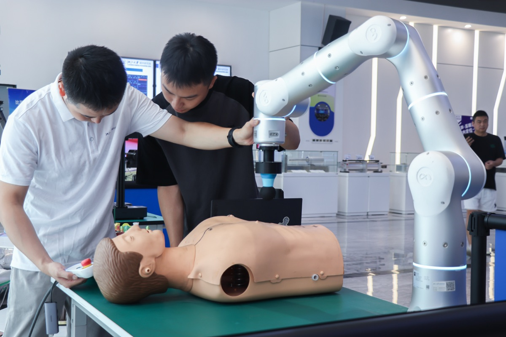
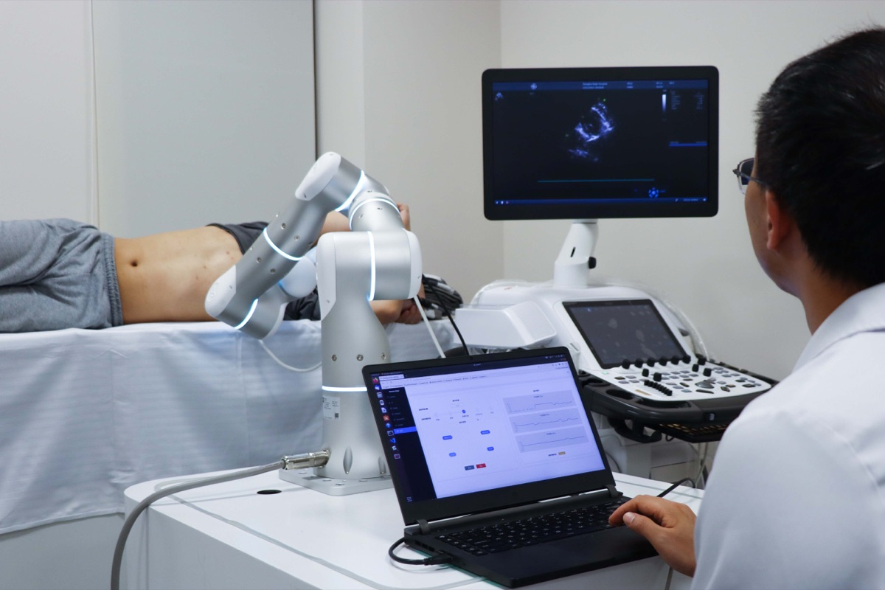
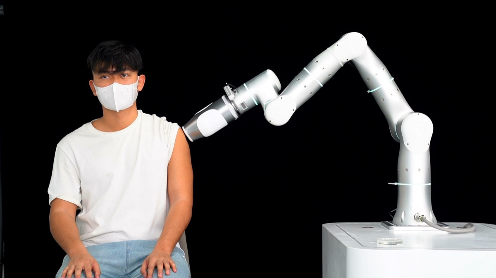
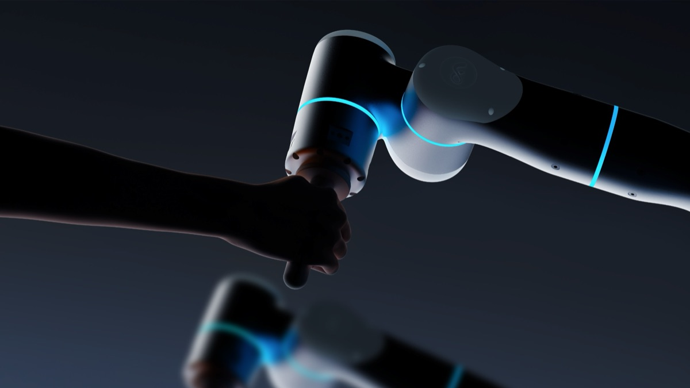
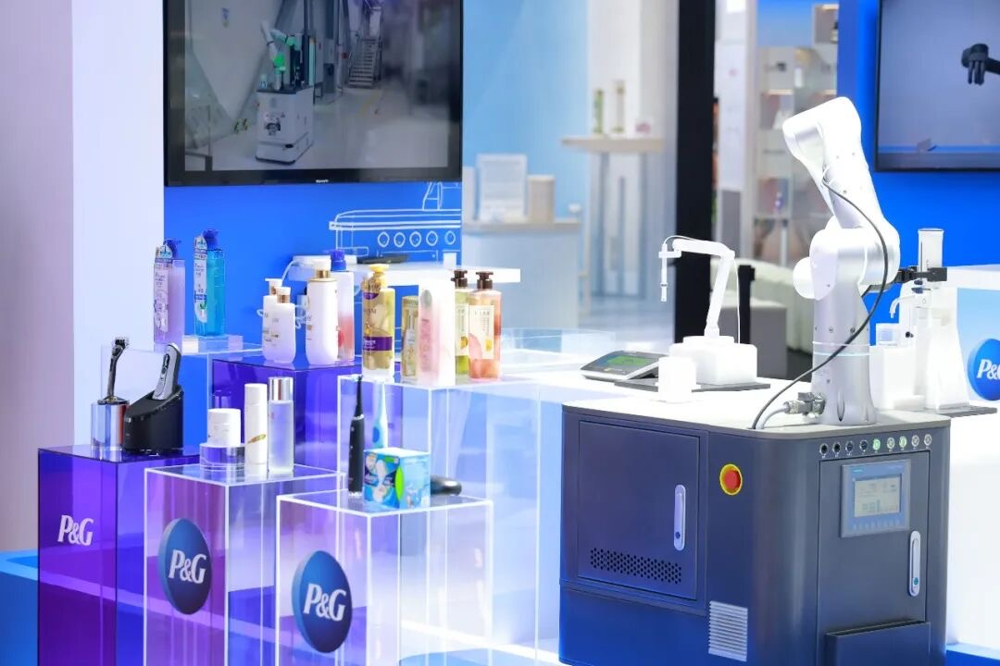
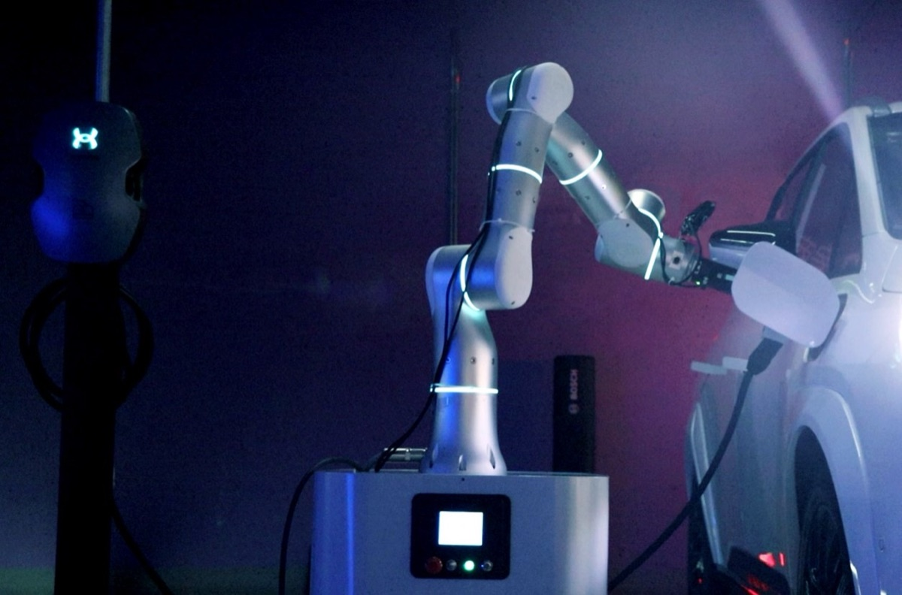
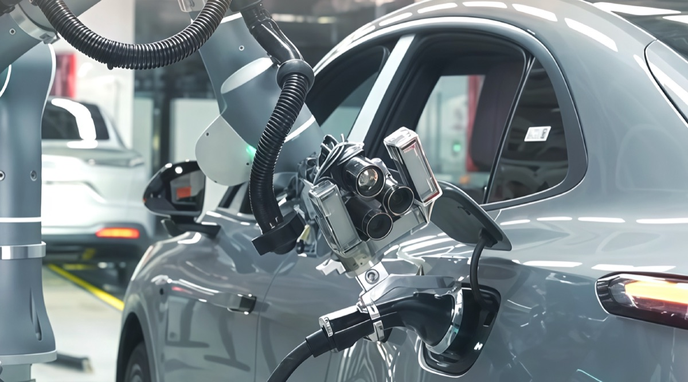
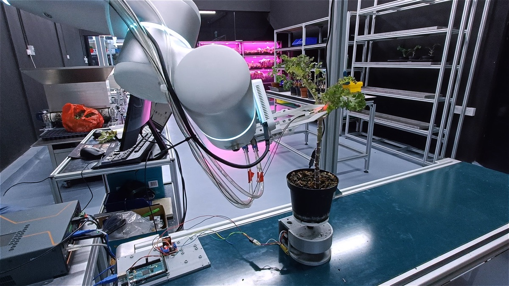
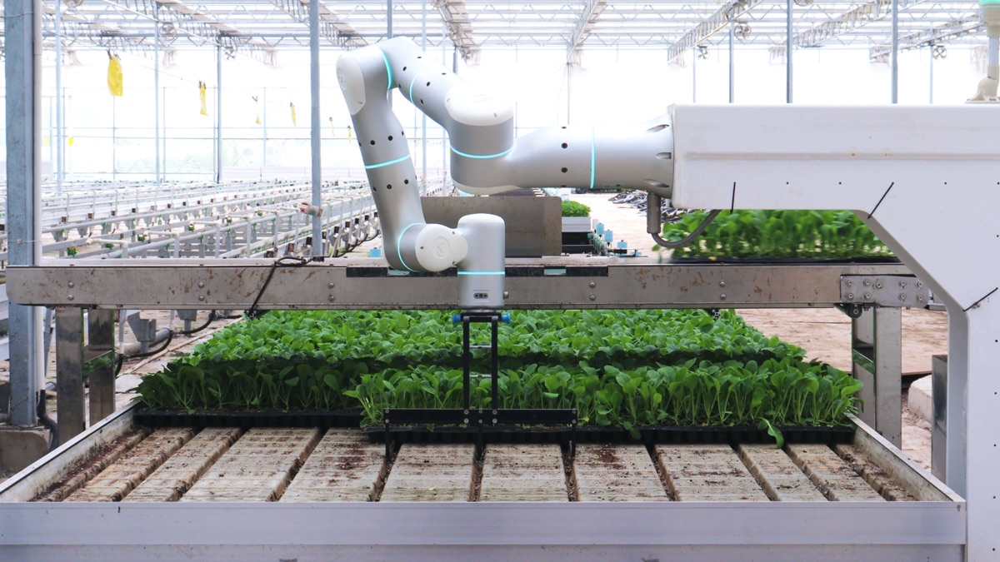

# Flexiv Robotics — Solutions and Projects Register

⬆ [Flexiv Robotics profile](Flexiv.md) · [Product portfolio](Flexiv-Products.md) · [Papers and research](Flexiv-Papers-and-Research.md) · [Roadmap and strategy](Flexiv-Roadmap-and-Strategy.md)

> **Coverage note:** Walked the official English site (flexiv.com) and the Chinese site (flexiv.cn, company name 非夕科技 — confirmed on the site) on 2026-11-14 via both sitemaps: the *Application* page (28 EN / 39 CN application samples in 9 sectors), the *Case study* list (16 EN / 23 CN cases), *History*, *Partner*, *NOEMA*, *Robot System*, and the *News* archive from 2019 to 2026-11-06 (about 80 EN and 100 CN items; every 2025–2026 item was opened, older items were dated from their page). The Chinese site is clearly more complete and is the main source for 2026 deployments. **Not accessed:** the dealer list (loads client-side, empty in the page data), the FCS customer portal (login), videos, WeChat / Bilibili posts, LinkedIn. **Web search was unavailable in this pass** (search budget exhausted), so trade-press coverage, third-party deployment reports and any stock-exchange filings were NOT checked — anything not on the official sites may be missing. The teleoperation article (2025-07-16) returned an empty body; only its title and date are used.

Legend: ✅ shipping / deployed at a customer · 🧪 demo, pilot or preview · 🔭 planned · ⚠️ unverified.
"Tracks" marks where the solution itself, or its technique, transfers to a hackathon track. Most Flexiv solutions are factory processes and carry "—".

## Solutions catalogue — everything they offer

Official sector names (from the Application page): Mobility, Electronics and Electrical Equipment, General Industrial, Food and FMCG, Biomedical, Commercial Services, Agriculture, Mobile Manipulation, Frontier Innovation.

| # | Solution / application | What it does | Products used | Maturity | Tracks | Source link |
|---|---|---|---|---|---|---|
| **Commercial services and healthcare** | | | | | | |
| 1 | Robotic massage — Mello / SuuHuu | Standardised **15-minute** back massage; camera finds the body, arm follows contours and regulates pressure in real time | Mello (7-DoF arm, 0.1 N sensing, 1 kHz force loop, max 200 N); earlier Rizon 4 app | 🧪 Mello release slated **Q4 2026**; SuuHuu shown by partner at shows | T04, T01 | [robot system](https://www.flexiv.com/product/robot-system) |
| 2 | Robotic therapy development (Zhejiang University Huzhou Institute; EN page says "Huzhou College") | Research project building a "robot physiotherapist" on a Rizon arm | Rizon | 🧪 research | T04 | [applications](https://www.flexiv.com/application) |
| 3 | Ultrasound scanning ("Heart Ultrasound Detection") | Arm holds the probe, follows body contour, keeps constant probe pressure | Rizon 4 | 🧪 demo / exhibit | T04 | [news](https://www.flexiv.com/news/rizon_demonstrates_ultrasound_treatment_at_celcomgidi_in_malaysia) |
| 4 | Needle-free injection | Arm positions a needle-free injector on the body with controlled contact | Rizon | 🧪 application sample | T04 | [applications](https://www.flexiv.com/application) |
| 5 | Spine-surgery robot component (GE Healthcare ORIDEX Spine) | Flexiv adaptive arm does the real-time navigated positioning inside GE's system; sub-millimetre positioning | Flexiv arm (model not stated) | ✅ per Flexiv, system holds China Class III medical-device registration | T04 (adjacent) | [news](https://www.flexiv.cn/news/Flexiv_2025_CIIE) |
| 6 | Medical version of Rizon 4 | Dedicated medical-grade arm for physiotherapy, healthcare and tele-operated procedures | Rizon 4 (medical) | 🔭 "in development" (2023), "soon" (2024); no release found ⚠️ | T04 | [news](https://www.flexiv.com/news/Flexiv_Scores_Sustainable_Development_Goals) |
| 7 | STEM stage show ("The Electrified Show") | Arm performs as an actor with human performers for children | Rizon 4 | ✅ done (2023) | T01 | [case](https://www.flexiv.com/partner/case/Rizon_4_Performs_in_The_Electrified_Show_in_Singapore) |
| 8 | Art installation "Xenoforms" | Arm autonomously observes and explores AI-generated objects in a gallery piece | Rizon 10 | ✅ done (2022) | T01 | [case](https://www.flexiv.com/partner/case/Avant_Garde_Art_Installation_Xenoforms) |
| 9 | Sneaker authentication cell ("smart authentication bay") | Pulls the insole out, collects vision / touch / force data, re-inserts the soft insole | Flexiv arm + partner tactile sensing | 🧪 demo (WAIC 2026) | T01 | [news](https://www.flexiv.cn/news/WAIC%202026：非夕多个联合应用亮相，加速具身智能生态繁荣) |
| 10 | Showcase skills: raw-egg shell carving, fan calligraphy, ball balancing, gift-box workshop | Proof of fine force control and dual-arm coordination; gift workshop is driven by a partner world model | Rizon 4s (0.03 N), MICO Core | 🧪 demos | T01 (guest-facing demos) | [news](https://www.flexiv.cn/news/通用基座，生态共创｜非夕科技亮相世界机器人大会，解锁机器人万千场景) |
| **Food and FMCG** | | | | | | |
| 11 | Airline / healthy-meal preparation station | Reads a recipe, identifies, grasps, cuts, plates and seasons ingredients of varying texture | Dual-arm Flexiv robots + partner food AI model | ✅ per Flexiv: in use on China Eastern's catering line, **about 10,000 meals per day** | T01 | [news](https://www.flexiv.cn/news/WAIC%202026：非夕多个联合应用亮相，加速具身智能生态繁荣) |
| 12 | Food-stall demos: skewer cooking station, cold-noodle stall, ice-cream scooping | Grasp, skewer, heat, hand over; scoop with force-following; open freezer, rinse scoop | Dual-arm Rizon, AICO-2 + Noematrix model | 🧪 demos | T01 | [news](https://www.flexiv.cn/news/flexiv_attends_waic_2025) |
| 13 | Tableware cleaning and tidying | Finds randomly placed bowls / plates / cups, one arm holds, the other wipes the curved surface, then puts away | MICO Core (2×7 DoF) + AI vision | 🧪 demo (WRC 2026) | T01, T04 | [news](https://www.flexiv.cn/news/通用基座，生态共创｜非夕科技亮相世界机器人大会，解锁机器人万千场景) |
| 14 | Fish fillet shaping | Vision finds breaded fillets on a moving conveyor; arm shapes them gently | Rizon 4 + AI vision + custom tool | ✅ **~16,000 fillets/unit/day** vs ~12,000 per person; availability >99.9% | — | [case](https://www.flexiv.com/partner/case/Automated_Fish_Fillet_Shaping_Solution) |
| 15 | FMCG flexible packaging (mixed-SKU case packing) | Dual-arm picks different bottle shapes and packs mixed cases; new pattern by teaching, no hardware change | Dual-arm adaptive robots + vision | 🧪 demo (CIIF 2026) | — | [news](https://www.flexiv.cn/news/CIIF2026) |
| 16 | FMCG quality "feel" testing | Robot squeezes / handles bottles, turns "easy to hold / squeeze / pour" into force data; detects defects, deformation, filling faults; skin-tester probing | Flexiv arm | ✅ used by P&G (shown at CIIE 2025) | — | [news](https://www.flexiv.cn/news/Flexiv_2025_CIIE) |
| **Agriculture** | | | | | | |
| 17 | Kale picking / indoor-farming handling | Arm harvests leafy greens in an indoor farm line | Rizon 4 / 4s / 10 (IP65) | 🧪 application sample; channel partner since 2022 | T03 | [news](https://www.flexiv.com/news/Flexiv_Partners_With_Tick-Tek_Sustainable_Technology_to_Create_the_Farms_of_the_Future) |
| 18 | Vegetable-harvest plug-tray loading workstation | Finds soft seedling trays by touch (no camera), force-searches the gap, scoops the tray onto the harvester conveyor | Flexiv arm + fork tool | ✅ case published 2026-08 | T03 | [case (CN)](https://www.flexiv.cn/partner/case/蔬菜采收穴盘上料工作站) |
| **Mobile manipulation and logistics** | | | | | | |
| 19 | Mobile manipulator for sampling / testing in FMCG plants | AMR drives between stations; arm takes samples, moves them, runs tests; force control absorbs docking error | Rizon + FMR 300 (laser SLAM) | ✅ deployed at P&G sites in **Indonesia, Poland, Japan** | T01 | [news](https://www.flexiv.cn/news/非夕携手宝洁亮相链博会，共探消费品智造升级之路) |
| 20 | Mobile EV charging robot | AMR finds the car in a car park; arm inserts and removes the DC charging plug using vision + force | Rizon on AMR | 🧪 customer project (2021–2022); still listed on CN site (entries refreshed 2025-10, 2026-04) | T03, T01 | [case](https://www.flexiv.com/partner/case/Automated_Charging_Solution_for_Electric_Vehicles) |
| 21 | Mobile CNC tool changing / tool management | Mobile arm swaps machine tools without vision: touch-based position correction, guided insertion, seating check | Rizon + AMR | ✅ application; demo at CIIF 2025, Hannover 2026 | — | [applications](https://www.flexiv.com/application) |
| 22 | Mobile screw fastening (DCU) and mobile workpiece grinding | Sector "Mobile Manipulation" samples: fastening and grinding from a mobile base | Rizon + AMR | ✅ application samples | — | [applications](https://www.flexiv.com/application) |
| 23 | FATP mobile loading / unloading, PCB loading | Mobile or fixed arm loads boards and devices in electronics final assembly | Rizon (+ AMR) | ✅ application samples | — | [applications (CN)](https://www.flexiv.cn/application) |
| 24 | Warehouse-logistics packaging (customer "Ultra") | Embodied-AI packaging / warehouse automation built on Flexiv arms | Rizon / Enlight | 🧪 listed 2026-04 as customer application | T01 | [applications](https://www.flexiv.com/application) |
| 25 | MICO Ultra mobile server assembly | Mobile dual-arm platform docks at a server rack, then inserts RAM and fans with dynamic hand-eye + force search | MICO Ultra | 🧪 demo (CIIF, NEPCON 2026) | — | [news](https://www.flexiv.cn/news/CIIF2026) |
| **Mobility (automotive)** | | | | | | |
| 26 | Pre-delivery vehicle inspection | Two arms plug in the charging connector and test charging, check heated parts with a thermal camera, inspect interior by vision | 2× Rizon 10 + visible and thermal cameras | ✅ at NIO: 3 checks in **84 s**, **+48%** efficiency, 6 models, 4 plug types | T03, T02 | [case](https://www.flexiv.com/partner/case/Automated_Pre-Delivery_Vehicle_Inspection) |
| 27 | Wheel-alignment adjustment in final assembly | Arms find tie-rod and nut by touch under the car and adjust with hybrid force-position control | 4× Rizon in one station | ✅ "batch-deployed in several car plants"; >99.5% success, takt 70–75 s | — | [applications](https://www.flexiv.com/application) |
| 28 | Seat ironing and seat connector electrical test | Steam-irons leather seats along curved surfaces; mates connectors for electrical checks | Rizon 4 | ✅ | — | [case](https://www.flexiv.com/partner/case/Automated_Ironing_Solution_for_Electric_Vehicles) |
| 29 | Steering-column lever testing / calibration | Force-measured actuation of turn-signal levers with data logging | Rizon 4s | ✅ | — | [case](https://www.flexiv.com/partner/case/Automotive_Steering_Column_Lever_Calibration) |
| 30 | Car-window adhesive primer application | Constant-contact primer wiping on glass edge | Rizon | ✅ | — | [case](https://www.flexiv.com/partner/case/Automated_Adhesive_Primer_Application_in_Automotive_Assembly) |
| 31 | Weld-spot grinding and weld-spatter removal | Force-controlled grinding on body-in-white | Rizon | ✅ | — | [case](https://www.flexiv.com/partner/case/Automated_Weld_Grinding_for_Automotive_Manufacturing) |
| 32 | Motor-mount assembly | Vision + force straighten parts, three-hole search insertion, pre-tightening; whole cell ships in a "container" | Rizon 4 + Rizon 10 | ✅ >99.5% success, **60 s** takt, production 5 days after arrival | — | [case (CN)](https://www.flexiv.cn/partner/case/Automobile_Motor_Mount_Assembly) |
| 33 | DCU heat-sink assembly ("Robotic Precision Assembly") | Tight-tolerance assembly of control-unit parts | Rizon | ✅ | — | [applications](https://www.flexiv.com/application) |
| 34 | E-drive end-of-line (EOL) test, battery-pack electrical test | Adaptive mating of test connectors despite pose error | Rizon | ✅ (EOL: "delivered to automotive customers") | — | [news](https://www.flexiv.cn/news/非夕科技亮相%20AMTS%202026：以自适应机器人推动汽车复杂工艺自动化升级) |
| 35 | Wire-harness and battery-connector installation | Dual-arm: sort and route harness, locate plug, insert, bolt | MICO | 🧪 demo (AMTS, CIIF 2026) | — | [news](https://www.flexiv.cn/news/非夕科技亮相%20AMTS%202026：以自适应机器人推动汽车复杂工艺自动化升级) |
| 36 | Hairpin-coil insertion for flat-wire motors; car-lamp assembly and test; injection-moulded vent unloading | Partner-built cells on Flexiv arms (vision-guided insertion; dual Grav grippers; soft gripper) | Rizon, Grav | 🧪 partner demos 2026 | — | [news](https://www.flexiv.cn/news/CIIF2026) |
| 37 | Car-body polishing; scan-and-plan sanding; deburring | Polishing with constant force; automatic scan → path → sand; deburring with the parallel robot | Rizon, Moonlight | 🧪 show demos (Hannover 2026, India 2026, Taipei 2024) | — | [news](https://www.flexiv.com/news/Flexiv%20to%20Showcase%20the%20Future%20of%20Adaptive%20Robotics%20at%20Hannover%20Messe%202026) |
| **Electronics and electrical equipment** | | | | | | |
| 38 | FPC (flexible cable) insertion | AI vision + visual servoing + force-controlled insertion and verification; force / image data logged at up to 1 kHz | Rizon + vision | ✅ | — | [applications](https://www.flexiv.com/application) |
| 39 | Server testing, RAM installation, server component insertion | Plug / unplug boards, RAM and fans with force search and seating check | Rizon, MICO | ✅ application; NVIDIA research use | — | [news](https://www.flexiv.com/news/NVIDIA-GB300Assembly) |
| 40 | Fibre-optic equipment assembly | Delicate connector assembly | Rizon | ✅ | — | [applications](https://www.flexiv.com/application) |
| 41 | Microwave fan-blade assembly | Vision + force insertion of keyed blades; **two sets in 12 s** | Rizon + pneumatic gripper | ✅ | — | [cases (CN)](https://www.flexiv.cn/partner/case) |
| 42 | Voice-coil assembly for audio devices | Interference-fit assembly with adaptive grasp and force search | Rizon + vision | ✅ (2022) | — | [case](https://www.flexiv.com/partner/case/Automated_Voice_Coil_Assembly_for_Audio_Devices) |
| 43 | Smartphone glue-line wiping and polishing, micro-screw fastening | Named in the sector description as deployed processes | Rizon | ✅ | — | [applications](https://www.flexiv.com/application) |
| 44 | Appliance assembly: washing-machine door hook posts; water-heater screw fastening on a moving line | Tight-fit post insertion; tracks a moving product and fastens screws | Rizon | 🧪 demos (CIIF 2025, CIIF 2026) | — | [news](https://www.flexiv.cn/news/Flexiv_2025_CIIF) |
| 45 | Keyboard testing | Arm presses keys with measured force (featured in a tech-channel video) | Rizon | 🧪 one-off | — | [cases (CN)](https://www.flexiv.cn/partner/case) |
| **General industrial** | | | | | | |
| 46 | Compressor tube inspection by touch | Arm "feels" bent or damaged copper tubes with a mandrel tool; tolerates ±5° deviation | Rizon 4 + custom tool | ✅ **<3 s** per check, 0.025 mm validity | T02 (technique) | [case](https://www.flexiv.com/partner/case/Automated_Compressor_Tube_Inspection) |
| 47 | Compressor tube plugging / rubber-plug installation; crankshaft sleeve assembly | Human-like plug insertion with failure detection; changeover in 2–3 min by hand-guiding | Rizon 4 | ✅ | — | [case](https://www.flexiv.com/partner/case/Automated_Tube_Plugging_Solution_for_Compressors) |
| 48 | Shutter sanding | Fully automated sanding of wooden shutters with automatic pad change and a custom operator UI | Rizon 4 + OnRobot sander | ✅ sanding time **−80%** (per Flexiv) | — | [case](https://www.flexiv.com/partner/case/Flexiv's_Automated_Shutter_Sanding_Solution) |
| 49 | Multi-axis blade grinding and polishing workstation; coated-blade grinding | Constant-force grinding of turbine / aero blades with in-line inspection and automatic rework | Rizon (0.1 N, 1 kHz) | ✅ partner product | — | [case (CN)](https://www.flexiv.cn/partner/case/adaptive_robot_blade_polishing) |
| 50 | Vacuum-chamber edge lapping and polishing | Sanding + polishing of 1220 × 1300 mm chamber edges with automatic tool and abrasive change | Rizon 10 | ✅ | — | [case (CN)](https://www.flexiv.cn/partner/case/Vacuum_Chamber_Lapping&Polishing_System) |
| 51 | Carbon-fibre sanding; abrasive-partner sanding cells | Surface treatment of large composite parts; joint sanding solutions with an abrasives maker | Rizon | 🧪 demos 2025–2026; partnership ✅ | — | [news](https://www.flexiv.cn/news/flexiv_and_mirka_signs_straegic_agreement) |
| 52 | CNC precision-machining load / unload | Inserts workpieces into precision fixtures whose clearance is tighter than robot accuracy | Rizon + SCHUNK gripping | ✅ (2021) | — | [news (CN)](https://www.flexiv.cn/news/adaptive_robot_CNC_loading_solution_with_SCHUNK) |
| **Biomedical and lab** | | | | | | |
| 53 | Lab automation: drug-molecule purification ("Talos"), rotary-evaporation handling, biopharma synthesis | Mobile dual-arm does TLC spotting, sample transfer, column loading, glassware handling | AICO-2 (0.1 N per arm, laser SLAM) + partner VLA model | 🧪 / ✅ partner solution, case 2026-07 | — | [case (CN)](https://www.flexiv.cn/partner/case/合碳智能) |
| **Frontier innovation and developer platforms** | | | | | | |
| 54 | Embodied-AI data-collection and model-training platform | Stable force-sensing arms for collecting contact-rich data and running customer models (fastener sorting, box opening, laundry) | Rizon, Enlight, MICO, AICO, IDE / RDK | ✅ customers named below | — | [applications](https://www.flexiv.com/application) |
| 55 | Force-feedback teleoperation | Leader-follower pair with bi-directional force feedback and low latency for remote handling and data collection | 2× Rizon 4 + Teleoperation Development Kit | ✅ released 2025-07 | T02, T04 | [news](https://www.flexiv.com/news/Flexiv_IROS%202026) |
| 56 | Whole-body touch interaction | Arm senses up to **7 simultaneous contacts** anywhere on its body (0.5 N touch, mm-level location) | Enlight | ✅ launched 2026 | T04 | [news (CN)](https://www.flexiv.cn/news/Flexiv_new_enlight) |
| 57 | NOEMA AI system + AIDK | No-code AI vision: 2D / 3D object pose detection, visual inspection, general grasping, visual servoing; cloud-edge-device | NOEMA Edge, 2D/3D cameras | ✅ on site (announced 2021); current status ⚠️ | T03, T02 | [NOEMA](https://www.flexiv.com/software/noema) |
| 58 | Simulation and digital-twin tooling | Force-control simulation bridged into Isaac Sim / MuJoCo; sim-trained task replayed on the real arm; Siemens digital-twin demo | Flexiv Sim Plugin, Flexiv-Isaac Bridge, Elements Studio | ✅ | T02 (digital twin) | [news](https://www.flexiv.com/news/flexiv-and-nvidia-join-forces-in-robotics-simulation) |
| 59 | Research platforms: gecko-adhesive testing, dexterous-hand RL (ADEPT) | Arm as precise force testbed; arm–hand platform for sim-to-real dexterity | Rizon | ✅ research use | — | [cases](https://www.flexiv.com/partner/case) |
| 60 | Education and training | Vocational-education courses and labs built on Flexiv arms; university lab kits; youth outreach | Rizon | 🧪 partnerships | — | [news (CN)](https://www.flexiv.cn/news/非夕科技与小状智能达成战略合作伙伴关系，携手共建职业教育新场景) |
| 61 | Adaptive Production Line (APL) concept | Whitepaper: whole lines built from adaptive robots to replace skilled manual stations | Rizon, Moonlight | ✅ whitepaper (2024) | — | [news](https://www.flexiv.com/news/adaptive_production_line_whitepaper_helps_solve_the_labor_shortage) |
| 62 | Textile and garment handling | Joint development of garment-production automation with a textile group | Flexiv platform | 🔭 agreement 2026-09 | — | [news (CN)](https://www.flexiv.cn/news/非夕科技与声白集团达成战略合作) |

### Robotic massage — Mello / SuuHuu

- **How:** 3D vision locates the back; a soft silicone tool on a 7-DoF arm reproduces deep-pressure gliding strokes (Tui Na style) and adapts force to the body in real time. Mello spec: 0.1 N sensing, **1000 Hz** force loop, max **200 N**, 500 W, 15-minute standard session.
- **History:** Rizon 4 massage app announced 2023-04-11 → massage workstation at shows (Taipei 2024, WAIC 2025, CIIF 2025) → **Mello** shown at ITES 2026 and Hannover Messe 2026 (first European preview), release slated **Q4 2026**.
- **SuuHuu:** the same 15-minute retail massage concept is exhibited under the name SuuHuu, by ecosystem partner 非常解压 (WRC 2026, GDPS 2026) and on Flexiv's own booth in Mumbai (2026-07). How Mello and SuuHuu relate commercially is not explained ⚠️.
- **Positioning:** retail / wellness ("clinic, spa, gym, health club" was the 2023 ambition), not a certified medical device in any material found.
- Link: [Robot System page](https://www.flexiv.com/product/robot-system) · [2023 announcement](https://www.flexiv.com/news/Flexiv_Robot_Massage)

### Robotic therapy development (Zhejiang University Huzhou Institute)

- Listed under "Frontier Innovation" since 2023: a research group develops a robot physiotherapist on a Flexiv arm.
- Only the title, picture and video are public; no protocol, results or paper found on the official site ⚠️.
- Link: [Application page](https://www.flexiv.com/application)

### Ultrasound scanning

- Rizon 4 moves an ultrasound probe over the body autonomously, reacting instantly to contours to hold an optimal probe pressure for a clean image.
- Installed as a permanent exhibit at CelcomDigi's AI Experience Centre (Subang Jaya, Malaysia) in 2024-07; shown again in Mumbai in 2026-07.
- Demonstration level; no clinical deployment found.
- Link: [news](https://www.flexiv.com/news/rizon_demonstrates_ultrasound_treatment_at_celcomgidi_in_malaysia)

### Needle-free injection

- Application sample (Biomedical sector, listed since 2023): the arm places a needle-free injector against the skin with controlled contact force.
- No customer, numbers or regulatory status published ⚠️.
- Link: [Application page](https://www.flexiv.com/application)

### Spine-surgery robot component and medical Rizon
- At CIIE 2025 (Shanghai, 2025-11) GE Healthcare premiered the **ORIDEX Spine** surgery robot; Flexiv states its adaptive arm provides the navigated, sub-millimetre positioning and that the full system holds China's Class III medical-device registration.
- A **medical version of Rizon 4** was announced as "in development" (2023-11) and "soon" (2024-07); no launch found ⚠️. A 2025–2026 Flexiv article on healthcare robots shows an IEC certificate image (details not read).
- Why it matters for T04: evidence that the arm is accepted inside a regulated medical product — not a ready-made care solution.
- Link: [CIIE 2025 article (CN)](https://www.flexiv.cn/news/Flexiv_2025_CIIE) · [healthcare article](https://www.flexiv.com/news/How_Can_Robots_Help_Healthcare_Professionals)

### Force-feedback teleoperation

- Leader-follower setup: the operator moves one Rizon 4 and feels the contact forces of the remote one ("high transparency", low latency). Software: Teleoperation Development Kit (TDK).
- Released 2025-07-16; shown at IROS 2026 as a dual-unit remote-handling demo. Also used to record demonstrations for policy training.
- Earlier variant: Rizon 4 driven by a Haply Inverse 3 haptic controller on QNX real-time OS (Automate 2024).
- Fits T02 hazardous-environment teleoperation and T04 remote care / telepresence.
- Link: [IROS 2026 release](https://www.flexiv.com/news/Flexiv_IROS%202026)

### Whole-body touch interaction (Enlight)
- Force-torque sensors in every joint give skin-like sensing over the whole arm: up to **7 contact points at once**, **0.5 N** touch resolution, millimetre-level contact location; single-touch, multi-point tracking and pattern recognition.
- At CIIF 2026 visitors touched the arm anywhere and saw contact position and force live in Flexiv Elements; Flexiv says this "lays the foundation" for service, home and embodied-AI use.
- Link: [Enlight launch (CN)](https://www.flexiv.cn/news/Flexiv_new_enlight)

### Airline / healthy-meal preparation station
- Built with food-AI partner 希夕智能 (Xixi Intelligent, English name ⚠️) and China Eastern Airlines; shown at WAIC 2026 as the "China Eastern healthy-meal station" and at WRC 2026 ("healthy meal" and "cold-noodle stall").
- The food model reads the recipe and plans; the dual-arm robot picks ingredients of very different softness and size, cuts, plates and seasons.
- Flexiv states the solution is in service on China Eastern's flight-catering line at **nearly 10,000 meals per day**.
- Link: [WAIC 2026 article (CN)](https://www.flexiv.cn/news/WAIC%202026：非夕多个联合应用亮相，加速具身智能生态繁荣)

### Food-stall demos and tableware cleaning
- WAIC 2025: AICO-2 mobile dual-arm with the Noematrix model opens a freezer, scoops ice cream by following the surface, rinses the scoop; a dual-arm "skewer cooking station" was shown in the government area.
- WRC 2026: MICO Core cleans and tidies randomly placed tableware — one arm stabilises, the other wipes the curved surface with force control.
- All are demonstrations, useful as templates for hospitality or home-help ideas.
- Link: [WAIC 2025 article (CN)](https://www.flexiv.cn/news/flexiv_attends_waic_2025) · [WRC 2026 article (CN)](https://www.flexiv.cn/news/通用基座，生态共创｜非夕科技亮相世界机器人大会，解锁机器人万千场景)

### Mobile manipulator in FMCG plants (P&G)

- Rizon arm on the FMR 300 base (laser SLAM): drives between production, storage and logistics stations and performs sampling, transfer and testing as one closed loop.
- Force control absorbs errors from the base, the tool and the workpiece, so the arm still works precisely after moving.
- Flexiv says deployments are live at P&G sites in **Indonesia, Poland and Japan**; shown jointly at the China International Supply Chain Expo, 2026-06-22 to 26.
- Link: [P&G article (CN)](https://www.flexiv.cn/news/非夕携手宝洁亮相链博会，共探消费品智造升级之路)

### Mobile EV charging robot

- Built for Hycan's "mobility power supply" concept: instead of one charger per parking space, an AMR carrying a 7-axis arm drives to the car and plugs in a DC connector.
- Vision gives the coarse position; force control does the compliant insertion and removal so neither port nor plug is damaged; works across car models.
- Customer case dated 2022-09; partnership announced 2021-09. No fleet deployment found; the Chinese site still lists EV charging as an application (2025–2026 entries).
- Link: [case study](https://www.flexiv.com/partner/case/Automated_Charging_Solution_for_Electric_Vehicles)

### Pre-delivery vehicle inspection (NIO)

- Two Rizon 10 arms: select the right charging plug, insert it compliantly and run a charging-current test; a robot-mounted **thermal camera** checks heated seats, armrests, steering wheel and mirrors; vision checks leather, colour, stitching and infotainment configuration.
- **84 s** for three inspection steps, **48%** faster than manual; six vehicle models and four charging configurations; data feeds NIO's self-inspection platform.
- Transferable pattern: robotic plug-in (T03 EV charging) and thermal / visual inspection with flagged anomalies (T02).
- Link: [case study](https://www.flexiv.com/partner/case/Automated_Pre-Delivery_Vehicle_Inspection)

### Kale picking / indoor farming

- "Agriculture" is one of Flexiv's official sectors, with kale picking as the sample.
- Channel partner Tick-Tek (Singapore) builds indoor-farming machinery and lines and uses Rizon 4 / 4s / 10 (IP65) in them; partnership announced 2022-10-10.
- No yield or deployment numbers published.
- Link: [Tick-Tek announcement](https://www.flexiv.com/news/Flexiv_Partners_With_Tick-Tek_Sustainable_Technology_to_Create_the_Farms_of_the_Future)

### Vegetable-harvest plug-tray loading workstation

- Built with 国兴农智能 (Guoxingnong Intelligent, English name ⚠️): the arm touches to find each soft seedling tray, force-searches the gap, slides a fork tool under it and loads it onto the harvester conveyor.
- **No camera needed**, so leaf occlusion, changing light and falling soil do not disturb it; one-key reset after a collision.
- Case published 2026-08-06; no throughput numbers given.
- Link: [case study (CN)](https://www.flexiv.cn/partner/case/蔬菜采收穴盘上料工作站)

### Guest-facing shows, art and retail demos
- **The Electrified Show** (Science Centre Singapore, 2023-06): Rizon 4 as a stage "actor" in Singapore's first large STEM + special-effects show for children.
- **Xenoforms** (2022): Rizon 10 as protagonist of a media-art installation by a New York University professor.
- **Sneaker authentication bay** (WAIC 2026, with 得物 Dewu and 千觉): removes and re-inserts a soft insole and gathers multi-modal data for authenticity checks.
- **Egg carving, fan calligraphy, gift workshop** (WAIC 2025, WRC 2026): crowd-pulling demos of 0.03 N force control and dual-arm skill.
- Link: [show case](https://www.flexiv.com/partner/case/Rizon_4_Performs_in_The_Electrified_Show_in_Singapore) · [art case](https://www.flexiv.com/partner/case/Avant_Garde_Art_Installation_Xenoforms)

### Warehouse-logistics packaging (Ultra)
- Listed 2026-04 under Frontier Innovation: EN title "Ultra | Intelligent Robot Packaging", CN title "embodied-intelligence warehouse and logistics automation".
- Only title, picture and video are public; CIIF 2026 also lists "logistics sorting" among the 28 tasks shown, without detail ⚠️.
- Link: [Application page](https://www.flexiv.com/application)

### Compressor tube inspection by touch
- Rizon 4 pushes a tapered guide sleeve and straightening mandrel over each copper tube; force signals reveal bends or damage. Tolerates ±5° angular deviation that defeated vision-based automation.
- **<3 s** per inspection, 0.025 mm fit precision, quality data logged.
- Useful as a template for "inspection by feel" in T02 (connectors, valves, fittings).
- Link: [case study](https://www.flexiv.com/partner/case/Automated_Compressor_Tube_Inspection)

### NOEMA AI vision and simulation tooling
- **NOEMA** (announced 2021-06, still on the site): no-code AI system for 2D / 3D pose detection, visual inspection, general grasping and visual servoing, with an AIDK API. The related company Noematrix (incubated by Flexiv) launched "Noematrix Brain" in 2024-07. Whether NOEMA is still actively sold is unclear ⚠️.
- **Simulation:** Flexiv Sim Plugin (2025-07) and the Flexiv-Isaac Bridge (2025-06) run the real force controller inside Isaac Sim / MuJoCo; a Tower-of-Hanoi task learned in simulation was replayed on a real Rizon 4. At CIIE 2025 the same demo ran inside Siemens' MioVerse digital-twin space, with large language models solving the puzzle.
- Link: [NOEMA](https://www.flexiv.com/software/noema) · [Isaac bridge](https://www.flexiv.com/news/flexiv-and-nvidia-join-forces-in-robotics-simulation)

## Projects register — past and current

Dates are event dates where the source gives them, otherwise the publication date of the official item.

| Date | Project / deployment / pilot / partnership | Partner or customer | Location | What happened (one line) | Tracks | Source link |
|---|---|---|---|---|---|---|
| 2026-11-06 | GB300 tester-tray assembly research (blog) | NVIDIA Seattle Robotics Lab | USA | Two Rizon 4s arms plus a conventional cobot automate busbar assembly and multi-connector insertion | — | [news](https://www.flexiv.com/news/NVIDIA-GB300Assembly) |
| 2026-10-27 | NEPCON ASIA 2026 + factory tour | — | Shenzhen / Zhongshan | FPC insertion, MICO Ultra server assembly, MICO harness assembly, EOL test, seat ironing; 200+ guests toured the Zhongshan plant | — | [news](https://www.flexiv.cn/news/NEPCON%20ASIA%202026) |
| 2026-10-23 | Global Developer Pioneer Summit keynote | 非常解压 (SuuHuu) | Shanghai | CEO keynote; SuuHuu massage robot shown; work with "100+ universities and embodied-AI firms" cited | T04 | [news](https://www.flexiv.cn/news/全球先锋者开发大会) |
| 2026-10-12 to 16 | CIIF 2026 | 19 ecosystem partners | Shanghai | **40 robots, 28 applications**: wheel alignment, MICO Ultra, coated-blade grinding, flexible packaging, meal prep, massage, lab automation | T01, T04 | [news](https://www.flexiv.cn/news/CIIF2026) |
| 2026-09-23 | Rizon 4 supported in NVIDIA Isaac | NVIDIA | — | Contact-rich insertion reference workflow on Isaac Lab / Isaac ROS | — | [news](https://www.flexiv.com/news/Rizon-4-Adaptive-Robot-Now-Supported-in-NVIDIA-Isaac) |
| 2026-09 | IROS 2026, booth 922 | — | Pittsburgh, USA | Four demos incl. dual-unit force-feedback teleoperation; CTO tech talk | T02 | [news](https://www.flexiv.com/news/Flexiv_IROS%202026) |
| 2026-09-09 | Strategic cooperation, textile and garment | 声白集团 (Shengbai Group, English name ⚠️) | Shanghai | Joint development and roll-out of garment-production robot solutions | — | [news](https://www.flexiv.cn/news/非夕科技与声白集团达成战略合作) |
| 2026-08-24 | ADEPT dexterity research listed as case | External research team | — | Sim-pretrained dexterous arm–hand policies deployed zero-shot on real robots | — | [cases](https://www.flexiv.com/partner/case) |
| 2026-08-19 to 23 | World Robot Conference 2026 | 希夕智能, 穹彻智能 (Noematrix), 非常解压, SMC | Beijing | Tableware cleaning, fan calligraphy, egg carving, meal prep, gift workshop, SuuHuu massage | T01, T04 | [news](https://www.flexiv.cn/news/通用基座，生态共创｜非夕科技亮相世界机器人大会，解锁机器人万千场景) |
| 2026-08-06 | Vegetable-harvest tray-loading workstation | 国兴农智能 | China | Vision-free tray loading case published | T03 | [case](https://www.flexiv.cn/partner/case/蔬菜采收穴盘上料工作站) |
| 2026-07-30 | "Talos" lab scientist robot | 合碳智能 (C12.ai) | China | AICO-2 dual-arm automates drug-molecule purification steps | — | [case](https://www.flexiv.cn/partner/case/合碳智能) |
| 2026-07-22 to 25 | Automation India Expo — first India show | — | Mumbai | Enlight, SuuHuu massage, component insertion, ultrasound scanning, scan-and-plan sanding | T04 | [news](https://www.flexiv.com/news/Flexiv%20Makes%20First%20Foray%20into%20India%20at%20Automation%20India%20Expo%202026) |
| 2026-07 | WAIC 2026 — joint applications across partner booths | Noematrix, 千觉, Fudan institute, 柔触科技, China Eastern, 得物 | Shanghai | Partner models and tools on Flexiv arms: meal station, sneaker authentication, lamp assembly, box folding | T01 | [news](https://www.flexiv.cn/news/WAIC%202026：非夕多个联合应用亮相，加速具身智能生态繁荣) |
| 2026-07-08 to 10 | AMTS 2026 | — | Shanghai | MICO harness-plug installation, EOL e-drive test, FPC insertion, seat applications | — | [news](https://www.flexiv.cn/news/非夕科技亮相%20AMTS%202026：以自适应机器人推动汽车复杂工艺自动化升级) |
| 2026-06-22 to 26 | Mobile manipulation in FMCG plants | Procter & Gamble | Indonesia, Poland, Japan (deployments) | Joint exhibit at the China International Supply Chain Expo; deployments reported in three countries | T01 | [news](https://www.flexiv.cn/news/非夕携手宝洁亮相链博会，共探消费品智造升级之路) |
| 2026-06-22 | Strategic agreement, electromechanical manufacturing | 敏卓机电 (Minzh Motor), 图南科技 | Foshan | Joint roll-out in precision assembly, insertion, inspection | — | [news](https://www.flexiv.cn/news/非夕科技与敏卓机电、图南科技签署战略合作协议，共推自适应机器人赋能机电制造场景) |
| 2026-06-22 | South China manufacturing base opens | Local government | Zhongshan | New plant for volume production, delivery, showroom and application validation | — | [news](https://www.flexiv.cn/news/非夕科技华南智造基地落地中山，十年深耕打造自适应机器人规模化制造新支点) |
| 2026-06 | Automate 2026 — international launch of Enlight and MICO | — | USA | Unveiling at booth 2844 | — | [news](https://www.flexiv.com/news/Flexiv%20to%20Unveil%20Next-Generation%20Adaptive%20Robots%20at%20Automate%202026) |
| 2026-06-10 to 12 | Smart Tech Korea — first Korea show | Minzh Motor / MGK Robotics | South Korea | Joint booth | — | [news](https://www.flexiv.com/news/Flexiv%20Makes%20Its%20South%20Korean%20Debut%20at%20Smart%20Tech%20Korea) |
| 2026-05-27 | Strategic cooperation, consumer-electronics manufacturing | 龙旗科技 (Longcheer) | China | Precision assembly and flexible-material processes; overseas focus incl. photovoltaic installation | T03 (planned) | [news](https://www.flexiv.cn/news/非夕科技与龙旗科技达成战略合作，共探通用智能机器人落地新场景) |
| 2026-05 | ICRA 2026 preview of Enlight | — | — | First-look whole-body touch demo, keynote | — | [news](https://www.flexiv.com/news/Flexiv%20to%20Offer%20Exclusive%20Preview%20of%20Next-Generation%20Robots%20at%20ICRA) |
| 2026-05 | Vocational-education partnership | 小状智能 | China | Partner builds courses and training on Flexiv arms | — | [news](https://www.flexiv.cn/news/非夕科技与小状智能达成战略合作伙伴关系，携手共建职业教育新场景) |
| 2026-04 | Hannover Messe 2026, Hall 27 G81 | — | Hannover, Germany | First European preview of Mello; ball balancing, mobile CNC tool change, server insertion, body polishing, seat ironing | T04 | [news](https://www.flexiv.com/news/Flexiv%20to%20Showcase%20the%20Future%20of%20Adaptive%20Robotics%20at%20Hannover%20Messe%202026) |
| 2026-04 | New customer applications listed | Generalist AI (GEN-1), Rhoda AI (DVA), Ultra | — | Embodied-AI model training on Flexiv arms | — | [applications](https://www.flexiv.com/application) |
| 2026-03-31 | ITES 2026 | Ecosystem partners | Shenzhen | Stated: **69 partners, 30 joint solutions, 16 sectors**; 6 of the global top-10 tech firms use Flexiv arms for embodied-AI R&D; Mello shown | T04 | [news](https://www.flexiv.cn/news/非夕科技携新品亮相%20ITES%202026_迈向通用智能新征程) |
| 2026-03-20 | FLEXIVERSE 2026 launch event | — | Shanghai | Enlight, Orion controller, MICO, enhanced gecko-material gripper | — | [news](https://www.flexiv.cn/news/Flexiv_new_enlight) |
| 2026-03-09 | New financing round | Invus (lead), Atma Capital, 奥飞集团 | — | Funds for platform R&D, scale-up, global sales / service | — | [news](https://www.flexiv.cn/news/Flexiv_Thelatestfundinground) |
| 2025-12-15 | Microwave fan-blade assembly case | Undisclosed | China | Two blade sets in 12 s | — | [cases](https://www.flexiv.cn/partner/case) |
| 2025-12-03 to 06 | iREX 2025 — first Japan show | — | Tokyo | Five demos incl. body polishing, ball balancing | — | [news](https://www.flexiv.com/news/Flexiv_Makes_First_Foray_into_Japan_at_iREX_2025) |
| 2025-11-13 | Motor-mount assembly case | Undisclosed car maker | China | Rizon 4 + Rizon 10 container cell | — | [case](https://www.flexiv.cn/partner/case/Automobile_Motor_Mount_Assembly) |
| 2025-11-05 | CIIE 2025 — Flexiv inside three partner booths | Siemens, GE Healthcare, P&G | Shanghai | MioVerse digital-twin demo; ORIDEX Spine surgery robot; P&G quality-feel testing | T04 (adjacent), T02 | [news](https://www.flexiv.cn/news/Flexiv_2025_CIIE) |
| 2025-09-24 | Cooperation agreement | SMC | Shanghai | Joint benchmark applications (industry, education / research), lead sharing | — | [news](https://www.flexiv.cn/news/Flexiv_2025_SMC) |
| 2025-09-23 to 27 | CIIF 2025 | SMC and others | Shanghai | 12 applications: mobile CNC tool change, washing-machine assembly, carbon-fibre sanding, massage + data collection | T04 | [news](https://www.flexiv.cn/news/Flexiv_2025_CIIF) |
| 2025-09 | Pre-delivery vehicle inspection | NIO | China | Two Rizon 10 arms in the quality-inspection island | T03, T02 | [case](https://www.flexiv.com/partner/case/Automated_Pre-Delivery_Vehicle_Inspection) |
| 2025-09-09 | Seat ironing + connector test write-up | Seat suppliers | China | Deployed practice in seat manufacturing | — | [news](https://www.flexiv.cn/news/automobile_seat_automation_innovation) |
| 2025-07-26 | WAIC 2025 joint booth | 穹彻智能 (Noematrix), 希夕智能 | Shanghai | AICO-2 ice-cream scooping, skewer station, egg carving, massage, server assembly | T01, T04 | [news](https://www.flexiv.cn/news/flexiv_attends_waic_2025) |
| 2025-07-23 | Flexiv Sim Plugin released | — | — | Bridges Elements Studio to Isaac Sim, MuJoCo | T02 (digital twin) | [news](https://www.flexiv.cn/news/flexiv_launches_flexiv_sim_plugin_to_minimize_sim2real_gap) |
| 2025-07-17 | End-to-end AI model training | Generalist AI | USA | Customer trains embodied models on Flexiv arms | — | [cases](https://www.flexiv.com/partner/case) |
| 2025-07-16 | Teleoperation kit released | — | — | One-step force-feedback teleoperation | T02, T04 | [news](https://www.flexiv.cn/news/Flexiv_Robotic_Teleoperation) |
| 2025-06-24 | automatica 2025 | — | Munich, Germany | First major European show | — | [news](https://www.flexiv.cn/news/flexiv_attends_automatica_to_explore_european_market) |
| 2025-06-12 | Flexiv-Isaac Bridge app | NVIDIA | — | Force-control simulation in Isaac Sim | — | [news](https://www.flexiv.com/news/flexiv-and-nvidia-join-forces-in-robotics-simulation) |
| 2025-06-10 | Strategic agreement, sanding | Mirka | China | Joint sanding solutions and lead sharing | — | [news](https://www.flexiv.cn/news/flexiv_and_mirka_signs_straegic_agreement) |
| 2025-05 | Metaltech 2025 and ICRA 2025 | — | Kuala Lumpur / USA | Dual presence | — | [news](https://www.flexiv.com/news/flexiv_Expands_global_footprint_with_dual_presence_at_Metaltech_and_ICRA2025) |
| 2025-04-29 | First European partner | Time Robotics | Italy | Distribution across Europe | — | [news](https://www.flexiv.com/news/flexiv_accelerates_global_growth_with_groundbreaking_european_partnership) |
| 2025-03-26 | Compressor tube inspection case | Undisclosed (NDA) | — | Touch-based inspection, <3 s | T02 (technique) | [case](https://www.flexiv.com/partner/case/Automated_Compressor_Tube_Inspection) |
| 2025-03-14 | Vacuum-chamber polishing workstation | DOCO Engineering for Pfeiffer Vacuum | — | Rizon 10 lapping + polishing cell for semiconductor chambers | — | [case](https://www.flexiv.cn/partner/case/Vacuum_Chamber_Lapping&Polishing_System) |
| 2025-03-13 | Singapore operations expanded | — | Singapore | Larger office for APAC | — | [news](https://www.flexiv.com/news/Flexiv-robotics-expands-operations-in-Singapore) |
| 2025-01-30 | Compressor tube plugging case | Undisclosed (NDA) | — | Force-controlled plug insertion | — | [case](https://www.flexiv.com/partner/case/Automated_Tube_Plugging_Solution_for_Compressors) |
| 2025-01-09 | KURAVIZON co-branded adaptive robot | KURABO | Japan | Flexiv arm + KURABO high-speed vision for the Japanese market | — | [news](https://www.flexiv.com/news/flexiv-and-kurabo-unite-to-create-the-kuravizon-adaptive-robot) |
| 2025-01-08 | Multi-axis blade polishing workstation | 沈阳埃斯莫 (Asimov) | Shenyang | Joint grinding / polishing cell for aero blades | — | [case](https://www.flexiv.cn/partner/case/adaptive_robot_blade_polishing) |
| 2024-12-10 | Stanford Robotics Center opening | Stanford University | USA | Demos at the opening | — | [news](https://www.flexiv.com/news/Flexiv_unveils_innovations_during_the_Stanford_Robotics_Center_opening) |
| 2024-11 | National standard GB/T 44589-2024 | Standards committee SAC/TC591 | China | Flexiv co-drafted "Technical requirements for robot adaptive capability" | — | [news](https://www.flexiv.cn/news/technical_requirements_for_robot_adaptive_capacity) |
| 2024-10-16 | Fish fillet shaping case | Undisclosed seafood processor | — | In-line shaping with vision + force | — | [case](https://www.flexiv.com/partner/case/Automated_Fish_Fillet_Shaping_Solution) |
| 2024-08-21 | TAiROS Taipei | 欧迪尔 | Taipei | Moonlight deburring, FPC insertion, massage station, ball balancing | T04 | [news](https://www.flexiv.cn/news/attends_automation_exhibition_in_Taipei) |
| 2024-07-30 | Ultrasound exhibit installed | CelcomDigi AI Experience Centre | Subang Jaya, Malaysia | Rizon 4 autonomous ultrasound scanning | T04 | [news](https://www.flexiv.com/news/rizon_demonstrates_ultrasound_treatment_at_celcomgidi_in_malaysia) |
| 2024-07 | Incubated company milestone | Noematrix (穹彻智能) | China | Flexiv-incubated firm launches "Noematrix Brain" | — | [history](https://www.flexiv.com/history) |
| 2024-05-28 | Joined Siemens Xcelerator ecosystem | Siemens | China | Co-create adaptive-robot solutions | — | [news](https://www.flexiv.com/news/join_the_Siemens_Xcelerator_ecosystem) |
| 2024-05-13 to 17 | ICRA 2024 | — | Yokohama, Japan | Four demos aimed at Japan's labour shortage | — | [news](https://www.flexiv.com/news/Flexiv_Unveils_Cutting-edge_Robotics_at_ICRA_2024_to_Help_Address_Japan's_Labor_Shortage) |
| 2024-05 | Haptic teleoperation on QNX | BlackBerry QNX, Haply | Chicago, USA | Rizon 4 driven by a haptic controller on a real-time OS | T02, T04 | [news](https://www.flexiv.com/news/collaboration_with_blackberry_qnx_at_automate) |
| 2024-03 | Shutter sanding deployed | EsVata | California, USA | Sanding time cut by 80% | — | [news](https://www.flexiv.com/news/slash_sanding_with_esvata) |
| 2023-12-01 | Seat ironing case | Undisclosed seat supplier | — | Rizon 4 + off-the-shelf steam iron | — | [case](https://www.flexiv.com/partner/case/Automated_Ironing_Solution_for_Electric_Vehicles) |
| 2023-11-30 | UN SDG commitment | — | — | Goals named incl. Zero Hunger and Good Health (physiotherapy, tele-operated medicine) | T03, T04 | [news](https://www.flexiv.com/news/Flexiv_Scores_Sustainable_Development_Goals) |
| 2023-11-25 | Strategic agreements | 立中集团, 长城精工 | Baoding | Signed at a manufacturing forum | — | [news](https://www.flexiv.cn/news/seminar_and_agrrement_signing) |
| 2023-06 | The Electrified Show | Science Centre Singapore | Singapore | Rizon 4 in a STEM stage show | T01 | [case](https://www.flexiv.com/partner/case/Rizon_4_Performs_in_The_Electrified_Show_in_Singapore) |
| 2023-04-11 | Robot massage application announced | — | — | Rizon 4 automatic back massage | T04 | [news](https://www.flexiv.com/news/Flexiv_Robot_Massage) |
| 2023-03-09 | Adaptive-robot blue book | MIIT equipment-industry centre | China | First national blue book on adaptive robots | — | [news](https://www.flexiv.cn/news/jointly_publish_blue_book_on_adaptive_robot_with_MIIT) |
| 2022-11 to 2023-04 | North American integrators | Infinity Robotics, Sycodal, DOCO Engineering, Cardinal | USA, Canada | Integration / distribution partnerships | — | [news](https://www.flexiv.com/news/Flexiv_Adds_Cardinal_to_Its_Flock_of_System_Integrators_to_Combat_Labor_Bottlenecks) |
| 2023-01-11 | Integration partner | Handplus Robotics | Singapore, Malaysia | Installs and commissions Flexiv arms | — | [news](https://www.flexiv.com/news/Flexiv_Partners_With_Handplus_Robotics%20) |
| 2022-10-10 | Indoor-farming channel partner | Tick-Tek | Singapore | Rizon arms in indoor-farm lines | T03 | [news](https://www.flexiv.com/news/Flexiv_Partners_With_Tick-Tek_Sustainable_Technology_to_Create_the_Farms_of_the_Future) |
| 2022-09-14 | Mobile EV charging case | Hycan (合创汽车) | China | AMR + arm automatic charging | T03, T01 | [case](https://www.flexiv.com/partner/case/Automated_Charging_Solution_for_Electric_Vehicles) |
| 2022 | Xenoforms art installation | New York University professor | — | Rizon 10 in a media-art piece | T01 | [case](https://www.flexiv.com/partner/case/Avant_Garde_Art_Installation_Xenoforms) |
| 2021-09-22 | Automated valet-parking ecosystem | Hycan | China | Flexiv joins as partner for automatic charging and car care | T03, T01 | [news](https://www.flexiv.cn/news/attend_hycan_vehicle_ecosystem) |
| 2021-04 | CNC load / unload solution | SCHUNK | Beijing (CIMT) | Joint exhibit | — | [news](https://www.flexiv.cn/news/adaptive_robot_CNC_loading_solution_with_SCHUNK) |
| 2019-04-05 | Early Adopter Program | — | Hannover, Germany | Launched with the first Rizon at Hannover Messe | — | [news](https://www.flexiv.cn/news/early_adopter_program) |

## Future projects and announced plans

| Announced | Planned for | What | Confidence (official / reported / inferred) | Tracks | Source link |
|---|---|---|---|---|---|
| 2026-04-13 | Q4 2026 | Commercial release of the **Mello** massage platform | official | T04, T01 | [news](https://www.flexiv.com/news/Flexiv%20to%20Showcase%20the%20Future%20of%20Adaptive%20Robotics%20at%20Hannover%20Messe%202026) |
| 2026-05-27 | Q3 2026 | Commercial launch of Enlight (whole-body touch arm); delivery status today ⚠️ unverified | official | T04 | [news](https://www.flexiv.com/news/Flexiv%20to%20Offer%20Exclusive%20Preview%20of%20Next-Generation%20Robots%20at%20ICRA) |
| 2026-03-20 | not dated | MICO Ultra configuration (mobile dual-arm); shown working at CIIF / NEPCON 2026, no spec sheet on site | official (product named), inferred (availability) | T01 | [news](https://www.flexiv.cn/news/CIIF2026) |
| 2023-11-30, 2024-07-30 | not dated | Medical version of Rizon 4; goal of tele-operated medical procedures | official, but no follow-up found ⚠️ | T04 | [news](https://www.flexiv.com/news/rizon_demonstrates_ultrasound_treatment_at_celcomgidi_in_malaysia) |
| 2026-10-13 | not dated | Extend Enlight-based robots into service, home and embodied-AI scenarios | inferred from official statement | T04, T01 | [news](https://www.flexiv.cn/news/CIIF2026) |
| 2026-06-26 | ongoing | Extend P&G mobile-manipulation work to more production sites | official statement | T01 | [news](https://www.flexiv.cn/news/非夕携手宝洁亮相链博会，共探消费品智造升级之路) |
| 2026-05-27 | not dated | With Longcheer: overseas solutions for industrial assembly, cable plugging and **photovoltaic installation** | official | T03 | [news](https://www.flexiv.cn/news/非夕科技与龙旗科技达成战略合作，共探通用智能机器人落地新场景) |
| 2026-09-09 | not dated | With Shengbai Group: standardised, scalable robot solutions for textile and garment production | official | — | [news](https://www.flexiv.cn/news/非夕科技与声白集团达成战略合作) |
| 2026-06-22 | not dated | With Minzh Motor / Tunan: scale precision assembly and inspection in micro-motor and fan manufacturing; joint push in Korea | official | — | [news](https://www.flexiv.cn/news/非夕科技与敏卓机电、图南科技签署战略合作协议，共推自适应机器人赋能机电制造场景) |
| 2026-06-22 | ongoing | Zhongshan base: automated production lines for core robots, global delivery | official | — | [news](https://www.flexiv.cn/news/非夕科技华南智造基地落地中山，十年深耕打造自适应机器人规模化制造新支点) |
| 2026-10-29 | not dated | Expansion into East and Southeast Asia from the Shenzhen–Zhongshan hub | official statement | — | [news](https://www.flexiv.cn/news/NEPCON%20ASIA%202026) |
| 2026-07-16 | ongoing | India market entry | official | — | [news](https://www.flexiv.com/news/Flexiv%20Makes%20First%20Foray%20into%20India%20at%20Automation%20India%20Expo%202026) |
| 2026-03-09 | ongoing | Use of Invus-led funds: platform and core R&D, volume production, global sales / service, scaling key industry scenarios | official | — | [news](https://www.flexiv.cn/news/Flexiv_Thelatestfundinground) |
| 2025-09-24 | not dated | With SMC: joint benchmark applications in industry and in education / research | official | — | [news](https://www.flexiv.cn/news/Flexiv_2025_SMC) |
| 2026-05 | not dated | With 小状智能: vocational-education courses and training on Flexiv arms | official | — | [news](https://www.flexiv.cn/news/非夕科技与小状智能达成战略合作伙伴关系，携手共建职业教育新场景) |
| 2023-04-11 | aspiration | Robot massage "in every clinic, spa, gym and health club", sold like a vending-machine service | official aspiration, not a plan | T04, T01 | [news](https://www.flexiv.com/news/Flexiv_Robot_Massage) |

Not found on official pages: any announced legged or humanoid robot, outdoor platform, or public pretrained model. Stock-market or further funding plans were not checked (no web search in this pass).

## Solutions by track — quick index

### T01 Autonomous Urban Services
- **Mobile manipulator (Rizon + FMR 300)** — deployed at P&G in three countries; closest thing to a roaming service robot (#19).
- **Meal-preparation station** — in service on an airline catering line; hospitality template (#11).
- **Robotic massage as a retail service** — Mello / SuuHuu, 15-minute session (#1).
- **Mobile EV charging robot** — car-park service concept (#20).
- **Food-stall demos and tableware cleaning** — skewers, noodles, ice cream, dish wiping (#12, #13).
- **Guest-facing shows and retail** — STEM stage show, art installation, sneaker authentication, gift workshop (#7, #8, #9, #10).
- **Warehouse-logistics packaging (Ultra)** — thin information (#24).
- Planned: MICO Ultra mobile dual-arm; Enlight into service scenarios.

### T02 Resilient & Safe City
- **Force-feedback teleoperation** — remote handling with felt contact forces; the only directly relevant offering (#55).
- **Pre-delivery inspection with thermal camera** — pattern for robotic thermal / visual inspection with anomaly flags (#26).
- **Inspection by touch** — compressor tube check as a template for fittings, valves, connectors (#46).
- **Simulation and digital-twin tooling** — Isaac bridge, Sim Plugin, Siemens MioVerse demo (#58).
- **NOEMA visual inspection** — status unclear (#57).
- Nothing specific found for search and rescue, security patrol, outdoor hazard monitoring or 3D mapping.

### T03 Sustainable City
- **Mobile EV charging robot** (Hycan) and **charging-plug handling at NIO** — proven robotic plug-in (#20, #26).
- **Vegetable-harvest tray loading** — vision-free agricultural handling (#18).
- **Kale picking / indoor farming** with Tick-Tek (#17).
- **NOEMA general grasping and visual inspection** — building blocks for sorting; no waste-sorting product (#57).
- Planned: photovoltaic installation with Longcheer.
- Context only: 2023 UN SDG commitment (sustainable manufacturing, food production).
- Nothing specific found for waste sorting, recycling, litter picking or building-energy automation.

### T04 Elderly Care & Rehabilitation
- **Robotic massage — Mello / SuuHuu** — the flagship; release slated Q4 2026 (#1).
- **Robotic therapy development** with a Zhejiang University institute — research only (#2).
- **Ultrasound scanning** — safe constant-pressure body contact (#3).
- **Whole-body touch interaction (Enlight)** — arm that feels contact anywhere; basis for safe physical assistance (#56).
- **Force-feedback teleoperation** — remote care / telepresence with touch (#55).
- **Needle-free injection** — sample only (#4).
- **Medical credentials** — arm inside GE Healthcare's spine-surgery robot; medical Rizon 4 planned (#5, #6).
- **Tableware cleaning** — home-help style dual-arm task (#13).
- Nothing specific found for mobility support, fall detection, companionship, exoskeletons or EMG interfaces.

## What they do NOT offer

- **No outdoor or rough-terrain robot.** The only mobile bases (FMR 300, AICO, MICO Ultra) are indoor, flat-floor, laser-SLAM platforms. No legged robot, drone or humanoid with legs.
- **No delivery, cleaning, patrol or guiding robot** as a product. T01 relevance comes from manipulation on a mobile base, not from autonomous city navigation.
- **No emergency-response, search-and-rescue, security or 3D-mapping solution.** Teleoperation is the only T02-ready piece, and it is arm-to-arm, wired.
- **No waste-sorting, recycling or litter-picking solution**, and no energy / building-automation product. EV charging exists as a customer project and a factory test step, not as a product you can buy.
- **No rehabilitation device in the clinical sense**: no exoskeleton, prosthetic, EMG interface, gait or mobility aid, fall detection or companion robot. Mello is a wellness massage product; no medical-device claim was found for it. The medical Rizon 4 has been "coming" since 2023.
- **Therapy and injection entries are thin**: titles, pictures and videos only — no protocols, data or papers on the official site.
- **No ready-made perception for your task.** NOEMA's status is unclear and no pretrained manipulation model is released; teams bring their own vision and policy.
- **No Swiss customer, partner or project found.** European presence: Munich office, a European sales director, distributor Time Robotics (Italy), shows in Hannover and Munich.

## Image credits

| file | shows | source URL |
|---|---|---|
| assets/flexiv-sol-massage.jpg | Robotic massage application (official application cover) | https://www.flexiv.com/uploaded/en/news/cover/2023/09/11/qdx110ppmmi.jpg |
| assets/flexiv-sol-therapy-huzhou.jpg | Robotic therapy development sample (official application cover) | https://www.flexiv.com/uploaded/en/news/cover/2023/09/15/7blycdjx00h.jpg |
| assets/flexiv-sol-ultrasound.jpg | Heart ultrasound detection sample (official application cover) | https://www.flexiv.com/uploaded/en/news/cover/2023/09/11/i14zv3sp6qg.jpg |
| assets/flexiv-sol-needle-free-injection.jpg | Needle-free injection sample (official application cover) | https://www.flexiv.com/uploaded/en/news/cover/2023/09/11/qs1r2ag0o6.png |
| assets/flexiv-sol-teleoperation.jpg | Hand guiding a Flexiv arm — cover of the teleoperation release | https://www.flexiv.cn/uploaded/zh/news/cover/2025/07/29/sk15lu72a2j.png |
| assets/flexiv-sol-mobile-manip-pg.jpg | Rizon arm on a mobile base at the P&G exhibit, 2026 | https://www.flexiv.cn/uploaded/zh/news/cover/2026/07/03/080p2shhjkje.jpg |
| assets/flexiv-sol-ev-charging.jpg | Arm on a mobile unit plugging a charger into a car (Hycan case) | https://www.flexiv.com/uploaded/en/PartnerCase/cover/2023/09/12/w2pmgx2bq49.jpg |
| assets/flexiv-sol-vehicle-inspection.jpg | Pre-delivery vehicle inspection case cover (NIO) | https://www.flexiv.com/uploaded/en/PartnerCase/cover/2026/04/29/fuod0xd1m3k.jpg |
| assets/flexiv-sol-kale-picking.jpg | Kale picking sample (official application cover) | https://www.flexiv.com/uploaded/en/news/cover/2023/09/12/dmvoyepvjni.jpg |
| assets/flexiv-sol-veg-tray.jpg | Vegetable-harvest tray-loading workstation case cover | https://www.flexiv.cn/uploaded/zh/PartnerCase/cover/2026/08/06/yw2cxlx69l.jpg |

All images © Flexiv, taken from the company's own sites.

## Sources

Official site sections
- [Flexiv — Application page (EN)](https://www.flexiv.com/application)
- [Flexiv — Application page (CN)](https://www.flexiv.cn/application)
- [Flexiv — Case studies (EN)](https://www.flexiv.com/partner/case)
- [Flexiv — Case studies (CN)](https://www.flexiv.cn/partner/case)
- [Flexiv — News archive (EN)](https://www.flexiv.com/news)
- [Flexiv — News archive (CN)](https://www.flexiv.cn/news)
- [Flexiv — History](https://www.flexiv.com/history)
- [Flexiv — Partner network](https://www.flexiv.com/partner)
- [Flexiv — NOEMA](https://www.flexiv.com/software/noema)
- [Flexiv — Robot Station / System (Mello, MICO, AICO, Mobile Manipulator)](https://www.flexiv.com/product/robot-system)
- [Flexiv — sitemap (EN)](https://www.flexiv.com/sitemap.xml) · [sitemap (CN)](https://www.flexiv.cn/sitemap.xml)

Case studies
- [Automated Pre-Delivery Vehicle Inspection (NIO)](https://www.flexiv.com/partner/case/Automated_Pre-Delivery_Vehicle_Inspection)
- [Automated Charging Solution for Electric Vehicles (Hycan)](https://www.flexiv.com/partner/case/Automated_Charging_Solution_for_Electric_Vehicles)
- [Automated Compressor Tube Inspection](https://www.flexiv.com/partner/case/Automated_Compressor_Tube_Inspection)
- [Automated Tube Plugging Solution for Compressors](https://www.flexiv.com/partner/case/Automated_Tube_Plugging_Solution_for_Compressors)
- [Automated Fish Fillet Shaping Solution](https://www.flexiv.com/partner/case/Automated_Fish_Fillet_Shaping_Solution)
- [Automated Shutter Sanding Solution (EsVata)](https://www.flexiv.com/partner/case/Flexiv's_Automated_Shutter_Sanding_Solution)
- [Automated Ironing Solution for Electric Vehicles](https://www.flexiv.com/partner/case/Automated_Ironing_Solution_for_Electric_Vehicles)
- [Automotive Steering Column Lever Calibration](https://www.flexiv.com/partner/case/Automotive_Steering_Column_Lever_Calibration)
- [Rizon 4 Performs in "The Electrified Show"](https://www.flexiv.com/partner/case/Rizon_4_Performs_in_The_Electrified_Show_in_Singapore)
- [Art installation Xenoforms](https://www.flexiv.com/partner/case/Avant_Garde_Art_Installation_Xenoforms)
- [Automated Voice Coil Assembly](https://www.flexiv.com/partner/case/Automated_Voice_Coil_Assembly_for_Audio_Devices)
- [Vegetable-harvest tray-loading workstation (CN)](https://www.flexiv.cn/partner/case/蔬菜采收穴盘上料工作站)
- [Drug-molecule purification with C12.ai (CN)](https://www.flexiv.cn/partner/case/合碳智能)
- [Motor-mount assembly (CN)](https://www.flexiv.cn/partner/case/Automobile_Motor_Mount_Assembly)
- [Vacuum-chamber lapping and polishing (CN)](https://www.flexiv.cn/partner/case/Vacuum_Chamber_Lapping&Polishing_System)
- [Multi-axis blade polishing (CN)](https://www.flexiv.cn/partner/case/adaptive_robot_blade_polishing)
- [EV automatic charging (CN)](https://www.flexiv.cn/partner/case/evcar_charging)

News — 2026
- [NVIDIA GB300 assembly research (2026-11-06)](https://www.flexiv.com/news/NVIDIA-GB300Assembly)
- [NEPCON ASIA 2026 (CN)](https://www.flexiv.cn/news/NEPCON%20ASIA%202026)
- [Global Developer Pioneer Summit keynote (CN)](https://www.flexiv.cn/news/全球先锋者开发大会)
- [CIIF 2026: 40 arms, 28 applications (CN)](https://www.flexiv.cn/news/CIIF2026)
- [Rizon 4 now supported in NVIDIA Isaac](https://www.flexiv.com/news/Rizon-4-Adaptive-Robot-Now-Supported-in-NVIDIA-Isaac)
- [IROS 2026](https://www.flexiv.com/news/Flexiv_IROS%202026)
- [Shengbai Group strategic cooperation (CN)](https://www.flexiv.cn/news/非夕科技与声白集团达成战略合作)
- [World Robot Conference 2026 (CN)](https://www.flexiv.cn/news/通用基座，生态共创｜非夕科技亮相世界机器人大会，解锁机器人万千场景)
- [WAIC 2026 joint applications (CN)](https://www.flexiv.cn/news/WAIC%202026：非夕多个联合应用亮相，加速具身智能生态繁荣)
- [Automation India Expo 2026](https://www.flexiv.com/news/Flexiv%20Makes%20First%20Foray%20into%20India%20at%20Automation%20India%20Expo%202026)
- [AMTS 2026 (CN)](https://www.flexiv.cn/news/非夕科技亮相%20AMTS%202026：以自适应机器人推动汽车复杂工艺自动化升级)
- [P&G at the supply-chain expo (CN)](https://www.flexiv.cn/news/非夕携手宝洁亮相链博会，共探消费品智造升级之路)
- [Minzh Motor and Tunan agreement (CN)](https://www.flexiv.cn/news/非夕科技与敏卓机电、图南科技签署战略合作协议，共推自适应机器人赋能机电制造场景)
- [South China manufacturing base, Zhongshan (CN)](https://www.flexiv.cn/news/非夕科技华南智造基地落地中山，十年深耕打造自适应机器人规模化制造新支点)
- [Automate 2026 launch of Enlight and MICO](https://www.flexiv.com/news/Flexiv%20to%20Unveil%20Next-Generation%20Adaptive%20Robots%20at%20Automate%202026)
- [Smart Tech Korea debut](https://www.flexiv.com/news/Flexiv%20Makes%20Its%20South%20Korean%20Debut%20at%20Smart%20Tech%20Korea)
- [Longcheer strategic cooperation (CN)](https://www.flexiv.cn/news/非夕科技与龙旗科技达成战略合作，共探通用智能机器人落地新场景)
- [ICRA 2026 preview](https://www.flexiv.com/news/Flexiv%20to%20Offer%20Exclusive%20Preview%20of%20Next-Generation%20Robots%20at%20ICRA)
- [Vocational-education partnership (CN)](https://www.flexiv.cn/news/非夕科技与小状智能达成战略合作伙伴关系，携手共建职业教育新场景)
- [Hannover Messe 2026](https://www.flexiv.com/news/Flexiv%20to%20Showcase%20the%20Future%20of%20Adaptive%20Robotics%20at%20Hannover%20Messe%202026)
- [ITES 2026 (CN)](https://www.flexiv.cn/news/非夕科技携新品亮相%20ITES%202026_迈向通用智能新征程)
- [FLEXIVERSE 2026: Enlight launch (CN)](https://www.flexiv.cn/news/Flexiv_new_enlight)
- [New financing round led by Invus (CN)](https://www.flexiv.cn/news/Flexiv_Thelatestfundinground)
- [How Can Robots Help Healthcare Professionals](https://www.flexiv.com/news/How_Can_Robots_Help_Healthcare_Professionals)

News — 2025 and earlier
- [CIIE 2025: Siemens, GE Healthcare, P&G (CN)](https://www.flexiv.cn/news/Flexiv_2025_CIIE)
- [CIIF 2025 (CN)](https://www.flexiv.cn/news/Flexiv_2025_CIIF)
- [SMC agreement (CN)](https://www.flexiv.cn/news/Flexiv_2025_SMC)
- [Seat manufacturing write-up (CN)](https://www.flexiv.cn/news/automobile_seat_automation_innovation)
- [WAIC 2025 (CN)](https://www.flexiv.cn/news/flexiv_attends_waic_2025)
- [Flexiv Sim Plugin (CN)](https://www.flexiv.cn/news/flexiv_launches_flexiv_sim_plugin_to_minimize_sim2real_gap)
- [Teleoperation release (CN, body not readable)](https://www.flexiv.cn/news/Flexiv_Robotic_Teleoperation)
- [automatica 2025 (CN)](https://www.flexiv.cn/news/flexiv_attends_automatica_to_explore_european_market)
- [Flexiv and NVIDIA: Isaac bridge](https://www.flexiv.com/news/flexiv-and-nvidia-join-forces-in-robotics-simulation)
- [Mirka strategic agreement (CN)](https://www.flexiv.cn/news/flexiv_and_mirka_signs_straegic_agreement)
- [Metaltech and ICRA 2025](https://www.flexiv.com/news/flexiv_Expands_global_footprint_with_dual_presence_at_Metaltech_and_ICRA2025)
- [First European partnership (Time Robotics)](https://www.flexiv.com/news/flexiv_accelerates_global_growth_with_groundbreaking_european_partnership)
- [iREX 2025](https://www.flexiv.com/news/Flexiv_Makes_First_Foray_into_Japan_at_iREX_2025)
- [Singapore expansion](https://www.flexiv.com/news/Flexiv-robotics-expands-operations-in-Singapore)
- [KURABO KURAVIZON](https://www.flexiv.com/news/flexiv-and-kurabo-unite-to-create-the-kuravizon-adaptive-robot)
- [Stanford Robotics Center opening](https://www.flexiv.com/news/Flexiv_unveils_innovations_during_the_Stanford_Robotics_Center_opening)
- [National standard GB/T 44589-2024 (CN)](https://www.flexiv.cn/news/technical_requirements_for_robot_adaptive_capacity)
- [TAiROS Taipei 2024 (CN)](https://www.flexiv.cn/news/attends_automation_exhibition_in_Taipei)
- [Ultrasound at CelcomDigi AiX](https://www.flexiv.com/news/rizon_demonstrates_ultrasound_treatment_at_celcomgidi_in_malaysia)
- [Siemens Xcelerator](https://www.flexiv.com/news/join_the_Siemens_Xcelerator_ecosystem)
- [ICRA 2024](https://www.flexiv.com/news/Flexiv_Unveils_Cutting-edge_Robotics_at_ICRA_2024_to_Help_Address_Japan's_Labor_Shortage)
- [BlackBerry QNX collaboration](https://www.flexiv.com/news/collaboration_with_blackberry_qnx_at_automate)
- [Adaptive Production Line whitepaper](https://www.flexiv.com/news/adaptive_production_line_whitepaper_helps_solve_the_labor_shortage)
- [EsVata sanding](https://www.flexiv.com/news/slash_sanding_with_esvata)
- [UN Sustainable Development Goals commitment](https://www.flexiv.com/news/Flexiv_Scores_Sustainable_Development_Goals)
- [Baoding forum agreements (CN)](https://www.flexiv.cn/news/seminar_and_agrrement_signing)
- [Robot massage announcement (2023)](https://www.flexiv.com/news/Flexiv_Robot_Massage)
- [MIIT blue book (CN)](https://www.flexiv.cn/news/jointly_publish_blue_book_on_adaptive_robot_with_MIIT)
- [Cardinal integrator partnership](https://www.flexiv.com/news/Flexiv_Adds_Cardinal_to_Its_Flock_of_System_Integrators_to_Combat_Labor_Bottlenecks)
- [Handplus Robotics partnership](https://www.flexiv.com/news/Flexiv_Partners_With_Handplus_Robotics%20)
- [Tick-Tek partnership](https://www.flexiv.com/news/Flexiv_Partners_With_Tick-Tek_Sustainable_Technology_to_Create_the_Farms_of_the_Future)
- [Hycan ecosystem (CN)](https://www.flexiv.cn/news/attend_hycan_vehicle_ecosystem)
- [SCHUNK CNC loading (CN)](https://www.flexiv.cn/news/adaptive_robot_CNC_loading_solution_with_SCHUNK)
- [Early Adopter Program (CN)](https://www.flexiv.cn/news/early_adopter_program)
