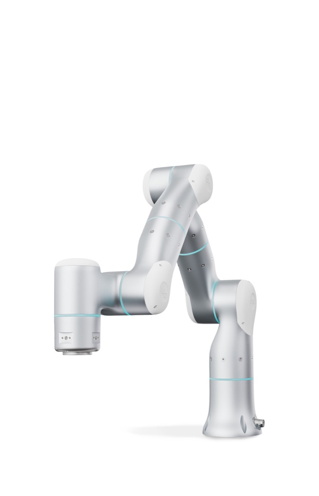
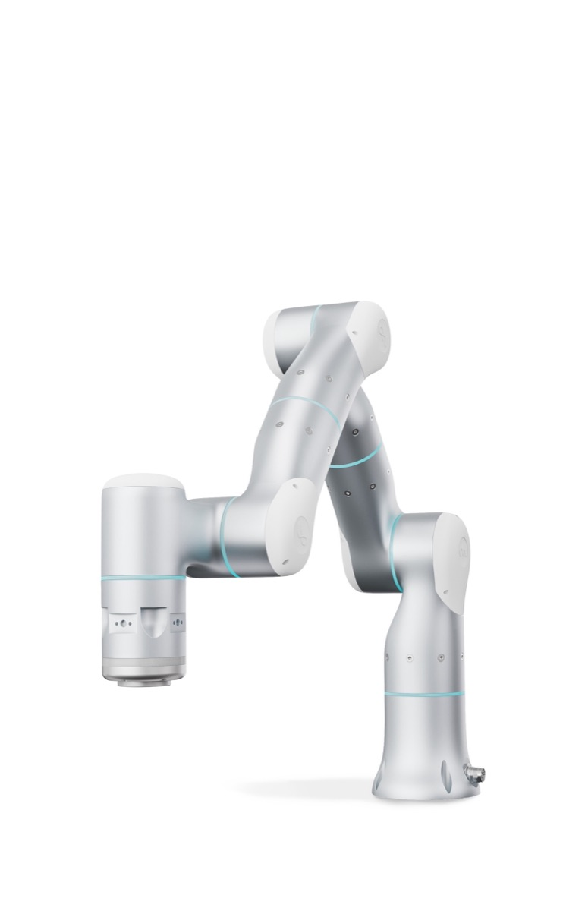
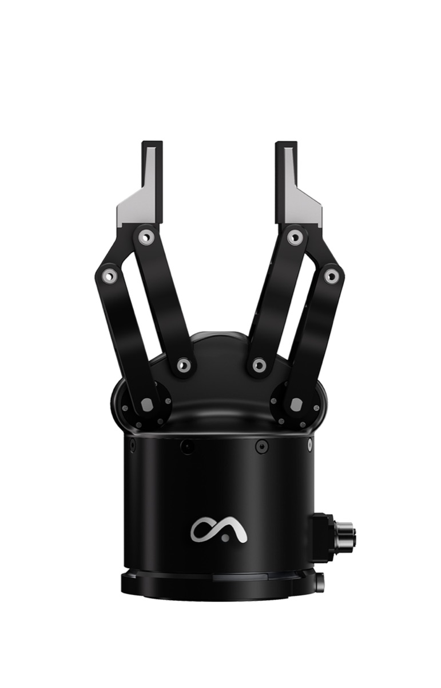
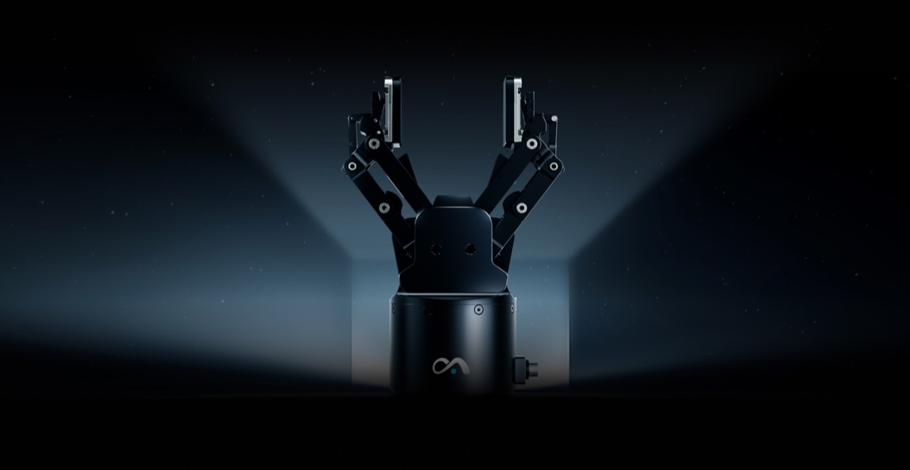
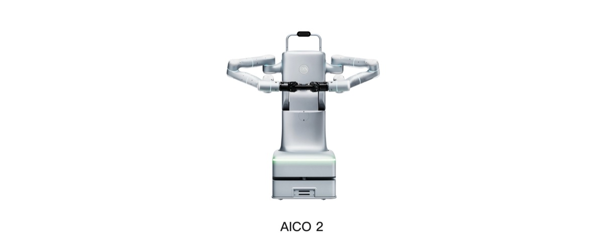
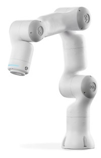
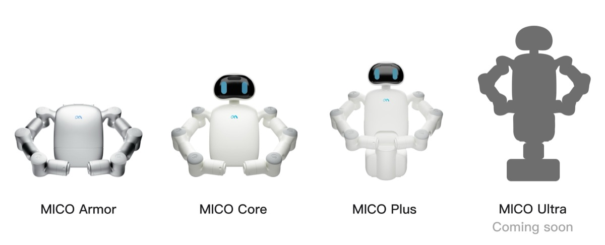

# Flexiv Robotics × T01 — Products and Solutions

⬆ [Flexiv Robotics profile](../Flexiv.md) · [Brief](Flexiv-T01-1-Brief.md) · [Playbook](Flexiv-T01-3-Playbook.md)

> **Bottom line for T01:** Flexiv sells force-controlled arms and factory / lab mobile platforms. Nothing in its public material is an urban-service robot. Its realistic role is the **manipulation station** of a city-service system: loading, plugging in, wiping, handing over.
> **Research note:** web search was unavailable in this pass; findings come from direct reads of official Flexiv pages, the official GitHub org and two trade-press articles, plus the company profile. Anything not on those pages is marked ⚠️ unverified.

## Relevant products (ranked for this track)

### Rizon 4

**Role in T01:** the default building block — a fixed or cart-mounted arm at a service point (parcel hand-off, charger plug-in, surface wiping). Most likely unit on site (best guess, not confirmed).

| Spec | Value |
|---|---|
| Payload / reach | **4 kg** / **876 mm** |
| DoF | 7 (redundant elbow helps in tight kiosks) |
| Force sensing | **0.1 N**, max TCP force 200 N |
| Repeatability | ±0.05 mm |
| Mass | 20 kg arm + 12 kg Hesper controller (500 W) |
| Ingress protection | **IP65** |
| Mobility / battery | none — mains-powered, stationary |

- **Status / price:** ✅ shipping · price not public.
- **Developer control:** RDK (C++ / Python) — non-real-time primitives and plans, or 1 kHz real-time joint / Cartesian / torque streaming; ROS 2 (`humble-v1` / `jazzy-v1` branches, RDK v1.x line per the `flexiv_ros2` README) with `joint_position` and `joint_impedance` modes, MoveIt, TCP wrench topics; supported in NVIDIA Isaac.

### Rizon 4s (Rizon 4 + wrist F/T sensor)

**Role in T01:** same as Rizon 4 when the task is delicate — handing an item to a person, pressing a touch screen or lift button, plugging small connectors.

| Spec | Value |
|---|---|
| Payload / reach | 4 kg / 919 mm |
| Force sensing | **0.03 N**, max TCP force 150 N |
| Mass / IP | 21 kg / IP65 |

- **Status / price:** ✅ shipping · price not public.
- **Developer control:** as Rizon 4, plus raw wrist F/T readings (`raw_ft_sensor` topic in ROS 2).

### Grav and Grav Enhanced

**Role in T01:** grasping parcels, bottles, towels, charger plugs, cleaning tools.

| Spec | Grav | Grav Enhanced |
|---|---|---|
| Stroke | 0–100 mm | 0–100 mm / V-mode 120–160° |
| Grip force | 1–100 N (accuracy 1 N) | 1–45 N |
| Object mass | not stated | up to 5 kg |
| Mass / IP | 0.9 kg / **IP67** | 1.3 kg / IP65 |
| Extra | — | gecko-inspired adhesive pads |

- **Status / price:** ✅ shipping · price not public.
- **Developer control:** RDK gripper API; ROS 2 gripper node with `move` / `grasp` actions (grasp needs direct force control support).

### Mobile Manipulator (FMR 300 base + Rizon arm)

**Role in T01:** the only Flexiv product that both drives and manipulates — an indoor "go to station, do contact task" robot. Unlikely to be on site.

| Spec | Value |
|---|---|
| Base | FMR 300 |
| Arm | Rizon series |
| Key trick | arm uses force sensing to cancel AMR docking error, no camera needed |
| Other specs | not public (official page lists none) |

- **Status / price:** ✅ listed on the official Robot System page · price not public.
- **Developer control:** arm via RDK; base interface unclear — see FMR 300 below.

### FMR 300

**Role in T01:** indoor flat-floor carrier (hotel corridor, clinic, spa back-of-house). Not an outdoor robot.

| Spec | Value |
|---|---|
| Payload | **272 kg** (600 lb) |
| Footprint / height | 78.7 × 60.9 cm / 86.3 cm |
| Navigation | laser SLAM; built-in collision detection; vision optional for crowded spaces |
| Drive | two-wheel differential |
| Battery | 72 Ah lithium-iron, **up to 8 h**, autonomous return to charging dock |
| Speed, slope, kerb, IP rating | not public |

- **Status / price:** ✅ launched Dec 2025 · price not public · no dedicated official product page found.
- **Developer control:** ⚠️ The public `flexiv_amr_sdk` (C++ / Python, Apache-2.0: status, navigation, motion, audio, sensor data, configuration) currently ships **SEER AMR integration only**; its README says Flexiv AMR support is reserved for a future release. Ask the engineers how an FMR 300 is commanded today.

### AICO (1, 2-4, 2-10)

**Role in T01:** mobile single / dual-arm research platform for embodied-AI data collection; would be the best single-vendor T01 platform if present, but it weighs 185–395 kg.

| Spec | AICO 1 | AICO 2-4 | AICO 2-10 |
|---|---|---|---|
| Arms / payload | 1 × 4 kg | 2 × 4 kg | 2 × 10 kg |
| Reach | 780 mm | 780 mm | 845 mm |
| Drive | four-wheel independent steering | dual-wheel differential | dual-wheel differential |
| Navigation | laser SLAM | laser SLAM | laser SLAM |
| Battery life | **4 h** | **6 h** | **4 h** |
| Mass | 185 kg | 281 kg | 395 kg |
| Operating temperature | 0–45 °C | 0–45 °C | 0–45 °C |

- **Status / price:** ✅ listed on official site · price not public · shipping status ⚠️ unverified.
- **Developer control:** arms via RDK / ROS 2 v1 line (AICO1/2 named in `flexiv_ros2`); base API not documented publicly.

### Enlight L and Mico

**Role in T01:** lighter alternative arm (Enlight L: **5 kg** payload, 752 mm, **15 kg**, whole-body touch sensing, IP65) and dual-arm station (Mico: 2 × 5 kg, 53–79 kg, 0–45 °C). Whole-body touch sensing is useful next to the public. Mico Ultra has a mobile base per the `flexiv_ros2` README, but that base is not driven by the ROS 2 stack and its specs are not public.

- **Status / price:** ✅ launched June 2026; delivery status ⚠️ unverified · price not public.
- **Developer control:** RDK v2.x; ROS 2 `humble` / `jazzy` (v2 line). Note the v1 / v2 split: code for Rizon and code for Enlight / Mico use different RDK lines.

### Flexiv Elements and RDK primitives

**Role in T01:** fastest path to a working contact task. The official primitives list shows **12 categories / 50 primitives**. Most useful here (behaviour inferred from names — check the docs on site):

| Need | Primitive(s) |
|---|---|
| Touch a surface and stop | Contact, ContactAlign |
| Wipe / clean with constant force | ForceHybrid, ForceComp, Polish |
| Find a socket and plug in | SearchHole, CheckPiH, InsertComp, Mate |
| Grasp with compliance | GraspComp |
| Hand-guiding for teaching | FloatingCartesian, FloatingJoint |
| Camera-guided approach | VSTeach, HPPoseBasedVS, HPImageBasedVS (hardware / license needs ⚠️ unverified) |

## What Flexiv Robotics already does in this domain

**Honest summary: no public urban-service, delivery, cleaning-robot or municipal deployment was found.** Closest items:

| Date | What | Relevance to T01 | Source |
|---|---|---|---|
| 2026-04 | Hannover Messe: **mobile CNC tool changing** demo (arm on mobile base), plus Mello massage preview | Shows "drive to a station, do a contact task" — in a factory | [Robotics 24/7](https://www.robotics247.com/article/hannover-messe-2026-flexiv-showcases-the-future-of-adaptive-robotics) |
| 2025-12 | **FMR 300** AMR launched for lab automation, CNC loading / unloading, mobile grinding and polishing | Indoor logistics-style mobility, industrial setting | [Automated Warehouse](https://www.automatedwarehouseonline.com/flexiv-launches-its-first-self-developed-amr/) |
| current | Official application page lists a **"Commercial Services"** sector, with no public description | Signals intent only | [flexiv.com/application](https://www.flexiv.com/application) |
| current | AICO positioned for embodied-AI development; Mello positioned as a retail massage product (release slated Q4 2026) | Consumer-facing service, but body care rather than city service | [Robot System page](https://www.flexiv.com/product/robot-system) |
| 2026-09 | Rizon 4 + Grav cable-insertion reference workflow in NVIDIA Isaac | Reusable for any plug-in / charging concept | [company profile](../Flexiv.md) |

- EV-charging, agriculture and other outdoor-service uses mentioned in older notes: ⚠️ unverified — not found on the official pages read in this pass.
- No Swiss or alpine-resort customer found.

## What they are building next in this domain

- **Platforms instead of bare arms (fact):** 2025–2026 launches are FMR 300, Mobile Manipulator, AICO, Mico — Flexiv is adding mobility around its arms.
- **AMR SDK (fact + inference):** the public SDK reserves Flexiv AMR support for a future release; *inference:* an open navigation API for FMR-class bases is coming but is not usable today.
- **Visual SLAM (inference):** the official GitHub org holds a recently updated fork of ORB_SLAM3; this hints at camera-based localisation work, nothing announced.
- **"Commercial Services" (inference):** the empty sector on the application page plus Mello suggest a push beyond factories; no product, date or partner is public.
- **Not announced:** outdoor mobile base, legged or humanoid platform, delivery or cleaning robot, in-house foundation model.

## Software, models and data that help for this track

| Asset | What it gives a T01 team | Notes |
|---|---|---|
| [flexiv_rdk](https://github.com/flexivrobotics/flexiv_rdk) | `pip install flexivrdk`; run primitives from Python in minutes | Linux / macOS / Windows; Apache-2.0; robot must have RDK enabled |
| [Primitives list](https://www.flexiv.com/software/primitives) | Ready-made contact, insertion, wiping and grasp skills | Parameters documented per category |
| [flexiv_ros2](https://github.com/flexivrobotics/flexiv_ros2) | ros2_control driver, MoveIt, fake hardware, TCP wrench topics | Rizon = v1 branches; Enlight / Mico = v2 branches |
| isaac_sim_ws / NVIDIA Isaac support | Simulate before touching the robot; insertion reference workflow | Needs an RTX-class GPU |
| [flexiv_trainer](https://github.com/flexivrobotics/flexiv_trainer) + flexiv_tdk | Teleop demos → LeRobot-format data → policy training | Realistic only for one short skill in 48 h |
| [flexiv_amr_sdk](https://github.com/flexivrobotics/flexiv_amr_sdk) | Navigation / motion / audio API for AMRs | SEER AMR only in the current public release |
| Pretrained models / datasets | none public from Flexiv | Bring your own detector or VLM |

## Gaps and limits for this track

- **No mobility in the likely on-site kit.** A Rizon needs mains power and a rigid mount; arm + controller is about 32 kg — not something to strap onto a quadruped.
- **Indoor only in practice.** Mobile platforms are rated 0–45 °C, use laser SLAM and differential drive; Leukerbad streets in November (snow, slopes, sub-zero) are out of scope. Rizon arm operating temperature not checked in this pass.
- **No perception stack included.** Cameras, object detection and language interfaces are yours to add (vision-guidance primitives exist, requirements unverified).
- **No public urban-service reference.** Judges will not see a Flexiv precedent for delivery or municipal work.
- **Access friction:** robot-side RDK license, wired LAN, real-time kernel for 1 kHz streaming, v1 / v2 RDK split.
- **Prices not public** — weak for a cost-per-service argument.

## Sources
- [Flexiv — Robot System page (Mico, AICO, Mello, Mobile Manipulator)](https://www.flexiv.com/product/robot-system)
- [Flexiv — Applications page](https://www.flexiv.com/application)
- [Flexiv — Primitives list](https://www.flexiv.com/software/primitives)
- [Flexiv RDK manual v2.x](https://www.flexiv.com/software/rdk/manual/v2.x/index.html)
- [GitHub — flexivrobotics organisation](https://github.com/flexivrobotics)
- [GitHub — flexiv_rdk](https://github.com/flexivrobotics/flexiv_rdk)
- [GitHub — flexiv_ros2](https://github.com/flexivrobotics/flexiv_ros2)
- [GitHub — flexiv_amr_sdk](https://github.com/flexivrobotics/flexiv_amr_sdk)
- [GitHub — flexiv_trainer](https://github.com/flexivrobotics/flexiv_trainer)
- [Automated Warehouse — Flexiv launches its first self-developed AMR (2025-12-04)](https://www.automatedwarehouseonline.com/flexiv-launches-its-first-self-developed-amr/)
- [Robotics 24/7 — Hannover Messe 2026: Flexiv showcases the future of adaptive robotics](https://www.robotics247.com/article/hannover-messe-2026-flexiv-showcases-the-future-of-adaptive-robotics)
- [Flexiv Robotics company profile (Rizon, Grav, Enlight specs; NVIDIA Isaac item)](../Flexiv.md), which cites the official [Rizon](https://www.flexiv.com/product/rizon), [Grav](https://www.flexiv.com/product/grav) and [Enlight](https://www.flexiv.com/product/enlight) pages
