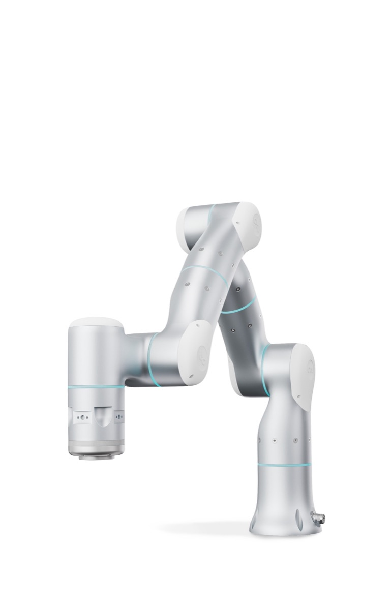
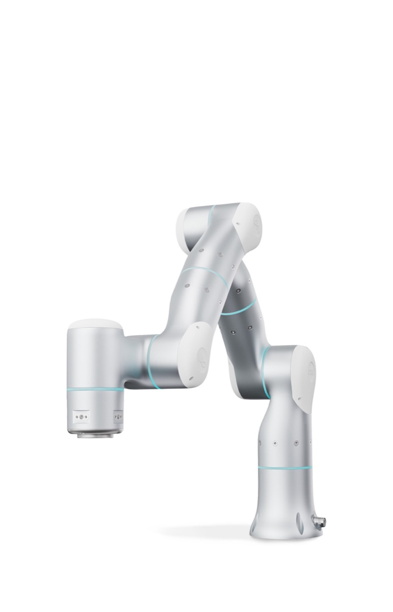
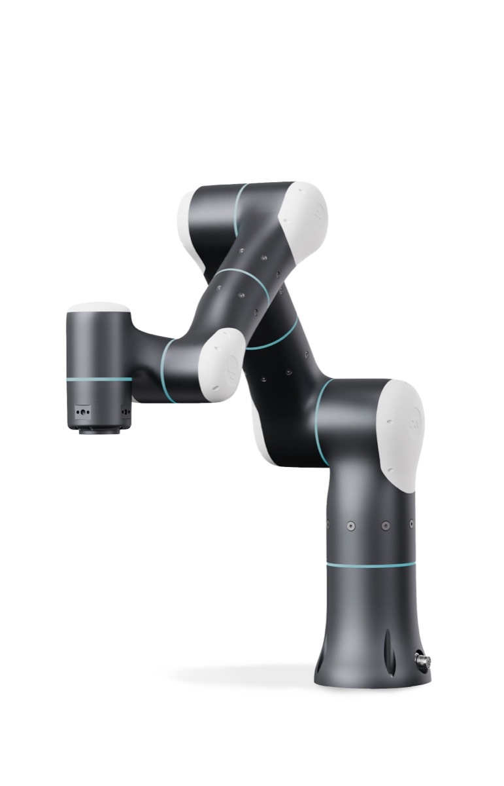
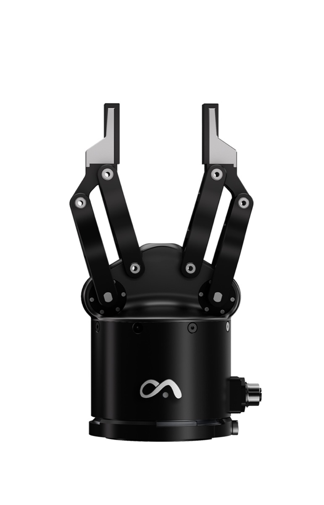
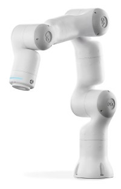

# Flexiv Robotics × T02 — Products and Solutions

⬆ [Flexiv Robotics profile](../Flexiv.md) · [Brief](Flexiv-T02-1-Brief.md) · [Playbook](Flexiv-T02-3-Playbook.md)

**Bottom line:** Flexiv is a force-controlled *manipulation* vendor. For T02 it contributes the intervention step (touch, turn, plug, press, probe) — not sensing, mobility or mapping. General specs and the developer stack are in the [profile](../Flexiv.md); this page lists only what matters for T02.

**Research note:** this pass used official Flexiv pages and GitHub only. A wider trade-press search for safety / emergency deployments could not be run (search quota exhausted), so "nothing found" below means "nothing on official pages checked".

## Relevant products (ranked for this track)

### Rizon 4s (Rizon 4 + wrist F/T sensor)

**Role in T02:** the most sensitive "remote hand" — best for teleoperated or shared-autonomy intervention where contact is uncertain (stiff valve, unknown latch, fragile connector) and for inspection by touch.

| Spec | Value |
|---|---|
| Payload / reach | **4 kg** / **919 mm** |
| Force sensing | **0.03 N** |
| Max TCP force | 150 N |
| Max TCP speed | 1.0 m/s |
| Arm protection | **IP65** |
| Operating range | **0–45 °C**, 20–80 % humidity, non-condensing |
| Arm weight | 21 kg (+ Hesper controller 12 kg, 500 W, **IP20**) |
| Certifications | CE, ETL |

- **Status / price:** ✅ shipping · price not public · on-site presence is a best guess, confirm at the booth.
- **Developer control:** RDK (C++ / Python) — joint torque, joint impedance, joint position and unified Cartesian motion + force, at **1 kHz** real-time or via non-real-time commands and built-in primitives / plans; gripper control; F/T sensor zeroing; robot states (TCP pose, external wrench, joint torques) readable for logging.

### Rizon 4

**Role in T02:** same as 4s with slightly coarser sensing and more push force; the model used in most public developer workflows, so the most likely unit on site.

| Spec | Value |
|---|---|
| Payload / reach | **4 kg** / **876 mm** |
| Force sensing | **0.1 N** |
| Max TCP force | **200 N** |
| Protection / temperature | IP65 arm · 0–45 °C |
| Weight | 20 kg (+ 12 kg controller) |

- **Status / price:** ✅ shipping · price not public.
- **Developer control:** identical to Rizon 4s. Also a supported robot in NVIDIA Isaac since Sept 2026 (simulation, RL training).

### Rizon 10

**Role in T02:** when the task needs muscle — heavy tools, larger valves, pushing debris-like objects, holding a sensor head.

| Spec | Value |
|---|---|
| Payload / reach | **10 kg** / **941 mm** (Rizon 10 + F/T sensor: 984 mm) |
| Force sensing | 0.2 N (0.1 N with F/T sensor) |
| Max TCP force | **350 N** |
| Protection / temperature | IP65 arm · 0–45 °C |
| Weight | 38 kg (39 kg with F/T sensor) |

- **Status / price:** ✅ shipping · price not public · less likely to be on site than Rizon 4 (heavier to ship).
- **Developer control:** same RDK interface.

### Grav

**Role in T02:** the gripper that actually grabs the valve handle, lever, plug or tool.

| Spec | Value |
|---|---|
| Stroke | 0–100 mm |
| Grip force | **1–100 N**, force accuracy 1 N |
| Protection | **IP67** |
| Weight | 0.9 kg |

- **Status / price:** ✅ shipping · price not public.
- **Developer control:** width, speed and force commands through RDK (see `basics6_gripper_control.py`).

### Mobile Manipulator

**Role in T02:** the only Flexiv route to "go to the fault, then fix it" — FMR 300 AMR carrying a Rizon arm; the arm uses force sensing to absorb the base's docking error. Flat indoor floors only (inference from wheeled differential-drive design; no outdoor rating published).

| Spec | Value |
|---|---|
| Base | FMR 300: **272 kg** payload, 78.7 × 60.9 cm footprint |
| Navigation | Laser SLAM, auto-docking |
| Runtime | 72 Ah battery, up to **8 h** |
| System-level specs | not public |

- **Status / price:** ✅ listed on the official site · price not public · **unlikely to be on site** (heavy) — ask.
- **Developer control:** `flexiv_amr_sdk` (C++ headers, examples, binaries) for the base + RDK for the arm.

### AICO (1, 2-4, 2-10)

**Role in T02:** mobile single / dual-arm research platform; would suit an indoor "maintenance robot" story if present.

| Spec | AICO 1 | AICO 2-4 | AICO 2-10 |
|---|---|---|---|
| Arms / payload | 1 × 4 kg | 2 × 4 kg | 2 × 10 kg |
| Battery | 4 h | 6 h | 4 h |
| Weight | 185 kg | 281 kg | 395 kg |
| Navigation | Laser SLAM | Laser SLAM | Laser SLAM |
| Temperature | 0–45 °C | 0–45 °C | 0–45 °C |

- **Status / price:** ✅ listed on the official site · price not public · very unlikely on site (185–395 kg).

### Enlight L

**Role in T02:** lighter alternative arm (**5 kg** payload, **752 mm** reach, **15 kg**, IP65) with whole-body touch sensing — interesting for working near people, but shorter reach. Delivery status ⚠️ unverified; plausible on site.

### RDK / DRDK / TDK / PDK / AMR SDK / Trainer

**Role in T02:** TDK is the track-relevant piece — remote operation with force feedback. Details in the software section below.

**Not relevant for T02:** Mello (massage), Moonlight (parallel pick-and-place), Mico (bench-top dual-arm), Grav Enhanced (only if you must grip smooth flat objects).

## What Flexiv Robotics already does in this domain

**Nothing confirmed in emergency response, hazard monitoring, security or critical-infrastructure inspection.** Official news titles from June 2025 to Sept 2026 are all trade-show, funding and NVIDIA-simulation items. Adjacent evidence only:

| Date | What | Why it is (loosely) relevant | Source |
|---|---|---|---|
| Nov 2026 (repo activity) | `flexiv_tdk` v2.1: robot-to-robot or device-to-robot teleop with force feedback, LAN and WAN | Foundation for hazardous-area remote manipulation | [flexiv_tdk](https://github.com/flexivrobotics/flexiv_tdk) |
| Nov 2026 (blog) | NVIDIA research on GB300 server assembly with two Rizon 4s | Contact-rich work on data-centre hardware (digital infrastructure) | [flexiv.com](https://www.flexiv.com) (via profile) |
| Apr 2026 | Hannover Messe: mobile CNC tool changing, server component insertion | Mobile base + force-guided insertion = pattern for "drive up and service a panel" | [Robotics 24/7](https://www.robotics247.com/article/hannover-messe-2026-flexiv-showcases-the-future-of-adaptive-robotics) (via profile) |
| Dec 2025 | FMR 300 AMR launched | Enables mobile manipulation indoors | [Automated Warehouse](https://www.automatedwarehouseonline.com/flexiv-launches-its-first-self-developed-amr/) (via profile) |

- EV-charging plug-in (a classic "keep infrastructure running" contact task) is often associated with Flexiv but was **not confirmed** on official pages ⚠️ unverified.
- No Swiss, alpine, civil-protection or utility customer found.

## What they are building next in this domain

- **No announced plans for safety, rescue or inspection products.**
- Stated direction (2026): platforms rather than bare arms (Enlight, Mico, AICO, FMR 300) and "physical AI" tooling (Isaac integration, Trainer, TDK). Europe expansion funded by the March 2026 Invus round; Munich office.
- *Inference:* mobile dual-arm platforms plus WAN teleop and learned contact skills are the building blocks for remote maintenance of plants, labs and data centres — the industrial-resilience corner of T02, not outdoor disaster response.
- *Inference:* a fork of ORB-SLAM3 in Flexiv's GitHub org (updated Nov 2026) hints at visual-SLAM work; purpose not documented ⚠️ unverified.

## Software, models and data that help for this track

| Asset | What it gives you for T02 | Notes |
|---|---|---|
| [`flexiv_rdk`](https://github.com/flexivrobotics/flexiv_rdk) | `pip install flexivrdk`; Python examples `basics3_primitive_execution.py`, `basics6_gripper_control.py`, `intermediate4_non_realtime_cartesian_motion_force_control.py` | Apache-2.0. Linux / macOS / Windows. Non-real-time modes do the real-time maths on the robot, so a normal laptop is enough |
| RDK control modes | `NRT_PRIMITIVE_EXECUTION`, `NRT_CARTESIAN_MOTION_FORCE` (fast path); `RT_CARTESIAN_MOTION_FORCE`, `RT_JOINT_TORQUE` at 1 kHz (needs RT-capable PC and network) | Mode switch while moving makes the robot stop first |
| Loss-of-connection behaviour | Robot drops to `IDLE`: decelerates, stops, holds position; reconnect without touching the robot, then re-select the mode | A ready-made fail-safe story for teleop |
| [`flexiv_tdk`](https://github.com/flexivrobotics/flexiv_tdk) | `transparent_cartesian_teleop_lan.py` and `..._wan.py` — force-feedback teleop over LAN or internet | Ubuntu 22.04+, x86_64 / aarch64; WAN needs clock sync (chrony). Robot-to-robot needs **two** Flexiv arms; supported input "devices" and licence needs ⚠️ unverified |
| [`flexiv_ros2`](https://github.com/flexivrobotics/flexiv_ros2) | ros2_control + MoveIt for collision-aware motion; mock hardware for off-robot development | Humble / Jazzy |
| `isaac_sim_ws` / NVIDIA Isaac support | Rehearse the task in simulation while waiting for robot time | Rizon 4 + Grav |
| `flexiv_trainer` | Record teleop demos in LeRobot format, train a policy | Probably too slow a loop for 48 h unless the skill is tiny |
| `flexiv_amr_sdk` | Drive the FMR 300 base | Only if the base is on site |

- **Models / datasets:** no public Flexiv foundation model, perception model or safety-domain dataset. Bring your own vision (open-vocabulary detector, fiducials) and LLM.
- **Compute:** your code runs on your own laptop / GPU box wired to the controller over Ethernet.

## Gaps and limits for this track

- **No mobility on rough terrain, no outdoor rating.** Arm is IP65 but the Hesper controller is **IP20** and the system is rated **0–45 °C**, non-condensing — not for a Leukerbad street in November.
- **No built-in perception or autonomy stack** beyond force sensing; camera, detection and scene understanding are on you.
- **Reach under 1 m** and a 32 kg+ arm-plus-controller package needing mains power — it cannot ride on the quadrupeds on site in 48 h.
- **Licences:** RDK needs a robot-side licence and Remote mode; TDK likely needs its own ⚠️ unverified. A missing licence is a hard blocker — check first.
- **Teleop with force feedback needs a second arm** (or a supported haptic device) — confirm what is physically available.
- **No domain track record** to cite in front of judges; your story must stand on the demo.

## Sources
- [Flexiv — Rizon product page](https://www.flexiv.com/product/rizon)
- [Flexiv — Robot System page (Mico, AICO, Mello, Mobile Manipulator)](https://www.flexiv.com/product/robot-system)
- [Flexiv — news list](https://www.flexiv.com/news)
- [Flexiv RDK manual v2.x — index](https://www.flexiv.com/software/rdk/manual/v2.x/index.html)
- [Flexiv RDK manual — Control modes](https://www.flexiv.com/software/rdk/manual/v2.x/control_modes.html)
- [Flexiv RDK manual — Loss of connection](https://www.flexiv.com/software/rdk/manual/v2.x/loss_of_connection.html)
- [GitHub — flexivrobotics organisation](https://github.com/flexivrobotics)
- [GitHub — flexiv_rdk](https://github.com/flexivrobotics/flexiv_rdk)
- [GitHub — flexiv_rdk Python examples](https://github.com/flexivrobotics/flexiv_rdk/tree/main/example_py)
- [GitHub — flexiv_tdk](https://github.com/flexivrobotics/flexiv_tdk)
- [GitHub — flexiv_tdk Python examples](https://github.com/flexivrobotics/flexiv_tdk/tree/main/example_py)
- Carried over from the [company profile](../Flexiv.md), not re-fetched in this pass: [Robotics 24/7 — Hannover Messe 2026](https://www.robotics247.com/article/hannover-messe-2026-flexiv-showcases-the-future-of-adaptive-robotics) · [Automated Warehouse — FMR 300 launch](https://www.automatedwarehouseonline.com/flexiv-launches-its-first-self-developed-amr/) · [Robotics 24/7 — Rizon 4 in NVIDIA Isaac](https://www.robotics247.com/article/flexix-rizon-4-adaptive-robot-now-supported-in-nvidia-isaac/Flexiv_Robotics) · [Flexiv — Grav product page](https://www.flexiv.com/product/grav) · [Flexiv — Enlight product page](https://www.flexiv.com/product/enlight)
