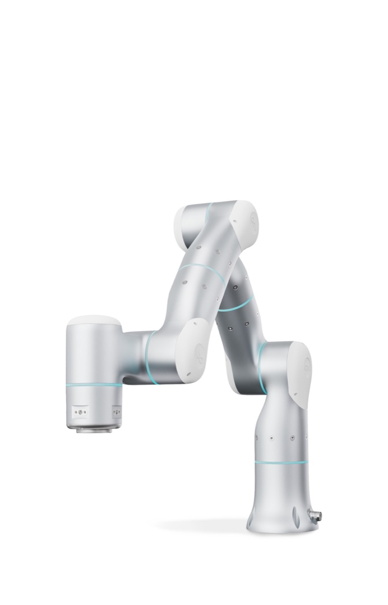
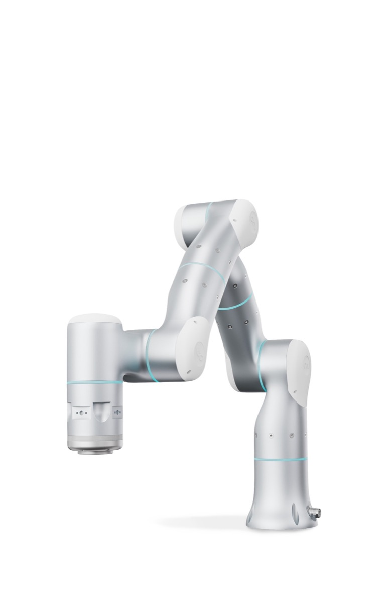
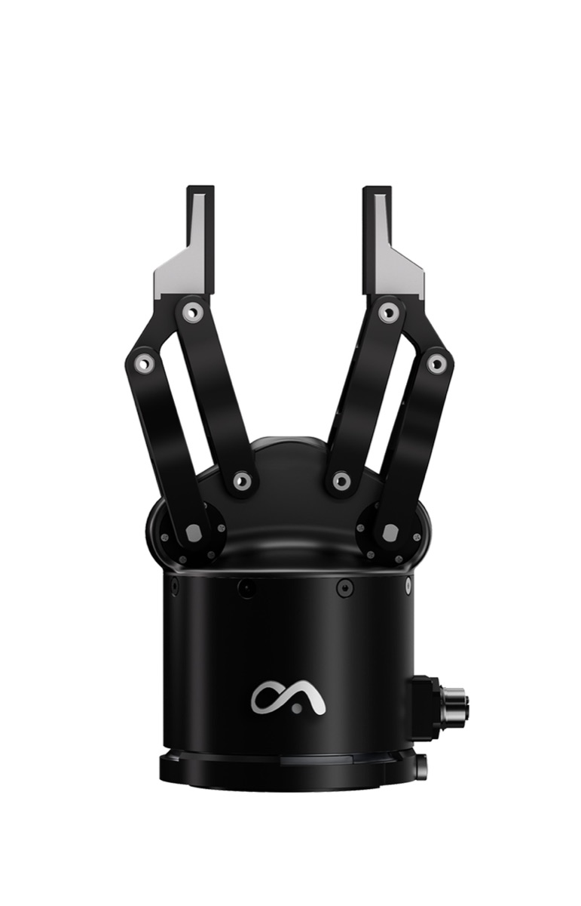
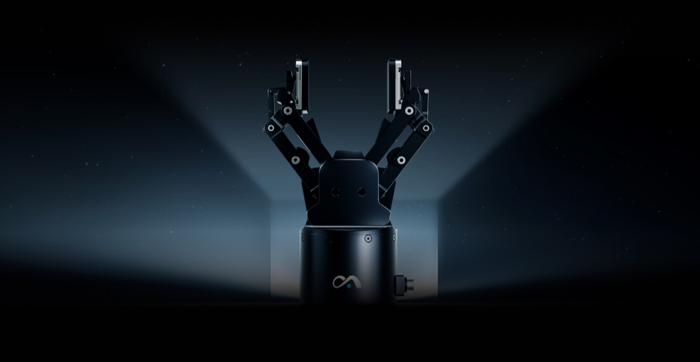
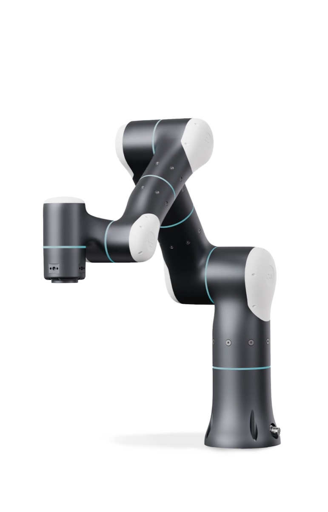
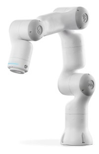
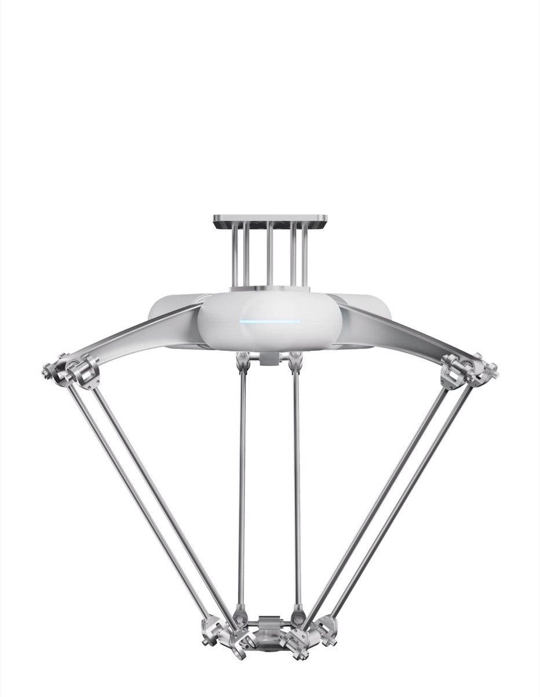

# Flexiv Robotics × T03 — Products and Solutions

⬆ [Flexiv Robotics profile](../Flexiv.md) · [Brief](Flexiv-T03-1-Brief.md) · [Playbook](Flexiv-T03-3-Playbook.md)

**Bottom line:** Flexiv sells force-controlled arms, not sustainability solutions. For T03 it is the **manipulation component** of a sorting, repair, disassembly or plug-in demo. Nothing below is purpose-built for waste, energy or environment.

Status icons: ✅ shipping/available · 🧪 announced/preview · 🔭 roadmap/concept. Which units are physically at Leukerbad is **not confirmed** — check the booth before planning.

## Relevant products (ranked for this track)

### Rizon 4

**Role in T03:** the default arm for sorting recyclables, unplugging / plugging connectors, light disassembly and surface refinishing. Most likely unit on site and the one every public developer workflow targets.

| Spec | Value |
|---|---|
| Payload / reach | **4 kg** / **876 mm** |
| Axes / weight | 7 / 20 kg |
| Force sensing accuracy | **0.1 N** (whole arm, joint torque sensors) |
| Max TCP force | 200 N |
| Typical TCP speed | 1.0 m/s |
| Repeatability | ±0.05 mm |
| Protection | **IP65** (arm) — controller is IP20 |
| Operating range | **0–45 °C**, 20–80 % humidity non-condensing |
| Controller (Hesper) | 12 kg · **500 W** listed power consumption · 16 DI / 16 DO · Profinet, Modbus TCP |
| Mounting / flange | any orientation / ISO 9409-1-50-4-M6 |

- **Status / price:** ✅ shipping · price not public.
- **Developer control:** Flexiv RDK (C++ / Python). High level: run built-in motion and force primitives and read full robot state (joint torques, TCP wrench, pose). Low level: 1 kHz joint or Cartesian motion-force streaming (needs real-time Linux). Digital I/O is exposed (useful for a conveyor, light or vacuum valve). ROS 2 + MoveIt available.

### Rizon 4s (Rizon 4 + wrist F/T sensor)

**Role in T03:** same as Rizon 4, preferred when the task hinges on very light contact — probing fragile items, weighing or stiffness-testing an object, mating small connectors.

| Spec | Value |
|---|---|
| Payload / reach | 4 kg / 919 mm |
| Force sensing accuracy | **0.03 N** |
| Max TCP force | 150 N |
| Weight / protection | 21 kg / IP65 |

- **Status / price:** ✅ shipping · price not public.
- **Developer control:** identical to Rizon 4.

### Grav

**Role in T03:** the end-effector that makes "sorting by touch" possible — commanded grip force plus finger width gives a cheap stiffness / size signal per object. IP67 means wet or sticky waste is acceptable.

| Spec | Value |
|---|---|
| Stroke | 0–100 mm |
| Grip force | **1–100 N**, force control accuracy 1 N |
| Gripping speed | 1–200 mm/s |
| Finger repeatability | 0.1 mm |
| Weight / protection | 0.9 kg / **IP67** |
| Operating temperature | −20 to +45 °C |

- **Status / price:** ✅ shipping · price not public.
- **Developer control:** plug-and-play on Flexiv arms; commanded from the RDK gripper interface (width, speed, force) ⚠️ exact API calls unverified in this pass — see the RDK gripper example.

### Grav Enhanced

**Role in T03:** better choice for a **mixed** waste or reuse stream — parallel pinch plus a V-mode with gecko-inspired dry-adhesive pads for round, large or irregular items (bottles, cans, bulbs) without suction or compressed air.

| Spec | Value |
|---|---|
| Modes | Parallel 0–100 mm · V-mode 120–160° |
| Grip force | 1–45 N |
| Object weight | up to **5 kg** (note: Rizon 4 payload is 4 kg including the 1.3 kg gripper) |
| Weight / protection | 1.3 kg / IP65 |
| Extras | optional self-cleaning station for the pads |

- **Status / price:** ✅ shipping · price not public.
- **Caveat:** dry-adhesive pads lose grip when dusty or greasy — real waste will contaminate them quickly (inference; ask the engineers).

### Rizon 10

**Role in T03:** only if you need more push force or payload — sanding / refinishing with a powered tool, handling e-bike batteries or heavier parts.

| Spec | Value |
|---|---|
| Payload / reach | **10 kg** / 941 mm |
| Force sensing accuracy | 0.2 N (0.1 N with wrist F/T = Rizon 10s) |
| Max TCP force | **350 N** |
| Weight / protection | 38 kg / IP65 |

- **Status / price:** ✅ shipping · price not public. Less likely to be on site than Rizon 4.

### Enlight L

**Role in T03:** lighter alternative if Flexiv brings its 2026 arm. Whole-body touch sensing is a plus for a station that people (hotel staff, visitors) work next to.

| Spec | Value |
|---|---|
| Payload / reach / weight | **5 kg** / **752 mm** / **15 kg** |
| Force | sensing 0.1 N · controllable force up to 400 N |
| Protection | IP65 |

- **Status / price:** ✅ launched June 2026; delivery status ⚠️ unverified · price not public.
- **Developer control:** RDK at 1 kHz per the platform specs; whether every public example runs unchanged on Enlight is ⚠️ unverified.

### Mobile Manipulator (FMR 300 + Rizon) and AICO

**Role in T03:** would unlock mobile concepts (roaming EV-charging arm, collection rounds), but both are heavy (FMR 300 carries 272 kg; AICO weighs 185–395 kg) and **unlikely to be on site**.

| Spec | Value |
|---|---|
| FMR 300 | payload 272 kg · laser SLAM · 72 Ah battery, up to 8 h · auto-docking |
| AICO 1 / 2-4 / 2-10 | 1×4 kg, 4 h · 2×4 kg, 6 h · 2×10 kg, 4 h battery |
| Notable | arm force sensing compensates base docking error without vision |

- **Status / price:** ✅ listed on the official site · price not public. Developer access: `flexiv_amr_sdk` (base), `flexiv_drdk` (dual arm).

### Moonlight

**Role in T03:** on paper the right machine for conveyor-speed sorting (1.5 m/s, 1200 mm working diameter, IP65, force-controlled). Payload is not stated on the product page and it is unlikely to be at the hackathon. Mention it in a pitch as the scale-up path, do not plan on it.

### Developer software (RDK and friends)

See the software section below.

## What Flexiv Robotics already does in this domain

**Directly in sustainability (waste, recycling, energy, environment): nothing found** on the official site, the case list (page 1 of 2) or the 2026 news items checked. The profile's starting notes on EV charging and agriculture remain ⚠️ unverified.

Adjacent, verified work you can legitimately cite:

| Date | What | Why it is relevant to T03 | Source |
|---|---|---|---|
| 2024-05 | EsVata Shutters (California): Rizon 4 + OnRobot sander with automatic grit changer sands wooden shutters; average sanding time per shutter **−80 %** | Proven force-controlled surface refinishing — the core skill for repair / refurbish concepts | [Flexiv case](https://www.flexiv.com/partner/case/Flexiv's_Automated_Shutter_Sanding_Solution) |
| undated | Polishing / grinding story: phones, castings, weld seams; ~1 N force accuracy, sanding at up to 800 mm/s, new part adapted in 1–2 days; less over-polishing | Less scrap from over-processing; quick changeover for high-mix repair work | [Flexiv story](https://www.flexiv.com/story/polish) |
| 2024-10-16 | "Automated Fish Fillet Shaping Solution" (Food and FMCG) | Handling soft, variable natural material (title and sector only; details not read) | [Flexiv user cases](https://www.flexiv.com/partner/case) |
| 2025-01 / 2025-03 | Compressor tube plugging and tube inspection cases | Contact-rich work on HVAC / refrigeration components (titles only) | [Flexiv user cases](https://www.flexiv.com/partner/case) |
| 2026-04 | Hannover Messe demos: mobile CNC tool changing, server component insertion, car-body polishing, seat ironing | Insertion and finishing demos; no sustainability framing in the coverage | [Robotics 24/7](https://www.robotics247.com/article/hannover-messe-2026-flexiv-showcases-the-future-of-adaptive-robotics) |
| 2026-09-24 | Rizon 4 supported in NVIDIA Isaac; reference workflow = RL-trained DisplayPort cable insertion, Rizon 4 + Grav, socket pose not known exactly | Closest public template for **charger / connector plug-in** | [Robotics 24/7](https://www.robotics247.com/article/flexix-rizon-4-adaptive-robot-now-supported-in-nvidia-isaac/Flexiv_Robotics) |

No Swiss customer or partner found.

## What they are building next in this domain

- **Announced:** nothing sustainability-specific.
- **Announced, generally relevant:** Isaac workflow and simulation assets "being released" so developers can adapt insertion to their own connectors (2026-09); platform push toward mobile and dual-arm systems (FMR 300, AICO, Mico); Europe expansion funded by the 2026-03 round (Munich office).
- **Inference (not announced):** mobile manipulation + connector insertion is technically the recipe for automated EV charging, and high-mix finishing is the recipe for remanufacturing — but Flexiv has not publicly positioned either as a product direction.

## Software, models and data that help for this track

| Asset | What it gives you in 48 h | Notes |
|---|---|---|
| [flexiv_rdk](https://github.com/flexivrobotics/flexiv_rdk) (Apache-2.0) | `pip install numpy spdlog flexivrdk`; Python 3.10 / 3.12 on Linux, macOS, Windows; examples in `example_py/` | Robot needs RDK server activated with a licence, Remote mode, wired LAN (set MTU / firewall per manual). Real-time scheduler needs root |
| Built-in force primitives | Contact detection, compliant moves, hole search / insertion, constant-force surface following without writing a controller | Exact primitive names depend on the installed robot software ⚠️ unverified — list them on the robot first |
| [flexiv_ros2](https://github.com/flexivrobotics/flexiv_ros2) | ros2_control + MoveIt; mock-hardware mode lets half the team develop without the arm | Humble / Jazzy |
| [flexiv_description](https://github.com/flexivrobotics/flexiv_description) | URDFs for planning and visualisation | |
| isaac_sim_ws / NVIDIA Isaac support | Simulate the cell; FoundationPose + cuMotion for perception and approach | Needs an RTX GPU; too heavy for most 48 h builds |
| [flexiv_trainer](https://github.com/flexivrobotics/flexiv_trainer) (Apache-2.0) | Record demos as LeRobot episodes, train ACT-style policies from a local web UI | Teleop is **leader–follower: needs a second Flexiv arm per follower**; RealSense / Orbbec cameras; GPU recommended |
| flexiv_pdk + Composer Studio | Scan-path planning over a surface — useful for refinishing / cleaning a part | Maturity not assessed |
| Pretrained models / datasets | **None from Flexiv.** Bring an open detector (e.g. an open-vocabulary detector or a small YOLO fine-tuned on a public waste dataset) | |

## Gaps and limits for this track

- **No domain track record** — every sustainability claim in your pitch will be yours, not Flexiv's.
- **No perception included** — camera, calibration and models are your job (the Rizon page mentions an optional camera module; availability on site unknown).
- **Stationary and indoor** — arm rated 0–45 °C, controller IP20; Leukerbad in November is below that outdoors. No mobile base expected on site.
- **Energy story is weak** — controller listed at 500 W; arm power draw is not published. Do not claim energy savings from the robot itself; claim them from the *outcome* (material recovered, parts reused).
- **Payload** — 4 kg minus gripper (0.9–1.3 kg) limits Rizon 4 to small items.
- **Throughput** — a 7-DoF cobot sorts a few items per minute; industrial sorting lines use delta robots (Flexiv's Moonlight is the analogue, not expected on site).
- **Access friction** — licence, Remote mode, wired LAN, real-time kernel for 1 kHz modes; one arm shared by several teams is likely.
- **Research limit of this doc:** web search was unavailable in this pass; findings rest on Flexiv's official pages, GitHub and two trade-press articles. Page 2 of the official case list was not read.

## Sources

- [Flexiv — Rizon product page](https://www.flexiv.com/product/rizon)
- [Flexiv — Grav product page](https://www.flexiv.com/product/grav)
- [Flexiv — Robot System page (Mico, AICO, Mello, Mobile Manipulator)](https://www.flexiv.com/product/robot-system)
- [Flexiv — official site, home and news list](https://www.flexiv.com)
- [Flexiv — user cases](https://www.flexiv.com/partner/case)
- [Flexiv — Automated Shutter Sanding Solution case](https://www.flexiv.com/partner/case/Flexiv's_Automated_Shutter_Sanding_Solution)
- [Flexiv — polishing story](https://www.flexiv.com/story/polish)
- [Flexiv RDK manual](https://www.flexiv.com/software/rdk/manual/v2.x/index.html)
- [GitHub — flexivrobotics organisation](https://github.com/flexivrobotics)
- [GitHub — flexiv_rdk](https://github.com/flexivrobotics/flexiv_rdk)
- [GitHub — flexiv_trainer](https://github.com/flexivrobotics/flexiv_trainer)
- [Robotics 24/7 — Hannover Messe 2026: Flexiv showcases the future of adaptive robotics](https://www.robotics247.com/article/hannover-messe-2026-flexiv-showcases-the-future-of-adaptive-robotics)
- [Robotics 24/7 — Flexiv Rizon 4 now supported in NVIDIA Isaac (2026-09-24)](https://www.robotics247.com/article/flexix-rizon-4-adaptive-robot-now-supported-in-nvidia-isaac/Flexiv_Robotics)
- [Flexiv Robotics profile (internal, general research)](../Flexiv.md)
