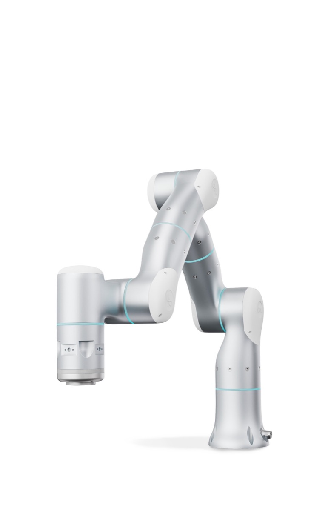
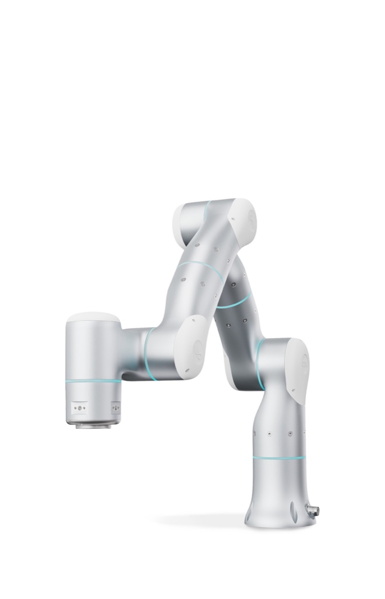
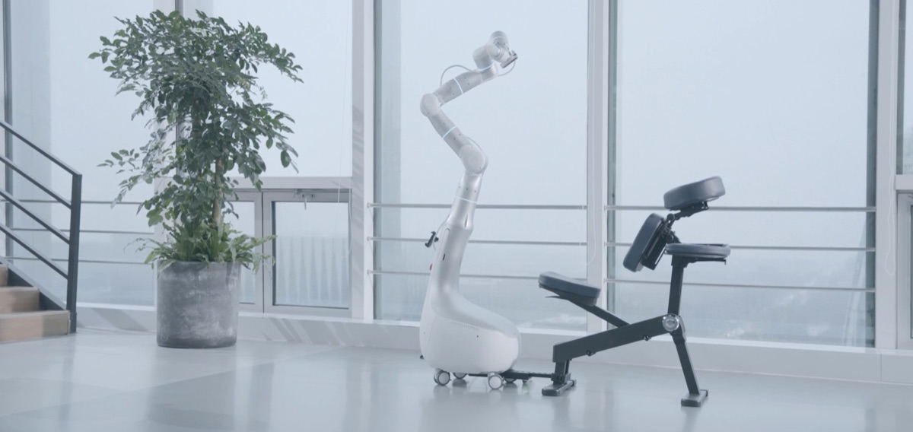
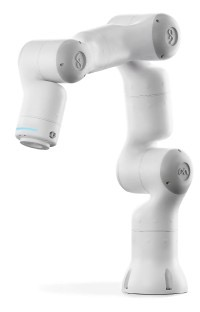
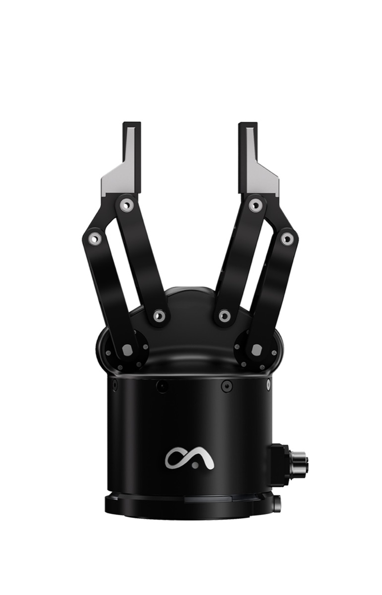
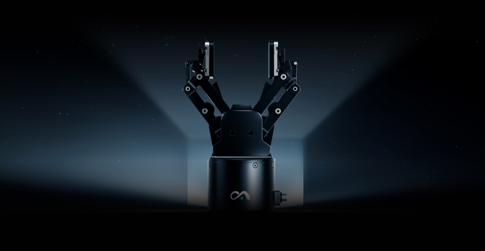
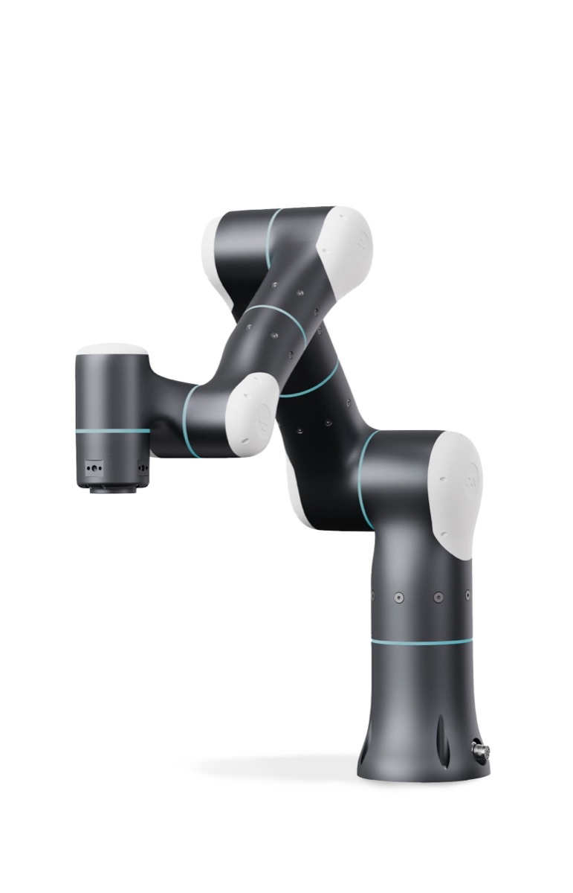
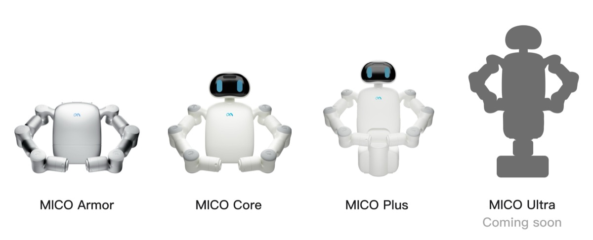
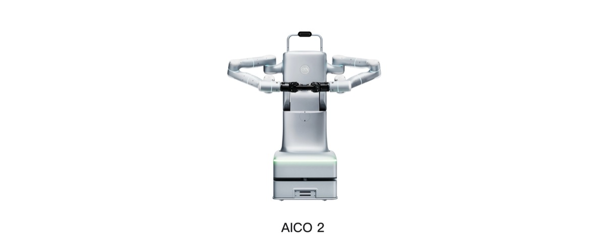

# Flexiv Robotics × T04 — Products and Solutions

⬆ [Flexiv Robotics profile](../Flexiv.md) · [Brief](Flexiv-T04-1-Brief.md) · [Playbook](Flexiv-T04-3-Playbook.md)

> **Research note:** the web-search budget was exhausted for this pass, so track-specific findings come from official Flexiv pages and GitHub repos fetched directly, plus the company profile. Absence of a care / rehab deployment below means "not found on official pages", not "proven not to exist".

## Relevant products (ranked for this track)

| Rank | Product | Role in T04 | Status | Likely on site? |
|---|---|---|---|---|
| 1 | Rizon 4s | Body-contact work: massage, guided exercise, gentle handover | ✅ | Likely (best guess) |
| 2 | Rizon 4 | Same, slightly less sensitive, more push force | ✅ | Likely (best guess) |
| 3 | Mello | Finished massage product; reference for what "good" looks like | 🧪 Q4 2026 | Plausible ⚠️ unverified |
| 4 | Enlight L | Lighter arm marketed for people-focused settings | ✅ launched; delivery ⚠️ unverified | Plausible ⚠️ unverified |
| 5 | Grav / Grav Enhanced | Handover, feeding aid, holding therapy tools | ✅ | Likely with the arm |
| 6 | Rizon 10 / 10s | Higher-force limb support or resistance training | ✅ | Less likely |
| 7 | Mico / AICO / Mobile Manipulator | Dual-arm or mobile care tasks | ✅ listed | Unlikely (53–395 kg) |

Moonlight (parallel pick-and-place robot) and the bare FMR 300 base have no sensible T04 role and are omitted.

### Rizon 4s (Rizon 4 + wrist F/T sensor)

**Role:** first choice whenever the robot touches a person or holds something a person pushes against. The wrist force/torque sensor gives the finest contact resolution in the range.

| Spec | Value |
|---|---|
| Payload / reach / weight | **4 kg** / **919 mm** / 21 kg |
| Force sensing accuracy | **0.03 N** |
| Max TCP force | **150 N** |
| DoF | 7 (redundant elbow — can keep clear of the person) |
| Typical TCP speed | 1.0 m/s (run far slower near people) |
| Repeatability | ±0.05 mm |
| Protection / noise | IP65 (arm), Hesper controller IP20 / under 70 dB |
| Certification | CE and ETL (per product page). Not a medical device |

- **Status / price:** ✅ shipping · price not public · listed on the official site as "Rizon 4 + F/T Sensor".
- **Developer control:** Flexiv RDK (C++ / Python) — joint and Cartesian impedance, Cartesian motion-force control, built-in primitives and plans, free drive, robot dynamics, 1 kHz real-time streaming (real-time Linux needed) or non-real-time commands from a normal laptop.

### Rizon 4

**Role:** same use cases as the 4s; the model used in all public developer workflows (RDK examples, ROS 2, NVIDIA Isaac, Flexiv Trainer), so it is the lowest-friction arm to program.

| Spec | Value |
|---|---|
| Payload / reach / weight | **4 kg** / **876 mm** / 20 kg |
| Force sensing accuracy | **0.1 N** (whole-arm, no wrist sensor) |
| Max TCP force | **200 N** |
| DoF / repeatability | 7 / ±0.05 mm |
| Protection | IP65 |

- **Status / price:** ✅ shipping · price not public.
- **Developer control:** identical to Rizon 4s.

### Mello

**Role:** Flexiv's own product in this domain — an automated massage platform. Useful as a proof point and, if a unit is on site, as a benchmark; it is a closed retail product, so expect less hackability than a bare Rizon.

| Spec | Value |
|---|---|
| DoF | 7 |
| Force sensing accuracy | **0.1 N** |
| Force control response | **1000 Hz** |
| Max output force | **200 N** |
| Session | standardized **15-minute** massage |
| Power | 220–240 V, 500 W |
| Operating temperature | 0–45 °C |
| Body sensing (camera / 3D vision) | not public |
| Underlying arm | not stated; specs match Rizon 4 (inference) |

- **Status / price:** 🧪 release slated **Q4 2026** (per Flexiv's Hannover Messe announcement) · price not public · described as "retail-ready"; no medical claims on the official page.
- **Developer control:** not public. Assume no SDK access to the Mello application layer ⚠️ unverified — ask on site.

### Enlight L

**Role:** the 2026 arm that Flexiv positions for people-focused settings (homes, schools, offices). Lighter than Rizon, with a stronger formal safety story — attractive for a care narrative if one is on site.

| Spec | Value |
|---|---|
| Payload / reach / weight | **5 kg** / **752 mm** / **15 kg** |
| Force sensing accuracy | 0.1 N |
| Max controllable force | 400 N |
| Whole-body touch sensing | yes, per launch coverage (not detailed on the product page) |
| Safety design | stated compliance with IEC 61508 and ISO 10218-1:2025; Orion control hub safety functions SIL 2 |
| Protection / noise | IP65 / under 70 dBA |
| Flange | ISO 9409-1-50-4-M6 |

- **Status / price:** ✅ launched June 2026 · delivery status and price not public.
- **Developer control:** Mico (built from Enlight arms) lists RDK at 1 kHz; RDK support for a standalone Enlight L ⚠️ unverified — confirm with the engineers.

### Grav

**Role:** force-controlled gripper for handover (cup, pill box, walking aid), holding a spoon or therapy tool, or gripping a custom 3D-printed massage / exercise handle.

| Spec | Value |
|---|---|
| Stroke | 0–100 mm |
| Grip force | **1–100 N**, accuracy 1 N |
| Weight / protection | 0.9 kg / IP67 |

- **Status / price:** ✅ shipping · price not public.
- **Developer control:** gripper control through RDK (a dedicated Python example exists).

### Grav Enhanced

**Role:** gentler grasp of irregular everyday objects (bottles, fruit, packaging) for assisted-living fetch-and-hand tasks.

| Spec | Value |
|---|---|
| Modes | parallel (0–100 mm) and V-mode (120–160°), gecko-inspired adhesive pads |
| Grip force | 1–45 N, objects up to 5 kg |
| Weight / protection | 1.3 kg / IP65 |

- **Status / price:** ✅ shipping · price not public.

### Rizon 10 / Rizon 10s

**Role:** only if you need more force — supporting the weight of a limb, or resistance training. Heavier and stronger, so the safety margin near people is smaller.

| Spec | Rizon 10 | Rizon 10s |
|---|---|---|
| Payload | **10 kg** | **10 kg** |
| Reach | 941 mm | 984 mm |
| Weight | 38 kg | 39 kg |
| Force sensing accuracy | 0.2 N | 0.1 N |
| Max TCP force | **350 N** | **350 N** |

- **Status / price:** ✅ shipping · price not public.

### Mico, AICO and Mobile Manipulator

**Role:** would unlock bimanual care tasks (dressing aid, tray handling) and mobile assistance. Treat as background unless you see one at the booth.

| Platform | Key facts |
|---|---|
| Mico (Armor / Core / Plus) | 2×7 DoF, 2×5 kg, 752 mm reach, 53–79 kg, RDK 1 kHz. Ultra: specs not public |
| AICO 1 / 2-4 / 2-10 | mobile, 1 or 2 Rizon arms, 4 kg or 10 kg per arm, laser SLAM, **4–6 h** battery, 185–395 kg |
| Mobile Manipulator | FMR 300 base + Rizon arm; force sensing compensates docking error; detailed specs not public |

- **Status / price:** ✅ listed on the official site · prices and delivery status not public.

## What Flexiv Robotics already does in this domain

| When | What | Evidence |
|---|---|---|
| 2026-04 | **Mello** automated massage platform, first European preview at Hannover Messe (Hall 27). Detects and follows body contours and adjusts contact pressure in real time. Flexiv's European sales director called it the "ultimate proof of concept" for its force control | [Flexiv news](https://www.flexiv.com/news/Flexiv%20to%20Showcase%20the%20Future%20of%20Adaptive%20Robotics%20at%20Hannover%20Messe%202026) · [Robotics 24/7](https://www.robotics247.com/article/hannover-messe-2026-flexiv-showcases-the-future-of-adaptive-robotics) |
| 2026 (current) | Mello listed as a product on the Robot System page: 7 DoF, 0.1 N, 1000 Hz, 200 N, 15-minute standardized massage | [Flexiv Robot System](https://www.flexiv.com/product/robot-system) |
| Earlier | Rizon 4-based robotic masseur reported in search summaries | ⚠️ unverified — not re-checked at source |

**What was not found:**
- No hospital, rehabilitation-clinic, physiotherapy or care-home deployment on official pages. The "physiotherapy" claim in the starting notes stays ⚠️ unverified.
- No medical-device certification (MDR / FDA) claim anywhere in public material.
- No elderly-care partner, and no Swiss customer or partner.
- Nothing on the first page of Flexiv's news list (2025-06 to 2026-09) is about healthcare; the company's public focus is industrial.

**Honest reading:** Flexiv is a force-control company whose one consumer-facing product happens to be massage. That is a real, relevant proof point for a spa and rehab town — but it is wellness, not rehabilitation medicine.

## What they are building next in this domain

- 🧪 **Mello commercial release, Q4 2026** — i.e. now. Whether it is already shipping, and in which markets, is not public.
- ✅ **Enlight L** positions Flexiv for "people-focused settings such as homes, schools and offices" with a formal safety architecture. *Inference:* this is the hardware base for future service and care applications, but Flexiv has announced no care product on it.
- **Platform direction** (Mico, AICO, FMR 300): dual-arm and mobile systems for embodied-AI work. *Inference:* a mobile dual-arm base is a prerequisite for home-assistance robots; no care-specific roadmap is public.
- **European expansion:** 2026 funding earmarked for sales and service build-out in Europe (Munich office). *Inference:* European wellness / spa operators are a plausible Mello channel — worth asking about.
- 🔭 No announced rehabilitation robot, exoskeleton, or medical certification programme.

## Software, models and data that help for this track

| Asset | What it gives you for T04 | Notes |
|---|---|---|
| [flexiv_rdk](https://github.com/flexivrobotics/flexiv_rdk) | C++ / Python control. `pip install numpy spdlog flexivrdk`. Linux, macOS, Windows | Apache-2.0 code; robot-side license must be activated |
| RDK Python examples | Ready starting points: `basics3_primitive_execution`, `basics5_zero_force_torque_sensors`, `basics6_gripper_control`, `intermediate2_non_realtime_joint_impedance_control`, `intermediate4_non_realtime_cartesian_motion_force_control`, `intermediate5_robot_dynamics` | The motion-force example is the direct base for massage or assist / resist exercise |
| Free drive | Hand-guide the arm (from RDK or Flexiv Elements) — lets a therapist teach a movement by demonstration | Listed in the RDK manual |
| [flexiv_tdk](https://github.com/flexivrobotics/flexiv_tdk) | Robot-to-robot or device-to-robot teleoperation with force feedback, over **LAN or internet** | Needs two arms for robot-to-robot; WAN mode needs chrony clock sync; Ubuntu 22.04+ |
| [flexiv_trainer](https://github.com/flexivrobotics/flexiv_trainer) | Record teleop demos as LeRobot-format episodes and train a policy | Via profile; needs cameras (RealSense / Orbbec) and a GPU |
| flexiv_ros2 + flexiv_description | ROS 2 Humble / Jazzy, MoveIt, URDFs, mock hardware for testing without a robot | Via profile |
| Isaac Sim bridge | Simulate with the same force controller as the real arm | Via profile; little time for sim in 48 h |
| Flexiv Elements | Graphical programming with force primitives on the teach pendant | Details ⚠️ unverified |

**Not available:** no Flexiv foundation model, no body-pose or anatomy perception module, no public massage / therapy dataset, no access to Mello's application software. Bring your own perception (camera + open-source pose estimation) and your own interaction logic.

## Gaps and limits for this track

- **Fixed base.** No mobility unless an AICO or Mobile Manipulator is on site — rules out fetch-across-the-room, night rounds and fall response as stand-alone Flexiv builds.
- **No care software layer.** No voice, no person tracking, no therapy protocols; everything above force control is yours to build.
- **Not a medical device.** CE / ETL industrial certification only; Mello is positioned as retail wellness. Do not claim clinical readiness.
- **Human-contact safety is on you.** A Rizon 4 can still push **150–200 N**. Limit force, stiffness and speed in software, keep the E-stop in hand, start on a mannequin.
- **Access friction.** Robot-side RDK license, wired LAN, and real-time Linux for 1 kHz streaming. Non-real-time Python is the realistic 48-hour path.
- **Small workspace and payload.** Under 1 m reach, 4–10 kg: no patient transfer or weight-bearing mobility support.
- **Evidence gap.** One massage product, previewed April 2026; no public clinical data or care deployments.
- **On-site hardware is a guess.** Which arm, gripper and license state are available is unconfirmed.

## Sources
- [Flexiv — Robot Station / System page (Mello, Mico, AICO, Mobile Manipulator)](https://www.flexiv.com/product/robot-system)
- [Flexiv — Rizon product page](https://www.flexiv.com/product/rizon)
- [Flexiv — Enlight product page](https://www.flexiv.com/product/enlight)
- [Flexiv — "Flexiv to Showcase the Future of Adaptive Robotics at Hannover Messe 2026" (2026-04-16)](https://www.flexiv.com/news/Flexiv%20to%20Showcase%20the%20Future%20of%20Adaptive%20Robotics%20at%20Hannover%20Messe%202026)
- [Flexiv — news list](https://www.flexiv.com/news)
- [Robotics 24/7 — Hannover Messe 2026: Flexiv showcases the future of adaptive robotics](https://www.robotics247.com/article/hannover-messe-2026-flexiv-showcases-the-future-of-adaptive-robotics)
- [GitHub — flexiv_rdk](https://github.com/flexivrobotics/flexiv_rdk)
- [GitHub — flexiv_rdk Python examples](https://github.com/flexivrobotics/flexiv_rdk/tree/main/example_py)
- [GitHub — flexiv_tdk](https://github.com/flexivrobotics/flexiv_tdk)
- [GitHub — flexiv_trainer (via company profile)](https://github.com/flexivrobotics/flexiv_trainer)
- [Flexiv RDK manual v2.x](https://www.flexiv.com/software/rdk/manual/v2.x/index.html)
- [Flexiv — Grav product page (via company profile)](https://www.flexiv.com/product/grav)
- [Flexiv Robotics company profile (this vault)](../Flexiv.md)
