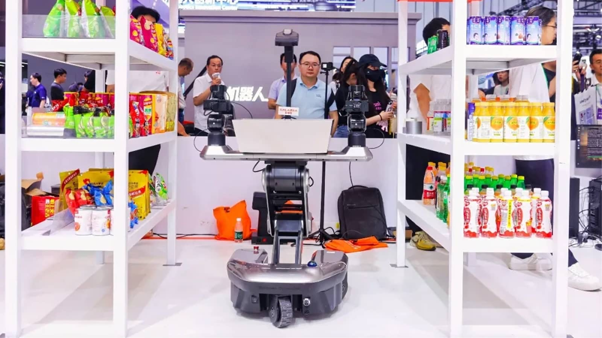
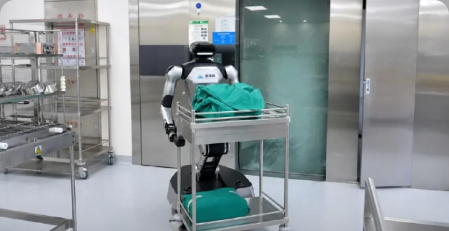
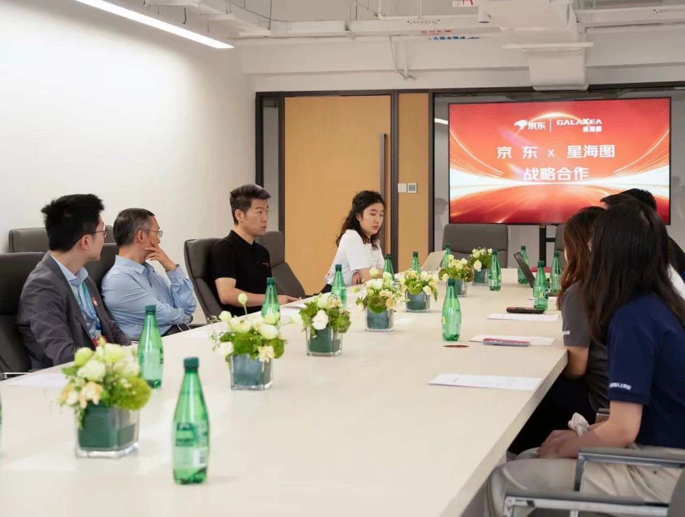
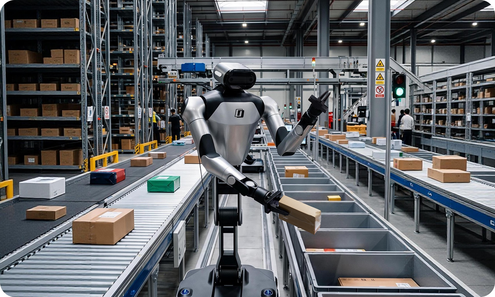
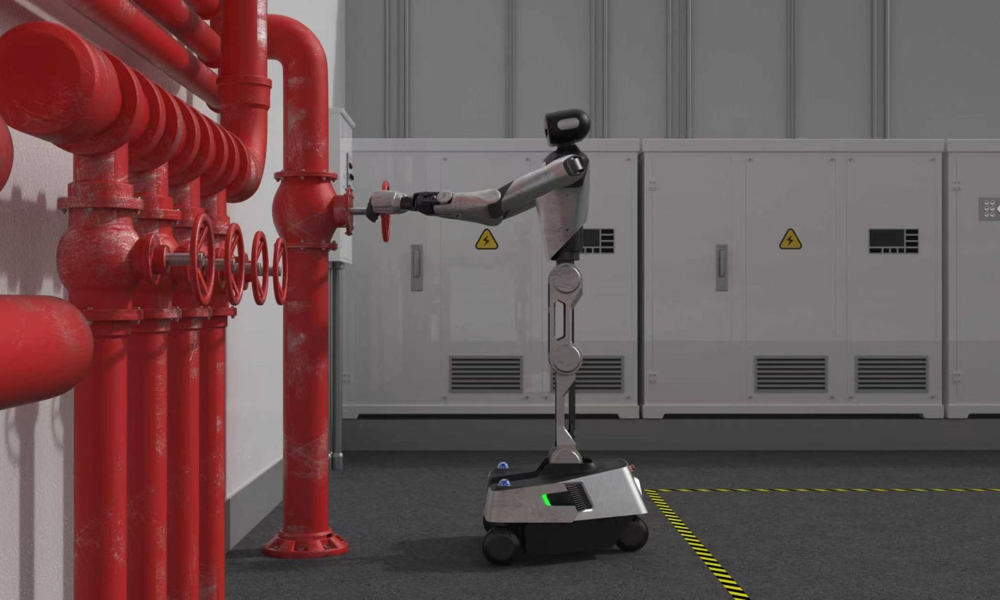
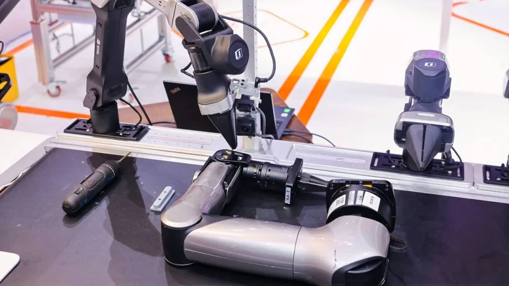
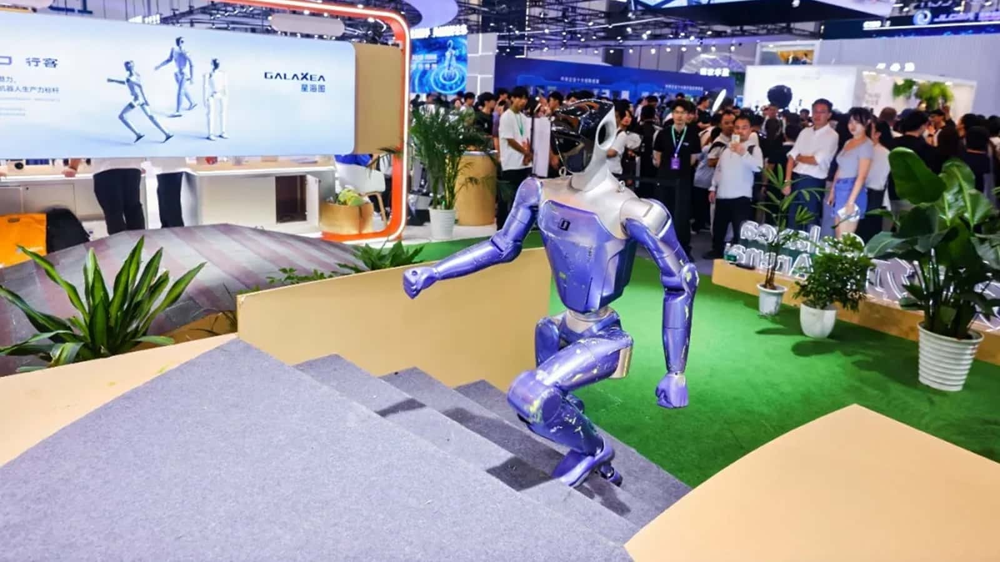
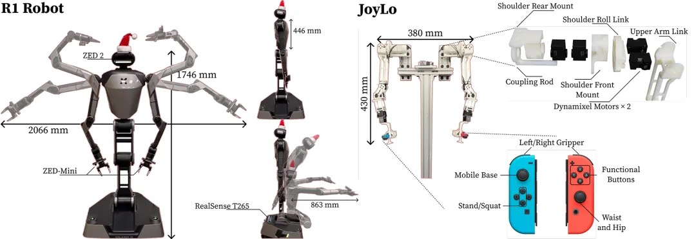
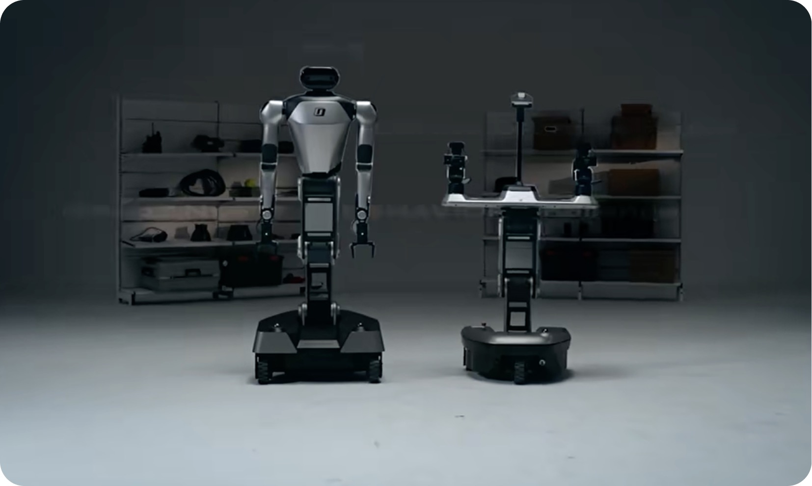
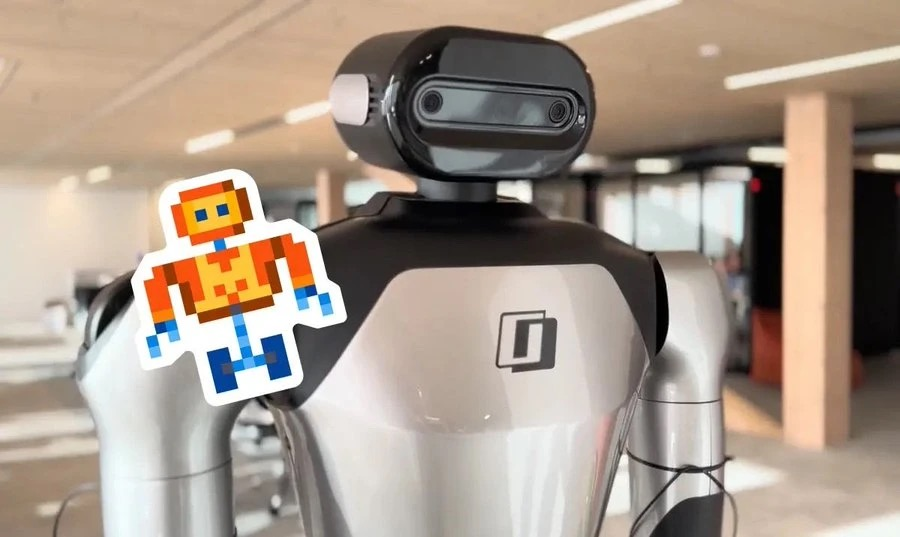

# Galaxea — Solutions and Projects Register

⬆ [Galaxea profile](Galaxea.md) · [Product portfolio](Galaxea-Products.md) · [Papers and research](Galaxea-Papers-and-Research.md) · [Roadmap and strategy](Galaxea-Roadmap-and-Strategy.md)

> **Coverage note:** Walked the full sitemap of the corporate site **galaxea-ai.com** (English and Chinese: home, Models, NEXO / KENGO / LEMO / R1 Series, EDP, both Solutions pages, About, all **10 news items** on news pages 1–2, dated 2025-06 to 2026-10) and the store **galaxea-dynamics.com** (all 11 blog articles, programme pages), plus the official GitHub organisation (incl. the community project list) and the trade press listed under Sources. Web search **was available** (2 extended queries, both used). Not accessible or thin: the company's WeChat / X / LinkedIn posts (only seen through search snippets), two news pages that have a headline but no body text (RSS Afterparty, "Robot Workforce"), partner logos on the Solutions pages (images without names), and any HKEX filing (reported as confidential). No Europe- or Switzerland-specific project was found. Company identity confirmed: Galaxea = 星海图 = GALAXEA (Beijing) Artificial Intelligence Technology Co., Ltd.; store entity GALAXEA HK LIMITED.

## Solutions catalogue — everything they offer

The corporate site markets exactly **two solution lines** (Research & Education, Industry Productivity) with **four industry verticals**; everything else below is a platform, model or programme that those lines are built from.

| # | Solution / application | What it does | Products used | Maturity | Tracks | Source link |
|---|---|---|---|---|---|---|
| 1 | **Industry Productivity Solutions** (umbrella) | "Embodied AI for real work": model-driven robots for four verticals — e-commerce & retail, express delivery & logistics, industrial manufacturing, commercial services | Nexo, R1 Pro, G0.5 | 🧪 2026 described by the company as a proof-of-concept year | T01 T03 T04 | [Industry Productivity](https://www.galaxea-ai.com/en/productivity.html) |
| 2 | **Robotic dark store / micro-fulfilment** (e-commerce & retail) | Takes a live order from a mini-program, navigates the store, picks from **10,000+ SKUs**, opens a plastic bag, packs, hands over; no per-product programming | Wheeled dual-arm robot (Nexo named as the productivity platform; model in the demo ⚠️ unverified) + G0.5 | 🧪 full-scale demo (WRC, Aug 2026); no named live store | T01 | [Use case page](https://www.galaxea-ai.com/en/productivitydetail.html) |
| 3 | **Express delivery & logistics** | Parcel / tote handling and warehouse material handling by wheeled dual-arm robots | Nexo (20 kg dual-arm payload) | 🧪 vertical listed; "thousand-unit" orders from unnamed logistics firms are press-reported ⚠️ unverified | T01 | [Industry Productivity](https://www.galaxea-ai.com/en/productivity.html) |
| 4 | **Industrial manufacturing** | Robot-assembling-robot (screw insertion + powered fastening), carton folding, component sorting, consumer-electronics assembly, material handling | Nexo, A1Z / LEMO arms, G0.5 + reinforcement learning | 🧪 demos (WRC 2026); automaker orders press-reported ⚠️ unverified | T03 (sorting skills transfer) | [WRC 2026 news](https://www.galaxea-ai.com/en/news/wrc-2026-beijing.html) |
| 5 | **Commercial services** | Service tasks in buildings and facilities; marketing image shows a robot operating a valve in a plant room; healthcare named as a target sector | R1 Pro, Nexo | 🧪 vertical listed; one hospital pilot (row 6) | T01 T02 T04 | [Industry Productivity](https://www.galaxea-ai.com/en/productivity.html) |
| 6 | **Hospital logistics and ward rounds** (Pioneer Partner solution) | Moves contaminated surgical instruments from operating rooms to processing, does routine ward patrol and information updates | **4 x R1 Pro**; integrator Kunshu Xingqi | 🧪 live pilot since about late Aug 2026 | T04 T01 T03 | [Kunshan hospital news](https://www.galaxea-ai.com/en/news/kunshan-first-people-hospital-r1-pro.html) |
| 7 | **Research & Education Solutions** | Open robot platform, fast prototype verification, scenario co-creation, open ecosystem cooperation for labs, universities and developers | R1 Pro, R1 Lite, LEMO, A1Z, EDP, G-series models | ✅ shipping; "nearly 100" clients | T01 T02 T03 T04 (enabler) | [Research & Education](https://www.galaxea-ai.com/en/developer.html) |
| 8 | **Household / daily-living research platform** | Whole-body mobile manipulation of home chores (trash, laundry, shelves, toilet, dishwasher) on the R1 family | R1, R1 Pro, R1 Lite | ✅ research use (Stanford BRS, BEHAVIOR-1K, π0.5) — not a consumer product | T04 T01 | [Stanford x Galaxea](https://galaxea-dynamics.com/blogs/robotics-applications/stanford-galaxea-brs-household-robotics) |
| 9 | **Teleoperation and data-collection kit** | Isomorphic leader-follower teleop (A1Z-T, under 50 ms), VR takeover, synchronised multi-camera recording, conversion to LeRobot format | LEMO, A1Z-T, R1 series | ✅ | T02 T04 (remote operation) | [LEMO page](https://www.galaxea-ai.com/en/product4.html) |
| 10 | **EDP — Embodied Development Platform** | One-stop data → training → deployment → evaluation; one-click post-training; OTA model deployment; **10+ built-in open models** (G0+, G0 Tiny, G0.5, G0.5 Tiny, π0, π0-FAST, π0.5, LingBot-VLA / VA, DreamZero) | Any Galaxea robot | ✅ launched Apr 2026; price by quote | — (tooling for any track) | [EDP](https://www.galaxea-ai.com/en/edp.html) |
| 11 | **G-series foundation models** | G0.5 (zero-shot VLA with action chain-of-thought), G0 Plus (plug-and-play VLA), G0 Tiny (edge), garment-folding G0 variant | R1 Lite, R1 Pro (also SO-101, Franka) | ✅ open weights, non-commercial licence | T01 T04 | [Models](https://www.galaxea-ai.com/en/model.html) |
| 12 | **Fast-WAM world action model** | World-model policy that skips video generation at inference: **190 ms** per step vs about 800 ms; shown on towel folding | Research code | ✅ code and paper | T04 (deformables) | [Fast-WAM blog](https://galaxea-dynamics.com/blogs/developer-hub/fast-wam-world-action-model) |
| 13 | **G-Fleet** | Distributed reinforcement learning across a robot fleet: fleet deployment, parallel real-world rollouts, human intervention, automated evaluation, model release | Fleet of Galaxea robots | 🧪 announced Aug 2026 | — | [Forum news](https://www.galaxea-ai.com/en/news/galaxea-lanches-wrc.html) |
| 14 | **Kengo biped for infrastructure work** | Bipedal humanoid positioned for energy and power infrastructure, wide-area exploration and equipment inspection | Kengo (1.40 m, about 40 kg, 23+ DoF, 2 kg arm payload, 2 h battery) | 🧪 launched Jun 2026; no deployments found | T02 T01 | [Forum news](https://www.galaxea-ai.com/en/news/galaxea-lanches-wrc.html) |
| 15 | **LEMO developer / maker platform** | Desktop dual-arm kit for imitation and reinforcement learning; page labels "Home Applications" and "Developer Exploration" | LEMO (2 x A1Z, G1Z grippers, 3 cameras, CCU) | ✅ orders since 14 Oct 2026 (RMB 49,999); global store 9 Nov 2026 (from USD 7,699) | T03 T04 (tabletop prototypes) | [LEMO launch](https://www.galaxea-ai.com/en/news/galaxea-launches-lemo.html) |
| 16 | **Open data** — Galaxea Open-World Dataset and the "one million hours" real-data initiative | 500+ h open dataset (homes, restaurants, retail, offices); data joint venture Yishu Intelligence to scale to 1 M hours | R1 Lite | ✅ dataset · 🧪 initiative | — | [Xingtu Program news](https://www.galaxea-ai.com/en/news/g0-embodied-foundation-model-release.html) |
| 17 | **Partner programmes** — Pioneer Partner, Excellence Partner, Xingtu (startup investment) | Integrators and domain experts get product, technology, brand and market support; Xingtu gives seed funding and toolchain access | — | ✅ running | — (route to a pilot) | [WRC 2026 news](https://www.galaxea-ai.com/en/news/wrc-2026-beijing.html) |
| 18 | **Education Discount / Developer Discount** | Discount codes for verified students, educators and developers; valid on LEMO and A1Z only | LEMO, A1Z | ✅ | — | [Education Discount](https://galaxea-dynamics.com/pages/education-discount) |

### Robotic dark store / micro-fulfilment

- **How it works:** customer orders in a mini-program → robot reads the order → plans a route → identifies and picks items → opens and holds a plastic bag → packs → places the finished order. Runs on G0.5; error detection and recovery are part of the loop.
- **Numbers (self-reported):** **10,000+ SKUs**, **99%+** order success, **100% autonomous** end to end, about **100 orders per 8 h per robot** ("about one full-time worker"). At WRC 2026: **900** orders, **1,775** picks, **1,560** packing cycles.
- **Who uses it:** shown as a 1:1 store replica; JD.com is the named retail partner. Planned extension to convenience stores, pharmacies, fresh-food supermarkets and unmanned retail.
- Official link: [Use case page](https://www.galaxea-ai.com/en/productivitydetail.html)

### Hospital logistics and ward rounds (Kunshan First People's Hospital)

- **How it works:** R1 Pro pushes instrument trolleys between operating rooms, instrument rooms and wards; a local partner (Kunshu Xingqi, 昆数星启) supplies the clinical workflow knowledge, Galaxea the robots and models.
- **Numbers:** **4 robots**; instrument transfer finished **within 1 h**; ward-patrol runs of **6+ h**; **100+ tasks** in the first month.
- **Next steps announced:** contaminated drapes and medical-waste transport across **20 operating rooms / about 130 surgeries per day**; later instrument counting (about 2,500 m², about 4,000 counts), operating-room cleaning, pre-operative kit preparation (100+ item variants).
- The closest thing Galaxea has to a care deployment — a hospital back-of-house pilot, not patient care.
- Official link: [Kunshan hospital news](https://www.galaxea-ai.com/en/news/kunshan-first-people-hospital-r1-pro.html)

### JD.com omnichannel partnership

- **Three-year** strategic agreement signed **22 Aug 2026** at WRC: omnichannel deployment, robot sales, joint technology work, supply-chain services, industrial market expansion.
- Joint "benchmark applications" planned in **health and logistics**; authorised joint after-sales network; service ecosystem built on the first **RoboBase** sites in Hangzhou and Chengdu (what a RoboBase is, and whose, is not explained ⚠️ unverified).
- Official link: [JD partnership news](https://www.galaxea-ai.com/en/news/galaxea-jd-three-year-partnership.html)

### Express delivery & logistics

- Picture is a **marketing render**, not a deployment photo.
- Target tasks: parcel and tote handling on sorting lines, warehouse material handling. Platform: Nexo (**30 DoF**, **20 kg** dual-arm payload, **2.5 m/s**, **8 h**, dual LiDAR).
- No named logistics customer or site is public; press reports of "thousand-unit" orders from logistics firms are ⚠️ unverified.
- Official link: [Industry Productivity](https://www.galaxea-ai.com/en/productivity.html)

### Commercial services (facility operation)

- Picture is a **marketing render** (robot turning a valve in a plant room), not a deployment photo.
- The only confirmed commercial-services pilot is the Kunshan hospital. Healthcare is named next to manufacturing, logistics and commercial services as a target sector.
- Official link: [Industry Productivity](https://www.galaxea-ai.com/en/productivity.html)

### Industrial manufacturing (assembly, sorting, carton folding)

- **Robot-assembling-robot:** centimetre-scale screw insertion, then tool change to a powered driver; vision localisation + dual-arm + force control; claimed **30%+ faster** than conventional demonstration-based teaching.
- **Carton folding:** **4,000 folds per day** under repeated disturbance. **Component sorting** and **arbitrary-object pick-and-place** with randomised poses.
- Track relevance is indirect: the sorting and pick-and-place skills are what a waste- or recyclables-sorting demo would reuse.
- Official link: [WRC 2026 news](https://www.galaxea-ai.com/en/news/wrc-2026-beijing.html)

### Kengo biped for infrastructure work

- Positioned by the company for **energy and power infrastructure, wide-area exploration and equipment inspection**; shown doing stair / parkour training at WRC 2026.
- Specs (official page): 1396 x 440 x 225 mm, about **40 kg**, **23+ DoF**, **2 kg** arm payload, 130+ N·m peak knee torque, **2 h** battery, handheld controller, OTA.
- No inspection deployment, sensor payload or public SDK documentation found — treat as positioning, not a field-proven solution.
- Official link: [KENGO](https://www.galaxea-ai.com/en/product3.html)

### Household / daily-living research platform

- **Stanford BEHAVIOR Robot Suite (BRS)** runs on the Galaxea R1: JoyLo whole-body teleop (under USD 500 of parts) + WB-VIMA policy; five chores — take out trash, organise shelves, lay out laundry, clean a toilet, load a dishwasher.
- **BEHAVIOR-1K / BEHAVIOR Challenge (NeurIPS 2025):** 50 full-length household tasks, **10,000 teleoperated demonstrations**, collected on the R1 Pro. **π0.5** was validated on the R1 Lite.
- Research evidence only; no home or care-home product.
- Official link: [Stanford x Galaxea](https://galaxea-dynamics.com/blogs/robotics-applications/stanford-galaxea-brs-household-robotics)

### Research & Education Solutions

- Four offers: open robot platform, fast prototype verification, scenario co-creation, open ecosystem cooperation. Showcase partners named on the page: **Stanford, NVIDIA, SERVO7**.
- Clients: "nearly 100", naming Stanford, Physical Intelligence, Huawei (press release) and NVIDIA (site, press). Press reports **150+** developer partners ⚠️ unverified.
- Hardware facts useful on site: R1 Lite 1.56 m / 96 kg / **3 cm** navigation accuracy; R1 Pro 1.70 m / 126 kg / 86 cm arm radius / 0–200 cm working range; both **5 kg** peak payload per arm.
- Official link: [Research & Education](https://www.galaxea-ai.com/en/developer.html)

### Language-guided navigation on R1 Pro (Mistral AI case)

- The developer page reports that **Mistral AI's vision-language-navigation model** was deployed on the R1 Pro and validated in real environments (the model name is garbled on the page ⚠️ unverified; no date or details given).
- Related third-party navigation work on the R1: **NavDP** (sim-trained navigation diffusion policy) and **VR-Robo** (RGB-only real-to-sim-to-real navigation, RA-L 2025).
- Official link: [Research & Education](https://www.galaxea-ai.com/en/developer.html)

## Projects register — past and current

| Date | Project / deployment / pilot / partnership | Partner or customer | Location | What happened (one line) | Tracks | Source link |
|---|---|---|---|---|---|---|
| 2026-11-09 | LEMO global store launch | — | Worldwide (store) | Desktop dual-arm platform on sale from **USD 7,699** | T03 T04 | [Store blog](https://galaxea-dynamics.com/blogs/robotics-insights-news/two-arms-one-platform-galaxea-launches-lemo) |
| 2026-10-14 | LEMO order opening | — | China | Orders open at **RMB 49,999**; SDK, URDF, LeRobot support | — | [LEMO launch](https://www.galaxea-ai.com/en/news/galaxea-launches-lemo.html) |
| 2026-09-23 | **Hospital pilot** (Pioneer Partner Program) | Kunshan First People's Hospital; Kunshu Xingqi (昆数星启) | Kunshan, Jiangsu, China | **4 R1 Pro** move contaminated instruments and patrol wards; about one month in operation at publication | T04 T01 T03 | [Kunshan news](https://www.galaxea-ai.com/en/news/kunshan-first-people-hospital-r1-pro.html) |
| 2026-09-04 / 09-10 | Hong Kong IPO filing (reported) | HKEX | Hong Kong | Confidential listing application reported by Chinese media; not confirmed by the company ⚠️ unverified | — | [Tencent News](https://news.qq.com/rain/a/20260910A089PH00) |
| 2026-08-26 (signed 08-22) | **Three-year strategic partnership** | JD.com (JD Group, JD Intelligent Robotics) | Beijing (signed at WRC) | Omnichannel deployment, robot sales, co-innovation, supply chain, industrial markets; dark store shown as joint showcase | T01 T04 | [JD news](https://www.galaxea-ai.com/en/news/galaxea-jd-three-year-partnership.html) |
| 2026-08-22 to 08-24 | **WRC 2026 "Productivity Awakens" showcase** | — | Beijing | 10+ demos: dark store (900 orders), robot-assembling-robot, carton folding (4,000 per day), part sorting, pick-and-place, biped parkour; **Nexo** unveiled; "1+3+N" strategy | T01 T03 | [WRC news](https://www.galaxea-ai.com/en/news/wrc-2026-beijing.html) |
| 2026-08-21 | "From Models to Productivity" forum | Panel: General Robotics, Mr.Robot / Jemco Group, Damon Technology, JD Retail | Beijing | Announced **G0.5 Reproduction Initiative**, **G-Fleet**, G0.5 MAX "coming soon"; COO: thousands of model-driven robots delivered | — | [Forum news](https://www.galaxea-ai.com/en/news/galaxea-lanches-wrc.html) |
| 2026-08 | Client base statement | Stanford, Physical Intelligence, Huawei (named) | — | "Nearly 100" clients for the R1 series | — | [PR Newswire](https://en.prnasia.com/story/545003-0.shtml) |
| 2026-08 | Funding milestone | — | — | Company page: Series B and C completed, total financing nearly **RMB 5 bn** | — | [About Us](https://www.galaxea-ai.com/en/company.html) |
| 2026-08-12 | G0.5 paper | — | — | Paper published after weights (16 Jun) and R1 Pro zero-shot entry point (11 Jul) | T01 T04 | [GalaxeaVLA](https://github.com/OpenGalaxea/GalaxeaVLA) |
| 2026-08-05 | RoboDojo leaderboard | RoboDojo | — | G0.5 ranked **No. 1** on the simulation leaderboard (overall 20.23); 42 sim + 18 real tasks in the benchmark | — | [RoboDojo news](https://www.galaxea-ai.com/en/news/joint-stock-restructuring-completed.html) |
| 2026-07-08 | Galaxea x RSS Afterparty | RSS community | not stated | Networking event for embodied-AI researchers (headline only, no details) | — | [Afterparty news](https://www.galaxea-ai.com/en/news/g0-plus-out-of-the-box-vla.html) |
| 2026 (date ⚠️ unverified) | AdventureX 2026 hackathon | AdventureX | not stated | "LEMO A1Z powers AdventureX 2026" — hardware supplied to a hackathon; no details | — | [Research & Education](https://www.galaxea-ai.com/en/developer.html) |
| 2026 (date ⚠️ unverified) | VLN model on R1 Pro | Mistral AI | not stated | Vision-language-navigation model deployed and validated on R1 Pro in real environments | T01 | [Research & Education](https://www.galaxea-ai.com/en/developer.html) |
| 2026 (date ⚠️ unverified) | Ego-Pi | Stanford University, Meta | not stated | VLA fine-tuning on first-person human + robot data, run on R1 Pro | T04 | [Research & Education](https://www.galaxea-ai.com/en/developer.html) |
| 2026-06 | Galaxea 2026 Global Developer Conference | — | not stated | **G0.5** and the **Kengo** biped launched | T02 | [About Us](https://www.galaxea-ai.com/en/company.html) |
| 2026-06 (page shows 2025-06-23 ⚠️) | **Xingtu Program** (startup investment) | Cathay Capital; Tsinghua IIIS network; local governments | China | **RMB 1 bn over five years** for **100** early-stage embodied-AI startups; nearly 10 invested so far | — | [Xingtu news](https://www.galaxea-ai.com/en/news/g0-embodied-foundation-model-release.html) |
| 2026-06 (reported) | **Yishu Intelligence** data joint venture | Beijing E-Town (Yizhuang) state capital, reported 60% | Beijing | Company for the "one million hours of real-world data" initiative; RMB 100 M registered capital ⚠️ unverified | — | [Tencent News](https://news.qq.com/rain/a/20260904A0CQM500) |
| 2026-06 (page shows 2025-06-25 ⚠️) | BAAI Conference talk | BAAI | Beijing | Chief scientist Zhao Xing on VLA vs world-action models; FASTer and ActionCodec tokenizers behind G0.5 | — | [BAAI talk news](https://www.galaxea-ai.com/en/news/r1-lite-developer-program.html) |
| 2026-04-02 | Series B+ and manufacturing partner | **Lens Technology** (investor, hardware and mass-production partner) and nearly 20 investors | China | About **RMB 2 bn / USD 291 M**; valuation above RMB 20 bn | — | [Caixin Global](https://www.caixinglobal.com/2026-04-02/robot-startup-galaxea-ai-raises-291-million-102430297.html) |
| 2026-04 | A1Z arm and EDP launched | — | — | Third-generation arm and the development platform released | — | [About Us](https://www.galaxea-ai.com/en/company.html) |
| 2026-03-25 | Fast-WAM | — | — | World action model, 190 ms per step; towel-folding demo; code released | T04 | [Fast-WAM blog](https://galaxea-dynamics.com/blogs/developer-hub/fast-wam-world-action-model) |
| 2026-03 | R1 Series upgrade | — | — | Whole R1 line upgraded | — | [About Us](https://www.galaxea-ai.com/en/company.html) |
| 2026-02 | Garment-folding G0 model and G0 Tiny | — | — | Vertical folding model plus an edge-size model open-sourced (reported) | T04 | [QbitAI](https://www.qbitai.com/2026/04/394626.html) |
| 2026-02-11 | Series B | Jinding Capital, BAIC Industrial Investment, Hone Capital and others | China | **RMB 1 bn**; described as focused on industrial / productivity applications | — | [Caixin Global](https://www.caixinglobal.com/2026-02-12/galaxea-ai-raises-144-million-as-chinas-robot-investment-frenzy-mounts-102413767.html) |
| 2026-01-23 | Joint-stock restructuring | — | Beijing | Converted to a joint-stock company (pre-IPO step) | — | [C114](https://www.c114.net.cn/industry/54751.html) |
| 2026-01 | **LingBot-VLA** hardware platform | Ant Group's Robbyant | China | R1 Pro is the core hardware behind Ant's open-source LingBot-VLA | — | [Caixin Global](https://www.caixinglobal.com/2026-02-12/galaxea-ai-raises-144-million-as-chinas-robot-investment-frenzy-mounts-102413767.html) |
| 2026-01 | G0 Plus release; RoCo Challenge (AAAI 2026) | NTU (RoCo) | — | Plug-and-play VLA released; R1 Pro is a supported platform in the human-in-the-loop gearbox-assembly benchmark | — | [Community list](https://github.com/OpenGalaxea/awesome-galaxea-developers) |
| 2025-12 | **BEHAVIOR Challenge** (NeurIPS 2025) | Stanford | — | 50 household tasks, 10,000 teleop demos collected on R1 Pro | T04 | [Community list](https://github.com/OpenGalaxea/awesome-galaxea-developers) |
| 2025-08 | G0 model and Open-World Dataset open-sourced | — | — | Dual-system VLA plus 500+ h dataset; 500,000–600,000 downloads reported ⚠️ unverified | — | [About Us](https://www.galaxea-ai.com/en/company.html) |
| 2025-05 | WBCD competition, ICRA 2025 | Carnegie Mellon University | — | First prize with NeSyPack using Galaxea **A1X** arms | — | [Community list](https://github.com/OpenGalaxea/awesome-galaxea-developers) |
| 2025-04 | R1 Lite and R1 Pro introduced | — | — | 2025 generation of the wheeled dual-arm line | — | [About Us](https://www.galaxea-ai.com/en/company.html) |
| 2025-03-12 | **Stanford BEHAVIOR Robot Suite** | Stanford (Fei-Fei Li's group) | Stanford, USA | Household whole-body manipulation suite built on the R1 (CoRL 2025) | T04 T01 | [Stanford x Galaxea](https://galaxea-dynamics.com/blogs/robotics-applications/stanford-galaxea-brs-household-robotics) |
| 2025-03 | A1XY six-axis arm | — | — | Arm in two configurations launched | — | [About Us](https://www.galaxea-ai.com/en/company.html) |
| 2024-10 | R1 launch and first deliveries | Fei-Fei Li's team, Physical Intelligence | USA | First R1 batch delivered to research labs | — | [About Us](https://www.galaxea-ai.com/en/company.html) |
| 2023-09 | Company founded | — | Beijing | First funding round closed | — | [About Us](https://www.galaxea-ai.com/en/company.html) |

**Unverified press claims worth asking the booth about:** "thousand-unit" orders from unnamed leading automakers and smart-logistics firms ([C114](https://www.c114.net.cn/industry/54751.html), [QbitAI](https://www.qbitai.com/2026/04/394626.html)); customers said to include entertainment / performance buyers and "data training ground" operators; one investor-forum summary lists wellness / elder-care institutions among customer types — no named site, ⚠️ unverified.

### Community research built on Galaxea hardware (official list)

All entries come from the company's own [awesome-galaxea-developers](https://github.com/OpenGalaxea/awesome-galaxea-developers) list; venues as stated there.

| Project | Galaxea hardware | Who / venue | What it shows | Tracks |
|---|---|---|---|---|
| BEHAVIOR Robot Suite | R1 | Stanford, CoRL 2025 | Whole-body household chores | T04 |
| π0.5 | R1 Lite | Physical Intelligence | Household tasks using base and torso | T04 |
| EgoScale | R1 Pro | NVIDIA GEAR Lab | VLA pretrained on 20,000+ h of egocentric human video | — |
| RoboBrain-X0 | R1 Lite | BAAI | Cross-embodiment foundation model, zero-shot tasks | — |
| NavDP | R1 | — | Sim-trained navigation in unseen real environments | T01 |
| VR-Robo | R1 | RA-L 2025 | RGB-only real-to-sim-to-real navigation | T01 |
| SafeBimanual | R1 | CoRL 2025 | Safety constraints for bimanual diffusion policies | T02 T04 |
| General Motion Retargeting (TWIST teleop) | R1 Pro | — | Real-time whole-body retargeting for teleoperation | T02 |
| XRoboToolkit | R1 Lite | — | OpenXR teleoperation and data collection | T02 |
| HERMES | A1 arms + X1 base | — | Human-to-robot mobile bimanual dexterous manipulation | — |
| DemoGen | R1 | RSS 2025 | One demonstration → generalised placement | — |
| DemoSpeedup | R1 | — | Up to 3x faster policy execution | — |
| MoMaGen | R1 | — | Data generation for bimanual mobile manipulation | — |
| DenseMatcher | A1 | ICLR 2025 spotlight | One-shot learning from a human demo (banana peeling) | — |
| Active Vision-Driven Robotics (AVR) | A1 + desktop teleop | — | Active-vision tracking, under 1 cm repeatability | — |
| CogVLA | R1 Lite | NeurIPS 2025 | Efficient instruction-routed VLA | — |
| DAWN | R1 Lite | arXiv 2509.22652 | Language → pixel-motion → action | — |
| FASTer | R1 Lite | arXiv 2512.04952 | Faster autoregressive VLA tokenizer | — |
| DepthVLA | R1 Lite | arXiv 2510.13375 | Depth expert for spatial reasoning | — |
| VLASH | R1 Lite | MIT, NVIDIA, Tsinghua, UC Berkeley | Asynchronous VLA inference, π0.5 at 15 Hz on a laptop GPU | — |
| VLA-Reasoner | A1 | NTU | MCTS look-ahead for long-horizon VLA | — |
| NORA-1.5 | A1 | NTU, Lambda Labs, SUTD | VLA with world-model rewards | — |
| ViTaS | R1 | Shanghai Qi Zhi, HIT, Tsinghua, HKU, CMU | Visuo-tactile learning under occlusion | — |
| GSWorld | R1 | UC San Diego, UCLA | Photo-realistic simulator, zero-shot sim-to-real | — |
| RoboCOIN | R1 Lite (one of 15 platforms) | — | 180,000+ bimanual trajectories, 421 tasks | — |
| iFlyBot-VLA, UNICOD | Open-World Dataset | arXiv 2511.01914, 2510.10642 | Dataset used in pre-training | — |
| ENACT | BEHAVIOR simulation | — | Embodied-cognition benchmark for VLMs | — |
| WBCD 2025 champion (NeSyPack) | A1X | CMU, ICRA 2025 | First prize, bimanual competition | — |
| BEHAVIOR Challenge | R1 Pro | Stanford, NeurIPS 2025 | 50 household tasks, 10,000 demos | T04 |
| RoCo Challenge | R1 Pro | NTU, AAAI 2026 | Human-in-the-loop gearbox assembly | — |

## Future projects and announced plans

| Announced | Planned for | What | Confidence (official / reported / inferred) | Tracks | Source link |
|---|---|---|---|---|---|
| 2026-09-23 | about Oct 2026 (status ⚠️ unverified) | Kunshan hospital: extend to contaminated drapes and **medical-waste transport** across 20 operating rooms, about 130 surgeries per day | official | T04 T03 | [Kunshan news](https://www.galaxea-ai.com/en/news/kunshan-first-people-hospital-r1-pro.html) |
| 2026-09-23 | no date | Kunshan hospital: post-operative instrument counting, operating-room cleaning and tidying, pre-operative kit preparation | official | T04 T01 | [Kunshan news](https://www.galaxea-ai.com/en/news/kunshan-first-people-hospital-r1-pro.html) |
| 2026-09-23 | ongoing | Recruit more Pioneer Partners (integrators, domain experts); healthcare listed as a target sector | official | T04 | [Kunshan news](https://www.galaxea-ai.com/en/news/kunshan-first-people-hospital-r1-pro.html) |
| 2026-08-26 | 2026–2029 | JD: joint benchmark applications in **health and logistics**; authorised after-sales network; RoboBase service sites (Hangzhou, Chengdu first) | official | T01 T04 | [JD news](https://www.galaxea-ai.com/en/news/galaxea-jd-three-year-partnership.html) |
| 2026-08-26 | no date | Dark-store technology extended to convenience stores, pharmacies, fresh-food supermarkets, unmanned retail | official | T01 | [JD news](https://www.galaxea-ai.com/en/news/galaxea-jd-three-year-partnership.html) |
| 2026-08-21 | 2027 | Deliver **more than 10,000 robots** in 2027 (from "thousands" in 2026) | official (forum report) | — | [Forum news](https://www.galaxea-ai.com/en/news/galaxea-lanches-wrc.html) |
| 2026-08-21 | "coming soon" | **G0.5 MAX** model | official | — | [Forum news](https://www.galaxea-ai.com/en/news/galaxea-lanches-wrc.html) |
| 2026-08-21 | no date | Large-scale pretrained model on the Fast-WAM architecture; press says Fast-WAM is being merged with G0.5 | official / reported | — | [Forum news](https://www.galaxea-ai.com/en/news/galaxea-lanches-wrc.html) |
| 2026-08-21 | no date | G-Fleet fleet-learning rollout; G0.5 Reproduction Initiative (sim, real-robot, co-creation tracks) | official | — | [Forum news](https://www.galaxea-ai.com/en/news/galaxea-lanches-wrc.html) |
| 2026-08-23 | no date | **Nexo** commercial deployments in manufacturing, logistics, retail, commercial services; price and ship date not public | official | T01 | [WRC news](https://www.galaxea-ai.com/en/news/wrc-2026-beijing.html) |
| 2026-08-21 | no date | **Kengo** applied to energy / power infrastructure inspection and wide-area exploration | official (positioning only) | T02 | [Forum news](https://www.galaxea-ai.com/en/news/galaxea-lanches-wrc.html) |
| 2026-08-21 | 2028 | JD's own target of **one million robots** deployed by 2028 (JD statement, not a Galaxea order) | official (partner statement) | T01 | [Forum news](https://www.galaxea-ai.com/en/news/galaxea-lanches-wrc.html) |
| 2026-06 | five years | Xingtu Program: RMB 1 bn into 100 early-stage startups; press adds a goal of 100+ industry partners by 2027 ⚠️ unverified | official / reported | — | [Xingtu news](https://www.galaxea-ai.com/en/news/g0-embodied-foundation-model-release.html) |
| 2026-06 | no date | "One million hours" of real-world robot data via Yishu Intelligence | official (initiative) / reported (JV details) | — | [Xingtu news](https://www.galaxea-ai.com/en/news/g0-embodied-foundation-model-release.html) |
| 2026-04 | 2026 | Company goals for 2026: stronger foundation model and delivery in **one** major productivity scenario; success test is 24 h continuous operation with clear customer ROI | reported | — | [QbitAI](https://www.qbitai.com/2026/04/394626.html) |
| 2026-09 | no date | Hong Kong IPO | reported | — | [Tencent News](https://news.qq.com/rain/a/20260910A089PH00) |
| 2026-04 | no date | G0.5 Tiny edge model (listed among EDP models; separate release not confirmed ⚠️ unverified) | inferred | T03 | [EDP](https://www.galaxea-ai.com/en/edp.html) |

## Solutions by track — quick index

### T01 Autonomous Urban Services
- **Robotic dark store / micro-fulfilment** — T01.1 (order picking and hand-over for urban quick-commerce); the strongest reference demo.
- **JD.com partnership** — T01.1 (retail and logistics deployment channel; planned pharmacy and convenience-store formats).
- **Hospital logistics, Kunshan** — T01.1 (indoor delivery), T01.2 (facility support; operating-room cleaning planned), T01.3 (service robot in a public building).
- **Express delivery & logistics vertical** — T01.1 (parcel handling; no named site).
- **Commercial services vertical** — T01.2, T01.3 (positioning plus the hospital pilot).
- **Mistral AI vision-language navigation on R1 Pro; NavDP; VR-Robo** — T01.6, T01.5 (language-guided and learned navigation, third-party research).
- **Stanford BRS household tasks** — T01.2 (toilet cleaning, trash removal, tidying as cleaning primitives).
- **G0.5 / EDP / teleop kit** — T01.7 (natural-language task instructions, fast fine-tuning from demos).
- **Kengo** — T01.4 (inspection positioning only).

### T02 Resilient & Safe City
- **Kengo biped** — T02.2, T02.3, T02.6 (company positioning for power-infrastructure inspection and wide-area exploration; stairs shown; no field deployment, 2 h battery).
- **Commercial services (valve operation render)** — T02.3 (manipulating plant equipment; marketing image only).
- **Teleoperation kit; General Motion Retargeting; XRoboToolkit** — T02.7, T02.1 (operator-in-the-loop manipulation from a safe distance).
- **SafeBimanual** — T02.7 (safety constraints on learned dual-arm policies, research).
- **Hospital ward patrol** — T02.5 (routine rounds and information updates; a loose fit).
- Nothing specific found for T02.4 (disaster response and environment sensing).

### T03 Sustainable City
- **Hospital pilot: contaminated drapes and medical-waste transport** — T03.1 (collection and transfer; announced as the next step).
- **Component sorting and arbitrary-object pick-and-place demos (WRC 2026)** — T03.1, T03.6 (the skills a recyclables-sorting cell needs; no waste deployment).
- **LEMO desktop dual-arm kit** — T03.1 (cheapest way to prototype a tabletop sorting policy).
- **Stanford BRS "take out the trash"** — T03.1 (household waste handling, research).
- **G0 Tiny / G0.5 Tiny edge models, Fast-WAM (4x faster inference)** — T03.3 (lower compute per action; a loose fit).
- Nothing specific found for T03.2, T03.4, T03.5, T03.7 (no environmental sensing, water or energy solutions).

### T04 Elderly Care & Rehabilitation
- **Hospital logistics and ward rounds, Kunshan** — T04.6 (automation in care settings), T04.2 (care-support robot); the only healthcare deployment.
- **Stanford BRS, BEHAVIOR-1K / BEHAVIOR Challenge, π0.5 on R1 Lite** — T04.1 (daily-living chores: laundry, dishes, tidying, toilet cleaning).
- **Garment-folding G0 model; Fast-WAM towel folding** — T04.1 (laundry and deformable objects).
- **JD partnership "health" benchmark applications** — T04.6 (planned, no detail).
- **Teleoperation kit (A1Z-T, VR)** — T04.2 (remote caregiver operation; fast demo collection for hand-over and fetch tasks).
- **G0.5 natural-language instructions; Ego-Pi** — T04.5 (voice or text task requests; interaction is task-level, no companionship features).
- **LEMO "Home Applications"** — T04.1 (page label only).
- Nothing specific found for T04.3 (rehabilitation training), T04.4 (mobility assistance) or T04.7 (health monitoring).

## What they do NOT offer

- **No elderly-care or rehabilitation product.** No patient-contact, lifting, walking-support or rehab robot; no medical-device certification mentioned anywhere. The hospital pilot is back-of-house logistics.
- **No health-monitoring or companionship software** (no vital-sign sensing, fall detection, conversational companion).
- **No outdoor or rough-terrain platform you can hack on.** R1 / Nexo are wheeled indoor robots; Kengo is a 2 h, 2 kg-payload biped without public developer docs.
- **No emergency, rescue, hazard or security solution**; no IP or ATEX ratings published; no gas, thermal or radiation payloads.
- **No environmental, water, energy or waste-sorting solution.** Sorting exists only as generic manipulation demos.
- **No urban outdoor delivery, cleaning machine or guidance / information robot product.** Everything shown is indoor manipulation.
- **No European or Swiss deployment, integrator or service base found**; the service network announced with JD is in China.
- **Models are non-commercial.** G0.5 weights are fine for the hackathon but need a separate agreement for any product.
- **Most "industry" claims are demos or one pilot.** The company itself calls 2026 a proof-of-concept year; customer names beyond research labs, JD and one hospital are not public.

## Image credits

| File | Shows | Source URL |
|---|---|---|
| assets/galaxea-sol-darkstore.jpg | Wheeled dual-arm robot between shelves in the dark-store demo, WRC 2026 | https://cdn.shopify.com/s/files/1/0750/7437/1840/files/A_Fully_Automated_Robotic_Micro-Fulfillment_Center_1.jpg |
| assets/galaxea-sol-hospital.jpg | R1 Pro pushing an instrument trolley at Kunshan First People's Hospital | https://www.galaxea-ai.com/uploads/2026/10/figma-home-news/kunshan-hospital.png |
| assets/galaxea-sol-jd.jpg | JD x Galaxea strategic-cooperation meeting | https://www.galaxea-ai.com/uploads/2026/10/389b1b01-a45d-473a-b0cf-cbccbe458b08.jpg |
| assets/galaxea-sol-logistics.jpg | Marketing render: robot sorting parcels on a conveyor line | https://www.galaxea-ai.com/en/images/pc/productivity/scenarios2.png |
| assets/galaxea-sol-facility.jpg | Marketing render: robot operating a valve in a plant room | https://www.galaxea-ai.com/en/images/pc/productivity/scenarios4.png |
| assets/galaxea-sol-assembly.jpg | Robot-assembling-robot demo: arms, screwdriver and a robot joint housing | https://cdn.shopify.com/s/files/1/0750/7437/1840/files/Millimeter-Level_Precision_1.jpg |
| assets/galaxea-sol-kengo.jpg | Kengo biped on a stair / parkour course at WRC 2026 | https://cdn.shopify.com/s/files/1/0750/7437/1840/files/A_Diverse_Portfolio_of_Technology_Demos_1.jpg |
| assets/galaxea-sol-household.jpg | BRS hardware overview: Galaxea R1 and the JoyLo teleop rig | https://cdn.shopify.com/s/files/1/0750/7437/1840/files/Overview_of_the_BRS_hardware_system.webp |
| assets/galaxea-sol-research.jpg | R1 Pro and R1 Lite side by side (Research & Education page) | https://www.galaxea-ai.com/en/images/wap/developer/1-stanford.png |
| assets/galaxea-sol-vln.jpg | R1 Pro in an office, Mistral AI application case | https://www.galaxea-ai.com/en/images/pc/developer/updates2.png |

## Sources

- [Galaxea corporate site — home](https://www.galaxea-ai.com/en/index.html)
- [Galaxea — sitemap](https://www.galaxea-ai.com/sitemap.xml)
- [Galaxea — Industry Productivity Solutions](https://www.galaxea-ai.com/en/productivity.html)
- [Galaxea — Robotic dark store use case](https://www.galaxea-ai.com/en/productivitydetail.html)
- [Galaxea — Research & Education Solutions](https://www.galaxea-ai.com/en/developer.html)
- [Galaxea — EDP](https://www.galaxea-ai.com/en/edp.html)
- [Galaxea — Models](https://www.galaxea-ai.com/en/model.html)
- [Galaxea — NEXO](https://www.galaxea-ai.com/en/product1.html)
- [Galaxea — R1 Series](https://www.galaxea-ai.com/en/product2.html)
- [Galaxea — KENGO](https://www.galaxea-ai.com/en/product3.html)
- [Galaxea — LEMO](https://www.galaxea-ai.com/en/product4.html)
- [Galaxea — About Us (milestones)](https://www.galaxea-ai.com/en/company.html)
- [Galaxea — News list](https://www.galaxea-ai.com/en/news.html) and [page 2](https://www.galaxea-ai.com/en/news/page-2.html); [Chinese news list](https://www.galaxea-ai.com/zh/news.html)
- [Galaxea news — LEMO available for order (14 Oct 2026)](https://www.galaxea-ai.com/en/news/galaxea-launches-lemo.html)
- [Galaxea news — R1 Pro joins Kunshan First People's Hospital (23 Sep 2026)](https://www.galaxea-ai.com/en/news/kunshan-first-people-hospital-r1-pro.html) and [Chinese version](https://www.galaxea-ai.com/zh/news/kunshan-first-people-hospital-r1-pro.html)
- [Galaxea news — JD three-year strategic partnership (26 Aug 2026)](https://www.galaxea-ai.com/en/news/galaxea-jd-three-year-partnership.html) and [Chinese version](https://www.galaxea-ai.com/zh/news/galaxea-jd-three-year-partnership.html)
- [Galaxea news — WRC 2026 showcase (23 Aug 2026)](https://www.galaxea-ai.com/en/news/wrc-2026-beijing.html)
- [Galaxea news — "From AI Models to Real-World Productivity" forum (21 Aug 2026)](https://www.galaxea-ai.com/en/news/galaxea-lanches-wrc.html)
- [Galaxea news — "Robot Workforce" at WRC (19 Aug 2026)](https://www.galaxea-ai.com/en/news/a1z-lightweight-arm-available.html)
- [Galaxea news — G0.5 No. 1 on RoboDojo (5 Aug 2026)](https://www.galaxea-ai.com/en/news/joint-stock-restructuring-completed.html)
- [Galaxea news — RSS Afterparty (8 Jul 2026)](https://www.galaxea-ai.com/en/news/g0-plus-out-of-the-box-vla.html)
- [Galaxea news — BAAI Conference talk](https://www.galaxea-ai.com/en/news/r1-lite-developer-program.html)
- [Galaxea news — Xingtu Program](https://www.galaxea-ai.com/en/news/g0-embodied-foundation-model-release.html)
- [Galaxea store blog — WRC 2026](https://galaxea-dynamics.com/blogs/robotics-insights-news/wrc-2026-embodied-ai-robotics)
- [Galaxea store blog — LEMO launch](https://galaxea-dynamics.com/blogs/robotics-insights-news/two-arms-one-platform-galaxea-launches-lemo)
- [Galaxea store blog — Stanford x Galaxea BRS](https://galaxea-dynamics.com/blogs/robotics-applications/stanford-galaxea-brs-household-robotics)
- [Galaxea store blog — Fast-WAM](https://galaxea-dynamics.com/blogs/developer-hub/fast-wam-world-action-model)
- [Galaxea store — Education Discount](https://galaxea-dynamics.com/pages/education-discount)
- [GitHub — OpenGalaxea organisation](https://github.com/OpenGalaxea)
- [GitHub — awesome-galaxea-developers (community projects)](https://github.com/OpenGalaxea/awesome-galaxea-developers)
- [GitHub — GalaxeaVLA](https://github.com/OpenGalaxea/GalaxeaVLA)
- [PR Newswire Asia — Galaxea AI at WRC 2026 (24 Aug 2026)](https://en.prnasia.com/story/545003-0.shtml)
- [Caixin Global — Galaxea AI raises USD 144 M (12 Feb 2026)](https://www.caixinglobal.com/2026-02-12/galaxea-ai-raises-144-million-as-chinas-robot-investment-frenzy-mounts-102413767.html)
- [Caixin Global — Galaxea AI raises USD 291 M (2 Apr 2026)](https://www.caixinglobal.com/2026-04-02/robot-startup-galaxea-ai-raises-291-million-102430297.html)
- [QbitAI — Galaxea raises another RMB 2 bn (Apr 2026)](https://www.qbitai.com/2026/04/394626.html)
- [Tencent News — Galaxea reportedly files confidentially with HKEX (10 Sep 2026)](https://news.qq.com/rain/a/20260910A089PH00)
- [Tencent News — Galaxea starts IPO process (4 Sep 2026)](https://news.qq.com/rain/a/20260904A0CQM500)
- [C114 — Galaxea restructuring, valuation and orders](https://www.c114.net.cn/industry/54751.html)
- [TheRoboRadar — Galaxea AI company file (used only for cross-checking dates)](https://theroboradar.com/companies/galaxea-ai)
- [Galaxea on X (search snippet on the Kunshan deployment; not fetched directly)](https://x.com/GalaxeaDynamics)
