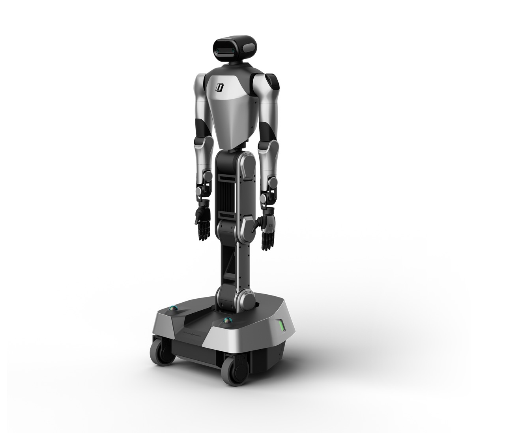
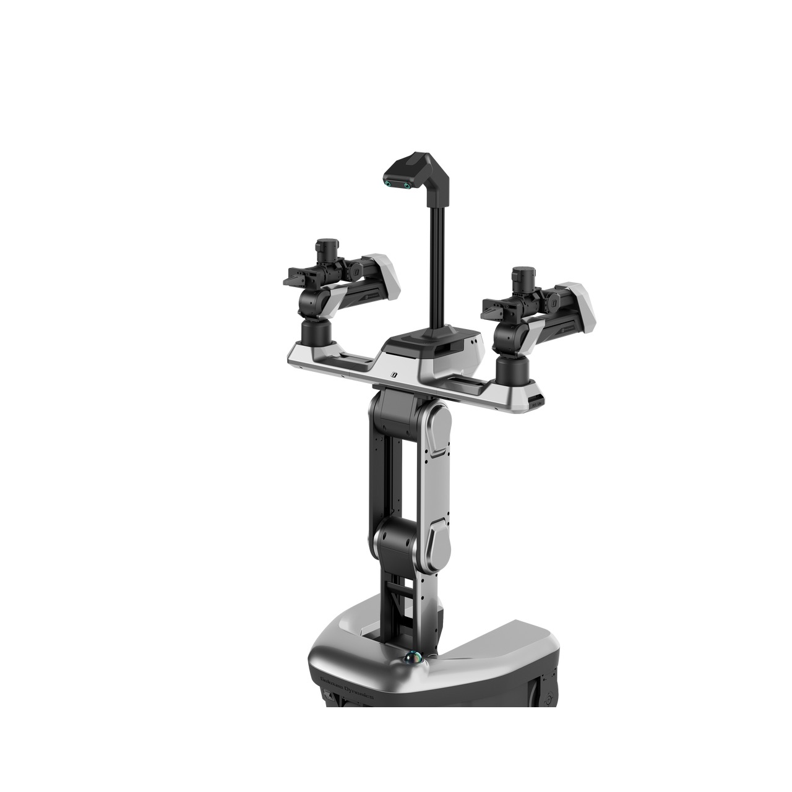
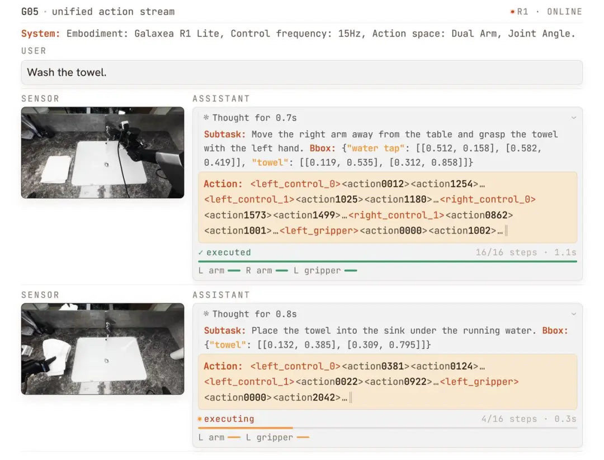
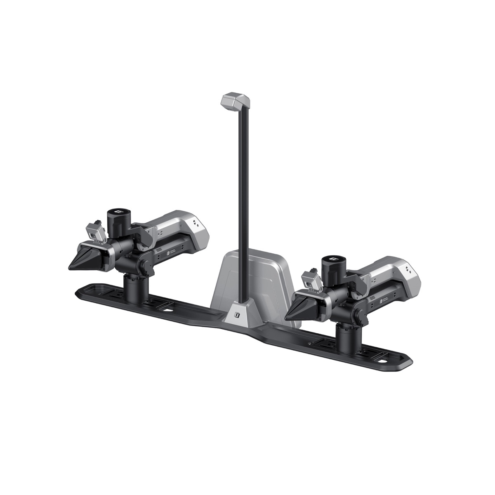
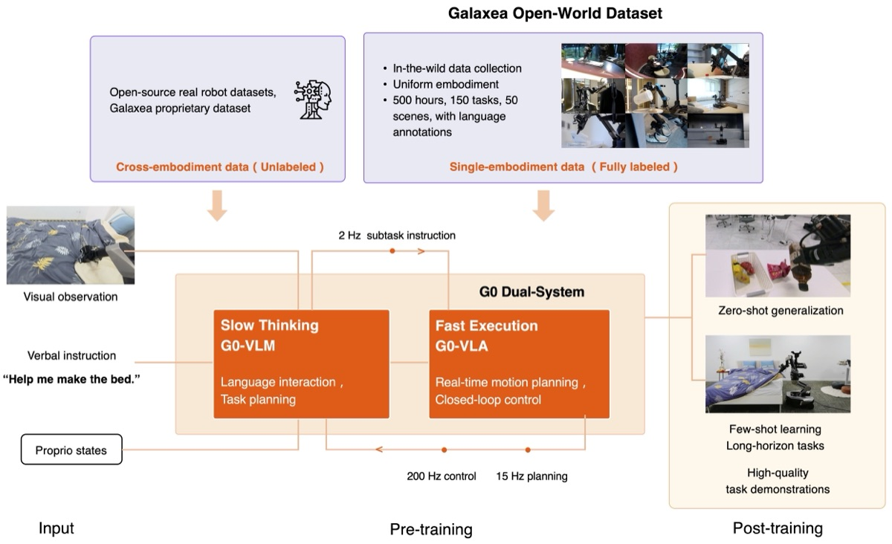
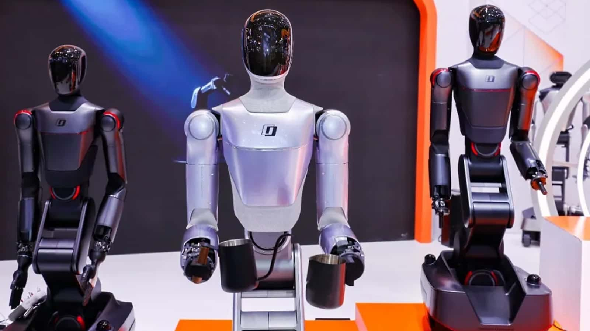

# Galaxea × T01 — Products and Solutions

⬆ [Galaxea profile](../Galaxea.md) · [Brief](Galaxea-T01-1-Brief.md) · [Playbook](Galaxea-T01-3-Playbook.md)

> **Read this first:** Galaxea covers the *indoor service* half of T01 (pick, pack, carry, hand over, tidy inside buildings). It has nothing for streets, snow or stairs. Which robots are physically on site is **not confirmed** — check at the booth before committing.
> Research note: the official docs portal is JavaScript-rendered and could not be read, so several hardware numbers below come from a reseller listing or the legacy R1 guide and are marked ⚠️ unverified.

## Relevant products (ranked for this track)

### R1 Pro

**Role in T01:** the main candidate — a mobile dual-arm robot that can pick items from shelves, carry them through corridors and hand them over. Best choice for a "service runner" or "facility upkeep" demo.

| Track-relevant spec | Value | Confidence |
|---|---|---|
| Mobility | 6-DoF omnidirectional wheeled chassis, **1.5 m/s** max | ⚠️ unverified (EU reseller listing) |
| Runtime | about **7 h** | ⚠️ unverified (reseller) |
| Payload | **5 kg per arm**, 10 kg dual-arm | ⚠️ unverified (reseller) |
| Arms / torso | 2 x 7-DoF arms, 3-DoF torso; 26 DoF total | ⚠️ unverified (reseller) |
| Size | 170 cm, 96 kg | ⚠️ unverified (reseller) |
| Sensors | 7 cameras + 1 LiDAR standard; stereo module optional | ⚠️ unverified (reseller) |
| Terrain / IP rating | not public — treat as flat, dry, indoor floors only | — |
| Slope, threshold, lift-door crossing | not public | — |
| On-board compute | NVIDIA Orin (inferred from the model repo, which targets "R1 Pro Orin") | ⚠️ unverified |

- **Status / price:** ✅ shipping. R1 Series "from USD 39,999" on the official store; R1 Pro about USD 69,999 on third-party listings ⚠️ unverified. Reseller quotes about 8 weeks delivery.
- **Developer interface:** ROS 2 + Galaxea SDK (official docs; exact distro ⚠️ unverified). G0.5 ships two R1 Pro deployment paths (joint-space and whole-body control) driven by a ROS 2 client in `experiments/r1pro` talking to an off-board policy server. Expect topic-level control of chassis velocity, torso, arms and grippers, plus camera, LiDAR and IMU streams (pattern documented for the legacy R1; confirm names on site).

### R1 Lite

**Role in T01:** the best-supported platform for learned policies — the whole Open-World Dataset was recorded on it and `g05-base` is released for zero-shot use on it. Pick this over R1 Pro if you plan to rely on G0.5 out of the box.

| Track-relevant spec | Value | Confidence |
|---|---|---|
| Arms | Dual 6-DoF arms (A1X) with grippers | official docs summary |
| A1X arm payload | 3 kg rated / 5 kg max | ⚠️ unverified (reseller) |
| Mobility | wheeled chassis with torso; dataset records chassis velocity, IMU and torso joints | Hugging Face dataset card |
| Navigation | docs mention "upgraded navigation" without numbers or method | ⚠️ unverified |
| Cameras | 4 RGB streams used in the dataset (720 x 1280) | dataset card |
| Speed, runtime, weight, IP rating | not public | — |

- **Status / price:** ✅ shipping; believed to be the USD 39,999 entry model ⚠️ unverified.
- **Developer interface:** ROS 2 client in `experiments/r1lite` (GalaxeaVLA) plus policy server on a GPU machine. Community work has run third-party policies on it at 15 Hz with asynchronous inference (VLASH) and OpenXR teleop (XRoboToolkit).

### G0.5 (and legacy G0 Plus / G0 Tiny)

**Role in T01:** the "brain" for language-conditioned pick, place, tidy and hand-over. It replaces hand-written grasp pipelines; it does **not** replace a navigation stack.

| Item | Value |
|---|---|
| Checkpoints | `g05-base` (R1 Lite / R1 Pro, zero-shot + fine-tune); legacy `G0Plus_3B-pick_and_place`; `G0Tiny_250M` for on-board Orin |
| Interface | natural-language instruction in, action chunks out; model first emits subtask, target bounding box and 2D trajectory hint |
| Action layout | 27-D: left arm (9) + gripper (1), right arm (9) + gripper (1), lower body (7). Chassis control inside this layout is ⚠️ unverified |
| Inference | **more than 8 GB VRAM**, RTX 4090 recommended; runs off-board as a policy server |
| Full fine-tune | **more than 70 GB VRAM** (A100 80 GB class) |
| Licence | G0.5 Community License — **non-commercial** |
| Reported results | 82.5% zero-shot on 10 DROID tabletop tasks; top BEHAVIOR-1K score (0.31) — both self-reported |

- **Status:** ✅ open weights since 16 Jun 2026; R1 Pro zero-shot entrypoint added 11 Jul 2026.

### LEMO

**Role in T01:** a fixed dual-arm "service counter" — bagging orders, sorting lost property, preparing kits. No mobility, but the lowest-risk hardware for a learned manipulation demo.

| Track-relevant spec | Value |
|---|---|
| Configuration | 2 x A1Z arms + grippers + 3 fisheye cameras + controller |
| Payload | **5 kg peak per arm** |
| Repeatability | ±0.1 mm |
| Teleop | A1Z-T leader arms (under 50 ms latency) or VR (PICO / Meta) |
| Software | ROS 2 workspace `galaxea_lemo`; LEMO Studio for collect-train-deploy; deployment repos for G0.5, π0.5 and LeRobot |

- **Status / price:** ✅ on sale since 9 Nov 2026, from **USD 7,699**.
- **Developer interface:** open low-level arm SDK (`galaxea_a1z`), ROS 2 teleop / recording / inference integration.

### Galaxea Open-World Dataset

**Role in T01:** pre-training and example data for service tasks; useful to check whether your task resembles something the model has already seen.

| Item | Value |
|---|---|
| Size | **500+ h**, 227 task archives, about 2.87 TB |
| Scenes | residential, kitchen, **retail**, **office** |
| Embodiment | R1 Lite only |
| Content | 4 RGB streams at 15 fps, arm / torso / **chassis** states and actions, IMU, subtask labels in English and Chinese |
| Example tasks | cleaning a mirror, wiping floor stains, arranging fruit, adjusting an air conditioner |
| Format / licence | LeRobot v2.1 (also RLDS); CC BY-NC-SA 4.0; gated download |

### Nexo

**Role in T01:** direction of travel, not a hackathon tool. 🧪 Unveiled Aug 2026: **30 DoF, 20 kg dual-arm payload, 8 h**, described as able to work in confined spaces; aimed at manufacturing, logistics and commercial services. No price, docs or SDK public.

### R1 (original)

**Role in T01:** only if an older unit shows up. Documented interface: **ROS 1 Noetic on Ubuntu 20.04**; chassis velocity command as a `Twist` on `/motion_target/target_speed_chassis` (limits **±1.5 m/s** linear, ±3 rad/s yaw); 5 chassis cameras, head and wrist cameras with depth, chassis LiDAR point cloud, two IMUs; **5 kg at 0.5 m**, working height 0–200 cm.

## What Galaxea already does in this domain

| Date | What | Relevance to T01 | Source |
|---|---|---|---|
| 2026-08-23/24 | **Dark-store / micro-fulfilment demo at WRC Beijing**: visitors ordered through a mini-program; robots picked, bagged and packed. 900 orders, 1,775 picks, 1,560 packing cycles; tens of thousands of SKUs claimed (all self-reported) | Direct: retail order fulfilment, deformable bags, live orders | [Galaxea blog](https://galaxea-dynamics.com/blogs/robotics-insights-news/wrc-2026-embodied-ai-robotics), [PR Newswire](https://en.prnasia.com/story/545003-0.shtml) |
| 2026-08 | Carton folding (4,000 cycles per day), part sorting, pick-and-place of arbitrary objects with disturbances | Indirect: packaging and sorting back-of-house | same |
| 2026-06 | G0.5 evaluated on BEHAVIOR-1K long-horizon mobile manipulation (move a box to storage, load a vehicle, tidy a room) — simulation benchmark | Indirect: carry-and-deliver behaviours, in simulation | [G0.5 blog](https://galaxea-dynamics.com/blogs/developer-hub/galaxea-g05-a-new-generation-embodied-foundation-model-for-robotics) |
| 2025-09 | Open-World Dataset recorded in retail, office, kitchen and residential scenes | Indirect: service-scene data | [Hugging Face](https://huggingface.co/datasets/OpenGalaxea/Galaxea-Open-World-Dataset) |
| 2025 | Third-party research on R1: **NavDP** (sim-trained navigation policy) and **VR-Robo** (RGB-only navigation), **BEHAVIOR Robot Suite** household tasks | Indirect: navigation and whole-body tasks, by universities, not Galaxea products | [awesome-galaxea-developers](https://github.com/OpenGalaxea/awesome-galaxea-developers) |

**Nothing found for:** street or outdoor delivery, public-space cleaning, hotel / hospitality pilots, guide or wayfinding robots, municipal services, or any deployment in Europe or Switzerland. No named commercial-service customer is public.

## What they are building next in this domain

- **Nexo** 🧪 — heavier-payload wheeled dual-arm robot positioned for logistics and commercial services (Aug 2026). Ship date not public.
- **"1+3+N" strategy** (Aug 2026) — target sectors named: manufacturing, parcel and warehouse logistics, e-commerce / retail, commercial services; delivery through partner programmes. No named partners or dates.
- **G0.5 follow-ups** — stated intent to scale to more data, longer horizons and more embodiments; no dates.
- *Inference:* the dark-store demo plus the sector list suggest retail back-of-house fulfilment is the first "urban service" product direction; nothing public points to outdoor or municipal robots.

## Software, models and data that help for this track

| Asset | Use in a 48-hour build | Link |
|---|---|---|
| GalaxeaVLA (G0.5, G0 Plus, G0 Tiny) | policy server + ROS 2 robot clients for R1 Lite / R1 Pro; fine-tune script | [GitHub](https://github.com/OpenGalaxea/GalaxeaVLA) |
| GalaxeaLeRobotToolkit | convert rosbag / MCAP teleop recordings to LeRobot format | [OpenGalaxea org](https://github.com/OpenGalaxea) |
| GalaxeaDP | diffusion-policy baseline — realistic alternative when no 80 GB GPU is available (GPU needs ⚠️ unverified) | [OpenGalaxea org](https://github.com/OpenGalaxea) |
| EFMNode | on-robot deployment node (last updated Feb 2026; current README uses the `experiments/` clients instead) | [OpenGalaxea org](https://github.com/OpenGalaxea) |
| GalaxeaManipSim, URDF / USD files | simulate before touching the robot | [OpenGalaxea org](https://github.com/OpenGalaxea), [userguide-galaxea](https://github.com/userguide-galaxea) |
| `galaxea_lemo`, `a1z_g05_deployment`, `a1z_lerobot`, `a1z_data_collection` | full teleop-train-deploy chain for LEMO / A1Z | [userguide-galaxea](https://github.com/userguide-galaxea) |
| awesome-galaxea-developers | community projects: NavDP, VR-Robo, XRoboToolkit teleop, VLASH async inference | [GitHub](https://github.com/OpenGalaxea/awesome-galaxea-developers) |

## Gaps and limits for this track

- **Indoor only.** No IP rating, slope or kerb data published; a 96 kg wheeled robot is not for snow, cobbles or Leukerbad's gradients.
- **Navigation is the unknown.** No public documentation of SLAM, localisation or path planning could be confirmed. Plan to bring your own (LiDAR SLAM + planner on the velocity topic) or use fixed waypoints.
- **No lifts, doors or stairs** capability shown publicly.
- **Compute.** G0.5 needs an off-board GPU for inference and an 80 GB-class GPU for full fine-tuning; whether Galaxea brings either is not confirmed.
- **Licences are non-commercial** (model and dataset) — fine for the hackathon, a blocker for a product pitch unless you say so.
- **Evidence quality.** The fulfilment numbers are self-reported trade-show figures; there is no independent deployment record in services.
- **Human-facing safety.** No public safety certification for operation around the public; keep speeds low and a human on the e-stop.

## Sources
- [Galaxea blog — WRC 2026](https://galaxea-dynamics.com/blogs/robotics-insights-news/wrc-2026-embodied-ai-robotics)
- [PR Newswire — Galaxea AI at WRC 2026](https://en.prnasia.com/story/545003-0.shtml)
- [Galaxea blog — G0.5](https://galaxea-dynamics.com/blogs/developer-hub/galaxea-g05-a-new-generation-embodied-foundation-model-for-robotics)
- [Galaxea blog — LEMO launch](https://galaxea-dynamics.com/blogs/robotics-insights-news/two-arms-one-platform-galaxea-launches-lemo)
- [GitHub — OpenGalaxea/GalaxeaVLA](https://github.com/OpenGalaxea/GalaxeaVLA)
- [GitHub — OpenGalaxea organisation](https://github.com/OpenGalaxea)
- [GitHub — OpenGalaxea/awesome-galaxea-developers](https://github.com/OpenGalaxea/awesome-galaxea-developers)
- [GitHub — userguide-galaxea organisation](https://github.com/userguide-galaxea)
- [Hugging Face — Galaxea Open-World Dataset](https://huggingface.co/datasets/OpenGalaxea/Galaxea-Open-World-Dataset)
- [Galaxea legacy user guide — R1 product page](https://userguide-galaxea.github.io/Product_User_Guide/Introducing_Galaxea_Robot/product_info/R1)
- [Galaxea legacy user guide — R1 software guide](https://userguide-galaxea.github.io/Product_User_Guide/Guide/R1/Software_Guide/)
- [RBTX reseller listing — R1 Pro](https://rbtx.de/en-GB/components/humanoid/galaxea-r1-pro-humanoid-robot-26-dof)
- [Galaxea documentation centre](https://docs.galaxea-dynamics.com/home/en/) (portal could not be read; cited for existence only)
- [Galaxea company profile (this repo)](../Galaxea.md)
