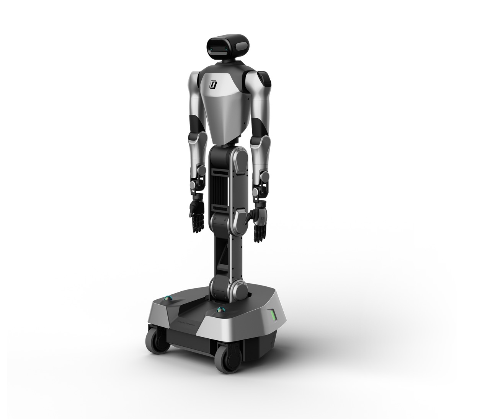
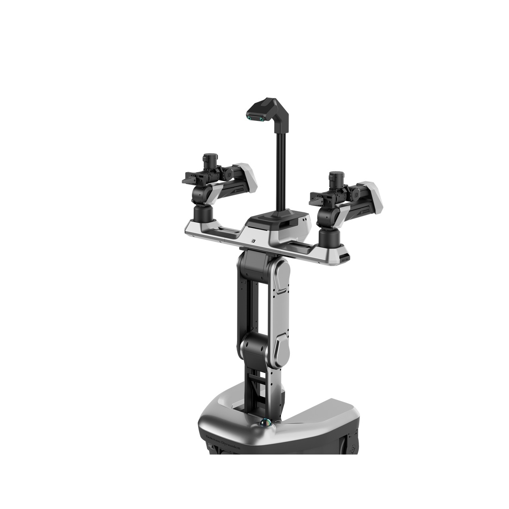
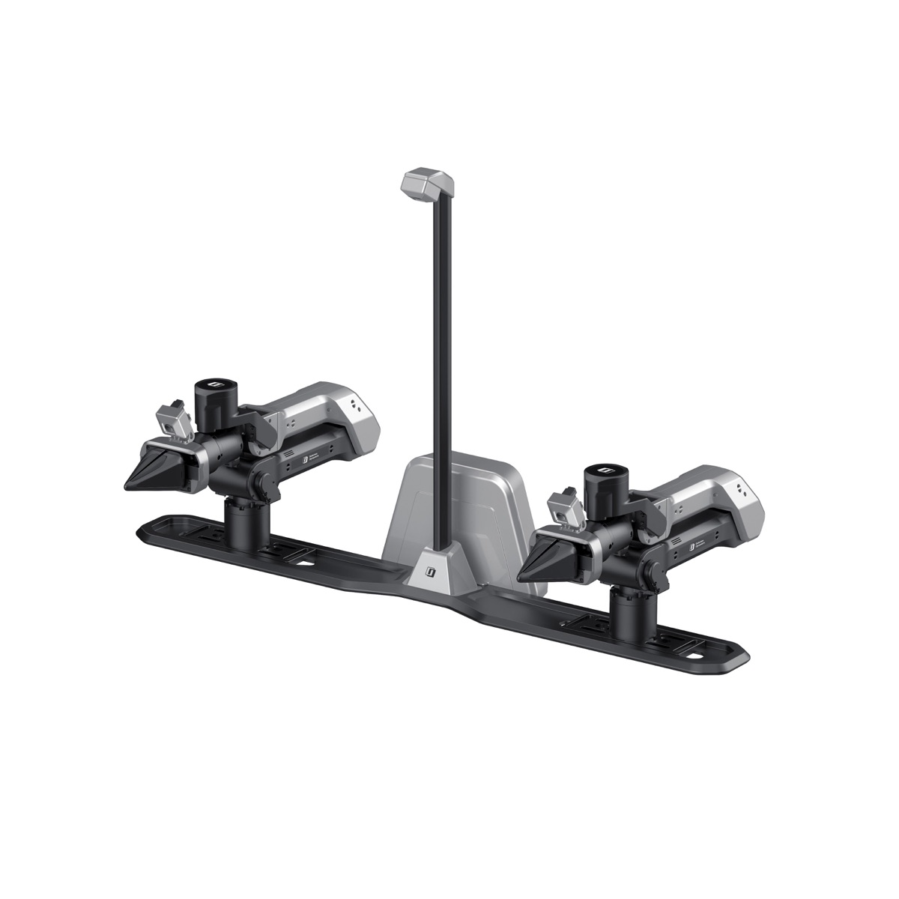
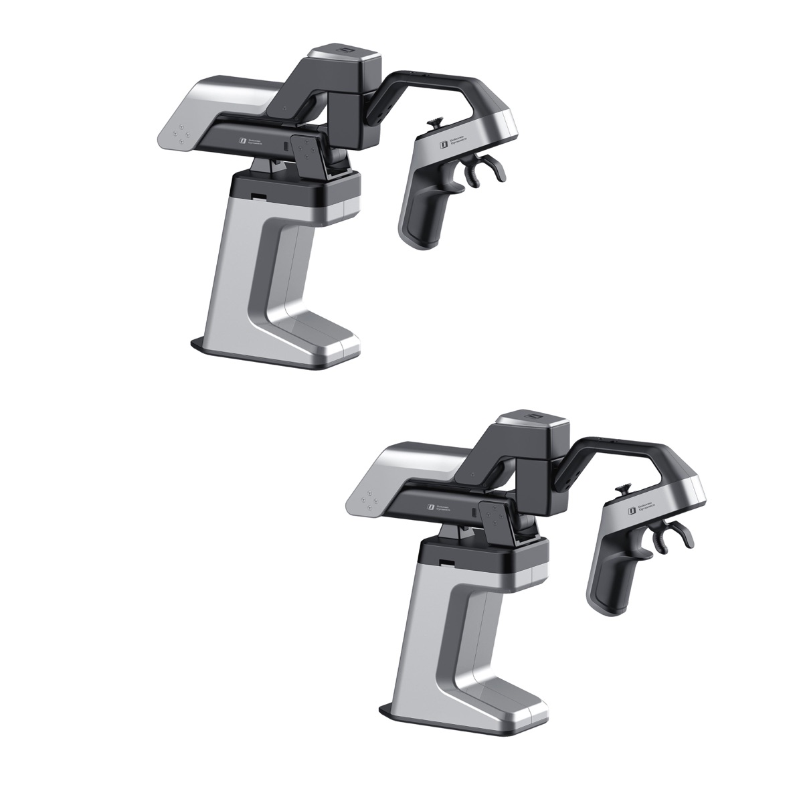
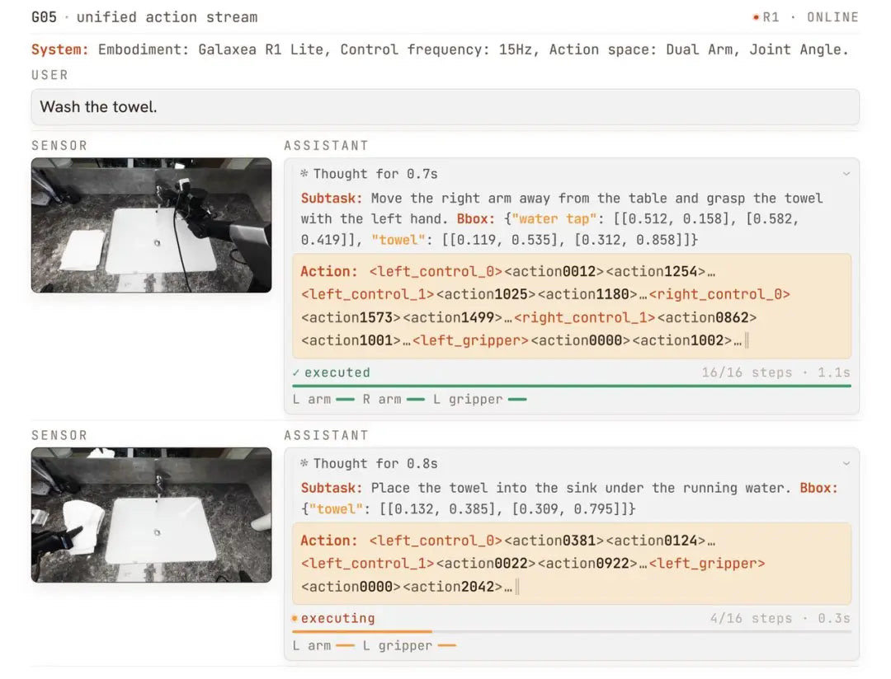
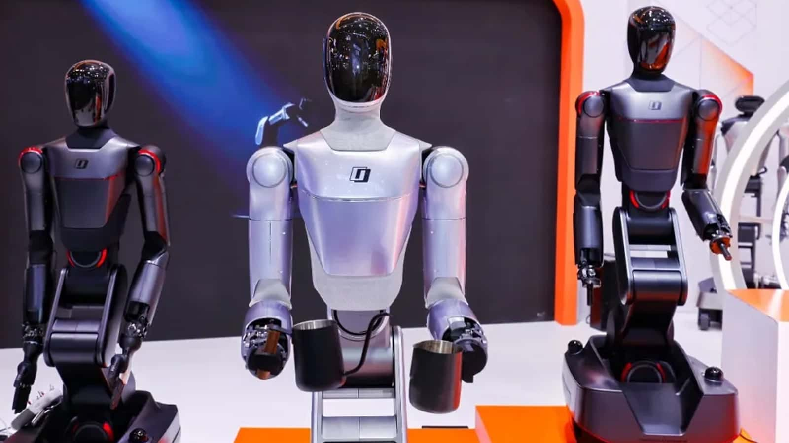

# Galaxea × T02 — Products and Solutions

⬆ [Galaxea profile](../Galaxea.md) · [Brief](Galaxea-T02-1-Brief.md) · [Playbook](Galaxea-T02-3-Playbook.md)

**Bottom line:** Galaxea has no product built for safety, inspection or emergency work. Its value in T02 is **indoor dual-arm manipulation under teleoperation or a learned policy** — the "hands" of a response system whose "legs and eyes" come from another vendor.

**Research note:** the general web-search quota was exhausted during this run, so track-specific findings rest on official pages fetched directly (blog, GitHub, reseller listing) and on the company profile research. Absence of evidence below means "not found in those sources".

## Relevant products (ranked for this track)

### R1 Pro

**Role in T02:** indoor intervention robot — drive to a known point in a building (plant room, corridor, control room) and operate things built for humans: valves, switches, doors, extinguisher cabinets, sample containers. Best used teleoperated, with autonomy as a stretch.

| Spec (track-relevant) | Value | Confidence |
|---|---|---|
| Degrees of freedom | **26** (2 x 7-DoF force-controlled arms, 3-DoF torso, 6-DoF omnidirectional chassis) | Reseller listing ⚠️ unverified against official docs |
| Payload | **5 kg per arm**, 10 kg dual-arm | ⚠️ unverified (reseller) |
| Working height | Ground to about **2 m** | ⚠️ unverified (reseller) |
| Speed | **1.5 m/s** | ⚠️ unverified (reseller) |
| Runtime | about **7 h** | ⚠️ unverified (reseller) |
| Sensors | 7 cameras + 1 LiDAR on the head; optional binocular module | ⚠️ unverified (reseller) |
| Size / mass | 170 cm, **96 kg** | ⚠️ unverified (reseller) |
| IP rating, operating temperature | **not public** | — |
| Slope, threshold / obstacle crossing | **not public** | — |
| Middleware | **ROS 2 Humble**, Python 3.10 (prerequisites of the official deployment node) | Official GitHub |
| On-board compute | NVIDIA Orin (inferred from the model repo) | ⚠️ unverified |

- **Status / price:** ✅ shipping. R1 Series "from **USD 39,999**" on the official store; R1 Pro itself is "contact us" at the EU reseller (about 8 weeks delivery).
- **Developer interface:** ROS 2 topics for arm, gripper, torso and chassis control, matching feedback topics, head depth camera, wrist cameras and TF (the set recorded by the official EFMNode recorder). Joint-space and whole-body-control variants are exposed for policy deployment. Whether the built-in navigation / SLAM stack is open to developers is ⚠️ unverified — ask on site.

### R1 Lite

**Role in T02:** same job as the R1 Pro with lighter arms; it is the robot the public dataset and most community VLA work were collected on, so learned skills transfer most easily.

| Spec | Value | Confidence |
|---|---|---|
| Arms | 2 x 6-DoF (A1X) with grippers | Official docs (per profile) |
| Total DoF | 23 | ⚠️ unverified (aggregator) |
| Arm payload | A1X about 3 kg rated / 5 kg max | ⚠️ unverified (reseller) |
| Navigation | "Upgraded navigation" claimed, no numbers | Official docs (per profile) |
| IP rating, slope, runtime | **not public** | — |

- **Status / price:** ✅ shipping; believed to be the USD 39,999 entry model ⚠️ unverified.
- **Developer interface:** same ROS 2 Humble stack; `hardware = "R1_LITE"` is a first-class target in EFMNode and G0.5.

### LEMO

**Role in T02:** bench-top remote-handling cell ("glovebox without the gloves") or the operator-side data-collection rig. Useful for a hazardous-sample handling demo or to train a manipulation skill that is later shown on an R1.

| Spec | Value | Confidence |
|---|---|---|
| Configuration | 2 x A1Z arms + grippers + 3 fisheye cameras + controller | Official (per profile) |
| Payload | **5 kg peak per arm** | Official (per profile) |
| Repeatability | **±0.1 mm** | Official (per profile) |
| Teleop latency | **under 50 ms** with A1Z-T leader arms; VR teleop (PICO / Meta) | Official (per profile) |
| Mobility | None (desktop) | — |

- **Status / price:** ✅ on sale since **9 Nov 2026**, from **USD 7,699**.
- **Developer interface:** LEMO Studio (collect → train → deploy); A1Z advertises an open low-level stack.

### A1Z-T

**Role in T02:** leader arm for master-slave teleoperation — the operator console of a "remote hands" demo. Same kinematics as the A1Z; **under 50 ms** latency (official, per profile). ✅ USD 1,499 (A1Z version) / USD 2,999 (LEMO version). Compatibility as a leader for R1 Pro arms is ⚠️ unverified.

### G0.5 (and legacy G0 Plus / G0 Tiny)

**Role in T02:** turns a teleoperated intervention into a repeatable autonomous skill, or adds language-conditioned "do X" on top of teleop.

| Item | Value |
|---|---|
| Targets | R1 Lite, R1 Pro (plus SO-100/101, Franka DROID) |
| Default control loop | **15 Hz**, 32 action steps per inference (EFMNode default config) |
| Inference hardware | More than **8 GB VRAM**; RTX 4090 recommended (TensorRT option) |
| Full fine-tune | More than **70 GB VRAM** |
| Licence | Non-commercial community licence |

- **Status:** ✅ open weights. Not trained on safety or inspection tasks; expect to fine-tune or fall back to a small diffusion policy (GalaxeaDP).

### Nexo

**Role in T02:** none for the hackathon; relevant as direction. 🧪 Unveiled 23 Aug 2026: **30 DoF**, **20 kg dual-arm payload**, up to **8 h**. Positioned for structured environments (logistics, manufacturing, retail). No public docs, price or SDK.

### Kengo

**Role in T02:** the only Galaxea platform described for "complex, unstructured environments" (biped, shown in parkour training at WRC 2026). 🧪 No specs, no docs; store price USD 999,999 reads as a placeholder. Do not plan on it.

## What Galaxea already does in this domain

**Nothing public.** No deployment, pilot, customer case or demo in emergency response, inspection, security patrol, hazard monitoring or outdoor operation was found.

Closest adjacent evidence:

| Date | What | Why it matters for T02 | Source |
|---|---|---|---|
| 23–24 Aug 2026 | WRC Beijing: closed-loop micro-fulfilment (900 orders, 1,775 picks), robot-on-robot screw assembly, carton folding at 4,000 cycles per day (all self-reported) | Shows sustained, disturbance-tolerant manipulation — the property you need for "keep it running" tasks. The blog does not mention inspection, safety, security or outdoor use | [Galaxea blog](https://galaxea-dynamics.com/blogs/robotics-insights-news/wrc-2026-embodied-ai-robotics) |
| 2025 | BEHAVIOR Robot Suite (Stanford) — whole-body teleoperation and learning of household tasks on the R1 | Proven whole-body teleop of the platform: door opening, reaching low and high | [awesome-galaxea-developers](https://github.com/OpenGalaxea/awesome-galaxea-developers) |
| 2025 | VR-Robo (RGB-only real-to-sim-to-real navigation on R1) and NavDP (navigation diffusion policy) — third-party research | Evidence that navigation research runs on the base; not a product feature | [awesome-galaxea-developers](https://github.com/OpenGalaxea/awesome-galaxea-developers) |
| 2025 | SafeBimanual (safety-aware bimanual diffusion policy, CoRL 2025) — third-party research | "Safety" here means not damaging objects or colliding arms, not public safety | [awesome-galaxea-developers](https://github.com/OpenGalaxea/awesome-galaxea-developers) |

## What they are building next in this domain

- **Announced:** "1+3+N" strategy (Aug 2026) names manufacturing, consumer electronics, parcel and warehouse logistics, e-commerce / retail and commercial services. **Safety, inspection and emergency response are not among the named sectors.**
- **Announced:** Nexo (heavier payload, longer runtime) and Kengo (biped for unstructured environments), both 🧪.
- **Inference, not announced:** a biped with real locomotion would be the first Galaxea platform able to leave flat floors; if Kengo matures, facility-inspection or response use becomes possible. There is no public statement of that intent.
- **Inference:** heavier Nexo payload (20 kg dual-arm) would suit industrial maintenance tasks such as carrying equipment or operating stiff valves, but it is positioned for logistics and manufacturing.

## Software, models and data that help for this track

| Asset | Use in a T02 build | Status |
|---|---|---|
| [EFMNode](https://github.com/OpenGalaxea/EFMNode) | On-robot ROS 2 node that runs a policy; its recorder script lists the camera, feedback and control topics you need for any custom teleop or inspection node. Docker image and `glx` CLI | ✅ |
| [GalaxeaVLA](https://github.com/OpenGalaxea/GalaxeaVLA) (G0.5, G0 Plus, G0 Tiny) | Fine-tune one intervention skill (valve, switch, pick-up) from teleop demos | ✅ non-commercial |
| GalaxeaDP | Small diffusion-policy baseline — trains on a single consumer GPU, the realistic 48-hour option | ✅ |
| GalaxeaLeRobotToolkit / GalaxeaLerobot3.0 | Convert rosbag / MCAP recordings to LeRobot format | ✅ |
| GalaxeaManipSim | Rehearse manipulation in simulation while the robot is busy | ✅ |
| [XRoboToolkit](https://xr-robotics.github.io/) (community) | OpenXR-based XR teleoperation framework — candidate for headset-driven remote operation | ✅ third-party; R1 Pro support ⚠️ unverified |
| [GMR](https://github.com/YanjieZe/GMR) (community) | Real-time whole-body motion retargeting, listed as used on R1 Pro | ✅ third-party |
| Galaxea Open-World Dataset | **500+ h** of R1 Lite mobile manipulation in homes, offices, retail — no hazard or infrastructure scenes; useful only as pre-training | ✅ |

## Gaps and limits for this track

- **Mobility:** wheeled omnidirectional base. No stairs, snow, gravel or steep ramps. Slope and threshold limits are not published.
- **Environment:** no IP rating, temperature range or wet-floor guidance published. Treat as dry-indoor only.
- **Sensing:** RGB / depth cameras and one LiDAR. No thermal, gas, radiation or acoustic sensors — add your own via USB / ROS if the task needs them.
- **Autonomy for inspection:** no inspection application layer (route scheduling, gauge reading, anomaly reports). You build it.
- **Navigation access:** developer access to mapping and waypoint navigation is unconfirmed.
- **Communications:** no published long-range or degraded-network teleop mode; assume venue Wi-Fi / LAN.
- **Mass:** a 96 kg robot near people needs a spotter and a reachable e-stop; this limits "search and rescue" style demos.
- **Models:** G0.5 has no safety-domain training data, and full fine-tuning needs an 80 GB-class GPU.
- **Track record:** zero public references in this domain; judges looking for deployment realism will notice.

## Sources
- [Galaxea blog — WRC 2026 (23 Aug 2026)](https://galaxea-dynamics.com/blogs/robotics-insights-news/wrc-2026-embodied-ai-robotics)
- [RBTX reseller listing — R1 Pro](https://rbtx.de/en-GB/components/humanoid/galaxea-r1-pro-humanoid-robot-26-dof)
- [Galaxea legacy user guide — R1](https://userguide-galaxea.github.io/Product_User_Guide/Introducing_Galaxea_Robot/product_info/R1)
- [GitHub — OpenGalaxea organisation](https://github.com/OpenGalaxea)
- [GitHub — OpenGalaxea/EFMNode](https://github.com/OpenGalaxea/EFMNode)
- [GitHub — OpenGalaxea/GalaxeaVLA](https://github.com/OpenGalaxea/GalaxeaVLA)
- [GitHub — awesome-galaxea-developers](https://github.com/OpenGalaxea/awesome-galaxea-developers)
- [Galaxea documentation centre — R1 Pro (JS-rendered; could not be read automatically, check on site)](https://docs.galaxea-dynamics.com/R1Pro/en/)
- [Galaxea company profile (this repo) — source for LEMO, A1Z-T, R1 Lite, G0.5 and strategy facts](../Galaxea.md)
