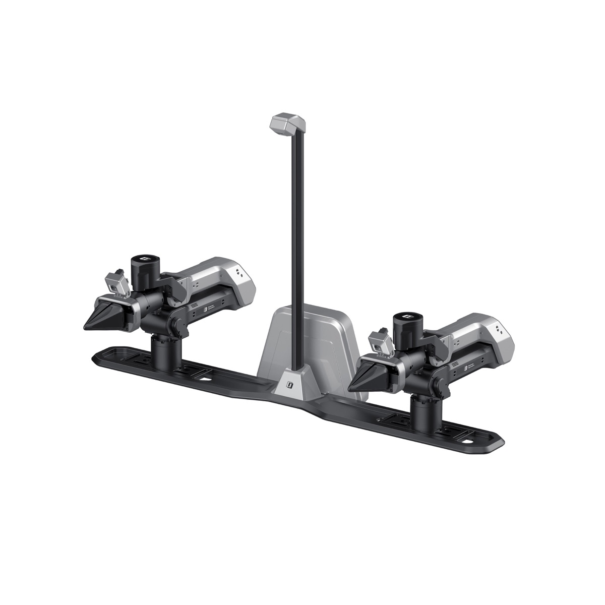
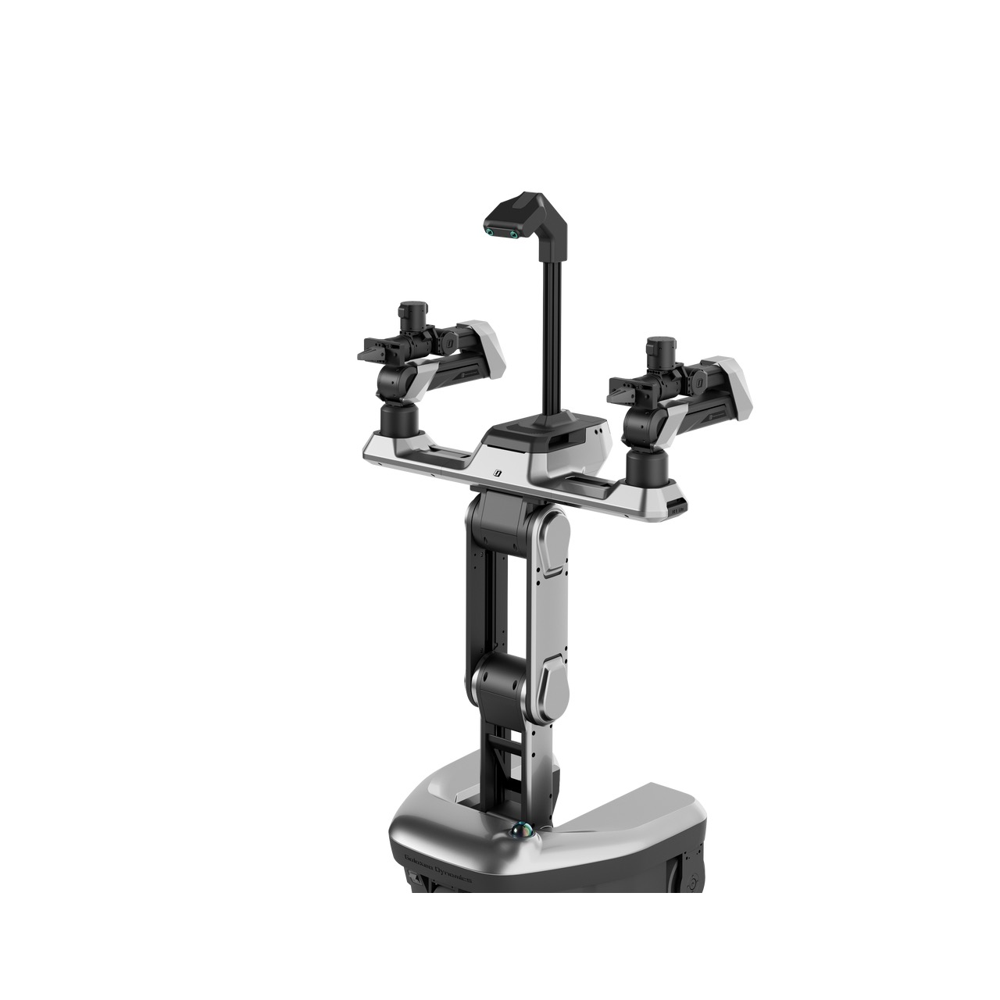
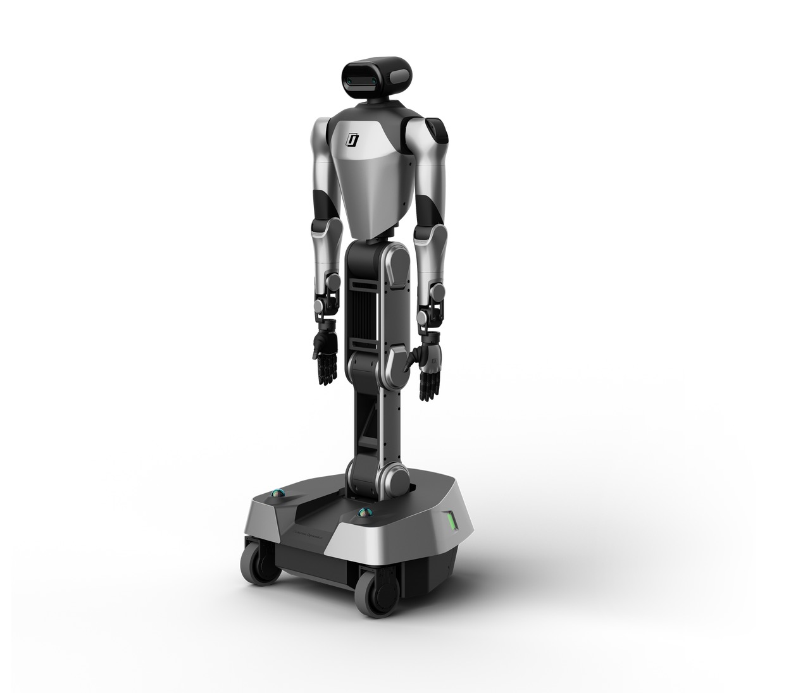
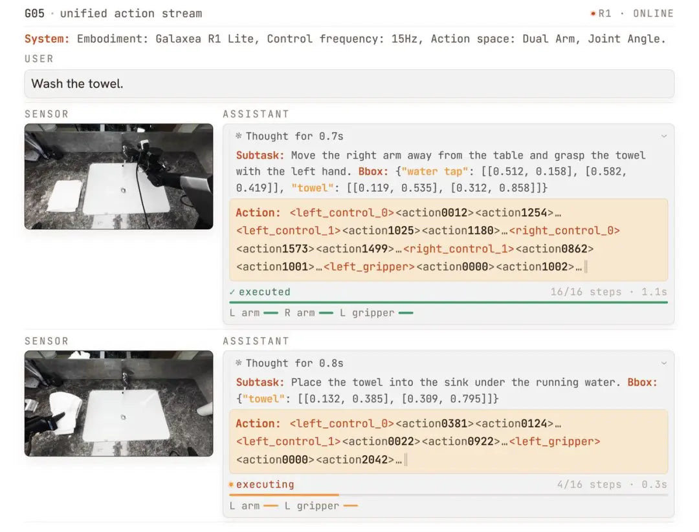
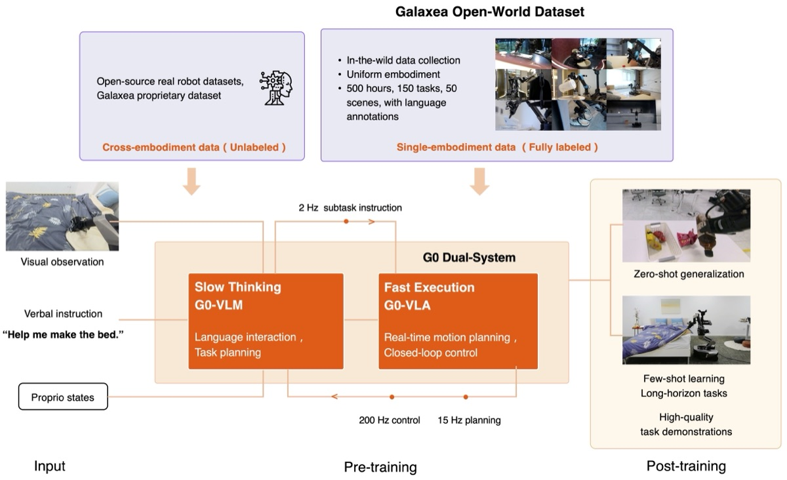
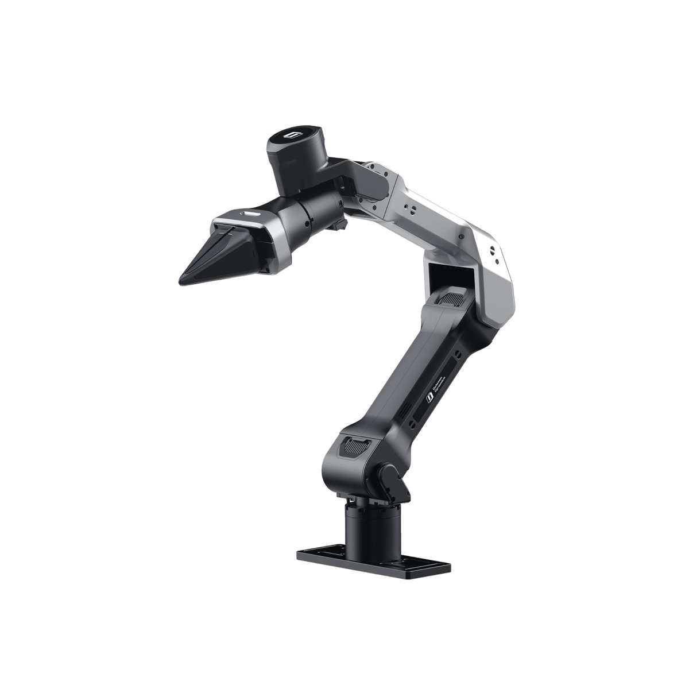
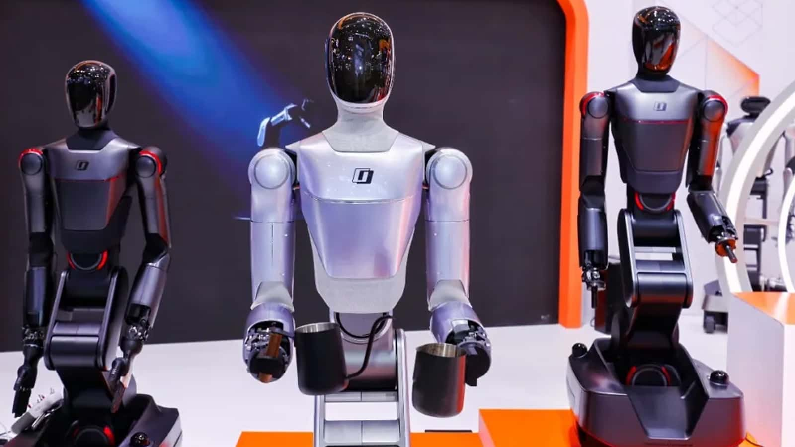

# Galaxea × T03 — Products and Solutions

⬆ [Galaxea profile](../Galaxea.md) · [Brief](Galaxea-T03-1-Brief.md) · [Playbook](Galaxea-T03-3-Playbook.md)

**Bottom line:** Galaxea has **no sustainability product or deployment**. Its value for T03 is as a manipulation platform: two arms, a short teleop-to-policy loop and open models, usable for sorting, clearing, repair / disassembly and simple building-operation tasks indoors. What is physically on site is not confirmed — check the booth first.

## Relevant products (ranked for this track)

### LEMO

**Role in T03:** fixed sorting or disassembly cell (recyclables, small e-waste, reusable items). Lowest-risk option because the workspace is fixed and data collection is fast.

| Spec | Value |
|---|---|
| Configuration | 2 × A1Z arms + grippers, CCU controller |
| Payload | **5 kg peak per arm** (rated continuous payload not public) |
| Repeatability | **±0.1 mm** |
| Cameras | 3 synchronized fisheye views (2 wrist, 1 top) |
| Teleop | A1Z-T leader arms, latency **under 50 ms**; VR (PICO / Meta) |
| Reach, weight, power draw, controller compute | not public |

- **Status / price:** ✅ on sale since **9 Nov 2026**, from **USD 7,699**. Presence on site ⚠️ unverified.
- **Developer interface:** LEMO Studio (collect → train → deploy), SDK, URDF and 3D models; vendor states support for imitation learning and real-world RL. Which policy frameworks LEMO Studio runs natively (LeRobot, ACT, G0.5) ⚠️ unverified — ask on site.
- **Published example task:** inserting and fastening a screw — relevant for repair / disassembly ideas.

### R1 Lite

**Role in T03:** mobile sorting / clearing between tables, rooms or bins. It is the embodiment of the whole Open-World Dataset, so pretrained models transfer best to it.

| Spec | Value |
|---|---|
| Arms | Dual 6-DoF arms with grippers |
| Total DoF | 23 ⚠️ unverified (aggregator) |
| Payload, runtime, speed, IP rating | not public / not retrieved from official docs |
| Model support | `g05-base` zero-shot and fine-tune target; EFMNode `R1_LITE` profile |

- **Status / price:** ✅ shipping; believed to be the "from **USD 39,999**" R1 Series entry model ⚠️ unverified.
- **Developer interface:** ROS 2 (EFMNode and the data toolkit use **ROS 2 Humble**) topics for arms, grippers, torso and chassis; Python policy client.

### R1 Pro

**Role in T03:** same as R1 Lite with more reach and payload — floor-to-shelf handling (bins on the floor, shelves at 2 m), whole-body tasks.

| Spec | Value (reseller listing, ⚠️ unverified against official docs) |
|---|---|
| DoF | **26** (2 × 7-DoF force-controlled arms, 3-DoF torso, 6-DoF omni chassis) |
| Payload | **5 kg per arm**, 10 kg combined |
| Working height | floor to **2 m** |
| Size / weight | 170 cm, **96 kg** |
| Speed / runtime | **1.5 m/s**, about **7 h** |
| Sensors | 7 cameras + 1 LiDAR on the head |
| End effector | Reseller lists grippers / dexterous hand as options — confirm what is fitted |
| IP rating, operating temperature | not public → treat as **indoor, dry floors only** |

- **Status / price:** ✅ shipping; about USD 69,999 on third-party listings ⚠️ unverified.
- **Developer interface:** ROS 2 + Galaxea SDK; joint-space and whole-body-control (WBC) action interfaces, both with example G0.5 fine-tune configs (fold carton, stack box).

### G0.5 (and legacy G0 Plus / G0 Tiny)

**Role in T03:** the policy brain for language-conditioned pick, sort and place.

| Item | Value |
|---|---|
| Checkpoints | `g05-base` (R1 Lite / R1 Pro), `g05-so101`, `g05-droid`; legacy `G0Plus_3B-pick_and_place`, `G0Tiny_250M-base` (R1 Pro Orin) |
| Inference | **more than 8 GB VRAM** (RTX 3090 / 4090) |
| Full fine-tune | **more than 70 GB VRAM** (A100 80 GB class); multi-GPU does not lower per-GPU memory |
| Data format | LeRobot |
| Deployment | GPU policy server + robot-side ROS 2 client (WebSocket + msgpack) |
| Licence | Non-commercial community licence (fine for a hackathon) |

- **Status:** ✅ open weights since 16 Jun 2026.
- **Sustainability caveat:** inference on a desktop GPU is the opposite of low-power edge AI. Only G0 Tiny (250 M parameters) targets on-board Orin.

### Galaxea Open-World Dataset

**Role in T03:** pre-training data and a source of task ideas; too large to download during the event.

| Item | Value |
|---|---|
| Size | **500+ h**, about 150 task categories, 58 skills, **1,600+ objects**, 50 scenes at 11 sites |
| Scenes | residential, retail, catering, office |
| Format | LeRobot v2.1, 227 task archives, about **2.87 TB**, gated download |
| T03-relevant task names visible | adjust air-conditioner temperature, clean mirror, wipe floor stains, arrange fruit |
| Licence | CC BY-NC-SA 4.0 |

### LEMO A1Z, A1Z-T and G1Z gripper

**Role in T03:** single-arm variant of the sorting cell, or a teleop leader. A1Z: 5 kg peak payload, ±0.1 mm, from **USD 2,999** (DoF stated inconsistently as 6 or 7). A1Z-T leader arm from USD 1,499; G1Z parallel gripper USD 499. ✅ in the official store.

### Nexo

**Role in T03:** none for building. 🧪 Unveiled Aug 2026 (30 DoF, **20 kg** dual-arm payload, **8 h** runtime); no public docs, price or IP rating. Relevant only as the direction of travel for heavier logistics handling.

## What Galaxea already does in this domain

**Nothing sustainability-specific is public.** No waste-sorting, recycling, energy, EV-charging, environmental-monitoring or agriculture deployment, pilot or partner was found in the official sources checked. (Open web search was unavailable for this pass, so only official pages and repos were reviewed — ⚠️ absence is not fully verified.)

Adjacent, transferable evidence:

| Date | What | Relevance to T03 |
|---|---|---|
| Aug 2026 | WRC Beijing: "industrial component sorting" demo (no figures) and tabletop pick-and-place of arbitrary objects | Sorting by object type is the same skill as waste-stream sorting |
| Aug 2026 | WRC micro-fulfilment cell: 900 orders, **1,775 picks**, 1,560 packing cycles (self-reported) | Sustained picking of mixed consumer items |
| Aug 2026 | WRC box folding: 4,000 cycles per day (self-reported); robot-on-robot screw assembly | Packaging handling; fastening skill needed for disassembly |
| Feb 2026 | G0 Plus "Fold Towels" demo | Textile handling (linen reuse ideas) |
| Sep 2025 | G0 paper: **table bussing** fine-tuned from **20 demonstrations**; microwave operation; bed making | Clearing and sorting items with little data |
| 2025 | BEHAVIOR Challenge (NeurIPS 2025) on R1 Pro: 50 household tasks, 10,000 teleop demos | Household tidying and cleaning in simulation |

## What they are building next in this domain

- **Stated targets (Aug 2026):** manufacturing, consumer electronics, parcel and warehouse logistics, e-commerce / retail, commercial services. Sustainability is **not** a named sector.
- **Nexo** (🧪) raises payload to 20 kg and runtime to 8 h — aimed at material handling.
- **Inference:** reverse logistics, returns handling and packaging are the nearest overlap with circular-economy use cases; no announcement confirms this.
- **Inference:** the model line (G0 Tiny on Orin, G0.5 efficiency work in the community) points toward more on-board inference, which would help the energy argument; no roadmap states it.

## Software, models and data that help for this track

| Asset | Use in 48 hours | Notes |
|---|---|---|
| [GalaxeaVLA](https://github.com/OpenGalaxea/GalaxeaVLA) | Zero-shot or fine-tuned pick / sort policy | Fine-tune via `scripts/run/finetune.sh`; needs 80 GB-class GPU |
| [EFMNode](https://github.com/OpenGalaxea/EFMNode) | On-robot policy node for R1 Lite / R1 Pro | ROS 2 Humble, Python 3.10, RTX 4090 recommended, TensorRT path |
| [GalaxeaLeRobotToolkit](https://github.com/OpenGalaxea/GalaxeaLeRobotToolkit) | Convert rosbag / MCAP recordings to LeRobot | Needs ROS 2 Humble + `hdas_msg` build |
| [GalaxeaManipSim](https://github.com/OpenGalaxea/GalaxeaManipSim) | Simulated R1 / R1 Pro / R1 Lite tasks (30+ environments, 17 tasks, e.g. dual bottle pick, block stacking) | Useful for testing code without the robot; MIT badge |
| [GalaxeaDP](https://github.com/OpenGalaxea/GalaxeaDP) | Diffusion-policy baseline | Simulation only so far; real-robot data support "coming soon" |
| [awesome-galaxea-developers](https://github.com/OpenGalaxea/awesome-galaxea-developers) | Community tools: XRoboToolkit (XR teleop on R1 Lite), GMR retargeting, NavDP navigation | None are sustainability-specific |
| [Open-World Dataset](https://huggingface.co/datasets/OpenGalaxea/Galaxea-Open-World-Dataset) | Background only | 2.87 TB — do not plan to download |

Practical shortcut: a **VLM classifier + scripted or small learned grasp** often beats a fine-tuned VLA in 48 hours. Use the Galaxea arm as the actuator and keep the "what material is this?" decision in a separate vision model.

## Gaps and limits for this track

- **No domain record:** every T03 claim must be built and measured by the team.
- **Indoor only:** wheeled base, no public IP rating or temperature range; no litter picking outdoors, no snow or slopes.
- **No sensing stack:** no air / water / energy sensors, no building-management integration; bring your own.
- **Energy cost of the robot itself:** a 96 kg robot plus a desktop GPU must be justified against the resource it saves — judges may ask.
- **Hygiene:** real waste is wet and dirty; grippers and cameras are not rated for it. Use clean, dry mock waste.
- **Throughput:** learned dual-arm picking is slow (seconds per item) compared with industrial sorting lines; pitch small decentralised streams (hotel, clinic, café), not municipal plants.
- **Training compute:** full G0.5 fine-tuning needs more than 70 GB VRAM; availability on site is unknown.
- **Licence:** models and dataset are non-commercial.

## Sources
- [Galaxea profile (general research)](../Galaxea.md)
- [Galaxea blog — WRC 2026](https://galaxea-dynamics.com/blogs/robotics-insights-news/wrc-2026-embodied-ai-robotics)
- [Galaxea blog — LEMO launch (9 Nov 2026)](https://galaxea-dynamics.com/blogs/robotics-insights-news/two-arms-one-platform-galaxea-launches-lemo)
- [GitHub — OpenGalaxea organisation](https://github.com/OpenGalaxea)
- [GitHub — OpenGalaxea/GalaxeaVLA](https://github.com/OpenGalaxea/GalaxeaVLA)
- [GitHub — OpenGalaxea/EFMNode](https://github.com/OpenGalaxea/EFMNode)
- [GitHub — OpenGalaxea/GalaxeaLeRobotToolkit](https://github.com/OpenGalaxea/GalaxeaLeRobotToolkit)
- [GitHub — OpenGalaxea/GalaxeaManipSim](https://github.com/OpenGalaxea/GalaxeaManipSim)
- [GitHub — OpenGalaxea/GalaxeaDP](https://github.com/OpenGalaxea/GalaxeaDP)
- [GitHub — OpenGalaxea/awesome-galaxea-developers](https://github.com/OpenGalaxea/awesome-galaxea-developers)
- [Hugging Face — Galaxea Open-World Dataset](https://huggingface.co/datasets/OpenGalaxea/Galaxea-Open-World-Dataset)
- [arXiv 2509.00576 — Galaxea Open-World Dataset and G0 dual-system VLA](https://arxiv.org/html/2509.00576v1)
- [RBTX reseller listing — R1 Pro](https://rbtx.de/en-GB/components/humanoid/galaxea-r1-pro-humanoid-robot-26-dof)
