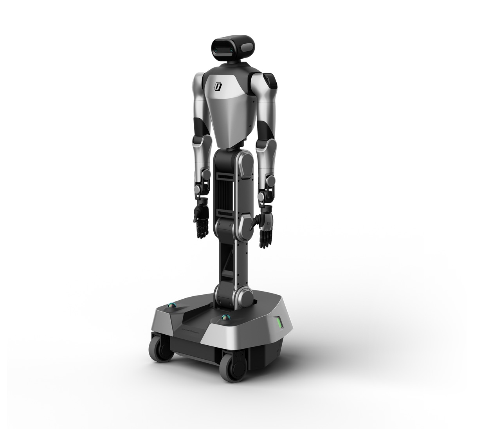
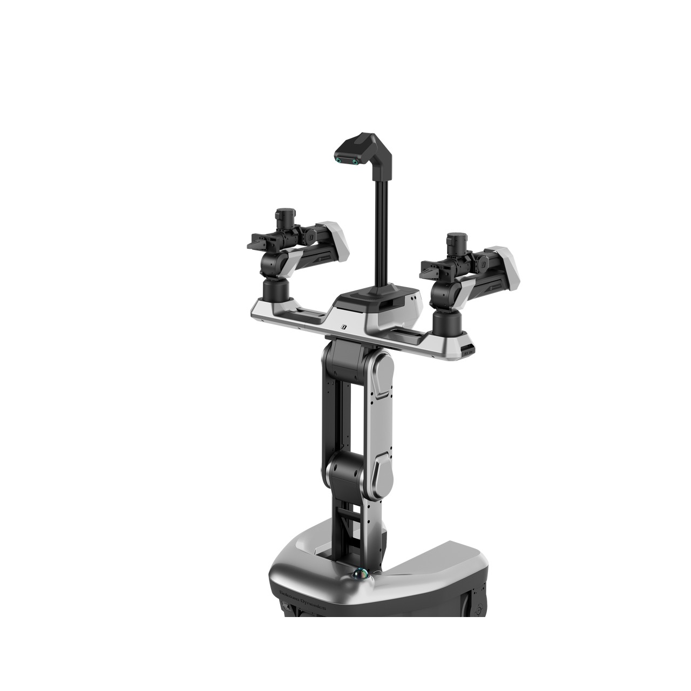
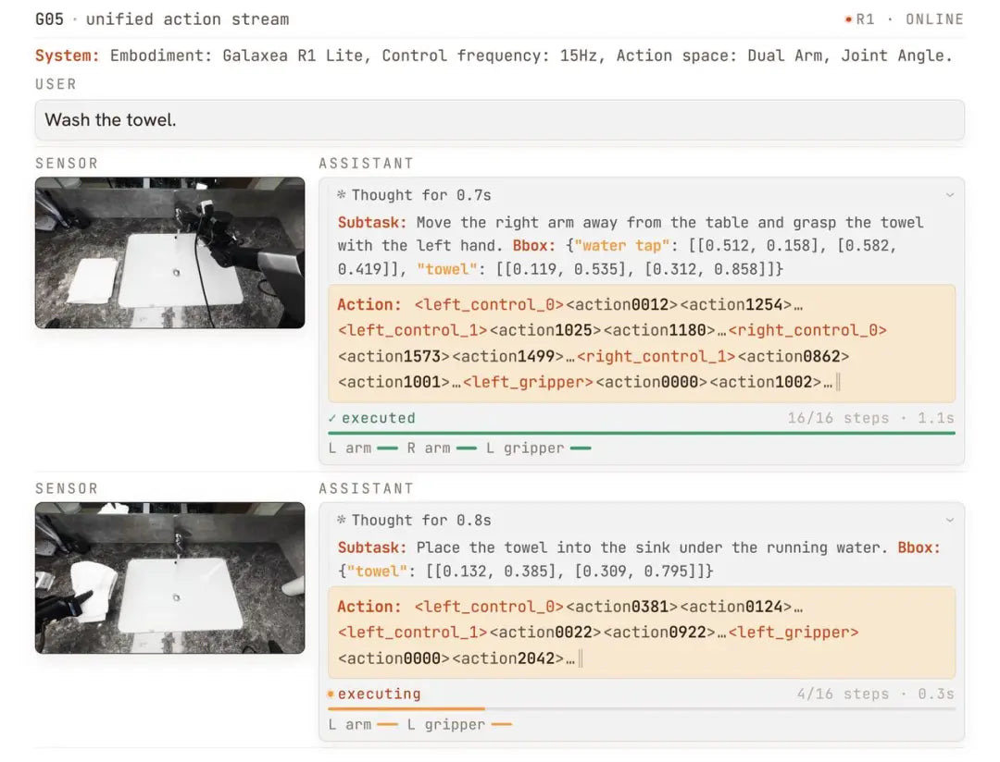
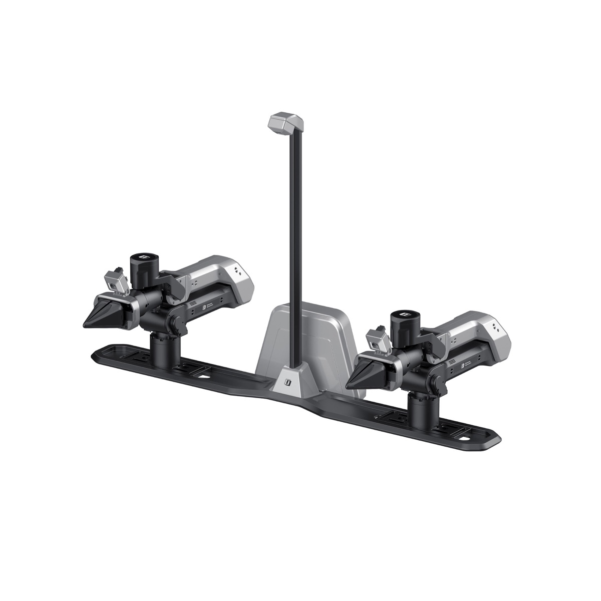
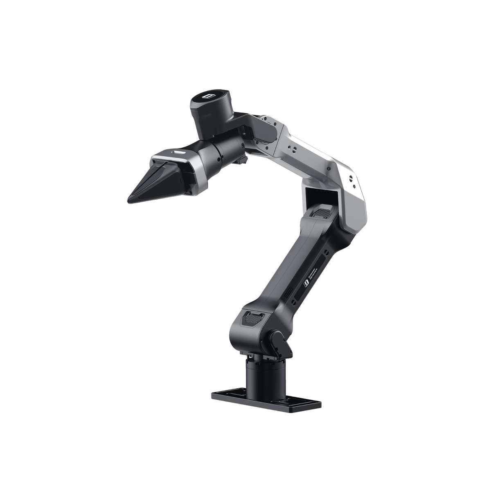
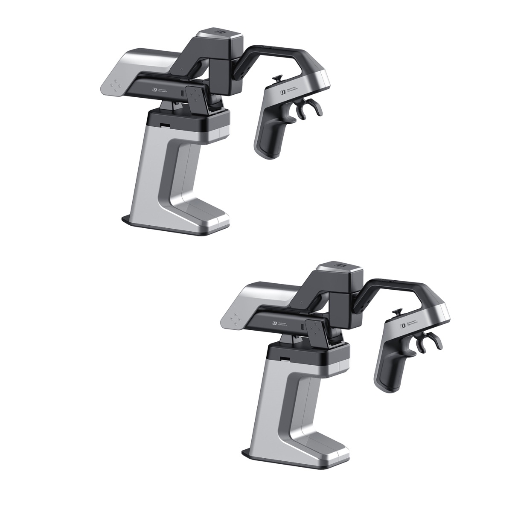
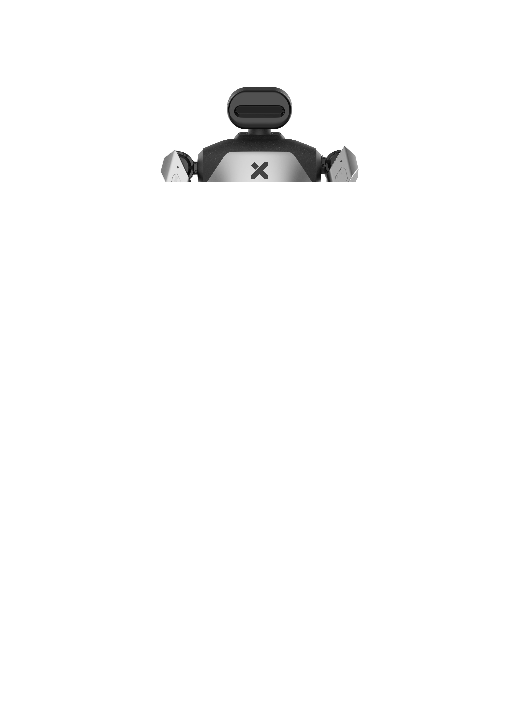
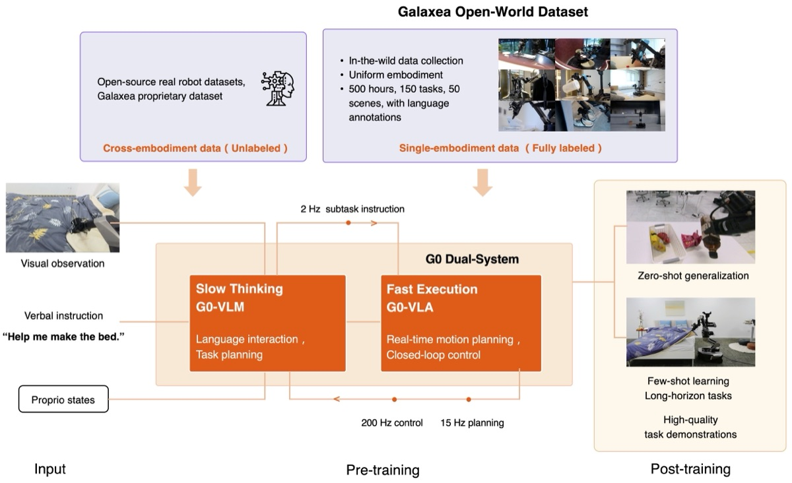
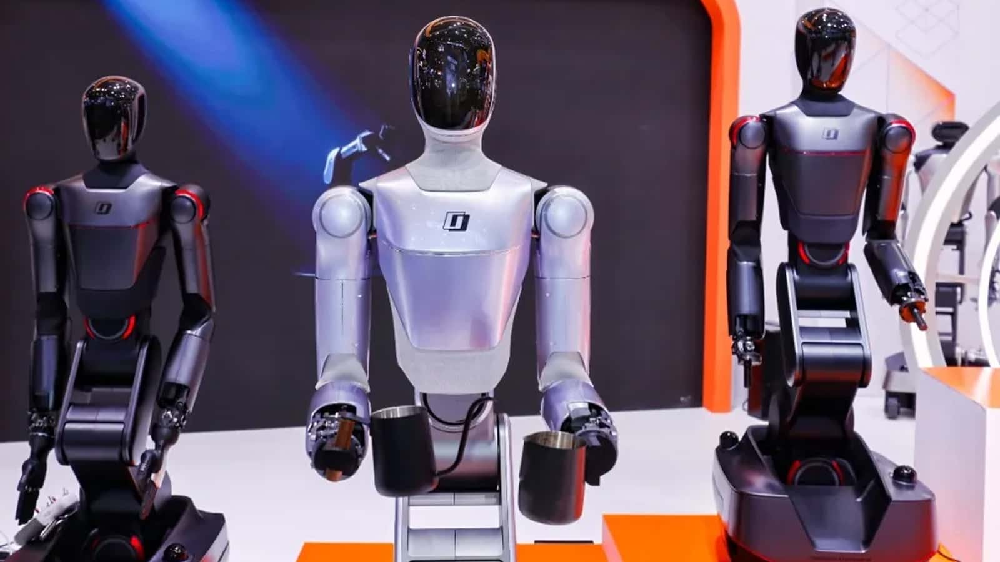

# Galaxea × T04 — Products and Solutions

⬆ [Galaxea profile](../Galaxea.md) · [Brief](Galaxea-T04-1-Brief.md) · [Playbook](Galaxea-T04-3-Playbook.md)

> **Read this first:** which Galaxea hardware is physically on site is **not confirmed**. Best guess from the profile: R1 Pro and/or R1 Lite, possibly LEMO kits. Check at the booth before committing. Research note: the targeted web search for care-sector news could not be run in this pass (search quota exhausted); statements of "nothing found" rest on the company-profile research plus the official pages fetched here.

## Relevant products (ranked for this track)

### R1 Pro

**Role in T04:** the main assistive robot — fetch from floor or high shelf, carry, hand over to a seated or bed-bound person, tidy, open doors, tele-care "remote hands".

| Spec (track-relevant) | Value | Confidence |
|---|---|---|
| Working envelope | Ground to about **2 m** | ⚠️ unverified (reseller listing) |
| Arms | 2 x **7-DoF**, **5 kg per arm** (10 kg combined, without hands) | ⚠️ unverified (reseller) |
| Torso / base | 3-DoF torso, 6-DoF omnidirectional chassis; **26 DoF** total | ⚠️ unverified (reseller) |
| Size / mass | **170 cm**, **96 kg** | ⚠️ unverified (reseller) |
| Speed / runtime | **1.5 m/s** max, about **7 h** | ⚠️ unverified (reseller) |
| Sensors | 7 cameras + 1 LiDAR, 360° perception and obstacle avoidance | ⚠️ unverified (reseller) |
| Hand option | 17-DoF dexterous hand listed as an option; standard is a parallel gripper | ⚠️ unverified (reseller) |
| Joint torque sensing / collision force limits | not public | ask on site |
| IP rating, safety certification | not public | assume none |

- **Status / price:** ✅ shipping. R1 Series "from USD 39,999" (official store); R1 Pro about USD 69,999 on third-party listings ⚠️ unverified. Reseller lead time about 8 weeks.
- **Developer interface:** ROS 2 + Galaxea SDK (docs list V2.5.0). G0.5 ships a ROS 2 client for R1 Pro (`experiments/r1pro` in GalaxeaVLA) with joint-space and whole-body variants; policy server runs on a separate GPU machine. Chassis, torso, arm and gripper are commanded over ROS topics (exact topic names: see the on-robot docs, [R1 Pro docs](https://docs.galaxea-dynamics.com/R1Pro/en/) — JS-rendered, not verified here).

### R1 Lite

**Role in T04:** same tasks as the R1 Pro with lighter arms; **best data match** — the whole Galaxea Open-World Dataset and the `g05-base` zero-shot path were built on it.

| Spec (track-relevant) | Value | Confidence |
|---|---|---|
| Arms | 2 x **6-DoF** with parallel grippers | ✅ (dataset card state layout) |
| Torso / base | 4-joint torso, 3-value (planar) chassis command | ✅ (dataset card) |
| Arm payload | about 3 kg rated / 5 kg max (A1X arm) | ⚠️ unverified (reseller) |
| Cameras used by the models | 4 camera streams | ✅ (dataset card) |
| Height, mass, speed, runtime | not public / not retrieved | — |

- **Status / price:** ✅ shipping; believed to be the USD 39,999 entry model ⚠️ unverified.
- **Developer interface:** ROS 2 client in `experiments/r1lite` (GalaxeaVLA); `scripts/serve_policy.py` serves `g05-base` from an off-board GPU. [R1 Lite docs](https://docs.galaxea-dynamics.com/R1Lite/en/) (JS-rendered, not verified here).

### G0.5 (and legacy G0 Plus / G0 Tiny)

**Role in T04:** language-conditioned manipulation policy — "pick up the glasses from the floor", "bring the water bottle" — without writing grasp code.

| Item | Value |
|---|---|
| Checkpoints | `g05-base` (R1 Lite + R1 Pro, zero-shot and fine-tune) · `g05-so101` · `g05-droid` (Franka) · legacy `G0Plus_3B-pick_and_place` · `G0Tiny_250M-base` (R1 Pro on-board Orin) |
| Inference | **more than 8 GB VRAM**, RTX 3090 / 4090 recommended; off-board server + ROS 2 client on robot |
| Full fine-tune | **more than 70 GB VRAM** (A100 80 GB / H20 96 GB class) |
| Fine-tune data format | local **LeRobot** datasets |
| Licence | **G0.5 Community License — non-commercial**; commercial use needs a separate agreement |
| Timeline | weights 16 Jun 2026; R1 Pro zero-shot entrypoint 11 Jul 2026 |

- **Status:** ✅ open weights. Published zero-shot results are tabletop and benchmark tasks (self-reported); **no care-specific task has been published**. Recommended demo count for fine-tuning: not stated.

### LEMO

**Role in T04:** fixed tabletop care station — pill-organiser filling, meal-tray set-up, opening packaging — and a fast, low-risk place to collect demos while the mobile robot is busy.

| Spec | Value |
|---|---|
| Arms | 2 x A1Z, **5 kg peak payload** each, **±0.1 mm** repeatability |
| Cameras | 3 synchronized fisheye views |
| Teleop | A1Z-T leader arms (**under 50 ms** latency), VR (PICO / Meta) |
| Workflow | LEMO Studio: collect → train → deploy |

- **Status / price:** ✅ shipping since 9 Nov 2026, from **USD 7,699**. [LEMO docs](https://docs.galaxea-dynamics.com/LEMO/en/) (not verified here).
- **Developer interface:** open low-level stack advertised for the A1Z arm; details per docs.

### LEMO A1Z

**Role in T04:** single lightweight "force-controlled" arm (vendor wording) for a bedside or wheelchair-side helper prototype. From **USD 2,999**, ✅. DoF stated as 6 in the product title and 7 in the launch post (⚠️ inconsistent). Force / torque limits and any human-contact rating: not public.

### A1Z-T

**Role in T04:** leader arm for tele-care and for demo collection. USD 1,499 / 2,999, ✅.

### R1 (original)

**Role in T04:** only if an older unit is on site; it is the exact robot used in Stanford BRS, so that code runs on it.

| Spec | Value (official legacy guide) |
|---|---|
| DoF | **24** (6 chassis, 4 torso, 14 arms + grippers) |
| Payload | **5 kg at 0.5 m** |
| Reach | **70 cm** per arm (86 cm with gripper) |
| Working height | **0–200 cm** |
| Sensors | 1 head + 2 wrist + 5 chassis cameras, 360° LiDAR |
| Compute | up to 550 TOPS |

### Galaxea Open-World Dataset

**Role in T04:** pre-training / co-training data for home tasks. **500+ h**, **227 task archives**, scenes: **residential, kitchen, retail, office**; R1 Lite only; LeRobot v2.1; bilingual subtask labels; **2.87 TB** total; CC BY-NC-SA 4.0; **gated** (accept terms on Hugging Face). Download single task archives, not the whole set.

### Nexo

🧪 Unveiled Aug 2026: **30 DoF**, **20 kg dual-arm payload**, **8 h**, coordinated force / position control, built for confined spaces. No docs, price or SDK public. The payload would matter for caregiver logistics, but treat it as a showpiece, not a build platform.

## What Galaxea already does in this domain

**Nothing care-specific is public.** No elderly-care, rehabilitation, clinical or hospital deployment, pilot or partner was found.

Closest evidence:

| Date | What | Relevance to T04 | Source |
|---|---|---|---|
| 2025-03 | **Stanford BEHAVIOR Robot Suite** on the Galaxea R1: learned whole-body policies for 5 home chores — put items on shelves, clean a toilet, lay clothes out, clean up after a party (incl. dishwasher), take trash outside through a door. About **98–138 teleop demos per task**, each 60–210 s | Shows the platform can do real activities-of-daily-living chores with torso + base + two arms. University research, not a Galaxea product | [Galaxea blog](https://galaxea-dynamics.com/blogs/robotics-applications/stanford-galaxea-brs-household-robotics), [BRS site](https://behavior-robot-suite.github.io) |
| 2025-09 onward | Galaxea Open-World Dataset collected partly in **residential and kitchen** scenes | Home-environment priors for the models | [Hugging Face](https://huggingface.co/datasets/OpenGalaxea/Galaxea-Open-World-Dataset) |
| 2026-08 | WRC Beijing: dark-store order picking and bag packing, carton folding, part sorting, robot-on-robot assembly | Reliability of repetitive pick / pack; nothing home- or care-related shown | [Galaxea blog](https://galaxea-dynamics.com/blogs/robotics-insights-news/wrc-2026-embodied-ai-robotics) |

## What they are building next in this domain

- **Stated target sectors (Aug 2026):** manufacturing, consumer electronics, parcel and warehouse logistics, e-commerce / retail, **commercial services**. Care and health are **not named**.
- **Nexo** (🧪) raises payload to 20 kg dual-arm with coordinated force / position control. *Inference:* this is the kind of hardware that later enables caregiver-relief logistics (linen, trays, equipment), but Galaxea has not said so.
- **G0.5 and successors** stay the strategic centre; general household competence improves as a side effect. *Inference:* any care application will most likely come from partners ("N industries" in the 1+3+N strategy), not from Galaxea itself.
- Care roadmap, medical certification plans, Europe / Switzerland plans: **not public**.

## Software, models and data that help for this track

| Asset | What it gives you in 48 h | Link |
|---|---|---|
| GalaxeaVLA (G0.5) | Zero-shot language-conditioned manipulation on R1 Lite / R1 Pro; fine-tune scripts; ROS 2 robot clients | [GitHub](https://github.com/OpenGalaxea/GalaxeaVLA) |
| `G0Plus_3B-pick_and_place` | Post-trained pick-and-place checkpoint ("pick up anything" demo) — quickest autonomous fetch baseline | [GitHub](https://github.com/OpenGalaxea/GalaxeaVLA) |
| `G0Tiny_250M-base` | Runs on the R1 Pro's on-board Orin if no GPU workstation is available | [GitHub](https://github.com/OpenGalaxea/GalaxeaVLA) |
| GalaxeaDP | Diffusion-policy baseline for Galaxea robots — the lighter alternative when no 80 GB GPU is available (GPU needs and demo counts not checked here ⚠️ unverified) | [GitHub](https://github.com/OpenGalaxea/GalaxeaDP) |
| Galaxea Open-World Dataset | Residential / kitchen task data in LeRobot format for co-training | [Hugging Face](https://huggingface.co/datasets/OpenGalaxea/Galaxea-Open-World-Dataset) |
| BRS: `brs-ctrl`, `brs-algo`, JoyLo | Whole-body teleop (Joy-Con based, under USD 500, haptic buzz) and the WB-VIMA policy for the **original R1**; R1 Pro / R1 Lite compatibility ⚠️ unverified | [brs-ctrl](https://github.com/behavior-robot-suite/brs-ctrl) · [brs-algo](https://github.com/behavior-robot-suite/brs-algo) · [data](https://huggingface.co/datasets/behavior-robot-suite/data) |

Missing and to be added by the team: speech (ASR / TTS), an LLM task layer, person / pose / fall detection, hand-over safety logic. None of these ship with the Galaxea stack as far as public docs show.

## Gaps and limits for this track

- **No care track record** and no medical-device status; nothing validated with elderly users.
- **Physical human contact is out of scope:** no published collision force limits, no ISO 10218 / ISO/TS 15066 or ISO 13482 statement found. Keep the robot at arm's length and hand over via a tray or a slow, stationary reach.
- **96 kg at up to 1.5 m/s** (R1 Pro, ⚠️ unverified) — cap base speed, keep an e-stop holder beside the robot.
- **Parallel grippers** by default: fine for bottles, boxes, remote controls; weak for pills, buttons, zips, cutlery use, feeding.
- **Compute:** full G0.5 fine-tuning needs an 80 GB-class GPU; on-site availability not confirmed.
- **Flat indoor floors only;** no stairs, thresholds and wet spa floors untested; IP rating not public.
- **Licences:** models non-commercial; dataset CC BY-NC-SA.
- **Docs:** official portal is JS-rendered and could not be read for this doc; several hardware numbers come from a reseller.

## Sources
- [Galaxea blog — Stanford x Galaxea household robotics (BRS)](https://galaxea-dynamics.com/blogs/robotics-applications/stanford-galaxea-brs-household-robotics)
- [BEHAVIOR Robot Suite project page](https://behavior-robot-suite.github.io)
- [GitHub — OpenGalaxea/GalaxeaVLA](https://github.com/OpenGalaxea/GalaxeaVLA)
- [Galaxea blog — WRC 2026](https://galaxea-dynamics.com/blogs/robotics-insights-news/wrc-2026-embodied-ai-robotics)
- [Hugging Face — Galaxea Open-World Dataset](https://huggingface.co/datasets/OpenGalaxea/Galaxea-Open-World-Dataset)
- [Galaxea legacy user guide — R1](https://userguide-galaxea.github.io/Product_User_Guide/Introducing_Galaxea_Robot/product_info/R1)
- [RBTX reseller listing — R1 Pro](https://rbtx.de/en-GB/components/humanoid/galaxea-r1-pro-humanoid-robot-26-dof)
- [Galaxea company profile (internal, general research)](../Galaxea.md)
