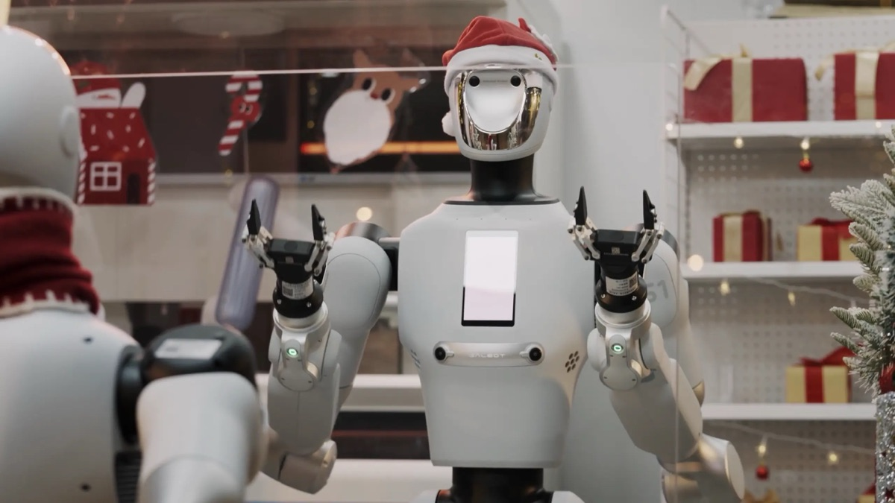
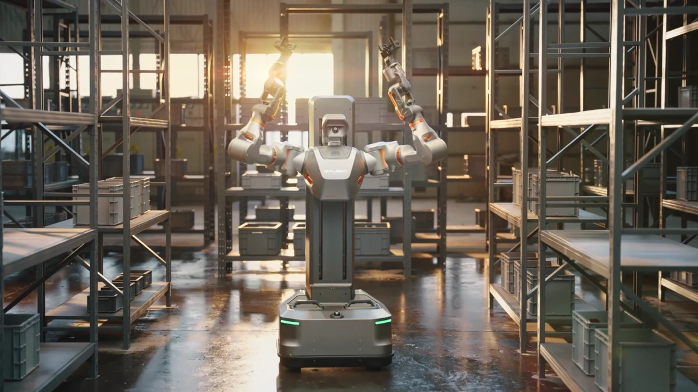
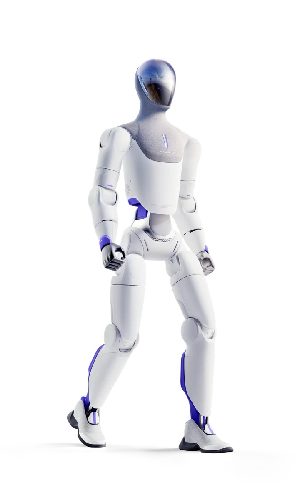
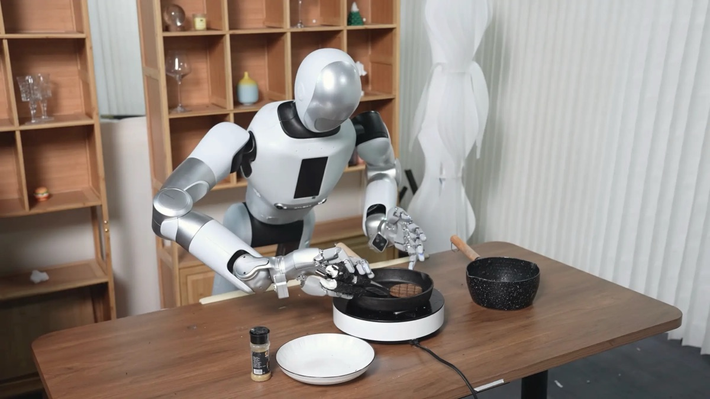
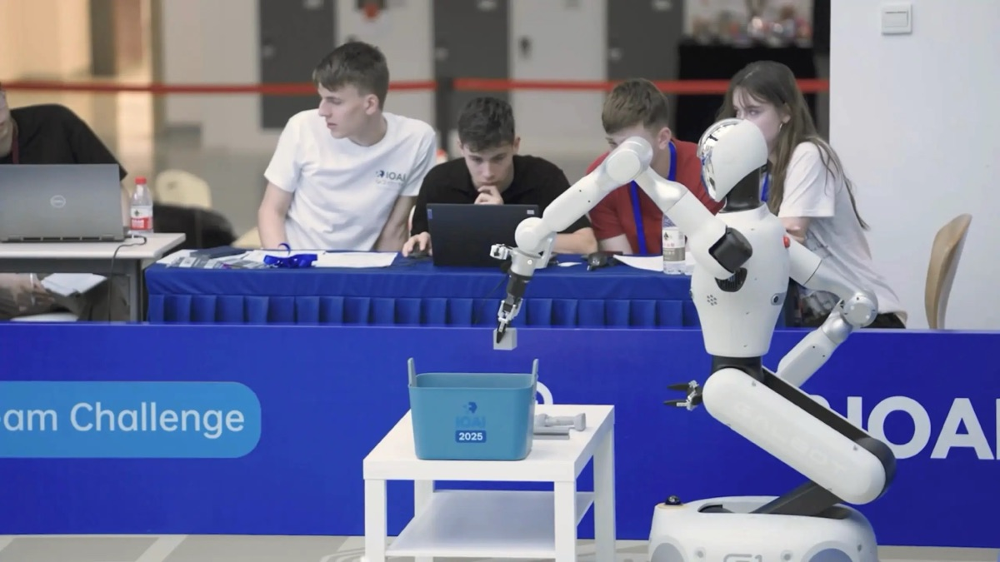
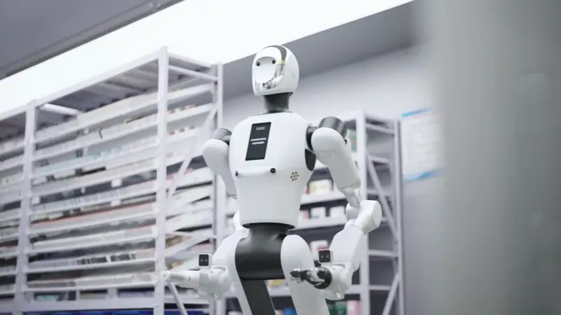

# Galbot — Product Portfolio

⬆ [Galbot profile](Galbot.md) · [Developer guide](Galbot-Developer-Guide.md) · [Roadmap and strategy](Galbot-Roadmap-and-Strategy.md)

> **30-second read:** Build on the **G1** if your idea is "find the right item on a shelf, pick it, bring it, hand it over" indoors. It has two 7-DoF arms (**5 kg each**), a lifting torso that reaches from the **floor to 2.1 m**, an omni base, **8 h** runtime and a public C++/Python SDK. Everything else in the lineup is either too heavy for a hackathon (S1), aimed at interaction rather than manipulation (ET1), or software that runs on the G1 (AstraBrain, GraspVLA). What is physically on site is **not confirmed** — check at the booth.

## Lineup map

Track relevance: ● strong · ◐ partial · ○ none. Status: ✅ shipping/available · 🧪 announced/preview · 🔭 roadmap/concept.

| Product | Category | Status | Launched | Price (if public) | Positioning (one line) | T01 | T02 | T03 | T04 |
|---|---|---|---|---|---|---|---|---|---|
| **Galbot G1** | Wheeled dual-arm mobile manipulator | ✅ | 2024 ⚠️ unverified (exact date not checked) | Not public | Indoor pick-fetch-hand-over workhorse; main SDK target | ● | ◐ | ● | ● |
| **Galbot G1 Lite** | Wheeled general-purpose robot (lighter G1) | ✅ listed on developer portal | Not public | Not public | Named as a supported robot for developer kits; no public spec sheet | ◐ | ○ | ◐ | ◐ |
| **Galbot S1** | Heavy-duty industrial wheeled dual-arm robot | ✅ | 2026-01 (reported) | Not public | 50 kg dual-arm payload for factory and warehouse handling | ◐ | ◐ | ◐ | ○ |
| **Galbot ET1** | Small bipedal humanoid | ✅ pre-orders since 2026-09-03 | 2026-08 (unveiled) | Not found (sold via JD.com) | Agent-native greeter / performer; hands only on Pro and Flagship | ◐ | ○ | ○ | ◐ |
| **AstraBrain** (WAM, WBC, Dex, Agent) | Embodied foundation-model family | ✅ in products · 🧪 partly open | 2026 (current naming) | Not public | The "one brain" behind all Galbot robots | ◐ | ◐ | ◐ | ◐ |
| **GraspVLA / GroceryVLA / TrackVLA / NavFoM / UrbanVLA** | Task foundation models | ✅ GraspVLA open · others research / in-product | GraspVLA paper 2025-05, code 2025-07 | Free (open parts) | Zero-shot grasping, retail picking, person following, navigation | ● | ◐ | ● | ● |
| **Galbot Space Capsule** | Robot-run retail kiosk (G1 inside) | ✅ operating in China | Not confirmed | Not public | Unattended kiosk: G1 picks and hands over drinks and goods | ● | ○ | ◐ | ◐ |
| **Smart pharmacy / instant-retail warehouse** | Vertical solution (G1 inside) | ✅ operating in China | Not confirmed | Not public | 24/7 order picking from shelves; closest template for medication fetch | ● | ◐ | ◐ | ● |

## Products

### Galbot G1

Wheeled semi-humanoid: two 7-DoF arms on a folding/lifting torso and a four-wheel omnidirectional base. Galbot's volume product and the robot behind all its retail, pharmacy and warehouse deployments. **Most likely Galbot hardware at the hackathon (best guess, not confirmed).**

| Spec | Value (official G1 page) |
|---|---|
| Height | max **1,730 mm**; leg-lift travel 650 mm |
| Weight | **92.5 kg** |
| DoF (excl. base and end effector) | **21**: neck 2, arms 7 x 2, waist 3, legs 2 |
| Arm length (shoulder to wrist centre) | 710 mm |
| Workspace (wrist centre) | vertical **0–2,100 mm**, horizontal 1,900 mm |
| Payload (at wrist centre) | **5 kg per arm / 10 kg both arms** |
| Base | 4-wheel omnidirectional, 600 x 600 mm footprint (625 mm swept circle) |
| Max speed | **1.5 m/s** |
| Battery / runtime | 48 V 30 Ah · **8 h** · 3.5 h charge (54.6 V 10 A adapter) |
| End effectors | Swappable: two-finger gripper, suction cup, dexterous hand |
| Sensors | Head: stereo camera · Torso: 4 RGB cameras, IMU · Wrists: 2 depth cameras, 2 six-axis force sensors · Base: 1 3D LiDAR, 8 ultrasonic, IMU |
| Compute | NVIDIA AGX Orin 64 GB (275 TOPS) |
| Connectivity | Wi-Fi 2.4 / 5 GHz, Bluetooth 5.2; 2 x USB 3.0, HDMI |
| HMI | 5.5-inch touchscreen (1920 x 1080), 2 x 4-mic linear arrays, 2 x 5 W speakers |
| Safety controls | Power button, emergency-stop button |
| Environment | **IP54**, 0–40 °C, 0–90 % RH non-condensing |

**What this means in practice**

- **Good at:** shelf picking at any height from floor to above head, carrying light items, hand-over with force sensing at the wrists, voice / screen interaction.
- **Not for:** stairs, snow, outdoor slopes, loads over 5 kg per arm, physically supporting a person.
- **Variants:** the official page lists none. A **G1 Lite** exists on the developer portal (see below). EDU / developer hardware editions: not public. Software access is tiered through the developer portal (Free / Pro / Enterprise) — see the [developer guide](Galbot-Developer-Guide.md).
- **Typical applications (official):** Space Capsule kiosks, supermarket picking / stock-taking / restocking, home tidying and fetching, instant-retail warehouse picking and packing, industrial part sorting and machine tending.
- **Official page:** [galbot.com/g1](http://www.galbot.com/g1/)

### Galbot G1 Lite

Wheeled general-purpose robot named next to the G1 on the developer portal as a supported robot for scenario kits. **No public spec sheet, price or product page found** ⚠️ unverified. If a G1 Lite is on site, ask which arms, sensors and SDK functions differ from the G1. No official image found, so none is shown.

- **Official page:** [developer.galbot.com](https://developer.galbot.com/?lang=en)

### Galbot S1

Heavy-duty industrial version of the same idea: two 7-DoF arms on a vertical lift column and a four-wheel-steer base. Built for factory lines and warehouses; **unlikely to be on site** (320 kg).

| Spec | Value (official S1 page) |
|---|---|
| Height | max **1,793 mm** |
| Weight | **320 kg** |
| DoF | **17**: neck 2, arms 7 x 2, lift 1 (750 mm stroke) |
| Arm length (shoulder to wrist) | 920 mm |
| Payload | up to **50 kg with both arms** |
| Workspace (wrist centre) | 0–2,400 mm and 2,390 mm (page gives horizontal / vertical; reach is floor to about 2.4 m) |
| Base | 4-wheel steering, omnidirectional, 730 x 730 mm |
| Max speed | 1.5 m/s |
| Battery / runtime | 2 x 48 V 30 Ah, **hot-swappable** · **8 h** · 2.0 h charge per battery |
| Sensors | Head: stereo camera, 3D LiDAR · Chest: 2 depth cameras, 2 six-axis force sensors · Base: 2 3D LiDAR |
| Compute | NVIDIA AGX Orin 64 GB (275 TOPS) |
| Connectivity | Wi-Fi 2.4 / 5 GHz, Bluetooth 5.2; 2 x USB 3.0, Ethernet |
| HMI / controls | 7-inch touchscreen, 2 x 5 W speakers, wireless remote, wireless and on-body emergency stop |
| Environment | 0–40 °C, 0–90 % RH non-condensing; IP rating not listed |
| End effectors | Not listed |

- **Applications:** picking, transfer, loading and unloading from floor to high shelves in industry and logistics. Reported in 24/7 use on CATL production lines (trade press, ⚠️ unverified).
- **SDK:** supported by GalbotSDK alongside the G1; URDF / MJCF / USD models published.
- **Official page:** [galbot.com/s1](http://www.galbot.com/s1/)

### Galbot ET1

Galbot's first bipedal robot: a child-sized humanoid sold as an "agent-native" robot for greeting, guiding and stage performance. Possible on site because it is easy to ship.

| Spec | Standard | Pro | Flagship |
|---|---|---|---|
| Standing height | **1,250 mm** | 1,250 mm | 1,250 mm |
| Weight (with battery) | **32 kg** | 32 kg | 32 kg |
| DoF | **26** | 26 + 12 (hands) = **38** | 26 + 12 (hands) = **38** |
| Dexterous hands | No | Yes | Yes |
| Extra AI compute | None listed | NVIDIA Orin Nano, 40 TOPS | NVIDIA Orin NX, 100 TOPS |
| Main processor (all) | RK3588 + D-Robotics RDK X5 | same | same |
| Vision (all) | Stereo camera | same | same |

- **Not listed on the official page:** battery capacity, runtime, walking speed, payload, connectivity, IP rating, price.
- **SDK:** the public GalbotSDK README names G1 and S1 as targets; ET1 developer access is not documented publicly ⚠️ unverified. Ask at the booth before planning custom motion on it.
- **Cross-vendor note:** the ET1 carries a D-Robotics RDK X5, so D-Robotics staff on site may be able to help with on-board perception.
- **Applications:** shop and venue greeting, theme parks, shows; companionship-style interaction.
- **Official page:** [galbot.com/et1](http://www.galbot.com/et1/)

### AstraBrain

Galbot's umbrella name for its embodied foundation models, shared across G1, S1 and ET1. Four parts are named on the official site:

| Part | Role | Public access |
|---|---|---|
| **WAM** | World-action model for manipulation tasks | Not public |
| **WBC** | Whole-body control ("cerebellum") | 🧪 version 0.5 code released as "Humanoid-GPT" on the company GitHub |
| **Dex** | Dexterous-hand manipulation | Not public |
| **Agent** | Task planning and interaction layer (basis of ET1's "agent-native" claim) | Not public |

- **Architecture (company figures):** a large "cerebrum" model of 3B–13B parameters running at 5–10 Hz plus a small "cerebellum" of 80–300M parameters at 100–250 Hz.
- **Hackathon relevance:** you will use AstraBrain indirectly, through the high-level SDK skills and whatever models are preloaded on the robot. Do not plan on fine-tuning it in 48 hours.
- **Official page:** [galbot.com](https://www.galbot.com)

### GraspVLA / GroceryVLA / TrackVLA / NavFoM / UrbanVLA

Task-specific foundation models from Galbot and its Peking University partner lab. The image shows a G1 doing a pick-and-place task at a student challenge (official G1 gallery), not a model diagram.

| Model | What it does | Status / access |
|---|---|---|
| **GraspVLA** | Open-vocabulary grasping from language; pretrained on billion-scale synthetic grasp data, zero-shot transfer to real objects | ✅ open: weights, simulation playground and real-robot interface (repo PKU-EPIC/GraspVLA) |
| **GroceryVLA** | Retail shelf picking; used in the kiosk and store deployments | In-product; public code not confirmed |
| **TrackVLA** | Following a person described in language | Research; public code not confirmed |
| **NavFoM** | Navigation foundation model across robot types | Research; public code not confirmed |
| **UrbanVLA** | Route-following navigation for urban micromobility | ✅ repository public on the company GitHub |

- **Hackathon relevance:** GraspVLA is the fastest route to "pick the named object" without training. Confirm at the booth whether it is preinstalled on the on-site robot and which gripper it expects.
- **Paper:** [GraspVLA, arXiv 2505.03233](https://arxiv.org/abs/2505.03233)

### Galbot Space Capsule

A self-contained retail kiosk with a G1 inside that takes an order, picks the product from shelves and hands it to the customer.

- **Scale (official site, 2026):** **170+ locations in 40+ cities** in China.
- **Not public:** kiosk dimensions, price, ordering software, whether it is offered outside China.
- **Hackathon relevance:** a concept to copy, not a product to borrow. A table, a shelf and a G1 reproduce the core loop for a T01 demo (unattended pharmacy counter, spa-towel or rental-gear hand-out).
- **Official page:** [galbot.com/g1](http://www.galbot.com/g1/)

### Smart pharmacy / instant-retail warehouse solution

G1 robots working as order pickers in pharmacies and delivery-platform dark stores: receive an order, find the items on shelves, pick, pack and pass out.

- **Scale (official site):** **100 instant-retail warehouses**, around the clock, longest site running **1.5+ years**.
- **2026-09-28:** G1 entered regular operation in a Laobaixing Pharmacy store in Shanghai (company news).
- **Not public:** order-system interfaces, pick rates, price. Accuracy figures quoted in the press are company claims ⚠️ unverified.
- **Hackathon relevance:** direct template for T04 (medication or aid fetch for clinic guests) and T01 (night pharmacy). Note there is **no known care-home or rehabilitation deployment**.
- **Official page:** [galbot.com/g1](http://www.galbot.com/g1/)

## Accessories and ecosystem

| Item | What it is | Status / notes |
|---|---|---|
| End effectors for G1 | Two-finger gripper, suction cup, dexterous hand (swappable) | ✅ listed on G1 page; models and specs of each not public |
| Wrist sensing (G1) | Depth camera and six-axis force sensor per wrist | ✅ standard equipment |
| S1 accessories | Wired charger, wireless emergency stop, wireless remote; hot-swap batteries | ✅ listed as included |
| ET1 compute options | Orin Nano (Pro) or Orin NX (Flagship) on top of RK3588 + RDK X5 | ✅ |
| **GalbotSDK** | C++ / Python SDK with high-level and low-level control for G1 and S1 | ✅ V1.10.0 (2026-09-22) on GitHub |
| Robot models | URDF, MJCF and USD for G1 and S1; ROS 2 description packages | ✅ public |
| Developer portal tiers | Free · Pro ¥50,000 per robot per year · Enterprise ¥200,000 per robot per year | ✅ |
| Scenario kits ("L2") | Welcome / guide kit (live), material sorting (coming soon), site inspection (planned) | ✅ / 🧪 / 🔭 |
| Open research code | Humanoid-GPT (WBC), OpenWBT teleoperation, OpenTrack / Any2Track, HumanTracker, UrbanVLA | ✅ on GitHub; several target other vendors' humanoids |
| Charging dock / auto-docking | Not documented publicly | ⚠️ unverified |

Details and code entry points: [developer guide](Galbot-Developer-Guide.md).

## Legacy and discontinued

- No discontinued products found. The company was founded in 2023 and the G1 is its first commercial robot.
- Unresolved names: a "G3" appears in the SDK README badge with no product page, and "Galbot One Golf" is the name of a public ROS 2 description package that appears to be a G1-family code name. Both ⚠️ unverified.

## Image credits

All images are from Galbot's official site CDN (oss-cn-beijing.galbot.com), converted to JPEG.

| File | Shows | Source URL |
|---|---|---|
| assets/galbot-g1.jpg | G1 with two-finger grippers in a retail setting (G1 page hero) | https://oss-cn-beijing.galbot.com/online/portal/website/posters/g1-hero.webp |
| assets/galbot-s1.jpg | S1 page hero image | https://oss-cn-beijing.galbot.com/online/portal/website/posters/s1-hero.webp |
| assets/galbot-et1.jpg | ET1 spec-section render | https://oss-cn-beijing.galbot.com/online/portal/website/posters/et1-spec-robot-v3.webp |
| assets/galbot-astrabrain.jpg | Home-page poster for the AstraBrain WAM section (robot with dexterous hands cooking) | https://oss-cn-beijing.galbot.com/online/portal/website/posters/home-wam.webp |
| assets/galbot-graspvla.jpg | G1 pick-and-place at a student challenge (G1 page gallery); stand-in, not a GraspVLA figure | https://oss-cn-beijing.galbot.com/online/portal/website/posters/g1-gallery-embosar-stack.webp |
| assets/galbot-space-capsule.jpg | Space Capsule scenario poster (G1 page) | https://oss-cn-beijing.galbot.com/online/portal/website/posters/g1-scenario-space-capsule.webp |
| assets/galbot-smart-pharmacy.jpg | Smart-pharmacy scenario poster (G1 page) | https://oss-cn-beijing.galbot.com/online/portal/website/posters/g1-scenario-smart-pharmacy.webp |

## Sources

- [Galbot G1 product page](http://www.galbot.com/g1/)
- [Galbot S1 product page](http://www.galbot.com/s1/)
- [Galbot ET1 product page](http://www.galbot.com/et1/)
- [Galbot official site (home, AstraBrain, news)](https://www.galbot.com)
- [Galbot developer portal](https://developer.galbot.com/?lang=en)
- [GalbotSDK on GitHub](https://github.com/GalaxyGeneralRobotics/GalbotSDK)
- [GitHub org GalaxyGeneralRobotics](https://github.com/GalaxyGeneralRobotics)
- [GraspVLA paper (arXiv 2505.03233)](https://arxiv.org/abs/2505.03233)
- [Galbot company profile in this pack](Galbot.md) (launch dates, deployment and funding context, with its own source list)
