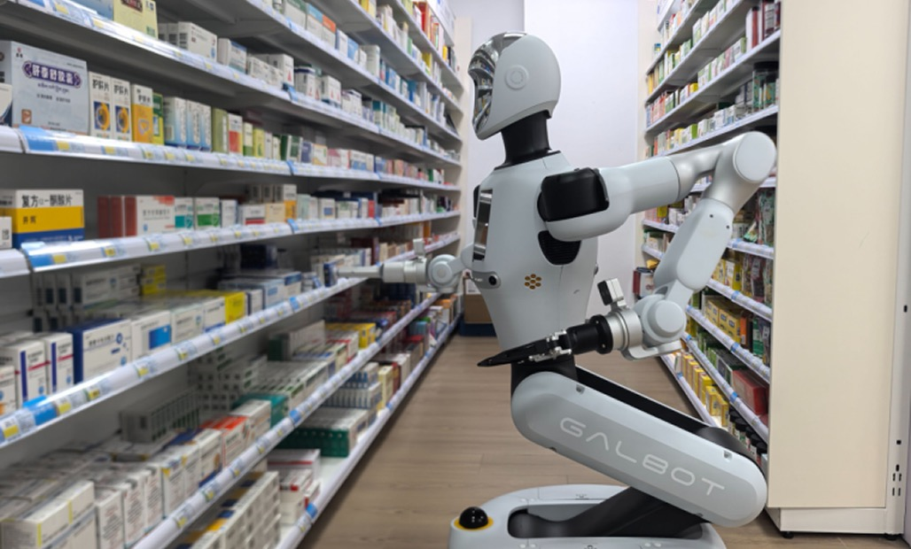
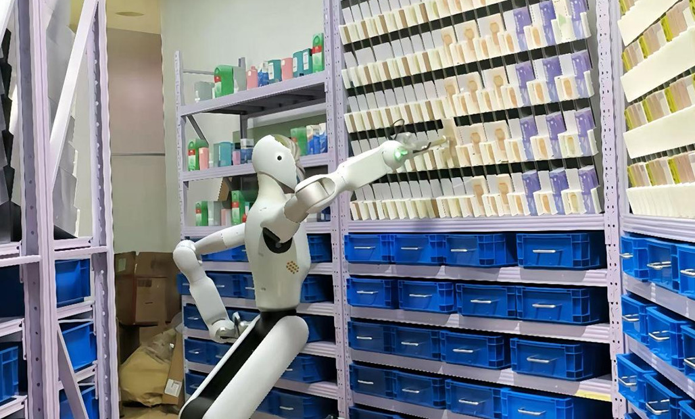
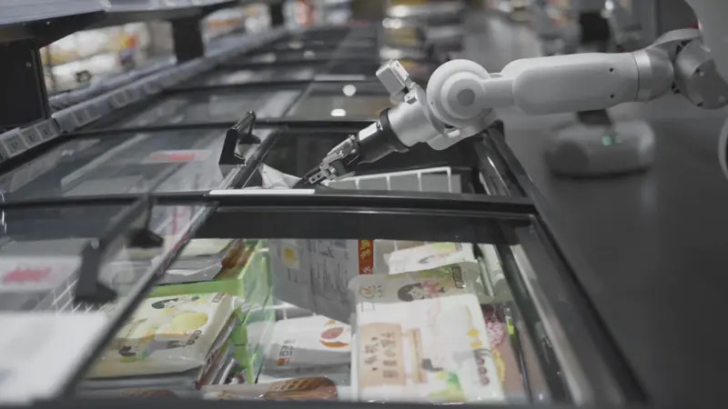
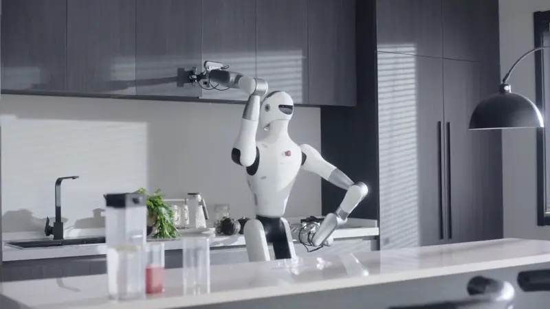
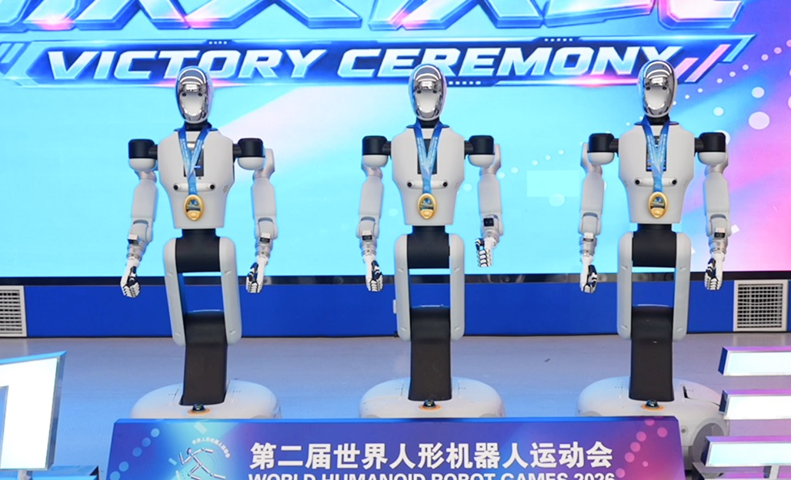
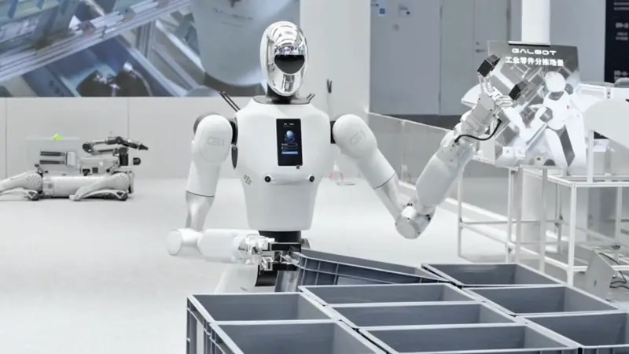
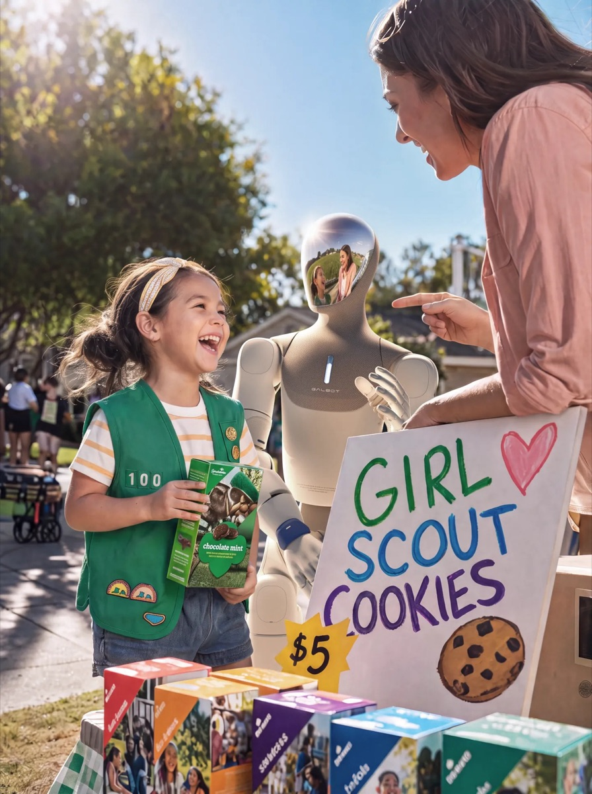

# Galbot — Solutions and Projects Register

⬆ [Galbot profile](Galbot.md) · [Product portfolio](Galbot-Products.md) · [Papers and research](Galbot-Papers-and-Research.md) · [Roadmap and strategy](Galbot-Roadmap-and-Strategy.md)

> **Coverage note:** Walked the official site galbot.com in Chinese (home, /g1, /s1, /et1, /about, /contact) and the **complete official news list: all 50 items, 2024-05-11 to 2026-10-01**, read from the site's own data payload. About 30 of the linked articles (Galbot's official WeChat account and the press pieces the company re-posts) were read in full. Also walked the developer portal (developer.galbot.com). Web search **was available** (2 extended searches used) and added the CATL, Hong Kong, Poly, FamilyMart and IPO items. **Could not access:** sitemap.xml (returns the app shell; robots.txt points to a placeholder domain), the English site routes (client-side only, same content), the Gasgoo English articles (blocked), EmbodiedGlobal and TechRepublic (errors), and three WeChat pages (ET1 pre-order, IROS award, InvestBeijing). The official news list has nothing after 2026-10-01. Items seen only as a search-result summary or only on Baidu Baike are marked ⚠️ unverified. Chinese name **银河通用机器人** confirmed on the official site.

Status icons: ✅ shipping / operating · 🧪 pilot / demo / announced · 🔭 planned.

## Solutions catalogue — everything they offer

| # | Solution / application | What it does | Products used | Maturity | Tracks | Source link |
|---|---|---|---|---|---|---|
| 1 | **Galbot Space Capsule** (银河太空舱) | Robot-run retail kiosk: voice greeting, order and payment, pick from shelf, hand-over at the counter | G1, GroceryVLA, GraspVLA | ✅ **170+ sites in 40+ cities** | T01 | [G1 page](https://www.galbot.com/g1) |
| 2 | **Smart pharmacy / instant-retail warehouse** (即时零售智慧药房) | 24/7 picking of online orders from dense shelves, check, pack, place in pick-up locker for the courier | G1, AstraBrain | ✅ **100 warehouses**, 24 cities | T01 T04 | [LBX Shanghai](https://mp.weixin.qq.com/s/jFPDTeeajsbifXMe_T8j_A) |
| 3 | **Robot-staffed medical-device retail** | Same store format, licensed to sell regulated medical devices (for example contact lenses) | G1 | ✅ Beijing | T01 T04 | [Haidian regulator](https://mp.weixin.qq.com/s/Jya-CW_sXRHamTKVsjNenQ) |
| 4 | **Supermarket and convenience retail** (商超零售) | Pick and deliver goods, continuous stock-taking and restocking, put misplaced goods back | G1, GroceryVLA | ✅ listed on G1 page; FamilyMart store reported ⚠️ | T01 T03 | [G1 page](https://www.galbot.com/g1) |
| 5 | **Galbot Store** (experience and retail store) | Robot "store manager", S1 box-handling demo, public data-collection corner, robot-dog reception | G1, S1, robot dog | ✅ 3 stores in Hong Kong | T01 | [PConline](https://news.pconline.com.cn/2181/21816791.html) |
| 6 | **Home service** (家庭服务) | Cleaning, tidying, finding items, fetching parcels; laundry folding and hanging shown in competition | G1, AstraBrain WAM | 🧪 demo level, no consumer product | T04 | [G1 page](https://www.galbot.com/g1) |
| 7 | **Food-service skill set** | Pick food with tongs, operate a microwave, pour and serve drinks, make breakfast | G1 with dexterous hands | 🧪 competition and trade-fair demos | T01 T04 | [Robot Games 2026](https://mp.weixin.qq.com/s/QQs2y7jEzPDkWHAt_GFUEw) |
| 8 | **Hospital and care assistance** (康养医疗) | Ward rounds day and night, admission and discharge assessment, vital-sign monitoring, risk alerts, medication delivery | G1, "VLA+H" | 🧪 pilots with Xuanwu and West China hospitals | T04 | [Beijing visit report](https://mp.weixin.qq.com/s/eDEoeHKo5YX9p4spq4515A) |
| 9 | **Elderly functional assessment and community screening** | Robot runs the assessment a doctor used to do on a tablet (about 40 min); screening workflow for community health centres | G1 | 🧪 research programme | T04 | [Beijing visit report](https://mp.weixin.qq.com/s/eDEoeHKo5YX9p4spq4515A) |
| 10 | **Prescription-based medicine picking** | Reads a prescription, finds the listed drugs among hundreds, picks and bins them | G1 | 🧪 competition demo built on the pharmacy stack | T04 | [Robot Games 2025](https://mp.weixin.qq.com/s/jzOn9D502_7cX8Xhz_xmpQ) |
| 11 | **Industrial manufacturing with G1** | Part sorting, tote handling, machine tending, assembly, quality checks | G1, G1 Premium (Jetson Thor) | ✅ at named car and parts makers | T03 | [G1 page](https://www.galbot.com/g1) |
| 12 | **Heavy-duty handling with S1** | Depalletising, tote transfer, loading and unloading from floor to 2.3 m; screw fastening shown | S1 | ✅ CATL lines 24/7 | T01 | [S1 page](https://www.galbot.com/s1) |
| 13 | **Welcome and guided-tour kit** (迎宾导览方案包, L2) | Configure knowledge base and persona, recognise key people, respond with voice and gestures | G1, G1 Lite | ✅ live | T01 | [Developer portal](https://developer.galbot.com/?lang=en) |
| 14 | **Material-sorting kit** (物料分拣方案包, L2) | Import a material library, train a sorting model quickly, arrange the workflow | G1, S1 | 🧪 "coming soon" | T03 | [Developer portal](https://developer.galbot.com/?lang=en) |
| 15 | **Site-inspection kit** (场地巡检方案包, L2) | Set patrol routes, arrange inspection tasks, report anomalies | G1, S1 | 🔭 planned | T01 T02 | [Developer portal](https://developer.galbot.com/?lang=en) |
| 16 | **ET1 interaction and performance** | Theme-park interaction, storefront greeting and product talk, dance, two-robot comedy | ET1 | ✅ pre-order | T01 T04 | [ET1 page](https://www.galbot.com/et1) |
| 17 | **Person following and "mobile guardian"** (TrackVLA) | Follows a person described in words, no map; app shows the robot's view and warns on risky events (child running, elderly fall) | TrackVLA; shown on a robot dog | 🧪 model released, no packaged product | T01 T02 T04 | [TrackVLA release](https://mp.weixin.qq.com/s/x08fP4TJF_S5XnX3LkRLZg) |
| 18 | **Cross-platform navigation** (NavFoM, UrbanVLA) | One navigation model for robot dogs, wheeled and legged humanoids, drones and vehicles, indoor and outdoor | NavFoM, UrbanVLA | 🧪 research / in-product | T01 T02 | [About page](https://www.galbot.com/about) |
| 19 | **Education solution** (L3) and competition platform | Course-to-equipment delivery for university labs; simulation-to-real contest platform | G1 | ✅ | — | [Developer portal](https://developer.galbot.com/?lang=en) |
| 20 | **Developer tools** (L1) | GalbotSDK, docs with AI assistant, online simulation, one-click deployment, sim assets | G1, S1 | ✅ | — | [Developer portal](https://developer.galbot.com/?lang=en) |
| 21 | **AstraBrain model stack** (WAM, WBC, Dex / DexNDM, WAM-TTT) | Foundation models behind every solution; WAM-TTT adapts a robot to a new site from a few first-person human videos | all robots | ✅ in products · 🧪 newest parts | — | [About page](https://www.galbot.com/about) |
| 22 | **AstraData and open datasets** | Synthetic-plus-real data infrastructure; open sets such as SynGrasp-1B and DexonomySim | — | ✅ | — | [Dataset release](https://mp.weixin.qq.com/s/Si6YQUzRwOgNjN29YaOQqg) |
| 23 | **Lifecycle service network** (with CATL's NING Service) | Authorised global service provider for Galbot robots | G1, S1 | 🧪 signed June 2026 | — | [CATL news](https://www.catl.com/news/10053.html) |
| 24 | **Precision-assembly products** (Bowintec joint venture) | Dexterous hands and single-arm robots for complex parts, precise assembly, flexible quality checks | joint-venture products | 🔭 | — | [Joint-venture news](https://mp.weixin.qq.com/s/EFcCx-9j6rWKmqVmQvVo_w) |

### Galbot Space Capsule

- **How it works:** a kiosk as small as **9 m²** with one G1 inside. The customer orders by voice or tablet, the robot picks the item and hands it over. No teleoperation and no site data collected beforehand (company statement).
- **Range:** drinks, snacks, souvenirs, medicine; chilled and frozen goods; **300+ product types** per kiosk; coffee and ice cream as add-ons.
- **Scale:** launched 2025-08-07 in Beijing Haidian with a "ten cities, hundred stores" partner plan; official site now states **170+ sites in 40+ cities**.
- **Official link:** [G1 page](https://www.galbot.com/g1) · [launch report](https://mp.weixin.qq.com/s/38FZnZygwEIRLwsKmibr9A)

### Smart pharmacy and instant-retail warehouse

- **How it works:** an online order arrives, G1 finds and picks the items on dense shelves, checks them by vision, packs them and puts them in a pick-up locker. The courier opens the locker with the customer's phone digits.
- **Numbers at the Laobaixing (LBX) store, Shanghai Xuhui (2026-09):** **400–500 orders per day**, **68 s** average handling per order, about **90 s** from order to release, picking accuracy reported as **100%** (store data quoted by the company).
- **Range and scale:** more than **10,000 product types** handled (prescription and over-the-counter drugs, devices, packaged food). **100 warehouses** around the clock, longest running **1.5+ years**; pharmacy and instant retail cover **24 cities**.
- **Staffing effect:** a Beijing Neptunus pharmacy reports more than **50%** less staff time per store (company-quoted).
- **Official link:** [LBX Shanghai article](https://mp.weixin.qq.com/s/jFPDTeeajsbifXMe_T8j_A)

### Robot-staffed medical-device retail

- **What it is:** the first commercial humanoid-robot retail warehouse, opened March 2025 in Beijing Haidian (Beixiaguan). By August 2025: **150+ days** of regular operation and tens of thousands of orders.
- **Capacity:** one robot covers a **50 m²** store with **5,000 product types, 6,000 slots, 10,000+ boxes**, including open shelves and drawers. A new store is set up in **1–2 days**.
- **Regulation:** sells class-III medical devices under a normal device-trading licence; human quality staff still inspect regularly.
- **Official link:** [Haidian regulator article](https://mp.weixin.qq.com/s/Jya-CW_sXRHamTKVsjNenQ)

### Supermarket and convenience retail

- **Tasks:** pick and deliver, stock-taking, restocking, returning misplaced goods. Dual-arm picking of two items at once was shown at WRC 2025.
- **Model:** GroceryVLA combines navigation to the shelf with grasping; handles bags, boxes, bottles, glass and hanging items.
- **Proof:** gold, silver and bronze in the retail event of the 2026 World Humanoid Robot Games, fully autonomous.
- **Official link:** [G1 page](https://www.galbot.com/g1) · [GroceryVLA debut](https://mp.weixin.qq.com/s/sLqVwcwctvYEg0JMXm_mLA)

### Galbot Store (Hong Kong)

- **Opened 2026-09-01:** three stores at Hung Hom waterfront, Wan Chai waterfront and Kai Tak Sports Park.
- **Inside:** G1 as store manager, S1 box-handling demo, a corner where visitors teleoperate a robot arm to produce training data, a robot dog guiding guests.
- **Why it matters:** the company calls Hong Kong its test and showcase window for international markets.
- **Link:** [PConline report](https://news.pconline.com.cn/2181/21816791.html)

### Home service

- **Listed tasks:** cleaning, tidying, finding items, fetching parcels.
- **Shown in competition (2026):** a 30-minute autonomous run across living room, bedroom, bathroom and balcony: tidy objects, open doors, fold shirts and trousers, load a washing machine, hang clothes, and handle a spoken interruption ("a parcel has arrived").
- **Status:** demonstration only. No home product, price or pilot households found.
- **Official link:** [G1 page](https://www.galbot.com/g1)

### Food-service skill set

- **Shown:** take the right dish from a hot-food cabinet with loose tongs, open and load a microwave, turn its timer knob, serve drinks without spilling. Fastest autonomous run **6 min 55 s** (2026 Games).
- **Also shown:** breakfast making (toast, pouring drinks) under disturbance at WAIC 2026.
- **Status:** skills, not a packaged product. The picture shows the 2026 medal ceremony.
- **Official link:** [2026 Games article](https://mp.weixin.qq.com/s/QQs2y7jEzPDkWHAt_GFUEw)

### Hospital and care assistance

- **Pilot content (company description, April 2025):** a robot-centred support system on wards of top-tier hospitals for day and night rounds, admission and discharge assessment, vital-sign monitoring, risk alerts and medication delivery. A second pilot type automates "record, screen, assess, monitor, intervene" in community health centres.
- **Partners:** Xuanwu Hospital (joint lab "Active Health Embodied-AI Robots"), West China hospital group. The Robot Report describes G1 helping in patient rooms, the pharmacy and hospital guidance at Xuanwu.
- **Status:** pilots and research. No product page, price, certification or published results from wards. The picture shows the hospital-scenario medicine-sorting event (2025), not a ward.
- **Official link:** [Beijing visit report](https://mp.weixin.qq.com/s/eDEoeHKo5YX9p4spq4515A)

### Elderly functional assessment and community screening

- **Context:** Galbot supplies the robot technology in a national research programme on ageing led by Xuanwu Hospital with 10+ institutions.
- **Claim:** the sub-project on assessing older people's core functions has completed **10,000+ assessments**; the step a doctor did on a tablet in about **40 minutes** is now done by the robot. How many of the assessments were robot-run is not stated.
- **Official link:** [Beijing visit report](https://mp.weixin.qq.com/s/eDEoeHKo5YX9p4spq4515A)

### Prescription-based medicine picking

- **Task:** read three prescriptions, find **9 drugs** among several hundred on 8 shelves, pick and place them in the right bin.
- **Result:** first place at the 2025 World Humanoid Robot Games, fully autonomous, **10 min 22 s**; most of the 22 teams used teleoperation. University teams using Galbot robots took 2nd and 4th.
- **Official link:** [2025 Games article](https://mp.weixin.qq.com/s/jzOn9D502_7cX8Xhz_xmpQ)

### Industrial manufacturing with G1

- **Tasks:** sorting stacked and similar-looking parts from deep bins, tote transfer, sunroof handling in a car plant, machine loading, quality checks. Vision only, no markers.
- **Track link is indirect:** the sorting skill is what a waste or recycling build would reuse; Galbot itself sells it for factories.
- **Customers named by the company:** see the projects register.
- **Official link:** [G1 page](https://www.galbot.com/g1)

### Heavy-duty handling with S1

- **What it does:** two arms carry up to **50 kg** together, floor to **2.3 m**, hot-swap batteries for 24/7 work. Positioned for industry, warehousing and logistics.
- **In use:** module and pack lines at CATL, **24/7 for 3+ months** by June 2026, no teleoperation (company and CATL statements).
- **Track link is indirect:** warehouse and logistics handling only; nothing for street-level delivery.
- **Official link:** [S1 page](https://www.galbot.com/s1)

### Welcome and guided-tour kit

- **What you configure:** knowledge base, persona, key-person recognition, voice and gesture responses. Low-code.
- **Robots:** G1 and G1 Lite. The only L2 kit that is live.
- **Official link:** [Developer portal](https://developer.galbot.com/?lang=en)

### Material-sorting kit

- **Planned content:** import a material library, train a sorting model quickly, arrange the business flow. For G1 and S1.
- **Status:** "coming soon", no date. A working sorting prototype at the hackathon would fill a gap in their own line-up.
- **Official link:** [Developer portal](https://developer.galbot.com/?lang=en)

### Site-inspection kit

- **Planned content:** patrol routes, inspection task flows, anomaly reporting. For G1 and S1.
- **Status:** "planned", no date. Indoor, flat-floor robots only.
- **Official link:** [Developer portal](https://developer.galbot.com/?lang=en)

### ET1 interaction and performance

- **Official scenarios:** theme-park interaction, storefront greeting with product introduction, stage dance, live comedy duo.
- **How:** child-sized biped (1.25 m, 32 kg) with a motion foundation model of about 100M parameters; learns new movements from interaction, without motion capture (company claim).
- **Care angle:** marketed as a companion that "understands you"; no care deployment. The picture is an official concept image.
- **Official link:** [ET1 page](https://www.galbot.com/et1)

### Person following and "mobile guardian" (TrackVLA)

- **What it does:** follows a target given in plain language ("the person with the yellow helmet"), finds the target again after losing sight, works in unseen malls, lifts and play areas, camera only.
- **Guardian features described:** live first-person view in an app and alerts for risky events such as a child running or an older person falling. The company names child accompaniment, elderly watching, mall patrol and indoor logistics as uses.
- **Status:** model release (June 2025) shown on a robot dog. No packaged product on the site.
- **Official link:** [TrackVLA release](https://mp.weixin.qq.com/s/x08fP4TJF_S5XnX3LkRLZg)

### Cross-platform navigation (NavFoM, UrbanVLA)

- **NavFoM:** one model for autonomous navigation and following across robot dogs, wheeled and legged humanoids, drones and vehicles; indoor to outdoor, long range (About page).
- **UrbanVLA:** route-following for urban micromobility; code on the company GitHub (see the papers file).
- **Status:** research and in-product; Galbot sells no outdoor mobile base of its own.
- **Official link:** [About page](https://www.galbot.com/about)

## Projects register — past and current

| Date | Project / deployment / pilot / partnership | Partner or customer | Location | What happened (one line) | Tracks | Source link |
|---|---|---|---|---|---|---|
| 2026-11 | Community robots partnership ⚠️ unverified (search summary only) | Poly Development | China | Strategic partnership for robots in residential communities, commercial spaces and urban services; no scale or dates given | T01 T04 | [Gasgoo](https://autonews.gasgoo.com/articles/news/robots-enter-communities-poly-development-and-galbot-sign-strategic-partnership-2117965405813104640) |
| 2026-10-01 | IROS 2026 special best-paper award | joint research partners | — | Joint research result awarded | — | [Galbot news](https://mp.weixin.qq.com/s/B_IU4PSYifAol1XoATZ6EA) |
| 2026-09-28 | Smart pharmacy in regular operation | Laobaixing (LBX) Pharmacy | Shanghai, Xuhui | G1 runs the instant-retail room of the Hongcao Road store; 400–500 orders a day | T01 T04 | [Galbot news](https://mp.weixin.qq.com/s/jFPDTeeajsbifXMe_T8j_A) |
| 2026-09-03 | ET1 pre-orders open | — | China | First biped product on sale | T01 | [Galbot news](https://mp.weixin.qq.com/s/RnmqpkT5Y-DNg4QE9ga1bg) |
| 2026-09-01 | Galbot Store opens, 3 sites | Bauhinia Culture Group, Hong Kong Playground Association, Kai Tak Sports Park | Hong Kong | First fully robot-run retail stores in Hong Kong | T01 | [PConline](https://news.pconline.com.cn/2181/21816791.html) |
| 2026-08-22 to 26 | 2nd World Humanoid Robot Games | — | Beijing | Gold in home, catering and retail events, all fully autonomous; retail podium sweep; home event **305 points** against 16 teams | T01 T04 | [Galbot news](https://mp.weixin.qq.com/s/QQs2y7jEzPDkWHAt_GFUEw) |
| 2026-08-22 | "AstraTennis" live match | — | Beijing | Humanoid played autonomous rallies and doubles with human players at the opening ceremony, broadcast live | — | [Galbot news](https://mp.weixin.qq.com/s/kcdnrTJFfSUfITB2u-Z7Iw) |
| 2026-08 | ET1 unveiled | — | Beijing | First public showing of the biped (date as in the company profile) | T01 | [ET1 page](https://www.galbot.com/et1) |
| 2026-08-09 | Beijing Key Laboratory of Embodied-AI Large Models | Peking University, CATL | Beijing Haidian | Galbot-led lab unveiled; 3-, 6- and 9-year targets set | — | [Galbot news](https://mp.weixin.qq.com/s/6IdDqb0yxYQU7eQKAsolDw) |
| 2026-07 | WAIC 2026 showcase | — | Shanghai | Breakfast making, retail hand-over with dexterous hands, tennis, S1 depalletising and screw fastening | T01 | [Gasgoo (zh)](https://m.gasgoo.com/news/70466412.html) |
| 2026-07-16 | WAM-TTT released | — | — | Deployment-time adaptation from unlabeled human video; cross-site performance retention about 15% to 76% (paper figure) | — | [Tencent Tech](https://mp.weixin.qq.com/s/LMtt3FGB6zyB7Boex4S6kg) |
| 2026-07-12 | Smart-retail training centre ⚠️ unverified (Baike only) | Hubei Open Vocational College | Wuhan | Training centre for robot-run retail opened | T01 | [Baidu Baike](https://baike.baidu.com/en/item/Beijing%20Galbot%20Co.,Ltd./888797) |
| 2026-06-24 | Global strategic cooperation | CATL, NING Service | Ningde | NING Service becomes authorised global service provider; S1 is the first such robot on CATL batteries | — | [CATL news](https://www.catl.com/news/10053.html) |
| 2026-06 | AstraBrain WAM 0.5 and WBC 0.5 released | — | — | "Brain" and "cerebellum" base models published; WBC trained on 20,000 h of human motion | — | [CATL feature](https://mp.weixin.qq.com/s/VsQ2Uir_Vn1EF40Bc0xGaQ) |
| 2026 (ongoing) | Production-line use at manufacturers | CATL, Bosch, Siemens, Toyota, Hyundai, BAIC, SAIC, Zeekr, Great Wall | China and abroad (not specified) | Quality checks, loading, handling and sorting on real lines; "thousands of units deployed" (company claim) | T03 | [CATL feature](https://mp.weixin.qq.com/s/VsQ2Uir_Vn1EF40Bc0xGaQ) |
| 2026-04 | Convenience-store cooperation ⚠️ unverified (Baike only) | FamilyMart | Beijing Zhongguancun | G1 reported on duty in a FamilyMart store | T01 | [Baidu Baike](https://baike.baidu.com/en/item/Beijing%20Galbot%20Co.,Ltd./888797) |
| 2026-04 | National embodied-AI data programme | National Data Development Research Institute, Beijing | Beijing | Galbot co-leads a data advancement plan | — | [Galbot news](https://mp.weixin.qq.com/s/6IdDqb0yxYQU7eQKAsolDw) |
| 2026-03 | S1 accepted on battery lines | CATL | Ningde HX base | Material transfer on module and pack lines, 24/7, no teleoperation | — | [CATL feature](https://mp.weixin.qq.com/s/VsQ2Uir_Vn1EF40Bc0xGaQ) |
| 2026-03-17 | Autonomous tennis humanoid shown on CCTV | — | Beijing | First public report of long autonomous rallies | — | [CCTV News](https://mp.weixin.qq.com/s/JE6rSPAeeEWxprWvsPCo-g) |
| 2026-03-02 | RMB 2.5B funding round | Sinopec, CITIC units, Bank of China, national AI fund, SAIC | — | Caixin also reports preparation for a Hong Kong listing | — | [Caixin Global](https://www.caixinglobal.com/2026-03-03/galbot-raises-362-million-in-fresh-funding-eyes-hong-kong-ipo-102418742.html) |
| 2026-02-16 | CCTV Spring Festival Gala appearance | China Media Group | — | Robot featured in a gala short film | — | [Caixin Global](https://www.caixinglobal.com/2026-03-03/galbot-raises-362-million-in-fresh-funding-eyes-hong-kong-ipo-102418742.html) |
| 2026-01 | S1 launched; city investment signing ⚠️ unverified (Baike only) | Chengdu | Chengdu | S1 released; company signed at a Chengdu investment event | — | [Baidu Baike](https://baike.baidu.com/en/item/Beijing%20Galbot%20Co.,Ltd./888797) |
| 2025-12-23 | 1,000+ robot deployment agreement ⚠️ unverified (secondary sources; partner name written "Bada" or "Patek" Precision) | precision manufacturer | China | Robots for a precision-manufacturing ecosystem | — | [Baidu Baike](https://baike.baidu.com/en/item/Beijing%20Galbot%20Co.,Ltd./888797) |
| 2025-12 | Funding above US$300M; Galbot Store in 30+ cities | — | China | Stated use: scale deployments, new technology, global reach | T01 | [The Robot Report](https://www.therobotreport.com/galbot-brings-in-300m-to-scale-mobile-manipulator-deployments/) |
| 2025-11 | World Internet Conference award | Peking University, University of Hong Kong | Wuzhen | Award for the synthetic-plus-real-data VLA project | — | [Galbot news](https://mp.weixin.qq.com/s/6IdDqb0yxYQU7eQKAsolDw) |
| 2025-08-28 | DexonomySim dataset opened | National Data Bureau | Guiyang | **9.5M** dexterous grasps, 10,000+ objects, 31 grasp types | — | [National Data Bureau](https://mp.weixin.qq.com/s/Si6YQUzRwOgNjN29YaOQqg) |
| 2025-08-25 | Jetson Thor early deployment | NVIDIA | Beijing | G1 Premium with Thor did industrial tote handling at WRC 2025; joint Isaac work | — | [Galbot news](https://mp.weixin.qq.com/s/Dya_o5bgMTxUdyh3Lfsf2Q) |
| 2025-08-17 | 1st World Humanoid Robot Games | — | Beijing | Won the medicine-sorting event fully autonomously (10 min 22 s, 336 points) | T04 | [Galbot news](https://mp.weixin.qq.com/s/jzOn9D502_7cX8Xhz_xmpQ) |
| 2025-08-15 | Robot sells regulated medical devices | Haidian market regulator | Beijing Haidian | Store running 150+ days; more than 10 such stores in Beijing | T01 T04 | [Regulator article](https://mp.weixin.qq.com/s/Jya-CW_sXRHamTKVsjNenQ) |
| 2025-08-07 | Space Capsule launch | Haidian district | Beijing Haidian | First kiosk opened; "ten cities, hundred stores" partner plan started | T01 | [Beijing Haidian](https://mp.weixin.qq.com/s/38FZnZygwEIRLwsKmibr9A) |
| 2025-08-02 to 09 | International Olympiad in AI 2025 | IOAI organisers | Beijing | Exclusive robot platform; top-10 student teams deployed code on Galbot robots in a "Future Factory" task | — | [Galbot news](https://mp.weixin.qq.com/s/uFsVCru1phM31H-nD_FxEQ) |
| 2025-06-23 | RMB 1.1B funding round | CATL, Puquan Capital | — | Nearly ten robot-run stores in Beijing at that time | — | [Galbot news](https://mp.weixin.qq.com/s/Osw0HJ522zhat_NSVw7VTw) |
| 2025-06-17 | Joint venture "Bowintec" (博银合创) and lab "RoboFab" | Boyuan Capital, Bosch China, UAES | Shanghai | Venture for precision assembly; lab for car-making steps | — | [Galbot news](https://mp.weixin.qq.com/s/EFcCx-9j6rWKmqVmQvVo_w) |
| 2025-06-06 | GroceryVLA live debut; OpenWBT released | BAAI Conference | Beijing | Shelf picking on stage by voice command, no teleoperation | T01 | [Galbot news](https://mp.weixin.qq.com/s/sLqVwcwctvYEg0JMXm_mLA) |
| 2025-06-04 | TrackVLA released | — | — | Language-driven person following shown in supermarkets and malls | T01 T04 | [Galbot news](https://mp.weixin.qq.com/s/x08fP4TJF_S5XnX3LkRLZg) |
| 2025-04-07 | City leadership visit; care programme shown | Xuanwu Hospital, West China Second Hospital | Beijing | Joint lab for "active health" robots announced; ward and community pilots described | T04 | [Galbot news](https://mp.weixin.qq.com/s/eDEoeHKo5YX9p4spq4515A) |
| 2025-03-27 to 31 | "Xiaoguan Shop" at Zhongguancun Forum | Zhongguancun Forum | Beijing | Thousands of pick-and-deliver tasks and coffees in 5 days, **99.97%** success; smart pharmacy named a major forum achievement | T01 | [Galbot news](https://mp.weixin.qq.com/s/tShL-A89aIa8bq-Oqv2A4A) |
| 2025-03 | First robot-run instant-retail store | — | Beijing Haidian | Start of the 24-hour store format later rolled out nationwide | T01 T04 | [Regulator article](https://mp.weixin.qq.com/s/Jya-CW_sXRHamTKVsjNenQ) |
| 2025-02-11 | Automotive joint venture ⚠️ unverified (Baike only) | Tianqi Shares | China | 50:50 venture for car manufacturing | — | [Baidu Baike](https://baike.baidu.com/en/item/Beijing%20Galbot%20Co.,Ltd./888797) |
| 2025-01-09 | GraspVLA released | Peking University, University of Hong Kong | — | Grasping model pretrained on one billion synthetic frames | T03 | [Galbot news](https://mp.weixin.qq.com/s/kFHggswjt8z9xHp_3Hg2IQ) |
| 2025-01-07 | CES 2025 | NVIDIA | Las Vegas | On stage in the NVIDIA keynote; 24-hour store demo at the NVIDIA booth | T01 | [Galbot news](https://mp.weixin.qq.com/s/aIPwDt44D9BKr2ehEFsFYg) |
| 2024 (late) | 24-hour medical kiosks ⚠️ unverified (Baike only) | Aibo Medical | five Chinese cities | Robot kiosks reported in Beijing, Shanghai, Guangzhou, Shenzhen, Hangzhou | T01 T04 | [Baidu Baike](https://baike.baidu.com/en/item/Beijing%20Galbot%20Co.,Ltd./888797) |
| 2024-11-20 | RMB 500M round; car-plant pilots | Mercedes-Benz, Zeekr and others | China | Tote handling, sorting, process supervision, sunroof transfer | — | [Galbot news](https://mp.weixin.qq.com/s/igrhF4OoZYVqu146jC-C6Q) |
| 2024-09-12 to 16 | First humanoid smart-pharmacy solution shown | Meituan Pharmacy | Beijing (CIFTIS) | Restocking and order picking on the Meituan stand; wider Meituan cooperation on retail, warehouses and logistics | T01 T04 | [Galbot news](https://mp.weixin.qq.com/s/rd0bYpnuazy2fERYjM8HsQ) |
| 2024-07 | Ecosystem cooperation and investment | Hong Kong Investment Corporation | Hong Kong | Start of the Hong Kong link | — | [Liaison Office HK](http://www.locpg.gov.cn/jsdt/2024-07/22/c_1212382257.htm) |
| 2024-06 | First public robot demo; RMB 700M angel funding | — | Beijing | G1 showed generalised pick skills live | — | [RoboSpeak](https://www.leaderobot.com/news/4337) |
| 2024-05-09 | PKU–Galbot Joint Lab of Embodied AI | Peking University | Beijing | Joint lab founded, led by Wang He | — | [PKU CFCS](https://mp.weixin.qq.com/s/ug1BKMOQ-Ph6MUxJUnTTTQ) |

Standing memberships (no single date): seats in China's national humanoid-robot and embodied-AI standards bodies, and drafting roles for data-collection and synthetic-data standards ([key-lab article](https://mp.weixin.qq.com/s/6IdDqb0yxYQU7eQKAsolDw)).

## Future projects and announced plans

| Announced | Planned for | What | Confidence | Tracks | Source link |
|---|---|---|---|---|---|
| 2026-11 | not stated | Robots in residential communities, commercial spaces and urban services with Poly Development | reported ⚠️ unverified | T01 T04 | [Gasgoo](https://autonews.gasgoo.com/articles/news/robots-enter-communities-poly-development-and-galbot-sign-strategic-partnership-2117965405813104640) |
| 2026-09-28 | next step | LBX pharmacy: tune night service, move to uninterrupted 24-hour operation, copy the model to more stores | official | T01 T04 | [Galbot news](https://mp.weixin.qq.com/s/jFPDTeeajsbifXMe_T8j_A) |
| 2026-09-03 | not stated | ET1 deliveries after pre-order | official | T01 | [Galbot news](https://mp.weixin.qq.com/s/RnmqpkT5Y-DNg4QE9ga1bg) |
| 2026-09-01 | ongoing | Use Hong Kong stores as the base for local roll-out and international showcase | official | T01 | [PConline](https://news.pconline.com.cn/2181/21816791.html) |
| 2026-08-09 | 3 / 6 / 9 years | Key lab: whole-body end-to-end model in 3 years, full city-level lab in 6, top national research centre in 9 | official | — | [Galbot news](https://mp.weixin.qq.com/s/6IdDqb0yxYQU7eQKAsolDw) |
| 2026-06-24 | not stated | With CATL: machine loading, cell sorting, screw fastening, wire-harness assembly; robot labs with two universities | official | — | [CATL feature](https://mp.weixin.qq.com/s/VsQ2Uir_Vn1EF40Bc0xGaQ) |
| 2026-06-24 | not stated | NING Service's **1,300+ sites in 80+ countries** to serve Galbot robots; joint after-sales standard; expansion abroad | official | — | [CATL news](https://www.catl.com/news/10053.html) |
| 2026-03-03 | not stated | Hong Kong stock listing in preparation (the company denied a filing in Dec 2025 per Baike) | reported | — | [Caixin Global](https://www.caixinglobal.com/2026-03-03/galbot-raises-362-million-in-fresh-funding-eyes-hong-kong-ipo-102418742.html) |
| 2026 | "coming soon" | Material-sorting kit for G1 and S1 | official | T03 | [Developer portal](https://developer.galbot.com/?lang=en) |
| 2026 | "planned" | Site-inspection kit for G1 and S1 | official | T01 T02 | [Developer portal](https://developer.galbot.com/?lang=en) |
| 2026-09-22 | not stated | "G3" robot model and Jetson AGX Thor support appear in SDK 1.10.0; no product page | inferred | — | [Roadmap file](Galbot-Roadmap-and-Strategy.md) |
| 2025-12-23 | not stated | 1,000+ robots into a precision-manufacturing ecosystem | reported ⚠️ unverified | — | [Baidu Baike](https://baike.baidu.com/en/item/Beijing%20Galbot%20Co.,Ltd./888797) |
| 2025-06-17 | not stated | Bowintec: dexterous hand and single-arm products, own funding, global set-up | official | — | [Galbot news](https://mp.weixin.qq.com/s/EFcCx-9j6rWKmqVmQvVo_w) |
| 2025-04-07 | not stated | More investment in "VLA+H" for medical and elderly care; joint bid for a national "active health" project with Xuanwu and West China Second Hospital (outcome not found) | official | T04 | [Galbot news](https://mp.weixin.qq.com/s/eDEoeHKo5YX9p4spq4515A) |
| 2025-08-07 | 2025–2026 | "Ten cities, hundred stores" for Space Capsule. **Exceeded:** 170+ sites in 40+ cities by 2026 | official | T01 | [Beijing Haidian](https://mp.weixin.qq.com/s/38FZnZygwEIRLwsKmibr9A) |
| 2025-01-09 | not stated | Multi-skill foundation models beyond grasping (placing, articulated and soft objects), pretrained on synthetic data only | official | — | [Galbot news](https://mp.weixin.qq.com/s/kFHggswjt8z9xHp_3Hg2IQ) |

## Solutions by track — quick index

### T01 Autonomous Urban Services

- **Space Capsule kiosk** ✅ — T01.3 public-space service, T01.1 urban retail logistics
- **Smart pharmacy / instant-retail warehouse** ✅ — T01.1 (order picking for couriers), T01.3
- **Galbot Store, Hong Kong** ✅ — T01.3, T01.7 human-robot interaction
- **Supermarket and convenience retail** ✅ — T01.3
- **Welcome and guided-tour kit** ✅ — T01.5 guidance and information
- **ET1 storefront greeting and theme-park interaction** ✅ — T01.5, T01.7
- **TrackVLA person following** 🧪 — T01.6 navigation, T01.7
- **NavFoM / UrbanVLA** 🧪 — T01.6 navigation and path planning
- **Food-service skill set** 🧪 — T01.3
- **S1 heavy-duty handling** ✅ — T01.1 (warehouse side only)
- **Site-inspection kit** 🔭 — T01.4 urban inspection
- **Poly Development community robots** 🔭 ⚠️ unverified — T01.3
- T01.2 smart cleaning: nothing specific found beyond "cleaning" in the home-service list

### T02 Resilient & Safe City

- **Site-inspection kit** 🔭 — T02.3 infrastructure monitoring, T02.5 security monitoring (not released)
- **TrackVLA "mobile guardian" and mall patrol** 🧪 — T02.5
- **NavFoM** 🧪 — T02.6 (model covers robot dogs and drones; Galbot sells neither)
- T02.1 rescue, T02.2 hazardous inspection, T02.4 disaster sensing, T02.7 emergency response: **nothing specific found**

### T03 Sustainable City

- **Material-sorting kit** 🧪 — T03.1 waste sorting, T03.6 recycling (planned for factory materials, not waste)
- **GraspVLA open-vocabulary grasping** ✅ open — T03.1 (building block)
- **G1 industrial part sorting** ✅ — T03.6 (skill transfer only)
- **Supermarket restocking and misplaced-goods return** ✅ — T03.6 resource optimisation (indirect)
- T03.2 environmental monitoring, T03.4 infrastructure, T03.5 water and energy, T03.7 environmental data: **nothing specific found**
- Context only: partner CATL's NING Service does battery repair and recycling; that is CATL's business, not a Galbot solution

### T04 Elderly Care & Rehabilitation

- **Hospital and care assistance pilots** 🧪 — T04.2 smart care robots, T04.6 automation in care, T04.7 health monitoring
- **Elderly functional assessment and community screening** 🧪 — T04.7
- **Smart pharmacy** ✅ — T04.6, T04.7 (round-the-clock medicine access, refills for chronic conditions)
- **Prescription-based medicine picking** 🧪 — T04.6
- **Home service** 🧪 — T04.1 daily living assistance
- **Food-service skill set** 🧪 — T04.1 (meal preparation)
- **TrackVLA "mobile guardian" with fall alert** 🧪 — T04.7, T04.4 (accompanying only)
- **ET1 companionship** ✅ pre-order — T04.5
- **Robot-staffed medical-device retail** ✅ — T04.7 (access to devices)
- **Poly Development community robots** 🔭 ⚠️ unverified — T04.1
- T04.3 rehabilitation training: **nothing specific found**

## What they do NOT offer

- **No rehabilitation or mobility-support robot.** No exoskeleton, walker or patient-lifting product; G1 arms carry 5 kg each. T04.3 and physical T04.4 are uncovered.
- **No commercial care product.** Hospital and elderly work is pilots and research in China; no price, certification or published ward results.
- **No rescue, hazard or rough-terrain platform.** All own robots are indoor, flat-floor machines; TrackVLA and NavFoM were shown on other makers' robot dogs.
- **No inspection product yet.** The inspection kit is only "planned"; no gas, thermal or structural sensing offered.
- **No waste, recycling or environmental-monitoring solution.** The sorting kit is unreleased and aimed at factory materials; no water or energy management.
- **No cleaning robot and no street-level delivery vehicle.** Last-mile delivery in their retail model is done by human couriers.
- **No European deployment or service point found.** The CATL service network is the only visible route abroad besides Hong Kong.
- **Solution software is mostly closed.** GroceryVLA, the kiosk and the pharmacy order systems are not public; open parts are GraspVLA, the SDK and research code.

## Image credits

All pictures come from Galbot's official site CDN (oss-cn-beijing.galbot.com), converted to JPEG.

| file | shows | source URL |
|---|---|---|
| assets/galbot-sol-space-capsule.jpg | G1 inside a Space Capsule kiosk with tablet ordering (news image, Haidian launch, 2025-08) | https://oss-cn-beijing.galbot.com/dev/202508/251056356678.jpg |
| assets/galbot-sol-smart-pharmacy.jpg | G1 picking from pharmacy shelves (news image, LBX Shanghai, 2026-09) | https://oss-cn-beijing.galbot.com/dev/202610/201531578342.png |
| assets/galbot-sol-medical-device-retail.jpg | G1 picking from slot shelves in a Haidian instant-retail store (news image, 2025-08) | https://oss-cn-beijing.galbot.com/dev/202508/251531039847.jpg |
| assets/galbot-sol-medicine-sorting.jpg | G1 in the "Hospital Scenario – Medicine Sorting" event, World Humanoid Robot Games 2025 | https://oss-cn-beijing.galbot.com/dev/202508/251530405523.jpg |
| assets/galbot-sol-robot-games-2026.jpg | Three Galbot robots at the victory ceremony, World Humanoid Robot Games 2026 | https://oss-cn-beijing.galbot.com/dev/202609/031718501613.png |
| assets/galbot-sol-supermarket-retail.jpg | Supermarket-retail scenario poster (G1 page) | https://oss-cn-beijing.galbot.com/online/portal/website/posters/g1-scenario-supermarket-retail.webp |
| assets/galbot-sol-home-service.jpg | Home-service scenario poster: G1 in a kitchen (G1 page) | https://oss-cn-beijing.galbot.com/online/portal/website/posters/g1-scenario-home-service.webp |
| assets/galbot-sol-industrial.jpg | Industrial-manufacturing scenario poster (G1 page) | https://oss-cn-beijing.galbot.com/online/portal/website/posters/g1-scenario-industrial-manufacturing.webp |
| assets/galbot-sol-s1-heavy-handling.jpg | S1 carrying a tote in a warehouse (S1 page gallery, rendered) | https://oss-cn-beijing.galbot.com/online/portal/website/posters/s1-gallery-heavy-load.webp |
| assets/galbot-sol-et1-greeting.jpg | ET1 storefront-greeting concept image (ET1 page) | https://oss-cn-beijing.galbot.com/online/portal/website/posters/et-scene-2-v2.webp |

## Sources

- [Galbot official site, home](https://www.galbot.com)
- [Galbot G1 page](https://www.galbot.com/g1)
- [Galbot S1 page](https://www.galbot.com/s1)
- [Galbot ET1 page](https://www.galbot.com/et1)
- [Galbot About page](https://www.galbot.com/about)
- [Galbot news list](https://www.galbot.com/news)
- [Galbot developer portal](https://developer.galbot.com/?lang=en)
- [Galbot: LBX Pharmacy Shanghai, 2026-09-28](https://mp.weixin.qq.com/s/jFPDTeeajsbifXMe_T8j_A)
- [Galbot: three golds at the 2026 Humanoid Robot Games, 2026-08-26](https://mp.weixin.qq.com/s/QQs2y7jEzPDkWHAt_GFUEw)
- [Galbot: AstraTennis, 2026-08-23](https://mp.weixin.qq.com/s/kcdnrTJFfSUfITB2u-Z7Iw)
- [Galbot: Beijing key laboratory, 2026-08-10](https://mp.weixin.qq.com/s/6IdDqb0yxYQU7eQKAsolDw)
- [Tencent Tech: WAM-TTT, 2026-07-16](https://mp.weixin.qq.com/s/LMtt3FGB6zyB7Boex4S6kg)
- [Jushen Yanxishe: CATL and NING Service cooperation, 2026-06-25](https://mp.weixin.qq.com/s/VsQ2Uir_Vn1EF40Bc0xGaQ)
- [CATL news: first heavy-duty humanoid on CATL batteries, 2026-06-24](https://www.catl.com/news/10053.html)
- [CCTV News: autonomous tennis humanoid, 2026-03-17](https://mp.weixin.qq.com/s/JE6rSPAeeEWxprWvsPCo-g)
- [National Data Bureau: DexonomySim dataset, 2025-08-30](https://mp.weixin.qq.com/s/Si6YQUzRwOgNjN29YaOQqg)
- [Galbot: Jetson Thor deployment, 2025-08-28](https://mp.weixin.qq.com/s/Dya_o5bgMTxUdyh3Lfsf2Q)
- [Galbot: 2025 Humanoid Robot Games win, 2025-08-17](https://mp.weixin.qq.com/s/jzOn9D502_7cX8Xhz_xmpQ)
- [Zhidx: 2025 Games and commercial plans, 2025-08-17](https://mp.weixin.qq.com/s/whHrD4KEquFZiDsKfhbAkg)
- [Haidian market regulator: robot sells medical devices, 2025-08-15](https://mp.weixin.qq.com/s/Jya-CW_sXRHamTKVsjNenQ)
- [Jazzyear: WRC 2025 report, 2025-08-11](https://mp.weixin.qq.com/s/a8dNO2WUhItRVV1545iFlw)
- [Beijing Haidian: Space Capsule launch, 2025-08-07](https://mp.weixin.qq.com/s/38FZnZygwEIRLwsKmibr9A)
- [Galbot: IOAI 2025 robot platform, 2025-07-28](https://mp.weixin.qq.com/s/uFsVCru1phM31H-nD_FxEQ)
- [Galbot: RMB 1.1B round, 2025-06-23](https://mp.weixin.qq.com/s/Osw0HJ522zhat_NSVw7VTw)
- [Galbot: Bowintec joint venture with Boyuan Capital, 2025-06-18](https://mp.weixin.qq.com/s/EFcCx-9j6rWKmqVmQvVo_w)
- [Galbot: GroceryVLA and OpenWBT at BAAI 2025, 2025-06-10](https://mp.weixin.qq.com/s/sLqVwcwctvYEg0JMXm_mLA)
- [Galbot: TrackVLA release, 2025-06-04](https://mp.weixin.qq.com/s/x08fP4TJF_S5XnX3LkRLZg)
- [Galbot: Beijing leadership visit, retail and care programme, 2025-04-08](https://mp.weixin.qq.com/s/eDEoeHKo5YX9p4spq4515A)
- [Galbot: Zhongguancun Forum "Xiaoguan Shop", 2025-04-01](https://mp.weixin.qq.com/s/tShL-A89aIa8bq-Oqv2A4A)
- [Galbot: GraspVLA release, 2025-01-09](https://mp.weixin.qq.com/s/kFHggswjt8z9xHp_3Hg2IQ)
- [Galbot: CES 2025, 2025-01-07](https://mp.weixin.qq.com/s/aIPwDt44D9BKr2ehEFsFYg)
- [Galbot: RMB 500M strategic round, 2024-11-20](https://mp.weixin.qq.com/s/igrhF4OoZYVqu146jC-C6Q)
- [Galbot: Meituan Pharmacy smart-pharmacy solution at CIFTIS, 2024-09-13](https://mp.weixin.qq.com/s/rd0bYpnuazy2fERYjM8HsQ)
- [PKU CFCS: PKU–Galbot joint lab, 2024-05-11](https://mp.weixin.qq.com/s/ug1BKMOQ-Ph6MUxJUnTTTQ)
- [PConline: Galbot Store opens in Hong Kong, 2026-09-07](https://news.pconline.com.cn/2181/21816791.html)
- [Gasgoo (zh): Galbot at WAIC 2026, 2026-07-18](https://m.gasgoo.com/news/70466412.html)
- [Caixin Global: funding and Hong Kong listing plans, 2026-03-03](https://www.caixinglobal.com/2026-03-03/galbot-raises-362-million-in-fresh-funding-eyes-hong-kong-ipo-102418742.html)
- [The Robot Report: Galbot brings in $300M, 2025-12-23](https://www.therobotreport.com/galbot-brings-in-300m-to-scale-mobile-manipulator-deployments/)
- [Baidu Baike (English): Beijing Galbot Co., Ltd.](https://baike.baidu.com/en/item/Beijing%20Galbot%20Co.,Ltd./888797) (secondary; used only for items marked ⚠️)
- [Gasgoo: Poly Development and Galbot partnership](https://autonews.gasgoo.com/articles/news/robots-enter-communities-poly-development-and-galbot-sign-strategic-partnership-2117965405813104640) (search-result summary only; page blocked)
- [Galbot company profile in this pack](Galbot.md) · [Roadmap and strategy](Galbot-Roadmap-and-Strategy.md)
