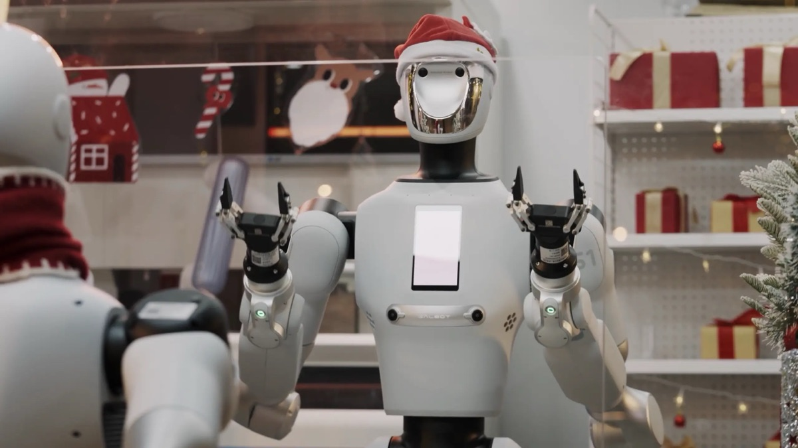
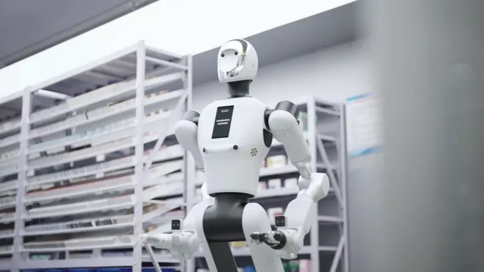
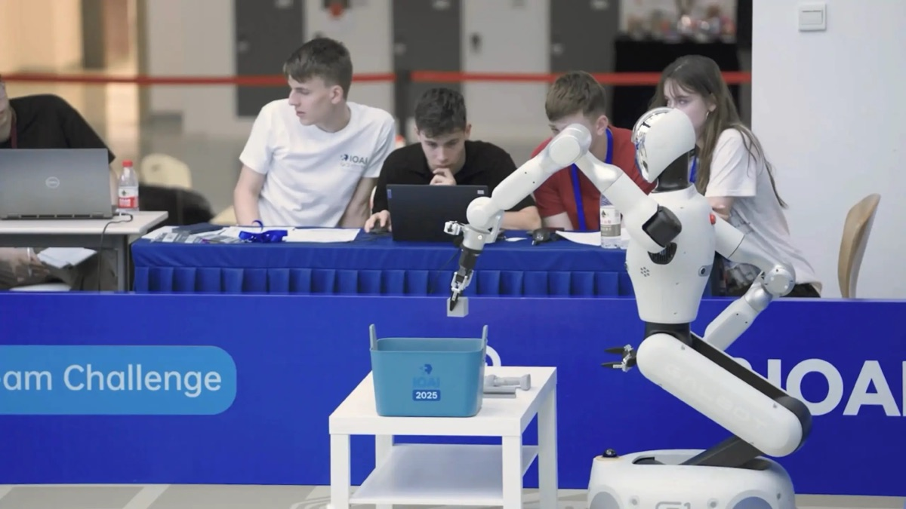
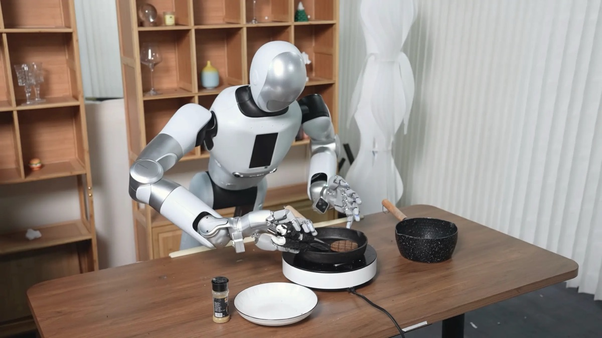
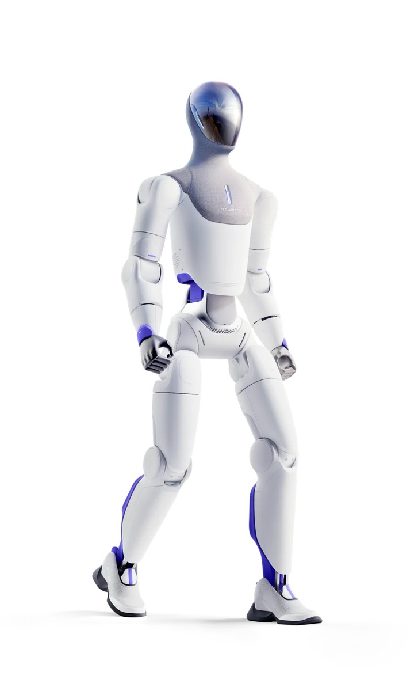

# Galbot × T01 — Products and Solutions

⬆ [Galbot profile](../Galbot.md) · [Brief](Galbot-T01-1-Brief.md) · [Playbook](Galbot-T01-3-Playbook.md)

**Short version:** for T01 Galbot is an **indoor service-point robot** (shop, kiosk, pharmacy, reception, stockroom). It is not a street or last-mile platform. What Galbot actually brought to Leukerbad is not confirmed ⚠️ — check at the booth before committing.

## Relevant products (ranked for this track)

### Galbot G1

**Role in T01:** the robot that staffs a service point — picks a named item from shelves, carries it a short distance indoors, hands it over, talks to the guest. Basis of every Galbot retail and pharmacy deployment.

| Spec (official G1 page, via company profile) | Value | Why it matters for T01 |
|---|---|---|
| Form | Wheeled base + lifting torso + 2 x 7-DoF arms, **21 DoF** | Reaches floor-level and top shelves from one base position |
| Height / weight | max **1,730 mm** / **92.5 kg** | Human-scale in a lobby; too heavy to lift over a threshold |
| Payload | **5 kg per arm, 10 kg both** | Parcels, bottles, towels, small crates; not luggage |
| Vertical wrist reach | **0-2,100 mm** | Full shelf height |
| Base | 4-wheel omnidirectional, **1.5 m/s** | Tight aisles, sideways docking at a counter |
| Runtime / charge | **8 h** / 3.5 h | A full demo day; deployments self-charge |
| Sensors | 3D LiDAR, stereo head camera, 4 torso RGB, 2 wrist depth cameras, 2 wrist 6-axis F/T | Built-in mapping and obstacle avoidance; force-aware hand-over |
| End effectors | Swappable gripper / suction / dexterous hand | Suction for boxes, gripper for bottles |
| Compute | NVIDIA AGX Orin 64 GB | Perception on board; large VLAs need an external GPU |
| Environment | **IP54, 0-40 °C**, wheeled | **Indoor flat floors only.** No snow, stairs, kerbs or steep ramps |

- **Status:** ✅ shipping (reported 1,200+ units in 2025 ⚠️ unverified).
- **Price:** not public.
- **Developer interface (GalbotSDK V1.10.0, C++ / Python, Ubuntu 20-24):**
  - High level: mapping, localisation, dynamic obstacle avoidance, **point-to-point navigation**; whole-body motion planning with collision protection; voice, light and motion interaction.
  - Low level: joint motors, chassis velocity, raw RGB / depth / point-cloud streams; pass-through of end-to-end model actions.
  - Repo contains `examples/`, per-model docs (`docs/g1/`), a robot-compatibility check script and a deploy-to-robot script. SDK V1.10.0 expects robot environment V1.18.

### Galbot Space Capsule

**Role in T01:** the closest thing Galbot has to a packaged "urban service" product — an unmanned 24/7 kiosk run by one G1. Use it as the **reference design** for a Leukerbad concierge / kiosk concept; the capsule itself is very unlikely to be on site.

| Item | Value | Source note |
|---|---|---|
| Footprint | **~9 m²** (Hong Kong unit, press) · **16 m²** (Guiyang units) | Press / local government |
| Scale | **170+ locations in 40+ cities** | Official site, 2026 |
| Robot tasks | Greeting, multilingual interaction, recommendation, order and payment, item retrieval, face-to-face hand-over, restocking, self-charging, remote scheduling | Guiyang government page; eWeek |
| Operation | Fully autonomous, 24/7 (company claim) | Company / press |

- **Status:** ✅ operating in China; first unit outside mainland China announced for Hong Kong (Hung Hom waterfront, reported 2026-06-17; opening not confirmed here ⚠️).
- **Price / availability:** not public; sold as a full solution to chain retail (developer portal).
- **Developer access:** none to the capsule product itself. You rebuild the idea with G1 + SDK.

### Smart pharmacy / instant-retail warehouse solution

**Role in T01:** proof that the pick-from-many-SKUs loop runs unattended. Maps onto "order online, robot picks, courier or guest collects" services (pharmacy, mini-market, hotel amenities).

| Item | Value |
|---|---|
| Scale | G1 working 7x24 in **100+ instant-retail warehouses**, some 1.5+ years (official site) |
| Latest store | Laobaixing Pharmacy, Shanghai, regular operation from **2026-09-28** (Galbot news) |
| Accuracy claim | 99.95% order accuracy with Neptunus ⚠️ unverified company / press claim |

- **Status:** ✅ operating. **Price:** not public. **Developer access:** the production picking stack is not public; ask whether a demo version is preloaded.

### GraspVLA / GroceryVLA / TrackVLA / NavFoM / UrbanVLA

**Role in T01:** the model layer for "pick anything" and "navigate / follow". Useful in practice only where weights are public.

| Model | What it does | Public status (checked 2026-11-14) | 48-hour usefulness |
|---|---|---|---|
| **GraspVLA** | Zero-shot open-vocabulary grasping, trained on SynGrasp-1B synthetic data | ✅ Checkpoint + model server + dataset + sim playground + real-robot controller (PKU-EPIC). **~200 ms latency, ~9 GB GPU memory** on one L40s. Two camera views, 7-dim action (Franka-style setup). Licence appears to be CC BY-NC 4.0 ⚠️ unverified | High if the booth has a G1 integration; otherwise a port is real work |
| **UrbanVLA** | Follows map-app route instructions (Amap / Google Maps style) with camera input for sidewalk-scale navigation; real tests on a **quadruped** with GPS and multi-view cameras | 🧪 Repo (Apache-2.0) has the MetaUrban data and benchmark pipeline only; **architecture, training code and checkpoint are still listed as to-do** | Low — benchmark only |
| **NavFoM** | Cross-embodiment navigation model (wheeled, quadruped, drone, car), ~8M training samples | 🧪 Paper + video only; ran on a remote RTX 5090 server in tests | None unless Galbot provides access on site |
| **TrackVLA** | Follows a described person from egocentric video, 10 FPS | 🧪 Code and EVT-Bench linked from the project page; weights not confirmed ⚠️ | Low to medium |
| **GroceryVLA** | Retail shelf picking | In-product; no public code found | Only via Galbot staff |

### AstraBrain

**Role in T01:** the umbrella brand for Galbot's in-product models (WAM, WBC, Dex, Agent). Relevant as the thing that makes the retail robots work, not as something you can call. Only the WBC 0.5 part ("Humanoid-GPT", humanoid whole-body control) is open, and it does not help a wheeled service build.

- **Status:** ✅ in products / 🧪 partly open. **Price:** not public. **Developer interface:** none public beyond SDK action pass-through.

### Galbot ET1

**Role in T01:** greeter / guide at a venue entrance. Small biped (**1,250 mm, 32 kg**), positioned by Galbot for theme parks, shop greeting and stage shows. Standard version has no dexterous hands, so no fetching.

- **Status:** ✅ pre-orders since 2026-09-03. **Price:** not found. **Developer interface:** not covered by the public GalbotSDK README (which lists G1, S1, G3) ⚠️ unverified.

### Galbot G1 Lite

**Role in T01:** listed on the developer portal as a supported robot for the **welcome / guide kit**. Specs not public ⚠️ unverified. Treat as "G1 for reception duty" until Galbot staff say otherwise.

**Not relevant for T01:** Galbot S1 (320 kg factory-line robot).

## What Galbot already does in this domain

| Date | What | Where | Status / source |
|---|---|---|---|
| Ongoing (some sites 1.5+ years as of 2026) | G1 picking in pharmacies and instant-retail warehouses, 24/7 | China; 100+ warehouses | ✅ [G1 page](http://www.galbot.com/g1/) |
| 2025 | Space Capsule kiosks tested at the Summer Palace and Zhongguancun ART PARK, Beijing | Beijing | Reported by [eWeek](https://www.eweek.com/news/hong-kong-humanoid-robot-store-apac-china/) |
| **2025-12-31** | **10 tourism-retail capsules** at landmarks (pedestrian street, ancient town, city park, civic centre). Serves coffee and warm drinks, acts as voice guide, multilingual, 24/7 | Guiyang and Gui'an, with China Mobile Guizhou | ✅ [Guiyang government](https://fgw.english.guiyang.gov.cn/2026-01/26/c_1157846.htm) |
| 2026-06 (reported) | First store outside mainland China, 24-hour capsule, snacks and OTC medicines | Hung Hom waterfront, Hong Kong | 🧪 announced; opening not confirmed here ⚠️ |
| 2026 (WAIC) | Multi-scenario showcase: retail selling, breakfast preparation; capsule count quoted as 170+ / 40+ cities | Shanghai | Gasgoo headline and search summary only ⚠️ unverified detail |
| **2026-09-28** | G1 in regular commercial operation at a Laobaixing pharmacy, 24-hour drug sales | Shanghai | ✅ Galbot news (via profile) |
| 2026 | Welcome / guide kit live on developer portal (knowledge base, persona, key-person recognition, voice and motion) | Developer portal | ✅ [portal](https://developer.galbot.com/?lang=en) |

**Not found:** hotel or room delivery, street or sidewalk delivery product, cleaning or maintenance robots, waste collection, any deployment in Europe or Switzerland. UrbanVLA is research, tested on a quadruped, not a Galbot product.

## What they are building next in this domain

- **Site-inspection kit** for G1 / S1 (routes, task flow, anomaly reporting): 🔭 "planned" on the developer portal. **Material-sorting kit:** 🧪 "coming soon".
- **UrbanVLA release:** model architecture, training code and checkpoint are listed as to-do in the repo. 🧪
- **International retail:** Hong Kong as first stop outside the mainland. 🧪 Further cities: not announced.
- **ET1 as venue greeter:** theme parks, shops, stage (launched Aug-Sep 2026). ✅ / 🧪
- **Inference (not announced):** NavFoM + UrbanVLA + TrackVLA research covering wheeled robots, quadrupeds and map-app route following suggests Galbot wants navigation beyond the shop floor. No outdoor delivery product has been announced.

## Software, models and data that help for this track

| Asset | Use in a T01 build | Link |
|---|---|---|
| GalbotSDK V1.10.0 | Navigation goals, arm motion planning, sensors, voice | [GitHub](https://github.com/GalaxyGeneralRobotics/GalbotSDK) |
| G1 description (URDF / MJCF / USD; ROS 2 package `galbot_one_golf_description`, Apache-2.0; G1 mapping ⚠️ unverified) | Simulate reach and shelf layout before touching the robot | [GitHub org](https://github.com/GalaxyGeneralRobotics) |
| GraspVLA (checkpoint, server, playground, real-world controller) | Open-vocabulary pick without per-item training | [PKU-EPIC/GraspVLA](https://github.com/PKU-EPIC/GraspVLA) |
| Welcome / guide kit | Concierge persona and knowledge base | [Developer portal](https://developer.galbot.com/?lang=en) |
| UrbanVLA benchmark pipeline (MetaUrban PointNav / SocialNav) | Only for evaluating your own sidewalk policy in sim | [GitHub](https://github.com/GalaxyGeneralRobotics/UrbanVLA) |
| RoboGesture (MIT, co-speech gestures for humanoids) | Possible polish for a greeter; robot compatibility not checked ⚠️ | [GitHub org](https://github.com/GalaxyGeneralRobotics) |

Not useful here: HumanTracker (a humanoid motion-tracking benchmark on Unitree G1, not a person-follower), Humanoid-GPT, OpenWBT, OpenTrack, LATENT (all legged-humanoid control).

## Gaps and limits for this track

- **Indoor only.** Wheeled, IP54, 0-40 °C. Leukerbad in November means snow and slopes outside; G1 stays inside one building, one floor unless a lift is integrated (no public lift-integration API found).
- **No outdoor delivery or maintenance product.** "Move and maintain the city" in the street sense is outside Galbot's range.
- **Production picking stack is closed.** GroceryVLA and the pharmacy software are not public; the open GraspVLA release targets a Franka-style arm.
- **Navigation models are not usable off the shelf** (NavFoM: no code; UrbanVLA: no checkpoint).
- **ROS 2 runtime bridge not documented**; expect to work in the SDK's own C++ / Python API.
- **Paid tiers** (¥50,000 / ¥200,000 per robot per year) gate cloud simulation, one-click deployment and remote debugging. Hackathon terms are unknown.
- **Payload 10 kg, speed 1.5 m/s:** a service-point robot, not a porter.
- **On-site hardware unconfirmed** ⚠️.

## Sources
- [Galbot company profile (this repo)](../Galbot.md)
- [Galbot G1 product page](http://www.galbot.com/g1/)
- [Galbot developer portal](https://developer.galbot.com/?lang=en)
- [GitHub org GalaxyGeneralRobotics](https://github.com/GalaxyGeneralRobotics)
- [GalbotSDK repository](https://github.com/GalaxyGeneralRobotics/GalbotSDK)
- [UrbanVLA repository](https://github.com/GalaxyGeneralRobotics/UrbanVLA)
- [UrbanVLA paper (arXiv 2510.23576)](https://arxiv.org/abs/2510.23576v1)
- [NavFoM project page](https://pku-epic.github.io/NavFoM-Web)
- [TrackVLA project page](https://pku-epic.github.io/TrackVLA-web)
- [GraspVLA repository (PKU-EPIC)](https://github.com/PKU-EPIC/GraspVLA)
- [GraspVLA paper (arXiv 2505.03233)](https://arxiv.org/abs/2505.03233)
- [HumanTracker repository](https://github.com/GalaxyGeneralRobotics/HumanTracker)
- [Guiyang government: robotic tourism-retail capsules, updated 2026-01-26](https://fgw.english.guiyang.gov.cn/2026-01/26/c_1157846.htm)
- [eWeek, 2026-06-17: humanoid robot to run a 24-hour store in Hong Kong](https://www.eweek.com/news/hong-kong-humanoid-robot-store-apac-china/)
- [Gasgoo: WAIC 2026 Galbot multi-scenario showcase](https://autonews.gasgoo.com/articles/news/waic-2026-making-breakfast-selling-goods-galbot-showcases-multi-scenario-capabilities-2079095839749283841) (headline and search summary only; page could not be fetched)
