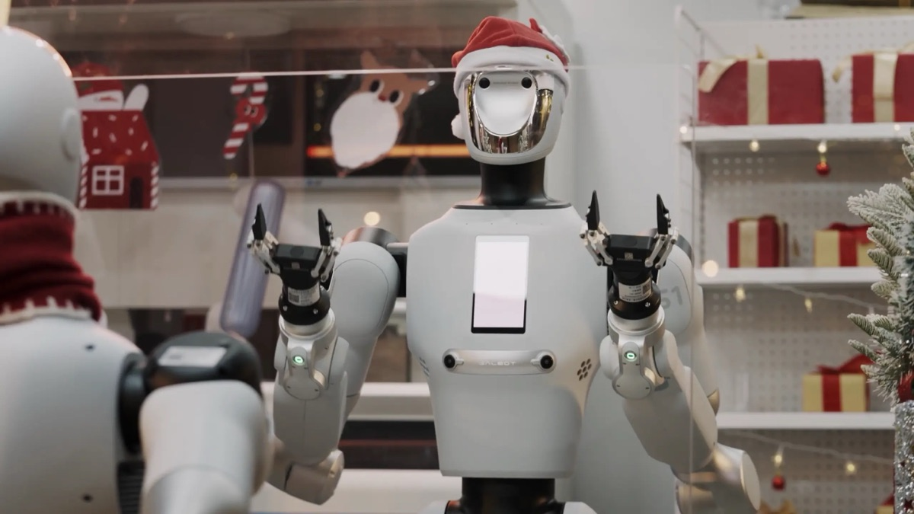
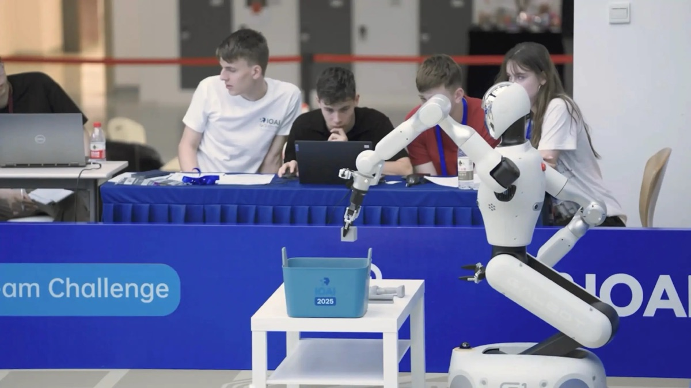
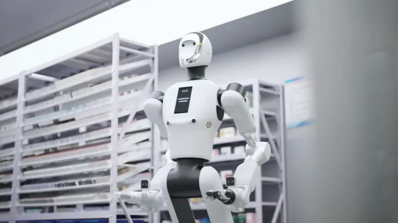
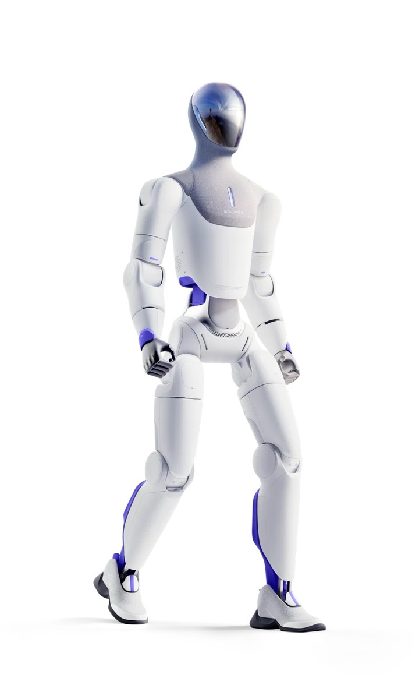

# Galbot × T02 — Products and Solutions

⬆ [Galbot profile](../Galbot.md) · [Brief](Galbot-T02-1-Brief.md) · [Playbook](Galbot-T02-3-Playbook.md)

**Bottom line:** Galbot has no product, kit or deployment aimed at safety, inspection or emergency response. What it offers this track is a reliable **indoor** mobile manipulator (G1) and a usable SDK. Treat it as the "hands" in a multi-vendor system, not as the lead platform.

## Relevant products (ranked for this track)

### Galbot G1

**Role in T02:** indoor inspection-and-intervention robot (look, then press / open / move / fetch), or an unattended emergency-supply point. The only Galbot robot likely to be on site (best guess, not confirmed).

| Track-relevant spec | Value (official G1 page via company profile) |
|---|---|
| Form | Wheeled dual-arm semi-humanoid, 4-wheel omni base |
| Size / mass | Height up to **1,730 mm** · **92.5 kg** |
| Payload | **5 kg per arm / 10 kg both arms** |
| Vertical reach (wrist) | **0–2,100 mm** (floor to above head height) |
| Speed | **1.5 m/s** |
| Runtime / charge | **8 h** / 3.5 h |
| Environment | **IP54, 0–40 °C**; flat floors only (no stairs, snow, slopes) |
| Sensors | 3D LiDAR, stereo head camera, 4 torso RGB, 2 wrist depth cameras, 2 wrist 6-axis force/torque sensors |
| Not on board | Thermal camera, gas / smoke sensing, hazardous-area (ATEX) rating: none listed |
| Compute | NVIDIA AGX Orin 64 GB |
| End effectors | Swappable gripper / suction / dexterous hand |

- **Status / price:** ✅ shipping · price not public (a reseller blog quotes about US$87–97k ⚠️ unverified).
- **Developer interface:** GalbotSDK V1.10.0 (C++ / Python, Ubuntu 20–24). High-level: mapping, localization, dynamic obstacle avoidance, point-to-point navigation, whole-body motion planning with collision protection. Low-level: joint and chassis velocity control, raw RGB / depth / point-cloud streams. End-to-end model actions can be passed through. Voice, light and motion interaction APIs.
- **Not documented publicly:** a teleoperation kit for G1, a ROS 2 runtime bridge ⚠️ unverified. Remote debugging is a paid-tier service, not an SDK feature.

### GraspVLA / GroceryVLA / TrackVLA / NavFoM / UrbanVLA

**Role in T02:** perception-to-action shortcuts for grasping, following a person and language-driven navigation.

| Model | T02 use | Public availability |
|---|---|---|
| GraspVLA | Pick an unseen object by name (first-aid kit, debris, tool) | ✅ open weights + code at PKU-EPIC/GraspVLA; whether a G1 build is preloaded on site: ask |
| TrackVLA / TrackVLA++ | Follow a responder or a designated person | 🧪 papers and project pages; official code not confirmed. Community re-implementation OmTrackVLA exists (third party, licence unclear) |
| NavFoM | Cross-embodiment navigation (wheeled, quadruped, drone, vehicle): language navigation, object search, target tracking | 🧪 ICLR 2026 paper; no official repo or weights found on the project page |
| UrbanVLA | Outdoor route following for urban micromobility | ✅ repo public (Apache-2.0, ICRA 2026); target embodiment is not the Galbot G1 ⚠️ unverified which robots are supported |
| GroceryVLA | Shelf picking in retail | In-product; no public code found |

- **Price:** open-source parts are free; the rest not public.

### Smart pharmacy / instant-retail warehouse solution

**Role in T02:** the only Galbot solution that maps onto "keep services running during disruption": an unattended, 24-hour pick-and-hand-over point. Re-skin it as an emergency supply or medication point.

| Proof | Value |
|---|---|
| Scale | G1 in **100+ instant-retail warehouses**, 7x24, some for 1.5+ years (official site) |
| Latest | Regular operation at a Laobaixing Pharmacy store, Shanghai, since **2026-09-28** |
| Accuracy | 99.95% order accuracy claimed with Neptunus ⚠️ unverified |

- **Status:** ✅ operating in China · price not public · the production picking stack is not open; you rebuild a small version with the SDK + GraspVLA.

### Galbot S1

**Role in T02:** theoretical only (heavy handling of sandbags, barriers, battery packs). Unlikely to be on site.

| Spec | Value |
|---|---|
| Mass / payload | **320 kg** / **50 kg** dual-arm |
| Reach | Floor to about 2.3–2.4 m |
| Sensors | 3 x 3D LiDAR |
| Runtime | 8 h, 2 hot-swap batteries |

- **Status:** ✅ shipping to industry (CATL lines reported ⚠️ unverified) · price not public · same SDK as G1.

### Galbot ET1

**Role in T02:** marginal. A 1,250 mm / 32 kg biped for interaction; could act as a public-information or evacuation-guide character indoors. No safety payload, no public SDK support confirmed (SDK lists G1, S1, G3).

- **Status:** ✅ pre-orders since 2026-09-03 · price not found.

## What Galbot already does in this domain

**Nothing found.** Searches in English and Chinese (Nov 2026) returned no Galbot deployment, pilot, demo or partnership in emergency response, security patrol, hazard monitoring or infrastructure inspection.

Adjacent facts, for context only:

| Date | Fact | Relevance |
|---|---|---|
| 2026 (site figure) | G1 unattended 7x24 in 100+ warehouses and in 24-hour pharmacies | Reliability of unattended operation, not safety work |
| 2026-03 | Sinopec among investors in the RMB 2.5B round ([TechNode](https://technode.com/2026/03/02/humanoid-robot-maker-galbot-raises-rmb-2-5-billion/)) | Energy-sector shareholder; the article names manufacturing, retail and healthcare as deployment areas and mentions no inspection or hazardous use |
| 2026 (reported) | State Grid plans to buy about 8,500 embodied-AI devices for inspection, live-line work, emergency rescue and warehousing; suppliers named in coverage are Unitree, UBTech and Fourier ([eWeek](https://www.eweek.com/news/china-ai-robots-power-grid-apac/)) | Galbot is **not** named |
| 2025–26 | Bowintec joint venture with Bosch's investment arm covers loading, assembly and "inspection" | This is factory quality inspection, not infrastructure inspection |

## What they are building next in this domain

- 🔭 **Site Inspection kit ("场地巡检方案包")** on the developer portal: status **planned**, for G1 and S1; listed features are inspection-route setup, task-flow orchestration and exception reporting. No date.
- 🧪 **Navigation foundation models** (NavFoM, TrackVLA++): cross-embodiment navigation and tracking research with PKU. Inference: these would power a future patrol product, but nothing is announced.
- **Energy sector (inference):** a Sinopec shareholding and industrial focus suggest plant-floor handling first; inspection in energy facilities is a plausible later step, not an announced plan.
- No announced work on search-and-rescue, outdoor all-terrain platforms or hazardous-area certification.

## Software, models and data that help for this track

| Asset | What it gives you in 48 h | Link |
|---|---|---|
| GalbotSDK V1.10.0 | Mapping, localization, goto navigation, motion planning, sensor streams, low-level control; docs ship inside the repo per model | [GalbotSDK](https://github.com/GalaxyGeneralRobotics/GalbotSDK) |
| G1 / S1 URDF, MJCF, USD | Simulate patrol routes and reach checks before touching the robot | [galbot_one_golf_description](https://github.com/GalaxyGeneralRobotics/galbot_one_golf_description) (G1-family name ⚠️ unverified) |
| GraspVLA | Zero-shot open-vocabulary grasping | [paper](https://arxiv.org/abs/2505.03233) |
| Click-and-Traverse | Collision-free humanoid traversal of cluttered indoor scenes, checkpoint released Jul 2026; **targets Unitree G1 humanoid**, not Galbot hardware | [repo](https://github.com/GalaxyGeneralRobotics/Click-and-Traverse) |
| OpenWBT | Whole-body teleoperation, published for Unitree humanoids | [GitHub org](https://github.com/GalaxyGeneralRobotics) |
| UrbanVLA | Outdoor urban navigation VLA | [GitHub org](https://github.com/GalaxyGeneralRobotics) |

Note: most of Galbot's open research code runs on **Unitree** humanoids. For T02 that makes "Galbot software on a Unitree robot" a real option (rubble-like indoor traversal, teleoperation).

Not useful here: HumanTracker (a humanoid motion-tracking benchmark, not person tracking).

## Gaps and limits for this track

- **Indoor only:** wheels, IP54, 0–40 °C. Leukerbad in mid-November is outside that envelope outdoors.
- **No hazard sensing:** no thermal, gas, smoke or radiation sensors listed.
- **No safety certification or ratings** for hazardous areas found.
- **No domain software:** inspection kit not released; no anomaly detection, alarm integration or fleet / incident dashboard.
- **Teleoperation:** no public G1 teleop kit; remote operation would be your own build on low-level control.
- **Models are partly closed:** NavFoM, TrackVLA and GroceryVLA have no confirmed public code.
- **On-site unknowns:** robot model, SDK / robot-environment version, whether low-level control is unlocked.

## Sources
- [Galbot company profile (this repo)](../Galbot.md)
- [Galbot G1 product page](http://www.galbot.com/g1/)
- [Galbot S1 product page](http://www.galbot.com/s1/)
- [Galbot ET1 product page](http://www.galbot.com/et1/)
- [Galbot developer portal (kits, tiers, SDK capabilities)](https://developer.galbot.com/?lang=en)
- [GitHub org GalaxyGeneralRobotics](https://github.com/GalaxyGeneralRobotics)
- [GalbotSDK README](https://raw.githubusercontent.com/GalaxyGeneralRobotics/GalbotSDK/HEAD/README.md)
- [Click-and-Traverse repo](https://github.com/GalaxyGeneralRobotics/Click-and-Traverse)
- [HumanTracker repo](https://github.com/GalaxyGeneralRobotics/HumanTracker)
- [NavFoM project page](https://pku-epic.github.io/NavFoM-Web)
- [TrackVLA project page](https://pku-epic.github.io/TrackVLA-web) (search result summary only)
- [GraspVLA paper (arXiv 2505.03233)](https://arxiv.org/abs/2505.03233)
- [TechNode, 2026-03-02: Galbot raises RMB 2.5 billion](https://technode.com/2026/03/02/humanoid-robot-maker-galbot-raises-rmb-2-5-billion/)
- [eWeek: China to deploy robots to patrol and inspect the power grid](https://www.eweek.com/news/china-ai-robots-power-grid-apac/) (search result summary only)
