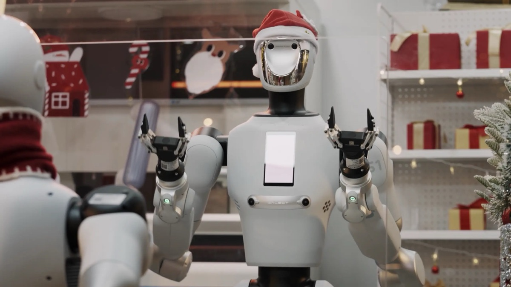
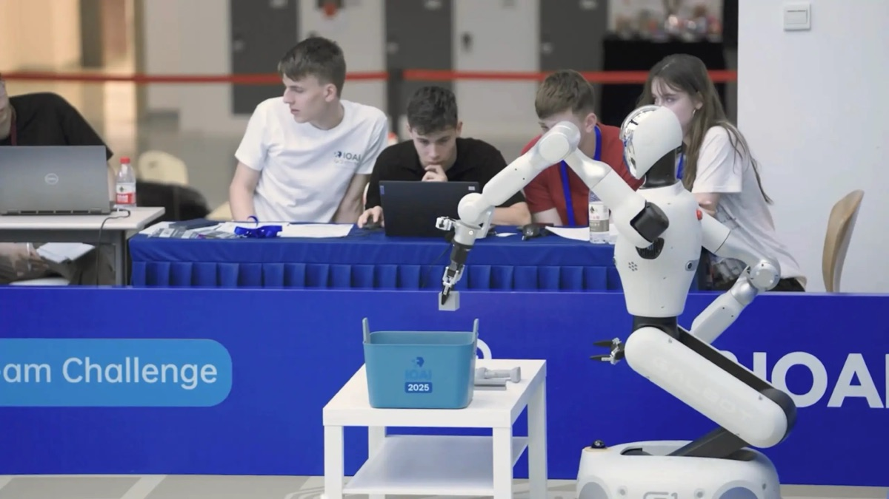
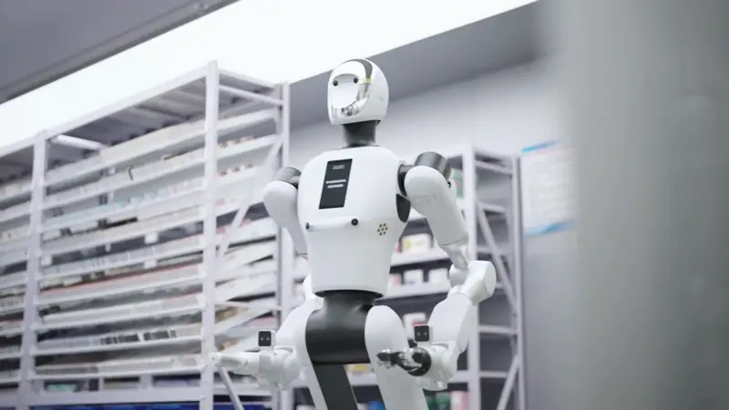
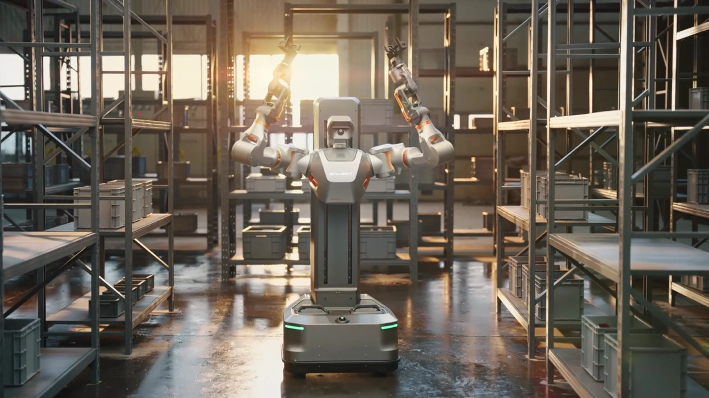
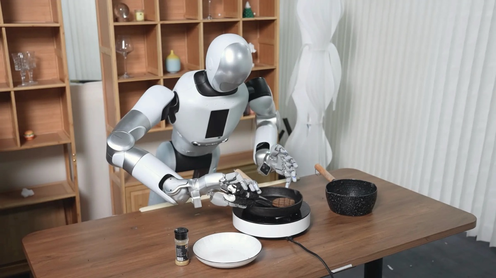

# Galbot × T03 — Products and Solutions

⬆ [Galbot profile](../Galbot.md) · [Brief](Galbot-T03-1-Brief.md) · [Playbook](Galbot-T03-3-Playbook.md)

**Bottom line:** Galbot has **no product, pilot or demo aimed at sustainability** (waste, energy, environment). What it does have is a mature indoor pick-sort-restock robot and an open grasping model. For T03 that means: you bring the sustainability logic, Galbot brings the hands.

## Relevant products (ranked for this track)

### Galbot G1

**Role in T03:** the manipulation station or indoor mobile worker: sorts recyclables or returned items into bins, audits and restocks shelves, moves light totes between stations.

| Track-relevant spec | Value (official G1 page) |
|---|---|
| Payload | **5 kg per arm**, 10 kg both arms |
| Reach | Arm length 710 mm; wrist workspace **0–2,100 mm vertical**, 1,900 mm horizontal (reaches floor-level bins and top shelves) |
| Base | 4-wheel omnidirectional, 600 × 600 mm footprint, max **1.5 m/s** |
| Runtime | **8 h** (48 V 30 Ah); **3.5 h** adapter charge |
| Environment | **IP54**, **0–40 °C**, 0–90% RH non-condensing: indoor, flat floor |
| Sensors | Head stereo camera · 4 torso RGB · 2 wrist depth cameras · **2 wrist 6-axis force sensors** · 3D LiDAR · 8 ultrasonic · 2 IMU |
| End effectors | Swappable gripper / suction cup / dexterous hand |
| Compute | NVIDIA AGX Orin 64 GB (275 TOPS) on board |
| Interaction | 5.5-inch touchscreen, 2 mic arrays, 2 speakers, Wi-Fi, emergency stop |

- **Status:** ✅ shipping. **Price:** not public. **On site:** most likely the robot Galbot brings (not confirmed).
- **Developer interface:** GalbotSDK V1.10.0 (C++ / Python, Ubuntu 20–24, robot environment V1.18). High-level control (built-in planning, navigation, whole-body motion) and low-level control (joints, base velocity, raw sensor streams), per the company profile. The README itself does not list individual APIs; the per-model docs ship inside the repo. Ask which level is unlocked on the hackathon units.

### GraspVLA / GroceryVLA / TrackVLA / NavFoM / UrbanVLA

**Role in T03:** the "pick anything" skill behind a sorting station. GraspVLA does open-vocabulary grasping from a text prompt, which is what mixed waste or mixed returns need.

| Item | Detail (GraspVLA repo) |
|---|---|
| Released | Model checkpoint and **SynGrasp-1B** synthetic dataset on Hugging Face; training framework (release note 2026-08-19); simulation playground and real-world control interface in separate repos |
| Inference cost | About **200 ms** latency and about **9 GB** GPU memory on one NVIDIA L40s with `--compile` (about 500 ms without) |
| Inputs | Two camera views + text instruction |
| Robot support in public code | Dataset loader supports a **Franka-format** dataset only; G1 port is not in the public repo |
| License | Badge indicates **CC BY-NC 4.0** ⚠️ unverified, check the LICENSE file |

- **Status:** ✅ GraspVLA open. GroceryVLA, TrackVLA, NavFoM: named by the company, public code not confirmed. UrbanVLA: public repo, aimed at outdoor micromobility navigation, not manipulation.
- **What you control:** a server that returns grasp poses / actions and 2D boxes; you wire it to the arm. On a G1, first ask whether Galbot's in-product grasp skill is exposed through the SDK, which would be faster than porting.

### Smart pharmacy / instant-retail warehouse solution

**Role in T03:** reference architecture, not a kit you can borrow. It proves the loop "order in → find item on shelf → pick → pack → hand out" and the inventory-check and restocking skills that a near-expiry audit or reuse shelf would copy.

| Item | Detail |
|---|---|
| Scale | 24/7 in **~100 instant-retail warehouses**, longest running **1.5+ years** (official G1 page) |
| Skills named | Picking, packing, outbound; in retail also inventory check and restocking |
| Latest | Regular operation in a Shanghai pharmacy store since **2026-09-28** (company news, via profile) |

- **Status:** ✅ operating in China. **Price:** not public. **Developer access:** the solution software is not offered as an open package (not public).

### Galbot S1

**Role in T03:** only if Galbot brings one (unlikely at 320 kg). It would be the heavy lifter for crates, battery modules or full recycling bins.

| Track-relevant spec | Value |
|---|---|
| Payload | **50 kg dual-arm** |
| Mass / reach | 320 kg; reach from floor to about 2.3–2.4 m (company page, via profile) |
| Energy | 2 × 48 V 30 Ah hot-swap batteries, **8 h**; cells supplied by CATL |
| Perception | Vision-only centimetre-level positioning, 360° obstacle avoidance (CATL statement) |

- **Status:** ✅ shipping, working in CATL module and pack lines. **Price:** not public. **Developer interface:** same GalbotSDK.

### AstraBrain

**Role in T03:** background only. It is the in-product model family (WAM / WBC / Dex / Agent). No sustainability-specific model exists, and the parts relevant here are not open beyond what is listed above.

**Low relevance for T03:** Galbot ET1 (small biped, interaction focus, no useful payload), Galbot G1 Lite (specs not public), Galbot Space Capsule (retail kiosk; only relevant as a template for an unattended reuse or deposit-return kiosk).

## What Galbot already does in this domain

**Nothing directly.** No waste-sorting, recycling, energy, EV-charging, environmental-monitoring or urban-farming deployment, pilot or demo was found in English or Chinese sources. Adjacent facts:

| Date | Fact | Relevance to T03 | Source |
|---|---|---|---|
| 2026 (site figures) | G1 runs 24/7 in ~100 instant-retail warehouses; Space Capsule kiosks at 170+ locations in 40+ cities | Proven autonomous picking and restocking of mixed items | [G1 page](http://www.galbot.com/g1/) |
| 2026 | G1 page lists "industrial manufacturing: sorting parts, moving materials, assembly, machine loading" as a use | Sorting is a stated use, no numbers given | [G1 page](http://www.galbot.com/g1/) |
| 2026-06-24 | CATL and Galbot sign a global strategic cooperation; S1 handles materials and picks parts in battery module and pack production | Battery manufacturing = energy-transition supply chain, but it is factory work, not a city service | [CnEVPost](https://cnevpost.com/2026/06/24/catl-galbot-scale-humanoid-robots-battery-factories/) |
| 2026-06-24 | Robots to join CATL's Ning Service network, which today covers inspection, maintenance and **recycling of power batteries** | Lifecycle service for the robots themselves; no statement that robots do the recycling | [CnEVPost](https://cnevpost.com/2026/06/24/catl-galbot-scale-humanoid-robots-battery-factories/) |
| 2026-03 | RMB 2.5B round with investors including **Sinopec** | Energy-sector shareholder; no joint project announced | [TechNode](https://technode.com/2026/08/27/how-far-are-robots-from-actually-working-on-production-lines-galbots-industrial-ai-journey/) |
| 2026-08 | S1 reported able to swap its own battery | Self-sufficient operation ⚠️ unverified (search summary only) | [TechRepublic](https://www.techrepublic.com/article/news-galbot-s1-humanoid-robot-battery/) |

## What they are building next in this domain

- 🧪 **"Material sorting" developer kit** for S1 and G1: import a material library, train a sorting model quickly, arrange the workflow. Listed as **coming soon**; no date. This is the closest thing to a T03 product.
- 🔭 **"Site inspection" developer kit** for G1 and S1: inspection routes, task flows, exception reporting. Listed as **planned**.
- 🧪 **Aftermarket service standard with CATL** for embodied-AI robots (maintenance and lifecycle).
- **Inference, not announced:** with CATL and Sinopec as shareholders, battery handling, energy-site inspection or service-station work are plausible future verticals. Nothing public confirms this.
- No sustainability or ESG programme, and no European service deployment, has been announced.

## Software, models and data that help for this track

| Asset | Use in a T03 build | Access |
|---|---|---|
| GalbotSDK V1.10.0 | Drive base, arms, grippers, read cameras and force sensors | Free tier, [GitHub](https://github.com/GalaxyGeneralRobotics/GalbotSDK) |
| G1 / S1 URDF, MJCF, USD | Rehearse bin layout and reach in MuJoCo or Isaac before touching the robot | Free tier, developer portal / GitHub |
| GraspVLA checkpoint + playground + real-world interface | Open-vocabulary grasping for mixed items | Open, [PKU-EPIC/GraspVLA](https://github.com/PKU-EPIC/GraspVLA) |
| SynGrasp-1B | Synthetic grasp data, only useful if you fine-tune (unrealistic in 48 h) | Hugging Face |
| On-board AGX Orin 64 GB | Run a detector or small VLM locally; an external GPU laptop is safer for GraspVLA (about 9 GB VRAM) | On robot |
| Welcome / guide kit (live) | Voice and screen interaction for explaining the sorting result to visitors | Paid tiers on the portal; ask what is unlocked on site |

## Gaps and limits for this track

- **No domain track record**: zero public waste, energy or environment references. Judges will see a retail robot repurposed.
- **Indoor only**: wheeled base, IP54, 0–40 °C. No streets, snow, stairs or slopes in Leukerbad.
- **5 kg per arm**: fine for bottles, cans, cartons and small e-waste; not for full bins, crates or wet heavy waste.
- **Dirty, wet, deformable items** (food waste, films, textiles) are outside what the retail stack is shown doing.
- **No environmental sensors** (gas, particulates, thermal camera, water quality). Add them over USB or pair with another vendor.
- **Sorting kit not released**; grasp skill on the G1 depends on what the on-site team exposes. Public GraspVLA code is Franka-format.
- **One 92.5 kg robot is not "low-power"**: do not claim energy savings for the robot itself; claim them for the waste or resources it saves.
- **Paid tiers** (online simulation, one-click deployment, remote debugging) cost CNY 50k–200k per robot per year; assume free-tier tools only unless Galbot says otherwise.

## Sources
- [Galbot G1 product page](http://www.galbot.com/g1/)
- [Galbot S1 product page](http://www.galbot.com/s1/) (via company profile)
- [Galbot developer portal (kits and tiers)](https://developer.galbot.com/?lang=en)
- [GalbotSDK README](https://raw.githubusercontent.com/GalaxyGeneralRobotics/GalbotSDK/HEAD/README.md)
- [GraspVLA repository (PKU-EPIC)](https://github.com/PKU-EPIC/GraspVLA)
- [GraspVLA paper (arXiv 2505.03233)](https://arxiv.org/abs/2505.03233)
- [CnEVPost, 2026-06-24: CATL teams with Galbot](https://cnevpost.com/2026/06/24/catl-galbot-scale-humanoid-robots-battery-factories/)
- [TechNode, 2026-08-27: Galbot's industrial AI journey](https://technode.com/2026/08/27/how-far-are-robots-from-actually-working-on-production-lines-galbots-industrial-ai-journey/)
- [TechRepublic: Galbot S1 battery swap](https://www.techrepublic.com/article/news-galbot-s1-humanoid-robot-battery/) (search result summary only)
- [Galbot company profile in this repo](../Galbot.md)
