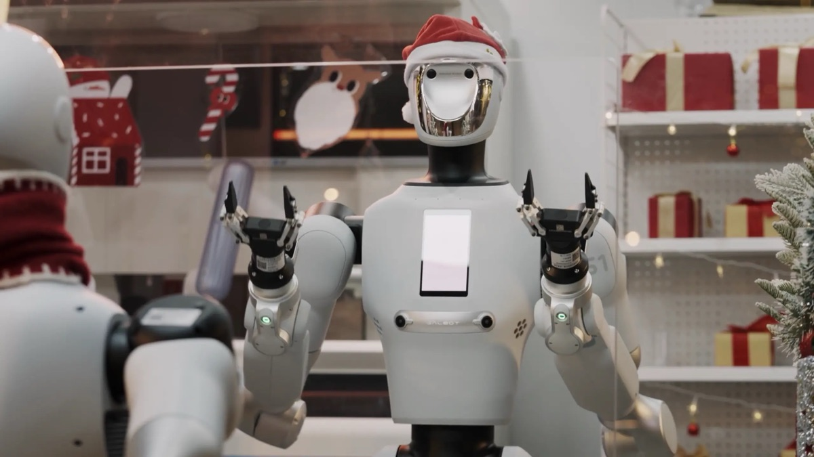
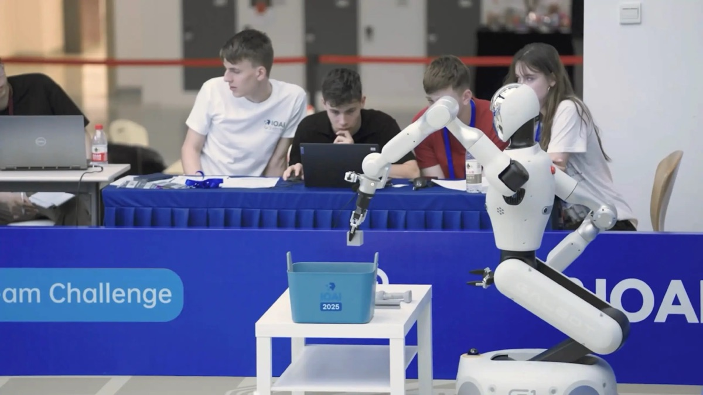
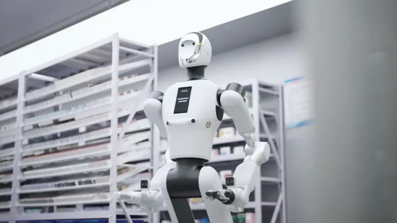
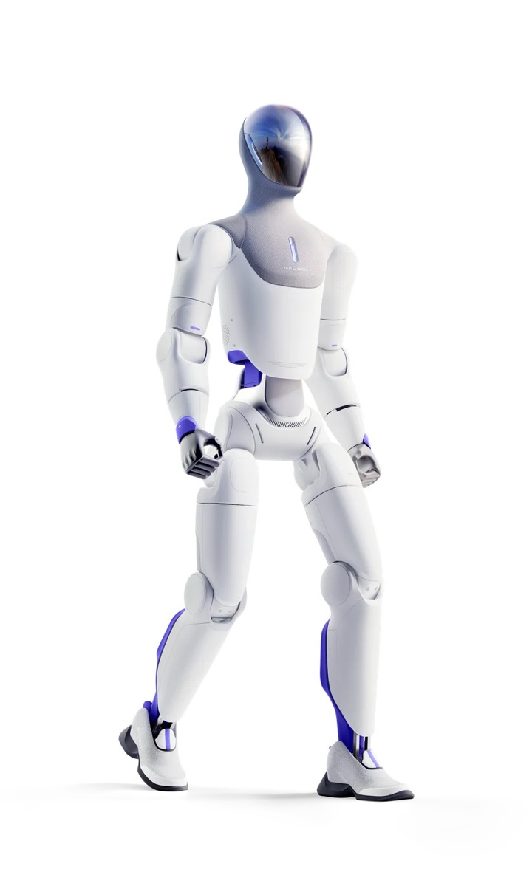

# Galbot × T04 — Products and Solutions

⬆ [Galbot profile](../Galbot.md) · [Brief](Galbot-T04-1-Brief.md) · [Playbook](Galbot-T04-3-Playbook.md)

**Bottom line:** Galbot has a strong, proven *medication and item picking* stack and no documented elderly-care or rehabilitation product. For T04 it is a fetch, deliver and hand-over platform. Which robot is actually on site is not confirmed (G1 is the best guess).

## Relevant products (ranked for this track)

### Galbot G1

**Role in T04:** the mobile "care aide" that fetches medication, drinks or dropped objects and hands them to a person; also a mobile sensor platform for night rounds.

| Track-relevant spec | Value (official G1 page via company profile) |
|---|---|
| Payload | **5 kg per arm / 10 kg both arms** |
| Arms | 2 x 7 DoF; 21 DoF in total incl. waist, lift and neck |
| Vertical wrist reach | **0-2,100 mm** (floor to high shelf) |
| Height / weight | max **1,730 mm** / **92.5 kg** |
| Base | 4-wheel omnidirectional, up to **1.5 m/s** |
| Runtime | **8 h**, 3.5 h charge |
| Sensing | 3D LiDAR, stereo head camera, 4 torso RGB, 2 wrist depth cameras, **2 wrist 6-axis force/torque sensors** |
| End effectors | Swappable gripper / suction cup / dexterous hand |
| Compute | NVIDIA AGX Orin 64 GB on board |
| Environment | **IP54, 0-40 °C**, indoor flat floors |
| Safety certification for personal care (e.g. ISO 13482) | not public |

- **Status:** ✅ shipping. **Price:** not public. **On site:** likely, not confirmed.
- **Developer interface (GalbotSDK V1.10.0, Python and C++):** the repo's G1 examples cover
  - navigation: go to goal, waypoints, follow trajectory, velocity control, relocalisation, stop
  - arm motion: IK / FK, collision-aware motion planning with obstacles you add, straight-line moves, joint trajectories, torso / leg height
  - end effectors: gripper, suction cup, dexterous hand state and commands
  - sensing: cameras (incl. synced observations and video stream), LiDAR, IMU, ultrasonic, odometry, **force-sensor data**, battery
  - interaction and safety: audio example, **emergency stop and resume**
  - tutorials: arm manipulation, navigation, sensor data collection, **execute VLA**, **pick and place**
- A compliance / impedance control mode is not confirmed from the public file list ⚠️ unverified. Assume position control plus force *reading*.

### GraspVLA and task models (GroceryVLA, TrackVLA, NavFoM)

**Role in T04:** open-vocabulary grasping ("bring me the blue pill box") without per-object training.

| Item | Value |
|---|---|
| Open release | ✅ checkpoint on Hugging Face, model server, SynGrasp-1B dataset, simulation playground, real-world controller repo |
| Inference cost | ~**200 ms** per step with ~**9 GB** GPU memory (measured on an NVIDIA L40s, with compile option) |
| Inputs | Two camera views + language instruction |
| Training embodiment | Franka-format data; transfer to the G1 arm is not documented ⚠️ unverified |
| Licence | CC BY-NC 4.0 badge (fine for a hackathon, not for commercial use) |
| GroceryVLA / TrackVLA / NavFoM | Named by the company; public code not confirmed. Ask whether they are preloaded on the robot |

- **Practical note:** run GraspVLA on a laptop or workstation GPU over the LAN. Whether it runs fast enough on the G1's Orin is not public.

### Smart pharmacy / instant-retail warehouse solution

**Role in T04:** the closest thing Galbot has to a care application; proof that G1 can pick the *right* medicine reliably.

| Item | Value |
|---|---|
| Tasks | Order handling, shelf picking, visual check, packing, drop into pickup cabinet, restocking, inventory |
| Scale | **100+ instant-retail warehouses**, 7x24, longest running 1.5+ years (company site) |
| Shanghai Laobaixing store (Sep 2026) | **400-500 orders/day**, ~**68 s** per order, 10,000+ recognisable products (company data via The Paper) |
| Beijing Haidian store (Mar 2026) | ~70 m², ~**5,000 SKUs**, ~99.5% grasp success reported (CGTN) |

- **Status:** ✅ operating in China. **Price:** not public. **Availability at the hackathon:** the turnkey solution will not be on site; treat it as a reference design. Whether its picking software is exposed through the SDK is not public.

### Galbot ET1

**Role in T04:** possible companion / exercise-demonstrator robot if one is on site. Supporting role only.

| Item | Value (official ET1 page) |
|---|---|
| Size | **1,250 mm**, **32 kg** with battery |
| DoF | 26 (Standard); 38 with dexterous hands (Pro / Flagship) |
| Sensors | Stereo camera; microphones / speakers not listed |
| Compute | RK3588 + D-Robotics RDK X5; Orin Nano (Pro) or Orin NX (Flagship) |
| Positioning | Theme-park interaction, shop greeting, stage shows. No home, care or education use stated |
| Runtime, payload, languages, price | not public |

- **Status:** ✅ pre-orders since 2026-09-03 (JD.com). **Developer access for ET1:** the SDK badge lists G1, S1 and G3, not ET1 ⚠️ unverified. A biped near frail people adds fall risk; keep it at a distance.

### Not relevant for T04
- **Galbot S1** (320 kg factory robot), **Space Capsule** (retail kiosk), **G1 Lite** (no public specs).

## What Galbot already does in this domain

**Direct elderly-care or rehabilitation deployments: none found.** What exists is adjacent (pharmacy, hospital pilots):

| Date | What | Evidence level |
|---|---|---|
| Early 2025 | First humanoid "smart pharmacy" with Neptunus (海王星辰), Beijing | Reported by The Paper |
| Aug 2025 | Gold in a hospital-scenario medicine-sorting event, World Humanoid Robot Games | Search summary only ⚠️ unverified |
| 2026-03-12 | G1 running a 24/7 drugstore in Haidian, Beijing; pharmacists keep prescription review and medication guidance | [CGTN](https://news.cgtn.com/news/2026-03-13/China-s-first-pharmacy-robot-goes-into-service-in-Beijing-1LtZ7juLcZ2/p.html) |
| 2026-09 | G1 in regular operation at Laobaixing Pharmacy, Hongcao Road, Shanghai | [The Paper](https://m.thepaper.cn/newsDetail_forward_34179567) |
| Undated | Hospital pilots (wards, pharmacy, guidance) with large Chinese hospitals; Xuanwu Hospital and West China Hospital are named in secondary sources | No hospital-side confirmation, no scale or dates ⚠️ unverified |
| Undated | Robots "being applied" in community day-care centres and elderly-care institutions, with chronic-disease and rehab-assistance use cases | One press article, no named site ⚠️ unverified |

- No deployment in Europe or Switzerland found. No rehabilitation device, exoskeleton or therapy product.

## What they are building next in this domain

- **Pharmacy expansion** is the stated priority: better night-time service and fully unattended 24-hour operation (The Paper, Sep 2026).
- **Pharmacies as community "health stations"** is a policy direction cited in the same coverage. *Inference:* this is the most likely bridge from retail to chronic-disease and elderly services.
- **Interaction robots:** ET1 ("agent-native") and the open RoboGesture research (co-speech gestures) point to companionship-style interaction. *Inference*; no care product announced.
- **Household skills:** trade-fair demos (WAIC 2026, headline mentions breakfast making) and garment-folding research suggest a move toward home tasks. Details not read in full ⚠️ unverified.
- **No announced** elderly-care product line, care-sector partner in Europe, or medical-device certification plan.

## Software, models and data that help for this track

| Asset | Use in a 48-hour care build | Access |
|---|---|---|
| [GalbotSDK](https://github.com/GalaxyGeneralRobotics/GalbotSDK) V1.10.0 | Navigation, arm planning, grippers, sensors, audio, e-stop; pick-and-place and VLA tutorials | Free; needs robot environment V1.18 |
| G1 URDF / MJCF / USD + `galbot_one_golf_description` | Rehearse reach and hand-over poses in simulation before robot time | Free, Apache-2.0 (description package) |
| [GraspVLA](https://github.com/PKU-EPIC/GraspVLA) | Language-conditioned grasping of unseen objects | Open weights, CC BY-NC 4.0 |
| `galbot-mcap2lerobot` | Convert G1 MCAP recordings to LeRobot v2.1 for quick imitation-learning fine-tunes | MIT |
| RoboGesture (ECCV 2026) | Speech-synchronised gestures for a friendlier humanoid | MIT; target robot not checked ⚠️ unverified |
| HumanTracker dataset | ~153 h of human motion incl. 89 h "daily" motions; reference for exercise-motion work | Hugging Face; humanoid tracking benchmark, not a rehab dataset |
| Developer portal "welcome / guide" L2 kit | Ready greeting and guiding behaviour | Listed as live; tier needed not confirmed |

## Gaps and limits for this track

- **No physical assistance:** 5 kg arms cannot lift, transfer or steady a person.
- **No certified human-contact use:** no public personal-care safety certification; 92.5 kg robot moving at up to 1.5 m/s near frail people needs speed limits and a human on the e-stop.
- **No rehab or medical product:** no therapy protocols, no clinical evidence, no health-data tooling.
- **Force control unclear:** F/T data is readable; compliant control through the SDK is not confirmed.
- **Speech stack unclear:** an audio example exists; built-in ASR / TTS languages (German, French, English) are not public. Plan your own.
- **Indoor only:** no stairs, thresholds, snow or slopes; lifts and doors need help.
- **Access uncertainty:** paid portal tiers gate online simulation and remote debugging; what the on-site team unlocks is unknown.
- **Care-domain claims are thin:** hospital and care-institution mentions come from secondary or company-fed press.

## Sources
- [Galbot company profile (this repo)](../Galbot.md)
- [Galbot G1 product page](http://www.galbot.com/g1/)
- [Galbot ET1 product page](http://www.galbot.com/et1/)
- [Galbot developer portal](https://developer.galbot.com/?lang=en)
- [GalbotSDK (GitHub, README and G1 example tree)](https://github.com/GalaxyGeneralRobotics/GalbotSDK)
- [GitHub org GalaxyGeneralRobotics (repo list)](https://github.com/GalaxyGeneralRobotics)
- [GraspVLA code (PKU-EPIC)](https://github.com/PKU-EPIC/GraspVLA)
- [GraspVLA paper (arXiv 2505.03233)](https://arxiv.org/abs/2505.03233)
- [HumanTracker (GitHub)](https://github.com/GalaxyGeneralRobotics/HumanTracker)
- [CGTN, 2026-03-13: China's first pharmacy robot goes into service in Beijing](https://news.cgtn.com/news/2026-03-13/China-s-first-pharmacy-robot-goes-into-service-in-Beijing-1LtZ7juLcZ2/p.html)
- [The Paper, 2026-09-30: G1 at Laobaixing Pharmacy, Shanghai](https://m.thepaper.cn/newsDetail_forward_34179567)
- [Gasgoo: WAIC 2026, Galbot multi-scenario showcase](https://autonews.gasgoo.com/articles/news/waic-2026-making-breakfast-selling-goods-galbot-showcases-multi-scenario-capabilities-2079095839749283841) (headline only, page not readable)
